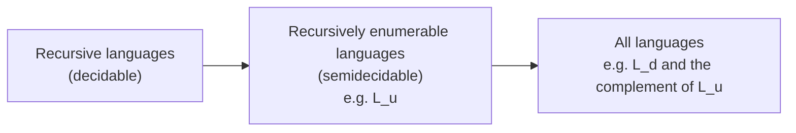
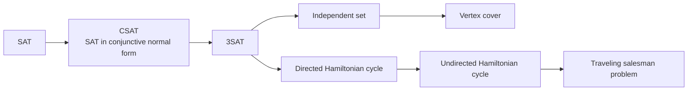

The previous chapter ([4.8.10](/4.8.10)) showed that **Turing machines** can simulate any reasonable model of computation; by the **Church–Turing thesis** they capture the full power of "algorithms". This chapter answers two questions. The first is computability: are there problems for which no algorithm exists at all? The answer is yes, and such problems are not rare: deciding whether a program halts, or whether two context-free grammars are equivalent, are examples. The core of the proof is Cantor's diagonal method together with reductions, which transform one problem into another. The second question is complexity: among the problems that do have algorithms, which can be solved efficiently (in polynomial time)? This leads to the classes $\mathrm{P}$ and $\mathrm{NP}$, and to a large family of mutually equivalent NP-complete problems for which it is still unknown whether polynomial-time algorithms exist. Section [4.3.1](/4.3.1) already mentioned $\mathrm{P}$, $\mathrm{NP}$, and the subset sum problem; here we give their precise definitions on Turing machines.

## 11.1. Problems and Languages

Section [1.1.4](/1.1.4) discussed the **decision problem** of predicate logic: is there a mechanical method that decides, for every formula, whether it is universally valid? In general, a decision problem consists of infinitely many instances, and the answer to each instance is "yes" or "no". Encode the instances as strings over some **alphabet**; the encodings of the instances whose answer is "yes" form a language, and the decision problem is the membership problem of this language. For example, "is a given graph connected" corresponds to the language $\{\langle G\rangle \mid G \text{ is a connected graph}\}$, where $\langle G\rangle$ is some encoding of the graph $G$ (for example, the adjacency matrix written row by row as a string of 0's and 1's). As long as the encoding is reasonable (convertible into another by a **Turing machine**), the decidability and complexity of the problem do not depend on the choice of encoding. Hence "problem" and "language" can be used interchangeably, just as a predicate and the set it defines.

**Definition 11.1.1 (Decidable Problem)** A problem is called **decidable** if the corresponding language is recursive; otherwise it is called an **undecidable problem**. If the corresponding language is recursively enumerable, the problem is called semidecidable.

A decidable problem is answered by a Turing machine that always halts, that is, there is an algorithm; a semidecidable problem has only a Turing machine that is sure to halt and accept when the answer is "yes".

## 11.2. The Diagonalization Language and the Universal Language

### 11.2.1. Encoding Turing Machines

To let a **Turing machine** handle problems about Turing machines, we first write Turing machines as strings. Without loss of generality we consider only Turing machines with input **alphabet** $\{0, 1\}$, and we stipulate:
- the states are $q_1, q_2, \dots, q_r$, the start state is $q_1$, and the only final state is $q_2$ (we have assumed that a Turing machine halts upon entering a final state, so one final state suffices);
- the tape symbols are $X_1, X_2, \dots, X_s$, where $X_1 = 0$, $X_2 = 1$, $X_3 = B$;
- the direction $\mathrm{L}$ is written $D_1$ and $\mathrm{R}$ is written $D_2$.

A transition $\delta(q_i, X_j) = (q_k, X_l, D_m)$ is encoded as $0^i10^j10^k10^l10^m$. All segments are nonempty, so no two 1's are adjacent in it. The encoding of a Turing machine is formed from the encodings $C_1, \dots, C_n$ of all its transitions joined by $11$: $C_1\,11\,C_2\,11 \cdots 11\,C_n$. A Turing machine has several encodings (different orders of the transitions), which does not matter. The pair of a Turing machine $M$ and an input string $w$ is encoded as $\langle M, w\rangle = C\,111\,w$, where $C$ is the encoding of $M$; $111$ does not occur in the encoding, so the first $111$ is the boundary.

**Example 11.2.1** The transitions and encodings of the Turing machine $M = (\{q_1, q_2, q_3\}, \{0, 1\}, \{0, 1, B\}, \delta, q_1, B, \{q_2\})$ are

| Transition | Encoding |
|---|---|
| $\delta(q_1, 1) = (q_3, 0, \mathrm{R})$ | $0100100010100$ |
| $\delta(q_3, 0) = (q_1, 1, \mathrm{R})$ | $0001010100100$ |
| $\delta(q_3, 1) = (q_2, 0, \mathrm{R})$ | $00010010010100$ |
| $\delta(q_3, B) = (q_3, 1, \mathrm{L})$ | $0001000100010010$ |

The encoding of $M$ is the string formed by joining these four segments with $11$.

Next we number the strings in $\{0, 1\}^*$: the string $w$ is the $i$-th string if and only if $1w$ is the binary representation of $i$. Thus $w_1 = \varepsilon$, $w_2 = 0$, $w_3 = 1$, $w_4 = 00$, and so on; every string has exactly one number, and this is the ordering by length and then by **lexicographic order**. If $w_i$ is the encoding of a Turing machine, call this machine $M_i$; if $w_i$ is not a valid encoding, let $M_i$ be the Turing machine without any transitions, so that $L(M_i) = \varnothing$. This gives a sequence $M_1, M_2, M_3, \dots$ containing all Turing machines, and both "the $i$-th Turing machine" and "the $i$-th string" are meaningful.

There are only as many Turing machines as a **countable set**, whereas there are $2^{\aleph_0}$ languages over $\{0, 1\}$ (by **Cantor's theorem** the power set of $\{0, 1\}^*$ is uncountable), so most languages are not recursively enumerable. We now construct a concrete example.

### 11.2.2. The Diagonalization Language

**Definition 11.2.1 (Diagonalization Language)** The **diagonalization language** is $L_{\mathrm{d}} = \{w_i \mid w_i \notin L(M_i)\}$, the set of strings not accepted by "the Turing machine that has them as its encoding".

Imagine an infinite table whose entry in row $i$ and column $j$ records whether $w_j \in L(M_i)$; row $i$ is then the characteristic vector of $L(M_i)$. $L_{\mathrm{d}}$ is obtained by complementing the values on the diagonal (row $i$, column $i$), so it differs from every row on the diagonal:

| | $w_1$ | $w_2$ | $w_3$ | $w_4$ | $\cdots$ |
|---|---|---|---|---|---|
| $M_1$ | 0 | 1 | 1 | 0 | |
| $M_2$ | 1 | 1 | 0 | 0 | |
| $M_3$ | 0 | 0 | 1 | 1 | |
| $M_4$ | 0 | 1 | 0 | 1 | |
| $\vdots$ | | | | | $\ddots$ |
| $L_{\mathrm{d}}$ | 1 | 0 | 0 | 0 | |

**Theorem 11.2.1** $L_{\mathrm{d}}$ is not a **recursively enumerable language**.

**Proof** Suppose a Turing machine $M$ satisfies $L(M) = L_{\mathrm{d}}$. $M$ occurs in the sequence; say $M = M_k$. Consider $w_k$: if $w_k \in L_{\mathrm{d}}$, then by definition $w_k \notin L(M_k) = L_{\mathrm{d}}$; if $w_k \notin L_{\mathrm{d}}$, then $w_k \notin L(M_k)$, and by definition $w_k \in L_{\mathrm{d}}$. Both cases are contradictory. $\square$

### 11.2.3. Complement

**Theorem 11.2.2** If $L$ is a **recursive language**, so is $\overline{L}$.

**Proof** Let $M$ halt on every input with $L(M) = L$. Construct $\overline{M}$: make the final state of $M$ non-final (with no transitions on it); add a new final state $r$; for every non-final state $q$ of $M$ and tape symbol $X$, if $\delta(q, X)$ is undefined, let $\delta(q, X) = (r, X, \mathrm{R})$. When $M$ accepts, $\overline{M}$ halts in a non-final state; when $M$ halts in a non-final state, $\overline{M}$ moves to $r$ and accepts. $\overline{M}$ also always halts, and $L(\overline{M}) = \overline{L}$. $\square$

**Theorem 11.2.3** If both $L$ and $\overline{L}$ are recursively enumerable languages, then $L$ is a recursive language.

**Proof** Let $L = L(M_1)$ and $\overline{L} = L(M_2)$. Construct a two-tape Turing machine $M$ that alternately simulates the computations of $M_1$ and $M_2$ on the input $w$, one step each at a time; if $M_1$ accepts, $M$ accepts, and if $M_2$ accepts, $M$ halts and rejects. Every $w$ belongs to one of $L$ and $\overline{L}$, so exactly one of $M_1$, $M_2$ eventually accepts, $M$ always halts, and $L(M) = L$. $\square$

Hence for any language $L$ there are only three possibilities for $L$ and $\overline{L}$: both are recursive; one is recursively enumerable but not recursive and the other is not recursively enumerable; neither is recursively enumerable.

### 11.2.4. The Universal Turing Machine and the Universal Language

**Definition 11.2.2 (Universal Language)** The **universal language** is $L_{\mathrm{u}} = \{\langle M, w\rangle \mid w \in L(M)\}$.

**Theorem 11.2.4** There is a Turing machine $U$ with $L(U) = L_{\mathrm{u}}$. Such a $U$ is called a *universal Turing machine*.

**Proof** Construct $U$ as a multitape Turing machine and then convert it to one tape by Theorem 10.3.1. The first tape holds the input $\langle M, w\rangle$; the second tape simulates the tape of $M$, with the symbol $X_j$ written as $0^j$ and adjacent symbols separated by 1; the third tape holds the current state $q_i$ of $M$, written $0^i$; the fourth tape is a scratch tape.
1. Check whether the encoding on the first tape is valid (correctly formed, and no two transitions begin with the same $0^i10^j$); otherwise halt and reject.
2. Copy $w$ to the second tape in the format above, write $0$ (state $q_1$) on the third tape, and place the head of the second tape on the first simulated cell.
3. Simulate one step: the third tape holds $0^i$ and the head of the second tape is over $0^j$; look on the first tape for a transition $0^i10^j10^k10^l10^m$ beginning with $0^i10^j1$. If none is found, halt and reject ($M$ halts); if one is found, change the third tape to $0^k$, replace $0^j$ on the second tape by $0^l$ (when the lengths differ, shift the content on the right using the scratch tape), and then move the head to the adjacent cell on the left or right according to $m$.
4. If the third tape holds $0^2$ ($M$ has entered the final state $q_2$), accept; otherwise return to step 3.

$U$ accepts $\langle M, w\rangle$ if and only if $M$ accepts $w$. $\square$

A **universal Turing machine** is an interpreter: the program (the encoding of $M$) and the data ($w$) lie on the same tape, which is precisely the idea of the stored-program computer. The following program is its Python version: it encodes the Turing machine of Example 11.2.1 as a string of 0's and 1's, and the "universal machine" then decodes and runs it.

```python
# Encoding: states q1, q2, ... (q1 start, q2 the only final state);
# tape symbols X1 = 0, X2 = 1, X3 = B; directions D1 = L, D2 = R.
# delta(q_i, X_j) = (q_k, X_l, D_m) is coded as 0^i 1 0^j 1 0^k 1 0^l 1 0^m, joined by "11".
SYM, DIR = {1: "0", 2: "1", 3: "B"}, {1: "L", 2: "R"}

def encode(rules):
    inv = {v: k for k, v in SYM.items()}
    dirs = {v: k for k, v in DIR.items()}
    return "11".join("1".join("0" * n for n in (i, inv[X], k, inv[Y], dirs[D]))
                     for (i, X), (k, Y, D) in rules.items())

def decode(code):
    rules = {}
    for part in code.split("11"):
        i, j, k, l, m = (len(z) for z in part.split("1"))
        rules[i, SYM[j]] = (k, SYM[l], DIR[m])
    return rules

def universal(code_and_input, max_steps=1000):
    # input of U: code(M) 111 w
    code, w = code_and_input.split("111", 1)
    delta = decode(code)
    tape, q, head = dict(enumerate(w)), 1, 0
    for _ in range(max_steps):
        if q == 2:
            return "accept"
        key = (q, tape.get(head, "B"))
        if key not in delta:
            return "reject (halts)"
        q, tape[head], D = delta[key]
        head += 1 if D == "R" else -1
    return "no answer yet"

rules = {(1, "1"): (3, "0", "R"), (3, "0"): (1, "1", "R"),
         (3, "1"): (2, "0", "R"), (3, "B"): (3, "1", "L")}
code = encode(rules)
print(code)
assert decode(code) == rules
for w in ["", "0", "1", "10", "11", "101", "1011"]:
    print(f"{w!r:7}", universal(code + "111" + w))
```

```text
01001000101001100010101001001100010010010100110001000100010010
''      reject (halts)
'0'     reject (halts)
'1'     no answer yet
'10'    reject (halts)
'11'    accept
'101'   no answer yet
'1011'  accept
```

On the input $1$, $M$ goes back and forth between $q_1$ and $q_3$ with the head moving ever to the right, and never halts. The simulation program can only give up at the step limit and cannot conclude that "it will never halt". The next theorem shows that this is not because the program is not clever enough.

**Theorem 11.2.5** $L_{\mathrm{u}}$ is a recursively enumerable language but not a recursive language.

**Proof** By Theorem 11.2.4, $L_{\mathrm{u}}$ is recursively enumerable. Suppose $L_{\mathrm{u}}$ were recursive; by Theorem 11.2.2 so is $\overline{L_{\mathrm{u}}}$, say accepted by a Turing machine $M$ that always halts. Construct a Turing machine $M'$: on an input $w = w_i$, first check whether $w$ is a valid encoding of a Turing machine. If not, then $L(M_i) = \varnothing$, $w_i \in L_{\mathrm{d}}$, and $M'$ accepts immediately. If it is, rewrite the input as $w\,111\,w$, that is, $\langle M_i, w_i\rangle$, and run $M$; then

$$
w_i \in L(M') \iff \langle M_i, w_i\rangle \notin L_{\mathrm{u}} \iff w_i \notin L(M_i) \iff w_i \in L_{\mathrm{d}}.
$$
Together the two cases give $L(M') = L_{\mathrm{d}}$, contradicting Theorem 11.2.1. $\square$

**Corollary 11.2.1** $\overline{L_{\mathrm{u}}}$ is not a recursively enumerable language.

**Proof** Otherwise, by Theorem 11.2.3, $L_{\mathrm{u}}$ would be a recursive language. $\square$

The relations among the classes of languages are as follows:



## 11.3. Reductions and Undecidable Problems

### 11.3.1. Reductions

In proving that $L_{\mathrm{u}}$ is undecidable we actually transformed the problem of $L_{\mathrm{d}}$ into the problem of $L_{\mathrm{u}}$. We generalize this device:

**Definition 11.3.1 (Reduction)** Let $P_1$ and $P_2$ be two problems (languages). If there is a Turing machine that always halts and transforms every instance $w$ of $P_1$ into an instance $f(w)$ of $P_2$ such that $w \in P_1$ if and only if $f(w) \in P_2$, then $P_1$ is said to **reduce** to $P_2$, written $P_1 \le P_2$.

**Theorem 11.3.1** Let $P_1 \le P_2$.
1. If $P_2$ is decidable, so is $P_1$; if $P_2$ is semidecidable, so is $P_1$.
2. If $P_1$ is undecidable, so is $P_2$; if $P_1$ is not recursively enumerable, neither is $P_2$.

**Proof** For an instance $w$ of $P_1$, first compute $f(w)$ and then run the Turing machine recognizing $P_2$. If the latter always halts, so does the whole procedure; it accepts $f(w)$ if and only if $w \in P_1$. Part 2 is the contrapositive of part 1. $\square$

The direction of the reduction is crucial: to show that $P_2$ is hard, we reduce a problem $P_1$ known to be hard to $P_2$, not $P_2$ to $P_1$.

### 11.3.2. The Halting Problem

**Definition 11.3.2 (Halting Problem)** The **halting problem**: given a Turing machine $M$ and an input $w$, decide whether $M$ halts on $w$. The corresponding language is $L_{\mathrm{H}} = \{\langle M, w\rangle \mid M \text{ halts on input } w\}$.

**Theorem 11.3.2** The halting problem is undecidable; $L_{\mathrm{H}}$ is a **recursively enumerable language**.

**Proof** Simulating the computation of $M$ on $w$ and accepting when it halts gives a Turing machine accepting $L_{\mathrm{H}}$, so $L_{\mathrm{H}}$ is recursively enumerable.

Next we prove $L_{\mathrm{u}} \le L_{\mathrm{H}}$. Given $\langle M, w\rangle$, construct $M'$: $M'$ is the same as $M$, except that for every configuration in which $M$ halts in a non-final state ($\delta(q, X)$ undefined and $q \notin F$), $M'$ moves to a new state in which it moves right forever. Then $M'$ halts on $w$ if and only if $M$ accepts $w$. The transformation $\langle M, w\rangle \mapsto \langle M', w\rangle$ merely rewrites the **transition table** mechanically and can be carried out by a **Turing machine** that always halts. By Theorem 11.2.5 and Theorem 11.3.1, $L_{\mathrm{H}}$ is not a recursive language. $\square$

In the language of programs, the undecidability of the halting problem can be explained directly by the diagonal method. Suppose there is a function `halts(p, x)` that, for every program `p` and input `x`, returns in finite time whether `p(x)` halts. Consider

```python
def paradox(p):
    if halts(p, p):      # would p halt when given its own text?
        while True:      # then loop forever
            pass
    return               # otherwise halt
```

`paradox(paradox)` halts if and only if `halts(paradox, paradox)` is false, that is, if and only if `paradox(paradox)` does not halt. The contradiction shows that `halts` does not exist. Program analysis tools (type checking, dead-code detection, malware recognition) can therefore only approximate: they either miss cases, or raise false alarms, or do not guarantee termination.

### 11.3.3. Questions About the Languages of Turing Machines

Consider two languages: $L_{\mathrm{e}} = \{\langle M\rangle \mid L(M) = \varnothing\}$ and $L_{\mathrm{ne}} = \{\langle M\rangle \mid L(M) \ne \varnothing\}$ (here $\langle M\rangle$ ranges over all strings of 0's and 1's, and an invalid encoding is regarded as a Turing machine with $L(M) = \varnothing$, so the two are complementary).

**Theorem 11.3.3** $L_{\mathrm{ne}}$ is recursively enumerable but not a **recursive language**; $L_{\mathrm{e}}$ is not recursively enumerable.

**Proof** $L_{\mathrm{ne}}$ is accepted by a nondeterministic Turing machine: it guesses a string $w$, then simulates the computation of $M$ on $w$ with the universal Turing machine, and accepts if $M$ accepts. By Theorem 10.3.3, $L_{\mathrm{ne}}$ is recursively enumerable.

Next we prove $L_{\mathrm{u}} \le L_{\mathrm{ne}}$. Given $\langle M, w\rangle$, construct $M'$: whatever its own input $x$ is, $M'$ first erases $x$ and writes $w$, and then simulates the computation of $M$ on $w$, accepting if $M$ accepts. Then $L(M') = \Sigma^*$ (if $w \in L(M)$) or $\varnothing$ (if $w \notin L(M)$), that is, $\langle M'\rangle \in L_{\mathrm{ne}}$ if and only if $\langle M, w\rangle \in L_{\mathrm{u}}$. So $L_{\mathrm{ne}}$ is not recursive. Finally, $L_{\mathrm{e}} = \overline{L_{\mathrm{ne}}}$; if it were recursively enumerable, then by Theorem 11.2.3 $L_{\mathrm{ne}}$ would be recursive. $\square$

This proof extends to almost any property of the languages of Turing machines.

**Definition 11.3.3 (Nontrivial Property)** A **property** of recursively enumerable languages is a set $\mathcal{P}$ of recursively enumerable languages (all the languages having the property). If $\mathcal{P}$ is neither empty nor the set of all recursively enumerable languages, it is called a **nontrivial property**.

Note that a property concerns languages and not Turing machines: of two Turing machines accepting the same language, either both have the property or neither does. Write $L_{\mathcal{P}} = \{\langle M\rangle \mid L(M) \in \mathcal{P}\}$.

**Theorem 11.3.4 (Rice's Theorem)** Every nontrivial property of the recursively enumerable languages is undecidable: if $\mathcal{P}$ is nontrivial, then $L_{\mathcal{P}}$ is not a recursive language.

**Proof** First suppose $\varnothing \notin \mathcal{P}$. By nontriviality there is an $L \in \mathcal{P}$; let a Turing machine $M_L$ accept $L$. We prove $L_{\mathrm{u}} \le L_{\mathcal{P}}$: given $\langle M, w\rangle$, construct $M'$, which on input $x$ first simulates the computation of $M$ on $w$ (using another tape), and if $M$ accepts $w$, then simulates the computation of $M_L$ on $x$, accepting if $M_L$ accepts. Then

$$
L(M') = \begin{cases} L, & w \in L(M), \\ \varnothing, & w \notin L(M), \end{cases}
$$
and $\langle M'\rangle \in L_{\mathcal{P}}$ if and only if $\langle M, w\rangle \in L_{\mathrm{u}}$, so $L_{\mathcal{P}}$ is not recursive.

If $\varnothing \in \mathcal{P}$, consider the complementary property $\overline{\mathcal{P}}$ (all recursively enumerable languages not having the property), which is nontrivial with $\varnothing \notin \overline{\mathcal{P}}$; by the previous paragraph $L_{\overline{\mathcal{P}}}$ is not recursive. Since $L_{\overline{\mathcal{P}}} = \overline{L_{\mathcal{P}}}$, by Theorem 11.2.2 $L_{\mathcal{P}}$ is not recursive either. $\square$

**Example 11.3.1** By **Rice's theorem**, the following problems are all undecidable: given a Turing machine $M$, whether $L(M)$ is empty, whether it is finite, whether it is a **regular language**, whether it is a context-free language, whether it contains some fixed string, whether it equals $\Sigma^*$. By contrast, "does $M$ have 5 states" and "will $M$ write a 1 in its first 100 steps on input $\varepsilon$" are questions about the Turing machine itself and not properties of the language, Rice's theorem does not apply, and they are obviously decidable.

## 11.4. Post's Correspondence Problem

The undecidable problems so far were all about **Turing machines**. Post's correspondence problem is a purely combinatorial problem about strings, and it is the bridge for proving that problems in other areas (such as **grammars**) are undecidable.

### 11.4.1. Definition and Examples

**Definition 11.4.1 (Post's Correspondence Problem)** An instance of **Post's correspondence problem** (PCP) consists of two lists of strings of equal length, $A = (w_1, \dots, w_k)$ and $B = (x_1, \dots, x_k)$, over the same alphabet $\Sigma$. If there is a nonempty sequence of indices $i_1, i_2, \dots, i_m$ ($m \ge 1$, indices may repeat) with

$$
w_{i_1}w_{i_2}\cdots w_{i_m} = x_{i_1}x_{i_2}\cdots x_{i_m},
$$
the instance is said to have a solution, and the sequence is called a solution. PCP asks whether a given instance has a solution.

Each pair $(w_i, x_i)$ can be imagined as a "domino" with two rows, an unlimited supply of each kind of domino being available, and the question is whether one can lay out a row of dominoes such that the strings spelled by the top and bottom rows are the same.

**Example 11.4.1** $\Sigma = \{0, 1\}$,

| $i$ | $w_i$ | $x_i$ |
|---|---|---|
| 1 | $1$ | $111$ |
| 2 | $10111$ | $10$ |
| 3 | $10$ | $0$ |

The sequence $2, 1, 1, 3$ is a solution: $w_2w_1w_1w_3 = 10111 \cdot 1 \cdot 1 \cdot 10 = 101111110$, and $x_2x_1x_1x_3 = 10 \cdot 111 \cdot 111 \cdot 0 = 101111110$. The instance $A = (10, 011, 101)$, $B = (101, 11, 011)$, on the other hand, has no solution: the first domino can only be number 1 (dominoes 2 and 3 differ in their first symbols), and then the bottom row exceeds the top row by $1$; the following domino must match this extra $1$ and what follows in the bottom row, and checking one by one shows that only domino 3 can be used, after which the bottom row still has an extra $1$ and can never be caught up.

When a solution exists, a search keyed on "which of the two rows overhangs, and by how much" will find it:

```python
from collections import deque

# Search PCP solutions breadth-first by the "overhang": after choosing indices,
# one of the two concatenations must be a prefix of the other; only the excess matters.
def pcp(A, B, max_len=12):
    queue = deque([((), "", "")])      # (indices, excess of top, excess of bottom)
    seen = set()
    while queue:
        seq, top, bot = queue.popleft()
        if len(seq) >= max_len:
            continue
        for i, (w, x) in enumerate(zip(A, B), start=1):
            t, b = top + w, bot + x
            k = min(len(t), len(b))
            if t[:k] != b[:k]:
                continue                   # the two strings already disagree
            t, b = t[k:], b[k:]
            if t == b == "":
                return seq + (i,)
            if (t, b) in seen:
                continue                   # same overhang reached by a shorter sequence
            seen.add((t, b))
            queue.append((seq + (i,), t, b))
    return None

A, B = ["1", "10111", "10"], ["111", "10", "0"]
s = pcp(A, B)
print("solution:", s, "".join(A[i - 1] for i in s), "".join(B[i - 1] for i in s))
print("no solution up to length 12:", pcp(["10", "011", "101"], ["101", "11", "011"]))
```

```text
solution: (2, 1, 1, 3) 101111110 101111110
no solution up to length 12: None
```

The search can give an affirmative answer only when it finds a solution, so PCP is semidecidable. The "overhang" may grow without bound, and in general the search does not stop when there is no solution.

### 11.4.2. Undecidability of PCP

**Theorem 11.4.1** Post's correspondence problem is undecidable.

**Proof** (outline) There are two steps. First we introduce the modified PCP (MPCP), which requires that a solution begin with domino 1.

Step 1, $L_{\mathrm{u}} \le \text{MPCP}$. Given a Turing machine $M$ (which may be assumed to have a **semi-infinite tape** and never write $B$, Theorem 10.4.1) and an input $w$, construct dominoes such that in every partial match beginning with domino 1 the bottom row is always ahead of the top row by the next ID of $M$, and the only way to catch up is to copy this ID in the top row while writing its successor in the bottom row. Use $\#$ to separate IDs:
1. Domino 1: top $\#$, bottom $\#\,q_0w\,\#$;
2. Copying: for every tape symbol $X$ the domino $(X, X)$, and also $(\#, \#)$;
3. Transitions: $\delta(q, X) = (p, Y, \mathrm{R})$ gives $(qX, Yp)$; $\delta(q, X) = (p, Y, \mathrm{L})$ gives $(ZqX, pZY)$ for every tape symbol $Z$; when the head is at a blank at the right end, $X = B$, giving $(q\#, Yp\#)$ and $(Zq\#, pZY\#)$ correspondingly;
4. Finishing: for a final state $q$ and tape symbols $X, Y$, the dominoes $(XqY, q)$, $(Xq, q)$, $(qY, q)$, which let the final state gradually "eat" the symbols on both sides; and finally $(q\#\#, \#)$.

Induction on the number of steps of the computation shows: the MPCP instance has a solution if and only if $M$ can reach a final state starting from $q_0w$, that is, $w \in L(M)$.

Step 2, $\text{MPCP} \le \text{PCP}$. Take $*$ and $\diamond$ not in the **alphabet**. For every pair $(w_i, x_i)$ of the MPCP instance, put $*$ after every symbol of $w_i$ and $*$ before every symbol of $x_i$ to get $(w_i', x_i')$; then add a starting domino $(*w_1', x_1')$ and an ending domino $(\diamond, *\diamond)$. The starting domino is the only one whose top and bottom begin with the same symbol, so every solution must begin with it, which enforces the condition of MPCP.

By Theorem 11.2.5 and Theorem 11.3.1, PCP is undecidable. $\square$

### 11.4.3. Undecidable Problems About Context-Free Grammars

Section 9.3.3 of [4.8.9](/4.8.9) listed several undecidable problems about **context-free grammars**, which we now prove using PCP. Let the PCP instance be $A = (w_1, \dots, w_k)$, $B = (x_1, \dots, x_k)$, take $k$ new symbols $a_1, \dots, a_k$ not in $\Sigma$ as index symbols, and define the grammar

$$
G_A\colon\ A \to w_1Aa_1 \mid \cdots \mid w_kAa_k \mid w_1a_1 \mid \cdots \mid w_ka_k,
$$
and $G_B$ similarly (with $x_i$ and the variable $B$). The strings of $L_A = L(G_A)$ have the form $w_{i_1}\cdots w_{i_m}a_{i_m}\cdots a_{i_1}$: the index symbols at the end record, in reverse order, the strings used, so $G_A$ is unambiguous, and likewise $L_B$.

**Theorem 11.4.2** It is undecidable whether a context-free grammar is ambiguous.

**Proof** Construct $G$ with $S \to A \mid B$ together with the productions of $G_A$ and $G_B$. Since $G_A$ and $G_B$ are each unambiguous, a string has two parse trees in $G$ if and only if it lies in both $L_A$ and $L_B$, that is, if there is an index sequence $i_1, \dots, i_m$ with $w_{i_1}\cdots w_{i_m} = x_{i_1}\cdots x_{i_m}$. Hence PCP $\le$ "is a CFG ambiguous", and by Theorem 11.4.1 the latter is undecidable. $\square$

**Theorem 11.4.3** The following problems are all undecidable ($G_1$, $G_2$ are context-free grammars and $R$ is a **regular expression**):
1. whether $L(G_1) \cap L(G_2)$ is empty;
2. whether $L(G_1) = \Sigma^*$;
3. whether $L(G_1) = L(G_2)$; whether $L(G_1) \subseteq L(G_2)$;
4. whether $L(G_1) = L(R)$; whether $L(R) \subseteq L(G_1)$.

**Proof** 1: $L_A \cap L_B \ne \varnothing$ if and only if the PCP instance has a solution. 2: $\overline{L_A}$ is a context-free language ($L_A$ can be recognized by a deterministic pushdown automaton and the deterministic context-free languages are closed under complement; a grammar can also be written down directly), so $\overline{L_A} \cup \overline{L_B}$ is a context-free language, and it equals the universal language $(\Sigma \cup \{a_1, \dots, a_k\})^*$ if and only if $L_A \cap L_B = \varnothing$, that is, if the PCP has no solution. 3, 4: taking $G_2$ or $R$ to be a grammar or regular expression generating the universal language, problem 2 is a special case of them. $\square$

## 11.5. P and NP

Among decidable problems, difficulty still varies enormously. Complexity theory classifies problems by the resources (time, space) needed to solve them.

### 11.5.1. Time Complexity and the Class P

**Definition 11.5.1 (Time Complexity of a Turing Machine)** If a Turing machine $M$ halts (whether accepting or not) within at most $T(n)$ steps on every input of length $n$, then the **time complexity** of $M$ is said to be $T(n)$. The time complexity of a nondeterministic Turing machine is $T(n)$ if, on every input of length $n$, every computation path halts within at most $T(n)$ steps.

**Definition 11.5.2 (Class P)** If there are a polynomial $T(n)$ and a deterministic Turing machine $M$ of time complexity $T(n)$ with $L = L(M)$, then $L$ belongs to the **class P**, written $L \in \mathrm{P}$.

By Sections 10.3.1 and 10.5 of [4.8.10](/4.8.10), the simulations among one-tape **Turing machines**, **multitape Turing machines**, and **random-access machines** cost only a polynomial factor, so $\mathrm{P}$ does not depend on which model is chosen; polynomials are closed under composition and addition, so a polynomial-time algorithm calling polynomial-time subroutines is still polynomial-time. These two facts make $\mathrm{P}$ the standard of "efficiently solvable" (the Cobham–Edmonds thesis). Graph connectivity, shortest paths, minimum spanning trees, linear programming, and primality testing all belong to $\mathrm{P}$.

### 11.5.2. The Class NP

**Definition 11.5.3 (Class NP)** If there are a polynomial $T(n)$ and a nondeterministic Turing machine $M$ of time complexity $T(n)$ with $L = L(M)$, then $L$ belongs to the **class NP**, written $L \in \mathrm{NP}$.

NP stands for nondeterministic polynomial, not "non-polynomial". A deterministic Turing machine is a special case of a **nondeterministic Turing machine**, so $\mathrm{P} \subseteq \mathrm{NP}$. NP has an equivalent, more intuitive characterization: every instance with answer "yes" has a short "certificate", and the certificate can be verified quickly.

**Theorem 11.5.1** $L \in \mathrm{NP}$ if and only if there are a polynomial $p$ and a polynomial-time deterministic Turing machine $V$ (called a verifier) such that

$$
w \in L \iff \text{there is } c,\ \lvert c\rvert \le p(\lvert w\rvert),\ \text{such that } V \text{ accepts } w\#c.
$$

**Proof** Let a nondeterministic Turing machine $M$ accept $L$ in time $T(n)$ with at most $m$ choices per step. Take the certificate $c$ to be the sequence of choices at each step along an accepting path (a string of length $T(n)$ over $\{1, \dots, m\}$); $V$ simulates $M$ deterministically following the choices specified by $c$, taking time $O(T(n))$. Conversely, given $V$ and $p$, a nondeterministic Turing machine first guesses on its tape a $c$ of length at most $p(n)$, and then runs $V$; the total time is polynomial. $\square$

**Example 11.5.1** The following problems belong to $\mathrm{NP}$, with the certificates as indicated:
- given an **undirected graph**, does it have a **Hamiltonian cycle**: the certificate is a permutation of the vertices, and we check that adjacent vertices (including the last and the first) are joined by edges;
- given an undirected graph and an integer $k$, are there $k$ pairwise nonadjacent vertices (the independent set problem): the certificate is these $k$ vertices;
- given a propositional formula, is it a **satisfiable formula**: the certificate is a truth assignment, and substituting and evaluating suffices;
- given positive integers $a_1, \dots, a_n, t$, is there a subset whose sum is exactly $t$ (the subset sum problem, see [4.3.1](/4.3.1)): the certificate is this subset.

The only deterministic algorithms known for these problems are exhaustive search in exponential time (for example, enumerating $2^n$ truth assignments); in general, by the simulation of Theorem 10.3.3, every problem in $\mathrm{NP}$ can be solved deterministically in time $2^{O(p(n))}$. Whether $\mathrm{P} = \mathrm{NP}$ is the most important open problem of theoretical computer science, and it is widely believed that $\mathrm{P} \ne \mathrm{NP}$: finding a solution seems to be inherently harder than checking one.

### 11.5.3. Polynomial-Time Reductions

**Definition 11.5.4 (Polynomial-Time Reduction)** If the transformation $f$ of Definition 11.3.1 can be computed by a polynomial-time deterministic Turing machine, then $P_1$ is said to reduce to $P_2$ by a **polynomial-time reduction**, written $P_1 \le_{\mathrm{p}} P_2$.

**Theorem 11.5.2** Let $P_1 \le_{\mathrm{p}} P_2$. If $P_2 \in \mathrm{P}$, then $P_1 \in \mathrm{P}$; if $P_2 \in \mathrm{NP}$, then $P_1 \in \mathrm{NP}$. The relation $\le_{\mathrm{p}}$ is transitive.

**Proof** Let $f$ be computable in time $p(n)$; then $\lvert f(w)\rvert \le p(\lvert w\rvert)$ (a Turing machine writes at most one symbol per step). If $P_2$ is decided by a Turing machine of time $q(n)$, then computing $f(w)$ and then deciding takes time $p(n) + q(p(n))$, still polynomial; the case of NP is the same. Transitivity: the composition of two polynomial-time transformations is still polynomial-time. $\square$

## 11.6. NP-Completeness

### 11.6.1. NP-Complete and NP-Hard Problems

**Definition 11.6.1 (NP-Complete)** A problem $P$ is called **NP-complete** if
1. $P \in \mathrm{NP}$;
2. $P' \le_{\mathrm{p}} P$ for every $P' \in \mathrm{NP}$.

A problem satisfying only condition 2 is called **NP-hard**.

The NP-complete problems are the "hardest" problems in NP:

**Theorem 11.6.1** If $P_1$ is NP-complete, $P_2 \in \mathrm{NP}$, and $P_1 \le_{\mathrm{p}} P_2$, then $P_2$ is NP-complete.

**Proof** For any $P' \in \mathrm{NP}$, $P' \le_{\mathrm{p}} P_1 \le_{\mathrm{p}} P_2$, and transitivity gives $P' \le_{\mathrm{p}} P_2$. $\square$

**Theorem 11.6.2** If some NP-complete problem belongs to $\mathrm{P}$, then $\mathrm{P} = \mathrm{NP}$.

**Proof** Let an NP-complete problem $P \in \mathrm{P}$. For any $P' \in \mathrm{NP}$, $P' \le_{\mathrm{p}} P$, and Theorem 11.5.2 gives $P' \in \mathrm{P}$. $\square$

So either all NP-complete problems have polynomial-time algorithms, or none does. Theorem 11.6.1 gives the standard method of proving a new problem NP-complete: show that it belongs to NP, and reduce a known NP-complete problem to it by a **polynomial-time reduction**. But this requires a first NP-complete problem.

### 11.6.2. The Cook–Levin Theorem

**Definition 11.6.2 (Satisfiability Problem)** The **Boolean satisfiability problem** (SAT): given a propositional formula built from variables, $\lnot$, $\land$, $\lor$, and parentheses, decide whether it is a **satisfiable formula**, that is, whether there is a truth assignment making it true.

For example $x \land \lnot(y \lor z)$ is satisfiable ($x$ true, $y, z$ false), and $x \land \lnot x$ is not. When encoding formulas, a variable is written as $x$ followed by a binary subscript, so the encoding length of a formula with $n$ variables is $\Omega(n\log n)$, which does not affect polynomial bounds.

**Theorem 11.6.3 (Cook–Levin Theorem)** SAT is NP-complete.

**Proof** (outline) SAT $\in \mathrm{NP}$: guess an assignment and evaluate.

Now we prove $L \le_{\mathrm{p}} \text{SAT}$ for every $L \in \mathrm{NP}$. Let a one-tape **nondeterministic Turing machine** $M$ accept $L$ in time $p(n)$; we may assume that $M$ stays in place after entering a final state (so that the accepting ID can be repeated indefinitely) and that the head never moves left of its initial position (Theorem 10.4.1). A computation of $M$ on an input $w$ ($\lvert w\rvert = n$) can be written as a $(p(n) + 1) \times (p(n) + 1)$ table: row $i$ is the ID after step $i$, with the state written as a symbol before the scanned cell and padded with $B$ where needed. Within $p(n)$ steps the head moves at most to cell $p(n)$, so the width is sufficient.

For every position $(i, j)$ and every symbol $X$ (a tape symbol or a state) introduce a propositional variable $y_{i,j,X}$, meaning "cell $j$ of row $i$ of the table is $X$". Construct the formula $E_{M,w} = U \land S \land N \land F$:
- $U$ (uniqueness): every cell has exactly one symbol; for each $(i, j)$, $\bigvee_X y_{i,j,X}$, and for each pair $X \ne X'$, $\lnot(y_{i,j,X} \land y_{i,j,X'})$;
- $S$ (start): row 0 is the initial ID $q_0w$ followed by some $B$'s, that is, a conjunction of several variables;
- $N$ (transition): adjacent rows conform to some transition of $M$. A transition changes only the cells near the state symbol, so "row $i + 1$ is obtained from row $i$ by one step" is equivalent to: for each $j$, the contents of cells $j - 1, j, j + 1$ of row $i$ and of cell $j$ of row $i + 1$ form a combination allowed by $M$. The allowed combinations are determined by $M$ and there are only constantly many, so the constraint at each position is a formula of constant size;
- $F$ (accepting): some final state occurs in the last row, $\bigvee_j \bigvee_{q \in F} y_{p(n),j,q}$.

$E_{M,w}$ is satisfiable if and only if there is a legal table, that is, if $M$ has a computation accepting $w$. $E_{M,w}$ has $O(p(n)^2)$ parts of constant size, the variable subscripts are written in binary, so the encoding length is $O(p(n)^2\log p(n))$, and a deterministic **Turing machine** can write it out part by part from $w$ in polynomial time. Hence $w \mapsto E_{M,w}$ is a polynomial-time reduction from $L$ to SAT. $\square$

Cook (1971) and Levin (1973) proved this theorem independently. Afterwards Karp (1972) used reductions to prove 21 combinatorial problems NP-complete, and NP-completeness became the universal tool for judging the difficulty of problems.

### 11.6.3. Typical NP-Complete Problems

Starting from SAT, the chain of reductions in the diagram below shows that a series of problems are NP-complete. We give the proofs of the first few steps.



**Theorem 11.6.4** CSAT (SAT restricted to formulas in **conjunctive normal form**) is NP-complete.

**Proof** (outline) Using the distributive law to turn a formula into an equivalent conjunctive normal form may blow up the size exponentially (for example, the conjunctive normal form of $(x_1 \land y_1) \lor \cdots \lor (x_n \land y_n)$ has $2^n$ clauses), so we cannot do this directly. We need only a transformation that preserves satisfiability: for every subformula $\varphi$ of the formula introduce a new variable $z_\varphi$, express the relation between $z_\varphi$ and its immediate subformulas by a constant number of clauses (for example, for $\varphi = \psi \land \chi$, write the conjunctive normal form of $z_\varphi \leftrightarrow (z_\psi \land z_\chi)$), and finally add the clause $z_E$. The resulting conjunctive normal form has size proportional to the original formula and is satisfiable if and only if the original formula is (the Tseitin transformation). In fact the $E_{M,w}$ in the proof of the Cook–Levin theorem can be written directly in conjunctive normal form. $\square$

**Theorem 11.6.5** 3SAT (CSAT in which every **clause** contains exactly three literals) is NP-complete.

**Proof** 3SAT $\in \mathrm{NP}$ is clear. Reduce CSAT to 3SAT: treat every clause $(l_1 \lor \cdots \lor l_k)$ according to its length.
- $k = 1$: introduce new variables $u, v$ and replace it by $(l_1 \lor u \lor v) \land (l_1 \lor u \lor \lnot v) \land (l_1 \lor \lnot u \lor v) \land (l_1 \lor \lnot u \lor \lnot v)$; the four clauses are simultaneously true if and only if $l_1$ is true.
- $k = 2$: introduce a new variable $u$ and replace it by $(l_1 \lor l_2 \lor u) \land (l_1 \lor l_2 \lor \lnot u)$.
- $k = 3$: unchanged.
- $k > 3$: introduce new variables $y_1, \dots, y_{k-3}$ and replace it by

  $$
  (l_1 \lor l_2 \lor y_1) \land (\lnot y_1 \lor l_3 \lor y_2) \land (\lnot y_2 \lor l_4 \lor y_3) \land \cdots \land (\lnot y_{k-3} \lor l_{k-1} \lor l_k).
  $$
  If some $l_j$ in the original clause is true, let the $y$'s before $j$ be true and those after it false, and every new clause is satisfied; conversely, if all $l_j$ are false, then starting from the first clause we deduce successively that $y_1, y_2, \dots, y_{k-3}$ must all be true, and the last clause is false.

The replacement of each clause preserves satisfiability only over the new variables, and the size grows linearly. $\square$

**Theorem 11.6.6** The independent set problem (given an **undirected graph** $G$ and an integer $k$, are there $k$ pairwise nonadjacent vertices) is NP-complete.

**Proof** It belongs to NP (Example 11.5.1). Reduce 3SAT to it: let the formula have $m$ clauses. For each of the three literals of each clause build a vertex, and join the three vertices of the same clause pairwise (a triangle); then join complementary literals ($x$ and $\lnot x$) in different clauses; take $k = m$.

If the formula is satisfiable, fix a satisfying assignment and choose in each clause one literal that is true; these $m$ vertices come from different triangles and contain no complementary pair (complementary literals cannot both be true), so they form an independent set. Conversely, an independent set of size $m$ takes exactly one vertex from each triangle and contains no complementary literals, so we can make these literals true (other variables arbitrary), and every clause is satisfied. The construction is clearly polynomial-time. $\square$

The following program verifies this reduction on randomly generated small formulas: a formula is satisfiable if and only if the constructed graph has an independent set whose size is the number of clauses.

```python
import random
from itertools import combinations, product

# A 3-CNF formula is a list of clauses; a literal is +v or -v for variable v >= 1.
def satisfiable(clauses, n):
    return any(all(any((lit > 0) == bits[abs(lit) - 1] for lit in c) for c in clauses)
               for bits in product([False, True], repeat=n))

def to_independent_set(clauses):
    # one vertex per literal occurrence; triangle inside each clause,
    # and an edge between complementary literals in different clauses
    nodes = [(j, lit) for j, c in enumerate(clauses) for lit in c]
    edges = {(u, v) for u, v in combinations(nodes, 2)
             if u[0] == v[0] or u[1] == -v[1]}
    return nodes, edges, len(clauses)

def has_independent_set(nodes, edges, k):
    return any(all((u, v) not in edges and (v, u) not in edges
                   for u, v in combinations(S, 2))
               for S in combinations(nodes, k))

random.seed(0)
agree = 0
for trial in range(300):
    n, m = random.randint(2, 4), random.randint(1, 6)
    clauses = [[random.choice([1, -1]) * v for v in random.sample(range(1, n + 1), min(3, n))]
               for _ in range(m)]
    agree += satisfiable(clauses, n) == has_independent_set(*to_independent_set(clauses))
print(f"{agree}/300 random formulas: satisfiable <=> independent set of size m")
```

```text
300/300 random formulas: satisfiable <=> independent set of size m
```

**Theorem 11.6.7** The vertex cover problem (given an undirected graph $G = (V, E)$ and an integer $k$, are there at most $k$ vertices such that every edge has at least one endpoint among them) is NP-complete.

**Proof** Membership in NP is clear. $S$ is an independent set if and only if no edge has both endpoints in $S$, if and only if every edge has at least one endpoint in $V \setminus S$, that is, $V \setminus S$ is a vertex cover. So $(G, k) \mapsto (G, \lvert V\rvert - k)$ is a reduction from the independent set problem to the vertex cover problem. $\square$

**Theorem 11.6.8** The directed Hamiltonian cycle problem, the undirected **Hamiltonian cycle** problem, and the **traveling salesman problem** (given a weighted complete graph and a bound $B$, is there a Hamiltonian cycle of total weight at most $B$) are all NP-complete.

**Proof** (outline) The reduction from 3SAT to the directed Hamiltonian cycle problem builds for each variable a "chain" that can be traversed to the left or to the right (the two directions correspond to true and false), and builds a vertex for each clause, which can be visited on the way only when some chain is traversed in a direction that makes the clause true; the details are long and omitted here. Directed to undirected: split each vertex $v$ into three vertices $v_{\mathrm{in}} - v_{\mathrm{mid}} - v_{\mathrm{out}}$, and replace a directed edge $u \to v$ by the undirected edge $u_{\mathrm{out}}v_{\mathrm{in}}$; the middle vertex forces the cycle to pass in the order in, mid, out. Undirected Hamiltonian cycle to the traveling salesman problem: given a graph $G$ on $n$ vertices, on the complete graph let the edges in $G$ have weight 1 and the others weight 2, and take $B = n$; a cycle of total weight at most $n$ can use only edges of $G$. $\square$

**Remark** Thousands of NP-complete problems are known, in graph theory, scheduling, cryptography, bioinformatics (such as some forms of multiple sequence alignment), and games. In practice, when facing an **NP-hard** problem, the usual ways out are: polynomial algorithms for special structures (such as matching in bipartite graphs), pseudo-polynomial algorithms (**dynamic programming** for subset sum), approximation algorithms, parameterized algorithms, and efficient heuristic solvers (modern SAT solvers handle industrial instances with millions of variables). Two other common misunderstandings: NP-hard does not mean "undecidable", since every problem in NP can be solved in exponential time; and the **halting problem** is NP-hard yet entirely undecidable, so an NP-hard problem need not belong to NP.

## Summary

| Topic | Key points |
|---|---|
| Problems and languages | Decision problem = membership problem of a language; decidable ⟺ recursive, semidecidable ⟺ recursively enumerable |
| **Diagonalization language** | $L_{\mathrm{d}} = \{w_i \mid w_i \notin L(M_i)\}$, not a **recursively enumerable language** (diagonal method) |
| **Universal language** | $L_{\mathrm{u}} = \{\langle M, w\rangle \mid w \in L(M)\}$, accepted by the **universal Turing machine**; recursively enumerable but not recursive, and its complement is not recursively enumerable |
| Complement | **Recursive languages** are closed under complement; $L$ and $\overline{L}$ both recursively enumerable ⟹ $L$ recursive |
| Reduction | $P_1 \le P_2$: $P_2$ decidable ⟹ $P_1$ decidable; reduce a known hard problem to the new problem |
| Undecidable problems | **Halting problem**; whether $L(M)$ is nonempty; **Rice's theorem**: every nontrivial property of the languages of Turing machines is undecidable |
| **PCP** | Domino matching; undecidable; implies the undecidability of ambiguity, emptiness of intersection, and equivalence for **CFG**s |
| P and NP | Polynomial time of deterministic / **nondeterministic Turing machines**; NP = certificates verifiable in polynomial time |
| **NP-complete** | In NP, and every problem in NP has a **polynomial-time reduction** to it; SAT (Cook–Levin) → CSAT → 3SAT → independent set, vertex cover, Hamiltonian cycle, traveling salesman |
