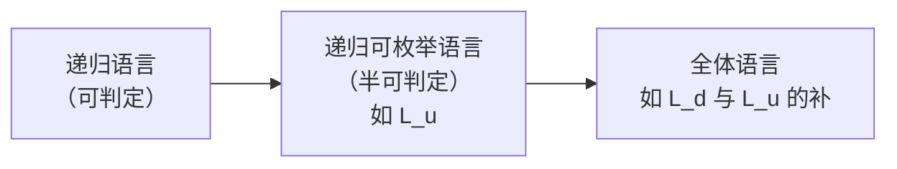
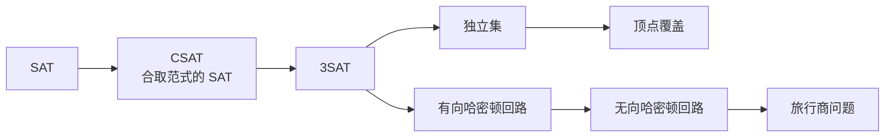

上一章（[4.8.10](/4.8.10)）说明**图灵机**能模拟任何合理的计算模型，由 **Church–Turing 论题**，它刻画了"算法"的全部能力。本章回答两个问题。第一是可计算性：有没有问题根本不存在算法？答案是肯定的，而且这类问题并不罕见——判定一个程序是否停机、两个上下文无关文法是否等价，都是如此。证明的核心是 Cantor 的对角线法，再加上把一个问题转化为另一个问题的归约。第二是复杂性：在有算法的问题中，哪些能有效地（在多项式时间内）解决？这引出 $\mathrm{P}$ 与 $\mathrm{NP}$ 两类问题，以及一大批彼此等价、至今不知道有没有多项式时间算法的 NP 完全问题。[4.3.1](/4.3.1) 已经初步提到 $\mathrm{P}$、$\mathrm{NP}$ 与子集和问题，本章给出它们在图灵机上的精确定义。

## 11.1. 问题与语言

[1.1.4](/1.1.4) 讨论过谓词逻辑的**判定问题**：是否存在一个机械的方法，对每个公式都能判定它是否普遍有效。一般地，一个判定问题由无穷多个实例组成，每个实例的答案是"是"或"否"。把实例编码成某个**字母表**上的串，答案为"是"的实例的编码构成一个语言；判定问题就是这个语言的成员问题。例如"给定的图是否连通"对应语言 $\{\langle G\rangle \mid G \text{ 是连通图}\}$，其中 $\langle G\rangle$ 是图 $G$ 的某种编码（如邻接矩阵按行写成 0、1 串）。只要编码是合理的（能用**图灵机**相互转换），问题的可判定性与复杂度就与编码的选取无关。因此"问题"与"语言"可以互换使用，就像谓词与它所定义的集合。

**定义 11.1.1（可判定问题）** 若一个问题对应的语言是递归语言，则称这个问题是**可判定的**；否则称它是**不可判定问题**。若对应的语言是递归可枚举语言，则称这个问题是半可判定的。

可判定的问题有一台总停机的图灵机给出答案，即存在算法；半可判定的问题只有一台在答案为"是"时一定停机并接受的图灵机。

## 11.2. 对角语言与通用语言

### 11.2.1. 图灵机的编码

要让**图灵机**处理关于图灵机的问题，先把图灵机写成串。不失一般性，只考虑输入**字母表**为 $\{0, 1\}$ 的图灵机，并约定：
- 状态为 $q_1, q_2, \dots, q_r$，开始状态是 $q_1$，唯一的终态是 $q_2$（我们已假定图灵机进入终态即停机，所以一个终态就够了）；
- 带符号为 $X_1, X_2, \dots, X_s$，其中 $X_1 = 0$，$X_2 = 1$，$X_3 = B$；
- 方向 $\mathrm{L}$ 记为 $D_1$，$\mathrm{R}$ 记为 $D_2$。

转移 $\delta(q_i, X_j) = (q_k, X_l, D_m)$ 编码为 $0^i10^j10^k10^l10^m$。各段都非空，所以其中没有两个相邻的 1。图灵机的编码是它的全部转移的编码 $C_1, \dots, C_n$ 用 $11$ 连接而成：$C_1\,11\,C_2\,11 \cdots 11\,C_n$。一台图灵机有多种编码（转移的排列顺序不同），这无关紧要。图灵机 $M$ 与输入串 $w$ 组成的偶对编码为 $\langle M, w\rangle = C\,111\,w$，其中 $C$ 是 $M$ 的编码；编码中不会出现 $111$，所以第一个 $111$ 就是分界。

**例 11.2.1** 图灵机 $M = (\{q_1, q_2, q_3\}, \{0, 1\}, \{0, 1, B\}, \delta, q_1, B, \{q_2\})$ 的转移与编码为

| 转移 | 编码 |
|---|---|
| $\delta(q_1, 1) = (q_3, 0, \mathrm{R})$ | $0100100010100$ |
| $\delta(q_3, 0) = (q_1, 1, \mathrm{R})$ | $0001010100100$ |
| $\delta(q_3, 1) = (q_2, 0, \mathrm{R})$ | $00010010010100$ |
| $\delta(q_3, B) = (q_3, 1, \mathrm{L})$ | $0001000100010010$ |

$M$ 的编码是这四段用 $11$ 连接起来的串。

接下来给 $\{0, 1\}^*$ 中的串编号：串 $w$ 是第 $i$ 个串，当且仅当 $1w$ 是 $i$ 的二进制表示。于是 $w_1 = \varepsilon$，$w_2 = 0$，$w_3 = 1$，$w_4 = 00$，……，每个串恰好有一个编号，这就是按长度、再按**字典序**的排列。若 $w_i$ 是某台图灵机的编码，记这台图灵机为 $M_i$；若 $w_i$ 不是合法的编码，令 $M_i$ 为没有任何转移的图灵机，$L(M_i) = \varnothing$。这样就得到一个包含所有图灵机的序列 $M_1, M_2, M_3, \dots$，"第 $i$ 台图灵机"与"第 $i$ 个串"都有了意义。

图灵机只有**可数集合**那么多，而 $\{0, 1\}$ 上的语言有 $2^{\aleph_0}$ 个（由 **Cantor 定理**，$\{0, 1\}^*$ 的幂集不可数），所以绝大多数语言都不是递归可枚举的。下面构造一个具体的例子。

### 11.2.2. 对角语言

**定义 11.2.1（对角语言）** **对角语言**是 $L_{\mathrm{d}} = \{w_i \mid w_i \notin L(M_i)\}$，即不被"以自己为编码的图灵机"接受的串的集合。

设想一张无穷的表格，第 $i$ 行第 $j$ 列记录 $w_j \in L(M_i)$ 是否成立，第 $i$ 行就是 $L(M_i)$ 的特征向量。$L_{\mathrm{d}}$ 由对角线（第 $i$ 行第 $i$ 列）上的值取反得到，因而与每一行都在对角线上不同：

| | $w_1$ | $w_2$ | $w_3$ | $w_4$ | $\cdots$ |
|---|---|---|---|---|---|
| $M_1$ | 0 | 1 | 1 | 0 | |
| $M_2$ | 1 | 1 | 0 | 0 | |
| $M_3$ | 0 | 0 | 1 | 1 | |
| $M_4$ | 0 | 1 | 0 | 1 | |
| $\vdots$ | | | | | $\ddots$ |
| $L_{\mathrm{d}}$ | 1 | 0 | 0 | 0 | |

**定理 11.2.1** $L_{\mathrm{d}}$ 不是**递归可枚举语言**。

**证明** 设有图灵机 $M$ 使 $L(M) = L_{\mathrm{d}}$。$M$ 出现在序列中，设 $M = M_k$。考察 $w_k$：若 $w_k \in L_{\mathrm{d}}$，由定义 $w_k \notin L(M_k) = L_{\mathrm{d}}$；若 $w_k \notin L_{\mathrm{d}}$，则 $w_k \notin L(M_k)$，由定义 $w_k \in L_{\mathrm{d}}$。两者都矛盾。$\square$

### 11.2.3. 补运算

**定理 11.2.2** 若 $L$ 是**递归语言**，则 $\overline{L}$ 也是递归语言。

**证明** 设 $M$ 在每个输入上都停机，$L(M) = L$。构造 $\overline{M}$：把 $M$ 的终态改为非终态（且其上没有转移）；增加新的终态 $r$；对 $M$ 的每个非终态 $q$ 和带符号 $X$，若 $\delta(q, X)$ 没有定义，则令 $\delta(q, X) = (r, X, \mathrm{R})$。$M$ 接受时 $\overline{M}$ 在非终态停机，$M$ 在非终态停机时 $\overline{M}$ 转入 $r$ 接受。$\overline{M}$ 也总停机，$L(\overline{M}) = \overline{L}$。$\square$

**定理 11.2.3** 若 $L$ 与 $\overline{L}$ 都是递归可枚举语言，则 $L$ 是递归语言。

**证明** 设 $L = L(M_1)$，$\overline{L} = L(M_2)$。构造双带图灵机 $M$，它交替地模拟 $M_1$ 与 $M_2$ 在输入 $w$ 上的计算，每次各走一步；$M_1$ 接受则 $M$ 接受，$M_2$ 接受则 $M$ 停机拒绝。任一 $w$ 属于 $L$ 或 $\overline{L}$ 之一，所以 $M_1$、$M_2$ 中恰有一个终将接受，$M$ 总停机，且 $L(M) = L$。$\square$

于是对任一语言 $L$，$L$ 与 $\overline{L}$ 只有三种可能：都是递归的；一个是递归可枚举而非递归的，另一个不是递归可枚举的；都不是递归可枚举的。

### 11.2.4. 通用图灵机与通用语言

**定义 11.2.2（通用语言）** **通用语言**是 $L_{\mathrm{u}} = \{\langle M, w\rangle \mid w \in L(M)\}$。

**定理 11.2.4** 存在图灵机 $U$ 使 $L(U) = L_{\mathrm{u}}$。这样的 $U$ 称为通用图灵机（universal Turing machine）。

**证明** 用多带图灵机构造 $U$，再由定理 10.3.1 化为单带。第一条带存放输入 $\langle M, w\rangle$；第二条带模拟 $M$ 的纸带，符号 $X_j$ 写成 $0^j$，相邻符号用 1 隔开；第三条带存放 $M$ 的当前状态 $q_i$，写成 $0^i$；第四条带作草稿。
1. 检查第一条带上的编码是否合法（形式正确，且没有两条转移以同一个 $0^i10^j$ 开头），否则停机拒绝。
2. 把 $w$ 按上述格式抄到第二条带，第三条带写 $0$（状态 $q_1$），第二条带的读写头指向第一个模拟单元格。
3. 模拟一步：第三条带上是 $0^i$，第二条带读写头下是 $0^j$，在第一条带上查找以 $0^i10^j1$ 开头的转移 $0^i10^j10^k10^l10^m$。找不到就停机拒绝（$M$ 停机）；找到了就把第三条带改为 $0^k$，把第二条带上的 $0^j$ 换成 $0^l$（长度不同时用草稿带平移右边的内容），再按 $m$ 把读写头移到左或右边相邻的单元格。
4. 若第三条带上是 $0^2$（$M$ 进入终态 $q_2$），则接受；否则回到第 3 步。

$U$ 接受 $\langle M, w\rangle$ 当且仅当 $M$ 接受 $w$。$\square$

**通用图灵机**就是一个解释器：程序（$M$ 的编码）与数据（$w$）放在同一条纸带上，这正是存储程序式计算机的思想。下面的程序是它的 Python 版本：把例 11.2.1 的图灵机编码成 0、1 串，再由"通用机"解码并运行。

```python
# Encoding: states q1, q2, ... (q1 start, q2 the only final state);
# tape symbols X1 = 0, X2 = 1, X3 = B; directions D1 = L, D2 = R.
# delta(q_i, X_j) = (q_k, X_l, D_m) is coded as 0^i 1 0^j 1 0^k 1 0^l 1 0^m, joined by "11".
SYM, DIR = {1: "0", 2: "1", 3: "B"}, {1: "L", 2: "R"}

def encode(rules):
    inv = {v: k for k, v in SYM.items()}
    dirs = {v: k for k, v in DIR.items()}
    return "11".join("1".join("0" * n for n in (i, inv[X], k, inv[Y], dirs[D]))
                     for (i, X), (k, Y, D) in rules.items())

def decode(code):
    rules = {}
    for part in code.split("11"):
        i, j, k, l, m = (len(z) for z in part.split("1"))
        rules[i, SYM[j]] = (k, SYM[l], DIR[m])
    return rules

def universal(code_and_input, max_steps=1000):
    # input of U: code(M) 111 w
    code, w = code_and_input.split("111", 1)
    delta = decode(code)
    tape, q, head = dict(enumerate(w)), 1, 0
    for _ in range(max_steps):
        if q == 2:
            return "accept"
        key = (q, tape.get(head, "B"))
        if key not in delta:
            return "reject (halts)"
        q, tape[head], D = delta[key]
        head += 1 if D == "R" else -1
    return "no answer yet"

rules = {(1, "1"): (3, "0", "R"), (3, "0"): (1, "1", "R"),
         (3, "1"): (2, "0", "R"), (3, "B"): (3, "1", "L")}
code = encode(rules)
print(code)
assert decode(code) == rules
for w in ["", "0", "1", "10", "11", "101", "1011"]:
    print(f"{w!r:7}", universal(code + "111" + w))
```

```text
01001000101001100010101001001100010010010100110001000100010010
''      reject (halts)
'0'     reject (halts)
'1'     no answer yet
'10'    reject (halts)
'11'    accept
'101'   no answer yet
'1011'  accept
```

在输入 $1$ 上，$M$ 在 $q_1$ 与 $q_3$ 之间来回，读写头不断右移，永不停机。模拟程序只能在步数上限处放弃，而无法断定"它永远不会停"。下面的定理说明，这不是程序写得不够聪明。

**定理 11.2.5** $L_{\mathrm{u}}$ 是递归可枚举语言，但不是递归语言。

**证明** 由定理 11.2.4，$L_{\mathrm{u}}$ 是递归可枚举语言。设 $L_{\mathrm{u}}$ 是递归语言，由定理 11.2.2，$\overline{L_{\mathrm{u}}}$ 也是，设总停机的图灵机 $M$ 接受它。构造图灵机 $M'$：对输入 $w = w_i$，先检查 $w$ 是否是合法的图灵机编码。若不是，则 $L(M_i) = \varnothing$，$w_i \in L_{\mathrm{d}}$，$M'$ 直接接受。若是，就把输入改写为 $w\,111\,w$，即 $\langle M_i, w_i\rangle$，再运行 $M$，于是

$$
w_i \in L(M') \iff \langle M_i, w_i\rangle \notin L_{\mathrm{u}} \iff w_i \notin L(M_i) \iff w_i \in L_{\mathrm{d}}.
$$
两种情形合起来，$L(M') = L_{\mathrm{d}}$，与定理 11.2.1 矛盾。$\square$

**推论 11.2.1** $\overline{L_{\mathrm{u}}}$ 不是递归可枚举语言。

**证明** 否则由定理 11.2.3，$L_{\mathrm{u}}$ 是递归语言。$\square$

各类语言的关系如下：



## 11.3. 归约与不可判定问题

### 11.3.1. 归约

证明 $L_{\mathrm{u}}$ 不可判定时，我们实际上把 $L_{\mathrm{d}}$ 的问题转化成了 $L_{\mathrm{u}}$ 的问题。把这个手法一般化：

**定义 11.3.1（归约）** 设 $P_1$、$P_2$ 是两个问题（语言）。若存在一个总停机的图灵机，把 $P_1$ 的每个实例 $w$ 变换为 $P_2$ 的实例 $f(w)$，使得 $w \in P_1$ 当且仅当 $f(w) \in P_2$，则称 $P_1$ **归约**到 $P_2$，记作 $P_1 \le P_2$。

**定理 11.3.1** 设 $P_1 \le P_2$。
1. 若 $P_2$ 是可判定的，则 $P_1$ 也是；若 $P_2$ 是半可判定的，则 $P_1$ 也是。
2. 若 $P_1$ 是不可判定的，则 $P_2$ 也是；若 $P_1$ 不是递归可枚举的，则 $P_2$ 也不是。

**证明** 对 $P_1$ 的实例 $w$，先计算 $f(w)$，再运行识别 $P_2$ 的图灵机。后者总停机时，整个过程也总停机；它接受 $f(w)$ 当且仅当 $w \in P_1$。第 2 条是第 1 条的逆否命题。$\square$

归约的方向至关重要：要证明 $P_2$ 难，是把一个已知难的问题 $P_1$ 归约到 $P_2$，而不是把 $P_2$ 归约到 $P_1$。

### 11.3.2. 停机问题

**定义 11.3.2（停机问题）** **停机问题**：给定图灵机 $M$ 与输入 $w$，判定 $M$ 在 $w$ 上是否停机。对应的语言是 $L_{\mathrm{H}} = \{\langle M, w\rangle \mid M \text{ 在输入 } w \text{ 上停机}\}$。

**定理 11.3.2** 停机问题是不可判定的；$L_{\mathrm{H}}$ 是**递归可枚举语言**。

**证明** 模拟 $M$ 在 $w$ 上的计算、停机时接受，就得到接受 $L_{\mathrm{H}}$ 的图灵机，所以 $L_{\mathrm{H}}$ 是递归可枚举语言。

下面证明 $L_{\mathrm{u}} \le L_{\mathrm{H}}$。给定 $\langle M, w\rangle$，构造 $M'$：$M'$ 与 $M$ 相同，只是对 $M$ 每个在非终态停机的格局（$\delta(q, X)$ 无定义且 $q \notin F$），让 $M'$ 转入一个新状态，在其中永远右移。于是 $M'$ 在 $w$ 上停机当且仅当 $M$ 接受 $w$。变换 $\langle M, w\rangle \mapsto \langle M', w\rangle$ 只是机械地改写**转移表**，可以由总停机的**图灵机**完成。由定理 11.2.5 与定理 11.3.1，$L_{\mathrm{H}}$ 不是递归语言。$\square$

用程序的语言，停机问题的不可判定性可以直接用对角线法说明。假设有函数 `halts(p, x)`，对任何程序 `p` 与输入 `x` 都在有限时间内返回 `p(x)` 是否停机。考虑

```python
def paradox(p):
    if halts(p, p):      # would p halt when given its own text?
        while True:      # then loop forever
            pass
    return               # otherwise halt
```

`paradox(paradox)` 停机，当且仅当 `halts(paradox, paradox)` 为假，即当且仅当 `paradox(paradox)` 不停机。矛盾说明 `halts` 不存在。程序分析工具（类型检查、死代码检测、恶意软件识别）因此都只能近似：要么漏报，要么误报，要么不保证终止。

### 11.3.3. 关于图灵机的语言的问题

考虑两个语言：$L_{\mathrm{e}} = \{\langle M\rangle \mid L(M) = \varnothing\}$ 与 $L_{\mathrm{ne}} = \{\langle M\rangle \mid L(M) \ne \varnothing\}$（这里 $\langle M\rangle$ 取遍所有 0、1 串，非法编码视为 $L(M) = \varnothing$ 的图灵机，所以二者互补）。

**定理 11.3.3** $L_{\mathrm{ne}}$ 是递归可枚举语言但不是**递归语言**；$L_{\mathrm{e}}$ 不是递归可枚举语言。

**证明** $L_{\mathrm{ne}}$ 由非确定图灵机接受：它猜一个串 $w$，再用通用图灵机模拟 $M$ 在 $w$ 上的计算，接受则接受。由定理 10.3.3，$L_{\mathrm{ne}}$ 是递归可枚举语言。

再证 $L_{\mathrm{u}} \le L_{\mathrm{ne}}$。给定 $\langle M, w\rangle$，构造 $M'$：$M'$ 不管自己的输入 $x$ 是什么，都先把 $x$ 擦掉、写上 $w$，再模拟 $M$ 在 $w$ 上的计算，$M$ 接受则接受。于是 $L(M') = \Sigma^*$（若 $w \in L(M)$）或 $\varnothing$（若 $w \notin L(M)$），即 $\langle M'\rangle \in L_{\mathrm{ne}}$ 当且仅当 $\langle M, w\rangle \in L_{\mathrm{u}}$。所以 $L_{\mathrm{ne}}$ 不是递归语言。最后，$L_{\mathrm{e}} = \overline{L_{\mathrm{ne}}}$，若它是递归可枚举语言，由定理 11.2.3，$L_{\mathrm{ne}}$ 将是递归语言。$\square$

这个证明可以推广到图灵机语言的几乎任何性质。

**定义 11.3.3（非平凡性质）** 递归可枚举语言的一个**性质**是递归可枚举语言的一个集合 $\mathcal{P}$（具有该性质的语言全体）。若 $\mathcal{P}$ 既不是空集，也不是全体递归可枚举语言，则称它是**非平凡性质**。

注意性质是关于语言的，不是关于图灵机的：接受同一语言的两台图灵机，要么都有、要么都没有这个性质。记 $L_{\mathcal{P}} = \{\langle M\rangle \mid L(M) \in \mathcal{P}\}$。

**定理 11.3.4（Rice 定理）** 递归可枚举语言的每个非平凡性质都是不可判定的：若 $\mathcal{P}$ 非平凡，则 $L_{\mathcal{P}}$ 不是递归语言。

**证明** 先设 $\varnothing \notin \mathcal{P}$。由非平凡性，存在 $L \in \mathcal{P}$，设图灵机 $M_L$ 接受 $L$。证明 $L_{\mathrm{u}} \le L_{\mathcal{P}}$：给定 $\langle M, w\rangle$，构造 $M'$，它在输入 $x$ 上先模拟 $M$ 在 $w$ 上的计算（用另一条带），若 $M$ 接受 $w$，再模拟 $M_L$ 在 $x$ 上的计算，$M_L$ 接受则接受。于是

$$
L(M') = \begin{cases} L, & w \in L(M), \\ \varnothing, & w \notin L(M), \end{cases}
$$
$\langle M'\rangle \in L_{\mathcal{P}}$ 当且仅当 $\langle M, w\rangle \in L_{\mathrm{u}}$，所以 $L_{\mathcal{P}}$ 不是递归语言。

若 $\varnothing \in \mathcal{P}$，考虑补性质 $\overline{\mathcal{P}}$（不具有该性质的递归可枚举语言全体），它非平凡且 $\varnothing \notin \overline{\mathcal{P}}$，由上一段 $L_{\overline{\mathcal{P}}}$ 不是递归语言。而 $L_{\overline{\mathcal{P}}} = \overline{L_{\mathcal{P}}}$，由定理 11.2.2，$L_{\mathcal{P}}$ 也不是递归语言。$\square$

**例 11.3.1** 由 **Rice 定理**，下列问题都不可判定：给定图灵机 $M$，$L(M)$ 是否为空、是否有限、是否是**正规语言**、是否是上下文无关语言、是否包含某个固定的串、是否等于 $\Sigma^*$。而"$M$ 是否有 5 个状态""$M$ 在输入 $\varepsilon$ 上的前 100 步是否会写 1"是关于图灵机本身的问题，不是语言的性质，Rice 定理不适用，它们显然是可判定的。

## 11.4. Post 对应问题

前面的不可判定问题都是关于**图灵机**的。Post 对应问题是一个纯粹的串的组合问题，它是证明其他领域（如**文法**）中的问题不可判定的桥梁。

### 11.4.1. 定义与例子

**定义 11.4.1（Post 对应问题）** **Post 对应问题**（PCP）的一个实例是同一字母表 $\Sigma$ 上的两个等长的串表 $A = (w_1, \dots, w_k)$ 与 $B = (x_1, \dots, x_k)$。若存在非空的下标序列 $i_1, i_2, \dots, i_m$（$m \ge 1$，下标可以重复），使

$$
w_{i_1}w_{i_2}\cdots w_{i_m} = x_{i_1}x_{i_2}\cdots x_{i_m},
$$
则称这个实例有解，该序列称为一个解。PCP 问的是：给定实例是否有解。

可以把每对 $(w_i, x_i)$ 想象成一张上下两行的"骨牌"，每种骨牌有无限多张，问能否排出一行，使上行与下行拼出的串相同。

**例 11.4.1** $\Sigma = \{0, 1\}$，

| $i$ | $w_i$ | $x_i$ |
|---|---|---|
| 1 | $1$ | $111$ |
| 2 | $10111$ | $10$ |
| 3 | $10$ | $0$ |

$2, 1, 1, 3$ 是一个解：$w_2w_1w_1w_3 = 10111 \cdot 1 \cdot 1 \cdot 10 = 101111110$，$x_2x_1x_1x_3 = 10 \cdot 111 \cdot 111 \cdot 0 = 101111110$。而实例 $A = (10, 011, 101)$、$B = (101, 11, 011)$ 无解：第一张骨牌只能是 1 号（2、3 号上下第一个符号就不同），此时下行比上行多出 $1$；接下来的骨牌必须与这个多出的 $1$ 及其后的下行吻合，逐一检查可知只有 3 号可用，而用了 3 号后下行仍然多出一个 $1$，永远追不上。

有解时，按"上下两行谁多出一截"做搜索就能找到解：

```python
from collections import deque

# Search PCP solutions breadth-first by the "overhang": after choosing indices,
# one of the two concatenations must be a prefix of the other; only the excess matters.
def pcp(A, B, max_len=12):
    queue = deque([((), "", "")])      # (indices, excess of top, excess of bottom)
    seen = set()
    while queue:
        seq, top, bot = queue.popleft()
        if len(seq) >= max_len:
            continue
        for i, (w, x) in enumerate(zip(A, B), start=1):
            t, b = top + w, bot + x
            k = min(len(t), len(b))
            if t[:k] != b[:k]:
                continue                   # the two strings already disagree
            t, b = t[k:], b[k:]
            if t == b == "":
                return seq + (i,)
            if (t, b) in seen:
                continue                   # same overhang reached by a shorter sequence
            seen.add((t, b))
            queue.append((seq + (i,), t, b))
    return None

A, B = ["1", "10111", "10"], ["111", "10", "0"]
s = pcp(A, B)
print("solution:", s, "".join(A[i - 1] for i in s), "".join(B[i - 1] for i in s))
print("no solution up to length 12:", pcp(["10", "011", "101"], ["101", "11", "011"]))
```

```text
solution: (2, 1, 1, 3) 101111110 101111110
no solution up to length 12: None
```

搜索只能在找到解时给出肯定的回答，所以 PCP 是半可判定的。"多出的一截"可以无限增长，搜索在无解时一般不会停止。

### 11.4.2. PCP 的不可判定性

**定理 11.4.1** Post 对应问题是不可判定的。

**证明**（要点） 分两步。先引入修正的 PCP（MPCP）：要求解必须以 1 号骨牌开头。

第一步，$L_{\mathrm{u}} \le \text{MPCP}$。给定图灵机 $M$（可设它是**半无穷带**、从不写 $B$ 的，定理 10.4.1）与输入 $w$，构造骨牌，使任何以 1 号骨牌开头的部分匹配中，下行总比上行多出 $M$ 的下一个 ID，而补齐的唯一方式是在上行抄下这个 ID、在下行写出它的后继。用 $\#$ 分隔 ID：
1. 1 号骨牌：上 $\#$，下 $\#\,q_0w\,\#$；
2. 抄写：对每个带符号 $X$，骨牌 $(X, X)$；以及 $(\#, \#)$；
3. 转移：$\delta(q, X) = (p, Y, \mathrm{R})$ 给出 $(qX, Yp)$；$\delta(q, X) = (p, Y, \mathrm{L})$ 对每个带符号 $Z$ 给出 $(ZqX, pZY)$；读写头在右端空白处时 $X = B$，相应地给出 $(q\#, Yp\#)$ 与 $(Zq\#, pZY\#)$；
4. 收尾：对终态 $q$ 与带符号 $X, Y$，骨牌 $(XqY, q)$、$(Xq, q)$、$(qY, q)$，让终态逐步"吃掉"两侧的符号；最后 $(q\#\#, \#)$。

对计算步数归纳可证：MPCP 实例有解，当且仅当 $M$ 从 $q_0w$ 出发能到达终态，即 $w \in L(M)$。

第二步，$\text{MPCP} \le \text{PCP}$。取不在**字母表**中的 $*$ 与 $\diamond$。对 MPCP 实例中的每对 $(w_i, x_i)$，把 $w_i$ 的每个符号后面加 $*$，把 $x_i$ 的每个符号前面加 $*$，得到 $(w_i', x_i')$；再加一张开头骨牌 $(*w_1', x_1')$ 与一张结束骨牌 $(\diamond, *\diamond)$。开头骨牌是唯一上下首符号相同的骨牌，所以任何解都必须以它开头，这就强制了 MPCP 的条件。

由定理 11.2.5 与定理 11.3.1，PCP 不可判定。$\square$

### 11.4.3. 上下文无关文法的不可判定问题

[4.8.9](/4.8.9) 的第 9.3.3 节列出了几个关于**上下文无关文法**的不可判定问题，现在用 PCP 证明。设 PCP 实例为 $A = (w_1, \dots, w_k)$、$B = (x_1, \dots, x_k)$，取 $k$ 个不在 $\Sigma$ 中的新符号 $a_1, \dots, a_k$ 作为下标记号，定义文法

$$
G_A\colon\ A \to w_1Aa_1 \mid \cdots \mid w_kAa_k \mid w_1a_1 \mid \cdots \mid w_ka_k,
$$
$G_B$ 同理（用 $x_i$ 与变元 $B$）。$L_A = L(G_A)$ 中的串形如 $w_{i_1}\cdots w_{i_m}a_{i_m}\cdots a_{i_1}$：末尾的下标记号倒序记录了用到的串，因此 $G_A$ 是无二义的，$L_B$ 同理。

**定理 11.4.2** 判定上下文无关文法是否二义是不可判定的。

**证明** 构造 $G$：$S \to A \mid B$，再加上 $G_A$、$G_B$ 的产生式。$G_A$、$G_B$ 各自无二义，所以 $G$ 中一个串有两棵分析树，当且仅当它既在 $L_A$ 中又在 $L_B$ 中，即存在下标序列 $i_1, \dots, i_m$ 使 $w_{i_1}\cdots w_{i_m} = x_{i_1}\cdots x_{i_m}$。所以 PCP $\le$ "CFG 是否二义"，由定理 11.4.1 后者不可判定。$\square$

**定理 11.4.3** 下列问题都是不可判定的（$G_1$、$G_2$ 是上下文无关文法，$R$ 是**正规表达式**）：
1. $L(G_1) \cap L(G_2)$ 是否为空；
2. $L(G_1) = \Sigma^*$ 是否成立；
3. $L(G_1) = L(G_2)$ 是否成立；$L(G_1) \subseteq L(G_2)$ 是否成立；
4. $L(G_1) = L(R)$ 是否成立；$L(R) \subseteq L(G_1)$ 是否成立。

**证明** 1：$L_A \cap L_B \ne \varnothing$ 当且仅当 PCP 实例有解。2：$\overline{L_A}$ 是上下文无关语言（$L_A$ 可由确定下推自动机识别，而确定上下文无关语言对补封闭；也可以直接写出文法），所以 $\overline{L_A} \cup \overline{L_B}$ 是上下文无关语言，它等于全集 $(\Sigma \cup \{a_1, \dots, a_k\})^*$ 当且仅当 $L_A \cap L_B = \varnothing$，即 PCP 无解。3、4：取 $G_2$ 或 $R$ 为生成全集的文法或正规表达式，问题 2 就是它们的特例。$\square$

## 11.5. P 与 NP

可判定的问题之间，难度仍然天差地别。复杂性理论按解决问题所需的资源（时间、空间）给问题分类。

### 11.5.1. 时间复杂度与 P 类

**定义 11.5.1（图灵机的时间复杂度）** 若图灵机 $M$ 在每个长度为 $n$ 的输入上都在至多 $T(n)$ 步内停机（无论是否接受），则称 $M$ 的**时间复杂度**为 $T(n)$。非确定图灵机的时间复杂度为 $T(n)$，是指在每个长度为 $n$ 的输入上，它的每一条计算路径都在至多 $T(n)$ 步内停机。

**定义 11.5.2（P 类）** 若存在多项式 $T(n)$ 与时间复杂度为 $T(n)$ 的确定图灵机 $M$ 使 $L = L(M)$，则称 $L$ 属于 **P 类**，即 $L \in \mathrm{P}$。

由 [4.8.10](/4.8.10) 第 10.3.1 节与第 10.5 节，单带**图灵机**、**多带图灵机**与**随机存取机**之间的模拟只有多项式的代价，所以 $\mathrm{P}$ 不依赖于具体选用哪种模型；多项式在复合与相加下封闭，所以多项式时间算法调用多项式时间的子程序仍是多项式时间的。这两点使 $\mathrm{P}$ 成为"可有效解决"的标准（Cobham–Edmonds 论题）。图的连通性、最短路、最小生成树、线性规划、素性检验都属于 $\mathrm{P}$。

### 11.5.2. NP 类

**定义 11.5.3（NP 类）** 若存在多项式 $T(n)$ 与时间复杂度为 $T(n)$ 的非确定图灵机 $M$ 使 $L = L(M)$，则称 $L$ 属于 **NP 类**，即 $L \in \mathrm{NP}$。

NP 是 nondeterministic polynomial 的缩写，不是"非多项式"。确定图灵机是**非确定图灵机**的特例，所以 $\mathrm{P} \subseteq \mathrm{NP}$。NP 有一个等价的、更直观的刻画：答案为"是"的实例都有一个短的"证据"，而证据可以快速验证。

**定理 11.5.1** $L \in \mathrm{NP}$，当且仅当存在多项式 $p$ 与多项式时间的确定图灵机 $V$（称为验证器），使得

$$
w \in L \iff \text{存在 } c,\ \lvert c\rvert \le p(\lvert w\rvert),\ V \text{ 接受 } w\#c.
$$

**证明** 设非确定图灵机 $M$ 在时间 $T(n)$ 内接受 $L$，每步至多 $m$ 个选择。取证据 $c$ 为接受路径上每一步的选择序列（长度 $T(n)$ 的 $\{1, \dots, m\}$ 串），$V$ 按 $c$ 指定的选择确定地模拟 $M$，用时 $O(T(n))$。反之，给定 $V$ 与 $p$，非确定图灵机先在纸带上猜出长度不超过 $p(n)$ 的 $c$，再运行 $V$，总时间是多项式。$\square$

**例 11.5.1** 以下问题属于 $\mathrm{NP}$，证据分别是：
- 给定**无向图**，是否有**哈密顿回路**：证据是一个顶点排列，检验它的相邻顶点（含首尾）都有边相连；
- 给定无向图与整数 $k$，是否有 $k$ 个两两不相邻的顶点（独立集问题）：证据是这 $k$ 个顶点；
- 给定命题公式，它是否为**可满足式**：证据是一个真值赋值，代入求值即可；
- 给定正整数 $a_1, \dots, a_n, t$，是否有子集的和恰为 $t$（子集和问题，见 [4.3.1](/4.3.1)）：证据是这个子集。

这些问题的确定性算法目前都只有指数时间的穷举（例如枚举 $2^n$ 个真值赋值），一般地，由定理 10.3.3 的模拟，$\mathrm{NP}$ 中的问题都可以在 $2^{O(p(n))}$ 时间内确定地解决。$\mathrm{P} = \mathrm{NP}$ 是否成立，是理论计算机科学最重要的公开问题，人们普遍相信 $\mathrm{P} \ne \mathrm{NP}$：找到一个解，似乎本质上比检验一个解难。

### 11.5.3. 多项式时间归约

**定义 11.5.4（多项式时间归约）** 若定义 11.3.1 中的变换 $f$ 能由一台多项式时间的确定图灵机计算，则称 $P_1$ **多项式时间归约**到 $P_2$，记作 $P_1 \le_{\mathrm{p}} P_2$。

**定理 11.5.2** 设 $P_1 \le_{\mathrm{p}} P_2$。若 $P_2 \in \mathrm{P}$，则 $P_1 \in \mathrm{P}$；若 $P_2 \in \mathrm{NP}$，则 $P_1 \in \mathrm{NP}$。$\le_{\mathrm{p}}$ 是传递的。

**证明** 设 $f$ 在时间 $p(n)$ 内可计算，则 $\lvert f(w)\rvert \le p(\lvert w\rvert)$（图灵机每步至多写一个符号）。若 $P_2$ 由时间 $q(n)$ 的图灵机判定，则先算 $f(w)$ 再判定，用时 $p(n) + q(p(n))$，仍是多项式；NP 的情形相同。传递性：两个多项式时间变换的复合仍是多项式时间的。$\square$

## 11.6. NP 完全性

### 11.6.1. NP 完全问题与 NP 难问题

**定义 11.6.1（NP 完全）** 问题 $P$ 称为 **NP 完全**的，如果：
1. $P \in \mathrm{NP}$；
2. 对每个 $P' \in \mathrm{NP}$，$P' \le_{\mathrm{p}} P$。

只满足条件 2 的问题称为 NP 难（NP-hard）的。

NP 完全问题是 NP 中"最难"的问题：

**定理 11.6.1** 设 $P_1$ 是 NP 完全的，$P_2 \in \mathrm{NP}$，且 $P_1 \le_{\mathrm{p}} P_2$，则 $P_2$ 是 NP 完全的。

**证明** 对任一 $P' \in \mathrm{NP}$，$P' \le_{\mathrm{p}} P_1 \le_{\mathrm{p}} P_2$，由传递性得 $P' \le_{\mathrm{p}} P_2$。$\square$

**定理 11.6.2** 若某个 NP 完全问题属于 $\mathrm{P}$，则 $\mathrm{P} = \mathrm{NP}$。

**证明** 设 NP 完全问题 $P \in \mathrm{P}$。对任一 $P' \in \mathrm{NP}$，$P' \le_{\mathrm{p}} P$，由定理 11.5.2 得 $P' \in \mathrm{P}$。$\square$

所以要么所有 NP 完全问题都有多项式时间算法，要么都没有。定理 11.6.1 给出了证明新问题 NP 完全的标准方法：说明它属于 NP，再把一个已知的 NP 完全问题**多项式时间归约**到它。但这需要第一个 NP 完全问题。

### 11.6.2. Cook–Levin 定理

**定义 11.6.2（可满足性问题）** **可满足性问题**（SAT）：给定由变元、$\lnot$、$\land$、$\lor$ 和括号构成的命题公式，判定它是否为**可满足式**，即是否存在使它为真的真值赋值。

例如 $x \land \lnot(y \lor z)$ 是可满足的（$x$ 真，$y, z$ 假），$x \land \lnot x$ 不是。编码公式时，变元写成 $x$ 后接二进制下标，所以 $n$ 个变元的公式编码长度为 $\Omega(n\log n)$，这不影响多项式的界。

**定理 11.6.3（Cook–Levin 定理）** SAT 是 NP 完全的。

**证明**（要点） SAT $\in \mathrm{NP}$：猜一个赋值并求值。

下面证明对任一 $L \in \mathrm{NP}$，$L \le_{\mathrm{p}} \text{SAT}$。设单带**非确定图灵机** $M$ 在时间 $p(n)$ 内接受 $L$，不妨设 $M$ 进入终态后原地不动（这样接受 ID 可以一直重复下去），且读写头从不左移出初始位置（定理 10.4.1）。$M$ 在输入 $w$（$\lvert w\rvert = n$）上的一条计算可以写成一张 $(p(n) + 1) \times (p(n) + 1)$ 的表格：第 $i$ 行是第 $i$ 步的 ID，把状态作为一个符号写在被扫描单元格之前，不足的部分补 $B$。$p(n)$ 步内读写头至多走到第 $p(n)$ 格，所以宽度够用。

对每个位置 $(i, j)$ 和每个符号 $X$（带符号或状态），引入命题变元 $y_{i,j,X}$，表示"表格第 $i$ 行第 $j$ 格是 $X$"。构造公式 $E_{M,w} = U \land S \land N \land F$：
- $U$（唯一性）：每个格子恰好有一个符号——对每个 $(i, j)$，$\bigvee_X y_{i,j,X}$，以及对每对 $X \ne X'$，$\lnot(y_{i,j,X} \land y_{i,j,X'})$；
- $S$（开始）：第 0 行是初始 ID $q_0w$ 后接若干 $B$，即若干个变元的合取；
- $N$（转移）：相邻两行符合 $M$ 的某个转移。一步转移只改变状态符号附近的格子，所以"第 $i + 1$ 行由第 $i$ 行经一步得到"等价于：对每个 $j$，第 $i$ 行第 $j - 1, j, j + 1$ 格与第 $i + 1$ 行第 $j$ 格的内容是 $M$ 允许的组合。允许的组合由 $M$ 决定，只有常数个，每个位置的约束是一个常数大小的公式；
- $F$（接受）：最后一行中出现某个终态，$\bigvee_j \bigvee_{q \in F} y_{p(n),j,q}$。

$E_{M,w}$ 可满足，当且仅当存在一张合法的表格，即 $M$ 有一条接受 $w$ 的计算。$E_{M,w}$ 共有 $O(p(n)^2)$ 个常数大小的部分，变元下标用二进制写，编码长度为 $O(p(n)^2\log p(n))$，并且可以由确定**图灵机**按 $w$ 在多项式时间内逐项写出。所以 $w \mapsto E_{M,w}$ 是从 $L$ 到 SAT 的多项式时间归约。$\square$

Cook（1971）与 Levin（1973）各自独立证明了这个定理。此后 Karp（1972）用归约证明了 21 个组合问题是 NP 完全的，NP 完全性从此成为判断问题难度的通用工具。

### 11.6.3. 典型的 NP 完全问题

从 SAT 出发，沿下图的归约链可以证明一系列问题是 NP 完全的。下面给出前几步的证明。



**定理 11.6.4** CSAT（输入限定为**合取范式**的 SAT）是 NP 完全的。

**证明**（要点） 用分配律把公式化为等价的合取范式，规模可能指数增长（如 $(x_1 \land y_1) \lor \cdots \lor (x_n \land y_n)$ 的合取范式有 $2^n$ 个子句），所以不能直接这样做。我们只需要可满足性不变的变换：对公式的每个子公式 $\varphi$ 引入新变元 $z_\varphi$，用常数个子句表达 $z_\varphi$ 与它的直接子公式之间的关系（例如 $\varphi = \psi \land \chi$ 时，写出 $z_\varphi \leftrightarrow (z_\psi \land z_\chi)$ 的合取范式），最后加上子句 $z_E$。所得合取范式的规模与原公式成正比，且可满足当且仅当原公式可满足（Tseitin 变换）。实际上，Cook–Levin 定理证明中的 $E_{M,w}$ 本来就可以直接写成合取范式。$\square$

**定理 11.6.5** 3SAT（每个**简单析取式**恰含三个文字的 CSAT）是 NP 完全的。

**证明** 3SAT $\in \mathrm{NP}$ 显然。把 CSAT 归约到 3SAT：对每个子句 $(l_1 \lor \cdots \lor l_k)$ 按长度处理。
- $k = 1$：引入新变元 $u, v$，替换为 $(l_1 \lor u \lor v) \land (l_1 \lor u \lor \lnot v) \land (l_1 \lor \lnot u \lor v) \land (l_1 \lor \lnot u \lor \lnot v)$，四个子句同时为真当且仅当 $l_1$ 为真。
- $k = 2$：引入新变元 $u$，替换为 $(l_1 \lor l_2 \lor u) \land (l_1 \lor l_2 \lor \lnot u)$。
- $k = 3$：不变。
- $k > 3$：引入新变元 $y_1, \dots, y_{k-3}$，替换为

  $$
  (l_1 \lor l_2 \lor y_1) \land (\lnot y_1 \lor l_3 \lor y_2) \land (\lnot y_2 \lor l_4 \lor y_3) \land \cdots \land (\lnot y_{k-3} \lor l_{k-1} \lor l_k).
  $$
  若原子句中某个 $l_j$ 为真，令 $j$ 之前的 $y$ 为真、之后的为假，各个新子句都被满足；反之若所有 $l_j$ 为假，从第一个子句起依次推出 $y_1, y_2, \dots, y_{k-3}$ 都必须为真，最后一个子句为假。

每个子句的替换都只在新变元上保持可满足性，规模线性增长。$\square$

**定理 11.6.6** 独立集问题（给定**无向图** $G$ 与整数 $k$，是否存在 $k$ 个两两不相邻的顶点）是 NP 完全的。

**证明** 它属于 NP（例 11.5.1）。把 3SAT 归约到它：设公式有 $m$ 个子句。对每个子句的三个文字各建一个顶点，同一子句的三个顶点两两相连（一个三角形）；再把不同子句中互补的文字（$x$ 与 $\lnot x$）相连；取 $k = m$。

若公式可满足，固定一个满足的赋值，在每个子句中选一个为真的文字，这 $m$ 个顶点来自不同的三角形，也不会有互补的一对（互补的文字不能同时为真），所以是独立集。反之，大小为 $m$ 的独立集在每个三角形中恰取一个顶点，且不含互补的文字，因此可以令这些文字为真（其余变元任意），每个子句都被满足。构造显然是多项式时间的。$\square$

下面的程序在随机生成的小公式上验证这个归约：公式可满足，当且仅当构造出的图有大小为子句数的独立集。

```python
import random
from itertools import combinations, product

# A 3-CNF formula is a list of clauses; a literal is +v or -v for variable v >= 1.
def satisfiable(clauses, n):
    return any(all(any((lit > 0) == bits[abs(lit) - 1] for lit in c) for c in clauses)
               for bits in product([False, True], repeat=n))

def to_independent_set(clauses):
    # one vertex per literal occurrence; triangle inside each clause,
    # and an edge between complementary literals in different clauses
    nodes = [(j, lit) for j, c in enumerate(clauses) for lit in c]
    edges = {(u, v) for u, v in combinations(nodes, 2)
             if u[0] == v[0] or u[1] == -v[1]}
    return nodes, edges, len(clauses)

def has_independent_set(nodes, edges, k):
    return any(all((u, v) not in edges and (v, u) not in edges
                   for u, v in combinations(S, 2))
               for S in combinations(nodes, k))

random.seed(0)
agree = 0
for trial in range(300):
    n, m = random.randint(2, 4), random.randint(1, 6)
    clauses = [[random.choice([1, -1]) * v for v in random.sample(range(1, n + 1), min(3, n))]
               for _ in range(m)]
    agree += satisfiable(clauses, n) == has_independent_set(*to_independent_set(clauses))
print(f"{agree}/300 random formulas: satisfiable <=> independent set of size m")
```

```text
300/300 random formulas: satisfiable <=> independent set of size m
```

**定理 11.6.7** 顶点覆盖问题（给定无向图 $G = (V, E)$ 与整数 $k$，是否存在至多 $k$ 个顶点，使每条边至少有一个端点在其中）是 NP 完全的。

**证明** 属于 NP 显然。$S$ 是独立集，当且仅当没有边的两个端点都在 $S$ 中，当且仅当每条边至少有一个端点在 $V \setminus S$ 中，即 $V \setminus S$ 是顶点覆盖。所以 $(G, k) \mapsto (G, \lvert V\rvert - k)$ 是从独立集问题到顶点覆盖问题的归约。$\square$

**定理 11.6.8** 有向哈密顿回路、无向**哈密顿回路**与**旅行商问题**（给定带权完全图与界 $B$，是否有总权不超过 $B$ 的哈密顿回路）都是 NP 完全的。

**证明**（要点） 从 3SAT 到有向哈密顿回路的归约为每个变元构造一条可以向左或向右走的"链"（两个方向对应真与假），为每个子句构造一个顶点，只有当某条链按使子句为真的方向经过时才能顺路访问它；细节较长，这里从略。有向到无向：把每个顶点 $v$ 拆成三个顶点 $v_{\mathrm{in}} - v_{\mathrm{mid}} - v_{\mathrm{out}}$，有向边 $u \to v$ 改为无向边 $u_{\mathrm{out}}v_{\mathrm{in}}$，中间顶点迫使回路按入、中、出的顺序经过。无向哈密顿回路到旅行商问题：给定 $n$ 个顶点的图 $G$，在完全图上令 $G$ 中的边权为 1、其余为 2，取 $B = n$；总权不超过 $n$ 的回路只能全用 $G$ 中的边。$\square$

**注** 已知的 NP 完全问题数以千计，遍及图论、调度、密码、生物信息学（如多序列比对的某些形式）与游戏。实践中面对 **NP 难问题**，常用的出路有：针对特殊结构的多项式算法（如二部图的匹配）、伪多项式算法（子集和的**动态规划**）、近似算法、参数化算法，以及高效的启发式求解器（现代 SAT 求解器能处理上百万个变元的工业实例）。另外两个常见的误解：NP 难不等于"不可判定"，NP 中的问题都能在指数时间内解决；而**停机问题**是 NP 难的，却根本不可判定，所以 NP 难的问题不一定属于 NP。

## 小结

| 主题 | 要点 |
|---|---|
| 问题与语言 | 判定问题 = 语言的成员问题；可判定 ⟺ 递归，半可判定 ⟺ 递归可枚举 |
| **对角语言** | $L_{\mathrm{d}} = \{w_i \mid w_i \notin L(M_i)\}$，不是**递归可枚举语言**（对角线法） |
| **通用语言** | $L_{\mathrm{u}} = \{\langle M, w\rangle \mid w \in L(M)\}$，由**通用图灵机**接受；递归可枚举而非递归，其补不是递归可枚举 |
| 补运算 | **递归语言**对补封闭；$L$ 与 $\overline{L}$ 都递归可枚举 ⟹ $L$ 递归 |
| 归约 | $P_1 \le P_2$：$P_2$ 可判定 ⟹ $P_1$ 可判定；用已知难的问题归约到新问题 |
| 不可判定问题 | **停机问题**；$L(M)$ 是否非空；**Rice 定理**：图灵机语言的非平凡性质都不可判定 |
| **PCP** | 骨牌匹配；不可判定；推出 **CFG** 的二义性、交是否为空、等价等不可判定 |
| P 与 NP | 确定 / **非确定图灵机**的多项式时间；NP = 证据可在多项式时间内验证 |
| **NP 完全** | 属于 NP 且 NP 中问题都**多项式时间归约**到它；SAT（Cook–Levin） → CSAT → 3SAT → 独立集、顶点覆盖、哈密顿回路、旅行商 |
