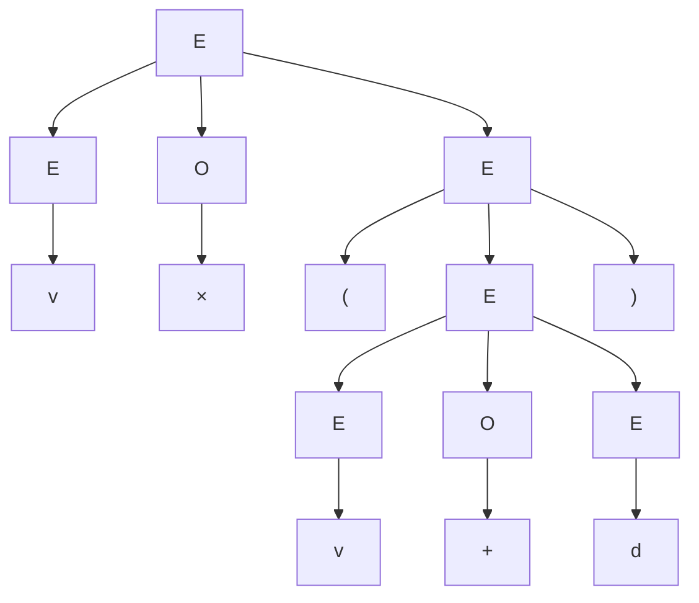
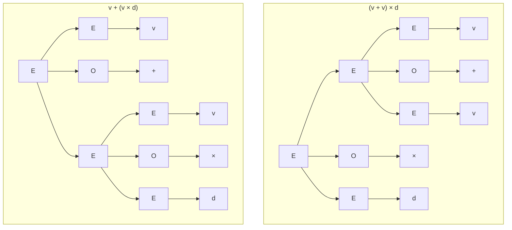

As Chapter 1 explained, one route to describing a language is to generate it with finitely many rewriting rules. This chapter formalizes the idea as grammars, with the emphasis on context-free grammars: they suffice to describe arithmetic expressions, nested parentheses, and the syntax of almost all programming languages, and they are the theoretical basis of syntactic analysis in compilers ([4.2.2](/4.2.2)). We first define grammars and derivations and learn how to design a grammar for a given language and prove it correct. Then we introduce parse trees and discuss ambiguity, the phenomenon that one sentence has two parse trees. Finally we consider general grammars and divide grammars and languages into four classes according to the form of their productions, the Chomsky hierarchy. Chapters 3–6 then study the simplest class (the regular languages), and Chapters 7–9 return to the context-free languages: the pushdown automata that recognize them, the simplification of grammars and parsing algorithms, and properties of the languages.

## 2.1. Context-Free Grammars

Consider two examples first. The language $\{0^n1^n \mid n \ge 1\}$ can be described recursively: 01 belongs to it, and if $w$ belongs to it, so does $0w1$. Written as two rules,

$$
S \to 01, \qquad S \to 0S1.
$$

Arithmetic expressions built from variables $v$, constants $d$, plus, times, and parentheses can also be described recursively:

$$
E \to EOE, \quad E \to (E), \quad E \to v, \quad E \to d, \quad O \to +, \quad O \to \times.
$$

The symbols $S$, $E$, $O$ on the left of the rules stand for classes of strings ("expression", "operator") and are called nonterminals; the symbols $0, 1, v, d, (, ), +, \times$ are those that finally appear in sentences and are called terminals.

**Definition 2.1.1 (Context-Free Grammar)** A **context-free grammar** (CFG) is a quadruple $G = (V, T, P, S)$, where

- $V$ is a finite set of **nonterminals** (also called variables);
- $T$ is a finite set of **terminals**, with $V \cap T = \varnothing$;
- $P$ is a finite set of **productions**, each of the form $A \to \alpha$, where $A \in V$ is called the head (left side) of the production and $\alpha \in (V \cup T)^*$ its body (right side);
- $S \in V$ is the **start symbol**.

"Context-free" refers to the fact that the left side of a production is a single nonterminal: no matter in what context $A$ occurs, it can be replaced by $\alpha$ using $A \to \alpha$. Productions with the same head, $A \to \alpha_1, \dots, A \to \alpha_n$, are abbreviated as $A \to \alpha_1 \mid \alpha_2 \mid \cdots \mid \alpha_n$.

**Example 2.1.1** The two grammars above are

$$
\begin{aligned}
G_{01} &= (\{S\},\ \{0, 1\},\ P,\ S), & P &: S \to 01 \mid 0S1;\\
G_{\mathrm{exp}} &= (\{E, O\},\ \{(, ), +, \times, v, d\},\ P,\ E), & P &: E \to EOE \mid (E) \mid v \mid d,\quad O \to + \mid \times.
\end{aligned}
$$

The language of palindromes ($w = w^{\mathrm{R}}$) is generated by $G_{\mathrm{pal}} = (\{P\}, \{0, 1\}, P, P)$ with the productions $P \to \varepsilon \mid 0 \mid 1 \mid 0P0 \mid 1P1$: the empty string and single symbols are palindromes, and adding the same symbol on both sides of a palindrome gives a palindrome again.

This course follows the notational conventions of the textbook by Hopcroft, Motwani, and Ullman: uppercase letters such as $A, B, C, S$ denote nonterminals; $a, b, c$ and digits denote terminals; $X, Y, Z$ denote a grammar symbol that may be a terminal or a nonterminal; $u, v, w, x, y, z$ denote strings of terminals; and $\alpha, \beta, \gamma$ denote strings in $(V \cup T)^*$.

## 2.2. Derivations and Recursive Inference

There are two directions in which to decide whether a string is described by a grammar. Top-down, we start from the start symbol and repeatedly replace some nonterminal by the body of one of its productions until only terminals remain; this is called a derivation. Bottom-up, we start from the string and repeatedly replace a segment equal to the body of some production by the head nonterminal until we reach the start symbol; this is called recursive inference, and its steps are customarily called reductions.

**Definition 2.2.1 (Derivation)** Let $G = (V, T, P, S)$, $\alpha, \beta \in (V \cup T)^*$, and $A \to \gamma \in P$. Then $\alpha A \beta$ yields $\alpha\gamma\beta$ in a one-step **derivation**, written

$$
\alpha A \beta \underset{G}{\Rightarrow} \alpha\gamma\beta.
$$
The relation $\overset{*}{\underset{G}{\Rightarrow}}$ is the reflexive transitive closure of $\underset{G}{\Rightarrow}$, defined inductively: for every $\alpha$, $\alpha \overset{*}{\Rightarrow} \alpha$ (zero steps); and if $\alpha \overset{*}{\Rightarrow} \beta$ and $\beta \Rightarrow \gamma$, then $\alpha \overset{*}{\Rightarrow} \gamma$. When the grammar is clear, the subscript $G$ is omitted.

**Definition 2.2.2 (Recursive Inference)** For a nonterminal $A$ of a grammar $G$ and a string of terminals $w$, the statement "$w$ belongs to the language of $A$" is inferred as follows, which is called **recursive inference**. Basis: if $A \to w$ is a production, then $w$ belongs to the language of $A$. Induction: if $A \to X_1 X_2 \cdots X_k$ is a production, $w = w_1 w_2 \cdots w_k$, and for each $i$ either $X_i$ is a terminal and $w_i = X_i$, or $X_i$ is a nonterminal and $w_i$ has already been inferred to belong to the language of $X_i$, then $w$ belongs to the language of $A$.

**Example 2.2.1** In $G_{\mathrm{exp}}$ number the productions (1) $E \to EOE$, (2) $E \to (E)$, (3) $E \to v$, (4) $E \to d$, (5) $O \to +$, (6) $O \to \times$. The recursive inference for the string $v \times (v + d)$ is as follows:

| Step | String | Belongs to | Justification |
|---|---|---|---|
| 1 | $v$ | $E$ | (3) |
| 2 | $d$ | $E$ | (4) |
| 3 | $+$ | $O$ | (5) |
| 4 | $\times$ | $O$ | (6) |
| 5 | $v + d$ | $E$ | (1), steps 1, 3, 2 |
| 6 | $(v + d)$ | $E$ | (2), step 5 |
| 7 | $v \times (v + d)$ | $E$ | (1), steps 1, 4, 6 |

Conversely, a derivation from $E$ is

$$
E \Rightarrow EOE \Rightarrow E \times E \Rightarrow E \times (E) \Rightarrow v \times (E) \Rightarrow v \times (EOE) \Rightarrow v \times (E + E) \Rightarrow v \times (v + E) \Rightarrow v \times (v + d).
$$

A string generally has more than one derivation, because at each step we may choose which nonterminal to replace. Fixing the choice gives two canonical kinds of derivation.

**Definition 2.2.3 (Leftmost and Rightmost Derivations)** A derivation in which every step replaces the leftmost nonterminal is called a **leftmost derivation**, written $\underset{\mathrm{lm}}{\Rightarrow}$ and $\overset{*}{\underset{\mathrm{lm}}{\Rightarrow}}$; a derivation in which every step replaces the rightmost nonterminal is called a **rightmost derivation**, written $\underset{\mathrm{rm}}{\Rightarrow}$ and $\overset{*}{\underset{\mathrm{rm}}{\Rightarrow}}$.

**Example 2.2.2** The leftmost and rightmost derivations of $v \times (v + d)$ in $G_{\mathrm{exp}}$ are

$$
\begin{aligned}
E &\underset{\mathrm{lm}}{\Rightarrow} EOE \underset{\mathrm{lm}}{\Rightarrow} vOE \underset{\mathrm{lm}}{\Rightarrow} v \times E \underset{\mathrm{lm}}{\Rightarrow} v \times (E) \underset{\mathrm{lm}}{\Rightarrow} v \times (EOE) \underset{\mathrm{lm}}{\Rightarrow} v \times (vOE) \underset{\mathrm{lm}}{\Rightarrow} v \times (v + E) \underset{\mathrm{lm}}{\Rightarrow} v \times (v + d),\\
E &\underset{\mathrm{rm}}{\Rightarrow} EOE \underset{\mathrm{rm}}{\Rightarrow} EO(E) \underset{\mathrm{rm}}{\Rightarrow} EO(EOE) \underset{\mathrm{rm}}{\Rightarrow} EO(EOd) \underset{\mathrm{rm}}{\Rightarrow} EO(E + d) \underset{\mathrm{rm}}{\Rightarrow} EO(v + d) \underset{\mathrm{rm}}{\Rightarrow} E \times (v + d) \underset{\mathrm{rm}}{\Rightarrow} v \times (v + d).
\end{aligned}
$$

**Definition 2.2.4 (Sentential Form)** Let $G = (V, T, P, S)$. If $S \overset{*}{\Rightarrow} \alpha$, then $\alpha \in (V \cup T)^*$ is called a **sentential form** of $G$; if $S \overset{*}{\underset{\mathrm{lm}}{\Rightarrow}} \alpha$, it is called a left-sentential form; if $S \overset{*}{\underset{\mathrm{rm}}{\Rightarrow}} \alpha$, a right-sentential form. A sentential form consisting only of terminals is called a **sentence**.

Every line in Example 2.2.2 is a sentential form. For instance, $v \times (EOE)$ is a left-sentential form, $EO(EOd)$ is a right-sentential form, and $E \times (E)$ is a sentential form that is neither left nor right.

## 2.3. Context-Free Languages

**Definition 2.3.1 (Context-Free Language)** The language of a grammar $G = (V, T, P, S)$ is the set of all its sentences:

$$
L(G) = \{\, w \in T^* \mid S \overset{*}{\underset{G}{\Rightarrow}} w \,\}.
$$
If a language $L$ is the language of some context-free grammar, that is, $L = L(G)$, then $L$ is called a **context-free language** (CFL).

For example, $L(G_{\mathrm{exp}})$ can be described inductively: $v, d \in L$; if $e \in L$ then $(e) \in L$; if $e_1, e_2 \in L$ then $e_1 + e_2 \in L$ and $e_1 \times e_2 \in L$. The productions of the grammar correspond one-to-one to this **inductive definition**, which is exactly the relation between a **context-free grammar** and an inductive definition.

### 2.3.1. Grammar Design

To design a grammar for a given language, the key is to find its recursive structure: how a string is assembled from shorter strings of the same kind, and what the shortest strings are. The examples below go from easy to hard; several techniques (nesting, concatenation, union over cases, splitting by counting) recur in design.

**Example 2.3.1 (Nesting)** $\{a^n b^{2n} \mid n \ge 0\}$: each time an $a$ is added on the outside, two $b$s are added on the right, and the innermost layer is the empty string. The grammar is $S \to aSbb \mid \varepsilon$. If $n \ge 1$ is required, change the basis to $S \to abb$.

**Example 2.3.2 (Nesting and Concatenation)** Two languages:

- $\{a^n b^m c^m d^n \mid n, m \ge 0\}$ has an outer and an inner layer: the outer layer is the matched pair $a \dots d$ and the inner layer is the matched pair $b \dots c$. The grammar is $S \to aSd \mid A$, $A \to bAc \mid \varepsilon$.
- $\{a^n b^n c^m d^m \mid n, m \ge 0\}$ is the concatenation of two independent parts, left and right: $S \to AB$, $A \to aAb \mid \varepsilon$, $B \to cBd \mid \varepsilon$.

**Example 2.3.3 (Union over Cases)** $\{a^n b^m \mid n \ne m\}$. The condition $n \ne m$ cannot be generated "layer by layer", but it is equivalent to $n > m$ or $n < m$; a string with $n > m$ is some number of $a$s followed by an $a^k b^k$:

$$
S \to AC \mid CB, \qquad C \to aCb \mid \varepsilon, \qquad A \to aA \mid a, \qquad B \to bB \mid b.
$$
Here $C$ generates $a^k b^k$, $A$ generates $a^+$, and $B$ generates $b^+$.

**Example 2.3.4 (Interval)** $\{a^n b^m \mid n \le m \le 2n\}$. The rule $S \to aSb$ makes the numbers of $b$s and $a$s equal, and $S \to aSbb$ makes the number of $b$s twice that of $a$s; mixing the two gives exactly the interval:

$$
S \to aSb \mid aSbb \mid \varepsilon.
$$
If the former is used $i$ times and the latter $j$ times, the generated string is $a^{i+j}b^{i+2j}$, which satisfies $n = i + j \le m = i + 2j \le 2n$; conversely, for $n, m$ satisfying the condition, take $j = m - n \ge 0$ and $i = 2n - m \ge 0$.

**Example 2.3.5 (Splitting by Counting)** All strings over $\{a, b\}$ with equally many $a$s and $b$s. Here the order is arbitrary and there is no fixed nesting structure; the technique is to split by prefix counts. Let $w$ be nonempty and begin with $a$. Scan from left to right, recording (number of $a$s) minus (number of $b$s). It starts at 1, and the symbol read when it first returns to 0 must be a $b$. Hence $w = a u b v$, where $u$ and $v$ each have equally many $a$s and $b$s. The case beginning with $b$ is symmetric. The grammar is

$$
S \to aSbS \mid bSaS \mid \varepsilon.
$$
Its correctness is proved in Example 2.3.7.

### 2.3.2. Proving That a Grammar Generates a Given Language

To prove $L(G) = L$ we need two directions:

- $L(G) \subseteq L$ (everything generated is correct): usually by induction on the number of derivation steps, or by **structural induction** on the productions, showing that the strings generated by each nonterminal have the corresponding property;
- $L \subseteq L(G)$ (everything that should be generated is): usually by strong induction on the string length, splitting $w \in L$ into shorter strings that belong to the corresponding languages.

**Theorem 2.3.1** $L(G_{\mathrm{pal}})$ is exactly the set of all palindromes over $\{0, 1\}$.

**Proof** ($\supseteq$) Let $w = w^{\mathrm{R}}$; we prove $P \overset{*}{\Rightarrow} w$ by strong induction on $\lvert w\rvert$. If $\lvert w\rvert \le 1$, then $w$ is $\varepsilon$, 0, or 1, and one production suffices. If $\lvert w\rvert \ge 2$, then since $w = w^{\mathrm{R}}$ the first and last symbols are equal, so $w = 0x0$ or $w = 1x1$, and $x$ is also a palindrome ($w^{\mathrm{R}} = 0x^{\mathrm{R}}0$, and comparing with $w$ gives $x = x^{\mathrm{R}}$). Since $\lvert x\rvert < \lvert w\rvert$, the induction hypothesis gives $P \overset{*}{\Rightarrow} x$, hence $P \Rightarrow 0P0 \overset{*}{\Rightarrow} 0x0 = w$; the other case is the same.

($\subseteq$) Let $P \overset{*}{\Rightarrow} w$; we prove by induction on the number $n$ of derivation steps that $w$ is a palindrome. For $n = 1$ only $P \to \varepsilon \mid 0 \mid 1$ can be used, and the claim holds. For $n > 1$ the first step can only use $P \to 0P0$ or $P \to 1P1$, say $P \Rightarrow 0P0 \overset{*}{\Rightarrow} 0x0 = w$, where $P \overset{*}{\Rightarrow} x$ uses only $n - 1$ steps. By the induction hypothesis $x$ is a palindrome, so $w^{\mathrm{R}} = 0x^{\mathrm{R}}0 = 0x0 = w$. $\square$

**Example 2.3.6** Prove that in every string generated by the grammar $S \to 0B \mid 1A$, $A \to 0 \mid 0S \mid 1AA$, $B \to 1 \mid 1S \mid 0BB$, the numbers of 0s and 1s are equal.

The properties of the three nonterminals are intertwined, so we use **mutual induction** ([§1.4.3](/4.8.1#sec-1.4.3)) to prove three statements simultaneously: if $S \overset{*}{\Rightarrow} w$ then $\lvert w\rvert_0 = \lvert w\rvert_1$; if $A \overset{*}{\Rightarrow} w$ then $\lvert w\rvert_0 = \lvert w\rvert_1 + 1$; if $B \overset{*}{\Rightarrow} w$ then $\lvert w\rvert_1 = \lvert w\rvert_0 + 1$. We induct on the number of derivation steps. A one-step derivation can only use $A \to 0$ or $B \to 1$, and the statements hold. For more steps look at the first step; for example, in $A \Rightarrow 1AA \overset{*}{\Rightarrow} 1w_1w_2$ the two $A$s generate $w_1, w_2$ in fewer steps, so by the induction hypothesis each has one more 0 than 1s, and with the leading 1 the number of 0s exceeds the number of 1s by exactly one. The cases $A \Rightarrow 0S$, $S \Rightarrow 0B$, and so on are similar, and each case uses the induction hypothesis of another nonterminal. (The converse also holds: this grammar generates exactly all strings with equally many 0s and 1s.)

**Example 2.3.7** Prove that the grammar $G$ of Example 2.3.5, $S \to aSbS \mid bSaS \mid \varepsilon$, satisfies $L(G) = \{w \in \{a,b\}^* \mid \lvert w\rvert_a = \lvert w\rvert_b\}$.

($\subseteq$) Induct on the number of derivation steps: a one-step derivation can only be $S \Rightarrow \varepsilon$. With more steps, if the first step is $S \Rightarrow aSbS$, then $w = a w_1 b w_2$, where $w_1, w_2$ are both derived from $S$ in fewer steps, so by the induction hypothesis each has equally many $a$s and $b$s, and so does $w$; the case $bSaS$ is the same.

($\supseteq$) Strong induction on $\lvert w\rvert$. For $w = \varepsilon$ we have $S \Rightarrow \varepsilon$. Let $w$ be nonempty and begin with $a$, and put $d(x) = \lvert x\rvert_a - \lvert x\rvert_b$. Along the prefixes of $w$, $d$ starts from $d(a) = 1$ and changes by $\pm 1$ per symbol read, and finally $d(w) = 0$, so there is a shortest prefix $p$ with $d(p) = 0$. The last symbol of $p$ makes $d$ drop from 1 to 0, so it is a $b$, and $p = aub$ with $d(u) = 0$. Write $w = aubv$; then $d(v) = d(w) - d(p) = 0$. Both $u$ and $v$ are shorter than $w$, so by the induction hypothesis $S \overset{*}{\Rightarrow} u$ and $S \overset{*}{\Rightarrow} v$, hence $S \Rightarrow aSbS \overset{*}{\Rightarrow} aubv = w$. If $w$ begins with $b$, use $S \to bSaS$ symmetrically. $\square$

## 2.4. Parse Trees

A derivation records the order of replacements, and this order often does not matter: the leftmost derivation and the **rightmost derivation** of $v \times (v + d)$ make the same replacements, only in a different order. Drawing "which nonterminal was replaced by what" as a tree removes the order and keeps only the structure.

**Definition 2.4.1 (Parse Tree)** Let $G = (V, T, P, S)$. A **parse tree** of $G$ is an ordered tree satisfying the conditions below; the string obtained by concatenating its leaves from left to right is called its **yield**:

1. Every interior node is labeled by a nonterminal;
2. Every leaf is labeled by a nonterminal, a terminal, or $\varepsilon$; a leaf labeled $\varepsilon$ is the only child of its parent;
3. If an interior node is labeled $A$ and its children are labeled $X_1, X_2, \dots, X_k$ from left to right, then $A \to X_1 X_2 \cdots X_k \in P$; if its only child is labeled $\varepsilon$, then $A \to \varepsilon \in P$.

The parse tree of $v \times (v + d)$ in $G_{\mathrm{exp}}$ is shown below; its yield is this string:

A parse tree with root $S$ and yield $\alpha$ corresponds to the **sentential form** $\alpha$; the yields of those trees whose yield consists only of terminals make up $L(G)$. The following theorem says that five characterizations of "$w$ belongs to the language of $A$" are equivalent, so we may use whichever is convenient.

**Theorem 2.4.1** Let $G = (V, T, P, S)$, $A \in V$, and $w \in T^*$. The following statements are equivalent:

1. $w$ can be inferred to belong to the language of $A$ by **recursive inference**;
2. $A \overset{*}{\Rightarrow} w$;
3. $A \overset{*}{\underset{\mathrm{lm}}{\Rightarrow}} w$;
4. $A \overset{*}{\underset{\mathrm{rm}}{\Rightarrow}} w$;
5. There is a parse tree with root $A$ and yield $w$.

The proof proceeds cyclically as 1 ⇒ 5 ⇒ 3 ⇒ 2 ⇒ 1; 5 ⇒ 4 ⇒ 2 is completely symmetric to 5 ⇒ 3. The implications 3 ⇒ 2 and 4 ⇒ 2 are trivial: a leftmost (rightmost) derivation is a derivation.

**Proof** (1 ⇒ 5) Induct on the number of steps of the recursive inference. If only one step is used, there is a production $A \to w$, and the tree with root $A$ whose children are the symbols of $w$ (one $\varepsilon$ leaf if $w = \varepsilon$) is as required. Otherwise let the last step use $A \to X_1 \cdots X_k$ with $w = w_1 \cdots w_k$: if $X_i$ is a terminal then $w_i = X_i$, and we take it as a leaf; if $X_i$ is a nonterminal, then "$w_i$ belongs to the language of $X_i$" was inferred in fewer steps, and by the induction hypothesis there is a tree with root $X_i$ and yield $w_i$. Hanging these trees as children under the root $A$ gives a tree with yield $w$.

(5 ⇒ 3) Induct on the height of the tree. If the height is 1, all children of the root are leaves with yield $w$, so $A \to w$ is a production and a one-step leftmost derivation exists. If the height is greater than 1, let the children of the root be $X_1, \dots, X_k$, and let the $i$th subtree have yield $w_i$ ($w_i = X_i$ if $X_i$ is a leaf), so $w = w_1 \cdots w_k$. For each nonterminal $X_i$ the induction hypothesis gives $X_i \overset{*}{\underset{\mathrm{lm}}{\Rightarrow}} w_i$. Therefore

$$
A \underset{\mathrm{lm}}{\Rightarrow} X_1 X_2 \cdots X_k \overset{*}{\underset{\mathrm{lm}}{\Rightarrow}} w_1 X_2 \cdots X_k \overset{*}{\underset{\mathrm{lm}}{\Rightarrow}} w_1 w_2 X_3 \cdots X_k \overset{*}{\underset{\mathrm{lm}}{\Rightarrow}} \cdots \overset{*}{\underset{\mathrm{lm}}{\Rightarrow}} w_1 w_2 \cdots w_k,
$$
where each segment is the derivation of $X_i$ with the terminal string $w_1 \cdots w_{i-1}$ prepended and $X_{i+1} \cdots X_k$ appended: what precedes is all terminals, so the leftmost nonterminal in the derivation of $X_i$ is still the leftmost one in the whole sentential form, and every step is still a leftmost step.

(2 ⇒ 1) Induct on the number of derivation steps, using the lemma below. For a one-step derivation there must be a production $A \to w$, and the basis of recursive inference applies. For more steps, let $A \Rightarrow X_1 \cdots X_k \overset{*}{\Rightarrow} w$. By Lemma 2.4.1, $w = w_1 \cdots w_k$ with $X_i \overset{*}{\Rightarrow} w_i$, each in fewer steps than the original derivation. For nonterminals $X_i$ the induction hypothesis shows that $w_i$ can be inferred to belong to the language of $X_i$, and one more recursive inference step with the production $A \to X_1 \cdots X_k$ finishes. $\square$

**Lemma 2.4.1** If $X_1 X_2 \cdots X_k \overset{*}{\Rightarrow} w$ ($w \in T^*$), then $w$ can be decomposed as $w = w_1 w_2 \cdots w_k$ such that $X_i \overset{*}{\Rightarrow} w_i$, and the numbers of steps of these derivations add up to the number of steps of the original derivation.

**Proof** Induct on the number of steps. With zero steps, $X_1 \cdots X_k = w$ and we take $w_i = X_i$. Otherwise the first step replaces the nonterminal in some $X_j$ (that is, $X_j$ itself), giving $X_1 \cdots X_{j-1}\gamma X_{j+1} \cdots X_k$; regarding the symbols of $\gamma$ as independent symbols, apply the induction hypothesis to the remaining derivation, and merge the segments coming from $\gamma$ into $w_j$; this gives $X_j \Rightarrow \gamma \overset{*}{\Rightarrow} w_j$. $\square$

A consequence of Theorem 2.4.1 is that every sentence has a leftmost derivation, and that parse trees correspond one-to-one to leftmost derivations (the construction from a tree to a derivation is deterministic, and a tree can also be drawn uniquely from a leftmost derivation).

## 2.5. Ambiguity

In $G_{\mathrm{exp}}$, the string $v + v \times d$ has two **parse trees** with root $E$: one first combines $v + v$ and then multiplies by $d$, the other first computes $v \times d$ and then adds.

The two trees have the same yield but different structure, corresponding to two different orders of computation. A compiler generates code from the parse tree, so such a grammar cannot be used directly for syntactic analysis.

**Definition 2.5.1 (Ambiguous Grammar)** If there is a $w \in T^*$ with two different parse trees whose roots are both the start symbol $S$ and whose yields are both $w$, then the grammar $G = (V, T, P, S)$ is called an **ambiguous grammar**; otherwise $G$ is unambiguous.

**Theorem 2.5.1** For a grammar $G$ and $w \in T^*$, $w$ has two different parse trees with root $S$ if and only if $w$ has two different leftmost derivations from $S$.

**Proof** By the construction (5 ⇒ 3) in the proof of Theorem 2.4.1, each tree determines a leftmost derivation. Comparing two different trees from the root downward, the first difference is a node at which different productions are used; by the construction, the two leftmost derivations are identical until the nonterminal corresponding to this node is replaced, and different productions are used to replace it, so the two derivations differ. Conversely, at the first point where two different leftmost derivations diverge, the same (leftmost) nonterminal is being replaced but by different productions, and the trees drawn differ at this node. $\square$

Hence ambiguity can also be defined as "some sentence has two different leftmost derivations", which is often more convenient when proving that a grammar is unambiguous: one only needs to show that the production usable at each step is uniquely determined by the remaining input. Note that deciding whether a **context-free grammar** is ambiguous is undecidable (Chapter 11): there is no algorithm that works for all grammars.

### 2.5.1. Removing Ambiguity

For a concrete grammar one can often rewrite it into an unambiguous grammar generating the same language. The ambiguity of the expression grammar comes from two sources: operator precedence ($\times$ should come before $+$) and associativity ($v + v + d$ should be read as $(v + v) + d$).

- Layering by precedence: introduce one nonterminal for each precedence level, so that lower-precedence operations can only appear in the upper layers. Take $E \to EAE \mid T$, $T \to TMT \mid (E) \mid v \mid d$, $A \to +$, $M \to \times$. Now $v + v \times d$ has only one tree, but $v + v + d$ still has two ($E \to EAE$ is symmetric in its two sides).
- Fixing associativity: change the symmetric $EAE$ into the left-recursive $EAT$, so that the right operand can only be an object of a higher layer. This gives the classic unambiguous expression grammar:

$$
E \to E + T \mid T, \qquad T \to T \times F \mid F, \qquad F \to (E) \mid v \mid d.
$$
Here $E$ is a sequence of $T$s joined by $+$, $T$ is a sequence of $F$s joined by $\times$, and $F$ is a basic object or an expression in parentheses. The structure of each sentence is uniquely determined: the outermost $+$s (those not inside parentheses) cut the sentence into terms, the last such $+$ corresponds to $E \to E + T$ at the root, and so on.

Another classic ambiguity comes from the if statement in programming languages. Let $i$ stand for if-then and $e$ for else. In the grammar $S \to \varepsilon \mid iS \mid iSeS$, the string $iie$ has two trees: the $e$ can be paired with the first $i$ or with the second (the dangling else problem). The convention of programming languages is that an else pairs with the nearest unpaired if. To express this, we distinguish "fully paired statements" $M$ and require that only a fully paired statement may precede an else:

$$
S \to \varepsilon \mid iS \mid iMeS, \qquad M \to \varepsilon \mid iMeM.
$$

Counting the parse trees of short strings one by one (up to length 6 for the expression grammar and up to length 8 for the if-statement grammar) verifies that the rewritten grammars generate the same strings as the original ones and that each string has exactly one parse tree. Real parsers (such as the LR parsers generated by yacc / bison) often keep the ambiguous grammar and resolve conflicts with separate precedence and associativity declarations, which has the same effect as the rewriting above.

### 2.5.2. Inherently Ambiguous Languages

For some languages the ambiguity cannot be removed by rewriting the grammar.

**Definition 2.5.2 (Inherent Ambiguity)** A context-free language $L$ is called **inherently ambiguous** if every grammar for $L$ is ambiguous.

**Example 2.5.1** The language $L = \{a^n b^n c^m d^m \mid n, m \ge 1\} \cup \{a^n b^m c^m d^n \mid n, m \ge 1\}$ is inherently ambiguous. One of its grammars is

$$
S \to AB \mid C, \quad A \to aAb \mid ab, \quad B \to cBd \mid cd, \quad C \to aCd \mid aDd, \quad D \to bDc \mid bc.
$$
Strings of the form $a^n b^n c^n d^n$ belong to both parts and have two trees in this grammar (one through $AB$ and one through $C$). It can be shown (Section 5.4.4 of the textbook by Hopcroft et al.) that no grammar can avoid this: for sufficiently large $n$, some $a^n b^n c^n d^n$ always have two different leftmost derivations. It follows that there is no general method for rewriting an arbitrary ambiguous grammar into an unambiguous one.

## 2.6. The Chomsky Hierarchy

Dropping the restriction that the left side has only one nonterminal gives general grammars.

**Definition 2.6.1 (Grammar)** A **grammar** (also called a phrase-structure grammar) is a quadruple $G = (V, T, P, S)$, where $V, T, S$ have the same meaning as in Definition 2.1.1, and the productions have the form $\alpha \to \beta$ with $\alpha, \beta \in (V \cup T)^*$ and $\alpha$ containing at least one nonterminal. Derivations and languages are defined as before: $\gamma\alpha\delta \Rightarrow \gamma\beta\delta$, $L(G) = \{w \in T^* \mid S \overset{*}{\Rightarrow} w\}$.

**Definition 2.6.2 (Chomsky Hierarchy)** Chomsky divided grammars into four classes according to the restrictions placed on the productions $\alpha \to \beta$; this classification is called the **Chomsky hierarchy**. A language that can be generated by a type-$i$ grammar is called a type-$i$ language:

1. **Type-0 grammars**: no further restriction (also called unrestricted grammars).
2. **Context-sensitive grammars** (type 1): every production satisfies $\lvert \alpha\rvert \le \lvert \beta\rvert$; the only exception is that $S \to \varepsilon$ is allowed, in which case $S$ must not occur on the right side of any production.
3. **Context-free grammars** (type 2): every production has the form $A \to \beta$ with $A \in V$.
4. **Regular grammars** (type 3, also called right-linear grammars): every production has the form $A \to aB$ or $A \to a$, where $A, B \in V$ and $a \in T \cup \{\varepsilon\}$.

| Type | Grammar | Language | Equivalent automaton |
|---|---|---|---|
| 0 | Unrestricted grammar | Recursively enumerable language | Turing machine (Chapter 10) |
| 1 | Context-sensitive grammar | Context-sensitive language | Linear bounded automaton |
| 2 | Context-free grammar | **Context-free languages** | Pushdown automaton (Chapter 7) |
| 3 | Regular grammar | Regular language | Finite automaton (Chapters 4, 5) |

Some remarks:

- Type-1 grammars are called "context-sensitive" because they generate the same class of languages as grammars in which every production has the form $\gamma A \delta \to \gamma\beta\delta$ ($\beta$ nonempty): $A$ may be rewritten as $\beta$ only in the context $\gamma \dots \delta$. When defined by $\lvert\alpha\rvert \le \lvert\beta\rvert$, the length of the **sentential form** never decreases during a derivation, so deciding whether $w$ belongs to a type-1 language only requires checking the finitely many sentential forms of length at most $\lvert w\rvert$; all type-1 languages are decidable.
- Every type-3 grammar is a type-2 grammar; every type-2 grammar without $\varepsilon$-productions is a type-1 grammar, and Chapter 8 will show that $\varepsilon$-productions can be eliminated, so every type-2 language is a type-1 language. The inclusions among the classes are strict: $\{0^n1^n \mid n \ge 1\}$ is context-free but not regular (Chapter 6), $\{a^n b^n c^n \mid n \ge 1\}$ is context-sensitive but not context-free (Chapter 9), and there are recursively enumerable languages that are not context-sensitive (Chapters 10 and 11).
- The equivalence of type-3 grammars and finite automata is proved in Chapter 5; the equivalence of type-0 grammars with **Turing machines** and of type-1 grammars with linear bounded automata is discussed in Chapter 10.

**Example 2.6.1** The following type-1 grammar generates $\{a^n b^n c^n \mid n \ge 1\}$:

$$
S \to aSBC \mid aBC, \quad CB \to BC, \quad aB \to ab, \quad bB \to bb, \quad bC \to bc, \quad cC \to cc.
$$
The first two productions generate $a^n (BC)^n$, $CB \to BC$ moves all $B$s in front of the $C$s, and the last four productions turn $B$ and $C$ into terminals from left to right; $bB \to bb$ and the like allow only a $B$ immediately following an $a$ or a $b$ to become $b$, which guarantees the order. A derivation for $n = 2$ is

$$
S \Rightarrow aSBC \Rightarrow aaBCBC \Rightarrow aaBBCC \Rightarrow aabBCC \Rightarrow aabbCC \Rightarrow aabbcC \Rightarrow aabbcc.
$$
If a $B$ is turned into $b$ too early (for example in $aabCBC$), there is still a $B$ after a $C$ that can no longer be swapped, and the derivation gets stuck without yielding a terminal string.

**Example 2.6.2** The language "contains at least one 0" of Chapter 1 is generated by the type-3 grammar $S \to 1S \mid 0A$, $A \to 0A \mid 1A \mid \varepsilon$. Here $S$ means "no 0 has been read yet" and $A$ means "a 0 has been read", which corresponds exactly to the two-state automaton of [§1.1](/4.8.1#sec-1.1): nonterminals are states, and the production $A \to aB$ is the transition from $A$ to $B$ on reading $a$. Chapter 5 generalizes this correspondence into a general proof.

## Summary

| Topic | Key points |
|---|---|
| Context-free grammars (Definition 2.1.1) | Quadruples $G = (V, T, P, S)$ with productions $A \to \gamma$; the language $L(G)$ is the set of all sentences (Definition 2.3.1) |
| Derivations and inference | Derivations $\Rightarrow$, $\overset{*}{\Rightarrow}$ (Definition 2.2.1), leftmost and rightmost derivations (Definition 2.2.3), sentential forms (Definition 2.2.4); recursive inference (Definition 2.2.2) works bottom-up |
| Five equivalent characterizations (Theorem 2.4.1) | Recursive inference, derivations, leftmost derivations, rightmost derivations and parse trees (Definition 2.4.1) describe the same thing |
| Designing grammars | Nesting ($S \to aSb$), concatenation, union of cases, ranges, splitting by counts (Examples 2.3.1–2.3.5) |
| Proving correctness | $L(G) = L$ requires two directions: induction on the number of derivation steps for "no more", induction on string length for "no fewer" (Theorem 2.3.1, Example 2.3.7) |
| Ambiguity | An ambiguous grammar (Definition 2.5.1) is one in which some string has two leftmost derivations (Theorem 2.5.1); layering by precedence and fixing associativity removes the ambiguity of the expression grammar; some languages are inherently ambiguous (Definition 2.5.2, Example 2.5.1) |
| Chomsky hierarchy (Definition 2.6.2) | Four classes of grammars by the restrictions on productions; the language classes are strictly nested: type 0 (recursively enumerable) $\supsetneq$ type 1 (context-sensitive) $\supsetneq$ type 2 (context-free) $\supsetneq$ type 3 (regular), recognized respectively by Turing machines, linear bounded automata, pushdown automata and finite automata |

## Questions

1. Give context-free grammars for the following languages: (1) $\{a^n b^{2n} c^m \mid n, m \ge 0\}$; (2) $\{a^n b^{n+m} c^m \mid n, m \ge 0\}$; (3) $\{a^m b^n c^p d^q \mid m + n = p + q\}$; (4) the strings over $\{a, b\}$ with different numbers of $a$s and $b$s; (5) $\{a^i b^j c^k \mid i + j \ge k\}$.
2. Prove that the grammar $S \to aS \mid aSb \mid \varepsilon$ generates $\{a^n b^m \mid n \ge m \ge 0\}$, show that it is ambiguous, and give an unambiguous grammar for this language.
3. Prove that in every string generated by the grammar $S \to 1 \mid 1T1$, $T \to 0 \mid 0S0$ there is one more 1 than 0s.
4. Give an unambiguous grammar generating the same language as $S \to SaS \mid SbS \mid ScS \mid d$.
5. Show that the grammar of Example 2.3.7 is ambiguous (find a string with two parse trees).
