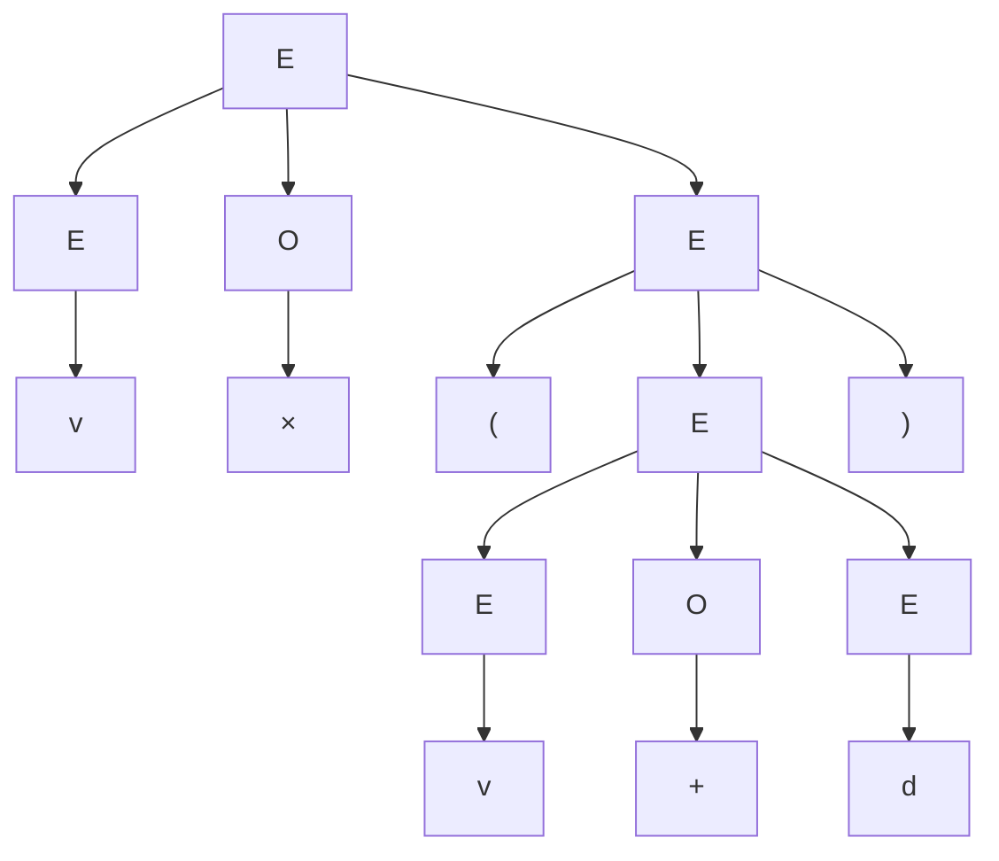
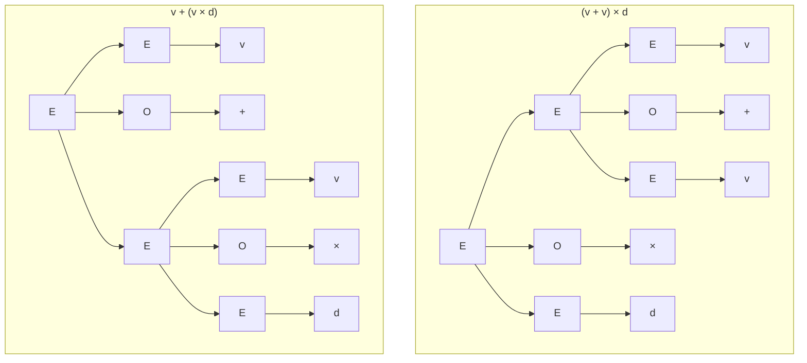

第 1 章说过，描述语言的一条路线是用有限条改写规则生成它。本章把这个想法形式化为文法，重点是上下文无关文法：它足以描述算术表达式、括号嵌套和几乎所有程序设计语言的语法，是编译器语法分析（[4.2.2](/4.2.2)）的理论基础。我们先定义文法和推导，学习怎样为给定的语言设计文法并证明它正确，再引入语法分析树，讨论同一个句子有两棵分析树的二义性问题，最后在一般文法上按产生式的形式把文法与语言分成四类，即 Chomsky 体系。之后第 3–6 章研究其中最简单的一类（正规语言），第 7–9 章回到上下文无关语言，研究识别它的下推自动机、文法的化简与分析算法以及语言的性质。

## 2.1. 上下文无关文法

先看两个例子。语言 $\{0^n1^n \mid n \ge 1\}$ 可以这样递归地描述：01 属于它；若 $w$ 属于它，则 $0w1$ 也属于它。写成两条规则就是

$$
S \to 01, \qquad S \to 0S1.
$$

由变量 $v$、常数 $d$、加号、乘号和括号组成的算术表达式也可以递归地描述：

$$
E \to EOE, \quad E \to (E), \quad E \to v, \quad E \to d, \quad O \to +, \quad O \to \times.
$$

规则左边的 $S$、$E$、$O$ 代表一类串（"表达式""运算符"），称为非终结符；$0, 1, v, d, (, ), +, \times$ 是最终出现在句子里的符号，称为终结符。

**定义 2.1.1（上下文无关文法）** 一个**上下文无关文法**（CFG）是四元组 $G = (V, T, P, S)$，其中

- $V$ 是**非终结符**（也称变元）的有限集合；
- $T$ 是**终结符**的有限集合，$V \cap T = \varnothing$；
- $P$ 是**产生式**的有限集合，每个产生式形如 $A \to \alpha$，其中 $A \in V$ 称为产生式的头（左部），$\alpha \in (V \cup T)^*$ 称为体（右部）；
- $S \in V$ 是**开始符号**。

"上下文无关"指产生式的左部只有一个非终结符：不论 $A$ 出现在什么上下文中，都可以用 $A \to \alpha$ 把它替换成 $\alpha$。头相同的几个产生式 $A \to \alpha_1, \dots, A \to \alpha_n$ 简写为 $A \to \alpha_1 \mid \alpha_2 \mid \cdots \mid \alpha_n$。

**例 2.1.1** 上面两个文法分别是

$$
\begin{aligned}
G_{01} &= (\{S\},\ \{0, 1\},\ P,\ S), & P &: S \to 01 \mid 0S1;\\
G_{\mathrm{exp}} &= (\{E, O\},\ \{(, ), +, \times, v, d\},\ P,\ E), & P &: E \to EOE \mid (E) \mid v \mid d,\quad O \to + \mid \times.
\end{aligned}
$$

回文（$w = w^{\mathrm{R}}$）的语言由 $G_{\mathrm{pal}} = (\{P\}, \{0, 1\}, P, P)$ 生成，产生式为 $P \to \varepsilon \mid 0 \mid 1 \mid 0P0 \mid 1P1$：空串和单个符号是回文，回文两边各加一个相同的符号仍是回文。

本课程沿用 Hopcroft 等人教材的记号约定：$A, B, C, S$ 等大写字母表示非终结符；$a, b, c$ 和数字表示终结符；$X, Y, Z$ 表示一个可能是终结符也可能是非终结符的文法符号；$u, v, w, x, y, z$ 表示终结符串；$\alpha, \beta, \gamma$ 表示 $(V \cup T)^*$ 中的串。

## 2.2. 推导与递归推理

判断一个串是否由文法描述有两个方向。自顶向下，从开始符号出发，反复把某个非终结符替换成它的某个产生式右部，直到只剩终结符，这称为推导；自底向上，从串出发，反复把与某个产生式右部相同的一段替换成左部的非终结符，直到得到开始符号，这称为递归推理，其过程习惯上称为归约。

**定义 2.2.1（推导）** 设 $G = (V, T, P, S)$，$\alpha, \beta \in (V \cup T)^*$，$A \to \gamma \in P$。称 $\alpha A \beta$ 一步**推导**出 $\alpha\gamma\beta$，记作

$$
\alpha A \beta \underset{G}{\Rightarrow} \alpha\gamma\beta.
$$
关系 $\overset{*}{\underset{G}{\Rightarrow}}$ 是 $\underset{G}{\Rightarrow}$ 的自反传递闭包，归纳定义为：对任意 $\alpha$，$\alpha \overset{*}{\Rightarrow} \alpha$（零步）；若 $\alpha \overset{*}{\Rightarrow} \beta$ 且 $\beta \Rightarrow \gamma$，则 $\alpha \overset{*}{\Rightarrow} \gamma$。文法明确时省略下标 $G$。

**定义 2.2.2（递归推理）** 对文法 $G$ 的非终结符 $A$ 与终结符串 $w$，"$w$ 属于 $A$ 的语言"按如下方式推出，称为**递归推理**：基础，若 $A \to w$ 是产生式，则 $w$ 属于 $A$ 的语言；归纳，若 $A \to X_1 X_2 \cdots X_k$ 是产生式，$w = w_1 w_2 \cdots w_k$，并且对每个 $i$，$X_i$ 是终结符且 $w_i = X_i$，或者 $X_i$ 是非终结符且已推出 $w_i$ 属于 $X_i$ 的语言，则 $w$ 属于 $A$ 的语言。

**例 2.2.1** 在 $G_{\mathrm{exp}}$ 中把产生式编号为 (1) $E \to EOE$，(2) $E \to (E)$，(3) $E \to v$，(4) $E \to d$，(5) $O \to +$，(6) $O \to \times$。串 $v \times (v + d)$ 的递归推理如下：

| 步骤 | 串 | 属于 | 依据 |
|---|---|---|---|
| 1 | $v$ | $E$ | (3) |
| 2 | $d$ | $E$ | (4) |
| 3 | $+$ | $O$ | (5) |
| 4 | $\times$ | $O$ | (6) |
| 5 | $v + d$ | $E$ | (1)，步骤 1、3、2 |
| 6 | $(v + d)$ | $E$ | (2)，步骤 5 |
| 7 | $v \times (v + d)$ | $E$ | (1)，步骤 1、4、6 |

反过来，从 $E$ 出发的一个推导为

$$
E \Rightarrow EOE \Rightarrow E \times E \Rightarrow E \times (E) \Rightarrow v \times (E) \Rightarrow v \times (EOE) \Rightarrow v \times (E + E) \Rightarrow v \times (v + E) \Rightarrow v \times (v + d).
$$

同一个串的推导一般不止一个，因为每一步可以选择替换哪个非终结符。规定选择方式就得到两种规范的推导。

**定义 2.2.3（最左推导与最右推导）** 若推导的每一步都替换最左边的非终结符，则称为**最左推导**，记作 $\underset{\mathrm{lm}}{\Rightarrow}$ 与 $\overset{*}{\underset{\mathrm{lm}}{\Rightarrow}}$；若每一步都替换最右边的非终结符，则称为**最右推导**，记作 $\underset{\mathrm{rm}}{\Rightarrow}$ 与 $\overset{*}{\underset{\mathrm{rm}}{\Rightarrow}}$。

**例 2.2.2** $v \times (v + d)$ 在 $G_{\mathrm{exp}}$ 中的最左推导与最右推导分别为

$$
\begin{aligned}
E &\underset{\mathrm{lm}}{\Rightarrow} EOE \underset{\mathrm{lm}}{\Rightarrow} vOE \underset{\mathrm{lm}}{\Rightarrow} v \times E \underset{\mathrm{lm}}{\Rightarrow} v \times (E) \underset{\mathrm{lm}}{\Rightarrow} v \times (EOE) \underset{\mathrm{lm}}{\Rightarrow} v \times (vOE) \underset{\mathrm{lm}}{\Rightarrow} v \times (v + E) \underset{\mathrm{lm}}{\Rightarrow} v \times (v + d),\\
E &\underset{\mathrm{rm}}{\Rightarrow} EOE \underset{\mathrm{rm}}{\Rightarrow} EO(E) \underset{\mathrm{rm}}{\Rightarrow} EO(EOE) \underset{\mathrm{rm}}{\Rightarrow} EO(EOd) \underset{\mathrm{rm}}{\Rightarrow} EO(E + d) \underset{\mathrm{rm}}{\Rightarrow} EO(v + d) \underset{\mathrm{rm}}{\Rightarrow} E \times (v + d) \underset{\mathrm{rm}}{\Rightarrow} v \times (v + d).
\end{aligned}
$$

**定义 2.2.4（句型）** 设 $G = (V, T, P, S)$。若 $S \overset{*}{\Rightarrow} \alpha$，则称 $\alpha \in (V \cup T)^*$ 为 $G$ 的一个**句型**；若 $S \overset{*}{\underset{\mathrm{lm}}{\Rightarrow}} \alpha$，称为左句型；若 $S \overset{*}{\underset{\mathrm{rm}}{\Rightarrow}} \alpha$，称为右句型。只含终结符的句型称为**句子**。

例 2.2.2 中的每一行都是句型，例如 $v \times (EOE)$ 是左句型，$EO(EOd)$ 是右句型，$E \times (E)$ 是句型但既非左句型也非右句型。

## 2.3. 上下文无关语言

**定义 2.3.1（上下文无关语言）** 文法 $G = (V, T, P, S)$ 的语言是它的全体句子：

$$
L(G) = \{\, w \in T^* \mid S \overset{*}{\underset{G}{\Rightarrow}} w \,\}.
$$
若语言 $L$ 是某个上下文无关文法的语言，即 $L = L(G)$，则称 $L$ 为**上下文无关语言**（CFL）。

例如 $L(G_{\mathrm{exp}})$ 可以归纳地描述为：$v, d \in L$；若 $e \in L$，则 $(e) \in L$；若 $e_1, e_2 \in L$，则 $e_1 + e_2 \in L$ 且 $e_1 \times e_2 \in L$。文法的产生式与这个归纳定义一一对应，这正是上下文无关文法与归纳定义的关系。

### 2.3.1. 文法设计

为给定的语言设计文法，关键是找到它的递归结构：串怎样由更短的同类串拼成，最短的串是什么。下面的例子从简单到困难，几种技巧（嵌套、拼接、分情况取并、按计数切分）在设计中反复出现。

**例 2.3.1（嵌套）** $\{a^n b^{2n} \mid n \ge 0\}$：每在外层加一个 $a$，就在右边加两个 $b$，最内层是空串。文法为 $S \to aSbb \mid \varepsilon$。若要求 $n \ge 1$，把基础改成 $S \to abb$。

**例 2.3.2（嵌套与拼接）** 两个语言：

- $\{a^n b^m c^m d^n \mid n, m \ge 0\}$ 有内外两层，外层是成对的 $a \dots d$，内层是成对的 $b \dots c$：$S \to aSd \mid A$，$A \to bAc \mid \varepsilon$。
- $\{a^n b^n c^m d^m \mid n, m \ge 0\}$ 是左右两个独立部分的拼接：$S \to AB$，$A \to aAb \mid \varepsilon$，$B \to cBd \mid \varepsilon$。

**例 2.3.3（分情况取并）** $\{a^n b^m \mid n \ne m\}$。$n \ne m$ 不是可以"逐层生成"的条件，但它等价于 $n > m$ 或 $n < m$；$n > m$ 的串是若干个 $a$ 后接一个 $a^k b^k$：

$$
S \to AC \mid CB, \qquad C \to aCb \mid \varepsilon, \qquad A \to aA \mid a, \qquad B \to bB \mid b.
$$
其中 $C$ 生成 $a^k b^k$，$A$ 生成 $a^+$，$B$ 生成 $b^+$。

**例 2.3.4（区间）** $\{a^n b^m \mid n \le m \le 2n\}$。规则 $S \to aSb$ 使 $b$ 与 $a$ 一样多，$S \to aSbb$ 使 $b$ 是 $a$ 的两倍，两者混用恰好得到区间：

$$
S \to aSb \mid aSbb \mid \varepsilon.
$$
若前者用了 $i$ 次、后者用了 $j$ 次，生成的是 $a^{i+j}b^{i+2j}$，满足 $n = i + j \le m = i + 2j \le 2n$；反之对满足条件的 $n, m$，取 $j = m - n \ge 0$，$i = 2n - m \ge 0$ 即可。

**例 2.3.5（按计数切分）** $\{a, b\}$ 上 $a$ 与 $b$ 个数相等的全体串。这里顺序任意，没有固定的嵌套结构，技巧是按前缀计数切分：设 $w$ 非空且以 $a$ 开头，从左往右扫描，记录（$a$ 的个数）减（$b$ 的个数），它从 1 开始，第一次回到 0 时读到的一定是 $b$。于是 $w = a u b v$，其中 $u$ 和 $v$ 中 $a$ 与 $b$ 的个数都相等。以 $b$ 开头的情况对称。文法为

$$
S \to aSbS \mid bSaS \mid \varepsilon.
$$
正确性的证明见例 2.3.7。

### 2.3.2. 证明文法生成给定的语言

要证 $L(G) = L$，需要两个方向：

- $L(G) \subseteq L$（文法生成的都对）：通常对推导的步数归纳，或对产生式作结构归纳，证明每个非终结符生成的串都具有相应的性质；
- $L \subseteq L(G)$（应有的都能生成）：通常对串的长度作强归纳，把 $w \in L$ 拆成更短的、属于相应语言的串。

**定理 2.3.1** $L(G_{\mathrm{pal}})$ 恰是 $\{0, 1\}$ 上全体回文的集合。

**证明** （$\supseteq$）设 $w = w^{\mathrm{R}}$，对 $\lvert w\rvert$ 强归纳证明 $P \overset{*}{\Rightarrow} w$。若 $\lvert w\rvert \le 1$，则 $w$ 为 $\varepsilon$、0 或 1，各用一个产生式即得。若 $\lvert w\rvert \ge 2$，由 $w = w^{\mathrm{R}}$，首尾符号相同，$w = 0x0$ 或 $w = 1x1$，且 $x$ 也是回文（$w^{\mathrm{R}} = 0x^{\mathrm{R}}0$，与 $w$ 比较得 $x = x^{\mathrm{R}}$）。$\lvert x\rvert < \lvert w\rvert$，由归纳假设 $P \overset{*}{\Rightarrow} x$，于是 $P \Rightarrow 0P0 \overset{*}{\Rightarrow} 0x0 = w$；另一种情况同理。

（$\subseteq$）设 $P \overset{*}{\Rightarrow} w$，对推导步数 $n$ 归纳证明 $w$ 是回文。$n = 1$ 时只能用 $P \to \varepsilon \mid 0 \mid 1$，结论成立。$n > 1$ 时第一步只能用 $P \to 0P0$ 或 $P \to 1P1$，比如 $P \Rightarrow 0P0 \overset{*}{\Rightarrow} 0x0 = w$，其中 $P \overset{*}{\Rightarrow} x$ 只用了 $n - 1$ 步。由归纳假设 $x$ 是回文，从而 $w^{\mathrm{R}} = 0x^{\mathrm{R}}0 = 0x0 = w$。$\square$

**例 2.3.6** 证明文法 $S \to 0B \mid 1A$，$A \to 0 \mid 0S \mid 1AA$，$B \to 1 \mid 1S \mid 0BB$ 生成的每个串中 0 与 1 个数相等。

三个非终结符的性质互相纠缠，用互归纳（[§1.4.3](/4.8.1#sec-1.4.3)）同时证明三个命题：若 $S \overset{*}{\Rightarrow} w$，则 $\lvert w\rvert_0 = \lvert w\rvert_1$；若 $A \overset{*}{\Rightarrow} w$，则 $\lvert w\rvert_0 = \lvert w\rvert_1 + 1$；若 $B \overset{*}{\Rightarrow} w$，则 $\lvert w\rvert_1 = \lvert w\rvert_0 + 1$。对推导步数归纳：一步推导只能用 $A \to 0$ 或 $B \to 1$，成立。多步时看第一步：例如 $A \Rightarrow 1AA \overset{*}{\Rightarrow} 1w_1w_2$，两个 $A$ 各自用更少的步数生成 $w_1, w_2$，由归纳假设它们都是 0 比 1 多一个，加上开头的 1，0 比 1 恰多一个；$A \Rightarrow 0S$、$S \Rightarrow 0B$ 等情况同理，每种情况用到另一个非终结符的归纳假设。（反方向也成立：这个文法恰好生成全体 0、1 个数相等的串。）

**例 2.3.7** 证明例 2.3.5 的文法 $G$：$S \to aSbS \mid bSaS \mid \varepsilon$ 满足 $L(G) = \{w \in \{a,b\}^* \mid \lvert w\rvert_a = \lvert w\rvert_b\}$。

（$\subseteq$）对推导步数归纳：一步推导只能是 $S \Rightarrow \varepsilon$。多步时第一步若为 $S \Rightarrow aSbS$，则 $w = a w_1 b w_2$，其中 $w_1, w_2$ 都由 $S$ 用更少步数推出，由归纳假设各自 $a$、$b$ 个数相等，于是 $w$ 也相等；$bSaS$ 同理。

（$\supseteq$）对 $\lvert w\rvert$ 强归纳。$w = \varepsilon$ 时 $S \Rightarrow \varepsilon$。设 $w$ 非空、以 $a$ 开头，令 $d(x) = \lvert x\rvert_a - \lvert x\rvert_b$。$d$ 在 $w$ 的前缀上从 $d(a) = 1$ 出发，每读一个符号变化 $\pm 1$，最后 $d(w) = 0$，所以存在最短的前缀 $p$ 使 $d(p) = 0$。$p$ 的最后一个符号使 $d$ 从 1 降到 0，是 $b$，于是 $p = aub$，$d(u) = 0$。记 $w = aubv$，则 $d(v) = d(w) - d(p) = 0$。$u, v$ 都比 $w$ 短，由归纳假设 $S \overset{*}{\Rightarrow} u$，$S \overset{*}{\Rightarrow} v$，故 $S \Rightarrow aSbS \overset{*}{\Rightarrow} aubv = w$。以 $b$ 开头时对称地用 $S \to bSaS$。$\square$

## 2.4. 语法分析树

推导记录了替换的顺序，而这个顺序往往无关紧要：$v \times (v + d)$ 的最左推导与最右推导做的是同样的替换，只是先后不同。把"哪个非终结符被替换成了什么"画成树，就去掉了顺序，只保留结构。

**定义 2.4.1（语法分析树）** 设 $G = (V, T, P, S)$。$G$ 的一棵**语法分析树**（简称分析树）是满足下列条件的有序树，它的叶子从左到右连接起来得到的串称为它的**果实**（yield，也译作产物）：

1. 每个内部结点标记为一个非终结符；
2. 每个叶结点标记为一个非终结符、一个终结符或 $\varepsilon$，标记为 $\varepsilon$ 的叶子是其父结点唯一的孩子；
3. 若内部结点标记为 $A$，其孩子从左到右标记为 $X_1, X_2, \dots, X_k$，则 $A \to X_1 X_2 \cdots X_k \in P$；若唯一的孩子标记为 $\varepsilon$，则 $A \to \varepsilon \in P$。

$v \times (v + d)$ 在 $G_{\mathrm{exp}}$ 中的分析树如下，它的果实就是这个串：

根为 $S$、果实为 $\alpha$ 的分析树与句型 $\alpha$ 对应；果实全由终结符组成的那些树，其果实构成 $L(G)$。下面的定理说明，"$w$ 属于 $A$ 的语言"的五种刻画是等价的，因此可以按方便选用任何一种。

**定理 2.4.1** 设 $G = (V, T, P, S)$，$A \in V$，$w \in T^*$。以下命题等价：

1. 由递归推理可推出 $w$ 属于 $A$ 的语言；
2. $A \overset{*}{\Rightarrow} w$；
3. $A \overset{*}{\underset{\mathrm{lm}}{\Rightarrow}} w$；
4. $A \overset{*}{\underset{\mathrm{rm}}{\Rightarrow}} w$；
5. 存在根为 $A$、果实为 $w$ 的分析树。

证明按 1 ⇒ 5 ⇒ 3 ⇒ 2 ⇒ 1 循环进行，5 ⇒ 4 ⇒ 2 与 5 ⇒ 3 完全对称。3 ⇒ 2 与 4 ⇒ 2 是平凡的：最左（最右）推导本身就是推导。

**证明** （1 ⇒ 5）对递归推理的步数归纳。若只用一步，必有产生式 $A \to w$，以 $A$ 为根、以 $w$ 的各符号为孩子（$w = \varepsilon$ 时以一个 $\varepsilon$ 叶子为孩子）的树即为所求。否则设最后一步用了 $A \to X_1 \cdots X_k$，$w = w_1 \cdots w_k$：$X_i$ 为终结符时 $w_i = X_i$，以它为叶子；$X_i$ 为非终结符时，"$w_i$ 属于 $X_i$ 的语言"由更少的步数推出，由归纳假设有根为 $X_i$、果实为 $w_i$ 的树。把这些树作为孩子挂在根 $A$ 下，得到果实为 $w$ 的树。

（5 ⇒ 3）对树的高度归纳。高度为 1 时，根的孩子都是叶子，果实为 $w$，必有 $A \to w$，一步最左推导即得。高度大于 1 时，设根的孩子为 $X_1, \dots, X_k$，第 $i$ 棵子树的果实为 $w_i$（$X_i$ 为叶子时 $w_i = X_i$），$w = w_1 \cdots w_k$。对非终结符 $X_i$，由归纳假设 $X_i \overset{*}{\underset{\mathrm{lm}}{\Rightarrow}} w_i$。于是

$$
A \underset{\mathrm{lm}}{\Rightarrow} X_1 X_2 \cdots X_k \overset{*}{\underset{\mathrm{lm}}{\Rightarrow}} w_1 X_2 \cdots X_k \overset{*}{\underset{\mathrm{lm}}{\Rightarrow}} w_1 w_2 X_3 \cdots X_k \overset{*}{\underset{\mathrm{lm}}{\Rightarrow}} \cdots \overset{*}{\underset{\mathrm{lm}}{\Rightarrow}} w_1 w_2 \cdots w_k,
$$
其中每一段都在 $X_i$ 的推导前面加上终结符串 $w_1 \cdots w_{i-1}$、后面加上 $X_{i+1} \cdots X_k$：前面全是终结符，所以 $X_i$ 推导中最左的非终结符仍是整个句型中最左的，每一步仍是最左推导。

（2 ⇒ 1）对推导步数归纳，需要下面的引理。一步推导时必有 $A \to w$，由递归推理的基础即得。多步时设 $A \Rightarrow X_1 \cdots X_k \overset{*}{\Rightarrow} w$，由引理 2.4.1，$w = w_1 \cdots w_k$ 且 $X_i \overset{*}{\Rightarrow} w_i$ 的步数都少于原推导，对非终结符 $X_i$ 由归纳假设可推出 $w_i$ 属于 $X_i$ 的语言，再用产生式 $A \to X_1 \cdots X_k$ 作一步递归推理即可。$\square$

**引理 2.4.1** 若 $X_1 X_2 \cdots X_k \overset{*}{\Rightarrow} w$（$w \in T^*$），则 $w$ 可分解为 $w = w_1 w_2 \cdots w_k$，使得 $X_i \overset{*}{\Rightarrow} w_i$，并且这些推导的步数之和等于原推导的步数。

**证明** 对步数归纳。零步时 $X_1 \cdots X_k = w$，取 $w_i = X_i$。否则第一步替换了某个 $X_j$ 中的非终结符（$X_j$ 本身），得到 $X_1 \cdots X_{j-1}\gamma X_{j+1} \cdots X_k$；把 $\gamma$ 的各符号也看成独立的符号，对剩下的推导用归纳假设，再把来自 $\gamma$ 的那几段合并为 $w_j$，就得到 $X_j \Rightarrow \gamma \overset{*}{\Rightarrow} w_j$。$\square$

定理 2.4.1 的一个推论是：每个句子都有最左推导，并且分析树与最左推导之间有一一对应（从树到推导的构造是确定的，从最左推导也能唯一地画出树）。

## 2.5. 二义性

$G_{\mathrm{exp}}$ 中，$v + v \times d$ 有两棵根为 $E$ 的分析树：一棵先把 $v + v$ 组合起来再乘 $d$，另一棵先算 $v \times d$ 再加。

两棵树的果实相同，结构不同，对应两种不同的计算顺序。编译器按分析树生成代码，所以这样的文法不能直接用于语法分析。

**定义 2.5.1（二义文法）** 若存在 $w \in T^*$，有两棵不同的分析树，它们的根都是开始符号 $S$、果实都是 $w$，则称文法 $G = (V, T, P, S)$ 是**二义文法**；否则称 $G$ 无二义。

**定理 2.5.1** 对文法 $G$ 和 $w \in T^*$，$w$ 有两棵不同的根为 $S$ 的分析树，当且仅当 $w$ 有两个不同的从 $S$ 出发的最左推导。

**证明** 由定理 2.4.1 证明中（5 ⇒ 3）的构造，每棵树确定一个最左推导。两棵不同的树从根往下比较，第一个不同之处是某个结点使用了不同的产生式；按构造，两个最左推导在替换这个结点对应的非终结符之前完全相同，替换它时用了不同的产生式，所以两个推导不同。反之，两个不同的最左推导在第一次分歧时，被替换的是同一个（最左的）非终结符，却用了不同的产生式，画出的树在这个结点处不同。$\square$

因此二义性也可以定义为"某个句子有两个不同的最左推导"，在证明文法无二义时，这往往更方便：只需说明每一步可用的产生式由剩余的输入唯一确定。要注意的是，判定一个上下文无关文法是否二义的问题是不可判定的（第 11 章）：不存在对所有文法都适用的算法。

### 2.5.1. 消除二义性

对具体的文法，常常可以改写成生成同一语言的无二义文法。表达式文法的二义来自两方面：运算符的优先级（$\times$ 应先于 $+$）和结合性（$v + v + d$ 应理解为 $(v + v) + d$）。

- 按优先级分层：为每一优先级引入一个非终结符，低优先级的运算只能出现在上层。$E \to EAE \mid T$，$T \to TMT \mid (E) \mid v \mid d$，$A \to +$，$M \to \times$。这样 $v + v \times d$ 只有一棵树，但 $v + v + d$ 仍有两棵（$E \to EAE$ 两边对称）。
- 规定结合性：把对称的 $EAE$ 改为左递归的 $EAT$，使右操作数只能是更高一层的对象，得到经典的无二义表达式文法：

$$
E \to E + T \mid T, \qquad T \to T \times F \mid F, \qquad F \to (E) \mid v \mid d.
$$
$E$ 是若干个 $T$ 用 $+$ 连接，$T$ 是若干个 $F$ 用 $\times$ 连接，$F$ 是基本对象或括号中的表达式。每个句子的结构被唯一确定：最外层的 $+$（不在括号内的）把句子切成若干项，最后一个 $+$ 对应根部的 $E \to E + T$，依此类推。

另一个经典的二义来自程序设计语言中的 if 语句。用 $i$ 代表 if-then，$e$ 代表 else，文法 $S \to \varepsilon \mid iS \mid iSeS$ 中，串 $iie$ 有两棵树：$e$ 可以与第一个 $i$ 配对，也可以与第二个配对（悬挂 else 问题）。程序设计语言的约定是 else 与最近的未配对的 if 配对。为此区分"完全配对的语句" $M$，规定 else 之前只能是完全配对的语句：

$$
S \to \varepsilon \mid iS \mid iMeS, \qquad M \to \varepsilon \mid iMeM.
$$

对较短的串逐一计算分析树的个数（表达式文法到长度 6，if 语句文法到长度 8）可以验证：改写后的文法与原文法生成相同的串，并且每个串恰好有一棵分析树。实际的语法分析器（如 yacc / bison 生成的 LR 分析器）往往保留二义文法，另外用优先级和结合性声明来消除冲突，效果与上面的改写相同。

### 2.5.2. 固有二义语言

有些语言的二义无法通过改写文法消除。

**定义 2.5.2（固有二义）** 若上下文无关语言 $L$ 的每个文法都是二义的，则称 $L$ 是**固有二义**的。

**例 2.5.1** $L = \{a^n b^n c^m d^m \mid n, m \ge 1\} \cup \{a^n b^m c^m d^n \mid n, m \ge 1\}$ 是固有二义的。它的一个文法是

$$
S \to AB \mid C, \quad A \to aAb \mid ab, \quad B \to cBd \mid cd, \quad C \to aCd \mid aDd, \quad D \to bDc \mid bc.
$$
形如 $a^n b^n c^n d^n$ 的串同时属于两部分，在这个文法中有两棵树（一棵经 $AB$，一棵经 $C$）。可以证明（Hopcroft 等教材 5.4.4 节）任何文法都无法避免：对充分大的 $n$，总有某些 $a^n b^n c^n d^n$ 有两个不同的最左推导。由此可知，不存在把任意二义文法改写成无二义文法的通用方法。

## 2.6. Chomsky 体系

去掉"左部只有一个非终结符"的限制，就得到一般的文法。

**定义 2.6.1（文法）** 一个**文法**（也称短语结构文法）是四元组 $G = (V, T, P, S)$，$V, T, S$ 的含义与定义 2.1.1 相同，产生式的形式为 $\alpha \to \beta$，其中 $\alpha, \beta \in (V \cup T)^*$，且 $\alpha$ 中至少含一个非终结符。推导与语言的定义同前：$\gamma\alpha\delta \Rightarrow \gamma\beta\delta$，$L(G) = \{w \in T^* \mid S \overset{*}{\Rightarrow} w\}$。

**定义 2.6.2（Chomsky 体系）** Chomsky 按对产生式 $\alpha \to \beta$ 施加的限制把文法分为四类，这一分类称为 **Chomsky 体系**；能由 $i$ 型文法生成的语言称为 $i$ 型语言：

1. **0 型文法**：无任何其他限制（也称无限制文法）。
2. **上下文有关文法**（1 型）：每个产生式满足 $\lvert \alpha\rvert \le \lvert \beta\rvert$；唯一的例外是允许 $S \to \varepsilon$，此时要求 $S$ 不出现在任何产生式的右部。
3. 上下文无关文法（2 型）：每个产生式形如 $A \to \beta$，$A \in V$。
4. **正规文法**（3 型，也称右线性文法）：每个产生式形如 $A \to aB$ 或 $A \to a$，其中 $A, B \in V$，$a \in T \cup \{\varepsilon\}$。

| 类型 | 文法 | 语言 | 等价的自动机 |
|---|---|---|---|
| 0 型 | 无限制文法 | 递归可枚举语言 | 图灵机（第 10 章） |
| 1 型 | 上下文有关文法 | 上下文有关语言 | 线性有界自动机 |
| 2 型 | 上下文无关文法 | 上下文无关语言 | 下推自动机（第 7 章） |
| 3 型 | 正规文法 | 正规语言 | 有限自动机（第 4、5 章） |

几点说明：

- 1 型文法名为"上下文有关"，是因为它生成的语言类与每个产生式都形如 $\gamma A \delta \to \gamma\beta\delta$（$\beta$ 非空）的文法相同：$A$ 只有在上下文 $\gamma \dots \delta$ 中才能改写为 $\beta$。按 $\lvert\alpha\rvert \le \lvert\beta\rvert$ 定义时，推导过程中句型的长度从不减少，所以判断 $w$ 是否属于 1 型语言只需检查长度不超过 $\lvert w\rvert$ 的有限多个句型，1 型语言都是可判定的。
- 每个 3 型文法都是 2 型文法；每个不含 $\varepsilon$ 产生式的 2 型文法都是 1 型文法，而第 8 章将说明 $\varepsilon$ 产生式可以消去，所以每个 2 型语言都是 1 型语言。各类语言之间是严格的包含关系：$\{0^n1^n \mid n \ge 1\}$ 是上下文无关的而不是正规的（第 6 章），$\{a^n b^n c^n \mid n \ge 1\}$ 是上下文有关的而不是上下文无关的（第 9 章），存在不是上下文有关的递归可枚举语言（第 10、11 章）。
- 3 型文法与有限自动机等价在第 5 章证明；0 型文法与**图灵机**等价、1 型文法与线性有界自动机等价在第 10 章讨论。

**例 2.6.1** 下面的 1 型文法生成 $\{a^n b^n c^n \mid n \ge 1\}$：

$$
S \to aSBC \mid aBC, \quad CB \to BC, \quad aB \to ab, \quad bB \to bb, \quad bC \to bc, \quad cC \to cc.
$$
前两个产生式生成 $a^n (BC)^n$，$CB \to BC$ 把所有 $B$ 换到 $C$ 前面，最后四个产生式从左到右把 $B$、$C$ 变成终结符；$bB \to bb$ 等只允许紧跟在 $a$ 或 $b$ 后面的 $B$ 变为 $b$，保证了次序。$n = 2$ 时的一个推导为

$$
S \Rightarrow aSBC \Rightarrow aaBCBC \Rightarrow aaBBCC \Rightarrow aabBCC \Rightarrow aabbCC \Rightarrow aabbcC \Rightarrow aabbcc.
$$
若过早地把 $B$ 变为 $b$（例如在 $aabCBC$ 中），后面的 $C$ 前还有 $B$ 却已无法交换，推导就会卡住，得不到终结符串。

**例 2.6.2** 第 1 章"至少含一个 0"的语言由 3 型文法 $S \to 1S \mid 0A$，$A \to 0A \mid 1A \mid \varepsilon$ 生成。$S$ 表示"还没有读到 0"，$A$ 表示"已经读到过 0"，这与 [§1.1](/4.8.1#sec-1.1) 中两状态的自动机完全对应：非终结符就是状态，产生式 $A \to aB$ 就是从 $A$ 读 $a$ 转到 $B$。第 5 章把这个对应推广为一般的证明。

## 习题

1. 给出下列语言的上下文无关文法：(1) $\{a^n b^{2n} c^m \mid n, m \ge 0\}$；(2) $\{a^n b^{n+m} c^m \mid n, m \ge 0\}$；(3) $\{a^m b^n c^p d^q \mid m + n = p + q\}$；(4) $\{a, b\}$ 上 $a$、$b$ 个数不等的串；(5) $\{a^i b^j c^k \mid i + j \ge k\}$。
2. 证明文法 $S \to aS \mid aSb \mid \varepsilon$ 生成 $\{a^n b^m \mid n \ge m \ge 0\}$，并说明它是二义的；给出这个语言的一个无二义文法。
3. 证明文法 $S \to 1 \mid 1T1$，$T \to 0 \mid 0S0$ 生成的每个串中 1 比 0 多一个。
4. 给出与 $S \to SaS \mid SbS \mid ScS \mid d$ 生成同一语言的无二义文法。
5. 说明例 2.3.7 的文法是二义的（找出一个有两棵分析树的串）。
