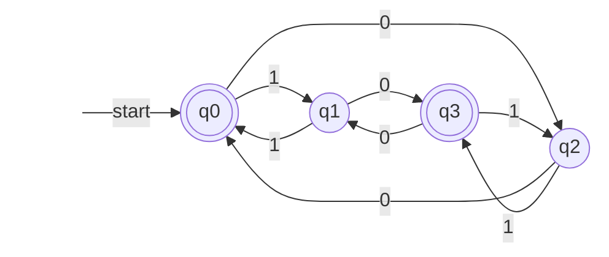
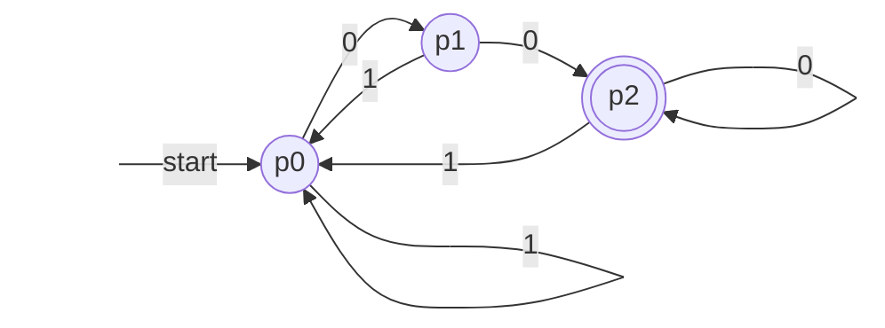
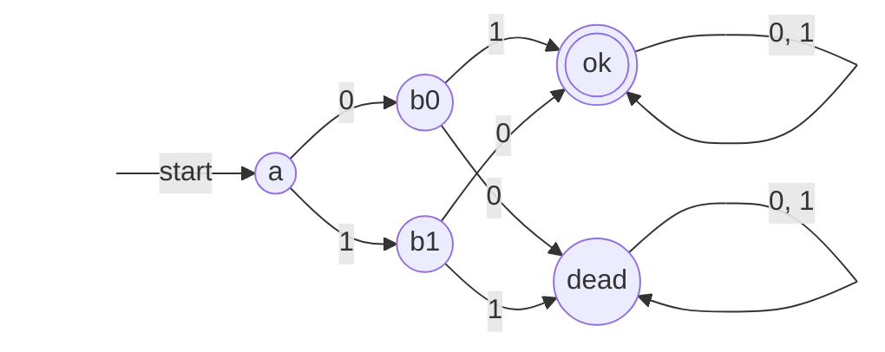
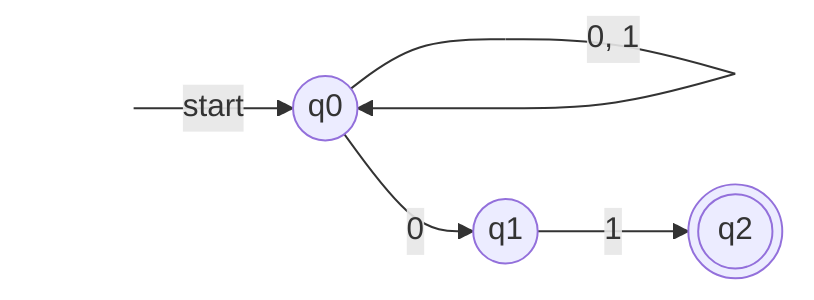
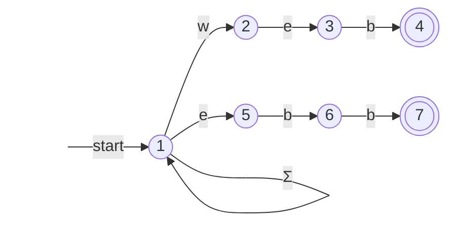
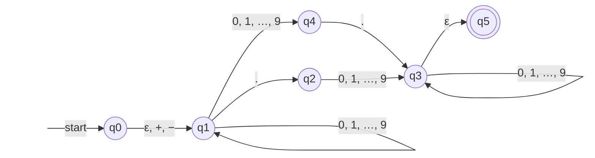
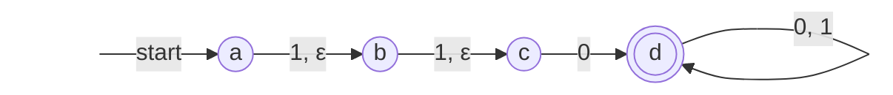

[Chapter 1](/4.8.1) explained that the second route to describing a language is recognition: design a machine with only finitely many states that reads symbols one at a time, and say that a string belongs to the language if the machine is in an "accepting" state when the input is exhausted. This chapter formalizes such a machine as the *finite automaton* and discusses three models in turn: the **deterministic finite automaton** (DFA), which has exactly one move at each step; the nondeterministic finite automaton (NFA), which may have several moves at each step; and the ε-NFA, which may also change state without reading input. Nondeterminism makes design easier but adds no recognition power: the subset construction turns any NFA into an equivalent DFA, the central theorem of this chapter, at the price of a possibly exponential growth in the number of states. Finite automata are the common model of lexical analyzers, regular-expression engines, string-matching algorithms (the KMP algorithm of [4.3.13](/4.3.13) is a special DFA), and sequential circuits in digital logic ([4.9.7](/4.9.7)). Chapter 5 proves that finite automata describe the same family of languages as the regular expressions of Chapter 3, and Chapter 6 studies the properties of this family and gives an algorithm for minimizing DFAs.

## 4.1. Deterministic Finite Automata

A **finite automaton** is, at any moment, in one of finitely many states. A state is a finite summary of "the input read so far": to decide whether the numbers of 0s and 1s in a binary string have the same parity, there is no need to remember the whole string; it suffices to remember the two parities, giving four possibilities. Each time a symbol is read, the machine moves from the current state to the next state by a fixed rule; when the input is exhausted, the string is accepted if the current state is one of the accepting states designated in advance.

**Definition 4.1.1 (Deterministic Finite Automaton)** A **deterministic finite automaton** (DFA) is a quintuple $A = (Q, \Sigma, \delta, q_0, F)$, where

- $Q$ is a finite set of **states**;
- $\Sigma$ is the input **alphabet**;
- $\delta\colon Q \times \Sigma \to Q$ is the **transition function**: $\delta(q, a)$ is the state to which the automaton moves when it reads $a$ in state $q$;
- $q_0 \in Q$ is the **start state**;
- $F \subseteq Q$ is the set of **accepting states** (also called final states).

"Deterministic" means that $\delta$ is an everywhere-defined function: for each state and each input symbol, the next state exists and is unique.

A DFA is usually represented in two ways. A *transition diagram* is a **directed graph**: each state is a node, $\delta(q, a) = p$ is drawn as an arc from $q$ to $p$ labeled $a$, the start state is marked by an arrow labeled start, and accepting states are drawn as double circles. A *transition table* is the table of the function $\delta$, with states as rows and input symbols as columns; the start state is marked by $\to$ and accepting states by $*$.

**Example 4.1.1** Let $\Sigma = \{0, 1\}$, $Q = \{q_0, q_1, q_2, q_3\}$, $F = \{q_0, q_3\}$, with the transition function

| | $0$ | $1$ |
|---|---|---|
| $\to * q_0$ | $q_2$ | $q_1$ |
| $q_1$ | $q_3$ | $q_0$ |
| $q_2$ | $q_0$ | $q_3$ |
| $* q_3$ | $q_1$ | $q_2$ |



Reading a 1 switches between the upper and lower rows, and reading a 0 switches between the left and right columns. On the input $0010$ the automaton passes through $q_0, q_2, q_0, q_1, q_3$ and stops in an accepting state, so $0010$ is accepted; on $011$ it stops in $q_2$ and does not accept.

To describe the state reached after reading a string, we extend $\delta$ from single symbols to strings.

**Definition 4.1.2 (Extended Transition Function)** The **extended transition function** $\hat\delta\colon Q \times \Sigma^* \to Q$ of a DFA $A = (Q, \Sigma, \delta, q_0, F)$ is defined by induction on the length of the string:

$$
\hat\delta(q, \varepsilon) = q, \qquad \hat\delta(q, xa) = \delta\bigl(\hat\delta(q, x), a\bigr) \quad (x \in \Sigma^*,\ a \in \Sigma).
$$

That is, first read all of $x$, then read the last symbol $a$ from the state reached. For a single symbol $a$, $\hat\delta(q, a) = \delta(\hat\delta(q, \varepsilon), a) = \delta(q, a)$, so $\hat\delta$ indeed extends $\delta$. Induction on $\lvert y\rvert$ easily proves $\hat\delta(q, xy) = \hat\delta(\hat\delta(q, x), y)$. In Example 4.1.1, $\hat\delta(q_0, 0010) = \delta(\hat\delta(q_0, 001), 0) = \delta(q_1, 0) = q_3$.

**Definition 4.1.3 (Language of a DFA)** The language accepted by a DFA $A$ is

$$
L(A) = \{\, w \in \Sigma^* \mid \hat\delta(q_0, w) \in F \,\}.
$$

Chapter 5 will prove that a language is a **regular language** if and only if it is the language of some DFA. Here we first see how to prove that a DFA accepts exactly a given language. As in Chapters 1 and 2, two directions must be proved; for automata, the most convenient way is to characterize, for each state, the strings that lead to it, and then to induct on the length of the string.

**Theorem 4.1.1** The language accepted by the DFA of Example 4.1.1 is $\{w \in \{0, 1\}^* \mid \lvert w\rvert_0 \text{ and } \lvert w\rvert_1 \text{ have the same parity}\}$.

**Proof** Rename the states $q_{2i+j}$ with $i, j \in \{0, 1\}$: $q_0 = q_{00}$, $q_1 = q_{01}$, $q_2 = q_{10}$, $q_3 = q_{11}$ (the subscripts are binary). Checking against the transition table, $\delta(q_{ij}, 0) = q_{(1-i)j}$ and $\delta(q_{ij}, 1) = q_{i(1-j)}$: reading 0 flips the first bit, and reading 1 flips the second. We prove by induction on $\lvert w\rvert$ that

$$
\hat\delta(q_0, w) = q_{ij}, \qquad i = \lvert w\rvert_0 \bmod 2,\quad j = \lvert w\rvert_1 \bmod 2.
$$
For $w = \varepsilon$ both counts are 0, and $\hat\delta(q_0, \varepsilon) = q_0 = q_{00}$. Let $w = xa$ and suppose the claim holds for $x$, $\hat\delta(q_0, x) = q_{ij}$. If $a = 0$, then $\hat\delta(q_0, w) = \delta(q_{ij}, 0) = q_{(1-i)j}$, and $w$ has one more 0 than $x$, so the parity of the number of 0s flips while that of 1s stays; the case $a = 1$ is the same. Hence $w \in L(A)$ if and only if $\hat\delta(q_0, w) \in \{q_{00}, q_{11}\}$, if and only if $i = j$. $\square$

This proof is exactly the **mutual induction** of [§1.4.3](/4.8.1#sec-1.4.3): each of the four states corresponds to a statement, and the induction step of each statement uses the induction hypotheses of the others.

### 4.1.1. Designing DFAs

The key to designing a DFA is to decide what the states must remember: a state is a "summary" of the prefix read so far, and it must suffice to determine everything that follows, that is, for any continuation $z$, to decide whether $xz$ belongs to the language. In practice, first draw along the "main line" the states and arcs needed for acceptance, then complete the outgoing arc for every symbol at every state, thinking carefully about which state each added arc should lead to.

**Example 4.1.2 (Suffixes)** Strings over $\{0, 1\}$ ending in 00. The states remember "how many consecutive 0s are at the end (counted up to 2)": $p_0$ means the string does not end in 0, $p_1$ means it ends in exactly one 0, and $p_2$ means it ends in at least two 0s. Reading a 1 always returns to $p_0$; reading a 0 gives $p_0 \to p_1 \to p_2 \to p_2$.



**Example 4.1.3 (Complement and Dead State)** Strings not containing the substring 00: take the DFA for strings containing 00 (similar to the figure above, except that $p_2$ also stays in $p_2$ on reading 1, since once the substring has occurred it never disappears) and swap accepting and nonaccepting states. In general, if $A = (Q, \Sigma, \delta, q_0, F)$ is a DFA, then $(Q, \Sigma, \delta, q_0, Q \setminus F)$ accepts $\Sigma^* \setminus L(A)$, because every string reaches exactly one state. After the swap, the state $p_2$ here becomes a nonaccepting state that cannot be left, called a *dead state*: once it is entered, nothing that follows will ever be accepted. In designing DFAs a dead state is often used to collect inputs that are "already doomed to fail". For example, strings of length at least 2 whose first two symbols differ:



**Example 4.1.4 (Modular Arithmetic)** Binary numbers divisible by 3 (leading 0s allowed, the empty string regarded as 0). If the prefix read so far represents the number $m$, then reading 0 gives $2m$ and reading 1 gives $2m + 1$, so it suffices to remember $m \bmod 3$: the states are $r \in \{0, 1, 2\}$ with $\delta(r, a) = (2r + a) \bmod 3$, and the start state and the only accepting state are both 0.

| | $0$ | $1$ |
|---|---|---|
| $\to * 0$ | $0$ | $1$ |
| $1$ | $2$ | $0$ |
| $2$ | $1$ | $2$ |

Induction on $\lvert w\rvert$ shows $\hat\delta(0, w) = (\text{the number represented by } w) \bmod 3$. The same method works for any modulus $k$ and any base.

**Remark** A finite automaton gives only an "accept or reject" verdict when the input is exhausted. A finite-state machine that also produces output at each step is called a transducer: if the output depends only on the state, it is a Moore machine; if it depends on both the state and the current input, a Mealy machine. They are models of synchronous sequential circuits ([4.9.7](/4.9.7)) and use the same language of states and transitions as DFAs.

## 4.2. Nondeterministic Finite Automata

Every state of a **DFA** must specify a unique next state for every symbol, which makes DFAs for many languages hard to write down directly. For example, for "strings ending in 01": when we read a 0, we do not know whether it is the second-to-last symbol. A **nondeterministic finite automaton** may have several moves in one step (or none), and accepts a string as soon as some way of choosing leads to an accepting state when the input is exhausted. One can imagine the machine "guessing" a path at each fork, or, equivalently, following all paths at the same time.

**Definition 4.2.1 (Nondeterministic Finite Automaton)** A **nondeterministic finite automaton** (NFA) is a quintuple $A = (Q, \Sigma, \delta, q_0, F)$, where $Q, \Sigma, q_0, F$ have the same meaning as for a DFA, and the transition function is

$$
\delta\colon Q \times \Sigma \to \mathcal{P}(Q),
$$
that is, $\delta(q, a)$ is a subset of $Q$ (possibly empty), and $\mathcal{P}(Q)$ is the **power set** of $Q$.

**Definition 4.2.2 (Extended Transition Function and Language of an NFA)** The extended transition function $\hat\delta\colon Q \times \Sigma^* \to \mathcal{P}(Q)$ of an NFA is defined by

$$
\hat\delta(q, \varepsilon) = \{q\}, \qquad \hat\delta(q, xa) = \bigcup_{p \in \hat\delta(q, x)} \delta(p, a).
$$
The language of an NFA $A$ is $L(A) = \{w \in \Sigma^* \mid \hat\delta(q_0, w) \cap F \ne \varnothing\}$.

$\hat\delta(q, w)$ is the set of all states reachable from $q$ along paths labeled $w$. A string $w$ is accepted if and only if the **transition diagram** has a path from $q_0$, labeled $w$, ending in an accepting state; it does not matter if other paths run into dead ends (the transition is the empty set) or stop in nonaccepting states.

**Example 4.2.1** An NFA for strings ending in 01: $q_0$ may stay put on any input, and on reading a 0 it may also "guess" that this is the second-to-last symbol and move to $q_1$; $q_1$ moves to the accepting state $q_2$ on reading 1, and $q_2$ has no outgoing arcs.



| | $0$ | $1$ |
|---|---|---|
| $\to q_0$ | $\{q_0, q_1\}$ | $\{q_0\}$ |
| $q_1$ | $\varnothing$ | $\{q_2\}$ |
| $* q_2$ | $\varnothing$ | $\varnothing$ |

On the input $00101$, $\hat\delta$ takes the values $\{q_0\}, \{q_0, q_1\}, \{q_0, q_1\}, \{q_0, q_2\}, \{q_0, q_1\}, \{q_0, q_2\}$ in turn; the last contains $q_2$, so the string is accepted.

**Theorem 4.2.1** The language accepted by the NFA of Example 4.2.1 is exactly $\{w \in \{0,1\}^* \mid w \text{ ends in } 01\}$.

**Proof** By induction on $\lvert w\rvert$ we prove three statements simultaneously: (1) $q_0 \in \hat\delta(q_0, w)$; (2) $q_1 \in \hat\delta(q_0, w)$ if and only if $w$ ends in 0; (3) $q_2 \in \hat\delta(q_0, w)$ if and only if $w$ ends in 01. For $w = \varepsilon$, $\hat\delta(q_0, \varepsilon) = \{q_0\}$ and all three hold ($\varepsilon$ ends in neither 0 nor 01). Let $w = xa$ and suppose the statements hold for $x$. (1) follows from $q_0 \in \hat\delta(q_0, x)$ and $q_0 \in \delta(q_0, a)$. (2) Only $q_0$ reading 0 can reach $q_1$, so $q_1 \in \hat\delta(q_0, w)$ if and only if $a = 0$ and $q_0 \in \hat\delta(q_0, x)$, which by (1) holds if and only if $a = 0$. (3) Only $q_1$ reading 1 can reach $q_2$, so $q_2 \in \hat\delta(q_0, w)$ if and only if $a = 1$ and $q_1 \in \hat\delta(q_0, x)$, which by the induction hypothesis (2) holds if and only if $a = 1$ and $x$ ends in 0, that is, $w$ ends in 01. $\square$

An NFA saves the work of "completing the outgoing arcs" required for a DFA. For example, for strings whose first two symbols differ, the NFA needs only the main line $a \xrightarrow{0} b_0 \xrightarrow{1} ok$, $a \xrightarrow{1} b_1 \xrightarrow{0} ok$ and a self-loop at $ok$; it does not need the *dead state* of Example 4.1.3: a transition without an outgoing arc is the empty set, and that path simply terminates.

## 4.3. Equivalence of DFAs and NFAs

Every **DFA** can be regarded as an **NFA**: let $\delta_N(q, a) = \{\delta_D(q, a)\}$; induction on $\lvert w\rvert$ shows $\hat\delta_N(q_0, w) = \{\hat\delta_D(q_0, w)\}$, so the two have the same language. The converse is the core of this chapter: the "state" of an NFA after reading $w$ is actually a set of states $\hat\delta(q_0, w)$, and $Q$ has only finitely many subsets, so each subset can serve as a state of a new DFA.

**Definition 4.3.1 (Subset Construction)** Let $N = (Q_N, \Sigma, \delta_N, q_0, F_N)$ be an NFA. The DFA obtained by the **subset construction** is $D = (Q_D, \Sigma, \delta_D, \{q_0\}, F_D)$, where

$$
Q_D = \mathcal{P}(Q_N), \qquad \delta_D(S, a) = \bigcup_{p \in S} \delta_N(p, a), \qquad F_D = \{\, S \subseteq Q_N \mid S \cap F_N \ne \varnothing \,\}.
$$

**Theorem 4.3.1** In Definition 4.3.1, $\hat\delta_D(\{q_0\}, w) = \hat\delta_N(q_0, w)$ for every $w \in \Sigma^*$. Hence $L(D) = L(N)$.

**Proof** Induct on $\lvert w\rvert$. For $w = \varepsilon$ both sides are $\{q_0\}$. Let $w = xa$; by the induction hypothesis $\hat\delta_D(\{q_0\}, x) = \hat\delta_N(q_0, x) = S$. Then

$$
\hat\delta_D(\{q_0\}, w) = \delta_D(S, a) = \bigcup_{p \in S} \delta_N(p, a) = \hat\delta_N(q_0, w),
$$
where the first equality is the definition of the extended transition function of the DFA, the second is the definition of $\delta_D$, and the third is the definition of the extended transition function of the NFA. Finally, $w \in L(D)$ if and only if $\hat\delta_D(\{q_0\}, w) \in F_D$, if and only if $\hat\delta_N(q_0, w) \cap F_N \ne \varnothing$, if and only if $w \in L(N)$. $\square$

**Theorem 4.3.2** A language $L$ is the language of some DFA if and only if $L$ is the language of some NFA.

**Proof** Necessity follows from the above construction regarding a DFA as an NFA, and sufficiency from Theorem 4.3.1. $\square$

$\mathcal{P}(Q_N)$ has $2^{\lvert Q_N\rvert}$ elements, but many of them are unreachable from $\{q_0\}$ and do not affect the language. In practice we start from $\{q_0\}$ and compute transitions only for the subsets that have appeared, until no new subsets are produced (the "lazy" subset construction). The following Python program implements this process with **breadth-first search** and applies it to the NFA of Example 4.2.1:

```python
from collections import deque


def subset_construction(nfa, start, finals, alphabet):
    """Lazy subset construction: only subsets reachable from {start}."""
    q0 = frozenset([start])
    dfa, queue = {}, deque([q0])
    while queue:
        S = queue.popleft()
        if S in dfa:
            continue
        dfa[S] = {}
        for a in alphabet:
            T = frozenset(r for q in S for r in nfa.get((q, a), ()))
            dfa[S][a] = T
            if T not in dfa:
                queue.append(T)
    accepting = {S for S in dfa if S & finals}
    return q0, dfa, accepting


# NFA for strings ending in 01
nfa = {("q0", "0"): {"q0", "q1"}, ("q0", "1"): {"q0"}, ("q1", "1"): {"q2"}}
q0, dfa, acc = subset_construction(nfa, "q0", {"q2"}, "01")
name = lambda S: "{" + ", ".join(sorted(S)) + "}"
for S, row in dfa.items():
    mark = "*" if S in acc else " "
    print(f"{mark} {name(S):12} 0 -> {name(row['0']):12} 1 -> {name(row['1'])}")
```

```text
  {q0}         0 -> {q0, q1}     1 -> {q0}
  {q0, q1}     0 -> {q0, q1}     1 -> {q0, q2}
* {q0, q2}     0 -> {q0, q1}     1 -> {q0}
```

Only 3 of the 8 subsets are reachable, and the three states of the resulting DFA correspond exactly to "the string does not end in 0", "ends in 0", and "ends in 01", in line with the design idea of Example 4.1.2.

### 4.3.1. The Cost of the Subset Construction

In practice the DFA produced by the subset construction often has about as many states as the NFA, but exponential growth in the worst case cannot be avoided.

**Theorem 4.3.3** Let $n \ge 1$ and $L_n = \{w \in \{0, 1\}^* \mid \text{the } n\text{th symbol from the end of } w \text{ is } 1\}$. $L_n$ has an NFA with $n + 1$ states, but every DFA accepting $L_n$ has at least $2^n$ states.

**Proof** The NFA: $q_0$ stays put on any symbol and, on reading 1, may also move to $q_1$; $q_i$ moves to $q_{i+1}$ on any symbol ($1 \le i < n$); $q_n$ is the only accepting state and has no outgoing arcs. It accepts $w$ if and only if it can "guess" the $n$th symbol from the end, jump from $q_0$ to $q_1$ there, and that symbol is 1.

The lower bound: let a DFA $D = (Q, \{0,1\}, \delta, q_0, F)$ accept $L_n$ with $\lvert Q\rvert < 2^n$. There are $2^n$ strings of length $n$, so by the pigeonhole principle there are two different strings $a_1 \cdots a_n \ne b_1 \cdots b_n$ with $\hat\delta(q_0, a_1 \cdots a_n) = \hat\delta(q_0, b_1 \cdots b_n)$. Choose a position $k$ with $a_k \ne b_k$, say $a_k = 1$ and $b_k = 0$. Append $0^{k-1}$ to both strings; by $\hat\delta(q, xy) = \hat\delta(\hat\delta(q, x), y)$ they still reach the same state. But the $n$th symbol from the end of $a_1 \cdots a_n 0^{k-1}$ is $a_k = 1$, so it belongs to $L_n$, while the $n$th symbol from the end of $b_1 \cdots b_n 0^{k-1}$ is $b_k = 0$, so it does not. The same state cannot both accept and reject, a contradiction. $\square$

Conversely, a DFA that remembers "the last $n$ symbols" has exactly $2^n$ states (padding with 0s at the beginning when fewer than $n$ symbols have been read), so the lower bound is tight. The idea of this proof, that two strings which have a "distinguishing suffix" must reach different states, is developed in Chapter 6 into the Myhill–Nerode theorem.

## 4.4. Application: Text Search

Finding occurrences of any keyword from a set in a text amounts to deciding whether each prefix of the text ends with some keyword. Take web and ebb as an example; the **NFA** is easy to write: the start state stays put on any symbol ($\Sigma$ is the set of all ASCII characters) and at the same time follows one chain for the letters of each keyword.



The **subset construction** gives a **DFA**. Merging the characters other than w, e, b into one column "other", there are only 7 reachable subsets (an asterisk marks accepting states):

| | w | e | b | other |
|---|---|---|---|---|
| $\to \{1\}$ | $\{1,2\}$ | $\{1,5\}$ | $\{1\}$ | $\{1\}$ |
| $\{1,2\}$ | $\{1,2\}$ | $\{1,3,5\}$ | $\{1\}$ | $\{1\}$ |
| $\{1,5\}$ | $\{1,2\}$ | $\{1,5\}$ | $\{1,6\}$ | $\{1\}$ |
| $\{1,3,5\}$ | $\{1,2\}$ | $\{1,5\}$ | $\{1,4,6\}$ | $\{1\}$ |
| $\{1,6\}$ | $\{1,2\}$ | $\{1,5\}$ | $\{1,7\}$ | $\{1\}$ |
| $* \{1,4,6\}$ | $\{1,2\}$ | $\{1,5\}$ | $\{1,7\}$ | $\{1\}$ |
| $* \{1,7\}$ | $\{1,2\}$ | $\{1,5\}$ | $\{1\}$ | $\{1\}$ |

The DFA has as many states as the NFA, which is no coincidence. The set the NFA is in after reading $x$ is determined by "which suffixes of $x$ are prefixes of some keyword": every non-start state of the NFA corresponds to a keyword prefix (2 is w, 3 is we, 5 is e, and so on). Among those keyword prefixes that are also suffixes of $x$, the shorter ones are all suffixes of the longest one, $u$, so the whole set is determined uniquely by $u$. Hence the number of states of the DFA produced by the subset construction does not exceed the number of states of the NFA, which is the number of nodes of the **trie** of the keyword set. The set $\{1, 3, 5\}$ is exactly such a case: after reading we, the longest keyword prefix is we (state 3), and its suffix e is also a keyword prefix (state 5).

The information in the DFA about "which state to return to on reading a mismatching character" is exactly what the next table of the **Knuth–Morris–Pratt algorithm** in [4.3.13](/4.3.13) stores in compressed form: for a single keyword, KMP stores only one failure transition per state and backtracks along the failure chain on demand, whereas the DFA stores the target for every state and every character. For several keywords, adding failure pointers to the trie gives the Aho–Corasick automaton, which recognizes the same language as the DFA obtained above by the subset construction. Unix tools such as grep and fgrep are built on automata of this kind.

## 4.5. NFAs with ε-Transitions

We relax once more: the automaton may change state without reading any input, which is called an ε-transition. This again adds no recognition power, but it makes constructions more modular, and it will be used extensively in Chapter 5 when automata are constructed from **regular expressions**.

**Definition 4.5.1 (ε-NFA)** An **NFA with ε-transitions** (ε-NFA) is a quintuple $E = (Q, \Sigma, \delta, q_0, F)$ whose only difference from an NFA is the transition function

$$
\delta\colon Q \times (\Sigma \cup \{\varepsilon\}) \to \mathcal{P}(Q),
$$
where $\varepsilon \notin \Sigma$, and $\delta(q, \varepsilon)$ is the set of states to which one can move from $q$ without reading input.

**Example 4.5.1** The following ε-NFA accepts decimal numbers: an optional sign, followed by a string of digits containing exactly one decimal point, where at least one of the digit strings before and after the point is nonempty, such as $3.14$, $+.314$, $-314.$.



The ε-transition $q_0 \to q_1$ means that the sign may be omitted; $q_1 \xrightarrow{\cdot} q_2 \xrightarrow{\text{digit}} q_3$ handles the case without digits before the point, and $q_1 \xrightarrow{\text{digit}} q_4 \xrightarrow{\cdot} q_3$ handles the case with digits before the point; the ε-transition $q_3 \to q_5$ only serves to make the accepting state a state of its own.

ε-transitions may occur consecutively, so we first define the states reachable from a state by ε-transitions alone.

**Definition 4.5.2 (ε-Closure)** In an ε-NFA, the **ε-closure** $\operatorname{ECLOSE}(q)$ of a state $q$ is the smallest set satisfying: $q \in \operatorname{ECLOSE}(q)$; and if $p \in \operatorname{ECLOSE}(q)$ and $r \in \delta(p, \varepsilon)$, then $r \in \operatorname{ECLOSE}(q)$. For a set $S$ of states, $\operatorname{ECLOSE}(S) = \bigcup_{q \in S} \operatorname{ECLOSE}(q)$.

That is, $\operatorname{ECLOSE}(q)$ is the set of all states reachable from $q$ (including $q$ itself) in the subgraph containing only ε-arcs, and it can be computed by a single graph search. In Example 4.5.1, $\operatorname{ECLOSE}(q_0) = \{q_0, q_1\}$ and $\operatorname{ECLOSE}(q_3) = \{q_3, q_5\}$; the ε-closure of every other state contains only itself.

**Definition 4.5.3 (Extended Transition Function and Language of an ε-NFA)** The extended transition function $\hat\delta\colon Q \times \Sigma^* \to \mathcal{P}(Q)$ of an ε-NFA is defined by

$$
\hat\delta(q, \varepsilon) = \operatorname{ECLOSE}(q), \qquad \hat\delta(q, xa) = \operatorname{ECLOSE}\Bigl(\bigcup_{p \in \hat\delta(q, x)} \delta(p, a)\Bigr).
$$
The language of an ε-NFA $E$ is $L(E) = \{w \in \Sigma^* \mid \hat\delta(q_0, w) \cap F \ne \varnothing\}$.

For each symbol read, first take one step along arcs labeled by that symbol, then take the ε-closure. This definition guarantees that $\hat\delta(q, w)$ is exactly the set of all states reachable from $q$ along paths whose concatenated labels (ε contributes no symbol) equal $w$. Here is the computation of $\hat\delta(q_0, 5.6)$ in Example 4.5.1:

$$
\begin{aligned}
\hat\delta(q_0, \varepsilon) &= \operatorname{ECLOSE}(q_0) = \{q_0, q_1\},\\
\hat\delta(q_0, 5) &= \operatorname{ECLOSE}\bigl(\delta(q_0, 5) \cup \delta(q_1, 5)\bigr) = \operatorname{ECLOSE}(\{q_1, q_4\}) = \{q_1, q_4\},\\
\hat\delta(q_0, 5.) &= \operatorname{ECLOSE}(\{q_2, q_3\}) = \{q_2, q_3, q_5\},\\
\hat\delta(q_0, 5.6) &= \operatorname{ECLOSE}(\{q_3\}) = \{q_3, q_5\}.
\end{aligned}
$$
The result contains $q_5$, so $5.6$ is accepted.

**Theorem 4.5.1 (Modified Subset Construction)** Let $E = (Q_E, \Sigma, \delta_E, q_0, F_E)$ be an ε-NFA. Let the **DFA** $D = (Q_D, \Sigma, \delta_D, q_D, F_D)$ be given by

$$
\begin{gathered}
Q_D = \{\, S \subseteq Q_E \mid S = \operatorname{ECLOSE}(S) \,\}, \qquad q_D = \operatorname{ECLOSE}(q_0),\\
\delta_D(S, a) = \operatorname{ECLOSE}\Bigl(\bigcup_{p \in S} \delta_E(p, a)\Bigr), \qquad F_D = \{\, S \in Q_D \mid S \cap F_E \ne \varnothing \,\}.
\end{gathered}
$$
Then $\hat\delta_D(q_D, w) = \hat\delta_E(q_0, w)$ for every $w \in \Sigma^*$, and hence $L(D) = L(E)$.

**Proof** Induct on $\lvert w\rvert$. For $w = \varepsilon$, $\hat\delta_D(q_D, \varepsilon) = q_D = \operatorname{ECLOSE}(q_0) = \hat\delta_E(q_0, \varepsilon)$. Let $w = xa$; by the induction hypothesis $\hat\delta_D(q_D, x) = \hat\delta_E(q_0, x) = S$, so

$$
\hat\delta_D(q_D, w) = \delta_D(S, a) = \operatorname{ECLOSE}\Bigl(\bigcup_{p \in S} \delta_E(p, a)\Bigr) = \hat\delta_E(q_0, w).
$$
($\delta_D(S, a)$ is an ε-closure, so it indeed belongs to $Q_D$.) The equivalence of the acceptance conditions is the same as in Theorem 4.3.1. $\square$

Combining Theorem 4.3.2 with the trivial direction that every DFA is an ε-NFA without ε-arcs, the three models DFA, **NFA**, and ε-NFA accept exactly the same family of languages.

**Example 4.5.2** The modified **subset construction** for Example 4.5.1. Regard the signs, the digits, and the decimal point as one column each. Starting from $\operatorname{ECLOSE}(q_0) = \{q_0, q_1\}$, the reachable states are as follows ($\varnothing$ is the *dead state*):

| | $+, -$ | digit | $.$ |
|---|---|---|---|
| $\to \{q_0, q_1\}$ | $\{q_1\}$ | $\{q_1, q_4\}$ | $\{q_2\}$ |
| $\{q_1\}$ | $\varnothing$ | $\{q_1, q_4\}$ | $\{q_2\}$ |
| $\{q_1, q_4\}$ | $\varnothing$ | $\{q_1, q_4\}$ | $\{q_2, q_3, q_5\}$ |
| $\{q_2\}$ | $\varnothing$ | $\{q_3, q_5\}$ | $\varnothing$ |
| $* \{q_2, q_3, q_5\}$ | $\varnothing$ | $\{q_3, q_5\}$ | $\varnothing$ |
| $* \{q_3, q_5\}$ | $\varnothing$ | $\{q_3, q_5\}$ | $\varnothing$ |
| $\varnothing$ | $\varnothing$ | $\varnothing$ | $\varnothing$ |

**Example 4.5.3** ε-transitions are especially suited to expressing "optional" parts. Strings over $\{0, 1\}$ of length at least 1 with at least one 0 among the first three symbols: the first 0 occurs at position 1, 2, or 3, preceded by at most two 1s.



Each of the two segments of arcs from $a$ to $c$ may read a 1 or nothing, which is exactly the trick of Example 3.3.3 in Chapter 3 of expressing "at most one 1" by $(\varepsilon + 1)$; the corresponding regular expression is $(\varepsilon + 1)(\varepsilon + 1)0(0 + 1)^*$.

## Summary

| Model | Transition function | $\hat\delta(q_0, w)$ | Acceptance condition | Conversion to DFA |
|---|---|---|---|---|
| **DFA** | $Q \times \Sigma \to Q$ | One state | Belongs to $F$ | — |
| **NFA** | $Q \times \Sigma \to \mathcal{P}(Q)$ | Set of states | Meets $F$ | **Subset construction**, at most $2^n$ states |
| **ε-NFA** | $Q \times (\Sigma \cup \{\varepsilon\}) \to \mathcal{P}(Q)$ | Set of states (closed under **ε-closure**) | Meets $F$ | Modified subset construction |

- Design: the states of a DFA are "summaries of the prefix read"; draw the main line first, then complete the outgoing arcs, using a *dead state* if necessary; NFAs and ε-NFAs can "guess", and only the successful paths need to be drawn.
- Correctness: characterize, for each state, the strings that reach it, and induct on the string length (**mutual induction**).
- The subset construction needs to compute only the subsets reachable from the start state; direct simulation of an NFA (maintaining the current set of states) processes an input of length $m$ in $O(m s^2)$ time ($s$ the number of NFA states), without first constructing a DFA.

## Questions

1. Give DFAs accepting the following languages over $\{a, b\}$: (1) no substring aa; (2) exactly an odd number of occurrences of the substring ab; (3) an even number of $a$s and even length; (4) containing the substring ab but not the substring bb; (5) equally many $a$s and $b$s, and in every prefix the difference between the numbers of $a$s and $b$s is at most 1.
2. Prove that the DFA of Example 4.1.4 accepts exactly the binary numbers divisible by 3.
3. Give an NFA for the strings over $\{0, 1\}$ of length at least 2 whose last two symbols differ, and convert it to a DFA by the subset construction.
4. Give an ε-NFA for the strings over $\{a, b, c\}$ of length at least 1 with at least one non-$c$ symbol among the last 3 symbols.
5. Prove that for every NFA $N$ there is an ε-NFA with only one accepting state accepting the same language. Does this conclusion still hold if only NFAs (without ε-transitions) are allowed?
6. Apply the subset construction to the NFA of Theorem 4.3.3 with $n = 3$, and verify that the resulting DFA has exactly 8 reachable states.
