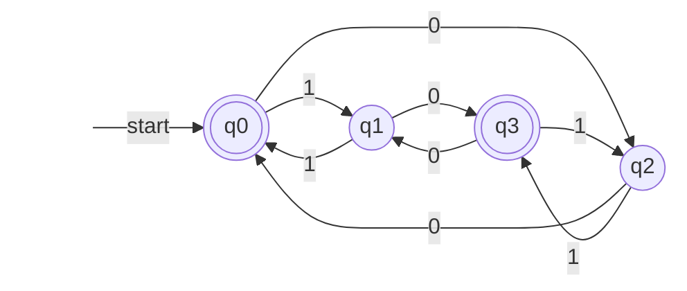
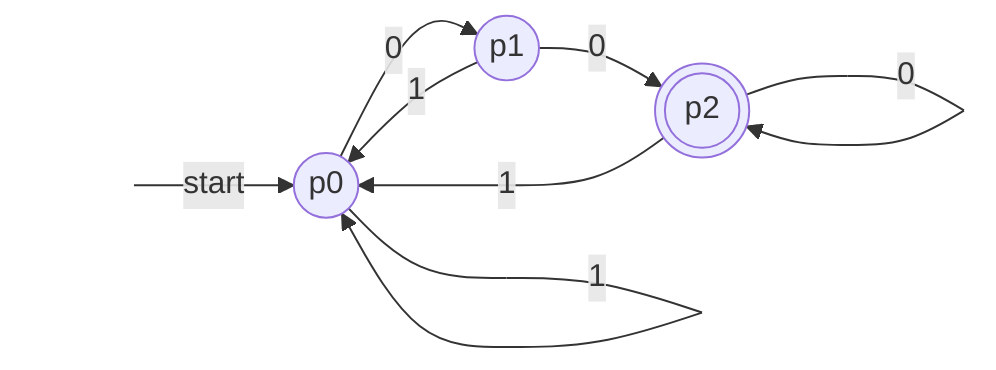
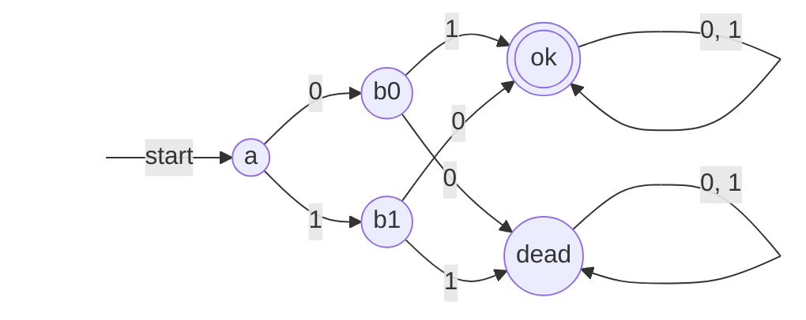
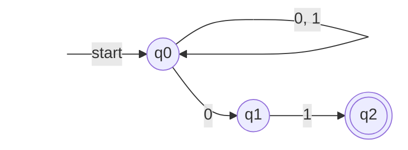
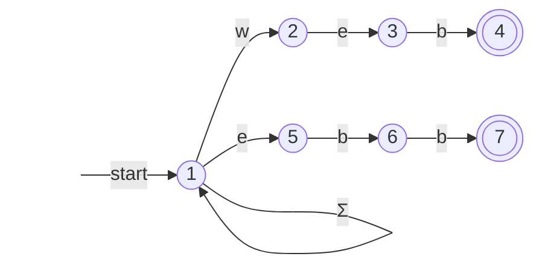
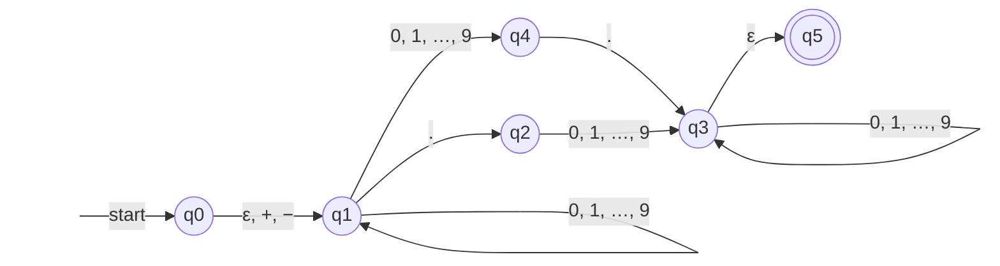
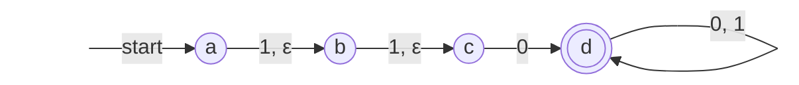

[第 1 章](/4.8.1)说过，描述语言的第二条路线是识别：设计一台只有有限个状态的机器，逐个读入符号，读完时处于"接受"状态的串属于语言。本章把这台机器形式化为**有限自动机**（finite automaton），依次讨论三种模型：每一步只有一个去处的**确定有限自动机**（DFA），每一步可以有多个去处的非确定有限自动机（NFA），以及允许不读输入就转移的 ε-NFA。非确定性让设计变得容易，但不增加识别能力：子集构造把任何 NFA 变成等价的 DFA，这是本章的核心定理，代价是状态数可能呈指数增长。有限自动机是词法分析器、正则表达式引擎、串匹配算法（[4.3.13](/4.3.13) 的 KMP 算法就是一台特殊的 DFA）和数字电路中时序电路（[4.9.7](/4.9.7)）的共同模型。第 5 章证明有限自动机与第 3 章的正规表达式描述的是同一族语言，第 6 章研究这族语言的性质，并给出 DFA 的极小化算法。

## 4.1. 确定有限自动机

一台**有限自动机**在任一时刻处于有限个状态中的一个。状态是对"到目前为止读过的输入"的有限总结：要判断一个二进制串中 0 和 1 的个数奇偶性是否相同，不必记住整个串，只需记住两个奇偶位，共四种可能。每读入一个符号，机器按固定的规则从当前状态转到下一个状态；输入读完时，若所处的状态是事先指定的接受状态之一，就接受这个串。

**定义 4.1.1（确定有限自动机）** 一个**确定有限自动机**（DFA）是五元组 $A = (Q, \Sigma, \delta, q_0, F)$，其中

- $Q$ 是**状态**的有限集合；
- $\Sigma$ 是输入**字母表**；
- $\delta\colon Q \times \Sigma \to Q$ 是**转移函数**：$\delta(q, a)$ 是处于状态 $q$ 时读入 $a$ 后转到的状态；
- $q_0 \in Q$ 是**开始状态**；
- $F \subseteq Q$ 是**接受状态**（也称终态）的集合。

"确定"指 $\delta$ 是一个处处有定义的函数：对每个状态和每个输入符号，下一个状态存在且唯一。

DFA 通常用两种方式表示。转移图（transition diagram）是一个**有向图**：每个状态是一个结点，$\delta(q, a) = p$ 画成从 $q$ 到 $p$ 标记为 $a$ 的弧，开始状态用一个标有 start 的箭头指向，接受状态画成双圈。转移表（transition table）是函数 $\delta$ 的表格，行是状态，列是输入符号；开始状态前标 $\to$，接受状态前标 $*$。

**例 4.1.1** $\Sigma = \{0, 1\}$，$Q = \{q_0, q_1, q_2, q_3\}$，$F = \{q_0, q_3\}$，转移函数如下：

| | $0$ | $1$ |
|---|---|---|
| $\to * q_0$ | $q_2$ | $q_1$ |
| $q_1$ | $q_3$ | $q_0$ |
| $q_2$ | $q_0$ | $q_3$ |
| $* q_3$ | $q_1$ | $q_2$ |



读 1 在上下两行之间切换，读 0 在左右两列之间切换。读入 $0010$ 时依次经过 $q_0, q_2, q_0, q_1, q_3$，停在接受状态，所以接受 $0010$；读入 $011$ 时停在 $q_2$，不接受。

为了描述读入一个串后到达的状态，把 $\delta$ 从单个符号推广到串。

**定义 4.1.2（扩展转移函数）** DFA $A = (Q, \Sigma, \delta, q_0, F)$ 的**扩展转移函数** $\hat\delta\colon Q \times \Sigma^* \to Q$ 按串的长度归纳定义：

$$
\hat\delta(q, \varepsilon) = q, \qquad \hat\delta(q, xa) = \delta\bigl(\hat\delta(q, x), a\bigr) \quad (x \in \Sigma^*,\ a \in \Sigma).
$$

即先读完 $x$，再从所到的状态读最后一个符号 $a$。对单个符号 $a$，$\hat\delta(q, a) = \delta(\hat\delta(q, \varepsilon), a) = \delta(q, a)$，所以 $\hat\delta$ 确实是 $\delta$ 的推广。对 $\lvert y\rvert$ 归纳容易证明 $\hat\delta(q, xy) = \hat\delta(\hat\delta(q, x), y)$。例 4.1.1 中，$\hat\delta(q_0, 0010) = \delta(\hat\delta(q_0, 001), 0) = \delta(q_1, 0) = q_3$。

**定义 4.1.3（DFA 的语言）** DFA $A$ 接受的语言为

$$
L(A) = \{\, w \in \Sigma^* \mid \hat\delta(q_0, w) \in F \,\}.
$$

第 5 章将证明：一个语言是**正规语言**，当且仅当它是某个 DFA 的语言。这里先看怎样证明一个 DFA 接受的恰好是给定的语言。和第 1、2 章一样，这要求证明两个方向；对自动机来说，最方便的做法是为每个状态写出"到达这个状态的串"的刻画，再对串的长度归纳。

**定理 4.1.1** 例 4.1.1 的 DFA 接受的语言是 $\{w \in \{0, 1\}^* \mid \lvert w\rvert_0 \text{ 与 } \lvert w\rvert_1 \text{ 的奇偶性相同}\}$。

**证明** 把状态重新写成 $q_{2i+j}$，$i, j \in \{0, 1\}$：$q_0 = q_{00}$，$q_1 = q_{01}$，$q_2 = q_{10}$，$q_3 = q_{11}$（下标是二进制）。由转移表直接核对，$\delta(q_{ij}, 0) = q_{(1-i)j}$，$\delta(q_{ij}, 1) = q_{i(1-j)}$：读 0 翻转第一位，读 1 翻转第二位。对 $\lvert w\rvert$ 归纳证明

$$
\hat\delta(q_0, w) = q_{ij}, \qquad i = \lvert w\rvert_0 \bmod 2,\quad j = \lvert w\rvert_1 \bmod 2.
$$
$w = \varepsilon$ 时两个计数都是 0，$\hat\delta(q_0, \varepsilon) = q_0 = q_{00}$。设 $w = xa$ 且命题对 $x$ 成立，$\hat\delta(q_0, x) = q_{ij}$。若 $a = 0$，$\hat\delta(q_0, w) = \delta(q_{ij}, 0) = q_{(1-i)j}$，而 $w$ 比 $x$ 多一个 0，0 的个数的奇偶性翻转、1 的不变；$a = 1$ 同理。于是 $w \in L(A)$ 当且仅当 $\hat\delta(q_0, w) \in \{q_{00}, q_{11}\}$，当且仅当 $i = j$。$\square$

这个证明就是 [§1.4.3](/4.8.1#sec-1.4.3) 的**互归纳**：四个状态各对应一个命题，归纳步骤中每个命题都用到另一个命题的归纳假设。

### 4.1.1. DFA 的设计

设计 DFA 的关键是决定状态要记住什么：状态是读过的前缀的一个"摘要"，它必须足以决定以后的一切，即对任何后续输入 $z$，能判断 $xz$ 是否属于语言。实际操作时，先沿着"主线"画出接受所需的状态和弧，再为每个状态补齐每个符号的出弧，并想清楚每条补上的弧应该指向哪个状态。

**例 4.1.2（后缀）** $\{0, 1\}$ 上以 00 结尾的串。状态记住"当前末尾有几个连续的 0（最多记到 2）"：$p_0$ 表示末尾不是 0，$p_1$ 表示末尾恰好一个 0，$p_2$ 表示末尾至少两个 0。读 1 总是回到 $p_0$；读 0 时 $p_0 \to p_1 \to p_2 \to p_2$。



**例 4.1.3（补与死状态）** 不含子串 00 的串：在含子串 00 的 DFA（与上图类似，但 $p_2$ 读 1 时也停留在 $p_2$，因为子串一旦出现就不会消失）中交换接受与不接受的状态即可。一般地，若 $A = (Q, \Sigma, \delta, q_0, F)$ 是 DFA，则 $(Q, \Sigma, \delta, q_0, Q \setminus F)$ 接受 $\Sigma^* \setminus L(A)$，因为每个串恰好到达一个状态。这里的 $p_2$ 在交换后成为一个无法离开的不接受状态，称为死状态（dead state）：一旦进入，无论后面读什么都不会被接受。设计 DFA 时常用它来收容"已经注定失败"的输入。例如，长度至少为 2 且前两个符号不同的串：



**例 4.1.4（模运算）** 二进制表示能被 3 整除的数（允许前导 0，空串看作 0）。设读过的前缀表示的数为 $m$，则再读 0 得 $2m$，读 1 得 $2m + 1$，所以只需记住 $m \bmod 3$：状态 $r \in \{0, 1, 2\}$，$\delta(r, a) = (2r + a) \bmod 3$，开始状态与唯一的接受状态都是 0。

| | $0$ | $1$ |
|---|---|---|
| $\to * 0$ | $0$ | $1$ |
| $1$ | $2$ | $0$ |
| $2$ | $1$ | $2$ |

对 $\lvert w\rvert$ 归纳可证 $\hat\delta(0, w) = (w \text{ 表示的数}) \bmod 3$。同样的办法对任何模数 $k$ 和任何进制都适用。

**注** 有限自动机只在读完输入时给出一个"接受或拒绝"的结论。在每一步还产生输出的有限状态机称为转换器：输出只由状态决定的是 Moore 机，由状态和当前输入共同决定的是 Mealy 机。它们是同步时序电路（[4.9.7](/4.9.7)）的模型，与 DFA 用的是同一套状态与转移的语言。

## 4.2. 非确定有限自动机

**DFA** 的每个状态都必须为每个符号指定唯一的下一状态，这让许多语言的 DFA 很难直接写出。例如"以 01 结尾的串"：读到一个 0 时，我们并不知道它是不是倒数第二个符号。**非确定有限自动机**允许机器在一步之内有多个去处（也可以没有去处），只要有一种选择方式能在读完时到达接受状态，就接受这个串。可以把它想象成机器在每个岔路口"猜"一条路，或者等价地，同时沿所有的路走下去。

**定义 4.2.1（非确定有限自动机）** 一个**非确定有限自动机**（NFA）是五元组 $A = (Q, \Sigma, \delta, q_0, F)$，$Q, \Sigma, q_0, F$ 的含义与 DFA 相同，转移函数是

$$
\delta\colon Q \times \Sigma \to \mathcal{P}(Q),
$$
即 $\delta(q, a)$ 是 $Q$ 的一个子集（可以为空），$\mathcal{P}(Q)$ 是 $Q$ 的**幂集**。

**定义 4.2.2（NFA 的扩展转移函数与语言）** NFA 的扩展转移函数 $\hat\delta\colon Q \times \Sigma^* \to \mathcal{P}(Q)$ 定义为

$$
\hat\delta(q, \varepsilon) = \{q\}, \qquad \hat\delta(q, xa) = \bigcup_{p \in \hat\delta(q, x)} \delta(p, a).
$$
NFA $A$ 的语言为 $L(A) = \{w \in \Sigma^* \mid \hat\delta(q_0, w) \cap F \ne \varnothing\}$。

$\hat\delta(q, w)$ 是从 $q$ 出发、沿标记为 $w$ 的路径能到达的全体状态。$w$ 被接受，当且仅当**转移图**中存在一条从 $q_0$ 出发、标记为 $w$、终点为接受状态的路径；其他路径走进死胡同（转移为空集）或停在非接受状态都无妨。

**例 4.2.1** 以 01 结尾的串的 NFA：$q_0$ 在任何输入下都可以留在原地，读 0 时还可以"猜"这是倒数第二个符号而转到 $q_1$；$q_1$ 读 1 转到接受状态 $q_2$，$q_2$ 没有出弧。



| | $0$ | $1$ |
|---|---|---|
| $\to q_0$ | $\{q_0, q_1\}$ | $\{q_0\}$ |
| $q_1$ | $\varnothing$ | $\{q_2\}$ |
| $* q_2$ | $\varnothing$ | $\varnothing$ |

读入 $00101$ 时，$\hat\delta$ 依次为 $\{q_0\}, \{q_0, q_1\}, \{q_0, q_1\}, \{q_0, q_2\}, \{q_0, q_1\}, \{q_0, q_2\}$，最后含 $q_2$，接受。

**定理 4.2.1** 例 4.2.1 的 NFA 接受的语言恰是 $\{w \in \{0,1\}^* \mid w \text{ 以 } 01 \text{ 结尾}\}$。

**证明** 对 $\lvert w\rvert$ 同时归纳证明三个命题：(1) $q_0 \in \hat\delta(q_0, w)$；(2) $q_1 \in \hat\delta(q_0, w)$ 当且仅当 $w$ 以 0 结尾；(3) $q_2 \in \hat\delta(q_0, w)$ 当且仅当 $w$ 以 01 结尾。$w = \varepsilon$ 时 $\hat\delta(q_0, \varepsilon) = \{q_0\}$，三者成立（$\varepsilon$ 不以 0 或 01 结尾）。设 $w = xa$，命题对 $x$ 成立。(1) 由 $q_0 \in \hat\delta(q_0, x)$ 且 $q_0 \in \delta(q_0, a)$ 得到。(2) 只有 $q_0$ 读 0 能到 $q_1$，所以 $q_1 \in \hat\delta(q_0, w)$ 当且仅当 $a = 0$ 且 $q_0 \in \hat\delta(q_0, x)$，由 (1) 当且仅当 $a = 0$。(3) 只有 $q_1$ 读 1 能到 $q_2$，所以 $q_2 \in \hat\delta(q_0, w)$ 当且仅当 $a = 1$ 且 $q_1 \in \hat\delta(q_0, x)$，由归纳假设 (2) 当且仅当 $a = 1$ 且 $x$ 以 0 结尾，即 $w$ 以 01 结尾。$\square$

NFA 省去了 DFA 中"补齐出弧"的工作。例如前两个符号不同的串，NFA 只需画出主线 $a \xrightarrow{0} b_0 \xrightarrow{1} ok$、$a \xrightarrow{1} b_1 \xrightarrow{0} ok$ 和 $ok$ 上的自环，不需要例 4.1.3 中的**死状态**：没有出弧的转移就是空集，那条路径自然终止。

## 4.3. DFA 与 NFA 的等价

每个 **DFA** 都可以看作 **NFA**：令 $\delta_N(q, a) = \{\delta_D(q, a)\}$，对 $\lvert w\rvert$ 归纳可证 $\hat\delta_N(q_0, w) = \{\hat\delta_D(q_0, w)\}$，两者的语言相同。反过来的方向是本章的核心：NFA 在读入 $w$ 后所处的"状态"实际上是一个状态集合 $\hat\delta(q_0, w)$，而 $Q$ 的子集只有有限个，所以可以把每个子集当作一个新 DFA 的状态。

**定义 4.3.1（子集构造）** 设 NFA $N = (Q_N, \Sigma, \delta_N, q_0, F_N)$。由**子集构造**得到的 DFA 为 $D = (Q_D, \Sigma, \delta_D, \{q_0\}, F_D)$，其中

$$
Q_D = \mathcal{P}(Q_N), \qquad \delta_D(S, a) = \bigcup_{p \in S} \delta_N(p, a), \qquad F_D = \{\, S \subseteq Q_N \mid S \cap F_N \ne \varnothing \,\}.
$$

**定理 4.3.1** 在定义 4.3.1 中，对任意 $w \in \Sigma^*$，$\hat\delta_D(\{q_0\}, w) = \hat\delta_N(q_0, w)$。因此 $L(D) = L(N)$。

**证明** 对 $\lvert w\rvert$ 归纳。$w = \varepsilon$ 时两边都是 $\{q_0\}$。设 $w = xa$，由归纳假设 $\hat\delta_D(\{q_0\}, x) = \hat\delta_N(q_0, x) = S$。于是

$$
\hat\delta_D(\{q_0\}, w) = \delta_D(S, a) = \bigcup_{p \in S} \delta_N(p, a) = \hat\delta_N(q_0, w),
$$
第一个等号是 DFA 扩展转移函数的定义，第二个是 $\delta_D$ 的定义，第三个是 NFA 扩展转移函数的定义。最后，$w \in L(D)$ 当且仅当 $\hat\delta_D(\{q_0\}, w) \in F_D$，当且仅当 $\hat\delta_N(q_0, w) \cap F_N \ne \varnothing$，当且仅当 $w \in L(N)$。$\square$

**定理 4.3.2** 语言 $L$ 是某个 DFA 的语言，当且仅当 $L$ 是某个 NFA 的语言。

**证明** 必要性由上面"DFA 看作 NFA"的构造得到，充分性由定理 4.3.1 得到。$\square$

$\mathcal{P}(Q_N)$ 有 $2^{\lvert Q_N\rvert}$ 个元素，但其中许多从 $\{q_0\}$ 出发根本到达不了，它们不影响语言。实际计算时从 $\{q_0\}$ 出发，只为已经出现的子集计算转移，直到不再产生新的子集为止（"惰性"的子集构造）。下面的 Python 程序用**广度优先搜索**实现这一过程，并作用于例 4.2.1 的 NFA：

```python
from collections import deque


def subset_construction(nfa, start, finals, alphabet):
    """Lazy subset construction: only subsets reachable from {start}."""
    q0 = frozenset([start])
    dfa, queue = {}, deque([q0])
    while queue:
        S = queue.popleft()
        if S in dfa:
            continue
        dfa[S] = {}
        for a in alphabet:
            T = frozenset(r for q in S for r in nfa.get((q, a), ()))
            dfa[S][a] = T
            if T not in dfa:
                queue.append(T)
    accepting = {S for S in dfa if S & finals}
    return q0, dfa, accepting


# NFA for strings ending in 01
nfa = {("q0", "0"): {"q0", "q1"}, ("q0", "1"): {"q0"}, ("q1", "1"): {"q2"}}
q0, dfa, acc = subset_construction(nfa, "q0", {"q2"}, "01")
name = lambda S: "{" + ", ".join(sorted(S)) + "}"
for S, row in dfa.items():
    mark = "*" if S in acc else " "
    print(f"{mark} {name(S):12} 0 -> {name(row['0']):12} 1 -> {name(row['1'])}")
```

```text
  {q0}         0 -> {q0, q1}     1 -> {q0}
  {q0, q1}     0 -> {q0, q1}     1 -> {q0, q2}
* {q0, q2}     0 -> {q0, q1}     1 -> {q0}
```

8 个子集中只有 3 个可达，得到的 DFA 的三个状态恰好对应"末尾不是 0""末尾是 0""末尾是 01"，与例 4.1.2 的设计思路一致。

### 4.3.1. 子集构造的代价

实践中子集构造得到的 DFA 常常与 NFA 的状态数相当，但最坏情况下指数级的增长无法避免。

**定理 4.3.3** 设 $n \ge 1$，$L_n = \{w \in \{0, 1\}^* \mid w \text{ 的倒数第 } n \text{ 个符号是 } 1\}$。$L_n$ 有一个 $n + 1$ 个状态的 NFA，但任何接受 $L_n$ 的 DFA 至少有 $2^n$ 个状态。

**证明** NFA：$q_0$ 读任何符号留在原地，读 1 时还可以转到 $q_1$；$q_i$ 读任何符号转到 $q_{i+1}$（$1 \le i < n$）；$q_n$ 是唯一的接受状态，没有出弧。它接受 $w$ 当且仅当可以在倒数第 $n$ 个符号处"猜中"并从 $q_0$ 跳到 $q_1$，且这个符号是 1。

下界：设 DFA $D = (Q, \{0,1\}, \delta, q_0, F)$ 接受 $L_n$ 且 $\lvert Q\rvert < 2^n$。长度为 $n$ 的串有 $2^n$ 个，由鸽巢原理，存在两个不同的串 $a_1 \cdots a_n \ne b_1 \cdots b_n$ 使 $\hat\delta(q_0, a_1 \cdots a_n) = \hat\delta(q_0, b_1 \cdots b_n)$。取某个 $a_k \ne b_k$ 的位置，不妨设 $a_k = 1$，$b_k = 0$。两个串后面都接上 $0^{k-1}$，由 $\hat\delta(q, xy) = \hat\delta(\hat\delta(q, x), y)$，到达的仍是同一个状态。但 $a_1 \cdots a_n 0^{k-1}$ 的倒数第 $n$ 个符号是 $a_k = 1$，属于 $L_n$；$b_1 \cdots b_n 0^{k-1}$ 的倒数第 $n$ 个符号是 $b_k = 0$，不属于 $L_n$。同一个状态不能既接受又拒绝，矛盾。$\square$

反过来，记住"最近的 $n$ 个符号"的 DFA 恰好有 $2^n$ 个状态（开头不足 $n$ 个符号时用 0 补齐），所以下界是紧的。这个证明的思想——两个串若有一个"区分后缀"，就必须到达不同的状态——在第 6 章发展为 Myhill–Nerode 定理。

## 4.4. 应用：文本搜索

在一篇文本中找出关键词集合中任一关键词的出现，就是判断文本的每个前缀是否以某个关键词结尾。以 web 和 ebb 为例，**NFA** 很容易写出：开始状态在任何符号（$\Sigma$ 为全体 ASCII 字符）上停留，同时沿每个关键词的字母各走一条链。



用**子集构造**得到 **DFA**。把 w、e、b 之外的字符合成一列"其他"，可达的子集只有 7 个（星号为接受状态）：

| | w | e | b | 其他 |
|---|---|---|---|---|
| $\to \{1\}$ | $\{1,2\}$ | $\{1,5\}$ | $\{1\}$ | $\{1\}$ |
| $\{1,2\}$ | $\{1,2\}$ | $\{1,3,5\}$ | $\{1\}$ | $\{1\}$ |
| $\{1,5\}$ | $\{1,2\}$ | $\{1,5\}$ | $\{1,6\}$ | $\{1\}$ |
| $\{1,3,5\}$ | $\{1,2\}$ | $\{1,5\}$ | $\{1,4,6\}$ | $\{1\}$ |
| $\{1,6\}$ | $\{1,2\}$ | $\{1,5\}$ | $\{1,7\}$ | $\{1\}$ |
| $* \{1,4,6\}$ | $\{1,2\}$ | $\{1,5\}$ | $\{1,7\}$ | $\{1\}$ |
| $* \{1,7\}$ | $\{1,2\}$ | $\{1,5\}$ | $\{1\}$ | $\{1\}$ |

DFA 的状态数与 NFA 相同，这不是巧合。NFA 读入 $x$ 后所处的集合由"$x$ 的哪些后缀是某个关键词的前缀"决定：NFA 的每个非开始状态对应一个关键词前缀（2 是 w，3 是 we，5 是 e，……）。在这些同时是 $x$ 的后缀的关键词前缀中，较短的都是最长者 $u$ 的后缀，所以整个集合由 $u$ 唯一确定。因此子集构造得到的 DFA 的状态数不超过 NFA 的状态数，也就是关键词集合的 **Trie** 的结点数。$\{1, 3, 5\}$ 正是这样：读到 we 时，最长的关键词前缀是 we（状态 3），它的后缀 e 也是关键词前缀（状态 5）。

DFA 中"读到不匹配的字符时回到哪个状态"的信息，正是 [4.3.13](/4.3.13) 中**KMP 算法**的 next 表所压缩存储的内容：单个关键词时，KMP 只为每个状态保存一条失效转移，按需沿失效链回溯，而 DFA 为每个状态和每个字符都存好了目标。对多个关键词，在 Trie 上加失效指针就得到 Aho–Corasick 自动机，它与上面子集构造得到的 DFA 识别同一个语言。Unix 的 grep、fgrep 等工具都建立在这类自动机之上。

## 4.5. 带 ε 转移的非确定有限自动机

再放宽一步：允许自动机不读任何输入就改变状态，称为 ε 转移。它同样不增加识别能力，但让构造更加模块化，第 5 章从**正规表达式**构造自动机时将大量使用它。

**定义 4.5.1（ε-NFA）** 一个**带 ε 转移的非确定有限自动机**（ε-NFA）是五元组 $E = (Q, \Sigma, \delta, q_0, F)$，与 NFA 唯一的区别是转移函数

$$
\delta\colon Q \times (\Sigma \cup \{\varepsilon\}) \to \mathcal{P}(Q),
$$
其中 $\varepsilon \notin \Sigma$，$\delta(q, \varepsilon)$ 是从 $q$ 不读输入就能转到的状态集合。

**例 4.5.1** 下面的 ε-NFA 接受十进制小数：一个可选的正负号，然后是一串数字，其中恰有一个小数点，小数点前后的数字串至少有一个非空，如 $3.14$、$+.314$、$-314.$。



$q_0 \to q_1$ 的 ε 转移表示正负号可以省略；$q_1 \xrightarrow{\cdot} q_2 \xrightarrow{\text{数字}} q_3$ 处理小数点前没有数字的情况，$q_1 \xrightarrow{\text{数字}} q_4 \xrightarrow{\cdot} q_3$ 处理小数点前有数字的情况；$q_3 \to q_5$ 的 ε 转移只是为了让接受状态单独成为一个状态。

ε 转移可以连续发生，所以先定义从一个状态出发只走 ε 转移能到达的状态。

**定义 4.5.2（ε 闭包）** ε-NFA 中状态 $q$ 的 **ε 闭包** $\operatorname{ECLOSE}(q)$ 是满足下面两条的最小集合：$q \in \operatorname{ECLOSE}(q)$；若 $p \in \operatorname{ECLOSE}(q)$ 且 $r \in \delta(p, \varepsilon)$，则 $r \in \operatorname{ECLOSE}(q)$。对状态集合 $S$，$\operatorname{ECLOSE}(S) = \bigcup_{q \in S} \operatorname{ECLOSE}(q)$。

即 $\operatorname{ECLOSE}(q)$ 是在只含 ε 弧的子图中从 $q$ 可达的全体状态（包括 $q$ 本身），可以用一次图搜索求出。例 4.5.1 中，$\operatorname{ECLOSE}(q_0) = \{q_0, q_1\}$，$\operatorname{ECLOSE}(q_3) = \{q_3, q_5\}$，其余状态的 ε 闭包只含自身。

**定义 4.5.3（ε-NFA 的扩展转移函数与语言）** ε-NFA 的扩展转移函数 $\hat\delta\colon Q \times \Sigma^* \to \mathcal{P}(Q)$ 定义为

$$
\hat\delta(q, \varepsilon) = \operatorname{ECLOSE}(q), \qquad \hat\delta(q, xa) = \operatorname{ECLOSE}\Bigl(\bigcup_{p \in \hat\delta(q, x)} \delta(p, a)\Bigr).
$$
ε-NFA $E$ 的语言为 $L(E) = \{w \in \Sigma^* \mid \hat\delta(q_0, w) \cap F \ne \varnothing\}$。

每读一个符号，先沿该符号的弧走一步，再取 ε 闭包。这样定义保证了 $\hat\delta(q, w)$ 恰是从 $q$ 出发、沿着标记连接起来（ε 不贡献符号）等于 $w$ 的路径能到达的全体状态。例 4.5.1 中计算 $\hat\delta(q_0, 5.6)$：

$$
\begin{aligned}
\hat\delta(q_0, \varepsilon) &= \operatorname{ECLOSE}(q_0) = \{q_0, q_1\},\\
\hat\delta(q_0, 5) &= \operatorname{ECLOSE}\bigl(\delta(q_0, 5) \cup \delta(q_1, 5)\bigr) = \operatorname{ECLOSE}(\{q_1, q_4\}) = \{q_1, q_4\},\\
\hat\delta(q_0, 5.) &= \operatorname{ECLOSE}(\{q_2, q_3\}) = \{q_2, q_3, q_5\},\\
\hat\delta(q_0, 5.6) &= \operatorname{ECLOSE}(\{q_3\}) = \{q_3, q_5\}.
\end{aligned}
$$
结果含 $q_5$，所以接受 $5.6$。

**定理 4.5.1（修改的子集构造）** 设 ε-NFA $E = (Q_E, \Sigma, \delta_E, q_0, F_E)$。令 **DFA** $D = (Q_D, \Sigma, \delta_D, q_D, F_D)$，其中

$$
\begin{gathered}
Q_D = \{\, S \subseteq Q_E \mid S = \operatorname{ECLOSE}(S) \,\}, \qquad q_D = \operatorname{ECLOSE}(q_0),\\
\delta_D(S, a) = \operatorname{ECLOSE}\Bigl(\bigcup_{p \in S} \delta_E(p, a)\Bigr), \qquad F_D = \{\, S \in Q_D \mid S \cap F_E \ne \varnothing \,\}.
\end{gathered}
$$
则对任意 $w \in \Sigma^*$，$\hat\delta_D(q_D, w) = \hat\delta_E(q_0, w)$，从而 $L(D) = L(E)$。

**证明** 对 $\lvert w\rvert$ 归纳。$w = \varepsilon$ 时，$\hat\delta_D(q_D, \varepsilon) = q_D = \operatorname{ECLOSE}(q_0) = \hat\delta_E(q_0, \varepsilon)$。设 $w = xa$，由归纳假设 $\hat\delta_D(q_D, x) = \hat\delta_E(q_0, x) = S$，则

$$
\hat\delta_D(q_D, w) = \delta_D(S, a) = \operatorname{ECLOSE}\Bigl(\bigcup_{p \in S} \delta_E(p, a)\Bigr) = \hat\delta_E(q_0, w).
$$
（$\delta_D(S, a)$ 是 ε 闭包，确实属于 $Q_D$。）接受条件的等价与定理 4.3.1 相同。$\square$

结合定理 4.3.2 和"每个 DFA 都是没有 ε 弧的 ε-NFA"这一平凡的方向，DFA、**NFA**、ε-NFA 三种模型接受的语言族完全相同。

**例 4.5.2** 对例 4.5.1 作修改的**子集构造**。把正负号、数字、小数点各看成一列，从 $\operatorname{ECLOSE}(q_0) = \{q_0, q_1\}$ 出发，可达的状态如下（$\varnothing$ 是**死状态**）：

| | $+, -$ | 数字 | $.$ |
|---|---|---|---|
| $\to \{q_0, q_1\}$ | $\{q_1\}$ | $\{q_1, q_4\}$ | $\{q_2\}$ |
| $\{q_1\}$ | $\varnothing$ | $\{q_1, q_4\}$ | $\{q_2\}$ |
| $\{q_1, q_4\}$ | $\varnothing$ | $\{q_1, q_4\}$ | $\{q_2, q_3, q_5\}$ |
| $\{q_2\}$ | $\varnothing$ | $\{q_3, q_5\}$ | $\varnothing$ |
| $* \{q_2, q_3, q_5\}$ | $\varnothing$ | $\{q_3, q_5\}$ | $\varnothing$ |
| $* \{q_3, q_5\}$ | $\varnothing$ | $\{q_3, q_5\}$ | $\varnothing$ |
| $\varnothing$ | $\varnothing$ | $\varnothing$ | $\varnothing$ |

**例 4.5.3** ε 转移特别适合表达"可选"的部分。$\{0, 1\}$ 上长度至少为 1、且前三个符号中至少有一个 0 的串：第一个 0 出现在第 1、2 或 3 位，前面是至多两个 1。



从 $a$ 到 $c$ 的两段弧各可以读一个 1 或者不读，这与第 3 章例 3.3.3 中用 $(\varepsilon + 1)$ 表达"至多一个 1"的技巧完全相同；对应的正规表达式是 $(\varepsilon + 1)(\varepsilon + 1)0(0 + 1)^*$。

## 小结

| 模型 | 转移函数 | $\hat\delta(q_0, w)$ | 接受条件 | 与 DFA 的转换 |
|---|---|---|---|---|
| **DFA** | $Q \times \Sigma \to Q$ | 一个状态 | 属于 $F$ | — |
| **NFA** | $Q \times \Sigma \to \mathcal{P}(Q)$ | 状态集合 | 与 $F$ 相交 | **子集构造**，最坏 $2^n$ 个状态 |
| **ε-NFA** | $Q \times (\Sigma \cup \{\varepsilon\}) \to \mathcal{P}(Q)$ | 状态集合（对 **ε 闭包**封闭） | 与 $F$ 相交 | 修改的子集构造 |

- 设计：DFA 的状态是"读过的前缀的摘要"，先画主线、再补齐出弧，必要时用**死状态**；NFA 和 ε-NFA 可以"猜"，只需画出成功的路径。
- 正确性：为每个状态刻画到达它的串，对串长归纳（**互归纳**）。
- 子集构造只需计算从开始状态可达的子集；NFA 直接模拟（维护当前状态集合）处理长为 $m$ 的输入需要 $O(m s^2)$ 时间（$s$ 为 NFA 的状态数），不必先构造 DFA。

## 思考题

1. 给出接受下列 $\{a, b\}$ 上语言的 DFA：(1) 不含子串 aa；(2) 恰含奇数个子串 ab；(3) $a$ 的个数为偶数且长度为偶数；(4) 含子串 ab 但不含子串 bb；(5) $a$、$b$ 个数相同，且每个前缀中 $a$、$b$ 的个数之差不超过 1。
2. 证明例 4.1.4 的 DFA 接受的恰是能被 3 整除的二进制数。
3. 给出长度至少为 2、末尾两个符号不同的 $\{0, 1\}$ 串的 NFA，并用子集构造化为 DFA。
4. 给出 $\{a, b, c\}$ 上长度至少为 1、且后 3 位中至少有一位不是 $c$ 的串的 ε-NFA。
5. 证明：对任何 NFA $N$，存在接受同一语言、只有一个接受状态的 ε-NFA。只用 NFA（不允许 ε 转移）时，这个结论还成立吗？
6. 对定理 4.3.3 中 $n = 3$ 的 NFA 作子集构造，验证得到的 DFA 恰有 8 个可达状态。
