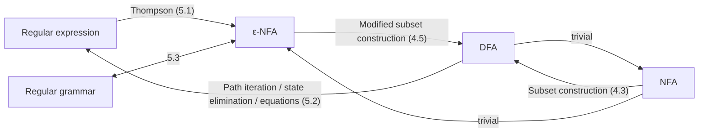
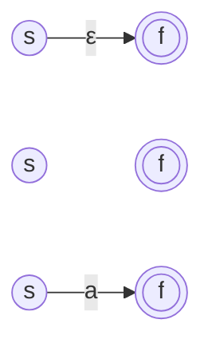
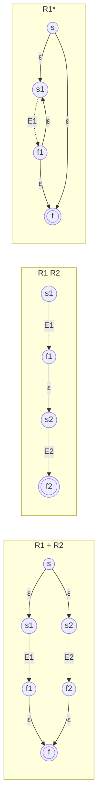
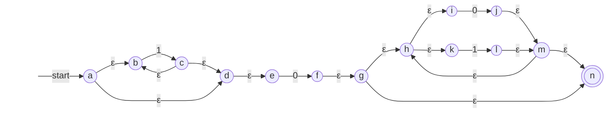
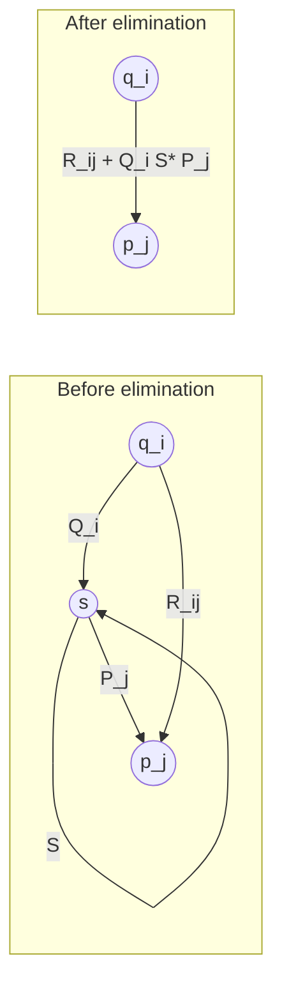
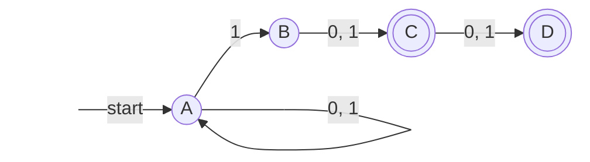

Chapter 3 defined the **regular languages** algebraically: the languages denoted by **regular expressions**. Chapter 4 defined another family of languages by machines: the languages accepted by finite automata (DFAs, NFAs, or ε-NFAs, which are equivalent). This chapter proves that the two families coincide, a result called Kleene's theorem; together with the type-3 grammars of Chapter 2, the regular languages thus have three equivalent descriptions: algebraic, machine, and grammatical. Both directions of the proof are constructive: starting from a regular expression, we can assemble an ε-NFA according to the structure of the expression (Thompson's construction), which is the starting point of practical regex engines; starting from a DFA, we can write down a regular expression by path iteration, state elimination, or solving equations. Finally we discuss the cost of these conversions and how they determine the matching algorithms of practical regular expressions ([4.2.11](/4.2.11)).



## 5.1. From Regular Expressions to ε-NFAs

**Theorem 5.1.1 (Thompson's Construction)** For every **regular expression** $R$ there is an **ε-NFA** $E$ with $L(E) = L(R)$ such that $E$ satisfies:

1. It has exactly one accepting state;
2. No arc enters the start state;
3. No arc leaves the accepting state.

**Proof** By induction on the structure of $R$, preserving all three properties at each step. In the figures below, $s$ and $f$ are the newly added start and accepting states; a dashed box stands for an automaton given by the induction hypothesis, of which only the start and accepting states are drawn.

Basis. For $R = \varepsilon$, $R = \varnothing$, and $R = a$ we construct, respectively:



The first accepts only $\varepsilon$; the second has no path from the start state to the accepting state and accepts $\varnothing$; the third accepts only $a$. The three properties clearly hold.

Induction. Let $E_1$ and $E_2$ be ε-NFAs for $R_1$ and $R_2$ satisfying the three properties, with start and accepting states $s_1, f_1$ and $s_2, f_2$, and with disjoint sets of states.

- $R = R_1 + R_2$: add $s$ and $f$; connect $s$ to $s_1$ and $s_2$ by ε-arcs, and connect $f_1$ and $f_2$ to $f$ by ε-arcs.
- $R = R_1R_2$: connect $f_1$ to $s_2$ by an ε-arc, with $s_1$ as the start state and $f_2$ as the accepting state (no new states).
- $R = R_1^*$: add $s$ and $f$ and the arcs $s \xrightarrow{\varepsilon} s_1$, $s \xrightarrow{\varepsilon} f$, $f_1 \xrightarrow{\varepsilon} s_1$, $f_1 \xrightarrow{\varepsilon} f$.
- $R = (R_1)$: reuse $E_1$.



Correctness: by properties 2 and 3, $E_1$ can be entered from outside only through $s_1$ and left only through $f_1$, so any path crossing $E_1$ consists of a segment "from $s_1$ to $f_1$ whose label lies in $L(E_1)$". Hence in the construction for union, a path from $s$ to $f$ crosses either $E_1$ or $E_2$, and the set of labels is $L(R_1) \cup L(R_2)$; in the construction for concatenation, a path crosses $E_1$ and then $E_2$, and the set of labels is $L(R_1)L(R_2)$; in the construction for closure, a path either goes directly $s \to f$ (label $\varepsilon$) or crosses $E_1$ some $k \ge 1$ times (with the back arc $f_1 \to s_1$ between consecutive crossings), and the set of labels is $\bigcup_{k \ge 0} L(R_1)^k = L(R_1)^*$. Each construction adds only arcs leaving $s$ and entering $f$, or turns the former $s_i$ and $f_i$ into internal states, so the three properties are preserved. $\square$

Properties 2 and 3 are not decoration. In the construction for closure, if we did not add a new $s$ and simply added arcs between $s_1$ and $f_1$, the back arc could let a path "slip into" other structures and produce strings that should not be accepted.

Each step adds at most two states and four arcs, so a regular expression of length $n$ (counting operators and symbols) yields an ε-NFA with at most $2n$ states and $4n$ arcs, each state having at most two outgoing arcs, and the construction takes $O(n)$ time.

**Example 5.1.1** The **Thompson's construction** for $1^*0(0 + 1)^*$, from the inside out: $1$, $0$, $0$, $1$ are each a basic automaton with two states; $1^*$ is obtained by the closure construction as $a$–$d$; $0 + 1$ is obtained by the union construction as $h$–$m$, and the closure construction then gives $g$–$n$; finally two concatenations join the three pieces.



This automaton has 14 states, whereas a hand design in the style of Example 4.1.2 needs only 2 ($1^*0(0+1)^*$ is "contains at least one 0", see [§1.1](/4.8.1#sec-1.1)). The automaton from Thompson's construction is large, but the construction is mechanical, linear, and in one-to-one correspondence with the structure of the expression, which suits a program; when a small automaton is needed, convert it to a **DFA** by the **subset construction** and minimize it with the algorithm of Chapter 6.

## 5.2. From DFAs to Regular Expressions

The reverse construction must "read" an arbitrary **transition diagram** as an expression. The difficulty is that the diagram may contain many interleaved cycles; the common idea of the three methods is to process the states one at a time, writing the cycles through a state as a closure.

### 5.2.1. Path Iteration

**Theorem 5.2.1 (Kleene's Algorithm)** Let the states of a **DFA** $A$ be $1, 2, \dots, n$ with start state 1. For $1 \le i, j \le n$ and $0 \le k \le n$, let $R_{ij}^{(k)}$ denote the set of strings that are labels of paths in the transition diagram from $i$ to $j$ all of whose intermediate states (not counting the start $i$ and the end $j$) have numbers at most $k$. Then every $R_{ij}^{(k)}$ can be written as a **regular expression**, and hence

$$
L(A) = \sum_{j \in F} R_{1j}^{(n)}
$$
is regular ($\sum$ denotes joining with $+$).

**Proof** Construct the expressions by induction on $k$.

Basis $k = 0$: a path cannot have intermediate states, so it is a single arc or (for $i = j$) the path of length 0 that uses no arc. Let $a_1, \dots, a_m$ be the symbols on the arcs from $i$ to $j$. Then for $i \ne j$, $R_{ij}^{(0)} = a_1 + \cdots + a_m$ ($\varnothing$ if there is no such arc), and for $i = j$, $R_{ii}^{(0)} = \varepsilon + a_1 + \cdots + a_m$.

Induction: suppose all $R_{ij}^{(k-1)}$ have been found. A path from $i$ to $j$ whose intermediate states have numbers at most $k$ either does not pass through state $k$ at all, in which case its label lies in $R_{ij}^{(k-1)}$; or passes through $k$ at least once, in which case cutting the path at each visit to $k$ gives "from $i$ to the first arrival at $k$", "zero or more segments from $k$ to $k$", and "from the last departure from $k$ to $j$", each of whose intermediate states has number at most $k - 1$. Therefore

$$
R_{ij}^{(k)} = R_{ij}^{(k-1)} + R_{ik}^{(k-1)}\bigl(R_{kk}^{(k-1)}\bigr)^* R_{kj}^{(k-1)}.
$$
For $k = n$ there is no restriction on intermediate states, and $R_{1j}^{(n)}$ is the set of labels of all paths from the start state to $j$. A string $w \in L(A)$ if and only if it labels a path from 1 to some accepting state, which gives the claim. $\square$

**Example 5.2.1** The DFA for "contains at least one 0": state 1 (start) stays in 1 on reading 1 and goes to 2 on reading 0; state 2 (accepting) stays in 2 on reading 0 or 1.

| | $k = 0$ | $k = 1$ | $k = 2$ |
|---|---|---|---|
| $R_{11}$ | $\varepsilon + 1$ | $1^*$ | $1^*$ |
| $R_{12}$ | $0$ | $1^*0$ | $1^*0(0 + 1)^*$ |
| $R_{21}$ | $\varnothing$ | $\varnothing$ | $\varnothing$ |
| $R_{22}$ | $\varepsilon + 0 + 1$ | $\varepsilon + 0 + 1$ | $(0 + 1)^*$ |

For instance, $R_{12}^{(1)} = R_{12}^{(0)} + R_{11}^{(0)}(R_{11}^{(0)})^*R_{12}^{(0)} = 0 + (\varepsilon + 1)(\varepsilon + 1)^*0$, which simplifies to $1^*0$ using $(\varepsilon + 1)^* = 1^*$ and $(\varepsilon + 1)1^* = 1^*$; and $R_{12}^{(2)} = R_{12}^{(1)} + R_{12}^{(1)}(R_{22}^{(1)})^*R_{22}^{(1)} = 1^*0 + 1^*0(0+1)^*$, which simplifies to $1^*0(0 + 1)^*$. The only accepting state is 2, so the result is $R_{12}^{(2)} = 1^*0(0 + 1)^*$. The simplifications here use the algebraic laws of [§3.4](/4.8.3#sec-3.4).

**Kleene's algorithm** applies mechanically to any DFA, and follows the same pattern of "recursion on the numbering of intermediate nodes" as the Floyd–Warshall algorithm (replacing union by minimum and concatenation by addition gives shortest paths). Its drawback is the blow-up of expressions: each round multiplies the length of the expressions by at most 4, so with $n$ states the result may be of length on the order of $4^n$.

### 5.2.2. State Elimination

For manual conversion, *state elimination* is more common. Generalize automata to ones whose arcs are labeled by regular expressions (an arc labeled $R$ means that any string of $L(R)$ may be read), and delete the intermediate states one by one while modifying the remaining arcs so that the accepted language is unchanged.

Suppose the state $s$ to be eliminated has a self-loop $S$, predecessors $q_1, \dots, q_k$ (arcs $q_i \xrightarrow{Q_i} s$), and successors $p_1, \dots, p_m$ (arcs $s \xrightarrow{P_j} p_j$), and that the existing arcs are $q_i \xrightarrow{R_{ij}} p_j$ ($\varnothing$ if absent). After deleting $s$, the labels of the paths $q_i \to s \to \cdots \to s \to p_j$ through $s$ lie in $Q_i S^* P_j$, so the label of the arc $q_i \to p_j$ is changed to

$$
R_{ij} + Q_i S^* P_j.
$$



The complete procedure:

1. For each accepting state $q$, make a copy of the automaton and eliminate all states except the start state $q_0$ and $q$.
2. If $q \ne q_0$, two states remain: a self-loop $R$ on $q_0$, an arc $S$ from $q_0$ to $q$, a self-loop $U$ on $q$, and an arc $T$ from $q$ to $q_0$. The corresponding expression is

   $$
   (R + SU^*T)^*SU^*:
   $$
   loop any number of times at $q_0$ (directly around $R$, or going to $q$, looping some number of times around $U$, and coming back), and finally go to $q$ and loop some number of times at $q$.
3. If $q = q_0$, only one state remains and the expression is $R^*$.
4. Join the expressions of all accepting states with $+$.

This method applies to **NFAs** as well (a transition diagram itself allows a state to have several outgoing arcs with the same symbol).

**Example 5.2.2** An NFA: $A$ (start) stays in $A$ on reading 0 or 1, and on reading 1 may also go to $B$; $B \xrightarrow{0, 1} C \xrightarrow{0, 1} D$; the accepting states are $C$ and $D$. It accepts strings whose second-to-last or third-to-last symbol is 1.



First merge the several symbols on an arc into the expression $0 + 1$. For the accepting state $C$: eliminate $D$ (it has no outgoing arc, so we just delete the arcs into it), then eliminate $B$, which gives the arc $A \xrightarrow{1(0+1)} C$. Now $R = 0 + 1$, $S = 1(0 + 1)$, $U = T = \varnothing$, and by $\varnothing^* = \varepsilon$ the expression is $(0 + 1)^*1(0 + 1)$. For the accepting state $D$: eliminate $B$ and $C$ in turn, which gives $A \xrightarrow{1(0+1)(0+1)} D$, and the expression is $(0 + 1)^*1(0 + 1)(0 + 1)$. The result is

$$
(0 + 1)^*1(0 + 1) + (0 + 1)^*1(0 + 1)(0 + 1).
$$

The order of elimination does not affect the language but affects the length of the expression: in general, eliminate first the states with fewer concatenations.

### 5.2.3. The System-of-Equations Method

The third method regards the automaton as a system of language equations. For each state $q$ of a DFA $A = (Q, \Sigma, \delta, q_0, F)$, let $X_q = \{w \mid \hat\delta(q, w) \in F\}$ be the set of strings accepted starting from $q$. Classifying by the first symbol,

$$
X_q = \sum_{a \in \Sigma} a\,X_{\delta(q, a)} + \begin{cases} \varepsilon, & q \in F,\\ \varnothing, & q \notin F, \end{cases}
$$
and the language sought is $X_{q_0}$. This is a "right-linear" system in which the coefficient of each unknown is a union of symbols not containing $\varepsilon$, so Arden's lemma (Theorem 3.4.3) can be used to eliminate the unknowns one by one: an equation of the form $X = AX + B$ ($\varepsilon \notin A$) has the unique solution $X = A^*B$, which is then substituted into the other equations.

**Example 5.2.3** Strings with an even number of 0s: state $e$ (start, accepting) stays in $e$ on reading 1 and goes to $o$ on reading 0; $o$ stays in $o$ on reading 1 and returns to $e$ on reading 0. The system is

$$
X_e = 1X_e + 0X_o + \varepsilon, \qquad X_o = 1X_o + 0X_e.
$$
By Arden's lemma the second equation gives $X_o = 1^*0X_e$. Substituting into the first: $X_e = 1X_e + 01^*0X_e + \varepsilon = (1 + 01^*0)X_e + \varepsilon$, and one more application of Arden's lemma gives $X_e = (1 + 01^*0)^*$. This differs in form from $(1^*01^*0)^*1^*$ of Example 3.3.5 but is equivalent (checked against all strings of length at most 10).

The three methods often give expressions of different forms. Equivalence of regular expressions is decidable (Chapter 6), but writing down the "shortest" regular expression is a hard problem.

### 5.2.4. Kleene's Theorem

**Theorem 5.2.2 (Kleene's Theorem)** For a language $L$, the following statements are equivalent:

1. $L$ is a **regular language**, that is, there is a regular expression $R$ with $L = L(R)$;
2. Some **ε-NFA** accepts $L$;
3. Some NFA accepts $L$;
4. Some DFA accepts $L$.

**Proof** 1 ⇒ 2 is Theorem 5.1.1; 2 ⇒ 4 is Theorem 4.5.1; 4 ⇒ 3 ⇒ 2 are trivial embeddings (a DFA is an NFA in which every transition set contains exactly one state, and an NFA is an ε-NFA without ε-arcs); 4 ⇒ 1 is Theorem 5.2.1. $\square$

From now on, a "regular language" may be described in whichever way is convenient: to prove closure properties, regular expressions are the most direct for union, concatenation, and closure, and DFAs are the most direct for complement and intersection (Chapter 6).

## 5.3. Regular Grammars and Finite Automata

Example 2.6.2 of Chapter 2 already showed that the nonterminals of a **regular grammar** (type 3) are states and a production $A \to aB$ is a transition. We now turn this correspondence into a general proof. Recall Definition 2.6.2: the productions of a regular grammar have the form $A \to aB$ or $A \to a$, where $a \in T \cup \{\varepsilon\}$.

**Theorem 5.3.1** A language $L$ is generated by some regular grammar if and only if $L$ is a **regular language**.

**Proof** (Grammar ⇒ automaton) Let $G = (V, T, P, S)$ be a regular grammar. Take a new state $f \notin V$ and construct the ε-NFA $E = (V \cup \{f\}, T, \delta, S, \{f\})$: for each production $A \to aB$, let $B \in \delta(A, a)$; for each production $A \to a$, let $f \in \delta(A, a)$ (for $a = \varepsilon$ these are all ε-arcs). Every sentential form of a regular grammar has the form $wB$ ($w \in T^*$, $B \in V$) or is a string of terminals $w$, because the body of every production has at most one nonterminal and it is at the right end. Induction on the number of derivation steps (equal to the number of arcs of the path) proves:

- $S \overset{*}{\Rightarrow} wB$ if and only if $E$ has a path from $S$ to $B$ labeled $w$;
- $S \overset{*}{\Rightarrow} w$ if and only if $E$ has a path from $S$ to $f$ labeled $w$.

For the induction step, note that the last step of the derivation, $uA \Rightarrow uaB$ or $uA \Rightarrow ua$, corresponds exactly to the last arc of the path, $A \xrightarrow{a} B$ or $A \xrightarrow{a} f$. By the second statement, $L(G) = L(E)$.

(Automaton ⇒ **grammar**) Let a **DFA** $A = (Q, \Sigma, \delta, q_0, F)$ accept $L$. Construct the grammar $G = (Q, \Sigma, P, q_0)$ with $p \to aq \in P$ if and only if $\delta(p, a) = q$, and $p \to \varepsilon \in P$ for each $p \in F$. Induction on $\lvert w\rvert$ shows that $q_0 \overset{*}{\Rightarrow} wq$ if and only if $\hat\delta(q_0, w) = q$. Hence $q_0 \overset{*}{\Rightarrow} w$ if and only if there is a $q$ with $q_0 \overset{*}{\Rightarrow} wq \Rightarrow w$, that is, $\hat\delta(q_0, w) = q \in F$. $\square$

For example, name the states 1 and 2 of the DFA of Example 5.2.1 $S$ and $A$; it gives the grammar $S \to 1S \mid 0A$, $A \to 0A \mid 1A \mid \varepsilon$, which is exactly the grammar of Example 2.6.2. Left-linear grammars, whose productions have the form $A \to Ba$ or $A \to a$, also generate exactly the regular languages: reversing the body of each production gives a right-linear grammar generating the reversal of the original language, and the regular languages are closed under reversal (Chapter 6). But mixing left-linear and right-linear productions in one grammar may generate nonregular languages; for example $S \to 0A \mid \varepsilon$, $A \to S1$ generates $\{0^n1^n \mid n \ge 0\}$.

## 5.4. Cost of Conversions and Regex Matching

Let the automaton have $n$ states and the regular expression have length $n$. The running times of the various conversions (with input size $n$ and the **alphabet** size regarded as a constant) are:

| Conversion | Method | Time |
|---|---|---|
| Regular expression → **ε-NFA** | **Thompson's construction** | $O(n)$ |
| **DFA** → **NFA** → ε-NFA | Trivial embedding | $O(n)$ |
| ε-NFA → DFA | Modified **subset construction** | $O(n^3 2^n)$; $O(n^3 s)$ counting only reachable states, $s$ the number of states of the DFA |
| NFA → DFA | Subset construction | $O(n^2 2^n)$; $O(n^2 s)$ counting only reachable states |
| DFA → regular expression | Path iteration, state elimination | $O(n^3 4^n)$ (the expression itself may be this long) |

The exponential terms all come from the fact that the result itself may be of exponential size: Theorem 4.3.3 shows that a DFA may have $2^n$ times as many states as an NFA, and there are DFAs with $n$ states whose equivalent regular expressions must have length $2^{\Omega(n)}$.

This table directly determines the design of regex engines. Given a pattern of length $n$ and a text of length $m$, there are three main implementations:

- NFA simulation: first obtain an ε-NFA with $O(n)$ states by Thompson's construction, then read the text symbols one by one as in Definition 4.5.3 while maintaining the current set of states, in time $O(nm)$. This is the method Thompson proposed in 1968 for the QED editor, and early Unix tools such as grep and awk followed this class of automaton methods.
- DFA: obtain a DFA by the subset construction, after which each symbol needs just one table lookup, in time $O(m)$; but constructing the DFA may take exponential time and space. The practical approach is lazy construction: during matching, construct and cache only the DFA states actually encountered, and flush the cache when it grows too large. GNU grep, Google's RE2, and Rust's regex library all adopt this scheme, which guarantees worst-case time linear in the length of the text.
- Backtracking: regard the pattern as a program, try each choice in order, and return to the previous choice point on failure (**backtracking**). Perl, PCRE, Python's `re`, and most Java and JavaScript engines work this way. Backtracking makes it easy to support extensions beyond the **regular languages**, such as backreferences and lookaround ([§3.1](/4.8.3#sec-3.1)), but the worst case is exponential time: it tries each path of the NFA separately, instead of merging all paths into one set of states as NFA simulation does.

The following Python program demonstrates the exponential behavior of backtracking. The language denoted by `(a*)*c` is just $a^*c$, but the nested closures give $a^n$ exponentially many ways of being split; the text contains no c, so the engine must try all splittings before failing:

```python
import re
import time

pattern = re.compile(r"(a*)*c")   # L = a*c, but written with a nested star
for n in range(16, 25, 2):
    text = "a" * n                # no 'c': every way of splitting the a's is tried
    t = time.perf_counter()
    assert pattern.fullmatch(text) is None
    print(f"n = {n}: {time.perf_counter() - t:.3f} s")
```

```text
n = 16: 0.002 s
n = 18: 0.009 s
n = 20: 0.033 s
n = 22: 0.126 s
n = 24: 0.538 s
```

Each increase of $n$ by 2 roughly quadruples the time. Matching the same pattern by NFA simulation or a DFA takes time linear in $n$. Such problems can be exploited with malicious input on servers, and are called *regular expression denial of service* (ReDoS). Defenses are to avoid nested and ambiguous closures, to cut off backtracking with possessive quantifiers or atomic groups (supported by Python's `re` since Python 3.11 as `a*+` and `(?>…)`), or to switch to an engine with guaranteed linear time when handling untrusted input.

## Summary

- **Kleene's theorem**: **regular expressions**, DFAs, NFAs, ε-NFAs, and regular grammars describe the same family of languages.
- Regular expression → **ε-NFA**: **Thompson's construction**, by induction on the structure, preserving "a single accepting state, no arc into the start state, no arc out of the accepting state", of linear size.
- **DFA** → regular expression: path iteration $R_{ij}^{(k)} = R_{ij}^{(k-1)} + R_{ik}^{(k-1)}(R_{kk}^{(k-1)})^*R_{kj}^{(k-1)}$; state elimination (arc labels become $R_{ij} + Q_iS^*P_j$, and $(R + SU^*T)^*SU^*$ with two states); the system of equations with Arden's lemma.
- **Regular grammars**: nonterminals are states, and $A \to aB$ is the transition $A \xrightarrow{a} B$.
- Practical engines: **NFA** simulation in $O(nm)$, lazy DFA in linear time, and backtracking, which supports extensions but takes exponential time in the worst case.

## Questions

1. Convert $(0 + 1)^*01$ and $(ab + a)^*$ to ε-NFAs by Thompson's construction, and then to DFAs by the modified subset construction.
2. Find a regular expression for the DFA of Example 4.1.4 (binary numbers divisible by 3) by path iteration, find one again by state elimination, and compare the results.
3. Find a regular expression for the DFA of Example 4.1.2 (ending in 00) by the system-of-equations method.
4. Suppose the closure step of Thompson's construction adds no new states, only the ε-arcs $s_1 \to f_1$ and $f_1 \to s_1$, with $s_1$ and $f_1$ as the start and accepting states. Show that for the expression $(a^*b)^*$ the resulting automaton accepts $a$. Which property is violated?
5. Give a regular grammar generating "strings with an even number of 0s", and draw the ε-NFA constructed in Theorem 5.3.1.
6. Prove that $S \to 0A \mid \varepsilon$, $A \to S1$ generates $\{0^n1^n \mid n \ge 0\}$.
