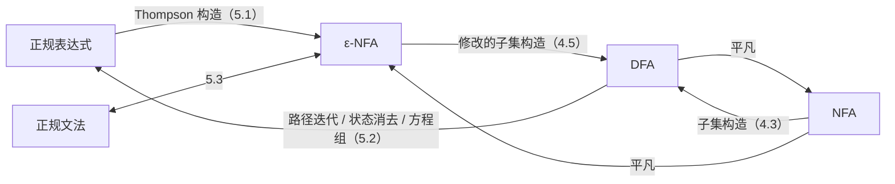
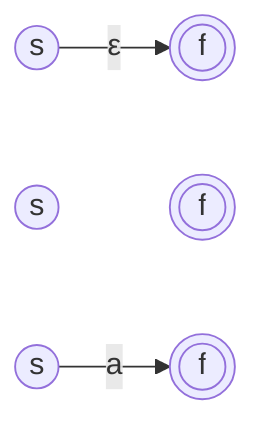
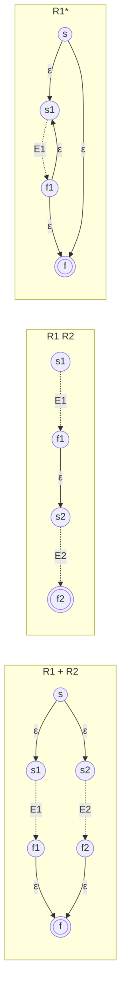
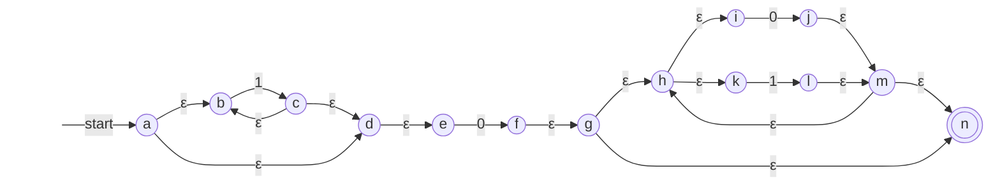
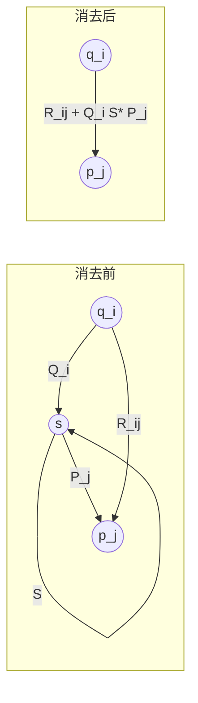
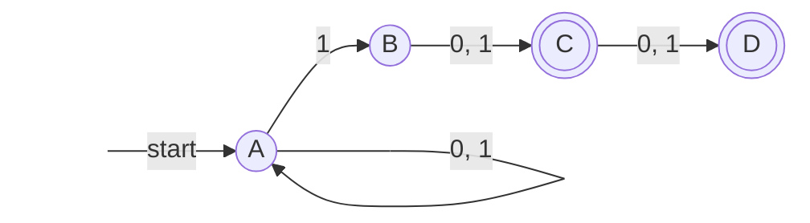

第 3 章用代数的方式定义了**正规语言**：由**正规表达式**表示的语言。第 4 章用机器定义了另一族语言：由有限自动机（DFA、NFA 或 ε-NFA，三者等价）接受的语言。本章证明这两族语言完全相同，这个结论称为 Kleene 定理；再加上第 2 章的 3 型文法，正规语言有了代数、机器、文法三种等价的描述。两个方向的证明都是构造性的：从正规表达式出发，可以按表达式的结构拼出一台 ε-NFA（Thompson 构造），这是实用正则表达式引擎的起点；从 DFA 出发，可以用路径迭代、状态消去或解方程的办法写出正规表达式。最后讨论这些转换的代价，以及它们怎样决定了实用正则表达式（[4.2.11](/4.2.11)）的匹配算法。



## 5.1. 从正规表达式到 ε-NFA

**定理 5.1.1（Thompson 构造）** 对每个**正规表达式** $R$，存在 **ε-NFA** $E$ 使 $L(E) = L(R)$，并且 $E$ 满足：

1. 恰有一个接受状态；
2. 没有弧进入开始状态；
3. 没有弧离开接受状态。

**证明** 对 $R$ 的结构归纳，在每一步都保持三条性质。下面的图中，$s$ 与 $f$ 是新增的开始状态与接受状态；虚线框表示归纳假设给出的自动机，只画出它的开始状态与接受状态。

基础。$R = \varepsilon$、$R = \varnothing$、$R = a$ 时分别构造：



第一台只接受 $\varepsilon$，第二台没有从开始状态到接受状态的路径，接受 $\varnothing$，第三台只接受 $a$。三条性质显然成立。

归纳。设 $E_1$、$E_2$ 分别是 $R_1$、$R_2$ 的满足三条性质的 ε-NFA，开始状态与接受状态分别为 $s_1, f_1$ 与 $s_2, f_2$，两者的状态集不相交。

- $R = R_1 + R_2$：新增 $s$、$f$，$s$ 用 ε 弧连到 $s_1$ 与 $s_2$，$f_1$ 与 $f_2$ 用 ε 弧连到 $f$。
- $R = R_1R_2$：把 $f_1$ 用 ε 弧连到 $s_2$，以 $s_1$ 为开始状态、$f_2$ 为接受状态（不新增状态）。
- $R = R_1^*$：新增 $s$、$f$，弧 $s \xrightarrow{\varepsilon} s_1$、$s \xrightarrow{\varepsilon} f$、$f_1 \xrightarrow{\varepsilon} s_1$、$f_1 \xrightarrow{\varepsilon} f$。
- $R = (R_1)$：沿用 $E_1$。



正确性：由性质 2、3，从 $E_1$ 外面进入 $E_1$ 只能经过 $s_1$，离开只能经过 $f_1$，所以任何一条穿过 $E_1$ 的路径都由一段"从 $s_1$ 到 $f_1$、标记属于 $L(E_1)$"的路径组成。于是在并的构造中，从 $s$ 到 $f$ 的路径要么穿过 $E_1$，要么穿过 $E_2$，标记的集合是 $L(R_1) \cup L(R_2)$；在连接的构造中，路径先穿过 $E_1$ 再穿过 $E_2$，标记的集合是 $L(R_1)L(R_2)$；在闭包的构造中，路径或者直接走 $s \to f$（标记 $\varepsilon$），或者穿过 $E_1$ 若干次（$k \ge 1$ 次，每两次之间经由 $f_1 \to s_1$ 的回弧），标记的集合是 $\bigcup_{k \ge 0} L(R_1)^k = L(R_1)^*$。三种构造都只新增了出自 $s$、进入 $f$ 的弧，或者把原来的 $s_i$、$f_i$ 变成内部状态，三条性质保持。$\square$

性质 2、3 不是装饰。在闭包的构造中，若不新增 $s$ 而直接在 $s_1$ 和 $f_1$ 之间加弧，回弧可能让路径"溜进"别的结构，产生不该接受的串。

每一步至多新增两个状态和四条弧，所以长度为 $n$ 的正规表达式（按运算符和符号的个数计）得到的 ε-NFA 至多 $2n$ 个状态、$4n$ 条弧，每个状态至多两条出弧，构造时间为 $O(n)$。

**例 5.1.1** 为 $1^*0(0 + 1)^*$ 作 **Thompson 构造**。从内向外：$1$、$0$、$0$、$1$ 各是两个状态的基础自动机；$1^*$ 用闭包构造得到 $a$–$d$；$0 + 1$ 用并的构造得到 $h$–$m$，再用闭包构造得到 $g$–$n$；最后用两次连接把三段串起来。



这台自动机有 14 个状态，而例 4.1.2 风格的手工设计只要 2 个（$1^*0(0+1)^*$ 即"至少含一个 0"，见 [§1.1](/4.8.1#sec-1.1)）。Thompson 构造得到的自动机很大，但它机械、线性，并且与表达式的结构一一对应，适合由程序完成；需要小的自动机时，再用**子集构造**化为 **DFA**，用第 6 章的算法极小化。

## 5.2. 从 DFA 到正规表达式

反方向的构造要把一张任意的**转移图**"读"成一个表达式。困难在于图中可能有许多交错的回路；三种方法的共同思想都是逐个处理状态，把经过这个状态的回路写成闭包。

### 5.2.1. 路径迭代法

**定理 5.2.1（路径迭代法）** 设 **DFA** $A$ 的状态为 $1, 2, \dots, n$，开始状态为 1。对 $1 \le i, j \le n$ 与 $0 \le k \le n$，令 $R_{ij}^{(k)}$ 表示这样的串的集合：它是转移图中一条从 $i$ 到 $j$ 的路径的标记，并且这条路径经过的中间状态（不计起点 $i$ 与终点 $j$）的编号都不超过 $k$。则每个 $R_{ij}^{(k)}$ 都可以写成**正规表达式**，从而

$$
L(A) = \sum_{j \in F} R_{1j}^{(n)}
$$
是正规语言（$\sum$ 表示用 $+$ 连接）。

**证明** 对 $k$ 归纳构造表达式。

基础 $k = 0$：路径不能有中间状态，只能是一条弧，或者（$i = j$ 时）不走任何弧的长为 0 的路径。设从 $i$ 到 $j$ 的弧上的符号为 $a_1, \dots, a_m$，则 $i \ne j$ 时 $R_{ij}^{(0)} = a_1 + \cdots + a_m$（没有这样的弧时为 $\varnothing$），$i = j$ 时 $R_{ii}^{(0)} = \varepsilon + a_1 + \cdots + a_m$。

归纳：设所有 $R_{ij}^{(k-1)}$ 已求出。一条从 $i$ 到 $j$、中间状态编号都不超过 $k$ 的路径，或者根本不经过状态 $k$，此时它的标记属于 $R_{ij}^{(k-1)}$；或者经过 $k$ 至少一次，此时在每次经过 $k$ 处把路径切开，得到"$i$ 到第一次到达 $k$""在 $k$ 与 $k$ 之间的零段或若干段""最后一次离开 $k$ 到 $j$"，每一段的中间状态编号都不超过 $k - 1$。于是

$$
R_{ij}^{(k)} = R_{ij}^{(k-1)} + R_{ik}^{(k-1)}\bigl(R_{kk}^{(k-1)}\bigr)^* R_{kj}^{(k-1)}.
$$
$k = n$ 时对中间状态没有限制，$R_{1j}^{(n)}$ 就是从开始状态到 $j$ 的全部路径的标记集合。$w \in L(A)$ 当且仅当它标记一条从 1 到某个接受状态的路径，结论成立。$\square$

**例 5.2.1** "至少含一个 0"的 DFA：状态 1（开始）读 1 留在 1、读 0 到 2；状态 2（接受）读 0、1 都留在 2。

| | $k = 0$ | $k = 1$ | $k = 2$ |
|---|---|---|---|
| $R_{11}$ | $\varepsilon + 1$ | $1^*$ | $1^*$ |
| $R_{12}$ | $0$ | $1^*0$ | $1^*0(0 + 1)^*$ |
| $R_{21}$ | $\varnothing$ | $\varnothing$ | $\varnothing$ |
| $R_{22}$ | $\varepsilon + 0 + 1$ | $\varepsilon + 0 + 1$ | $(0 + 1)^*$ |

例如 $R_{12}^{(1)} = R_{12}^{(0)} + R_{11}^{(0)}(R_{11}^{(0)})^*R_{12}^{(0)} = 0 + (\varepsilon + 1)(\varepsilon + 1)^*0$，用 $(\varepsilon + 1)^* = 1^*$ 与 $(\varepsilon + 1)1^* = 1^*$ 化简为 $1^*0$；$R_{12}^{(2)} = R_{12}^{(1)} + R_{12}^{(1)}(R_{22}^{(1)})^*R_{22}^{(1)} = 1^*0 + 1^*0(0+1)^*$，化简为 $1^*0(0 + 1)^*$。唯一的接受状态是 2，所以结果为 $R_{12}^{(2)} = 1^*0(0 + 1)^*$。这里的化简用的都是 [§3.4](/4.8.3#sec-3.4) 的代数定律。

**路径迭代法**对任何 DFA 都机械地适用，也是 Floyd–Warshall 算法的同一套"按中间点编号递推"的模式（把并换成取最小、连接换成加法，就得到最短路径）。它的缺点是表达式膨胀：每轮递推把表达式长度至多乘以 4，$n$ 个状态时结果可能长达 $4^n$ 量级。

### 5.2.2. 状态消去法

手工转换时更常用的是状态消去法（state elimination）。把自动机推广为弧上标记正规表达式的形式（一条标记 $R$ 的弧表示可以读入 $L(R)$ 中的任一串），然后逐个删去中间状态，同时修改其余的弧，使接受的语言不变。

设要消去的状态 $s$ 上有自环 $S$，前驱 $q_1, \dots, q_k$（弧 $q_i \xrightarrow{Q_i} s$），后继 $p_1, \dots, p_m$（弧 $s \xrightarrow{P_j} p_j$），原有的弧 $q_i \xrightarrow{R_{ij}} p_j$（没有时为 $\varnothing$）。删去 $s$ 后，经过 $s$ 的路径 $q_i \to s \to \cdots \to s \to p_j$ 的标记属于 $Q_i S^* P_j$，所以把弧 $q_i \to p_j$ 的标记改为

$$
R_{ij} + Q_i S^* P_j.
$$



完整的步骤：

1. 对每个接受状态 $q$，复制一份自动机，消去除开始状态 $q_0$ 与 $q$ 之外的所有状态。
2. 若 $q \ne q_0$，剩下两个状态：$q_0$ 上的自环 $R$，$q_0 \to q$ 的弧 $S$，$q$ 上的自环 $U$，$q \to q_0$ 的弧 $T$。对应的表达式为

   $$
   (R + SU^*T)^*SU^*:
   $$
   在 $q_0$ 处任意次绕圈（直接绕 $R$，或者去 $q$ 绕若干圈 $U$ 再回来），最后去 $q$ 并在 $q$ 上绕若干圈。
3. 若 $q = q_0$，只剩一个状态，表达式为 $R^*$。
4. 把各接受状态对应的表达式用 $+$ 连接起来。

这个方法对 **NFA** 同样适用（转移图本身就允许一个状态有多条同符号的出弧）。

**例 5.2.2** NFA：$A$（开始）读 0、1 留在 $A$，读 1 还可以到 $B$；$B \xrightarrow{0, 1} C \xrightarrow{0, 1} D$；接受状态为 $C$ 和 $D$。它接受倒数第 2 位或倒数第 3 位是 1 的串。



先把弧上的多个符号合成表达式 $0 + 1$。对接受状态 $C$：消去 $D$（它没有出弧，只是删去指向它的弧），再消去 $B$，得到弧 $A \xrightarrow{1(0+1)} C$。此时 $R = 0 + 1$，$S = 1(0 + 1)$，$U = T = \varnothing$，由 $\varnothing^* = \varepsilon$，表达式为 $(0 + 1)^*1(0 + 1)$。对接受状态 $D$：依次消去 $B$、$C$，得到 $A \xrightarrow{1(0+1)(0+1)} D$，表达式为 $(0 + 1)^*1(0 + 1)(0 + 1)$。结果

$$
(0 + 1)^*1(0 + 1) + (0 + 1)^*1(0 + 1)(0 + 1).
$$

消去的顺序不影响结果的语言，但影响表达式的长短：一般先消去连接少的状态。

### 5.2.3. 方程组法

第三种方法把自动机看作一组语言方程。对 DFA $A = (Q, \Sigma, \delta, q_0, F)$ 的每个状态 $q$，令 $X_q = \{w \mid \hat\delta(q, w) \in F\}$ 为从 $q$ 出发能被接受的串的集合。按第一个符号分类，

$$
X_q = \sum_{a \in \Sigma} a\,X_{\delta(q, a)} + \begin{cases} \varepsilon, & q \in F,\\ \varnothing, & q \notin F, \end{cases}
$$
所求的语言是 $X_{q_0}$。这是一个"右线性"方程组，每个未知量的系数是符号的并，不含 $\varepsilon$，于是可以用 Arden 引理（定理 3.4.3）逐个消元：形如 $X = AX + B$（$\varepsilon \notin A$）的方程有唯一解 $X = A^*B$，代入其余方程即可。

**例 5.2.3** 偶数个 0 的串：状态 $e$（开始、接受）读 1 留在 $e$、读 0 到 $o$；$o$ 读 1 留在 $o$、读 0 回到 $e$。方程组为

$$
X_e = 1X_e + 0X_o + \varepsilon, \qquad X_o = 1X_o + 0X_e.
$$
由 Arden 引理，第二个方程给出 $X_o = 1^*0X_e$。代入第一个：$X_e = 1X_e + 01^*0X_e + \varepsilon = (1 + 01^*0)X_e + \varepsilon$，再用一次 Arden 引理，$X_e = (1 + 01^*0)^*$。这与例 3.3.5 的 $(1^*01^*0)^*1^*$ 形式不同但等价（对长度不超过 10 的全部串逐一核对过）。

三种方法得到的表达式往往形式不同。正规表达式的等价性可以判定（第 6 章），但写出"最短"的正规表达式是困难的问题。

### 5.2.4. Kleene 定理

**定理 5.2.2（Kleene 定理）** 对语言 $L$，以下命题等价：

1. $L$ 是**正规语言**，即存在正规表达式 $R$ 使 $L = L(R)$；
2. 存在 **ε-NFA** 接受 $L$；
3. 存在 NFA 接受 $L$；
4. 存在 DFA 接受 $L$。

**证明** 1 ⇒ 2 是定理 5.1.1；2 ⇒ 4 是定理 4.5.1；4 ⇒ 3 ⇒ 2 是平凡的嵌入（DFA 是每个转移集合恰含一个状态的 NFA，NFA 是没有 ε 弧的 ε-NFA）；4 ⇒ 1 是定理 5.2.1。$\square$

从此"正规语言"可以按方便选用任何一种描述：证明封闭性时，并、连接、闭包用正规表达式最直接，补和交用 DFA 最直接（第 6 章）。

## 5.3. 正规文法与有限自动机

第 2 章的例 2.6.2 已经显示，**3 型文法**的非终结符就是状态，产生式 $A \to aB$ 就是转移。下面把这一对应变成一般的证明。回顾定义 2.6.2：正规文法的产生式形如 $A \to aB$ 或 $A \to a$，其中 $a \in T \cup \{\varepsilon\}$。

**定理 5.3.1** 语言 $L$ 由某个正规文法生成，当且仅当 $L$ 是**正规语言**。

**证明** （文法 ⇒ 自动机）设 $G = (V, T, P, S)$ 是正规文法。取一个新状态 $f \notin V$，构造 ε-NFA $E = (V \cup \{f\}, T, \delta, S, \{f\})$：对每个产生式 $A \to aB$，令 $B \in \delta(A, a)$；对每个产生式 $A \to a$，令 $f \in \delta(A, a)$（$a = \varepsilon$ 时这些都是 ε 弧）。正规文法的每个句型都形如 $wB$（$w \in T^*$，$B \in V$）或者是终结符串 $w$，因为每个产生式右部至多有一个非终结符、并且在最右端。对推导的步数（等于路径的弧数）归纳可证：

- $S \overset{*}{\Rightarrow} wB$ 当且仅当 $E$ 中有一条从 $S$ 到 $B$、标记为 $w$ 的路径；
- $S \overset{*}{\Rightarrow} w$ 当且仅当 $E$ 中有一条从 $S$ 到 $f$、标记为 $w$ 的路径。

归纳步骤只需注意：推导的最后一步 $uA \Rightarrow uaB$ 或 $uA \Rightarrow ua$ 恰好对应路径的最后一条弧 $A \xrightarrow{a} B$ 或 $A \xrightarrow{a} f$。由第二条，$L(G) = L(E)$。

（自动机 ⇒ **文法**）设 **DFA** $A = (Q, \Sigma, \delta, q_0, F)$ 接受 $L$。构造文法 $G = (Q, \Sigma, P, q_0)$，其中 $p \to aq \in P$ 当且仅当 $\delta(p, a) = q$，并且对每个 $p \in F$ 有 $p \to \varepsilon \in P$。对 $\lvert w\rvert$ 归纳可证 $q_0 \overset{*}{\Rightarrow} wq$ 当且仅当 $\hat\delta(q_0, w) = q$。于是 $q_0 \overset{*}{\Rightarrow} w$ 当且仅当存在 $q$ 使 $q_0 \overset{*}{\Rightarrow} wq \Rightarrow w$，即 $\hat\delta(q_0, w) = q \in F$。$\square$

例如，把例 5.2.1 的 DFA 的状态 1、2 记作 $S$、$A$，它给出文法 $S \to 1S \mid 0A$，$A \to 0A \mid 1A \mid \varepsilon$，正是例 2.6.2 的文法。产生式形如 $A \to Ba$ 或 $A \to a$ 的左线性文法生成的也恰好是正规语言：把每个产生式的右部反转得到右线性文法，它生成原语言的反转，而正规语言对反转封闭（第 6 章）。但在同一个文法中混用左线性和右线性产生式，就可能生成非正规语言，例如 $S \to 0A \mid \varepsilon$，$A \to S1$ 生成 $\{0^n1^n \mid n \ge 0\}$。

## 5.4. 转换的代价与正则表达式匹配

设自动机有 $n$ 个状态，**正规表达式**的长度为 $n$，各种转换的时间（输入规模为 $n$，**字母表**大小看作常数）为：

| 转换 | 方法 | 时间 |
|---|---|---|
| 正规表达式 → **ε-NFA** | **Thompson 构造** | $O(n)$ |
| **DFA** → **NFA** → ε-NFA | 平凡嵌入 | $O(n)$ |
| ε-NFA → DFA | 修改的**子集构造** | $O(n^3 2^n)$；只计可达状态时 $O(n^3 s)$，$s$ 为 DFA 的状态数 |
| NFA → DFA | 子集构造 | $O(n^2 2^n)$；只计可达状态时 $O(n^2 s)$ |
| DFA → 正规表达式 | 路径迭代、状态消去 | $O(n^3 4^n)$（表达式本身可能这么长） |

指数项都来自结果本身可能是指数大小：定理 4.3.3 说明 DFA 的状态数可能是 NFA 的 $2^n$ 倍，而存在 $n$ 状态的 DFA，其等价的正规表达式长度必须达到 $2^{\Omega(n)}$。

这张表直接决定了正则表达式引擎的设计。给定长为 $n$ 的模式和长为 $m$ 的文本，主要有三种实现：

- NFA 模拟：先用 Thompson 构造得到 $O(n)$ 个状态的 ε-NFA，再按定义 4.5.3 逐个读入文本符号、维护当前状态集合，时间 $O(nm)$。这是 Thompson 在 1968 年为 QED 编辑器提出的方法，Unix 早期的 grep、awk 等工具沿用了这一类自动机方法。
- DFA：用子集构造得到 DFA，此后每个符号只需一次查表，时间 $O(m)$，但构造 DFA 可能需要指数时间和空间。实用的做法是惰性构造：匹配过程中只构造实际遇到的 DFA 状态并缓存，缓存过大时清空重来。GNU grep、Google 的 RE2、Rust 的 regex 库都采用这种方案，保证最坏情况下与文本长度成线性的时间。
- 回溯：把模式看作一个程序，按顺序尝试每个选择，失败时退回上一个选择点（**回溯**）。Perl、PCRE、Python 的 `re`、Java、JavaScript 的引擎大都如此。回溯便于支持反向引用、环视等超出**正规语言**的扩展（[§3.1](/4.8.3#sec-3.1)），但最坏情况是指数时间：它对 NFA 的每条路径分别尝试，而不是像 NFA 模拟那样把所有路径合并成一个状态集合。

下面的 Python 程序演示回溯的指数行为。`(a*)*c` 表示的语言就是 $a^*c$，但嵌套的闭包让 $a^n$ 有指数多种划分方式；文本中没有 c，引擎在失败前要尝试所有划分：

```python
import re
import time

pattern = re.compile(r"(a*)*c")   # L = a*c, but written with a nested star
for n in range(16, 25, 2):
    text = "a" * n                # no 'c': every way of splitting the a's is tried
    t = time.perf_counter()
    assert pattern.fullmatch(text) is None
    print(f"n = {n}: {time.perf_counter() - t:.3f} s")
```

```text
n = 16: 0.002 s
n = 18: 0.009 s
n = 20: 0.033 s
n = 22: 0.126 s
n = 24: 0.538 s
```

$n$ 每增加 2，时间约变为 4 倍。用 NFA 模拟或 DFA 匹配同一个模式，时间与 $n$ 成线性。这类问题在服务器上可以被恶意输入利用，称为正则表达式拒绝服务（ReDoS）。防御的办法是避免嵌套且有歧义的闭包，使用占有量词或原子分组（Python 3.11 起的 `re` 支持 `a*+`、`(?>…)`）切断回溯，或者在处理不可信输入时改用保证线性时间的引擎。

## 小结

- **Kleene 定理**：**正规表达式**、DFA、NFA、ε-NFA、正规文法描述同一族语言。
- 正规表达式 → **ε-NFA**：**Thompson 构造**，按结构归纳，保持"单一接受状态、无弧入开始状态、无弧出接受状态"，线性大小。
- **DFA** → 正规表达式：路径迭代 $R_{ij}^{(k)} = R_{ij}^{(k-1)} + R_{ik}^{(k-1)}(R_{kk}^{(k-1)})^*R_{kj}^{(k-1)}$；状态消去（弧标记改为 $R_{ij} + Q_iS^*P_j$，两状态时 $(R + SU^*T)^*SU^*$）；方程组与 Arden 引理。
- **正规文法**：非终结符即状态，$A \to aB$ 即转移 $A \xrightarrow{a} B$。
- 实用引擎：**NFA** 模拟 $O(nm)$、惰性 DFA 线性时间、回溯支持扩展但最坏指数时间。

## 思考题

1. 用 Thompson 构造把 $(0 + 1)^*01$ 和 $(ab + a)^*$ 转换为 ε-NFA，再用修改的子集构造化为 DFA。

   **答** (1) $(0 + 1)^*01$。基础自动机 $c \xrightarrow{0} d$、$e \xrightarrow{1} f$、$i \xrightarrow{0} j$、$k \xrightarrow{1} l$；$0 + 1$ 用并的构造新增 $b$、$g$；闭包新增 $a$、$h$；两次连接加弧 $h \to i$、$j \to k$。共 12 个状态，开始状态 $a$，接受状态 $l$：

   ```mermaid
   flowchart LR
       st[" "] -->|start| a((a))
       a -->|ε| b((b))
       a -->|ε| h((h))
       b -->|ε| c((c))
       b -->|ε| e((e))
       c -->|0| d((d))
       e -->|1| f((f))
       d -->|ε| g((g))
       f -->|ε| g
       g -->|ε| b
       g -->|ε| h
       h -->|ε| i((i))
       i -->|0| j((j))
       j -->|ε| k((k))
       k -->|1| l(((l)))
       style st fill:none,stroke:none
   ```

   修改的子集构造从 $\operatorname{ECLOSE}(a) = \{a, b, c, e, h, i\}$ 出发：

   | | $0$ | $1$ |
   |---|---|---|
   | $\to P = \{a, b, c, e, h, i\}$ | $Q$ | $R$ |
   | $Q = \{b, c, d, e, g, h, i, j, k\}$ | $Q$ | $T$ |
   | $R = \{b, c, e, f, g, h, i\}$ | $Q$ | $R$ |
   | $* T = \{b, c, e, f, g, h, i, l\}$ | $Q$ | $R$ |

   例如 $\delta_D(P, 0) = \operatorname{ECLOSE}(\{d, j\})$：从 $d$ 经 $g$ 回到 $b, c, e$ 并到 $h, i$，从 $j$ 到 $k$。$Q$ 表示末尾是 0，$T$ 表示末尾是 01，$P$ 与 $R$ 都表示"末尾不是 0 也不是 01"，转移与接受性都相同，是等价状态；合并后得到 3 个状态的极小 DFA，与 4.3 节以 01 结尾的 DFA 相同。

   (2) $(ab + a)^*$。基础自动机 $c \xrightarrow{a} d$、$e \xrightarrow{b} f$、$g \xrightarrow{a} h$；连接 $ab$ 加弧 $d \to e$；并新增 $b$、$i$；闭包新增 $a$、$j$。共 10 个状态，开始状态 $a$，接受状态 $j$：

   ```mermaid
   flowchart LR
       st[" "] -->|start| a((a))
       a -->|ε| b((b))
       a -->|ε| j(((j)))
       b -->|ε| c((c))
       b -->|ε| g((g))
       c -->|a| d((d))
       d -->|ε| e((e))
       e -->|b| f((f))
       g -->|a| h((h))
       f -->|ε| i((i))
       h -->|ε| i
       i -->|ε| b
       i -->|ε| j
       style st fill:none,stroke:none
   ```

   | | $a$ | $b$ |
   |---|---|---|
   | $\to * P = \{a, b, c, g, j\}$ | $Q$ | $\varnothing$ |
   | $* Q = \{b, c, d, e, g, h, i, j\}$ | $Q$ | $R$ |
   | $* R = \{b, c, f, g, i, j\}$ | $Q$ | $\varnothing$ |
   | $\varnothing$ | $\varnothing$ | $\varnothing$ |

   $P$ 与 $R$ 等价，合并后极小 DFA 有 3 个状态：$\{P, R\}$（开始、接受，表示空串或末尾是 $b$）、$Q$（接受，末尾是 $a$）、死状态 $\varnothing$。它接受的语言是"不以 $b$ 开头且不含 bb"的串，与 $(ab + a)^*$ 的含义（每个 $b$ 前面紧挨着一个 $a$）一致。两个 DFA 都对长度不超过 12 的全部串用程序核对过。
2. 用路径迭代法求例 4.1.4（被 3 整除的二进制数）的 DFA 的正规表达式，再用状态消去法求一遍，比较结果。

   **答** 把余数 0、1、2 的状态编号为 1、2、3，开始与接受状态都是 1；转移为 $1 \xrightarrow{0} 1$、$1 \xrightarrow{1} 2$、$2 \xrightarrow{0} 3$、$2 \xrightarrow{1} 1$、$3 \xrightarrow{0} 2$、$3 \xrightarrow{1} 3$。所求为 $R_{11}^{(3)}$。

   $k = 0$：$R_{11} = \varepsilon + 0$，$R_{12} = 1$，$R_{13} = \varnothing$，$R_{21} = 1$，$R_{22} = \varepsilon$，$R_{23} = 0$，$R_{31} = \varnothing$，$R_{32} = 0$，$R_{33} = \varepsilon + 1$。

   $k = 1$（$(R_{11}^{(0)})^* = 0^*$）：$R_{11} = 0^*$，$R_{12} = 0^*1$，$R_{13} = \varnothing$，$R_{21} = 10^*$，$R_{22} = \varepsilon + 10^*1$，$R_{23} = 0$；$R_{3j}$ 不变（$R_{31}^{(0)} = \varnothing$）。

   $k = 2$（$(R_{22}^{(1)})^* = (10^*1)^*$，记 $Y = (10^*1)^*$）：

   $$
   \begin{aligned}
   R_{11}^{(2)} &= 0^* + 0^*1Y10^*, & R_{13}^{(2)} &= 0^*1Y0,\\
   R_{31}^{(2)} &= 0Y10^*, & R_{33}^{(2)} &= \varepsilon + 1 + 0Y0.
   \end{aligned}
   $$

   $k = 3$：$R_{11}^{(3)} = R_{11}^{(2)} + R_{13}^{(2)}\bigl(R_{33}^{(2)}\bigr)^*R_{31}^{(2)}$，即

   $$
   0^* + 0^*1(10^*1)^*10^* + 0^*1(10^*1)^*0\bigl(1 + 0(10^*1)^*0\bigr)^*0(10^*1)^*10^*.
   $$

   状态消去法：先消去状态 3（自环 1，前驱与后继都是 2，弧上都是 0），2 上得到自环 $01^*0$；再消去 2（从 1 经 1 进入、经 1 回到 1），1 上的自环成为 $0 + 1(01^*0)^*1$。只剩开始状态，结果为

   $$
   \bigl(0 + 1(01^*0)^*1\bigr)^*.
   $$

   比较：两个表达式等价（都由同一台 DFA 得到；也对长度不超过 12 的全部串用程序核对过），但路径迭代法的结果长得多：它按固定的编号顺序递推，$R_{11}^{(3)}$ 要把"不经过 3"与"经过 3"两部分分开写，同样的子表达式 $(10^*1)^*$ 反复出现；状态消去法每一步都直接把回路合并成闭包，适合手算。
3. 用方程组法求例 4.1.2（以 00 结尾）的 DFA 的正规表达式。

   **答** 状态 $p_0$（开始）、$p_1$、$p_2$（接受），方程组为

   $$
   X_0 = 1X_0 + 0X_1, \qquad X_1 = 1X_0 + 0X_2, \qquad X_2 = 0X_2 + 1X_0 + \varepsilon.
   $$
   由 Arden 引理，第三个方程给出 $X_2 = 0^*(1X_0 + \varepsilon)$。代入第二个：$X_1 = 1X_0 + 00^*1X_0 + 00^* = (1 + 00^*1)X_0 + 00^*$。再代入第一个：

   $$
   X_0 = (1 + 01 + 000^*1)X_0 + 000^*.
   $$
   系数 $1 + 01 + 000^*1 = (\varepsilon + 0 + 000^*)1 = 0^*1$ 不含 $\varepsilon$，再用一次 Arden 引理，

   $$
   X_0 = (0^*1)^*000^* = (0^*1)^*0^*00 = (0 + 1)^*00,
   $$
   最后一步用到 $(0^*1)^*0^* = (0 + 1)^*$（任一串在每个 1 之后切开）。
4. 若 Thompson 构造的闭包一步不新增状态，只加 ε 弧 $s_1 \to f_1$ 与 $f_1 \to s_1$，并以 $s_1$、$f_1$ 为开始状态与接受状态，说明对表达式 $(a^*b)^*$ 得到的自动机会接受 $a$。问题出在哪一条性质被破坏？

   **答** 按修改后的构造：$a$ 的基础自动机 $1 \xrightarrow{a} 2$，闭包加 $1 \xrightarrow{\varepsilon} 2$、$2 \xrightarrow{\varepsilon} 1$，得到 $a^*$（开始 1、接受 2）；$b$ 的基础自动机 $3 \xrightarrow{b} 4$，连接加 $2 \xrightarrow{\varepsilon} 3$，得到 $a^*b$（开始 1、接受 4）；外层闭包加 $1 \xrightarrow{\varepsilon} 4$、$4 \xrightarrow{\varepsilon} 1$，开始 1、接受 4。

   ```mermaid
   flowchart LR
       st[" "] -->|start| n1((1))
       n1 -->|a| n2((2))
       n1 -->|ε| n2
       n2 -->|ε| n1
       n2 -->|ε| n3((3))
       n3 -->|b| n4(((4)))
       n1 -->|ε| n4
       n4 -->|ε| n1
       style st fill:none,stroke:none
   ```

   路径 $1 \xrightarrow{a} 2 \xrightarrow{\varepsilon} 1 \xrightarrow{\varepsilon} 4$ 的标记是 $a$，所以 $a$ 被接受；但 $L((a^*b)^*)$ 中的非空串都以 $b$ 结尾，$a$ 不属于它。

   被破坏的是性质 2（没有弧进入开始状态）：内层 $a^*$ 的自动机有回弧 $2 \to 1$ 进入它的开始状态 1（这条弧同时离开了接受状态 2，也破坏了性质 3）。外层闭包的捷径 $1 \xrightarrow{\varepsilon} 4$ 本意只在"一个 $a^*b$ 都不读"时使用，可是状态 1 在读了若干个 $a$ 之后又能回到，于是路径在 $a^*$ 内部绕了一圈后跳过 $b$ 直接到达接受状态。定理 5.1.1 的证明需要"进入一个子自动机只能经过它的开始状态、离开只能经过它的接受状态"，正是这两条性质保证的。
5. 给出生成"0 的个数为偶数的串"的正规文法，并画出定理 5.3.1 构造的 ε-NFA。

   **答** 由例 5.2.3 的 DFA（$E$ 表示已读偶数个 0，$O$ 表示奇数个）得到文法

   $$
   E \to 1E \mid 0O \mid \varepsilon, \qquad O \to 1O \mid 0E,
   $$
   开始符号 $E$；$E \to \varepsilon$ 是 $A \to a$ 中 $a = \varepsilon$ 的情形。定理 5.3.1 的构造以非终结符为状态，另加接受状态 $f$：$A \to aB$ 给出弧 $A \xrightarrow{a} B$，$E \to \varepsilon$ 给出 ε 弧 $E \to f$：

   ```mermaid
   flowchart LR
       st[" "] -->|start| E((E))
       E -->|1| E
       E -->|0| O((O))
       O -->|1| O
       O -->|0| E
       E -->|ε| f(((f)))
       style st fill:none,stroke:none
   ```

   从 $E$ 出发到达 $f$ 的路径先在 $E$、$O$ 之间走若干步，最后必须停在 $E$，即读了偶数个 0。
6. 证明：$S \to 0A \mid \varepsilon$，$A \to S1$ 生成 $\{0^n1^n \mid n \ge 0\}$。

   **答** 每个句型至多含一个非终结符，$A$ 只有产生式 $A \to S1$，所以从 $S$ 出发的推导或者是 $S \Rightarrow \varepsilon$，或者以 $S \Rightarrow 0A \Rightarrow 0S1$ 开头。

   （$\subseteq$）对推导步数归纳：一步推导只能得到 $\varepsilon = 0^01^0$。否则 $S \Rightarrow 0A \Rightarrow 0S1 \overset{*}{\Rightarrow} 0u1$，其中 $S \overset{*}{\Rightarrow} u$ 少用了两步，由归纳假设 $u = 0^m1^m$，于是 $w = 0^{m+1}1^{m+1}$。

   （$\supseteq$）对 $n$ 归纳：$n = 0$ 时 $S \Rightarrow \varepsilon$；$n \ge 1$ 时由归纳假设 $S \overset{*}{\Rightarrow} 0^{n-1}1^{n-1}$，于是 $S \Rightarrow 0A \Rightarrow 0S1 \overset{*}{\Rightarrow} 0^n1^n$。$\square$

   这个文法混用了右线性产生式 $S \to 0A$ 与左线性产生式 $A \to S1$，所以不是正规文法；由例 6.1.1，它生成的语言也不是正规语言。
