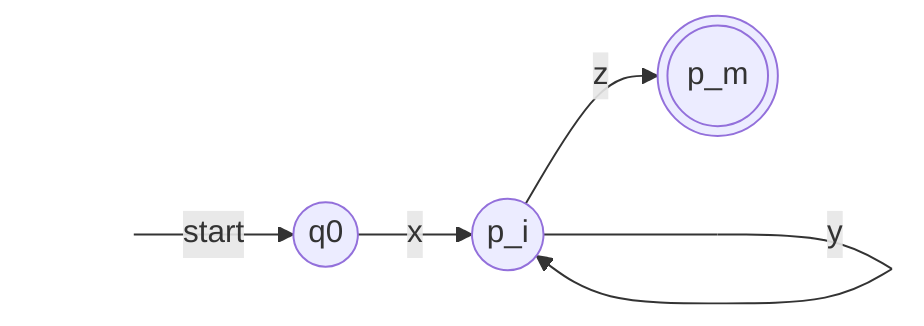

The previous two chapters proved that **regular expressions**, **DFAs**, NFAs, and ε-NFAs describe the same family of languages. This chapter studies the properties of this family as a whole and answers four kinds of questions. Which languages are not regular? The pumping lemma and the Myhill–Nerode theorem provide tools for proofs: finitely many states can remember only finite information. Under which operations do regular languages stay regular? Union, intersection, complement, reversal, homomorphism, and others all work; these closure properties are both a means of constructing automata and a means of proving nonregularity. Which questions about regular languages have algorithms? Emptiness, membership, finiteness, and equivalence are all decidable. Finally, a regular language has infinitely many DFAs, among which the one with the fewest states is essentially unique and can be found by the table-filling algorithm. Chapter 9 discusses the same questions for context-free languages, where many answers differ: context-free languages are not closed under intersection and complement, and equivalence is undecidable.

## 6.1. The Pumping Lemma

### 6.1.1. The Pumping Lemma for Regular Languages

Let a **DFA** have $n$ states. On reading a string of length at least $n$, the automaton passes through at least $n + 1$ states counting the start state, so by the pigeonhole principle some state occurs twice: there is a cycle on the path. Going around this cycle a few more times, or not at all, changes the string read but not the state finally reached.

**Theorem 6.1.1 (Pumping Lemma for Regular Languages)** Let $L$ be a **regular language**. Then there is a constant $n \ge 1$ such that every $w \in L$ with $\lvert w\rvert \ge n$ can be written as $w = xyz$ satisfying

1. $y \ne \varepsilon$;
2. $\lvert xy\rvert \le n$;
3. $xy^kz \in L$ for all $k \ge 0$.

**Proof** Let a DFA $A = (Q, \Sigma, \delta, q_0, F)$ accept $L$, and take $n = \lvert Q\rvert$. Let $w = a_1 a_2 \cdots a_m \in L$ with $m \ge n$. Put $p_i = \hat\delta(q_0, a_1 \cdots a_i)$ ($i = 0, 1, \dots, n$, $p_0 = q_0$). These $n + 1$ states take only $n$ values, so there are $0 \le i < j \le n$ with $p_i = p_j$. Let

$$
x = a_1 \cdots a_i, \qquad y = a_{i+1} \cdots a_j, \qquad z = a_{j+1} \cdots a_m.
$$
From $i < j$ we get $y \ne \varepsilon$, and from $j \le n$ we get $\lvert xy\rvert \le n$. Since $\hat\delta(p_i, y) = p_j = p_i$, induction on $k$ gives $\hat\delta(p_i, y^k) = p_i$, and so

$$
\hat\delta(q_0, xy^kz) = \hat\delta\bigl(\hat\delta(\hat\delta(q_0, x), y^k), z\bigr) = \hat\delta(p_i, z) = \hat\delta(q_0, w) \in F. \qquad \square
$$



### 6.1.2. Proving Nonregularity with the Pumping Lemma

The pumping lemma is a necessary condition for regular languages. To use it to prove that $L$ is not regular is to prove its negation: for every $n \ge 1$ there is a $w \in L$ with $\lvert w\rvert \ge n$ such that for every decomposition $w = xyz$ with $y \ne \varepsilon$ and $\lvert xy\rvert \le n$ there is a $k \ge 0$ with $xy^kz \notin L$. The alternation of quantifiers can be seen as a game: the adversary chooses $n$, we choose $w$, the adversary chooses the decomposition, and we choose $k$. What we may choose are $w$ and $k$, whereas $n$ and the decomposition must be handled in all cases.

**Example 6.1.1** $L_{01} = \{0^m1^m \mid m \ge 0\}$ is not regular. For any $n$, take $w = 0^n1^n \in L_{01}$. Every decomposition satisfies $\lvert xy\rvert \le n$, so $x$ and $y$ lie within the initial 0s, and $y = 0^t$ with $t \ge 1$. Take $k = 0$: $xz = 0^{n-t}1^n$ has fewer 0s than 1s and does not belong to $L_{01}$. $\square$

This is exactly what Chapter 1 meant by "finitely many states cannot remember an arbitrarily large number".

**Example 6.1.2** $L_{\mathrm{eq}} = \{w \in \{0,1\}^* \mid \lvert w\rvert_0 = \lvert w\rvert_1\}$ is not regular. Again take $w = 0^n1^n$; then $y = 0^t$, and $xy^2z = 0^{n+t}1^n$ has more 0s than 1s. The choice of $w$ is the key: with $w = (01)^n$ the adversary can take $y = 01$, and no $k$ pumps out of $L_{\mathrm{eq}}$.

**Example 6.1.3** $L_{\mathrm{pr}} = \{1^p \mid p \text{ is prime}\}$ is not regular. For any $n$, take a prime $p \ge n + 2$ and $w = 1^p$. Let $y = 1^t$ with $1 \le t \le n$. Take $k = p - t$; then

$$
\lvert xy^kz\rvert = (p - t) + kt = (p - t)(1 + t),
$$
where $1 + t \ge 2$ and $p - t \ge p - n \ge 2$, so the product is not prime. $\square$

**Example 6.1.4** $L_{ww} = \{uu \mid u \in \{0, 1\}^*\}$ is not regular. Take $w = 0^n10^n1$, so that $y = 0^t$ lies in the first run of 0s. For $k = 0$ we get $0^{n-t}10^n1$. If it were equal to $uu$, the two copies of $u$ would have the same ending, both ending in 1, and the string has only two 1s, so each $u$ contains exactly one 1, giving $u = 0^{n-t}1 = 0^n1$, which contradicts $t \ge 1$. $\square$

**Example 6.1.5 (Pumping Down)** $\{0^i1^j \mid i > j\}$ is not regular. Take $w = 0^{n+1}1^n$. Pumping up only produces more 0s and is useless; take $k = 0$: $xz = 0^{n+1-t}1^n$ with $t \ge 1$ has no more 0s than 1s.

The pumping lemma is only a necessary condition: some nonregular languages also satisfy its conclusion.

**Example 6.1.6** $L = \{a^ib^jc^k \mid i, j, k \ge 0, \text{ if } i = 1 \text{ then } j = k\}$ satisfies the conclusion of the pumping lemma (with $n = 2$) but is not regular (Example 6.2.4). Let $w = a^ib^jc^k \in L$ with $\lvert w\rvert \ge 2$, and take $x = \varepsilon$:

- $i = 0$: take $y$ to be the first symbol of $w$. The pumped strings still have the form $b^*c^*$, contain no $a$, and belong to $L$.
- $i = 1$: take $y = a$. After pumping, the number of $a$s is $k$; for $k \ne 1$ there is no restriction, and for $k = 1$ the string is $w$ itself; all belong to $L$.
- $i = 2$: take $y = aa$. After pumping, the number of $a$s is even and different from 1.
- $i \ge 3$: take $y = a$. After pumping, the number of $a$s is at least $i - 1 \ge 2$.

In all four cases $\lvert xy\rvert \le 2$. This example shows that the pumping lemma cannot prove the nonregularity of certain languages; in that case one can resort to closure properties (Section 6.2) or the Myhill–Nerode theorem (Section 6.5), the latter giving a necessary and sufficient condition for regularity.

## 6.2. Closure Properties

If the result of applying an operation to **regular languages** is always a regular language, we say that the regular languages are closed under this operation; such properties are called *closure properties*. In proofs we may freely choose any description of regular languages (**Kleene's theorem**, Theorem 5.2.2).

**Theorem 6.2.1** If $L$ and $M$ are regular languages, then so are $L \cup M$, $LM$, and $L^*$.

**Proof** Let $L = L(R)$ and $M = L(S)$. Then $L \cup M = L(R + S)$, $LM = L(RS)$, and $L^* = L(R^*)$. $\square$

**Theorem 6.2.2 (Complement)** If $L \subseteq \Sigma^*$ is a regular language, then $\overline{L} = \Sigma^* \setminus L$ is a regular language.

**Proof** Let a DFA $A = (Q, \Sigma, \delta, q_0, F)$ accept $L$ and let $B = (Q, \Sigma, \delta, q_0, Q \setminus F)$. Each $w$ reaches exactly one state $\hat\delta(q_0, w)$, which belongs to $Q \setminus F$ if and only if it does not belong to $F$, so $L(B) = \overline{L}$. $\square$

This construction requires the transition function of the **DFA** to be defined everywhere: missing transitions must first be completed with a **dead state**. Swapping accepting states in an NFA is wrong: for the NFA of Example 4.2.1 (ending in 01), the accepting states after the swap are $\{q_0, q_1\}$, and since $q_0$ is always in the current set of states, the new NFA accepts every string rather than the strings "not ending in 01".

**Theorem 6.2.3 (Intersection)** If $L$ and $M$ are regular languages, then $L \cap M$ is a regular language.

**Proof** This follows from De Morgan's law $L \cap M = \overline{\overline{L} \cup \overline{M}}$ and the previous two theorems. More directly, use the *product construction*: let the DFAs $A_L = (Q_L, \Sigma, \delta_L, q_L, F_L)$ and $A_M = (Q_M, \Sigma, \delta_M, q_M, F_M)$ accept $L$ and $M$, respectively, and let

$$
A = (Q_L \times Q_M, \Sigma, \delta, (q_L, q_M), F_L \times F_M), \qquad \delta\bigl((p, q), a\bigr) = \bigl(\delta_L(p, a), \delta_M(q, a)\bigr).
$$
The set of states of $A$ is the **Cartesian product** of the two sets of states, and it simulates the two automata simultaneously. Induction on $\lvert w\rvert$ shows $\hat\delta((p, q), w) = (\hat\delta_L(p, w), \hat\delta_M(q, w))$: for $w = \varepsilon$ both sides are $(p, q)$; for $w = xa$,

$$
\hat\delta((p, q), xa) = \delta\bigl((\hat\delta_L(p, x), \hat\delta_M(q, x)), a\bigr) = \bigl(\hat\delta_L(p, xa), \hat\delta_M(q, xa)\bigr).
$$
So $w \in L(A)$ if and only if $\hat\delta_L(q_L, w) \in F_L$ and $\hat\delta_M(q_M, w) \in F_M$, that is, $w \in L \cap M$. $\square$

Replacing the set of accepting states by $(F_L \times Q_M) \cup (Q_L \times F_M)$ gives the union, and replacing it by $F_L \times (Q_M \setminus F_M)$ gives the difference $L \setminus M$: the **product automaton** can implement any Boolean operation.

**Example 6.2.1** Let $A_1$ accept the strings with an even number of 0s (states $e$, $o$, with $e$ the start and accepting state), and $A_2$ the strings ending in 1 (states $n$, $y$, with $n$ the start state and $y$ the accepting state; reading 0 goes to $n$ and reading 1 goes to $y$). The product automaton is

| | $0$ | $1$ |
|---|---|---|
| $\to (e, n)$ | $(o, n)$ | $(e, y)$ |
| $(o, n)$ | $(e, n)$ | $(o, y)$ |
| $* (e, y)$ | $(o, n)$ | $(e, y)$ |
| $(o, y)$ | $(e, n)$ | $(o, y)$ |

It accepts the strings with an even number of 0s that end in 1.

**Corollary 6.2.1 (Difference)** If $L$ and $M$ are regular languages, then $L \setminus M = L \cap \overline{M}$ is a regular language.

**Theorem 6.2.4 (Reversal)** If $L$ is a regular language, then $L^{\mathrm{R}} = \{w^{\mathrm{R}} \mid w \in L\}$ is a regular language.

**Proof** Let $L = L(E)$. By induction on the structure of $E$ we construct $E^{\mathrm{R}}$ with $L(E^{\mathrm{R}}) = L(E)^{\mathrm{R}}$: for $E$ equal to $\varepsilon$, $\varnothing$, or $a$, $E^{\mathrm{R}} = E$; $(E_1 + E_2)^{\mathrm{R}} = E_1^{\mathrm{R}} + E_2^{\mathrm{R}}$; $(E_1E_2)^{\mathrm{R}} = E_2^{\mathrm{R}}E_1^{\mathrm{R}}$; $(E_1^*)^{\mathrm{R}} = (E_1^{\mathrm{R}})^*$. The case of concatenation uses $(uv)^{\mathrm{R}} = v^{\mathrm{R}}u^{\mathrm{R}}$, that is, item 3 of Property 1.3.1; the case of closure is similar, with $(u_1 \cdots u_k)^{\mathrm{R}} = u_k^{\mathrm{R}} \cdots u_1^{\mathrm{R}}$. $\square$

One can also modify the automaton directly: let $A$ accept $L$, reverse every arc of the **transition diagram**, make the original start state the only accepting state, and add a new start state with ε-arcs to each original accepting state. In the new **ε-NFA**, the paths labeled $w^{\mathrm{R}}$ from the new start state to the original start state correspond exactly to the paths in $A$ labeled $w$ from the start state to some accepting state.

**Definition 6.2.1 (String Homomorphism)** Let $\Sigma$ and $T$ be alphabets. A map $h\colon \Sigma \to T^*$ extended to $\Sigma^*$ by $h(\varepsilon) = \varepsilon$ and $h(a_1 a_2 \cdots a_n) = h(a_1)h(a_2) \cdots h(a_n)$ is called a **string homomorphism**; for a language $L \subseteq \Sigma^*$, $h(L) = \{h(w) \mid w \in L\}$.

That is, $h$ replaces each symbol by a string (possibly the empty string). It satisfies $h(uv) = h(u)h(v)$ and is a homomorphism from the **monoid** $\Sigma^*$ to the monoid $T^*$. For example, with $h(0) = ab$ and $h(1) = \varepsilon$ we have $h(0101) = abab$ and $h(\{0^m1^m \mid m \ge 0\}) = L((ab)^*)$: the homomorphic image of a nonregular language can be regular.

**Theorem 6.2.5 (Homomorphism)** If $L \subseteq \Sigma^*$ is a regular language and $h\colon \Sigma \to T^*$ is a string homomorphism, then $h(L)$ is a regular language.

**Proof** Let $L = L(E)$. Replace each symbol $a$ in $E$ by a regular expression for $\{h(a)\}$ (the concatenation of the symbols of $h(a)$, or $\varepsilon$ if $h(a) = \varepsilon$), and denote the resulting expression by $h(E)$. We prove $L(h(E)) = h(L(E))$ by induction on the structure of $E$. Basis: for $E = a$ both sides are $\{h(a)\}$; for $E$ equal to $\varepsilon$ or $\varnothing$ it is obvious. Induction: $h$ preserves unions, $h(L_1 \cup L_2) = h(L_1) \cup h(L_2)$; by $h(uv) = h(u)h(v)$, $h(L_1L_2) = h(L_1)h(L_2)$ and $h(L_1^*) = h(L_1)^*$. Thus, for example, $L(h(E_1E_2)) = L(h(E_1))L(h(E_2)) = h(L(E_1))h(L(E_2)) = h(L(E_1E_2))$. $\square$

**Definition 6.2.2 (Inverse Homomorphism)** Let $h\colon \Sigma \to T^*$ be a string homomorphism and $M \subseteq T^*$. The **inverse homomorphism** of $M$ under $h$ is $h^{-1}(M) = \{w \in \Sigma^* \mid h(w) \in M\}$.

**Theorem 6.2.6 (Inverse Homomorphism)** If $M \subseteq T^*$ is a regular language and $h\colon \Sigma \to T^*$ is a string homomorphism, then $h^{-1}(M)$ is a regular language.

**Proof** Let a DFA $A = (Q, T, \delta_A, q_0, F)$ accept $M$. Construct a DFA over $\Sigma$, $B = (Q, \Sigma, \delta_B, q_0, F)$, with $\delta_B(q, a) = \hat\delta_A(q, h(a))$: reading a symbol $a$ in $B$ corresponds to $A$ reading the string $h(a)$. Induction on $\lvert w\rvert$ shows $\hat\delta_B(q, w) = \hat\delta_A(q, h(w))$: for $w = \varepsilon$ both sides are $q$; for $w = xa$,

$$
\hat\delta_B(q, xa) = \delta_B\bigl(\hat\delta_A(q, h(x)), a\bigr) = \hat\delta_A\bigl(\hat\delta_A(q, h(x)), h(a)\bigr) = \hat\delta_A(q, h(x)h(a)) = \hat\delta_A(q, h(xa)).
$$
So $w \in L(B)$ if and only if $h(w) \in M$. $\square$

### 6.2.1. Proving Nonregularity with Closure Properties

Closure properties are often used to reduce a language to a known nonregular language: if $L$ were regular, a language obtained by operations that preserve regularity would also be regular; if the latter is known not to be regular, then $L$ is not regular.

**Example 6.2.2** Another proof that $L_{\mathrm{eq}}$ is not regular: if it were regular, then $L_{\mathrm{eq}} \cap L(0^*1^*) = \{0^m1^m \mid m \ge 0\}$ would also be regular, contradicting Example 6.1.1.

**Example 6.2.3** $\{w \in \{0,1\}^* \mid \lvert w\rvert_0 \ne \lvert w\rvert_1\}$ is not regular: its complement is $L_{\mathrm{eq}}$. Proving this directly with the pumping lemma is rather cumbersome, because the adversary can always find a decomposition that does not destroy "unequal".

**Example 6.2.4** The language $L$ of Example 6.1.6 is not regular. If $L$ were regular, then $L' = L \cap L(ab^*c^*) = \{ab^jc^j \mid j \ge 0\}$ would be regular; take the homomorphism $h(a) = \varepsilon$, $h(b) = 0$, $h(c) = 1$, and $h(L') = \{0^j1^j \mid j \ge 0\}$ would also have to be regular, a contradiction.

## 6.3. Decision Problems

The input of a decision problem is some finite description of a **regular language** (a **DFA**, NFA, ε-NFA, or regular expression). By the conversion algorithms of Chapters 4 and 5 these descriptions can be converted into one another, only at different costs: converting to a DFA may increase the size exponentially, and all other directions are polynomial. Below, $n$ denotes the number of states of the automaton.

### 6.3.1. Emptiness

$L(A) = \varnothing$ if and only if no accepting state is reachable from the start state. Compute the set of reachable states by graph search: the start state is reachable; if $q$ is reachable and there is an arc (a symbol arc or an ε-arc) from $q$ to $p$, then $p$ is reachable. The time is linear in the number of arcs, at most $O(n^2)$ (the size of the **alphabet** regarded as a constant). For a **regular expression** one can also decide directly by structure: $L(\varnothing)$ is empty, $L(\varepsilon)$ and $L(a)$ are nonempty; $L(R_1 + R_2)$ is empty if and only if both are empty; $L(R_1R_2)$ is empty if and only if at least one is empty; $L(R_1^*)$ always contains $\varepsilon$ and is nonempty.

### 6.3.2. Membership

Given $w$ with $\lvert w\rvert = m$. For a DFA, simulate directly in $O(m)$ time; for an **NFA** or **ε-NFA**, maintain the current set of states in $O(mn^2)$ time; for a regular expression, first apply Thompson's construction. These are the two matching algorithms of [§5.4](/4.8.5#sec-5.4).

### 6.3.3. Finiteness

**Theorem 6.3.1** Let a DFA $A$ have $n$ states. $L(A)$ is infinite if and only if $L(A)$ contains a string with length in $[n, 2n)$.

**Proof** If $w \in L(A)$ and $\lvert w\rvert \ge n$, then by (the proof of) the pumping lemma $xy^kz \in L(A)$ for all $k$; these strings are pairwise distinct, so $L(A)$ is infinite. Conversely, if $L(A)$ is infinite, it contains strings of length at least $n$; take a shortest such string $w$. If $\lvert w\rvert \ge 2n$, apply the pumping lemma to $w$: $xz \in L(A)$ and $1 \le \lvert y\rvert \le n$, so $n \le \lvert w\rvert - n \le \lvert xz\rvert < \lvert w\rvert$, contradicting the minimality of $w$. Hence $n \le \lvert w\rvert < 2n$. $\square$

Checking the strings in this range one by one takes exponential time. A better algorithm: delete the states unreachable from the start state and the states from which no accepting state can be reached; then $L(A)$ is infinite if and only if the remaining **transition diagram** has a cycle, which a single depth-first search can decide.

### 6.3.4. Equivalence and Containment

$L(A) = L(B)$ if and only if the symmetric difference $(L(A) \setminus L(B)) \cup (L(B) \setminus L(A))$ is empty. Use the **product construction** (Theorem 6.2.3) to obtain a DFA accepting the symmetric difference and then test emptiness; the time is linear in the product of the numbers of states of the two DFAs. $L(A) \subseteq L(B)$ if and only if $L(A) \setminus L(B) = \varnothing$, which is decidable in the same way. Section 6.4 gives another method.

For NFAs or regular expressions the equivalence problem is still decidable (convert to DFAs first), but it is known to be PSPACE-complete, and it is generally believed to have no polynomial-time algorithm; the exponential cost comes from the **subset construction**.

## 6.4. Equivalence of States and DFA Minimization

### 6.4.1. Equivalent States and the Table-Filling Algorithm

A single **regular language** has many **DFAs**, whose numbers of states may differ. If two states of a DFA behave exactly the same "from now on", they can be merged.

**Definition 6.4.1 (Equivalent States)** Let $A = (Q, \Sigma, \delta, q_0, F)$ be a DFA and $p, q \in Q$. If for every $w \in \Sigma^*$, $\hat\delta(p, w) \in F$ if and only if $\hat\delta(q, w) \in F$, then $p$ and $q$ are called **equivalent**, written $p \equiv q$; otherwise $p$ and $q$ are called **distinguishable**, and a string $w$ for which exactly one of $\hat\delta(p, w)$ and $\hat\delta(q, w)$ belongs to $F$ is said to distinguish them.

Clearly $\equiv$ is an **equivalence relation** on $Q$ (reflexivity, symmetry, and transitivity follow directly from the "if and only if"), and it splits $Q$ into **equivalence classes**, forming a **partition** of $Q$. Two simple and important facts:

- If $\delta(r, a) = p$ and $\delta(s, a) = q$, and $p$ and $q$ are distinguished by $w$, then $r$ and $s$ are distinguished by $aw$, because $\hat\delta(r, aw) = \hat\delta(p, w)$ and $\hat\delta(s, aw) = \hat\delta(q, w)$.
- Contrapositively, if $r \equiv s$, then $\delta(r, a) \equiv \delta(s, a)$ for every $a$.

The first fact gives a recursive method for finding all distinguishable pairs of states.

**Definition 6.4.2 (Table-Filling Algorithm)** Mark pairs of states of a DFA $A$ as follows:

1. Basis: if $p \in F$ and $q \notin F$ (or vice versa), mark $\{p, q\}$;
2. Induction: if there is an $a \in \Sigma$ such that $\{\delta(p, a), \delta(q, a)\}$ is a marked pair, mark $\{p, q\}$;
3. Repeat step 2 until no new marks are produced.

Arranging the pairs of states in a triangular table, with one cell for each pair, the algorithm gradually "fills in" marks in the table, hence the name *table-filling algorithm*.

**Theorem 6.4.1** When the table-filling algorithm terminates, $\{p, q\}$ is marked if and only if $p$ and $q$ are distinguishable.

**Proof** ($\Rightarrow$) Induct on the order of marking. A pair marked in the basis step is distinguished by $\varepsilon$; in the induction step, if $\{\delta(p, a), \delta(q, a)\}$ is distinguished by $w$, then $\{p, q\}$ is distinguished by $aw$.

($\Leftarrow$) By contradiction. Call a distinguishable but unmarked pair of states a bad pair. If bad pairs exist, choose among them a pair $\{p, q\}$ whose shortest distinguishing string $w$ is the shortest among all bad pairs. $w \ne \varepsilon$, since otherwise exactly one of $p$ and $q$ would be an accepting state, and the pair would be marked in the basis step. Let $w = aw'$, $r = \delta(p, a)$, and $s = \delta(q, a)$. Then $r$ and $s$ are distinguished by the shorter $w'$ (in particular $r \ne s$). By the minimality of $w$, $\{r, s\}$ is not a bad pair, so it is already marked; but then the algorithm would mark $\{p, q\}$ in the next round, contradicting that $\{p, q\}$ is unmarked. $\square$

**Example 6.4.1** A DFA over the **alphabet** $\{0, 1\}$ with start state $A$ and accepting state $C$:

| | $0$ | $1$ |
|---|---|---|
| $\to A$ | $B$ | $F$ |
| $B$ | $G$ | $C$ |
| $* C$ | $A$ | $C$ |
| $D$ | $C$ | $G$ |
| $E$ | $H$ | $F$ |
| $F$ | $C$ | $G$ |
| $G$ | $G$ | $E$ |
| $H$ | $G$ | $C$ |

No arc enters $D$, so it is unreachable from $A$ and is deleted first. We fill the table for the remaining 7 states; the number in a cell is the round in which the pair was marked (0 is the basis step), and $=$ means never marked:

| | $A$ | $B$ | $C$ | $E$ | $F$ | $G$ |
|---|---|---|---|---|---|---|
| $B$ | 1 | | | | | |
| $C$ | 0 | 0 | | | | |
| $E$ | $=$ | 1 | 0 | | | |
| $F$ | 1 | 1 | 0 | 1 | | |
| $G$ | 2 | 1 | 0 | 2 | 1 | |
| $H$ | 1 | $=$ | 0 | 1 | 1 | 1 |

Round 0 marks $C$ against all other states. In round 1, for example for $\{A, B\}$: on reading 1 they go to $F$ and $C$, and $\{C, F\}$ is already marked. In round 2, for $\{A, G\}$: on reading 0 they go to $B$ and $G$, and $\{B, G\}$ was marked in round 1. $\{A, E\}$ goes to $\{B, H\}$ on reading 0 and both go to $F$ on reading 1; $\{B, H\}$ both go to $G$ on reading 0 and both go to $C$ on reading 1; these two pairs are never marked, so $A \equiv E$ and $B \equiv H$, and all other states are pairwise distinguishable.

Scanning all pairs of states round by round as in the definition takes $O(n^2\lvert\Sigma\rvert)$ per round and at most $O(n^2)$ rounds. If for each pair of states we record "which pairs of states reach it by reading one symbol" and propagate marks along these reverse links when a pair is marked, the total time drops to $O(n^2\lvert\Sigma\rvert)$. Hopcroft's partition refinement algorithm achieves $O(n\lvert\Sigma\rvert\log n)$ and is the practical minimization algorithm.

The table-filling algorithm also gives another method for the equivalence test of Section 6.3: put two DFAs $A$ and $B$ (with states renamed to be disjoint) together as one DFA (taking either start state as the start state, which does not affect equivalence between states), and fill the table; $L(A) = L(B)$ if and only if the two start states are equivalent.

### 6.4.2. DFA Minimization

**Theorem 6.4.2 (Quotient Automaton)** Let $A = (Q, \Sigma, \delta, q_0, F)$ be a DFA, and let $[q]$ denote the $\equiv$-equivalence class of $q$. Let

$$
B = \bigl(Q/{\equiv},\ \Sigma,\ \delta_B,\ [q_0],\ \{[q] \mid q \in F\}\bigr), \qquad \delta_B([q], a) = [\delta(q, a)].
$$
Then $B$ is a well-defined DFA and $L(B) = L(A)$.

**Proof** If $p \equiv q$, then $\delta(p, a) \equiv \delta(q, a)$ (the second fact above), so $\delta_B$ does not depend on the choice of representatives; moreover $p \equiv q$ implies $p \in F \Leftrightarrow q \in F$ (take $w = \varepsilon$), so an equivalence class is either entirely contained in $F$ or disjoint from $F$, and the set of accepting states is also well defined. Induction on $\lvert w\rvert$ gives $\hat\delta_B([q_0], w) = [\hat\delta(q_0, w)]$, which is an accepting state if and only if $\hat\delta(q_0, w) \in F$. $\square$

**Algorithm 6.4.1 (DFA Minimization)** 1. Delete the states unreachable from the start state; 2. use the table-filling algorithm to find the equivalent pairs of states; 3. construct the **quotient automaton** $B$.

After minimization, Example 6.4.1 has 5 states $\{A, E\}$, $\{B, H\}$, $C$, $F$, $G$. The following Python program implements these three steps:

```python
from itertools import combinations


def table_filling(states, alphabet, delta, finals):
    """Return the set of distinguishable pairs (as frozensets)."""
    marked = {frozenset(p) for p in combinations(states, 2)
              if (p[0] in finals) != (p[1] in finals)}
    changed = True
    while changed:
        changed = False
        for p, q in combinations(states, 2):
            pair = frozenset((p, q))
            if pair in marked:
                continue
            if any(frozenset((delta[p, a], delta[q, a])) in marked
                   for a in alphabet if delta[p, a] != delta[q, a]):
                marked.add(pair)
                changed = True
    return marked


def reachable(alphabet, delta, start):
    seen, stack = {start}, [start]
    while stack:
        p = stack.pop()
        for a in alphabet:
            if delta[p, a] not in seen:
                seen.add(delta[p, a])
                stack.append(delta[p, a])
    return seen


def minimize(alphabet, delta, start, finals):
    states = sorted(reachable(alphabet, delta, start))
    finals = finals & set(states)
    marked = table_filling(states, alphabet, delta, finals)
    block = {}
    for p in states:
        block[p] = frozenset(q for q in states
                             if q == p or frozenset((p, q)) not in marked)
    blocks = sorted(set(block.values()), key=sorted)
    new_delta = {(B, a): block[delta[min(B), a]] for B in blocks for a in alphabet}
    return blocks, new_delta, block[start], {B for B in blocks if B & finals}


# The DFA of Example 6.4.1; D is unreachable from A
trans = {"A": "BF", "B": "GC", "C": "AC", "D": "CG",
         "E": "HF", "F": "CG", "G": "GE", "H": "GC"}
delta = {(q, a): trans[q][i] for q in trans for i, a in enumerate("01")}
blocks, nd, s, fs = minimize("01", delta, "A", {"C"})
name = lambda B: "".join(sorted(B))
for B in blocks:
    mark = ("->" if B == s else "  ") + ("*" if B in fs else " ")
    print(f"{mark} {name(B):3} 0 -> {name(nd[B, '0']):3} 1 -> {name(nd[B, '1'])}")
```

```text
->  AE  0 -> BH  1 -> F
    BH  0 -> G   1 -> C
  * C   0 -> AE  1 -> C
    F   0 -> C   1 -> G
    G   0 -> G   1 -> AE
```

If $D$ were not deleted first, table filling would find $D \equiv F$, and $D$ would be merged into the class of $F$, giving the same 5 states. In general, however, an unreachable state that is distinguishable from all reachable states would remain in the quotient automaton as a superfluous state, so step 1 cannot be omitted.

The states of the quotient automaton are pairwise distinguishable and (after deleting unreachable states) all reachable. Why is it then the DFA with the fewest states? The Myhill–Nerode theorem in the next section gives the complete answer.

## 6.5. The Myhill–Nerode Theorem

The **table-filling algorithm** compares states inside one **DFA**. From another angle, we compare strings directly: if two prefixes have the same "fate" under every continuation, then no DFA needs to distinguish them after reading them. This gives a structure of the language itself that does not depend on any automaton.

**Definition 6.5.1 (Right-Invariant Equivalence Relation)** An equivalence relation $E$ on $\Sigma^*$ is called **right-invariant** if $x \mathrel{E} y$ implies $xz \mathrel{E} yz$ for every $z \in \Sigma^*$. The number of equivalence classes of $E$ is called its index (possibly infinite).

**Definition 6.5.2 (Nerode Equivalence)** Let $L \subseteq \Sigma^*$. For $x, y \in \Sigma^*$, write $x \equiv_L y$ if, for every $z \in \Sigma^*$, $xz \in L$ if and only if $yz \in L$. The relation $\equiv_L$ is called the **Nerode equivalence** of $L$.

$\equiv_L$ is a right-invariant equivalence relation: if $x \equiv_L y$, then for all $z$ and $z'$, $xzz' \in L \Leftrightarrow yzz' \in L$, that is, $xz \equiv_L yz$. Also $L$ is a union of some equivalence classes of $\equiv_L$: if $x \equiv_L y$, taking $z = \varepsilon$ gives $x \in L \Leftrightarrow y \in L$.

**Theorem 6.5.1 (Myhill–Nerode Theorem)** For a language $L \subseteq \Sigma^*$, the following statements are equivalent:

1. $L$ is a **regular language**;
2. $L$ is a union of some equivalence classes of a right-invariant equivalence relation of finite index on $\Sigma^*$;
3. $\equiv_L$ has finite index.

**Proof** (1 ⇒ 2) Let a DFA $A = (Q, \Sigma, \delta, q_0, F)$ accept $L$. Define $x \sim_A y$ if and only if $\hat\delta(q_0, x) = \hat\delta(q_0, y)$. It is an equivalence relation with index at most $\lvert Q\rvert$; it is right-invariant because $\hat\delta(q_0, xz) = \hat\delta(\hat\delta(q_0, x), z)$; and $L$ is the union of the classes that reach states in $F$.

(2 ⇒ 3) Let $E$ be such a relation. If $x \mathrel{E} y$, then $xz \mathrel{E} yz$ for every $z$, and since $L$ is a union of classes of $E$, $xz \in L \Leftrightarrow yz \in L$, that is, $x \equiv_L y$. So every equivalence class of $E$ is contained in some equivalence class of $\equiv_L$, and the index of $\equiv_L$ is at most that of $E$, hence finite.

(3 ⇒ 1) Construct a DFA whose states are the equivalence classes of $\equiv_L$:

$$
A_L = \bigl(\Sigma^*/{\equiv_L},\ \Sigma,\ \delta,\ [\varepsilon],\ \{[x] \mid x \in L\}\bigr), \qquad \delta([x], a) = [xa].
$$
By right-invariance, $x \equiv_L y$ implies $xa \equiv_L ya$, so $\delta$ is well defined; since $L$ is a union of classes, the set of accepting states is well defined. Induction on $\lvert w\rvert$ gives $\hat\delta([\varepsilon], w) = [w]$, which is an accepting state if and only if $w \in L$. Hence $L(A_L) = L$ and $L$ is regular. $\square$

**Theorem 6.5.2 (Minimal DFA)** Let $L$ be a regular language and let $\equiv_L$ have index $m$. Then:

1. Every DFA accepting $L$ has at least $m$ states;
2. Every DFA accepting $L$ with exactly $m$ states is isomorphic to $A_L$ (differing only in the names of the states);
3. For any DFA accepting $L$, the minimization algorithm of Section 6.4.2 yields a DFA with exactly $m$ states.

**Proof** 1. By the proofs of (1 ⇒ 2) and (2 ⇒ 3), for any DFA $A$ the relation $\sim_A$ refines $\equiv_L$, so $\lvert Q\rvert$ is at least the index of $\sim_A$, which is at least $m$.

2. Let $A$ have $m$ states. The index of $\sim_A$ is at least $m$ (it refines $\equiv_L$) and at most the number $m$ of states, so it is exactly $m$: every state is reachable, and the equivalence classes of $\sim_A$ and $\equiv_L$ coincide. Map a state $q$ to the class $[x]$ of any string $x$ leading to it; this is a well-defined bijection. By $\hat\delta(q_0, xa) = \delta(\hat\delta(q_0, x), a)$ and $\delta_{A_L}([x], a) = [xa]$, it preserves transitions, the start state, and the accepting states, so it is an isomorphism.

3. Let minimization produce $B$, whose states are all reachable and pairwise inequivalent (they are **distinguishable states** by Theorem 6.4.1). If $x \equiv_L y$, then $p = \hat\delta_B([q_0], x)$ and $q = \hat\delta_B([q_0], y)$ satisfy, for every $z$, $\hat\delta_B(p, z) \in F_B \Leftrightarrow xz \in L \Leftrightarrow yz \in L \Leftrightarrow \hat\delta_B(q, z) \in F_B$, that is, $p \equiv q$, and hence $p = q$. So $\sim_B$ coincides with $\equiv_L$, and the number of states of $B$ equals $m$. $\square$

Therefore every regular language has a unique (up to isomorphism) **minimal DFA**, and two regular languages are equal if and only if their minimal DFAs are isomorphic, which gives yet another method for deciding equivalence.

The **Myhill–Nerode theorem** is also the most powerful tool for proving nonregularity: one only needs to find infinitely many strings that are pairwise not $\equiv_L$-equivalent to show that $\equiv_L$ has infinite index. Unlike the pumping lemma, it is a necessary and sufficient condition and hence applies to every nonregular language.

**Example 6.5.1** $\{0^m1^m \mid m \ge 0\}$: for $i \ne j$, $0^i1^i \in L$ but $0^j1^i \notin L$, so $0^i \not\equiv_L 0^j$. The strings $\varepsilon, 0, 00, \dots$ lie in pairwise different equivalence classes, and $L$ is not regular.

**Example 6.5.2** $L = \{a^ib^jc^k \mid \text{if } i = 1 \text{ then } j = k\}$ of Example 6.1.6: for $i \ne j$, the suffix $c^i$ distinguishes $ab^i$ from $ab^j$, so $\equiv_L$ has infinite index. The pumping lemma is powerless against it, whereas the Myhill–Nerode theorem finishes the proof in one step.

**Example 6.5.3** Strings ending in 01: $\equiv_L$ has three equivalence classes: the strings ending in 0, the strings ending in 01, and the rest ($\varepsilon$, $1$, and the strings ending in 11). These three classes are exactly the three states of the DFA obtained by the **subset construction** in Section 4.3, so that DFA is already minimal. The proof of the lower bound in Theorem 4.3.3 uses the same idea: the $2^n$ strings of length $n$ are pairwise inequivalent with respect to $L_n$.

## Summary

| Question | Tool | Key points |
|---|---|---|
| Proving nonregularity | Pumping lemma | Necessary condition; choose $w$ and $k$, and discuss all decompositions ($\lvert xy\rvert \le n$, $y \ne \varepsilon$) |
| | Closure properties | Intersect with a **regular language**, complement, or apply a homomorphism to reduce to a known nonregular language |
| | Myhill–Nerode | Necessary and sufficient; find infinitely many pairwise distinguishable prefixes |
| Closed operations | **Regular expressions** | Union, concatenation, closure, reversal, homomorphism |
| | **DFA** | Complement (swap accepting states), intersection and difference (**product construction**), inverse homomorphism ($\delta_B(q, a) = \hat\delta_A(q, h(a))$) |
| Decision | Graph search | Emptiness (reachability), finiteness (cycles), membership (simulation), equivalence (empty symmetric difference or table filling) |
| Minimization | **Table-filling algorithm** + **quotient automaton** | The number of states of the result equals the index of $\equiv_L$; the minimal DFA is unique up to isomorphism |

## Questions

1. Use the pumping lemma to prove that the following languages are not regular: (1) the strings over $\{0,1\}$ in which the number of 0s is twice the number of 1s; (2) the strings with more 0s than 1s; (3) $\{0^{m^2} \mid m \ge 0\}$; (4) the palindromes over $\{0,1\}$.
2. Let $h(a) = 01$, $h(b) = 10$, and $M = L((01 + 10)^*0)$. Find a regular expression for $h^{-1}(M)$.
3. Let $h(a) = \varepsilon$, $h(b) = 10$, and $E = \varepsilon + (a + b)(ba)^*$. (1) Write $E^{\mathrm{R}}$; (2) write $h(E)$; (3) construct a DFA accepting $\overline{L(h(E))}$.
4. Give an algorithm to decide $L(A) = \Sigma^*$, where $A$ is a DFA; then give an algorithm to decide $L(A) \cup L(B) = \Sigma^*$.
5. Minimize the DFA of Example 4.1.1 and the DFA obtained in Example 4.5.2, and explain why the results are minimal.
6. Find all equivalence classes of $\equiv_L$ for $L = \{w \in \{a, b\}^* \mid \text{the second-to-last symbol of } w \text{ is } a\}$ and write down the minimal DFA from them.
7. Prove that if $L$ is a regular language, then $\operatorname{half}(L) = \{x \mid \text{there is } y \text{ with } \lvert y\rvert = \lvert x\rvert \text{ and } xy \in L\}$ is also a regular language. (Hint: simultaneously simulate "reading $x$ from the start state" and "guessing a state and reading $y$ backward".)
