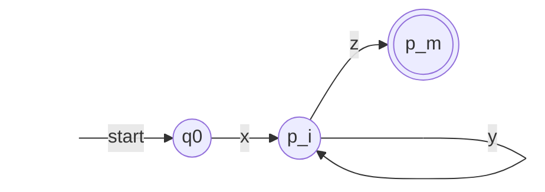

前两章证明了**正规表达式**、**DFA**、NFA、ε-NFA 描述同一族语言。本章研究这族语言整体的性质，回答四类问题。哪些语言不是正规的？泵引理和 Myhill–Nerode 定理给出证明的工具：有限个状态只能记住有限的信息。正规语言经过哪些运算仍是正规的？并、交、补、反转、同态等都可以，这些封闭性既是构造自动机的手段，也是证明非正规性的手段。关于正规语言的哪些问题有算法？空性、成员、有限性、等价性都可以判定。最后，同一个正规语言有无穷多个 DFA，其中状态最少的一个本质上唯一，可以用填表算法求出。第 9 章对上下文无关语言讨论同样的问题，那里许多答案不同：上下文无关语言对交和补不封闭，等价性也不可判定。

## 6.1. 泵引理

### 6.1.1. 正规语言的泵引理

设 **DFA** 有 $n$ 个状态。读入一个长度至少为 $n$ 的串时，连同开始状态一共经过至少 $n + 1$ 个状态，由鸽巢原理，其中必有一个状态重复出现：路径上有一个回路。沿这个回路多走几圈或者干脆不走，读入的串变了，最后到达的状态却不变。

**定理 6.1.1（正规语言的泵引理）** 设 $L$ 是**正规语言**，则存在常数 $n \ge 1$，使得对任意 $w \in L$，只要 $\lvert w\rvert \ge n$，就可以把 $w$ 写成 $w = xyz$，满足

1. $y \ne \varepsilon$；
2. $\lvert xy\rvert \le n$；
3. 对任意 $k \ge 0$，$xy^kz \in L$。

**证明** 设 DFA $A = (Q, \Sigma, \delta, q_0, F)$ 接受 $L$，取 $n = \lvert Q\rvert$。设 $w = a_1 a_2 \cdots a_m \in L$，$m \ge n$。令 $p_i = \hat\delta(q_0, a_1 \cdots a_i)$（$i = 0, 1, \dots, n$，$p_0 = q_0$）。这 $n + 1$ 个状态只能取 $n$ 个值，所以存在 $0 \le i < j \le n$ 使 $p_i = p_j$。令

$$
x = a_1 \cdots a_i, \qquad y = a_{i+1} \cdots a_j, \qquad z = a_{j+1} \cdots a_m.
$$
由 $i < j$ 得 $y \ne \varepsilon$，由 $j \le n$ 得 $\lvert xy\rvert \le n$。$\hat\delta(p_i, y) = p_j = p_i$，对 $k$ 归纳得 $\hat\delta(p_i, y^k) = p_i$，于是

$$
\hat\delta(q_0, xy^kz) = \hat\delta\bigl(\hat\delta(\hat\delta(q_0, x), y^k), z\bigr) = \hat\delta(p_i, z) = \hat\delta(q_0, w) \in F. \qquad \square
$$



### 6.1.2. 用泵引理证明非正规性

泵引理是正规语言的必要条件。用它证明 $L$ 不是正规语言，就是证明它的否定：对任意 $n \ge 1$，存在 $w \in L$，$\lvert w\rvert \ge n$，使得对 $w$ 的任意满足 $y \ne \varepsilon$、$\lvert xy\rvert \le n$ 的分解 $w = xyz$，都存在 $k \ge 0$ 使 $xy^kz \notin L$。量词的交替可以看作一场游戏：对手选 $n$，我们选 $w$，对手选分解，我们选 $k$。我们能选的是 $w$ 和 $k$，而 $n$ 和分解必须对一切情况都讨论到。

**例 6.1.1** $L_{01} = \{0^m1^m \mid m \ge 0\}$ 不是正规语言。对任意 $n$，取 $w = 0^n1^n \in L_{01}$。任意分解满足 $\lvert xy\rvert \le n$，所以 $x$、$y$ 都在前面的 0 中，$y = 0^t$，$t \ge 1$。取 $k = 0$，$xz = 0^{n-t}1^n$，0 比 1 少，不属于 $L_{01}$。$\square$

这正是第 1 章说的"有限个状态记不住任意大的数"。

**例 6.1.2** $L_{\mathrm{eq}} = \{w \in \{0,1\}^* \mid \lvert w\rvert_0 = \lvert w\rvert_1\}$ 不是正规语言。同样取 $w = 0^n1^n$；$y = 0^t$，$xy^2z = 0^{n+t}1^n$ 中 0 比 1 多。选 $w$ 是关键：若选 $w = (01)^n$，对手可以取 $y = 01$，任何 $k$ 都泵不出 $L_{\mathrm{eq}}$。

**例 6.1.3** $L_{\mathrm{pr}} = \{1^p \mid p \text{ 是素数}\}$ 不是正规语言。对任意 $n$，取素数 $p \ge n + 2$，$w = 1^p$。设 $y = 1^t$，$1 \le t \le n$。取 $k = p - t$，则

$$
\lvert xy^kz\rvert = (p - t) + kt = (p - t)(1 + t),
$$
其中 $1 + t \ge 2$，$p - t \ge p - n \ge 2$，乘积不是素数。$\square$

**例 6.1.4** $L_{ww} = \{uu \mid u \in \{0, 1\}^*\}$ 不是正规语言。取 $w = 0^n10^n1$，$y = 0^t$ 落在第一段 0 中。$k = 0$ 时得 $0^{n-t}10^n1$。若它等于 $uu$，则两个 $u$ 末尾相同，都以 1 结尾，且串中只有两个 1，所以每个 $u$ 恰含一个 1，$u = 0^{n-t}1 = 0^n1$，与 $t \ge 1$ 矛盾。$\square$

**例 6.1.5（向下泵）** $\{0^i1^j \mid i > j\}$ 不是正规语言。取 $w = 0^{n+1}1^n$。向上泵只会让 0 更多，没有用；取 $k = 0$，$xz = 0^{n+1-t}1^n$，$t \ge 1$，0 不再多于 1。

泵引理只是必要条件：有些非正规语言也满足它的结论。

**例 6.1.6** $L = \{a^ib^jc^k \mid i, j, k \ge 0, \text{ 若 } i = 1 \text{ 则 } j = k\}$ 满足泵引理的结论（取 $n = 2$），但不是正规语言（例 6.2.4）。设 $w = a^ib^jc^k \in L$，$\lvert w\rvert \ge 2$，取 $x = \varepsilon$：

- $i = 0$：取 $y$ 为 $w$ 的第一个符号。泵后的串仍形如 $b^*c^*$，没有 $a$，属于 $L$。
- $i = 1$：取 $y = a$。泵后 $a$ 的个数为 $k$，$k \ne 1$ 时没有任何限制，$k = 1$ 时就是 $w$，都属于 $L$。
- $i = 2$：取 $y = aa$。泵后 $a$ 的个数是偶数，不等于 1。
- $i \ge 3$：取 $y = a$。泵后 $a$ 的个数至少为 $i - 1 \ge 2$。

四种情况都有 $\lvert xy\rvert \le 2$。这个例子说明，泵引理无法证明某些语言的非正规性；这时可以借助封闭性（6.2 节）或 Myhill–Nerode 定理（6.5 节），后者给出了正规性的充分必要条件。

## 6.2. 封闭性

若对**正规语言**作某种运算的结果总是正规语言，就说正规语言对这种运算封闭，这类性质称为封闭性（closure property）。证明时可以任意选用正规语言的哪一种描述（**Kleene 定理**，定理 5.2.2）。

**定理 6.2.1** 若 $L$、$M$ 是正规语言，则 $L \cup M$、$LM$、$L^*$ 是正规语言。

**证明** 设 $L = L(R)$，$M = L(S)$，则 $L \cup M = L(R + S)$，$LM = L(RS)$，$L^* = L(R^*)$。$\square$

**定理 6.2.2（补）** 若 $L \subseteq \Sigma^*$ 是正规语言，则 $\overline{L} = \Sigma^* \setminus L$ 是正规语言。

**证明** 设 DFA $A = (Q, \Sigma, \delta, q_0, F)$ 接受 $L$，令 $B = (Q, \Sigma, \delta, q_0, Q \setminus F)$。每个 $w$ 恰好到达一个状态 $\hat\delta(q_0, w)$，它属于 $Q \setminus F$ 当且仅当不属于 $F$，所以 $L(B) = \overline{L}$。$\square$

这个构造要求 **DFA** 的转移函数处处有定义：缺少的转移要先补上一个**死状态**。对 NFA 交换接受状态是错的：例 4.2.1 的 NFA（以 01 结尾）交换后接受状态为 $\{q_0, q_1\}$，由于 $q_0$ 始终在当前状态集合中，新的 NFA 接受一切串，而不是"不以 01 结尾"的串。

**定理 6.2.3（交）** 若 $L$、$M$ 是正规语言，则 $L \cap M$ 是正规语言。

**证明** 由 De Morgan 律 $L \cap M = \overline{\overline{L} \cup \overline{M}}$ 和前两个定理即得。更直接的是乘积构造（product construction）：设 DFA $A_L = (Q_L, \Sigma, \delta_L, q_L, F_L)$ 与 $A_M = (Q_M, \Sigma, \delta_M, q_M, F_M)$ 分别接受 $L$、$M$，令

$$
A = (Q_L \times Q_M, \Sigma, \delta, (q_L, q_M), F_L \times F_M), \qquad \delta\bigl((p, q), a\bigr) = \bigl(\delta_L(p, a), \delta_M(q, a)\bigr).
$$
$A$ 的状态集是两个状态集的**笛卡儿积**，它同时模拟两台自动机。对 $\lvert w\rvert$ 归纳可证 $\hat\delta((p, q), w) = (\hat\delta_L(p, w), \hat\delta_M(q, w))$：$w = \varepsilon$ 时两边都是 $(p, q)$；$w = xa$ 时，

$$
\hat\delta((p, q), xa) = \delta\bigl((\hat\delta_L(p, x), \hat\delta_M(q, x)), a\bigr) = \bigl(\hat\delta_L(p, xa), \hat\delta_M(q, xa)\bigr).
$$
所以 $w \in L(A)$ 当且仅当 $\hat\delta_L(q_L, w) \in F_L$ 且 $\hat\delta_M(q_M, w) \in F_M$，即 $w \in L \cap M$。$\square$

把接受状态集换成 $(F_L \times Q_M) \cup (Q_L \times F_M)$ 就得到并，换成 $F_L \times (Q_M \setminus F_M)$ 就得到差 $L \setminus M$：**乘积自动机**可以实现任何布尔运算。

**例 6.2.1** $A_1$ 接受含偶数个 0 的串（状态 $e$、$o$，$e$ 为开始与接受状态），$A_2$ 接受以 1 结尾的串（状态 $n$、$y$，$n$ 为开始状态，$y$ 为接受状态，读 0 到 $n$、读 1 到 $y$）。乘积自动机为

| | $0$ | $1$ |
|---|---|---|
| $\to (e, n)$ | $(o, n)$ | $(e, y)$ |
| $(o, n)$ | $(e, n)$ | $(o, y)$ |
| $* (e, y)$ | $(o, n)$ | $(e, y)$ |
| $(o, y)$ | $(e, n)$ | $(o, y)$ |

它接受含偶数个 0 且以 1 结尾的串。

**推论 6.2.1（差）** 若 $L$、$M$ 是正规语言，则 $L \setminus M = L \cap \overline{M}$ 是正规语言。

**定理 6.2.4（反转）** 若 $L$ 是正规语言，则 $L^{\mathrm{R}} = \{w^{\mathrm{R}} \mid w \in L\}$ 是正规语言。

**证明** 设 $L = L(E)$。对 $E$ 的结构归纳构造 $E^{\mathrm{R}}$ 使 $L(E^{\mathrm{R}}) = L(E)^{\mathrm{R}}$：$E$ 为 $\varepsilon$、$\varnothing$、$a$ 时 $E^{\mathrm{R}} = E$；$(E_1 + E_2)^{\mathrm{R}} = E_1^{\mathrm{R}} + E_2^{\mathrm{R}}$；$(E_1E_2)^{\mathrm{R}} = E_2^{\mathrm{R}}E_1^{\mathrm{R}}$；$(E_1^*)^{\mathrm{R}} = (E_1^{\mathrm{R}})^*$。连接的情形用到 $(uv)^{\mathrm{R}} = v^{\mathrm{R}}u^{\mathrm{R}}$，即性质 1.3.1 的第 3 条；闭包的情形同理，$(u_1 \cdots u_k)^{\mathrm{R}} = u_k^{\mathrm{R}} \cdots u_1^{\mathrm{R}}$。$\square$

也可以直接改造自动机：设 $A$ 接受 $L$，把**转移图**的每条弧反向，原开始状态作为唯一的接受状态，再新增一个开始状态，用 ε 弧连到原来的每个接受状态。新的 **ε-NFA** 中标记为 $w^{\mathrm{R}}$、从新开始状态到原开始状态的路径，恰好对应 $A$ 中标记为 $w$、从开始状态到某个接受状态的路径。

**定义 6.2.1（字符串同态）** 设 $\Sigma$、$T$ 是字母表。映射 $h\colon \Sigma \to T^*$ 按 $h(\varepsilon) = \varepsilon$，$h(a_1 a_2 \cdots a_n) = h(a_1)h(a_2) \cdots h(a_n)$ 推广到 $\Sigma^*$ 上，称为一个**字符串同态**；对语言 $L \subseteq \Sigma^*$，$h(L) = \{h(w) \mid w \in L\}$。

即 $h$ 把每个符号替换成一个串（可以是空串）。它满足 $h(uv) = h(u)h(v)$，是 $\Sigma^*$ 到 $T^*$ 的**含幺半群**同态。例如 $h(0) = ab$，$h(1) = \varepsilon$，则 $h(0101) = abab$，$h(\{0^m1^m \mid m \ge 0\}) = L((ab)^*)$：非正规语言的同态像可以是正规的。

**定理 6.2.5（同态）** 若 $L \subseteq \Sigma^*$ 是正规语言，$h\colon \Sigma \to T^*$ 是字符串同态，则 $h(L)$ 是正规语言。

**证明** 设 $L = L(E)$。把 $E$ 中的每个符号 $a$ 换成表示 $\{h(a)\}$ 的正规表达式（$h(a)$ 的各符号的连接，$h(a) = \varepsilon$ 时用 $\varepsilon$），记所得表达式为 $h(E)$。对 $E$ 的结构归纳证明 $L(h(E)) = h(L(E))$。基础：$E = a$ 时两边都是 $\{h(a)\}$；$E$ 为 $\varepsilon$、$\varnothing$ 时显然。归纳：$h$ 保持并，$h(L_1 \cup L_2) = h(L_1) \cup h(L_2)$；由 $h(uv) = h(u)h(v)$，$h(L_1L_2) = h(L_1)h(L_2)$，$h(L_1^*) = h(L_1)^*$。于是例如 $L(h(E_1E_2)) = L(h(E_1))L(h(E_2)) = h(L(E_1))h(L(E_2)) = h(L(E_1E_2))$。$\square$

**定义 6.2.2（逆同态）** 设 $h\colon \Sigma \to T^*$ 是字符串同态，$M \subseteq T^*$。$M$ 在 $h$ 下的**逆同态**为 $h^{-1}(M) = \{w \in \Sigma^* \mid h(w) \in M\}$。

**定理 6.2.6（逆同态）** 若 $M \subseteq T^*$ 是正规语言，$h\colon \Sigma \to T^*$ 是字符串同态，则 $h^{-1}(M)$ 是正规语言。

**证明** 设 DFA $A = (Q, T, \delta_A, q_0, F)$ 接受 $M$。构造 $\Sigma$ 上的 DFA $B = (Q, \Sigma, \delta_B, q_0, F)$，$\delta_B(q, a) = \hat\delta_A(q, h(a))$：$B$ 读一个符号 $a$，相当于 $A$ 读串 $h(a)$。对 $\lvert w\rvert$ 归纳证明 $\hat\delta_B(q, w) = \hat\delta_A(q, h(w))$：$w = \varepsilon$ 时两边都是 $q$；$w = xa$ 时，

$$
\hat\delta_B(q, xa) = \delta_B\bigl(\hat\delta_A(q, h(x)), a\bigr) = \hat\delta_A\bigl(\hat\delta_A(q, h(x)), h(a)\bigr) = \hat\delta_A(q, h(x)h(a)) = \hat\delta_A(q, h(xa)).
$$
所以 $w \in L(B)$ 当且仅当 $h(w) \in M$。$\square$

### 6.2.1. 用封闭性证明非正规性

封闭性常用来把一个语言化归为已知的非正规语言：若 $L$ 是正规的，经过保持正规性的运算得到的语言也应是正规的；若后者已知不是正规的，$L$ 就不是正规的。

**例 6.2.2** 再证 $L_{\mathrm{eq}}$ 不是正规语言：若它是正规的，则 $L_{\mathrm{eq}} \cap L(0^*1^*) = \{0^m1^m \mid m \ge 0\}$ 也是正规的，与例 6.1.1 矛盾。

**例 6.2.3** $\{w \in \{0,1\}^* \mid \lvert w\rvert_0 \ne \lvert w\rvert_1\}$ 不是正规语言：它的补是 $L_{\mathrm{eq}}$。直接用泵引理证明这一点相当麻烦，因为对手总能找到不破坏"不等"的分解。

**例 6.2.4** 例 6.1.6 的 $L$ 不是正规语言。若 $L$ 是正规的，则 $L' = L \cap L(ab^*c^*) = \{ab^jc^j \mid j \ge 0\}$ 是正规的；取同态 $h(a) = \varepsilon$，$h(b) = 0$，$h(c) = 1$，$h(L') = \{0^j1^j \mid j \ge 0\}$ 也应是正规的，矛盾。

## 6.3. 判定问题

判定问题的输入是**正规语言**的某种有限描述（**DFA**、NFA、ε-NFA 或正规表达式）。由第 4、5 章的转换算法，这些描述可以互相转换，只是代价不同：转换为 DFA 可能指数级地增大，其余方向都是多项式的。下面设 $n$ 为自动机的状态数。

### 6.3.1. 空性

$L(A) = \varnothing$ 当且仅当从开始状态出发不能到达任何接受状态。用图搜索求出可达状态集合：开始状态可达；若 $q$ 可达且有从 $q$ 到 $p$ 的弧（符号弧或 ε 弧），则 $p$ 可达。时间与弧数成线性，至多 $O(n^2)$（**字母表**大小看作常数）。对**正规表达式**也可以直接按结构判断：$L(\varnothing)$ 为空，$L(\varepsilon)$、$L(a)$ 非空；$L(R_1 + R_2)$ 为空当且仅当两者都为空；$L(R_1R_2)$ 为空当且仅当至少一个为空；$L(R_1^*)$ 总含 $\varepsilon$，非空。

### 6.3.2. 成员

给定 $w$，$\lvert w\rvert = m$。对 DFA 直接模拟，$O(m)$；对 **NFA** 或 **ε-NFA** 维护当前状态集合，$O(mn^2)$；对正规表达式先作 Thompson 构造。这就是 [§5.4](/4.8.5#sec-5.4) 的两种匹配算法。

### 6.3.3. 有限性

**定理 6.3.1** 设 DFA $A$ 有 $n$ 个状态。$L(A)$ 是无穷集，当且仅当 $L(A)$ 中有长度在 $[n, 2n)$ 中的串。

**证明** 若 $w \in L(A)$ 且 $\lvert w\rvert \ge n$，由泵引理（的证明）$xy^kz \in L(A)$ 对一切 $k$ 成立，它们互不相同，$L(A)$ 无穷。反之设 $L(A)$ 无穷，则它含长度至少为 $n$ 的串；取其中最短的一个 $w$。若 $\lvert w\rvert \ge 2n$，对 $w$ 用泵引理，$xz \in L(A)$，而 $1 \le \lvert y\rvert \le n$，于是 $n \le \lvert w\rvert - n \le \lvert xz\rvert < \lvert w\rvert$，与 $w$ 最短矛盾。所以 $n \le \lvert w\rvert < 2n$。$\square$

逐个检查这个范围内的串需要指数时间。更好的算法是：删去从开始状态不可达的状态和不能到达任何接受状态的状态，$L(A)$ 无穷当且仅当剩下的**转移图**中有回路，用一次深度优先搜索即可判断。

### 6.3.4. 等价与包含

$L(A) = L(B)$ 当且仅当对称差 $(L(A) \setminus L(B)) \cup (L(B) \setminus L(A))$ 为空。用**乘积构造**（定理 6.2.3）得到接受对称差的 DFA，再判断空性；时间与两台 DFA 状态数的乘积成线性。$L(A) \subseteq L(B)$ 当且仅当 $L(A) \setminus L(B) = \varnothing$，同理可判定。6.4 节给出另一种方法。

对 NFA 或正规表达式，等价性问题仍然可判定（先转换为 DFA），但已知它是 PSPACE 完全的，一般认为没有多项式时间算法；指数代价来自**子集构造**。

## 6.4. 状态的等价与 DFA 极小化

### 6.4.1. 等价状态与填表算法

同一个**正规语言**有许多 **DFA**，它们的状态数可以不同。一台 DFA 中若有两个状态"从此以后的行为完全一样"，它们就可以合并。

**定义 6.4.1（等价状态）** 设 DFA $A = (Q, \Sigma, \delta, q_0, F)$，$p, q \in Q$。若对任意 $w \in \Sigma^*$，$\hat\delta(p, w) \in F$ 当且仅当 $\hat\delta(q, w) \in F$，则称 $p$ 与 $q$ **等价**，记作 $p \equiv q$；否则称 $p$ 与 $q$ **可区分**，使 $\hat\delta(p, w)$ 与 $\hat\delta(q, w)$ 恰有一个属于 $F$ 的串 $w$ 称为区分它们的串。

$\equiv$ 显然是 $Q$ 上的**等价关系**（自反、对称、传递都直接来自"当且仅当"），它把 $Q$ 分成若干**等价类**，构成 $Q$ 的一个**划分**。两个简单而重要的事实：

- 若 $\delta(r, a) = p$，$\delta(s, a) = q$，且 $p$、$q$ 由 $w$ 区分，则 $r$、$s$ 由 $aw$ 区分，因为 $\hat\delta(r, aw) = \hat\delta(p, w)$，$\hat\delta(s, aw) = \hat\delta(q, w)$。
- 逆否地，若 $r \equiv s$，则对任意 $a$，$\delta(r, a) \equiv \delta(s, a)$。

第一条给出了递推地找出全部可区分状态对的方法。

**定义 6.4.2（填表算法）** 对 DFA $A$ 的状态对作标记：

1. 基础：若 $p \in F$、$q \notin F$（或反之），标记 $\{p, q\}$；
2. 归纳：若存在 $a \in \Sigma$，使 $\{\delta(p, a), \delta(q, a)\}$ 是已标记的状态对，则标记 $\{p, q\}$；
3. 重复第 2 步，直到不再产生新的标记。

把状态对排成一张三角形的表，每个格子对应一对状态，算法就是在表中逐步"填"上标记，故名**填表算法**（table-filling algorithm）。

**定理 6.4.1** 填表算法结束时，$\{p, q\}$ 被标记当且仅当 $p$ 与 $q$ 可区分。

**证明** （⇒）对标记的先后归纳。基础步骤标记的对由 $\varepsilon$ 区分；归纳步骤中若 $\{\delta(p, a), \delta(q, a)\}$ 由 $w$ 区分，则 $\{p, q\}$ 由 $aw$ 区分。

（⇐）反证。称"可区分但未被标记"的状态对为坏对。若坏对存在，在所有坏对中取一对 $\{p, q\}$，使区分它的最短串 $w$ 在所有坏对中最短。$w \ne \varepsilon$，否则 $p$、$q$ 恰有一个是接受状态，在基础步骤就被标记。设 $w = aw'$，令 $r = \delta(p, a)$，$s = \delta(q, a)$，则 $r$、$s$ 由更短的 $w'$ 区分（特别地 $r \ne s$）。由 $w$ 的最短性，$\{r, s\}$ 不是坏对，所以已被标记；但这样算法会在下一轮标记 $\{p, q\}$，与 $\{p, q\}$ 未被标记矛盾。$\square$

**例 6.4.1** **字母表** $\{0, 1\}$ 上的 DFA，开始状态 $A$，接受状态 $C$：

| | $0$ | $1$ |
|---|---|---|
| $\to A$ | $B$ | $F$ |
| $B$ | $G$ | $C$ |
| $* C$ | $A$ | $C$ |
| $D$ | $C$ | $G$ |
| $E$ | $H$ | $F$ |
| $F$ | $C$ | $G$ |
| $G$ | $G$ | $E$ |
| $H$ | $G$ | $C$ |

没有弧进入 $D$，它从 $A$ 不可达，先删去。对其余 7 个状态填表，格子中的数字表示在第几轮被标记（0 为基础步骤），$=$ 表示始终未被标记：

| | $A$ | $B$ | $C$ | $E$ | $F$ | $G$ |
|---|---|---|---|---|---|---|
| $B$ | 1 | | | | | |
| $C$ | 0 | 0 | | | | |
| $E$ | $=$ | 1 | 0 | | | |
| $F$ | 1 | 1 | 0 | 1 | | |
| $G$ | 2 | 1 | 0 | 2 | 1 | |
| $H$ | 1 | $=$ | 0 | 1 | 1 | 1 |

第 0 轮标记 $C$ 与其余状态。第 1 轮，例如 $\{A, B\}$：读 1 分别到 $F$、$C$，$\{C, F\}$ 已标记。第 2 轮，$\{A, G\}$：读 0 分别到 $B$、$G$，$\{B, G\}$ 在第 1 轮被标记。$\{A, E\}$ 读 0 到 $\{B, H\}$、读 1 都到 $F$；$\{B, H\}$ 读 0 都到 $G$、读 1 都到 $C$；两对始终不会被标记，所以 $A \equiv E$，$B \equiv H$，其余状态两两可区分。

按定义逐轮扫描所有状态对，每轮 $O(n^2\lvert\Sigma\rvert)$，至多 $O(n^2)$ 轮。为每个状态对记录"哪些状态对读一个符号会到达它"，被标记时沿这些反向链接传播，总时间可降到 $O(n^2\lvert\Sigma\rvert)$。Hopcroft 的划分细化算法进一步达到 $O(n\lvert\Sigma\rvert\log n)$，是实用的极小化算法。

填表算法也给出了 6.3 节等价性判定的另一种方法：把两台 DFA $A$、$B$（状态重新命名使之不相交）放在一起看作一台 DFA（开始状态任取其一，它不影响状态之间的等价），对它填表；$L(A) = L(B)$ 当且仅当两个开始状态等价。

### 6.4.2. DFA 极小化

**定理 6.4.2（商自动机）** 设 DFA $A = (Q, \Sigma, \delta, q_0, F)$，$[q]$ 表示 $q$ 所在的 $\equiv$ 等价类。令

$$
B = \bigl(Q/{\equiv},\ \Sigma,\ \delta_B,\ [q_0],\ \{[q] \mid q \in F\}\bigr), \qquad \delta_B([q], a) = [\delta(q, a)],
$$
则 $B$ 是良定义的 DFA，并且 $L(B) = L(A)$。

**证明** 若 $p \equiv q$，则 $\delta(p, a) \equiv \delta(q, a)$（上面的第二个事实），所以 $\delta_B$ 不依赖代表元的选取；又 $p \equiv q$ 蕴含 $p \in F \Leftrightarrow q \in F$（取 $w = \varepsilon$），所以一个等价类要么整个在 $F$ 中，要么与 $F$ 不交，接受状态集也是良定义的。对 $\lvert w\rvert$ 归纳得 $\hat\delta_B([q_0], w) = [\hat\delta(q_0, w)]$，它是接受状态当且仅当 $\hat\delta(q_0, w) \in F$。$\square$

**算法 6.4.1（DFA 极小化）** 1. 删去从开始状态不可达的状态；2. 用填表算法求出等价的状态对；3. 构造**商自动机** $B$。

例 6.4.1 极小化后有 5 个状态 $\{A, E\}$、$\{B, H\}$、$C$、$F$、$G$。下面的 Python 程序实现这三步：

```python
from itertools import combinations


def table_filling(states, alphabet, delta, finals):
    """Return the set of distinguishable pairs (as frozensets)."""
    marked = {frozenset(p) for p in combinations(states, 2)
              if (p[0] in finals) != (p[1] in finals)}
    changed = True
    while changed:
        changed = False
        for p, q in combinations(states, 2):
            pair = frozenset((p, q))
            if pair in marked:
                continue
            if any(frozenset((delta[p, a], delta[q, a])) in marked
                   for a in alphabet if delta[p, a] != delta[q, a]):
                marked.add(pair)
                changed = True
    return marked


def reachable(alphabet, delta, start):
    seen, stack = {start}, [start]
    while stack:
        p = stack.pop()
        for a in alphabet:
            if delta[p, a] not in seen:
                seen.add(delta[p, a])
                stack.append(delta[p, a])
    return seen


def minimize(alphabet, delta, start, finals):
    states = sorted(reachable(alphabet, delta, start))
    finals = finals & set(states)
    marked = table_filling(states, alphabet, delta, finals)
    block = {}
    for p in states:
        block[p] = frozenset(q for q in states
                             if q == p or frozenset((p, q)) not in marked)
    blocks = sorted(set(block.values()), key=sorted)
    new_delta = {(B, a): block[delta[min(B), a]] for B in blocks for a in alphabet}
    return blocks, new_delta, block[start], {B for B in blocks if B & finals}


# The DFA of Example 6.4.1; D is unreachable from A
trans = {"A": "BF", "B": "GC", "C": "AC", "D": "CG",
         "E": "HF", "F": "CG", "G": "GE", "H": "GC"}
delta = {(q, a): trans[q][i] for q in trans for i, a in enumerate("01")}
blocks, nd, s, fs = minimize("01", delta, "A", {"C"})
name = lambda B: "".join(sorted(B))
for B in blocks:
    mark = ("->" if B == s else "  ") + ("*" if B in fs else " ")
    print(f"{mark} {name(B):3} 0 -> {name(nd[B, '0']):3} 1 -> {name(nd[B, '1'])}")
```

```text
->  AE  0 -> BH  1 -> F
    BH  0 -> G   1 -> C
  * C   0 -> AE  1 -> C
    F   0 -> C   1 -> G
    G   0 -> G   1 -> AE
```

若不先删去 $D$，填表会发现 $D \equiv F$，$D$ 被并入 $F$ 的类，结果仍是这 5 个状态。但一般地，一个不可达状态若与所有可达状态都可区分，就会作为多余的状态留在商自动机中，所以第 1 步不能省。

商自动机的状态两两可区分，并且（删去不可达状态后）都可达。它为什么就是状态最少的 DFA？下一节的 Myhill–Nerode 定理给出了完整的回答。

## 6.5. Myhill–Nerode 定理

**填表算法**比较的是一台 **DFA** 内部的状态。换个角度，直接比较串：两个前缀若对一切后续输入的"命运"相同，任何 DFA 读完它们后都无须区分。这给出了一个不依赖任何自动机的、语言本身的结构。

**定义 6.5.1（右不变等价关系）** $\Sigma^*$ 上的等价关系 $E$ 称为**右不变**的，若 $x \mathrel{E} y$ 蕴含对任意 $z \in \Sigma^*$ 有 $xz \mathrel{E} yz$。$E$ 的等价类个数称为它的指标（可以是无穷）。

**定义 6.5.2（Nerode 等价）** 设 $L \subseteq \Sigma^*$。对 $x, y \in \Sigma^*$，若对任意 $z \in \Sigma^*$，$xz \in L$ 当且仅当 $yz \in L$，则记 $x \equiv_L y$。$\equiv_L$ 称为 $L$ 的 **Nerode 等价关系**。

$\equiv_L$ 是右不变的等价关系：若 $x \equiv_L y$，对任意 $z$、$z'$，$xzz' \in L \Leftrightarrow yzz' \in L$，即 $xz \equiv_L yz$。$L$ 是 $\equiv_L$ 的若干个等价类的并：若 $x \equiv_L y$，取 $z = \varepsilon$ 得 $x \in L \Leftrightarrow y \in L$。

**定理 6.5.1（Myhill–Nerode 定理）** 对语言 $L \subseteq \Sigma^*$，以下命题等价：

1. $L$ 是**正规语言**；
2. $L$ 是 $\Sigma^*$ 上某个指标有限的右不变等价关系的若干等价类之并；
3. $\equiv_L$ 的指标有限。

**证明** （1 ⇒ 2）设 DFA $A = (Q, \Sigma, \delta, q_0, F)$ 接受 $L$。定义 $x \sim_A y$ 当且仅当 $\hat\delta(q_0, x) = \hat\delta(q_0, y)$。它是等价关系，指标不超过 $\lvert Q\rvert$；它是右不变的，因为 $\hat\delta(q_0, xz) = \hat\delta(\hat\delta(q_0, x), z)$；$L$ 是那些到达 $F$ 中状态的等价类之并。

（2 ⇒ 3）设 $E$ 是这样的关系。若 $x \mathrel{E} y$，则对任意 $z$，$xz \mathrel{E} yz$，而 $L$ 是 $E$ 的等价类之并，所以 $xz \in L \Leftrightarrow yz \in L$，即 $x \equiv_L y$。于是 $E$ 的每个等价类都包含在 $\equiv_L$ 的某个等价类中，$\equiv_L$ 的指标不超过 $E$ 的指标，是有限的。

（3 ⇒ 1）以 $\equiv_L$ 的等价类为状态构造 DFA

$$
A_L = \bigl(\Sigma^*/{\equiv_L},\ \Sigma,\ \delta,\ [\varepsilon],\ \{[x] \mid x \in L\}\bigr), \qquad \delta([x], a) = [xa].
$$
由右不变性，$x \equiv_L y$ 蕴含 $xa \equiv_L ya$，$\delta$ 是良定义的；由 $L$ 是等价类之并，接受状态集是良定义的。对 $\lvert w\rvert$ 归纳得 $\hat\delta([\varepsilon], w) = [w]$，它是接受状态当且仅当 $w \in L$。所以 $L(A_L) = L$，$L$ 是正规语言。$\square$

**定理 6.5.2（极小 DFA）** 设 $L$ 是正规语言，$\equiv_L$ 的指标为 $m$。则：

1. 每个接受 $L$ 的 DFA 至少有 $m$ 个状态；
2. 恰有 $m$ 个状态的接受 $L$ 的 DFA 都与 $A_L$ 同构（只差状态的名字）；
3. 对任何接受 $L$ 的 DFA，6.4.2 节的极小化算法得到的 DFA 恰有 $m$ 个状态。

**证明** 1. 由（1 ⇒ 2）与（2 ⇒ 3）的证明，任一 DFA $A$ 的 $\sim_A$ 细分 $\equiv_L$，所以 $\lvert Q\rvert$ 不小于 $\sim_A$ 的指标，后者不小于 $m$。

2. 设 $A$ 有 $m$ 个状态。$\sim_A$ 的指标至少为 $m$（它细分 $\equiv_L$）、至多为状态数 $m$，所以恰为 $m$：每个状态都可达，并且 $\sim_A$ 与 $\equiv_L$ 的等价类相同。把状态 $q$ 映到任一到达它的串 $x$ 的类 $[x]$，这是良定义的双射；由 $\hat\delta(q_0, xa) = \delta(\hat\delta(q_0, x), a)$ 与 $\delta_{A_L}([x], a) = [xa]$，它保持转移、开始状态和接受状态，是同构。

3. 设极小化得到 $B$，它的状态都可达且两两**可区分**（定理 6.4.1）。若 $x \equiv_L y$，则 $p = \hat\delta_B([q_0], x)$ 与 $q = \hat\delta_B([q_0], y)$ 满足：对任意 $z$，$\hat\delta_B(p, z) \in F_B \Leftrightarrow xz \in L \Leftrightarrow yz \in L \Leftrightarrow \hat\delta_B(q, z) \in F_B$，即 $p \equiv q$，从而 $p = q$。所以 $\sim_B$ 与 $\equiv_L$ 相同，$B$ 的状态数等于 $m$。$\square$

因此每个正规语言有唯一的（在同构意义下）**极小 DFA**，两个正规语言相等当且仅当它们的极小 DFA 同构，这又给出一种判定等价性的方法。

**Myhill–Nerode 定理**也是证明非正规性最有力的工具：只需找出无穷多个两两不 $\equiv_L$ 的串，就证明了 $\equiv_L$ 的指标无穷。与泵引理不同，它是充分必要条件，所以对任何非正规语言都适用。

**例 6.5.1** $\{0^m1^m \mid m \ge 0\}$：对 $i \ne j$，$0^i1^i \in L$ 而 $0^j1^i \notin L$，所以 $0^i \not\equiv_L 0^j$。$\varepsilon, 0, 00, \dots$ 两两属于不同的等价类，$L$ 不是正规语言。

**例 6.5.2** 例 6.1.6 的 $L = \{a^ib^jc^k \mid \text{若 } i = 1 \text{ 则 } j = k\}$：对 $i \ne j$，后缀 $c^i$ 区分 $ab^i$ 与 $ab^j$，所以 $\equiv_L$ 的指标无穷。泵引理对它无能为力，Myhill–Nerode 定理却一步就完成了证明。

**例 6.5.3** 以 01 结尾的串：$\equiv_L$ 有三个等价类——以 0 结尾的串、以 01 结尾的串、其余的串（$\varepsilon$、$1$ 和以 11 结尾的串）。这三个类正是 4.3 节**子集构造**得到的 DFA 的三个状态，所以那台 DFA 已经是极小的。定理 4.3.3 的下界证明也是同一思想：长为 $n$ 的 $2^n$ 个串关于 $L_n$ 两两不等价。

## 小结

| 问题 | 工具 | 要点 |
|---|---|---|
| 证明非正规 | 泵引理 | 必要条件；选 $w$ 与 $k$，对一切分解（$\lvert xy\rvert \le n$，$y \ne \varepsilon$）讨论 |
| | 封闭性 | 与**正规语言**求交、取补、作同态，化归为已知的非正规语言 |
| | Myhill–Nerode | 充要条件；找无穷多个两两**可区分**的前缀 |
| 封闭运算 | **正规表达式** | 并、连接、闭包、反转、同态 |
| | **DFA** | 补（交换接受状态）、交与差（**乘积构造**）、逆同态（$\delta_B(q, a) = \hat\delta_A(q, h(a))$） |
| 判定 | 图搜索 | 空性（可达性）、有限性（回路）、成员（模拟）、等价（对称差为空或填表） |
| 极小化 | **填表算法** + **商自动机** | 结果的状态数等于 $\equiv_L$ 的指标，极小 DFA 在同构意义下唯一 |

## 思考题

1. 用泵引理证明下列语言不是正规语言：(1) 0 的个数是 1 的个数的两倍的 $\{0,1\}$ 串；(2) 0 的个数多于 1 的个数的串；(3) $\{0^{m^2} \mid m \ge 0\}$；(4) $\{0,1\}$ 上的回文。

   **答** 四个证明的框架相同：假设 $L$ 是正规语言，$n$ 是定理 6.1.1 给出的常数；选一个 $w \in L$，$\lvert w\rvert \ge n$；对任意满足 $y \ne \varepsilon$、$\lvert xy\rvert \le n$ 的分解 $w = xyz$，找出 $k$ 使 $xy^kz \notin L$，与泵引理矛盾。

   (1) 取 $w = 0^{2n}1^n \in L$，$\lvert w\rvert = 3n \ge n$。由 $\lvert xy\rvert \le n$，$y$ 落在开头的 0 中，$y = 0^t$，$1 \le t \le n$。取 $k = 0$：$xz = 0^{2n-t}1^n$，0 的个数 $2n - t \ne 2n$，不属于 $L$，矛盾。$\square$

   (2) 取 $w = 0^{n+1}1^n \in L$。同样 $y = 0^t$，$t \ge 1$。取 $k = 0$：$xz = 0^{n+1-t}1^n$，$n + 1 - t \le n$，0 不再多于 1，不属于 $L$，矛盾（向上泵没有用，见例 6.1.5）。$\square$

   (3) 取 $w = 0^{n^2} \in L$，$\lvert w\rvert = n^2 \ge n$。$y = 0^t$，$1 \le t \le \lvert xy\rvert \le n$。取 $k = 2$：$\lvert xy^2z\rvert = n^2 + t$，而

   $$
   n^2 < n^2 + t \le n^2 + n < n^2 + 2n + 1 = (n + 1)^2,
   $$
   $n^2 + t$ 夹在两个相邻的平方数之间，不是平方数，$xy^2z \notin L$，矛盾。$\square$

   (4) 取 $w = 0^n10^n \in L$。$y = 0^t$ 落在第一段 0 中，$t \ge 1$。取 $k = 0$：$xz = 0^{n-t}10^n$，它的反转是 $0^n10^{n-t} \ne xz$（唯一的 1 前后的 0 的个数不同），不是回文，矛盾。$\square$
2. 设 $h(a) = 01$，$h(b) = 10$，$M = L((01 + 10)^*0)$，求 $h^{-1}(M)$ 的正规表达式。

   **答** 对任意 $w \in \{a, b\}^*$，$h(w)$ 由长度为 2 的块拼成，长度 $2\lvert w\rvert$ 是偶数；而 $M$ 中的串是若干个长度为 2 的块再加一个 0，长度都是奇数。所以不存在 $w$ 使 $h(w) \in M$，$h^{-1}(M) = \varnothing$，正规表达式为 $\varnothing$。
3. 设 $h(a) = \varepsilon$，$h(b) = 10$，$E = \varepsilon + (a + b)(ba)^*$。(1) 写出 $E^{\mathrm{R}}$；(2) 写出 $h(E)$；(3) 构造接受 $\overline{L(h(E))}$ 的 DFA。

   **答** (1) 按 $(E_1 + E_2)^{\mathrm{R}} = E_1^{\mathrm{R}} + E_2^{\mathrm{R}}$、$(E_1E_2)^{\mathrm{R}} = E_2^{\mathrm{R}}E_1^{\mathrm{R}}$、$(E_1^*)^{\mathrm{R}} = (E_1^{\mathrm{R}})^*$ 递归地反转：$E^{\mathrm{R}} = \varepsilon + (ab)^*(a + b)$。

   (2) 把 $a$ 换成 $\varepsilon$、$b$ 换成 $10$：$h(E) = \varepsilon + (\varepsilon + 10)(\varepsilon\,10)^* = \varepsilon + (\varepsilon + 10)(10)^*$，化简为 $(10)^*$。

   (3) 字母表 $\{0, 1\}$ 上接受 $(10)^*$ 的 DFA 有状态 $p$（开始、接受）、$q$（刚读完一个 1）和死状态 $d$；交换接受与不接受的状态（定理 6.2.2）即得接受补集的 DFA：

   | | $0$ | $1$ |
   |---|---|---|
   | $\to p$ | $d$ | $q$ |
   | $* q$ | $p$ | $d$ |
   | $* d$ | $d$ | $d$ |

   （对长度不超过 10 的全部串用程序核对过。）
4. 给出判定 $L(A) = \Sigma^*$ 的算法，其中 $A$ 是 DFA；再给出判定 $L(A) \cup L(B) = \Sigma^*$ 的算法。

   **答** $L(A) = \Sigma^*$ 当且仅当 $\overline{L(A)} = \varnothing$。把 $A$ 的接受与不接受状态交换得到接受补集的 DFA（定理 6.2.2），再按 6.3.1 节判断空性；等价地说，从开始状态作一次图搜索，$L(A) = \Sigma^*$ 当且仅当每个可达状态都是接受状态。时间 $O(\lvert Q\rvert\,\lvert\Sigma\rvert)$。

   设 $B$ 也是 DFA（若是 NFA 或正规表达式，先转换为 DFA）。$L(A) \cup L(B) = \Sigma^*$ 当且仅当 $\overline{L(A)} \cap \overline{L(B)} = \varnothing$。作乘积自动机（定理 6.2.3），从 $(q_A, q_B)$ 出发搜索可达的状态对；结论成立当且仅当不存在可达的 $(p, q)$ 使 $p \notin F_A$ 且 $q \notin F_B$。时间 $O(\lvert Q_A\rvert\,\lvert Q_B\rvert\,\lvert\Sigma\rvert)$。只检查两台 DFA 各自的可达状态是不够的：两者都有不接受的可达状态时，它们未必能被同一个串同时到达。
5. 极小化例 4.1.1 的 DFA 与例 4.5.2 得到的 DFA，并说明结果为什么是极小的。

   **答** 例 4.1.1：四个状态都可达。第 0 轮标记接受状态 $q_0, q_3$ 与不接受状态 $q_1, q_2$ 之间的 4 对。剩下 $\{q_0, q_3\}$：读 0 到 $\{q_2, q_1\}$、读 1 到 $\{q_1, q_2\}$，未标记；$\{q_1, q_2\}$：读 0 到 $\{q_3, q_0\}$、读 1 到 $\{q_0, q_3\}$，未标记。第 1 轮没有新标记，算法结束：$q_0 \equiv q_3$，$q_1 \equiv q_2$。商自动机有两个状态 $[q_0]$（开始、接受）与 $[q_1]$，读 0、1 都在两者之间切换，接受的是长度为偶数的串（$\lvert w\rvert_0$ 与 $\lvert w\rvert_1$ 奇偶性相同当且仅当 $\lvert w\rvert$ 是偶数，与定理 4.1.1 一致）。

   例 4.5.2：记 $P = \{q_0, q_1\}$、$B = \{q_1\}$、$C = \{q_1, q_4\}$、$D = \{q_2\}$、$E = \{q_2, q_3, q_5\}$、$F = \{q_3, q_5\}$、$N = \varnothing$，接受状态为 $E$、$F$，全部可达。

   - 第 0 轮：标记 $\{E, F\}$ 中的状态与其余 5 个状态的对。
   - 第 1 轮：读数字时 $D \to F$ 是接受状态，而 $P, B, C \to C$、$N \to N$ 不是，标记 $D$ 与 $P, B, C, N$ 的对；读小数点时 $C \to E$ 是接受状态，而 $P, B \to D$、$N \to N$ 不是，标记 $C$ 与 $P, B, N$ 的对。
   - 第 2 轮：$\{P, N\}$、$\{B, N\}$ 读数字到 $\{C, N\}$，已标记。
   - 第 3 轮：$\{P, B\}$ 读正负号到 $\{B, N\}$，已标记。
   - $\{E, F\}$：读正负号、小数点都到 $N$，读数字都到 $F$，始终不被标记。

   所以只有 $E \equiv F$（两者都已构成合法的小数，此后只能再读数字），极小 DFA 有 6 个状态：$P, B, C, D, [E] = \{E, F\}, N$。

   两个结果都是极小的：由定理 6.4.1，填表结束后未合并的状态两两可区分，且它们都可达；由定理 6.4.2 与 6.5.2，极小化算法得到的 DFA 的状态数等于 $\equiv_L$ 的指标，任何接受同一语言的 DFA 都不会更少。（两次极小化也用程序核对过。）
6. 求 $L = \{w \in \{a, b\}^* \mid w \text{ 的倒数第 2 个符号是 } a\}$ 的 $\equiv_L$ 的全部等价类，由此写出极小 DFA。

   **答** $wz \in L$ 只取决于 $wz$ 的末两位，而 $wz$ 的末两位由 $w$ 的末两位与 $z$ 决定；把长度不足 2 的 $w$ 在左边补 $b$（补上的 $b$ 不会成为倒数第 2 位的 $a$），可知末两位（补齐后）相同的串等价。于是至多 4 个等价类：

   - $C_{bb}$：$\varepsilon$、$b$ 与以 $bb$ 结尾的串；
   - $C_{ba}$：$a$ 与以 $ba$ 结尾的串；
   - $C_{ab}$：以 $ab$ 结尾的串；
   - $C_{aa}$：以 $aa$ 结尾的串。

   它们两两不等价：后缀 $\varepsilon$ 区分 $C_{ab}, C_{aa}$（属于 $L$）与 $C_{bb}, C_{ba}$（不属于 $L$）；后缀 $b$ 区分 $C_{bb}$ 与 $C_{ba}$（$bbb \notin L$，$bab \in L$），也区分 $C_{ab}$ 与 $C_{aa}$（$abb \notin L$，$aab \in L$）。所以 $\equiv_L$ 恰有 4 个等价类。按 $\delta([x], c) = [xc]$，即末两位 $uv$ 读 $c$ 变为 $vc$，得到极小 DFA：

   | | $a$ | $b$ |
   |---|---|---|
   | $\to C_{bb}$ | $C_{ba}$ | $C_{bb}$ |
   | $C_{ba}$ | $C_{aa}$ | $C_{ab}$ |
   | $* C_{ab}$ | $C_{ba}$ | $C_{bb}$ |
   | $* C_{aa}$ | $C_{aa}$ | $C_{ab}$ |

   这与定理 4.3.3（$n = 2$，符号 $a$ 代替 1）的下界 $2^2 = 4$ 一致。
7. 证明：若 $L$ 是正规语言，则 $\operatorname{half}(L) = \{x \mid \text{存在 } y,\ \lvert y\rvert = \lvert x\rvert,\ xy \in L\}$ 也是正规语言。（提示：同时模拟"从开始状态读 $x$"和"猜测一个状态、向后读 $y$"。）

   **答** 设 DFA $A = (Q, \Sigma, \delta, q_0, F)$ 接受 $L$。$x \in \operatorname{half}(L)$ 当且仅当存在长为 $\lvert x\rvert$ 的路径从 $\hat\delta(q_0, x)$ 到 $F$ 中的某个状态。构造 NFA $N$ 同时追踪两件事：第一个分量从 $q_0$ 出发正向读 $x$；第二个分量从猜测的接受状态出发，每读 $x$ 的一个符号，就沿 $A$ 的某条弧（符号任意）倒退一步，相当于从后往前"读"一个长度与 $x$ 相同的 $y$。

   - 状态集 $Q \times Q$；开始状态为全体 $(q_0, f)$，$f \in F$（多个开始状态可以用一个新开始状态加 ε 弧实现）；
   - 转移：$\delta_N((q, r), a) = \{(\delta(q, a), r') \mid \text{存在 } b \in \Sigma \text{ 使 } \delta(r', b) = r\}$；
   - 接受状态：$\{(q, q) \mid q \in Q\}$。

   对 $\lvert x\rvert$ 归纳可证：读完 $x$ 后 $N$ 可以处于 $(q, r)$，当且仅当 $q = \hat\delta(q_0, x)$，且存在 $y$，$\lvert y\rvert = \lvert x\rvert$，使 $\hat\delta(r, y) \in F$（$y$ 由倒退时选用的弧的符号按相反次序组成）。于是 $N$ 接受 $x$，当且仅当存在这样的 $y$ 使 $\hat\delta(q_0, x) = r$ 且 $\hat\delta(r, y) \in F$，即 $\hat\delta(q_0, xy) \in F$、$xy \in L$。所以 $L(N) = \operatorname{half}(L)$，由定理 4.3.2 它是正规语言。$\square$

   也可以直接构造 DFA：令 $\operatorname{pre}(S) = \{p \mid \text{存在 } b \text{ 使 } \delta(p, b) \in S\}$，状态为 $(q, S) \in Q \times \mathcal{P}(Q)$，开始 $(q_0, F)$，$(q, S) \xrightarrow{a} (\delta(q, a), \operatorname{pre}(S))$，接受 $q \in S$ 的状态；读完 $x$ 后 $S$ 恰是能用长为 $\lvert x\rvert$ 的串到达 $F$ 的状态集合，这正是对上面 NFA 作子集构造的结果。
