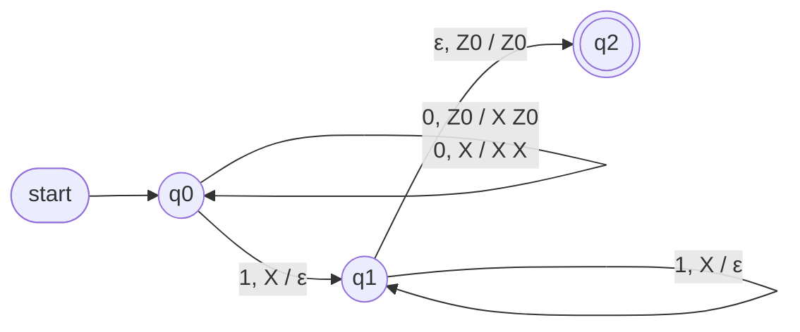
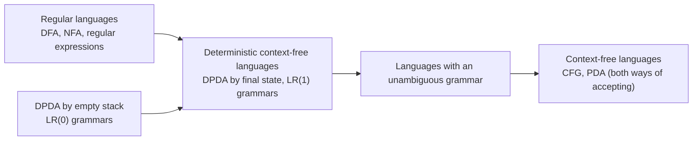

A **finite automaton** has only finitely many states and can therefore "remember" only a bounded amount of information: it cannot recognize a language such as $\{0^n1^n \mid n \ge 1\}$, which requires counting. Equip a finite automaton with a **stack** of unbounded capacity that can be accessed only at one end, and we obtain a pushdown automaton. In this chapter we prove that pushdown automata recognize exactly the languages generated by **context-free grammars**: a grammar describes a class of languages by generation, a pushdown automaton describes the same class by recognition, in complete parallel with the relation between regular expressions and finite automata ([4.8.5](/4.8.5)). The chapter ends with deterministic pushdown automata, the theoretical model of the parsers in compilers. Chapter [4.8.8](/4.8.8) turns to the simplification and parsing algorithms for grammars, and Chapter [4.8.9](/4.8.9) discusses the properties of these languages.

## 7.1. Definition of Pushdown Automata

### 7.1.1. Formal Definition

A pushdown automaton adds a stack to an **NFA with ε-transitions**. In each step it chooses an action nondeterministically, depending on the current state, the current input symbol (or no input), and the top stack symbol: it moves to a new state and replaces the top stack symbol by a string of symbols.

**Definition 7.1.1 (Pushdown Automaton)** A **pushdown automaton** (PDA) is a 7-tuple $P = (Q, \Sigma, \Gamma, \delta, q_0, Z_0, F)$, where
- $Q$ is a finite set of states, $\Sigma$ is a finite input alphabet, and $\Gamma$ is a finite stack alphabet;
- $\delta\colon Q \times (\Sigma \cup \{\varepsilon\}) \times \Gamma \to \mathcal{P}(Q \times \Gamma^*)$ is the transition function, and every $\delta(q, a, X)$ is a finite set;
- $q_0 \in Q$ is the start state, $Z_0 \in \Gamma$ is the start stack symbol (initially the stack contains only $Z_0$), and $F \subseteq Q$ is the set of final states.

The meaning of $(p, \gamma) \in \delta(q, a, X)$ is: in state $q$ with $X$ on top of the stack, read $a$ (no input is read if $a = \varepsilon$), move to state $p$, and replace the top symbol $X$ by the string $\gamma$, whose first symbol becomes the new top of the stack. Thus $\gamma = \varepsilon$ is a pop, $\gamma = X$ leaves the stack unchanged, and $\gamma = YX$ pushes $Y$. When the stack is empty, the PDA can make no move.

Conventions: input symbols are written $a, b, \dots$ and input strings $w, x, y, \dots$; stack symbols are capital letters $X, Y, Z$ and stack strings are $\alpha, \beta, \gamma$; when a stack content is written, its leftmost symbol is the top.

A **transition diagram** is drawn as for **finite automata**; a label $a, X / \gamma$ on an arc means $(p, \gamma) \in \delta(q, a, X)$, and a double circle is a final state.

### 7.1.2. Examples

**Example 7.1.1** A PDA recognizing $L = \{0^n1^n \mid n \ge 1\}$ is $P = (\{q_0, q_1, q_2\}, \{0, 1\}, \{X, Z_0\}, \delta, q_0, Z_0, \{q_2\})$, where

$$
\begin{aligned}
&\delta(q_0, 0, Z_0) = \{(q_0, XZ_0)\}, && \delta(q_0, 0, X) = \{(q_0, XX)\}, \\
&\delta(q_0, 1, X) = \{(q_1, \varepsilon)\}, && \delta(q_1, 1, X) = \{(q_1, \varepsilon)\}, \\
&\delta(q_1, \varepsilon, Z_0) = \{(q_2, Z_0)\},
\end{aligned}
$$
and all other $\delta(q, a, Y) = \varnothing$. Each 0 pushes an $X$; the first 1 moves the PDA to $q_1$, after which each 1 pops an $X$; when the bottom symbol $Z_0$ is exposed, the PDA enters the final state.



**Example 7.1.2** Even-length palindromes $L_{ww^{\mathrm{R}}} = \{ww^{\mathrm{R}} \mid w \in \{0,1\}^*\}$ ($w^{\mathrm{R}}$ is the reversal of $w$). In state $q_0$ the PDA pushes each symbol it reads; at any moment it may "guess" that the midpoint has been reached and move to $q_1$ by an ε-transition; in $q_1$ it compares each symbol read with the top of the stack and pops it if they agree; when $Z_0$ is exposed it enters the final state $q_2$:

$$
\begin{aligned}
&\delta(q_0, a, X) = \{(q_0, aX)\}, \quad \delta(q_0, \varepsilon, X) = \{(q_1, X)\} \qquad (a \in \{0,1\},\ X \in \{0, 1, Z_0\}), \\
&\delta(q_1, a, a) = \{(q_1, \varepsilon)\} \quad (a \in \{0, 1\}), \qquad \delta(q_1, \varepsilon, Z_0) = \{(q_2, Z_0)\}.
\end{aligned}
$$
The nondeterminism here is essential: while reading, the PDA cannot know where the midpoint is, so it must "split" and try every position. Section 7.6 shows that this language cannot be recognized by any deterministic PDA.

## 7.2. Instantaneous Descriptions and the Language of a PDA

### 7.2.1. Instantaneous Descriptions

The "configuration" of a **finite automaton** is just its current state; that of a **PDA** must also include the content of the stack.

**Definition 7.2.1 (Instantaneous Description)** An **instantaneous description** (ID) of a PDA $P$ is a triple $(q, w, \gamma)$, where $q$ is the current state, $w$ is the remaining input, and $\gamma$ is the stack content (top at the left). If $(p, \beta) \in \delta(q, a, X)$, then for all $w \in \Sigma^*$ and $\alpha \in \Gamma^*$ we define a one-step move

$$
(q, aw, X\alpha) \vdash_P (p, w, \beta\alpha),
$$
dropping the subscript $P$ when no confusion arises. The relation $\vdash^*$ is the reflexive transitive closure of $\vdash$: $I \vdash^* I$, and if $I \vdash K$ and $K \vdash^* J$ then $I \vdash^* J$.

The PDA of Example 7.1.1 processes the input $000111$ as follows:

$$
\begin{aligned}
(q_0, 000111, Z_0) &\vdash (q_0, 00111, XZ_0) \vdash (q_0, 0111, XXZ_0) \vdash (q_0, 111, XXXZ_0) \\
&\vdash (q_1, 11, XXZ_0) \vdash (q_1, 1, XZ_0) \vdash (q_1, \varepsilon, Z_0) \vdash (q_2, \varepsilon, Z_0).
\end{aligned}
$$

A move depends only on the state, the next input symbol, and the top of the stack, not on the rest of the input or the deeper stack contents. This fact is used repeatedly in the proofs below.

**Theorem 7.2.1** If $(q, x, \alpha) \vdash^* (p, y, \beta)$, then for all $w \in \Sigma^*$ and $\gamma \in \Gamma^*$ we have $(q, xw, \alpha\gamma) \vdash^* (p, yw, \beta\gamma)$.

**Proof** Induction on the number of steps. The case of zero steps is clear. Suppose that before the last step we already have $(q, xw, \alpha\gamma) \vdash^* (r, zw, \eta\gamma)$, and that the last step $(r, z, \eta) \vdash (p, y, \beta)$ reads the first symbol of $z$ (or none) and replaces the top of $\eta$. This step depends only on $r$, the first symbol of $z$, and the top of $\eta$, so it can be carried out equally well when $w$ is appended to the input and $\gamma$ to the bottom of the stack, giving $(r, zw, \eta\gamma) \vdash (p, yw, \beta\gamma)$. $\square$

**Theorem 7.2.2** If $(q, xw, \alpha) \vdash^* (p, yw, \beta)$, then $(q, x, \alpha) \vdash^* (p, y, \beta)$.

**Proof** This sequence of moves never reads any symbol of $w$, and whether a move is possible does not depend on the unread input, so every step remains possible after $w$ is removed. $\square$

The converse for removing $\gamma$ from the bottom of the stack does not hold in general: during the computation the stack may have been popped into $\gamma$ and pushed again. $\gamma$ can be removed only if it never becomes the top of the stack during the whole computation.

### 7.2.2. Two Ways of Accepting

**Definition 7.2.2 (Acceptance by Final State)** The language accepted by a PDA $P = (Q, \Sigma, \Gamma, \delta, q_0, Z_0, F)$ by **final state** is

$$
L(P) = \{ w \in \Sigma^* \mid (q_0, w, Z_0) \vdash^* (q, \varepsilon, \alpha),\ q \in F,\ \alpha \in \Gamma^* \}.
$$

**Definition 7.2.3 (Acceptance by Empty Stack)** The language accepted by a PDA $P$ by **empty stack** is

$$
N(P) = \{ w \in \Sigma^* \mid (q_0, w, Z_0) \vdash^* (q, \varepsilon, \varepsilon),\ q \in Q \}.
$$
When we discuss acceptance by empty stack, the set of final states is irrelevant and is often omitted, so the PDA is written as a 6-tuple $(Q, \Sigma, \Gamma, \delta, q_0, Z_0)$.

Both methods require that the entire input be read. For the same PDA, $L(P)$ and $N(P)$ are in general different: the PDA of Example 7.1.1 never empties its stack, so $N(P) = \varnothing$; if the last transition is changed to $\delta(q_1, \varepsilon, Z_0) = \{(q_1, \varepsilon)\}$, we obtain a PDA with $N(P) = \{0^n1^n \mid n \ge 1\}$ (which needs only two states).

**Example 7.2.1** A PDA is nondeterministic: an ID may have several successors, and an input is accepted if and only if some computation path reaches an accepting configuration. To decide acceptance by a program is to search the **state space** of IDs. Below we simulate the PDA of Example 7.1.2 by **breadth-first search**. The stack of an ID may grow without bound (for example by repeatedly executing a pushing ε-transition), so a general simulation needs pruning; the stack of this PDA never exceeds $\lvert w\rvert + 1$ symbols, so pruning at this length loses no accepting path.

```python
from collections import deque

# delta[(q, a, X)] = set of (p, gamma); a == "" means an epsilon move.
# The stack is a string whose first character is the top.
def accepts(delta, q0, Z0, finals, w, by="final", limit=10_000):
    start = (q0, w, Z0)
    seen, queue = {start}, deque([start])
    while queue:
        q, rest, stack = queue.popleft()
        if rest == "" and (q in finals if by == "final" else stack == ""):
            return True
        if not stack:
            continue
        X, below = stack[0], stack[1:]
        moves = [("", r) for r in delta.get((q, "", X), ())]
        if rest:
            moves += [(rest[0], r) for r in delta.get((q, rest[0], X), ())]
        for a, (p, gamma) in moves:
            nxt = (p, rest[len(a):], gamma + below)
            # this PDA never needs more than |w| + 1 stack symbols
            if nxt not in seen and len(nxt[2]) <= len(w) + 2:
                seen.add(nxt)
                queue.append(nxt)
        if len(seen) > limit:
            raise RuntimeError("too many IDs")
    return False

# PDA for { w w^R : w in {0,1}* }, accepting by final state (Z is the bottom marker)
delta = {}
for X in "01Z":
    for a in "01":
        delta[("q0", a, X)] = {("q0", a + X)}        # push the input symbol
    delta[("q0", "", X)] = {("q1", X)}                # guess the middle
for a in "01":
    delta[("q1", a, a)] = {("q1", "")}                # match and pop
delta[("q1", "", "Z")] = {("q2", "Z")}                # bottom reached: accept

for w in ["", "0110", "1001", "011", "0101", "110011"]:
    print(f"{w!r:10} {accepts(delta, 'q0', 'Z', {'q2'}, w)}")
```

```text
''         True
'0110'     True
'1001'     True
'011'      False
'0101'     False
'110011'   True
```

## 7.3. Equivalence of the Two Ways of Accepting

The two acceptance methods define the same class of languages: a **PDA** of either kind can be converted into one of the other kind. The key of the constructions is to place a new symbol $X_0$ at the bottom of the stack, which tells us whether "the stack of the original PDA is empty".

**Theorem 7.3.1 (From Empty Stack to Final State)** If $L = N(P_N)$ with $P_N = (Q, \Sigma, \Gamma, \delta_N, q_0, Z_0)$, then there is a PDA $P_F$ with $L = L(P_F)$.

**Proof** Take new states $p_0, p_f$ and a new stack symbol $X_0$, and let $P_F = (Q \cup \{p_0, p_f\}, \Sigma, \Gamma \cup \{X_0\}, \delta_F, p_0, X_0, \{p_f\})$ with
1. $\delta_F(p_0, \varepsilon, X_0) = \{(q_0, Z_0X_0)\}$: push $Z_0$ above $X_0$ and enter the start configuration of $P_N$;
2. $\delta_F(q, a, Y) = \delta_N(q, a, Y)$ for $q \in Q$, $a \in \Sigma \cup \{\varepsilon\}$, $Y \in \Gamma$;
3. $\delta_F(q, \varepsilon, X_0) = \{(p_f, \varepsilon)\}$ for every $q \in Q$: when $X_0$ is exposed, the stack of $P_N$ is empty, and we move to the final state.

If $w \in N(P_N)$, that is, $(q_0, w, Z_0) \vdash^*_{N} (q, \varepsilon, \varepsilon)$, then appending $X_0$ to the bottom of the stack by Theorem 7.2.1 gives

$$
(p_0, w, X_0) \vdash_F (q_0, w, Z_0X_0) \vdash^*_F (q, \varepsilon, X_0) \vdash_F (p_f, \varepsilon, \varepsilon),
$$
so $w \in L(P_F)$. Conversely, $P_F$ can enter $p_f$ only by rule 3, and its first step must use rule 1; all intermediate steps are moves of $P_N$, and once $X_0$ is exposed only rule 3 can be applied, so $X_0$ is never exposed in the intermediate steps and can be removed from the bottom of the stack, giving $(q_0, w, Z_0) \vdash^*_N (q, \varepsilon, \varepsilon)$. $\square$

**Theorem 7.3.2 (From Final State to Empty Stack)** If $L = L(P_F)$ with $P_F = (Q, \Sigma, \Gamma, \delta_F, q_0, Z_0, F)$, then there is a PDA $P_N$ with $L = N(P_N)$.

**Proof** Take new states $p_0, p$ and a new stack symbol $X_0$, and let $P_N = (Q \cup \{p_0, p\}, \Sigma, \Gamma \cup \{X_0\}, \delta_N, p_0, X_0)$ with
1. $\delta_N(p_0, \varepsilon, X_0) = \{(q_0, Z_0X_0)\}$;
2. $\delta_N(q, a, Y) \supseteq \delta_F(q, a, Y)$ for $q \in Q$, $a \in \Sigma \cup \{\varepsilon\}$, $Y \in \Gamma$;
3. $(p, \varepsilon) \in \delta_N(q, \varepsilon, Y)$ for $q \in F$ and $Y \in \Gamma \cup \{X_0\}$: in a final state the PDA may begin to empty the stack;
4. $\delta_N(p, \varepsilon, Y) = \{(p, \varepsilon)\}$ for $Y \in \Gamma \cup \{X_0\}$: in $p$ the stack is popped until empty.

If $(q_0, w, Z_0) \vdash^*_F (q, \varepsilon, \alpha)$ with $q \in F$, then $(p_0, w, X_0) \vdash_N (q_0, w, Z_0X_0) \vdash^*_N (q, \varepsilon, \alpha X_0) \vdash^*_N (p, \varepsilon, \varepsilon)$. Conversely, $X_0$ is always at the bottom of the stack of $P_N$ and the moves of $P_F$ cannot pop $X_0$, so the stack can be emptied only in state $p$; entering $p$ requires first reaching some state in $F$, and no more input is read afterwards, so $P_F$ has reached a final state when $w$ has been read. The bottom marker $X_0$ prevents the following error: $P_F$ empties its own stack in a non-final state, and $P_N$ would accept by mistake. $\square$

**Example 7.3.1** Checking if–else matching: let $i$ stand for if and $e$ for else; in every prefix the number of else's should not exceed the number of if's. The following PDA accepts, under **acceptance by empty stack**, the strings in which "an unmatched else appears for the first time": $P_N = (\{q\}, \{i, e\}, \{Z\}, \delta_N, q, Z)$ with

$$
\delta_N(q, i, Z) = \{(q, ZZ)\}, \qquad \delta_N(q, e, Z) = \{(q, \varepsilon)\}.
$$
The number of $Z$'s on the stack equals (number of if's $-$ number of else's $+ 1$), so an empty stack means exactly that one else too many has occurred. By Theorem 7.3.1 we obtain the PDA $P_F = (\{p, q, r\}, \{i, e\}, \{Z, X_0\}, \delta_F, p, X_0, \{r\})$ accepting by final state:

$$
\delta_F(p, \varepsilon, X_0) = \{(q, ZX_0)\}, \quad \delta_F(q, i, Z) = \{(q, ZZ)\}, \quad \delta_F(q, e, Z) = \{(q, \varepsilon)\}, \quad \delta_F(q, \varepsilon, X_0) = \{(r, \varepsilon)\}.
$$
Among strings of length at most 5 it accepts $e$, $iee$, $iieee$, $ieiee$, all of which are strings in which "an else is in excess exactly at the last symbol". This PDA detects matching errors; it does not confirm that matching is correct.

## 7.4. Designing Pushdown Automata

When we design a **PDA**, the stack usually plays one of three roles: a counter (the number of pushed symbols records a difference in counts), reverse storage (compare with the second half in last-in-first-out order), and a record of "what is still owed" (Section 7.5 uses it to simulate derivations). Nondeterminism is used to guess where to cut the input into parts.

**Example 7.4.1** $L = \{w \in \{a, b\}^* \mid w \text{ has equally many } a\text{'s and } b\text{'s}\}$, under **acceptance by empty stack**. The stack stores only the symbol that is in excess: $P = (\{q\}, \{a, b\}, \{A, B, Z_0\}, \delta, q, Z_0)$ with

$$
\begin{aligned}
&\delta(q, a, Z_0) = \{(q, AZ_0)\}, && \delta(q, a, A) = \{(q, AA)\}, && \delta(q, a, B) = \{(q, \varepsilon)\}, \\
&\delta(q, b, Z_0) = \{(q, BZ_0)\}, && \delta(q, b, B) = \{(q, BB)\}, && \delta(q, b, A) = \{(q, \varepsilon)\}, \\
&\delta(q, \varepsilon, Z_0) = \{(q, \varepsilon)\}.
\end{aligned}
$$
For a prefix $x$ that has been read, put $d = \#_a(x) - \#_b(x)$. If $d > 0$ the stack is $A^dZ_0$; if $d < 0$ the stack is $B^{-d}Z_0$; if $d = 0$ the stack is $Z_0$ (by induction on the length read). $Z_0$ can be popped only when $d = 0$, so $N(P) = L$. The last ε-transition coexists with the input-reading transitions at the same $(q, Z_0)$, so this PDA is not deterministic.

**Example 7.4.2** $L = \{a^n b^m c^k \mid n, m, k \ge 0,\ n + 2m = k\}$, under **acceptance by final state**. Each $a$ pushes one $X$, each $b$ pushes two $X$'s, and each $c$ pops one $X$; the states enforce the order of the three blocks:

$$
\begin{aligned}
&\delta(q_0, a, Y) = \{(q_0, XY)\}, \quad \delta(q_0, \varepsilon, Y) = \{(q_1, Y)\}, \\
&\delta(q_1, b, Y) = \{(q_1, XXY)\}, \quad \delta(q_1, \varepsilon, Y) = \{(q_2, Y)\} \qquad (Y \in \{X, Z_0\}), \\
&\delta(q_2, c, X) = \{(q_2, \varepsilon)\}, \quad \delta(q_2, \varepsilon, Z_0) = \{(q_3, Z_0)\},
\end{aligned}
$$
with final-state set $\{q_3\}$. Checking all strings of length at most 9 with the simulation program of Section 7.2 shows that exactly the strings of $L$ are accepted.

## 7.5. Equivalence of Context-Free Grammars and Pushdown Automata

This section uses the notation of [4.8.2](/4.8.2): a **context-free grammar** $G = (V, T, P, S)$, derivations $\Rightarrow$ and $\overset{*}{\Rightarrow}$, and leftmost derivations $\underset{\mathrm{lm}}{\Rightarrow}$.

**Definition 7.5.1 (Context-Free Language)** A language $L$ is called a **context-free language** (CFL) if $L = L(G)$ for some context-free grammar $G$.

We prove that three classes of languages coincide: the context-free languages, the languages of PDAs using **acceptance by empty stack**, and the languages of PDAs using **acceptance by final state**. The equality of the last two was proved in Section 7.3.

### 7.5.1. From a Grammar to a PDA

The idea is to let the PDA simulate a leftmost derivation on its stack: the stack holds the part of the **sentential form** that has not yet been matched with the input. When the top of the stack is a variable, the PDA nondeterministically chooses a production and expands it; when the top is a terminal, it is compared with the next input symbol and popped. This is exactly top-down parsing.

**Theorem 7.5.1** Let $G = (V, T, P, S)$ be a context-free grammar. Let the PDA be $P_G = (\{q\}, T, V \cup T, \delta, q, S)$, where
1. $\delta(q, \varepsilon, A) = \{(q, \beta) \mid A \to \beta \in P\}$ for every variable $A$;
2. $\delta(q, a, a) = \{(q, \varepsilon)\}$ for every terminal $a$.

Then $N(P_G) = L(G)$.

**Proof** For a grammar symbol $X \in V \cup T$ and $w \in T^*$ we prove: $X \overset{*}{\Rightarrow} w$ if and only if $(q, w, X) \vdash^* (q, \varepsilon, \varepsilon)$. Taking $X = S$ gives the claim.

($\Rightarrow$) Induction on the number of derivation steps. If $X$ is a terminal then $w = X$, and rule 2 finishes in one step. If $X = A$ is a variable, suppose the first step of the derivation uses $A \to X_1X_2\cdots X_m$; then $w = w_1w_2\cdots w_m$ with $X_i \overset{*}{\Rightarrow} w_i$, each derivation shorter than the original one. By rule 1, $(q, w, A) \vdash (q, w, X_1\cdots X_m)$; by the induction hypothesis and Theorem 7.2.1, for $i = 1, \dots, m$ in turn

$$
(q, w_iw_{i+1}\cdots w_m, X_iX_{i+1}\cdots X_m) \vdash^* (q, w_{i+1}\cdots w_m, X_{i+1}\cdots X_m),
$$
and chaining these gives $(q, w, A) \vdash^* (q, \varepsilon, \varepsilon)$.

($\Leftarrow$) Induction on the number of moves. If $X$ is a terminal, the only possible move is by rule 2, so $w = X$. If $X = A$ is a variable, the first step must be by rule 1, say $(q, w, A) \vdash (q, w, X_1\cdots X_m)$. For the stack to be emptied afterwards, $X_1, \dots, X_m$ must be removed one after another; let $w_i$ be the input read from the moment $X_i$ is exposed until the position of $X_i$ has been popped. Then $w = w_1\cdots w_m$, and during this stretch $X_{i+1}\cdots X_m$ is never exposed, so removing them (and, by Theorem 7.2.2, the input that follows) gives a shorter computation $(q, w_i, X_i) \vdash^* (q, \varepsilon, \varepsilon)$. By the induction hypothesis $X_i \overset{*}{\Rightarrow} w_i$, hence $A \Rightarrow X_1\cdots X_m \overset{*}{\Rightarrow} w_1\cdots w_m = w$. $\square$

**Example 7.5.1** Take the **grammar** $E \to E + E \mid E * E \mid a$. An accepting path of $P_G$ on $a + a * a$ (each application of rule 1 must "guess" the right production) is

$$
\begin{aligned}
(q, a{+}a{*}a, E) &\vdash (q, a{+}a{*}a, E{+}E) \vdash (q, a{+}a{*}a, a{+}E) \vdash (q, {+}a{*}a, {+}E) \vdash (q, a{*}a, E) \\
&\vdash (q, a{*}a, E{*}E) \vdash (q, a{*}a, a{*}E) \vdash (q, {*}a, {*}E) \vdash (q, a, E) \vdash (q, a, a) \vdash (q, \varepsilon, \varepsilon).
\end{aligned}
$$
Concatenating the part already read with the stack content gives, in turn, the sentential forms of the leftmost derivation $E \Rightarrow E + E \Rightarrow a + E \Rightarrow a + E * E \Rightarrow a + a * E \Rightarrow a + a * a$.

### 7.5.2. From a PDA to a Grammar

The converse construction translates computations of a PDA into derivations. A computation accepting by empty stack can be decomposed into a sequence of segments whose net effect is to pop one stack symbol: for states $q, p$ and a stack symbol $X$ we introduce a variable $[qXp]$, which generates all input strings read "starting in state $q$, until the $X$ on top of the stack has been popped and the PDA is exactly in state $p$".

**Theorem 7.5.2** Let $P = (Q, \Sigma, \Gamma, \delta, q_0, Z_0)$. Construct the grammar $G = (V, \Sigma, R, S)$ with $V = \{S\} \cup \{[qXp] \mid p, q \in Q,\ X \in \Gamma\}$, whose productions $R$ are:
1. $S \to [q_0Z_0p]$ for every $p \in Q$;
2. for every $(r, Y_1Y_2\cdots Y_k) \in \delta(q, a, X)$ ($a \in \Sigma \cup \{\varepsilon\}$, $k \ge 0$) and all states $r_1, \dots, r_k$,

   $$
   [qXr_k] \to a\,[rY_1r_1][r_1Y_2r_2]\cdots[r_{k-1}Y_kr_k];
   $$
   for $k = 0$ this reads $[qXr] \to a$.

Then $L(G) = N(P)$.

**Proof** We prove that for all $q, p \in Q$, $X \in \Gamma$, and $w \in \Sigma^*$: $[qXp] \overset{*}{\Rightarrow} w$ if and only if $(q, w, X) \vdash^* (p, \varepsilon, \varepsilon)$. By rule 1, $S \overset{*}{\Rightarrow} w$ if and only if $[q_0Z_0p] \overset{*}{\Rightarrow} w$ for some $p$, that is, $w \in N(P)$.

($\Leftarrow$) Induction on the number of moves. Suppose the first move is $(q, w, X) \vdash (r, x, Y_1\cdots Y_k)$, with $w = ax$ and $(r, Y_1\cdots Y_k) \in \delta(q, a, X)$. If $k = 0$ then $x = \varepsilon$ and $r = p$, and the production $[qXp] \to a$ exists. If $k \ge 1$, then $Y_1, \dots, Y_k$ are popped one after another afterwards; let $r_i$ be the state after $Y_i$ is popped ($r_k = p$) and $x_i$ the input read in that stretch. Then $x = x_1\cdots x_k$, and by the argument of Section 7.5.1 we have $(r_{i-1}, x_i, Y_i) \vdash^* (r_i, \varepsilon, \varepsilon)$ ($r_0 = r$), all with fewer steps. By the induction hypothesis $[r_{i-1}Y_ir_i] \overset{*}{\Rightarrow} x_i$, and the production $[qXp] \to a[rY_1r_1]\cdots[r_{k-1}Y_kp]$ of rule 2 gives $[qXp] \overset{*}{\Rightarrow} ax_1\cdots x_k = w$.

($\Rightarrow$) Induction on the number of derivation steps. Suppose the first step uses $[qXp] \to a[rY_1r_1]\cdots[r_{k-1}Y_kp]$; then $w = ax_1\cdots x_k$ and $[r_{i-1}Y_ir_i] \overset{*}{\Rightarrow} x_i$. By the induction hypothesis $(r_{i-1}, x_i, Y_i) \vdash^* (r_i, \varepsilon, \varepsilon)$; supplying the following input and stack content by Theorem 7.2.1 and linking the segments gives

$$
(q, w, X) \vdash (r, x_1\cdots x_k, Y_1\cdots Y_k) \vdash^* (r_1, x_2\cdots x_k, Y_2\cdots Y_k) \vdash^* \cdots \vdash^* (p, \varepsilon, \varepsilon). \qquad \square
$$

In rule 2, $r_1, \dots, r_k$ are "guesses" of future states; a variable guessed wrongly cannot generate any terminal string and is deleted as a **useless symbol** during simplification.

**Example 7.5.2** Take the PDA accepting $\{0^n1^n \mid n \ge 1\}$ by empty stack, $P = (\{q_0, q_1\}, \{0, 1\}, \{X, Z_0\}, \delta, q_0, Z_0)$:

$$
\begin{aligned}
&\delta(q_0, 0, Z_0) = \{(q_0, XZ_0)\}, \quad \delta(q_0, 0, X) = \{(q_0, XX)\}, \quad \delta(q_0, 1, X) = \{(q_1, \varepsilon)\}, \\
&\delta(q_1, 1, X) = \{(q_1, \varepsilon)\}, \quad \delta(q_1, \varepsilon, Z_0) = \{(q_1, \varepsilon)\}.
\end{aligned}
$$
The construction yields the productions ($r_1, r_2$ range over $\{q_0, q_1\}$):

$$
\begin{aligned}
&S \to [q_0Z_0q_0] \mid [q_0Z_0q_1], \\
&[q_0Z_0r_2] \to 0\,[q_0Xr_1][r_1Z_0r_2], \qquad [q_0Xr_2] \to 0\,[q_0Xr_1][r_1Xr_2], \\
&[q_0Xq_1] \to 1, \qquad [q_1Xq_1] \to 1, \qquad [q_1Z_0q_1] \to \varepsilon.
\end{aligned}
$$
From $q_1$ the PDA can never return to $q_0$, so every production containing $[q_1Yq_0]$ is useless. Deleting these together with the variables that thereby cannot generate terminal strings (for the algorithm see Section 8.1 of [4.8.8](/4.8.8)), and writing $A = [q_0Z_0q_1]$, $B = [q_0Xq_1]$, $C = [q_1Xq_1]$, $D = [q_1Z_0q_1]$, we are left with

$$
S \to A, \quad A \to 0BD, \quad B \to 0BC \mid 1, \quad C \to 1, \quad D \to \varepsilon.
$$
$B$ generates $0^k1^{k+1}$, so $A$ generates $0^{k+1}1^{k+1}$, which is indeed the original language.

**Corollary 7.5.1** For a language $L$ the following three conditions are equivalent: $L$ is a context-free language; $L = N(P)$ for some PDA $P$; $L = L(P)$ for some PDA $P$.

The two constructions differ in size: from a grammar to a PDA the size is linear; from a PDA to a grammar, a move pushing $k$ symbols produces $\lvert Q\rvert^k$ productions, which is exponential. If each move is first split into several steps that push at most two symbols (introducing intermediate states), the size of the grammar drops to $O(n^3)$.

## 7.6. Deterministic Pushdown Automata

### 7.6.1. Definition

**Definition 7.6.1 (Deterministic Pushdown Automaton)** A PDA $P = (Q, \Sigma, \Gamma, \delta, q_0, Z_0, F)$ is called a **deterministic pushdown automaton** (DPDA) if, for all $q \in Q$ and $X \in \Gamma$:
1. $\delta(q, a, X)$ has at most one element for every $a \in \Sigma \cup \{\varepsilon\}$;
2. if $\delta(q, a, X) \ne \varnothing$ for some $a \in \Sigma$, then $\delta(q, \varepsilon, X) = \varnothing$.

Condition 2 rules out a choice between "reading input" and "not reading input". Hence every ID has at most one successor, and the computation is unique.

**Theorem 7.6.1** If $L$ is a **regular language**, then $L = L(P)$ for some DPDA $P$.

**Proof** Let a DFA $A = (Q, \Sigma, \delta_A, q_0, F)$ recognize $L$. Let $P = (Q, \Sigma, \{Z_0\}, \delta_P, q_0, Z_0, F)$ with $\delta_P(q, a, Z_0) = \{(\delta_A(q, a), Z_0)\}$: $P$ does not use its stack and just simulates $A$. Induction on $\lvert w\rvert$ shows that $(q_0, w, Z_0) \vdash^* (p, \varepsilon, Z_0)$ if and only if $\delta_A$ takes $q_0$ to $p$ on $w$. $\square$

The inclusion is proper: $L_{wcw^{\mathrm{R}}} = \{wcw^{\mathrm{R}} \mid w \in \{0, 1\}^*\}$ is not regular (this follows from the **pumping lemma for regular languages**, see [4.8.6](/4.8.6)), but once the midpoint marker $c$ is present, the guessing of Example 7.1.2 is no longer necessary:

**Example 7.6.1** A DPDA recognizing $L_{wcw^{\mathrm{R}}}$: for $a \in \{0, 1\}$ and $X \in \{0, 1, Z_0\}$,

$$
\delta(q_0, a, X) = \{(q_0, aX)\}, \quad \delta(q_0, c, X) = \{(q_1, X)\}, \quad \delta(q_1, a, a) = \{(q_1, \varepsilon)\}, \quad \delta(q_1, \varepsilon, Z_0) = \{(q_2, Z_0)\},
$$
with final-state set $\{q_2\}$. At $(q_1, Z_0)$ there is only an ε-transition, and in all other configurations only input-reading transitions, so Definition 7.6.1 is satisfied.

### 7.6.2. The Prefix Property and Acceptance by Empty Stack

For a deterministic **PDA**, the two ways of accepting are no longer equivalent.

**Definition 7.6.2 (Prefix Property)** A language $L$ has the **prefix property** if there are no two distinct strings $x, y \in L$ such that $x$ is a prefix of $y$.

For example, for any $L \subseteq \Sigma^*$ and any symbol $\dashv$ not in $\Sigma$, the language $L{\dashv} = \{w{\dashv} \mid w \in L\}$ has the prefix property; $L_{wcw^{\mathrm{R}}}$ has the prefix property; $\{0\}^*$ does not.

**Theorem 7.6.2** There is a DPDA $P$ with $L = N(P)$ if and only if $L$ has the prefix property and there is a DPDA $P'$ with $L = L(P')$.

**Proof** ($\Rightarrow$) Let $x \in N(P)$. By determinism, the computation of $P$ on input $xy$ is step by step the same as on input $x$ until $x$ has been read; after that, on input $x$ the PDA $P$ makes only ε-moves until the stack is empty, and on input $xy$, by condition 2 of Definition 7.6.1, only these ε-moves are possible in the same configuration, so $P$ also halts with an empty stack without having read $y$. Hence $xy \notin N(P)$ for $y \ne \varepsilon$, and $L$ has the prefix property. The construction of Theorem 7.3.1 adds ε-moves only on the new stack symbol $X_0$, and the original PDA has no moves at all on $X_0$, so the resulting $P'$ is still deterministic.

($\Leftarrow$) In $P'$, being in a final state after reading a prefix $x$ shows that $x \in L$, and by the prefix property no proper extension of $x$ is in $L$. Hence we may delete all transitions leaving final states and replace them by ε-moves that "empty the stack" (placing $X_0$ at the bottom as in Theorem 7.3.2). No input-reading transitions remain on final states, so the resulting PDA is deterministic and accepts exactly $L$ by empty stack. $\square$

Therefore $\{0\}^*$, although regular, is not the language of any DPDA using **acceptance by empty stack**. DPDAs accepting by empty stack are weaker, and the study of determinism usually uses **acceptance by final state**.

### 7.6.3. Deterministic Context-Free Languages and Unambiguous Grammars

**Definition 7.6.3 (Deterministic Context-Free Language)** A language $L$ is called a **deterministic context-free language** (DCFL) if $L = L(P)$ for some DPDA $P$.

**Theorem 7.6.3** $L_{ww^{\mathrm{R}}}$ is a **context-free language** but not a deterministic context-free language.

Intuitively, on reading the second character of $0110$ a deterministic machine cannot decide whether to keep pushing (the input might be $0110\,0110$) or to start matching (the input is just $0110$), and the two possibilities require entirely different stack operations: once popping and matching begin, the first half is irrecoverably lost. The rigorous proof is long and is omitted here.

**Theorem 7.6.4** If a DPDA $P$ satisfies $L = N(P)$, then $L$ has an unambiguous **context-free grammar**.

**Proof** Apply the construction of Theorem 7.5.2 to $P$ to obtain $G$. Every leftmost derivation of $G$ corresponds to an accepting computation of $P$: the production used to expand a variable $[qXp]$ is determined by the transition being executed and the guessed states $r_1, \dots, r_k$, and a guess that can generate a terminal string must agree with the states the actual computation passes through. Since $P$ is deterministic, every $w \in N(P)$ has only one computation, hence only one leftmost derivation, and $G$ is unambiguous. $\square$

**Theorem 7.6.5** If a DPDA $P$ satisfies $L = L(P)$, then $L$ has an unambiguous context-free grammar.

**Proof** Take a symbol $\dashv$ not in the alphabet. Modify $P$ so that, after reading the input in a final state, it reads $\dashv$ and enters a new final state; this gives a DPDA recognizing $L{\dashv}$. The language $L{\dashv}$ has the prefix property, so by Theorem 7.6.2 there is a DPDA accepting $L{\dashv}$ by empty stack, and by Theorem 7.6.4 there is an unambiguous grammar $G'$ with $L(G') = L{\dashv}$. Turn $\dashv$ into a variable and add the production ${\dashv} \to \varepsilon$; this gives a grammar $G$ with $L(G) = L$. The leftmost derivations of $G$ correspond one to one to those of $G'$ (with only the extra last step ${\dashv} \Rightarrow \varepsilon$), so $G$ is unambiguous. $\square$

By Theorem 7.6.5, no language that is **inherently ambiguous** (for example $\{a^nb^nc^md^m\} \cup \{a^nb^mc^md^n\}$, $n, m \ge 1$) is a DCFL. The converse fails: $L_{ww^{\mathrm{R}}}$ has the unambiguous **grammar** $S \to 0S0 \mid 1S1 \mid \varepsilon$ but is not a DCFL.

**Remark** Deterministic context-free languages are closely related to parsing in compilers. Knuth (1965) proved that a language is a DCFL if and only if it can be generated by some LR(1) grammar (equivalently, by some LR($k$) grammar, $k \ge 1$); the LR(0) grammars generate exactly the DCFLs with the prefix property, that is, the languages of DPDAs accepting by empty stack. The LALR(1) used by parser generators such as yacc and Bison is a practical subclass of LR(1). Moreover, the DCFLs are closed under complement but not under union or intersection, in exact contrast to general context-free languages (closed under union, not under complement).

The relations among the language classes are as follows (an arrow means proper inclusion). The languages of DPDAs accepting by empty stack and the regular languages are incomparable: $\{0\}^*$ is regular but not in the former, and $L_{wcw^{\mathrm{R}}}$ is in the former but not regular.



## Summary

| Topic | Key points |
|---|---|
| **PDA** | 7-tuple $(Q, \Sigma, \Gamma, \delta, q_0, Z_0, F)$; ID $(q, w, \gamma)$, with $\vdash$ and $\vdash^*$ |
| Two ways of accepting | $L(P)$ by **acceptance by final state**, $N(P)$ by **acceptance by empty stack**; interconvertible with a new stack bottom $X_0$, same class of languages |
| **Grammar** → PDA | A one-state PDA simulates leftmost derivations on its stack (top-down parsing), linear size |
| PDA → grammar | The variable $[qXp]$ generates the strings read "from $q$, popping $X$, to reach $p$"; exponential size, $O(n^3)$ after preprocessing |
| **DPDA** | Every ID has at most one successor; **regular languages** $\subsetneq$ DCFL $\subsetneq$ CFL |
| **Prefix property** | Languages of DPDAs accepting by empty stack = DCFLs with the prefix property |
| Unambiguity | Every DCFL has an unambiguous grammar; **inherently ambiguous** languages are not DCFLs; $L_{ww^{\mathrm{R}}}$ is unambiguous but not a DCFL |
