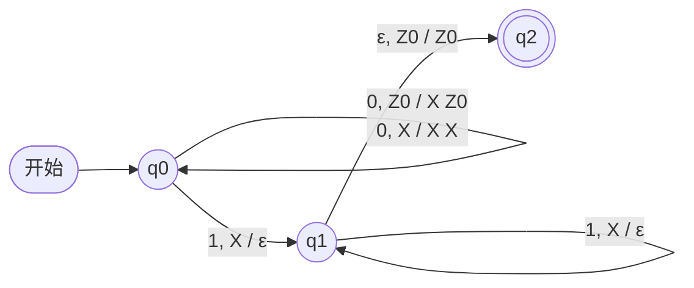
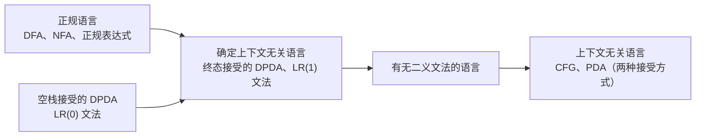

**有限自动机**只有有限个状态，因而只能"记住"有限的信息：它无法识别 $\{0^n1^n \mid n \ge 1\}$ 这样需要计数的语言。给有限自动机配上一个容量不限、但只能在一端存取的**栈**，就得到下推自动机。本章证明它恰好识别**上下文无关文法**生成的语言：文法从"生成"的角度描述一类语言，下推自动机从"识别"的角度描述同一类语言，这与正规表达式和有限自动机的关系（[4.8.5](/4.8.5)）完全平行。本章最后讨论确定的下推自动机，它是编译器中语法分析器的理论模型；第 [4.8.8](/4.8.8) 章转向文法本身的化简与分析算法，第 [4.8.9](/4.8.9) 章讨论这类语言的性质。

## 7.1. 下推自动机的定义

### 7.1.1. 形式定义

下推自动机在 **ε-NFA** 的基础上增加一个栈。每一步，它根据当前状态、当前输入符号（或不读输入）和栈顶符号，非确定地选择一个动作：转入新状态，并用一个符号串替换栈顶符号。

**定义 7.1.1（下推自动机）** 一个**下推自动机**（PDA）是一个七元组 $P = (Q, \Sigma, \Gamma, \delta, q_0, Z_0, F)$，其中
- $Q$ 是有限的状态集，$\Sigma$ 是有限的输入字母表，$\Gamma$ 是有限的栈字母表；
- $\delta\colon Q \times (\Sigma \cup \{\varepsilon\}) \times \Gamma \to \mathcal{P}(Q \times \Gamma^*)$ 是转移函数，每个 $\delta(q, a, X)$ 都是有限集；
- $q_0 \in Q$ 是开始状态，$Z_0 \in \Gamma$ 是开始栈符号（初始时栈中只有它），$F \subseteq Q$ 是终态集。

$(p, \gamma) \in \delta(q, a, X)$ 的含义是：在状态 $q$、栈顶为 $X$ 时，读入 $a$（$a = \varepsilon$ 时不读输入），转入状态 $p$，并把栈顶的 $X$ 替换为符号串 $\gamma$，$\gamma$ 的第一个符号成为新的栈顶。$\gamma = \varepsilon$ 是弹栈，$\gamma = X$ 是栈不变，$\gamma = YX$ 是压入 $Y$。栈为空时 PDA 没有任何动作。

约定：输入符号用 $a, b, \dots$，输入串用 $w, x, y, \dots$；栈符号用大写字母 $X, Y, Z$，栈中的串用 $\alpha, \beta, \gamma$；书写栈内容时最左边是栈顶。

**转移图**沿用**有限自动机**的画法，弧上的标记 $a, X / \gamma$ 表示 $(p, \gamma) \in \delta(q, a, X)$；双圈是终态。

### 7.1.2. 例子

**例 7.1.1** 识别 $L = \{0^n1^n \mid n \ge 1\}$ 的一个 PDA：$P = (\{q_0, q_1, q_2\}, \{0, 1\}, \{X, Z_0\}, \delta, q_0, Z_0, \{q_2\})$，其中

$$
\begin{aligned}
&\delta(q_0, 0, Z_0) = \{(q_0, XZ_0)\}, && \delta(q_0, 0, X) = \{(q_0, XX)\}, \\
&\delta(q_0, 1, X) = \{(q_1, \varepsilon)\}, && \delta(q_1, 1, X) = \{(q_1, \varepsilon)\}, \\
&\delta(q_1, \varepsilon, Z_0) = \{(q_2, Z_0)\},
\end{aligned}
$$
其余的 $\delta(q, a, Y) = \varnothing$。读 0 时每读一个压入一个 $X$；读到第一个 1 转入 $q_1$，此后每读一个 1 弹出一个 $X$；露出栈底 $Z_0$ 时转入终态。



**例 7.1.2** 偶数长度的回文 $L_{ww^{\mathrm{R}}} = \{ww^{\mathrm{R}} \mid w \in \{0,1\}^*\}$（$w^{\mathrm{R}}$ 是 $w$ 的反转）。PDA 在状态 $q_0$ 把读到的符号逐个压栈；在任何时刻都可以"猜测"已到达中点，经 ε 转移进入 $q_1$；在 $q_1$ 中每读一个符号就与栈顶比较，相同则弹出；露出 $Z_0$ 时进入终态 $q_2$：

$$
\begin{aligned}
&\delta(q_0, a, X) = \{(q_0, aX)\}, \quad \delta(q_0, \varepsilon, X) = \{(q_1, X)\} \qquad (a \in \{0,1\},\ X \in \{0, 1, Z_0\}), \\
&\delta(q_1, a, a) = \{(q_1, \varepsilon)\} \quad (a \in \{0, 1\}), \qquad \delta(q_1, \varepsilon, Z_0) = \{(q_2, Z_0)\}.
\end{aligned}
$$
这里的非确定性是本质的：读入过程中 PDA 无从知道中点在哪里，只能在每个位置都"分身"尝试一次。第 7.6 节会说明，这个语言不能被任何确定的 PDA 识别。

## 7.2. 瞬时描述与 PDA 的语言

### 7.2.1. 瞬时描述

**有限自动机**的"格局"只是当前状态；**PDA** 的格局还要包括栈的内容。

**定义 7.2.1（瞬时描述）** PDA $P$ 的**瞬时描述**（ID）是三元组 $(q, w, \gamma)$：$q$ 是当前状态，$w$ 是尚未读入的输入，$\gamma$ 是栈的内容（栈顶在左）。若 $(p, \beta) \in \delta(q, a, X)$，则对任意 $w \in \Sigma^*$、$\alpha \in \Gamma^*$ 定义一步转移

$$
(q, aw, X\alpha) \vdash_P (p, w, \beta\alpha),
$$
不致混淆时省略下标 $P$。$\vdash^*$ 是 $\vdash$ 的自反传递闭包：$I \vdash^* I$；若 $I \vdash K$ 且 $K \vdash^* J$，则 $I \vdash^* J$。

例 7.1.1 的 PDA 处理输入 $000111$ 的过程是

$$
\begin{aligned}
(q_0, 000111, Z_0) &\vdash (q_0, 00111, XZ_0) \vdash (q_0, 0111, XXZ_0) \vdash (q_0, 111, XXXZ_0) \\
&\vdash (q_1, 11, XXZ_0) \vdash (q_1, 1, XZ_0) \vdash (q_1, \varepsilon, Z_0) \vdash (q_2, \varepsilon, Z_0).
\end{aligned}
$$

一步转移只看状态、下一个输入符号和栈顶，与后面的输入和栈中更深的内容无关。这一事实在后面的证明中反复使用：

**定理 7.2.1** 若 $(q, x, \alpha) \vdash^* (p, y, \beta)$，则对任意 $w \in \Sigma^*$、$\gamma \in \Gamma^*$，有 $(q, xw, \alpha\gamma) \vdash^* (p, yw, \beta\gamma)$。

**证明** 对步数归纳。零步时显然。设最后一步之前已有 $(q, xw, \alpha\gamma) \vdash^* (r, zw, \eta\gamma)$，而最后一步 $(r, z, \eta) \vdash (p, y, \beta)$ 读入 $z$ 的首符号（或不读）、替换 $\eta$ 的栈顶。这一步只依赖 $r$、$z$ 的首符号与 $\eta$ 的栈顶，所以在其后附加 $w$、栈底附加 $\gamma$ 时同样可以执行，得到 $(r, zw, \eta\gamma) \vdash (p, yw, \beta\gamma)$。$\square$

**定理 7.2.2** 若 $(q, xw, \alpha) \vdash^* (p, yw, \beta)$，则 $(q, x, \alpha) \vdash^* (p, y, \beta)$。

**证明** 这一串转移从未读入 $w$ 的任何符号，而转移是否可行与未读的输入无关，因此去掉 $w$ 后每一步仍然可行。$\square$

反过来去掉栈底的 $\gamma$ 一般不成立：计算过程中可能曾经弹出到 $\gamma$ 内部再压回。只有在整个计算中 $\gamma$ 从未露出到栈顶时，才能把它去掉。

### 7.2.2. 两种接受方式

**定义 7.2.2（终态接受）** PDA $P = (Q, \Sigma, \Gamma, \delta, q_0, Z_0, F)$ 以**终态接受**的语言是

$$
L(P) = \{ w \in \Sigma^* \mid (q_0, w, Z_0) \vdash^* (q, \varepsilon, \alpha),\ q \in F,\ \alpha \in \Gamma^* \}.
$$

**定义 7.2.3（空栈接受）** PDA $P$ 以**空栈接受**的语言是

$$
N(P) = \{ w \in \Sigma^* \mid (q_0, w, Z_0) \vdash^* (q, \varepsilon, \varepsilon),\ q \in Q \}.
$$
讨论空栈接受时终态集无关紧要，常省略，把 PDA 写成六元组 $(Q, \Sigma, \Gamma, \delta, q_0, Z_0)$。

两种方式都要求读完全部输入。同一个 PDA 的 $L(P)$ 与 $N(P)$ 一般不同：例 7.1.1 的 PDA 永不清空栈，$N(P) = \varnothing$；把最后一条转移改成 $\delta(q_1, \varepsilon, Z_0) = \{(q_1, \varepsilon)\}$，就得到 $N(P) = \{0^n1^n \mid n \ge 1\}$ 的 PDA（此时只需两个状态）。

**例 7.2.1** PDA 是非确定的：一个 ID 可能有多个后继，输入被接受当且仅当某一条计算路径到达接受格局。用程序判定接受，就是在 ID 构成的**状态空间**上搜索。下面用**广度优先搜索**模拟例 7.1.2 的 PDA。ID 的栈可能无限增长（例如反复执行压栈的 ε 转移），一般的模拟需要剪枝；这台 PDA 的栈不会超过 $\lvert w\rvert + 1$ 个符号，所以按这个长度剪枝不会丢掉接受的路径。

```python
from collections import deque

# delta[(q, a, X)] = set of (p, gamma); a == "" means an epsilon move.
# The stack is a string whose first character is the top.
def accepts(delta, q0, Z0, finals, w, by="final", limit=10_000):
    start = (q0, w, Z0)
    seen, queue = {start}, deque([start])
    while queue:
        q, rest, stack = queue.popleft()
        if rest == "" and (q in finals if by == "final" else stack == ""):
            return True
        if not stack:
            continue
        X, below = stack[0], stack[1:]
        moves = [("", r) for r in delta.get((q, "", X), ())]
        if rest:
            moves += [(rest[0], r) for r in delta.get((q, rest[0], X), ())]
        for a, (p, gamma) in moves:
            nxt = (p, rest[len(a):], gamma + below)
            # this PDA never needs more than |w| + 1 stack symbols
            if nxt not in seen and len(nxt[2]) <= len(w) + 2:
                seen.add(nxt)
                queue.append(nxt)
        if len(seen) > limit:
            raise RuntimeError("too many IDs")
    return False

# PDA for { w w^R : w in {0,1}* }, accepting by final state (Z is the bottom marker)
delta = {}
for X in "01Z":
    for a in "01":
        delta[("q0", a, X)] = {("q0", a + X)}        # push the input symbol
    delta[("q0", "", X)] = {("q1", X)}                # guess the middle
for a in "01":
    delta[("q1", a, a)] = {("q1", "")}                # match and pop
delta[("q1", "", "Z")] = {("q2", "Z")}                # bottom reached: accept

for w in ["", "0110", "1001", "011", "0101", "110011"]:
    print(f"{w!r:10} {accepts(delta, 'q0', 'Z', {'q2'}, w)}")
```

```text
''         True
'0110'     True
'1001'     True
'011'      False
'0101'     False
'110011'   True
```

## 7.3. 两种接受方式的等价

两种接受方式定义的语言类相同：任一方式的 **PDA** 都可以改造成另一方式的 PDA。构造的关键是在栈底垫一个新符号 $X_0$，用它判断"原 PDA 的栈是否已空"。

**定理 7.3.1（从空栈接受到终态接受）** 若 $L = N(P_N)$，$P_N = (Q, \Sigma, \Gamma, \delta_N, q_0, Z_0)$，则存在 PDA $P_F$ 使 $L = L(P_F)$。

**证明** 取新状态 $p_0, p_f$ 与新栈符号 $X_0$，令 $P_F = (Q \cup \{p_0, p_f\}, \Sigma, \Gamma \cup \{X_0\}, \delta_F, p_0, X_0, \{p_f\})$：
1. $\delta_F(p_0, \varepsilon, X_0) = \{(q_0, Z_0X_0)\}$：把 $Z_0$ 压在 $X_0$ 之上，进入 $P_N$ 的开始格局；
2. 对 $q \in Q$、$a \in \Sigma \cup \{\varepsilon\}$、$Y \in \Gamma$，$\delta_F(q, a, Y) = \delta_N(q, a, Y)$；
3. 对每个 $q \in Q$，$\delta_F(q, \varepsilon, X_0) = \{(p_f, \varepsilon)\}$：$X_0$ 露出说明 $P_N$ 的栈已空，转入终态。

若 $w \in N(P_N)$，即 $(q_0, w, Z_0) \vdash^*_{N} (q, \varepsilon, \varepsilon)$，由定理 7.2.1 在栈底附加 $X_0$，得

$$
(p_0, w, X_0) \vdash_F (q_0, w, Z_0X_0) \vdash^*_F (q, \varepsilon, X_0) \vdash_F (p_f, \varepsilon, \varepsilon),
$$
所以 $w \in L(P_F)$。反之，$P_F$ 只能经规则 3 进入 $p_f$，第一步只能用规则 1；中间各步都是 $P_N$ 的转移，而且 $X_0$ 一旦露出就只能执行规则 3，所以中间各步中 $X_0$ 从未露出，可以从栈底去掉，得到 $(q_0, w, Z_0) \vdash^*_N (q, \varepsilon, \varepsilon)$。$\square$

**定理 7.3.2（从终态接受到空栈接受）** 若 $L = L(P_F)$，$P_F = (Q, \Sigma, \Gamma, \delta_F, q_0, Z_0, F)$，则存在 PDA $P_N$ 使 $L = N(P_N)$。

**证明** 取新状态 $p_0, p$ 与新栈符号 $X_0$，令 $P_N = (Q \cup \{p_0, p\}, \Sigma, \Gamma \cup \{X_0\}, \delta_N, p_0, X_0)$：
1. $\delta_N(p_0, \varepsilon, X_0) = \{(q_0, Z_0X_0)\}$；
2. 对 $q \in Q$、$a \in \Sigma \cup \{\varepsilon\}$、$Y \in \Gamma$，$\delta_N(q, a, Y) \supseteq \delta_F(q, a, Y)$；
3. 对 $q \in F$、$Y \in \Gamma \cup \{X_0\}$，$(p, \varepsilon) \in \delta_N(q, \varepsilon, Y)$：在终态可以开始清栈；
4. 对 $Y \in \Gamma \cup \{X_0\}$，$\delta_N(p, \varepsilon, Y) = \{(p, \varepsilon)\}$：在 $p$ 中把栈弹空。

若 $(q_0, w, Z_0) \vdash^*_F (q, \varepsilon, \alpha)$，$q \in F$，则 $(p_0, w, X_0) \vdash_N (q_0, w, Z_0X_0) \vdash^*_N (q, \varepsilon, \alpha X_0) \vdash^*_N (p, \varepsilon, \varepsilon)$。反之，$P_N$ 的栈底始终有 $X_0$，而 $P_F$ 的转移不能弹出 $X_0$，所以栈只能在状态 $p$ 中被清空；进入 $p$ 必须先到达 $F$ 中的某个状态，且此后不再读入输入，因此读完 $w$ 时 $P_F$ 已到达终态。垫底的 $X_0$ 防止了一种错误：$P_F$ 恰好在非终态把自己的栈弹空，从而让 $P_N$ 误接受。$\square$

**例 7.3.1** 检查 if–else 的配对：用 $i$ 表示 if、$e$ 表示 else，在任何前缀中 else 的个数都不应超过 if 的个数。下面的 PDA 以**空栈接受**"第一次出现多余的 else"的串：$P_N = (\{q\}, \{i, e\}, \{Z\}, \delta_N, q, Z)$，

$$
\delta_N(q, i, Z) = \{(q, ZZ)\}, \qquad \delta_N(q, e, Z) = \{(q, \varepsilon)\}.
$$
栈中 $Z$ 的个数等于（if 数 $-$ else 数 $+ 1$），栈空恰好说明 else 多出一个。按定理 7.3.1 得到终态接受的 $P_F = (\{p, q, r\}, \{i, e\}, \{Z, X_0\}, \delta_F, p, X_0, \{r\})$：

$$
\delta_F(p, \varepsilon, X_0) = \{(q, ZX_0)\}, \quad \delta_F(q, i, Z) = \{(q, ZZ)\}, \quad \delta_F(q, e, Z) = \{(q, \varepsilon)\}, \quad \delta_F(q, \varepsilon, X_0) = \{(r, \varepsilon)\}.
$$
长度不超过 5 的串中，它接受的是 $e$、$iee$、$iieee$、$ieiee$，都是"恰在最后一个符号处 else 多出一个"的串。这个 PDA 用来发现配对错误，而不是确认配对正确。

## 7.4. 设计下推自动机

设计 **PDA** 时，栈通常扮演三种角色：计数器（压入的符号个数记录数量差）、逆序存储（后进先出地与后半部分比较）、以及记录"还欠什么"（7.5 节用它模拟推导）。非确定性用来猜测分段的位置。

**例 7.4.1** $L = \{w \in \{a, b\}^* \mid w \text{ 中 } a \text{ 与 } b \text{ 的个数相等}\}$，**空栈接受**。栈中只存放"多出来"的一种符号：$P = (\{q\}, \{a, b\}, \{A, B, Z_0\}, \delta, q, Z_0)$，

$$
\begin{aligned}
&\delta(q, a, Z_0) = \{(q, AZ_0)\}, && \delta(q, a, A) = \{(q, AA)\}, && \delta(q, a, B) = \{(q, \varepsilon)\}, \\
&\delta(q, b, Z_0) = \{(q, BZ_0)\}, && \delta(q, b, B) = \{(q, BB)\}, && \delta(q, b, A) = \{(q, \varepsilon)\}, \\
&\delta(q, \varepsilon, Z_0) = \{(q, \varepsilon)\}.
\end{aligned}
$$
对已读入的前缀 $x$，若 $d = \#_a(x) - \#_b(x) > 0$，栈为 $A^dZ_0$；若 $d < 0$，栈为 $B^{-d}Z_0$；若 $d = 0$，栈为 $Z_0$（对读入的长度归纳即得）。只有 $d = 0$ 时可以弹出 $Z_0$，因此 $N(P) = L$。最后一条 ε 转移与读输入的转移并存于同一个 $(q, Z_0)$，所以这个 PDA 不是确定的。

**例 7.4.2** $L = \{a^n b^m c^k \mid n, m, k \ge 0,\ n + 2m = k\}$，**终态接受**。每读一个 $a$ 压入一个 $X$，每读一个 $b$ 压入两个 $X$，每读一个 $c$ 弹出一个 $X$；用状态保证三段的顺序：

$$
\begin{aligned}
&\delta(q_0, a, Y) = \{(q_0, XY)\}, \quad \delta(q_0, \varepsilon, Y) = \{(q_1, Y)\}, \\
&\delta(q_1, b, Y) = \{(q_1, XXY)\}, \quad \delta(q_1, \varepsilon, Y) = \{(q_2, Y)\} \qquad (Y \in \{X, Z_0\}), \\
&\delta(q_2, c, X) = \{(q_2, \varepsilon)\}, \quad \delta(q_2, \varepsilon, Z_0) = \{(q_3, Z_0)\},
\end{aligned}
$$
终态集为 $\{q_3\}$。用 7.2 节的模拟程序对长度不超过 9 的全部串验证，接受的恰好是 $L$ 中的串。

## 7.5. 上下文无关文法与下推自动机的等价

本节沿用 [4.8.2](/4.8.2) 的记号：**上下文无关文法** $G = (V, T, P, S)$，推导 $\Rightarrow$、$\overset{*}{\Rightarrow}$，最左推导 $\underset{\mathrm{lm}}{\Rightarrow}$。

**定义 7.5.1（上下文无关语言）** 若存在上下文无关文法 $G$ 使 $L = L(G)$，则称 $L$ 为**上下文无关语言**（CFL）。

本节证明三类语言相同：上下文无关语言、**空栈接受**的 **PDA** 的语言、终态接受的 PDA 的语言。后两者的相等已由 7.3 节证明。

### 7.5.1. 从文法构造 PDA

思路是让 PDA 在栈上模拟最左推导：栈中存放**句型**中尚未与输入匹配的部分。栈顶是变元时，非确定地选一个产生式把它展开；栈顶是终结符时，与下一个输入符号比较并弹出。这正是自顶向下的语法分析。

**定理 7.5.1** 设 $G = (V, T, P, S)$ 是上下文无关文法。令 PDA $P_G = (\{q\}, T, V \cup T, \delta, q, S)$，其中
1. 对每个变元 $A$，$\delta(q, \varepsilon, A) = \{(q, \beta) \mid A \to \beta \in P\}$；
2. 对每个终结符 $a$，$\delta(q, a, a) = \{(q, \varepsilon)\}$。

则 $N(P_G) = L(G)$。

**证明** 对文法符号 $X \in V \cup T$ 与 $w \in T^*$ 证明：$X \overset{*}{\Rightarrow} w$ 当且仅当 $(q, w, X) \vdash^* (q, \varepsilon, \varepsilon)$。取 $X = S$ 即得结论。

（$\Rightarrow$）对推导的步数归纳。$X$ 是终结符时 $w = X$，由规则 2 一步完成。$X = A$ 是变元时，设推导的第一步用 $A \to X_1X_2\cdots X_m$，则 $w$ 可以写成 $w = w_1w_2\cdots w_m$，其中 $X_i \overset{*}{\Rightarrow} w_i$ 的步数都少于原推导。由规则 1，$(q, w, A) \vdash (q, w, X_1\cdots X_m)$；由归纳假设与定理 7.2.1，对 $i = 1, \dots, m$ 依次有

$$
(q, w_iw_{i+1}\cdots w_m, X_iX_{i+1}\cdots X_m) \vdash^* (q, w_{i+1}\cdots w_m, X_{i+1}\cdots X_m),
$$
连起来即得 $(q, w, A) \vdash^* (q, \varepsilon, \varepsilon)$。

（$\Leftarrow$）对转移的步数归纳。$X$ 是终结符时，唯一可行的转移是规则 2，于是 $w = X$。$X = A$ 是变元时，第一步必然是规则 1，设为 $(q, w, A) \vdash (q, w, X_1\cdots X_m)$。此后栈要清空，$X_1, \dots, X_m$ 必须依次被消去；记 $w_i$ 是从 $X_i$ 露出栈顶到 $X_i$ 所在位置被弹空为止读入的输入，则 $w = w_1\cdots w_m$，且在这段计算中 $X_{i+1}\cdots X_m$ 从未露出，去掉它们（并由定理 7.2.2 去掉后面的输入）得到步数更少的 $(q, w_i, X_i) \vdash^* (q, \varepsilon, \varepsilon)$。由归纳假设 $X_i \overset{*}{\Rightarrow} w_i$，所以 $A \Rightarrow X_1\cdots X_m \overset{*}{\Rightarrow} w_1\cdots w_m = w$。$\square$

**例 7.5.1** **文法** $E \to E + E \mid E * E \mid a$。$P_G$ 处理 $a + a * a$ 的一条接受路径（规则 1 的每一步都要"猜对"产生式）是

$$
\begin{aligned}
(q, a{+}a{*}a, E) &\vdash (q, a{+}a{*}a, E{+}E) \vdash (q, a{+}a{*}a, a{+}E) \vdash (q, {+}a{*}a, {+}E) \vdash (q, a{*}a, E) \\
&\vdash (q, a{*}a, E{*}E) \vdash (q, a{*}a, a{*}E) \vdash (q, {*}a, {*}E) \vdash (q, a, E) \vdash (q, a, a) \vdash (q, \varepsilon, \varepsilon).
\end{aligned}
$$
已读入的部分与栈内容拼起来，依次是最左推导 $E \Rightarrow E + E \Rightarrow a + E \Rightarrow a + E * E \Rightarrow a + a * E \Rightarrow a + a * a$ 中的各个句型。

### 7.5.2. 从 PDA 构造文法

反方向的构造要把 PDA 的计算翻译成推导。空栈接受的计算可以分解为一系列"净效果是弹出一个栈符号"的片段：对状态 $q, p$ 与栈符号 $X$，引入变元 $[qXp]$，让它生成"从状态 $q$ 出发、最终把栈顶的 $X$ 弹掉并恰好到达状态 $p$"所读入的全部输入串。

**定理 7.5.2** 设 $P = (Q, \Sigma, \Gamma, \delta, q_0, Z_0)$。构造文法 $G = (V, \Sigma, R, S)$，其中 $V = \{S\} \cup \{[qXp] \mid p, q \in Q,\ X \in \Gamma\}$，产生式 $R$ 为：
1. 对每个 $p \in Q$，$S \to [q_0Z_0p]$；
2. 对每个 $(r, Y_1Y_2\cdots Y_k) \in \delta(q, a, X)$（$a \in \Sigma \cup \{\varepsilon\}$，$k \ge 0$）与任意状态 $r_1, \dots, r_k$，

   $$
   [qXr_k] \to a\,[rY_1r_1][r_1Y_2r_2]\cdots[r_{k-1}Y_kr_k];
   $$
   $k = 0$ 时即 $[qXr] \to a$。

则 $L(G) = N(P)$。

**证明** 证明对任意 $q, p \in Q$、$X \in \Gamma$、$w \in \Sigma^*$：$[qXp] \overset{*}{\Rightarrow} w$ 当且仅当 $(q, w, X) \vdash^* (p, \varepsilon, \varepsilon)$。由规则 1，$S \overset{*}{\Rightarrow} w$ 当且仅当存在 $p$ 使 $[q_0Z_0p] \overset{*}{\Rightarrow} w$，即 $w \in N(P)$。

（$\Leftarrow$）对转移步数归纳。设第一步是 $(q, w, X) \vdash (r, x, Y_1\cdots Y_k)$，$w = ax$，$(r, Y_1\cdots Y_k) \in \delta(q, a, X)$。$k = 0$ 时 $x = \varepsilon$、$r = p$，产生式 $[qXp] \to a$ 存在。$k \ge 1$ 时，此后 $Y_1, \dots, Y_k$ 依次被弹掉；记 $r_i$ 为 $Y_i$ 被弹掉后的状态（$r_k = p$），$x_i$ 为这一段读入的输入，则 $x = x_1\cdots x_k$，且同 7.5.1 节的论证有 $(r_{i-1}, x_i, Y_i) \vdash^* (r_i, \varepsilon, \varepsilon)$（$r_0 = r$），步数都更少。由归纳假设 $[r_{i-1}Y_ir_i] \overset{*}{\Rightarrow} x_i$，再用规则 2 的产生式 $[qXp] \to a[rY_1r_1]\cdots[r_{k-1}Y_kp]$ 得 $[qXp] \overset{*}{\Rightarrow} ax_1\cdots x_k = w$。

（$\Rightarrow$）对推导步数归纳。设第一步用 $[qXp] \to a[rY_1r_1]\cdots[r_{k-1}Y_kp]$，则 $w = ax_1\cdots x_k$，$[r_{i-1}Y_ir_i] \overset{*}{\Rightarrow} x_i$。由归纳假设 $(r_{i-1}, x_i, Y_i) \vdash^* (r_i, \varepsilon, \varepsilon)$，用定理 7.2.1 补上后面的输入与栈内容，依次连接：

$$
(q, w, X) \vdash (r, x_1\cdots x_k, Y_1\cdots Y_k) \vdash^* (r_1, x_2\cdots x_k, Y_2\cdots Y_k) \vdash^* \cdots \vdash^* (p, \varepsilon, \varepsilon). \qquad \square
$$

规则 2 中 $r_1, \dots, r_k$ 是对未来状态的"猜测"，猜错的变元不能生成任何终结符串，在化简时作为无用符号删去。

**例 7.5.2** 取空栈接受 $\{0^n1^n \mid n \ge 1\}$ 的 PDA $P = (\{q_0, q_1\}, \{0, 1\}, \{X, Z_0\}, \delta, q_0, Z_0)$：

$$
\begin{aligned}
&\delta(q_0, 0, Z_0) = \{(q_0, XZ_0)\}, \quad \delta(q_0, 0, X) = \{(q_0, XX)\}, \quad \delta(q_0, 1, X) = \{(q_1, \varepsilon)\}, \\
&\delta(q_1, 1, X) = \{(q_1, \varepsilon)\}, \quad \delta(q_1, \varepsilon, Z_0) = \{(q_1, \varepsilon)\}.
\end{aligned}
$$
构造得到的产生式是（$r_1, r_2$ 取遍 $\{q_0, q_1\}$）：

$$
\begin{aligned}
&S \to [q_0Z_0q_0] \mid [q_0Z_0q_1], \\
&[q_0Z_0r_2] \to 0\,[q_0Xr_1][r_1Z_0r_2], \qquad [q_0Xr_2] \to 0\,[q_0Xr_1][r_1Xr_2], \\
&[q_0Xq_1] \to 1, \qquad [q_1Xq_1] \to 1, \qquad [q_1Z_0q_1] \to \varepsilon.
\end{aligned}
$$
从 $q_1$ 出发不可能回到 $q_0$，所以凡是含 $[q_1Yq_0]$ 的产生式都没有用。删去它们和由此不能生成终结符串的变元（算法见 [4.8.8](/4.8.8) 的 8.1 节），记 $A = [q_0Z_0q_1]$、$B = [q_0Xq_1]$、$C = [q_1Xq_1]$、$D = [q_1Z_0q_1]$，剩下

$$
S \to A, \quad A \to 0BD, \quad B \to 0BC \mid 1, \quad C \to 1, \quad D \to \varepsilon.
$$
$B$ 生成 $0^k1^{k+1}$，所以 $A$ 生成 $0^{k+1}1^{k+1}$，确实是原来的语言。

**推论 7.5.1** 对语言 $L$，以下三条等价：$L$ 是上下文无关语言；存在 PDA $P$ 使 $L = N(P)$；存在 PDA $P$ 使 $L = L(P)$。

两个方向构造的规模不同：从文法到 PDA 是线性的；从 PDA 到文法，一条压入 $k$ 个符号的转移产生 $\lvert Q\rvert^k$ 个产生式，是指数的。先把每条转移拆成至多压入两个符号的若干步（引入中间状态），再做构造，文法的规模就降到 $O(n^3)$。

## 7.6. 确定下推自动机

### 7.6.1. 定义

**定义 7.6.1（确定下推自动机）** PDA $P = (Q, \Sigma, \Gamma, \delta, q_0, Z_0, F)$ 称为**确定下推自动机**（DPDA），如果对任意 $q \in Q$、$X \in \Gamma$：
1. 对任意 $a \in \Sigma \cup \{\varepsilon\}$，$\delta(q, a, X)$ 至多含一个元素；
2. 若对某个 $a \in \Sigma$ 有 $\delta(q, a, X) \ne \varnothing$，则 $\delta(q, \varepsilon, X) = \varnothing$。

条件 2 排除了"读输入"与"不读输入"之间的选择。于是每个 ID 至多有一个后继，计算是唯一的。

**定理 7.6.1** 若 $L$ 是**正规语言**，则存在 DPDA $P$ 使 $L = L(P)$。

**证明** 设 DFA $A = (Q, \Sigma, \delta_A, q_0, F)$ 识别 $L$。令 $P = (Q, \Sigma, \{Z_0\}, \delta_P, q_0, Z_0, F)$，$\delta_P(q, a, Z_0) = \{(\delta_A(q, a), Z_0)\}$：$P$ 不使用栈，只模拟 $A$。对 $\lvert w\rvert$ 归纳可得 $(q_0, w, Z_0) \vdash^* (p, \varepsilon, Z_0)$ 当且仅当 $\delta_A$ 把 $q_0$ 经 $w$ 带到 $p$。$\square$

包含是真包含：$L_{wcw^{\mathrm{R}}} = \{wcw^{\mathrm{R}} \mid w \in \{0, 1\}^*\}$ 不是正规语言（用**正规语言的泵引理**即可证明，见 [4.8.6](/4.8.6)），但有中点标记 $c$ 之后，例 7.1.2 的猜测就不必要了：

**例 7.6.1** 识别 $L_{wcw^{\mathrm{R}}}$ 的 DPDA：对 $a \in \{0, 1\}$、$X \in \{0, 1, Z_0\}$，

$$
\delta(q_0, a, X) = \{(q_0, aX)\}, \quad \delta(q_0, c, X) = \{(q_1, X)\}, \quad \delta(q_1, a, a) = \{(q_1, \varepsilon)\}, \quad \delta(q_1, \varepsilon, Z_0) = \{(q_2, Z_0)\},
$$
终态集 $\{q_2\}$。在 $(q_1, Z_0)$ 处只有 ε 转移，在其余格局只有读输入的转移，满足定义 7.6.1。

### 7.6.2. 前缀性质与空栈接受

对确定的 **PDA**，两种接受方式不再等价。

**定义 7.6.2（前缀性质）** 语言 $L$ 具有**前缀性质**，如果不存在两个不同的串 $x, y \in L$ 使 $x$ 是 $y$ 的前缀。

例如对任意 $L \subseteq \Sigma^*$ 和不在 $\Sigma$ 中的符号 $\dashv$，$L{\dashv} = \{w{\dashv} \mid w \in L\}$ 具有前缀性质；$L_{wcw^{\mathrm{R}}}$ 具有前缀性质；$\{0\}^*$ 没有。

**定理 7.6.2** 存在 DPDA $P$ 使 $L = N(P)$，当且仅当 $L$ 具有前缀性质，且存在 DPDA $P'$ 使 $L = L(P')$。

**证明** （$\Rightarrow$）设 $x \in N(P)$。由确定性，在输入 $xy$ 上 $P$ 的计算与在输入 $x$ 上的计算逐步相同，直到读完 $x$；此后在输入 $x$ 上 $P$ 只做 ε 转移直至栈空，而在输入 $xy$ 上，由定义 7.6.1 的条件 2，同一格局下只有这些 ε 转移可做，于是 $P$ 也以空栈停下、$y$ 未被读入。所以 $y \ne \varepsilon$ 时 $xy \notin N(P)$，$L$ 有前缀性质。定理 7.3.1 的构造只在新栈符号 $X_0$ 上增加 ε 转移，而原 PDA 在 $X_0$ 上没有任何转移，所以构造出的 $P'$ 仍是确定的。

（$\Leftarrow$）在 $P'$ 中，读完前缀 $x$ 时处于终态说明 $x \in L$，由前缀性质，$x$ 的任何真延长都不在 $L$ 中。因此可以删去从终态出发的全部转移，改为"弹空栈"的 ε 转移（并像定理 7.3.2 那样在栈底垫 $X_0$）。终态上不再有读输入的转移，所得 PDA 是确定的，且以空栈恰好接受 $L$。$\square$

所以 $\{0\}^*$ 虽然是正规语言，却不是任何以**空栈接受**的 DPDA 的语言。以空栈接受的 DPDA 能力较弱，研究确定性时通常用**终态接受**。

### 7.6.3. 确定上下文无关语言与无二义文法

**定义 7.6.3（确定上下文无关语言）** 若存在 DPDA $P$ 使 $L = L(P)$，则称 $L$ 为**确定上下文无关语言**（DCFL）。

**定理 7.6.3** $L_{ww^{\mathrm{R}}}$ 是**上下文无关语言**，但不是确定上下文无关语言。

直观上，确定的机器在读到 $0110$ 的第二个字符时无法决定是继续压栈（输入可能是 $0110\,0110$）还是开始匹配（输入就是 $0110$），而两种可能要求截然不同的栈操作：一旦开始弹栈匹配，前一半就不可恢复地丢失了。严格的证明较长，这里从略。

**定理 7.6.4** 若 DPDA $P$ 满足 $L = N(P)$，则 $L$ 有一个无二义的**上下文无关文法**。

**证明** 对 $P$ 作定理 7.5.2 的构造得到 $G$。$G$ 的每个最左推导对应 $P$ 的一个接受计算：每一步展开变元 $[qXp]$ 所用的产生式，由当前执行的转移和猜测的状态 $r_1, \dots, r_k$ 决定，而能生成终结符串的猜测必须与实际计算经过的状态一致。$P$ 是确定的，对每个 $w \in N(P)$ 只有一个计算，因此 $w$ 只有一个最左推导，$G$ 无二义。$\square$

**定理 7.6.5** 若 DPDA $P$ 满足 $L = L(P)$，则 $L$ 有一个无二义的上下文无关文法。

**证明** 取不在字母表中的符号 $\dashv$。修改 $P$：读完输入后若处于终态，再读 $\dashv$ 进入新的终态，得到识别 $L{\dashv}$ 的 DPDA。$L{\dashv}$ 具有前缀性质，由定理 7.6.2 存在以空栈接受 $L{\dashv}$ 的 DPDA，由定理 7.6.4 存在无二义文法 $G'$ 使 $L(G') = L{\dashv}$。把 $\dashv$ 改作变元并加入产生式 ${\dashv} \to \varepsilon$，得到文法 $G$，$L(G) = L$。$G$ 的最左推导与 $G'$ 的最左推导一一对应（只多出最后一步 ${\dashv} \Rightarrow \varepsilon$），所以 $G$ 无二义。$\square$

由定理 7.6.5，**固有二义**的语言（如 $\{a^nb^nc^md^m\} \cup \{a^nb^mc^md^n\}$，$n, m \ge 1$）都不是 DCFL。反之不成立：$L_{ww^{\mathrm{R}}}$ 有无**二义文法** $S \to 0S0 \mid 1S1 \mid \varepsilon$，却不是 DCFL。

**注** 确定上下文无关语言与编译器的语法分析紧密相关。Knuth（1965）证明：一个语言是 DCFL，当且仅当它能由某个 LR(1) **文法**生成（等价地，由某个 LR($k$) 文法生成，$k \ge 1$）；LR(0) 文法生成的恰好是具有前缀性质的 DCFL，即以空栈接受的 DPDA 的语言。yacc、Bison 等语法分析器生成器使用的 LALR(1) 是 LR(1) 的一个实用子类。此外，DCFL 对补运算封闭，但对并、交不封闭，这一点与一般的上下文无关语言（对并封闭、对补不封闭）恰好相反。

各类语言之间的关系如下（箭头表示真包含于）。以空栈接受的 DPDA 的语言与正规语言互不包含：$\{0\}^*$ 是正规语言而不属于前者，$L_{wcw^{\mathrm{R}}}$ 属于前者而不是正规语言。



## 小结

| 主题 | 要点 |
|---|---|
| **PDA** | 七元组 $(Q, \Sigma, \Gamma, \delta, q_0, Z_0, F)$；ID $(q, w, \gamma)$，$\vdash$ 与 $\vdash^*$ |
| 两种接受方式 | $L(P)$ **终态接受**，$N(P)$ **空栈接受**；用新栈底 $X_0$ 互相转换，语言类相同 |
| **文法** → PDA | 单状态 PDA 在栈上模拟最左推导（自顶向下分析），线性规模 |
| PDA → 文法 | 变元 $[qXp]$ 生成"从 $q$ 弹掉 $X$ 到达 $p$"读入的串；规模指数，预处理后 $O(n^3)$ |
| **DPDA** | 每个 ID 至多一个后继；**正规语言** $\subsetneq$ DCFL $\subsetneq$ CFL |
| **前缀性质** | 空栈接受的 DPDA 的语言 = 具有前缀性质的 **DCFL** |
| 无**二义性** | DCFL 都有无二义文法；**固有二义**的语言不是 DCFL；$L_{ww^{\mathrm{R}}}$ 无二义但不是 DCFL |
