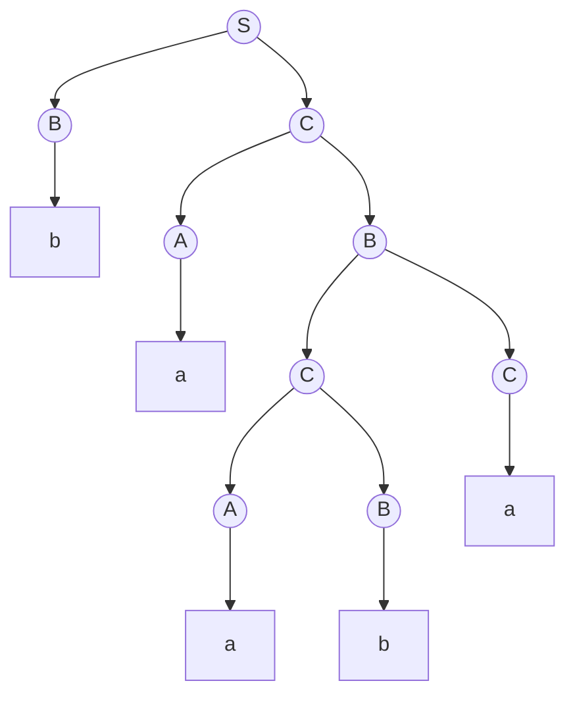

A single **context-free language** has infinitely many **grammars**, many of which contain "superfluous" parts: symbols that can never be used, productions that merely rename a variable, and productions that generate the empty string. In this chapter we first give algorithms that eliminate them, and then bring grammars into the uniform Chomsky normal form. The normal form is itself a tool for proofs (the pumping lemma of [4.8.9](/4.8.9) rests on it) and the starting point of algorithms: for a grammar in Chomsky normal form, **dynamic programming** decides in $O(n^3)$ time whether a string belongs to the language of the grammar (the CYK algorithm). Finally we present the Earley algorithm, which does not require a normal form and is more flexible in practice. The chapter uses the notation of [4.8.2](/4.8.2): a grammar is $G = (V, T, P, S)$; $A, B, C$ denote variables, $a, b$ terminals, $X, Y$ grammar symbols (variables or terminals), and $\alpha, \beta, \gamma$ strings of grammar symbols.

## 8.1. Eliminating Useless Symbols

### 8.1.1. Useful Symbols

**Definition 8.1.1 (Useless Symbol)** A grammar symbol $X$ is called **useful** if there is a derivation $S \overset{*}{\Rightarrow} \alpha X \beta \overset{*}{\Rightarrow} w$ with $w \in T^*$; otherwise $X$ is called a **useless symbol**.

Two conditions are needed for usefulness: $X$ can derive a terminal string, and $X$ can appear in a **sentential form** derived from the start symbol. We name these two conditions separately:

**Definition 8.1.2** If $X \overset{*}{\Rightarrow} w$ for some $w \in T^*$, $X$ is called a **generating symbol**; if $S \overset{*}{\Rightarrow} \alpha X \beta$ for some $\alpha, \beta$, $X$ is called a **reachable symbol**.

A useful symbol is both generating and reachable, but not conversely. In the **grammar** $S \to AB \mid a$, $A \to b$, the symbol $A$ is generating and also reachable, but $B$ is not generating, so the only sentential form containing $A$, namely $AB$, derives no terminal string, and $A$ is useless.

### 8.1.2. Computing the Generating and Reachable Symbols

Both sets can be computed by an inductive process that expands outward from what is known until nothing changes:

- Generating symbols. Basis: every terminal is a generating symbol. Induction: if $A \to \alpha$ is a production and every symbol of $\alpha$ is already known to be generating, then $A$ is generating (in particular, $A \to \varepsilon$ makes $A$ generating).
- Reachable symbols. Basis: $S$ is reachable. Induction: if $A$ is reachable and $A \to \alpha$ is a production, then every symbol of $\alpha$ is reachable.

**Theorem 8.1.1** The process above finds exactly all generating symbols (respectively, all reachable symbols).

**Proof** Take the generating symbols as an example. The symbols added by the induction are clearly generating. Conversely, we use induction on the number of steps of a derivation $X \overset{*}{\Rightarrow} w$: with zero steps $X = w$ is a terminal; otherwise the first step is $X \to X_1\cdots X_k$, each $X_i$ derives a segment of $w$ in fewer steps, so by the induction hypothesis each is found, and hence so is $X$. For reachable symbols the argument is the same, by induction on the number of steps of $S \overset{*}{\Rightarrow} \alpha X \beta$. $\square$

A naive implementation scans all productions in every round, taking $O(n^2)$ in the worst case ($n$ is the total length of the grammar). If for every production we record the "number of symbols on the right side not yet confirmed" and update the productions containing a symbol whenever it is confirmed, confirming the left side when a count drops to 0, the total time is $O(n)$.

### 8.1.3. The Order of Elimination

**Theorem 8.1.2** Let $L(G) \ne \varnothing$. First delete all non-generating symbols and the productions containing them, obtaining $G_2$; then delete from $G_2$ all unreachable symbols and the productions containing them, obtaining $G_1$. Then $G_1$ has no useless symbols and $L(G_1) = L(G)$.

**Proof** The productions of $G_1$ are productions of $G$, so $L(G_1) \subseteq L(G)$. Conversely, in any derivation $S \overset{*}{\Rightarrow} w$ of $G$, every symbol that occurs derives a segment of $w$ and is therefore generating, and every symbol occurs in a sentential form derived from $S$ and is therefore reachable; this derivation survives both deletion steps, so $L(G) \subseteq L(G_1)$.

Next we show that $G_1$ has no useless symbols. Let $X$ remain in $G_1$; then $X$ is reachable in $G_2$: $S \overset{*}{\Rightarrow}_{G_2} \alpha X \beta$. Every symbol of $G_2$ is generating in $G$, and the symbols used in its derivation of a terminal string are also generating, so it is still generating in $G_2$; hence $\alpha X \beta \overset{*}{\Rightarrow}_{G_2} w$. All symbols in the whole derivation $S \overset{*}{\Rightarrow} \alpha X\beta \overset{*}{\Rightarrow} w$ are reachable from $S$ and therefore remain in $G_1$, so $X$ is useful in $G_1$. $\square$

The order cannot be reversed. For $S \to AB \mid a$, $A \to b$: first deleting the non-generating symbol $B$ gives $S \to a$, $A \to b$, and then deleting the unreachable $A$ gives $S \to a$. If we first delete unreachable symbols, all symbols are reachable and nothing is deleted; after deleting $B$ we are left with $S \to a$, $A \to b$, and the useless $A$ remains.

**Example 8.1.1** Take the grammar $S \to aS \mid A \mid C$, $A \to a$, $B \to aa$, $C \to aCb$. The generating symbols are $a, b, A, B, S$; the only production of $C$ has $C$ itself on the right side, so $C$ is not generating. Deleting $C$ gives $S \to aS \mid A$, $A \to a$, $B \to aa$, in which $B$ is unreachable; deleting it gives $S \to aS \mid A$, $A \to a$. The grammar constructed from a **PDA** in Example 7.5.2 of [4.8.7](/4.8.7) was simplified in the same way.

## 8.2. Eliminating ε-Productions

**Definition 8.2.1 (ε-Production)** A production of the form $A \to \varepsilon$ is called an **ε-production**. If $A \overset{*}{\Rightarrow} \varepsilon$, the variable $A$ is called a **nullable symbol**.

If $\varepsilon \in L(G)$, no **grammar** without ε-productions can generate $\varepsilon$, so our goal is a grammar generating $L(G) \setminus \{\varepsilon\}$. Nullable symbols are computed in a way similar to **generating symbols**. Basis: if $A \to \varepsilon$ is a production, $A$ is nullable. Induction: if $B \to C_1C_2\cdots C_k$ and every $C_i$ is a nullable variable, then $B$ is nullable.

**Algorithm 8.2.1 (Eliminating ε-Productions)** After the nullable symbols are found, construct $G_1 = (V, T, P_1, S)$ as follows: for every production $A \to X_1X_2\cdots X_k$ ($k \ge 1$) in $P$ with $m$ nullable symbols on its right side, add to $P_1$ all $2^m$ productions obtained by choosing for each nullable symbol "keep or delete", except the one with an empty right side (which occurs when all $X_i$ are nullable). The original ε-productions are not added to $P_1$.

**Theorem 8.2.1** The grammar $G_1$ obtained by Algorithm 8.2.1 satisfies $L(G_1) = L(G) \setminus \{\varepsilon\}$.

**Proof** For a variable $A$ and a nonempty $w \in T^*$ we prove: $A \overset{*}{\Rightarrow}_{G_1} w$ if and only if $A \overset{*}{\Rightarrow}_G w$.

($\Rightarrow$) Every production of $G_1$ is obtained from some production $A \to X_1\cdots X_k$ of $G$ by deleting some nullable symbols; in $G$ we can simulate it by first using this production and then deriving $\varepsilon$ from the deleted symbols.

($\Leftarrow$) Induction on the number of derivation steps. Let the first step in $G$ be $A \to X_1\cdots X_k$; then $w = w_1\cdots w_k$ with $X_i \overset{*}{\Rightarrow}_G w_i$. Those $X_i$ with $w_i = \varepsilon$ are nullable; deleting them gives a production $A \to X_{j_1}\cdots X_{j_r}$, which belongs to $P_1$ because $w \ne \varepsilon$ guarantees $r \ge 1$. For the symbols $X_{j}$ that remain, $w_{j} \ne \varepsilon$, and by the induction hypothesis (or directly by equality for terminals) $X_{j} \overset{*}{\Rightarrow}_{G_1} w_{j}$. $\square$

**Example 8.2.1** Take the grammar $S \to AB$, $A \to aAA \mid \varepsilon$, $B \to bBB \mid \varepsilon$. The nullable symbols are $A, B$, and hence $S$. Eliminating the ε-productions gives

$$
S \to AB \mid A \mid B, \qquad A \to aAA \mid aA \mid a, \qquad B \to bBB \mid bB \mid b.
$$
Of the 4 choices for $S \to AB$, the one that deletes all symbols is not added.

If the empty string must be kept, add after the elimination a new start symbol $S_0$ and the productions $S_0 \to S \mid \varepsilon$; since $S_0$ occurs on no right side, this ε-production is never used in the middle of a derivation.

## 8.3. Eliminating Unit Productions

**Definition 8.3.1 (Unit Production)** A production of the form $A \to B$ ($A, B$ both variables) is called a **unit production**. If $A \overset{*}{\Rightarrow} B$ using only unit productions, $(A, B)$ is called a **unit pair**.

A unit production merely renames a variable, yet it increases the number of derivation steps and complicates some proofs (such as the height estimate of the **parse tree** in the pumping lemma). In a grammar without **ε-productions**, the unit pairs can be computed as follows. Basis: for every variable $A$, $(A, A)$ is a unit pair. Induction: if $(A, B)$ is a unit pair and $B \to C$ is a production, then $(A, C)$ is a unit pair.

**Algorithm 8.3.1 (Eliminating Unit Productions)** After all unit pairs are found, construct $G_1 = (V, T, P_1, S)$: for every unit pair $(A, B)$ and every non-unit production $B \to \alpha$ of $B$, add $A \to \alpha$ to $P_1$.

**Theorem 8.3.1** The grammar $G_1$ obtained by Algorithm 8.3.1 satisfies $L(G_1) = L(G)$.

**Proof** A production $A \to \alpha$ of $G_1$ corresponds in $G$ to $A \overset{*}{\Rightarrow} B \Rightarrow \alpha$, so $L(G_1) \subseteq L(G)$. Conversely, take a leftmost derivation of $w$ in $G$ and split it into segments, each consisting of several consecutive unit-production steps followed by one non-unit-production step. In a leftmost derivation all steps of one segment act on the variable at the same position: a segment $A \Rightarrow B_1 \Rightarrow \cdots \Rightarrow B_r \Rightarrow \alpha$ shows that $(A, B_r)$ is a unit pair, and it can be replaced by the single step $A \to \alpha$ of $G_1$. $\square$

**Example 8.3.1** The expression **grammar**

$$
\begin{aligned}
I &\to a \mid b \mid Ia \mid Ib \mid I0 \mid I1, & F &\to I \mid (E), \\
T &\to F \mid T * F, & E &\to T \mid E + T.
\end{aligned}
$$
Besides $(X, X)$, the unit pairs are $(E, T)$, $(E, F)$, $(E, I)$, $(T, F)$, $(T, I)$, $(F, I)$. Writing $\iota = a \mid b \mid Ia \mid Ib \mid I0 \mid I1$ for the right sides of the non-unit productions of $I$, the grammar after eliminating the unit productions is

$$
\begin{aligned}
E &\to E + T \mid T * F \mid (E) \mid \iota, & T &\to T * F \mid (E) \mid \iota, \\
F &\to (E) \mid \iota, & I &\to \iota.
\end{aligned}
$$

### 8.3.1. The Order of the Three Simplifications

**Theorem 8.3.2** Let $L(G)$ contain a nonempty string. Perform in order (1) elimination of ε-productions, (2) elimination of unit productions, (3) elimination of **useless symbols**. The resulting grammar $G_1$ has no ε-productions, no unit productions, and no useless symbols, and $L(G_1) = L(G) \setminus \{\varepsilon\}$.

**Proof** The relation between the languages follows from Theorems 8.2.1, 8.3.1, and 8.1.2. We only have to check that later steps do not destroy earlier results: the right sides added by eliminating unit productions are existing nonempty non-unit right sides, so no ε-productions are introduced; eliminating useless symbols only deletes productions and introduces no new ones. Conversely, eliminating ε-productions may create new unit productions (such as $S \to A$ in Example 8.2.1), and eliminating unit productions may create new useless symbols (in Example 8.4.1, $A$ becomes unreachable after $S \to A$ is eliminated), so the order cannot be changed. $\square$

## 8.4. Normal Forms

### 8.4.1. Chomsky Normal Form

**Definition 8.4.1 (Chomsky Normal Form)** A grammar $G$ is in **Chomsky normal form** (CNF) if it has no useless symbols and every production has one of two forms: $A \to BC$ ($A, B, C$ all variables), or $A \to a$ ($a$ a terminal).

To generate the empty string, one more production $S \to \varepsilon$ is often allowed, provided that the start symbol $S$ occurs on no right side.

**Theorem 8.4.1** Every nonempty **context-free language** not containing $\varepsilon$ has a **grammar** in Chomsky normal form.

**Proof** By Theorem 8.3.2 we may assume that $G$ has no ε-productions, no unit productions, and no useless symbols. Then every production with a right side of length 1 has the form $A \to a$ and already meets the requirement. For productions with right sides of length at least 2, we make two transformations:
1. Separate the terminals: for every terminal $a$ occurring in such right sides, introduce a new variable $C_a$ and a production $C_a \to a$, and replace $a$ in these right sides by $C_a$. Afterwards every right side of length at least 2 contains only variables.
2. Binarize: replace $A \to B_1B_2\cdots B_k$ ($k > 2$) by the sequence of productions

   $$
   A \to B_1D_1, \quad D_1 \to B_2D_2, \quad \dots, \quad D_{k-3} \to B_{k-2}D_{k-2}, \quad D_{k-2} \to B_{k-1}B_k,
   $$
   where $D_1, \dots, D_{k-2}$ are new variables (a separate set for each production).

In step 1, $C_a$ can derive only $a$; in step 2 the new variables can be expanded only along this sequence, and $A \overset{*}{\Rightarrow} B_1\cdots B_k$ if and only if the original production can be used. So neither step changes the language or introduces **useless symbols**. $\square$

**Example 8.4.1** Convert the grammar $S \to A$, $A \to 0BD$, $B \to 0BC \mid 1$, $C \to 1$, $D \to \varepsilon$ obtained in Example 7.5.2 of [4.8.7](/4.8.7) to Chomsky normal form.
1. The only **nullable symbol** is $D$. Eliminating the **ε-productions** gives $S \to A$, $A \to 0BD \mid 0B$, $B \to 0BC \mid 1$, $C \to 1$.
2. The only **unit pair** is $(S, A)$. Eliminating the **unit productions** gives $S \to 0BD \mid 0B$, $A \to 0BD \mid 0B$, $B \to 0BC \mid 1$, $C \to 1$.
3. $D$ no longer has a production and is not a **generating symbol**; after deleting it, $A$ is unreachable. What remains is $S \to 0B$, $B \to 0BC \mid 1$, $C \to 1$.
4. Separate the terminal $0$ (new variable $Z \to 0$): $S \to ZB$, $B \to ZBC \mid 1$, $C \to 1$, $Z \to 0$.
5. Binarize $B \to ZBC$ (new variable $E$):

$$
S \to ZB, \qquad B \to ZE \mid 1, \qquad E \to BC, \qquad C \to 1, \qquad Z \to 0.
$$

**Remark** The cost of simplification. Eliminating unit productions can make the length of the grammar grow quadratically; when ε-productions are eliminated, a right side with $m$ nullable symbols becomes $2^m$ right sides, which is exponential growth in the worst case. If we binarize first and eliminate ε-productions afterwards, every right side has at most 2 symbols and yields at most 3 productions, so the whole transformation produces a result of size $O(n^2)$ ($n$ is the length of the original grammar). Binarization is not unique; practical parsers merge symbol pairs that often occur next to each other into the same new variable, to reduce the number of new variables.

### 8.4.2. Greibach Normal Form

**Definition 8.4.2 (Greibach Normal Form)** A grammar is in **Greibach normal form** (GNF) if every production has the form $A \to a\alpha$, where $a$ is a terminal and $\alpha$ is a (possibly empty) string of variables.

**Theorem 8.4.2** Every nonempty context-free language not containing $\varepsilon$ has a grammar in Greibach normal form (Greibach, 1965).

The proof requires eliminating left recursion and is rather tedious, so it is omitted here. The significance of Greibach normal form is that every derivation step produces exactly one terminal: a string of length $n$ is derived in exactly $n$ steps. Applying the construction of Theorem 7.5.1 to such a grammar gives a **PDA** that reads one input symbol in every move and has no ε-transitions.

## 8.5. The CYK Algorithm

The membership problem is: given a **grammar** $G$ and a string $w \in T^*$, decide whether $w \in L(G)$. In a grammar without **ε-productions** and unit productions, every derivation step either lengthens the sentential form or replaces a variable by a terminal, so a derivation of $w$ has at most $2\lvert w\rvert - 1$ steps, and enumerating all such derivations decides the question, but at exponential cost. The dynamic-programming algorithm proposed independently by Cocke, Younger, and Kasami reduces this to $O(n^3)$.

### 8.5.1. The Algorithm

Let $G$ be a grammar in **Chomsky normal form** and $w = a_1a_2\cdots a_n$. For $1 \le i \le j \le n$ let

$$
X_{ij} = \{ A \in V \mid A \overset{*}{\Rightarrow} a_ia_{i+1}\cdots a_j \}.
$$
Then $w \in L(G)$ if and only if $S \in X_{1n}$.

**Algorithm 8.5.1 (CYK Algorithm)** Compute $X_{ij}$ in order of increasing substring length:
1. Length 1: $X_{ii} = \{A \mid A \to a_i \in P\}$;
2. Length greater than 1: $A \in X_{ij}$ if and only if there are $k$ ($i \le k < j$) and a production $A \to BC$ with $B \in X_{ik}$ and $C \in X_{k+1,j}$.

**Theorem 8.5.1** Algorithm 8.5.1 computes all $X_{ij}$ correctly, in time $O(n^3 \lvert P\rvert)$ and space $O(n^2\lvert V\rvert)$.

**Proof** Induction on $j - i$. For $j = i$, in Chomsky normal form a derivation of a single terminal can only be the one step $A \to a_i$. For $j > i$, the first step of $A \overset{*}{\Rightarrow} a_i\cdots a_j$ must be some $A \to BC$, after which $B$ derives a prefix $a_i\cdots a_k$ and $C$ derives the rest $a_{k+1}\cdots a_j$, both nonempty (in Chomsky normal form variables do not derive the empty string), that is, $i \le k < j$; by the induction hypothesis $B \in X_{ik}$ and $C \in X_{k+1,j}$ have been computed correctly. Conversely, from such $B, C$ a derivation of $A$ can obviously be composed.

There are $O(n^2)$ sets $X_{ij}$, each requires considering $O(n)$ split points $k$, and each split point checks $\lvert P\rvert$ productions, for a total time of $O(n^3\lvert P\rvert)$. $\square$

If beside each $A \in X_{ij}$ we record the $(k, B, C)$ that justify it, we can recover a **parse tree** recursively, starting from $S \in X_{1n}$.

### 8.5.2. Examples

**Example 8.5.1** Take the grammar $S \to AB \mid BC$, $A \to BA \mid a$, $B \to CC \mid b$, $C \to AB \mid a$ and the input $w = baaba$.

```python
# A grammar in Chomsky normal form: binary rules A -> B C and terminal rules A -> a.
binary = {("S", "AB"), ("S", "BC"), ("A", "BA"), ("B", "CC"), ("C", "AB")}
terminal = {("A", "a"), ("B", "b"), ("C", "a")}

def cky(w):
    n = len(w)
    X = {}                 # X[i, j] = set of variables deriving w[i..j] (1-based, inclusive)
    back = {}              # back pointers for building one parse tree
    for i in range(1, n + 1):
        X[i, i] = {A for A, a in terminal if a == w[i - 1]}
    for length in range(2, n + 1):
        for i in range(1, n - length + 2):
            j = i + length - 1
            X[i, j] = set()
            for k in range(i, j):
                for A, BC in sorted(binary):
                    if BC[0] in X[i, k] and BC[1] in X[k + 1, j]:
                        X[i, j].add(A)
                        back.setdefault((A, i, j), (k, BC[0], BC[1]))
    return X, back

def tree(back, w, A, i, j):
    if i == j:
        return f"{A}({w[i - 1]})"
    k, B, C = back[A, i, j]
    return f"{A}({tree(back, w, B, i, k)} {tree(back, w, C, k + 1, j)})"

w = "baaba"
X, back = cky(w)
n = len(w)
for length in range(n, 0, -1):          # print the triangular table, top row first
    row = []
    for i in range(1, n - length + 2):
        cell = "".join(sorted(X[i, i + length - 1])) or "-"
        row.append(f"X{i}{i + length - 1}={{{cell}}}")
    print("  ".join(row))
print("S in X15:", "S" in X[1, n])
print(tree(back, w, "S", 1, n))
```

```text
X15={ACS}
X14={-}  X25={ACS}
X13={-}  X24={B}  X35={B}
X12={AS}  X23={B}  X34={CS}  X45={AS}
X11={B}  X22={AC}  X33={AC}  X44={B}  X55={AC}
S in X15: True
S(B(b) C(A(a) B(C(A(a) B(b)) C(a))))
```

The table is filled from the bottom row upward; row $\ell$ (counted from the bottom) consists of the substrings of length $\ell$. Take $X_{24}$ (the substring $aab$) as an example: the split $a \mid ab$ gives $X_{22}X_{34} = \{A, C\} \times \{C, S\}$, in which $CC$ yields $B$ by $B \to CC$; the split $aa \mid b$ gives $X_{23}X_{44} = \{B\} \times \{B\}$, and there is no production of the form $A \to BB$. Hence $X_{24} = \{B\}$. Since $S \in X_{15}$, we have $baaba \in L(G)$, and one parse tree recovered is:



**Remark** The triple loop of CYK is essentially Boolean matrix multiplication, and Valiant (1975) used this to reduce the membership problem to the complexity $O(n^{\omega})$ of matrix multiplication ($\omega < 2.38$). Replacing sets by probabilities and "or" by summation turns CYK into the inside algorithm that computes sentence probabilities in a probabilistic **context-free grammar**, which is the basis of statistical parsing.

## 8.6. The Earley Algorithm

CYK requires **Chomsky normal form**, and converting to the normal form changes the structure of the **grammar**, so that the parse trees differ from those of the original grammar. Earley's algorithm (1970) handles arbitrary context-free grammars directly; it scans the input from left to right, carrying out top-down prediction and bottom-up merging simultaneously.

### 8.6.1. The Algorithm

**Definition 8.6.1 (Earley Item)** Let $A \to \alpha\beta$ be a production and $0 \le i \le n$. We call $[A \to \alpha \cdot \beta,\ i]$ an **Earley item**: the dot indicates that $\alpha$ has already been matched with the segment of the input beginning at position $i$, and the item is waiting for $\beta$.

**Algorithm 8.6.1 (Earley Algorithm)** The input is $w = a_1\cdots a_n$. For each position $j = 0, 1, \dots, n$ maintain an item set $S_j$. Initially, for every production $S \to \gamma$ of $S$, put $[S \to \cdot\gamma,\ 0]$ into $S_0$. For $j = 0, 1, \dots, n$, repeatedly apply to each item of $S_j$ one of the following three operations, until $S_j$ stops growing:
1. Predict: for $[A \to \alpha \cdot B\beta,\ i]$ ($B$ a variable) and every production $B \to \gamma$ of $B$, add $[B \to \cdot\gamma,\ j]$ to $S_j$;
2. Scan: for $[A \to \alpha \cdot a\beta,\ i]$, if $a = a_{j+1}$, add $[A \to \alpha a \cdot \beta,\ i]$ to $S_{j+1}$;
3. Complete: for $[A \to \gamma\cdot,\ i]$ and every item of $S_i$ of the form $[B \to \alpha \cdot A\beta,\ h]$, add $[B \to \alpha A \cdot \beta,\ h]$ to $S_j$.

Then $w \in L(G)$ if and only if $S_n$ contains some $[S \to \gamma\cdot,\ 0]$.

**Theorem 8.6.1** $[A \to \alpha\cdot\beta,\ i] \in S_j$ if and only if $\alpha \overset{*}{\Rightarrow} a_{i+1}\cdots a_j$ and there is $\delta$ with $S \overset{*}{\Rightarrow} a_1\cdots a_i A\delta$.

**Proof** (outline) "Only if": by induction on the order in which items are added; all three operations preserve the two properties: prediction preserves the second ($B$ immediately follows the prefix matched up to position $j$), and scanning and completion append a matched piece of input after $\alpha$. "If": by induction on the total length of the derivations $S \overset{*}{\Rightarrow} a_1\cdots a_i A \delta$ and $\alpha \overset{*}{\Rightarrow} a_{i+1}\cdots a_j$, show that the corresponding prediction, scanning, and completion steps do take place. Taking $A = S$, $i = 0$, $j = n$, and $\beta = \varepsilon$ gives the correctness of the acceptance condition. $\square$

Complexity: $S_j$ contains at most $O(j\lvert G\rvert)$ items, and completion scans $S_i$ for each item, so the running time on general grammars is $O(n^3)$; for unambiguous **grammars** it is $O(n^2)$; for most LR($k$) grammars it is $O(n)$, and Leo's (1991) improvement makes all LR($k$) grammars linear. That is, the **Earley algorithm** automatically speeds up on "easy" grammars, whereas CYK is always $\Theta(n^3)$.

With **ε-productions**, completion needs care: if $A$ is nullable, then when $[A \to \cdot,\ j]$ is completed in $S_j$, items in $S_j$ waiting for $A$ may be added only after it and thus be missed. The fix of Aycock and Horspool (2002) is to move the dot over a nullable $B$ at the same time as $B$ is predicted.

### 8.6.2. Examples

**Example 8.6.1** The grammar $S \to S + M \mid M$, $M \to M * T \mid T$, $T \to 1 \mid 2 \mid 3 \mid 4$ is left-recursive, and no transformation is needed. We parse $2 + 3 * 4$:

```python
# Grammar: S -> S + M | M,  M -> M * T | T,  T -> digit
grammar = {
    "S": [("S", "+", "M"), ("M",)],
    "M": [("M", "*", "T"), ("T",)],
    "T": [(d,) for d in "1234"],
}
start = "S"

def earley(w):
    # an item (A, rhs, dot, origin) stands for [A -> rhs[:dot] . rhs[dot:], origin]
    sets = [[] for _ in range(len(w) + 1)]
    def add(j, item):
        if item not in sets[j]:
            sets[j].append(item)
    for rhs in grammar[start]:
        add(0, (start, rhs, 0, 0))
    for j in range(len(w) + 1):
        k = 0
        while k < len(sets[j]):                      # sets[j] grows while we scan it
            A, rhs, dot, i = sets[j][k]
            k += 1
            if dot < len(rhs) and rhs[dot] in grammar:          # predict
                for r in grammar[rhs[dot]]:
                    add(j, (rhs[dot], r, 0, j))
            elif dot < len(rhs):                                 # scan
                if j < len(w) and w[j] == rhs[dot]:
                    add(j + 1, (A, rhs, dot + 1, i))
            else:                                                # complete
                for B, r, d, h in list(sets[i]):
                    if d < len(r) and r[d] == A:
                        add(j, (B, r, d + 1, h))
    accepted = any(A == start and dot == len(rhs) and i == 0
                   for A, rhs, dot, i in sets[len(w)])
    return sets, accepted

def show(item):
    A, rhs, dot, i = item
    return f"[{A} -> {' '.join(rhs[:dot] + ('.',) + rhs[dot:])}, {i}]"

sets, ok = earley("2+3*4")
for j, s in enumerate(sets):
    print(f"S{j}: " + "  ".join(show(it) for it in s))
print("accepted:", ok)
```

```text
S0: [S -> . S + M, 0]  [S -> . M, 0]  [M -> . M * T, 0]  [M -> . T, 0]  [T -> . 1, 0]  [T -> . 2, 0]  [T -> . 3, 0]  [T -> . 4, 0]
S1: [T -> 2 ., 0]  [M -> T ., 0]  [S -> M ., 0]  [M -> M . * T, 0]  [S -> S . + M, 0]
S2: [S -> S + . M, 0]  [M -> . M * T, 2]  [M -> . T, 2]  [T -> . 1, 2]  [T -> . 2, 2]  [T -> . 3, 2]  [T -> . 4, 2]
S3: [T -> 3 ., 2]  [M -> T ., 2]  [S -> S + M ., 0]  [M -> M . * T, 2]  [S -> S . + M, 0]
S4: [M -> M * . T, 2]  [T -> . 1, 4]  [T -> . 2, 4]  [T -> . 3, 4]  [T -> . 4, 4]
S5: [T -> 4 ., 4]  [M -> M * T ., 2]  [S -> S + M ., 0]  [M -> M . * T, 2]  [S -> S . + M, 0]
accepted: True
```

Consider $S_3$: $[S \to S + M\cdot,\ 0]$ says that $2 + 3$ is already a complete $S$, while $[M \to M\cdot * T,\ 2]$ at the same time keeps open the possibility that "$3$ is the beginning of a longer product"; after $*$ is read, the latter continues in $S_4$. The left-recursive $S \to \cdot S + M$ is added only once during prediction (an item already in the set is not added again), so the algorithm does not fall into an infinite loop as naive recursive descent does.

## Summary

| Transformation or algorithm | Method | Cost |
|---|---|---|
| Eliminating **useless symbols** | First delete non-**generating symbols**, then unreachable symbols (the order cannot be swapped) | $O(n)$, never enlarges the grammar |
| Eliminating **ε-productions** | Find the **nullable symbols**, enumerate keeping or dropping them in every right side; the language loses $\varepsilon$ | Exponential in the worst case; linear if binarized first |
| Eliminating **unit productions** | Find the **unit pairs** $(A, B)$, copy the non-unit productions of $B$ to $A$ | $O(n^2)$ |
| Order of simplification | ε-productions → unit productions → useless symbols | |
| **Chomsky normal form** | $A \to BC$ or $A \to a$; separate terminals, binarize | Every **CFL** without $\varepsilon$ has one |
| **Greibach normal form** | $A \to a\alpha$, $\alpha \in V^*$ | Derivation steps = string length |
| **CYK algorithm** | Interval dynamic programming; $X_{ij}$ = set of variables deriving $a_i\cdots a_j$ | $\Theta(n^3\lvert P\rvert)$, needs Chomsky normal form |
| **Earley algorithm** | Items $[A \to \alpha\cdot\beta, i]$; predict, scan, complete | $O(n^3)$ in general, $O(n^2)$ if unambiguous, $O(n)$ for LR($k$) |
