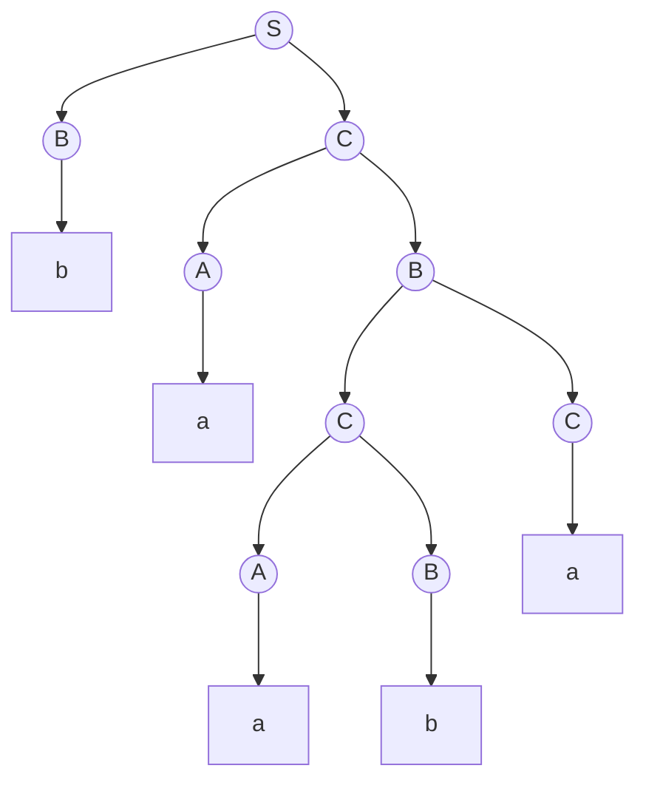

同一个**上下文无关语言**有无穷多个**文法**，其中许多包含"多余"的部分：永远用不上的符号、只起改名作用的产生式、生成空串的产生式。本章先给出消去它们的算法，再把文法化成形式统一的 Chomsky 范式。范式本身是证明的工具（[4.8.9](/4.8.9) 的泵引理就建立在它之上），也是算法的起点：在 Chomsky 范式下，用**动态规划**可以在 $O(n^3)$ 时间内判定一个串是否属于文法的语言（CKY 算法）。最后介绍不要求范式、在实践中更灵活的 Earley 算法。本章沿用 [4.8.2](/4.8.2) 的记号：文法 $G = (V, T, P, S)$，用 $A, B, C$ 表示变元，$a, b$ 表示终结符，$X, Y$ 表示文法符号（变元或终结符），$\alpha, \beta, \gamma$ 表示文法符号串。

## 8.1. 消去无用符号

### 8.1.1. 有用符号

**定义 8.1.1（无用符号）** 文法符号 $X$ 称为**有用符号**，如果存在推导 $S \overset{*}{\Rightarrow} \alpha X \beta \overset{*}{\Rightarrow} w$，其中 $w \in T^*$；否则称 $X$ 为**无用符号**。

有用要满足两个条件：$X$ 能推出终结符串，且 $X$ 能出现在从开始符号出发的**句型**中。分别给这两个条件命名：

**定义 8.1.2** 若存在 $w \in T^*$ 使 $X \overset{*}{\Rightarrow} w$，称 $X$ 为**生成符号**；若存在 $\alpha, \beta$ 使 $S \overset{*}{\Rightarrow} \alpha X \beta$，称 $X$ 为**可达符号**。

有用符号一定既是生成符号又是可达符号，反之不然。在**文法** $S \to AB \mid a$，$A \to b$ 中，$A$ 是生成符号，也是可达符号，但 $B$ 不是生成符号，所以唯一出现 $A$ 的句型 $AB$ 推不出终结符串，$A$ 是无用的。

### 8.1.2. 计算生成符号与可达符号

两个集合都可以用"从已知往外扩张"的归纳方式计算，直到不再变化：

- 生成符号。基础：每个终结符是生成符号。归纳：若有产生式 $A \to \alpha$，且 $\alpha$ 中的每个符号都已知是生成符号，则 $A$ 是生成符号（特别地，$A \to \varepsilon$ 使 $A$ 成为生成符号）。
- 可达符号。基础：$S$ 是可达符号。归纳：若 $A$ 是可达符号且有产生式 $A \to \alpha$，则 $\alpha$ 中的所有符号都是可达符号。

**定理 8.1.1** 上述过程求出的恰好是全部生成符号（相应地，全部可达符号）。

**证明** 以生成符号为例。归纳加入的符号显然是生成符号。反之，对推导 $X \overset{*}{\Rightarrow} w$ 的步数归纳：零步时 $X = w$ 是终结符；否则第一步为 $X \to X_1\cdots X_k$，每个 $X_i$ 以更少的步数推出 $w$ 的一段，由归纳假设都会被求出，于是 $X$ 也会被求出。可达符号同理，对 $S \overset{*}{\Rightarrow} \alpha X \beta$ 的步数归纳。$\square$

朴素实现每轮扫描全部产生式，最坏 $O(n^2)$（$n$ 为文法的总长度）。为每个产生式记录"右部中尚未确认的符号个数"，每确认一个符号就更新含它的产生式，计数降到 0 时确认左部，总时间为 $O(n)$。

### 8.1.3. 消去的顺序

**定理 8.1.2** 设 $L(G) \ne \varnothing$。先删去所有非生成符号及含有它们的产生式，得到 $G_2$；再从 $G_2$ 中删去所有不可达符号及含有它们的产生式，得到 $G_1$。则 $G_1$ 没有无用符号，且 $L(G_1) = L(G)$。

**证明** $G_1$ 的产生式都是 $G$ 的产生式，所以 $L(G_1) \subseteq L(G)$。反之，$G$ 中任一推导 $S \overset{*}{\Rightarrow} w$ 里出现的每个符号都推出 $w$ 的一段，因而是生成符号，又都出现在从 $S$ 出发的句型中，因而是可达符号，这个推导在两步删除中都保留下来，所以 $L(G) \subseteq L(G_1)$。

再证 $G_1$ 中没有无用符号。设 $X$ 留在 $G_1$ 中，则 $X$ 在 $G_2$ 中可达：$S \overset{*}{\Rightarrow}_{G_2} \alpha X \beta$。$G_2$ 中每个符号在 $G$ 中都是生成符号，而它推出终结符串所用的符号也都是生成符号，所以在 $G_2$ 中仍是生成符号；于是 $\alpha X \beta \overset{*}{\Rightarrow}_{G_2} w$。整个推导 $S \overset{*}{\Rightarrow} \alpha X\beta \overset{*}{\Rightarrow} w$ 中的符号都从 $S$ 可达，因而都留在 $G_1$ 中，$X$ 在 $G_1$ 中是有用的。$\square$

顺序不能颠倒。对 $S \to AB \mid a$，$A \to b$：先删非生成符号 $B$ 得 $S \to a$，$A \to b$，再删不可达的 $A$，得到 $S \to a$。若先删不可达符号，则所有符号都可达，什么也不删；再删 $B$ 后剩下 $S \to a$，$A \to b$，无用的 $A$ 留了下来。

**例 8.1.1** 文法 $S \to aS \mid A \mid C$，$A \to a$，$B \to aa$，$C \to aCb$。生成符号：$a, b, A, B, S$；$C$ 的唯一产生式右部含 $C$ 自身，不是生成符号。删去 $C$ 后得 $S \to aS \mid A$，$A \to a$，$B \to aa$；其中 $B$ 不可达，删去后得 $S \to aS \mid A$，$A \to a$。[4.8.7](/4.8.7) 例 7.5.2 从 **PDA** 构造的文法也是这样化简的。

## 8.2. 消去 ε 产生式

**定义 8.2.1（ε 产生式）** 形如 $A \to \varepsilon$ 的产生式称为 **ε 产生式**。若 $A \overset{*}{\Rightarrow} \varepsilon$，称变元 $A$ 为**可致空符号**。

若 $\varepsilon \in L(G)$，任何不含 ε 产生式的**文法**都不能生成 $\varepsilon$，所以目标是得到生成 $L(G) \setminus \{\varepsilon\}$ 的文法。可致空符号的计算与**生成符号**类似。基础：若 $A \to \varepsilon$ 是产生式，$A$ 可致空。归纳：若 $B \to C_1C_2\cdots C_k$ 且每个 $C_i$ 都是可致空的变元，则 $B$ 可致空。

**算法 8.2.1（消去 ε 产生式）** 求出可致空符号后，构造 $G_1 = (V, T, P_1, S)$：对 $P$ 中的每个产生式 $A \to X_1X_2\cdots X_k$（$k \ge 1$），设其中有 $m$ 个可致空符号，把每个可致空符号"保留或删去"的 $2^m$ 种选择都加入 $P_1$，但不加入右部为空的那一个（所有 $X_i$ 都可致空时它会出现）。原有的 ε 产生式不加入 $P_1$。

**定理 8.2.1** 算法 8.2.1 得到的 $G_1$ 满足 $L(G_1) = L(G) \setminus \{\varepsilon\}$。

**证明** 对变元 $A$ 和非空的 $w \in T^*$ 证明：$A \overset{*}{\Rightarrow}_{G_1} w$ 当且仅当 $A \overset{*}{\Rightarrow}_G w$。

（$\Rightarrow$）$G_1$ 的每个产生式都是 $G$ 的某个产生式 $A \to X_1\cdots X_k$ 删去若干可致空符号的结果，在 $G$ 中先用这个产生式、再把被删去的符号推成 $\varepsilon$，即可模拟它。

（$\Leftarrow$）对推导的步数归纳。设 $G$ 中第一步为 $A \to X_1\cdots X_k$，则 $w = w_1\cdots w_k$，$X_i \overset{*}{\Rightarrow}_G w_i$。$w_i = \varepsilon$ 的那些 $X_i$ 是可致空的；删去它们得到产生式 $A \to X_{j_1}\cdots X_{j_r}$，它属于 $P_1$，因为 $w \ne \varepsilon$ 保证 $r \ge 1$。对保留下来的 $X_{j}$，$w_{j} \ne \varepsilon$，由归纳假设（终结符则直接相等）$X_{j} \overset{*}{\Rightarrow}_{G_1} w_{j}$。$\square$

**例 8.2.1** 文法 $S \to AB$，$A \to aAA \mid \varepsilon$，$B \to bBB \mid \varepsilon$。可致空符号是 $A, B$，进而 $S$。消去 ε 产生式得到

$$
S \to AB \mid A \mid B, \qquad A \to aAA \mid aA \mid a, \qquad B \to bBB \mid bB \mid b.
$$
$S \to AB$ 的 4 种选择中删去全部符号的那一种不加入。

若需要保留空串，在消去后增加新的开始符号 $S_0$ 与产生式 $S_0 \to S \mid \varepsilon$；$S_0$ 不出现在任何右部，所以这条 ε 产生式不会在推导中间被使用。

## 8.3. 消去单位产生式

**定义 8.3.1（单位产生式）** 形如 $A \to B$（$A, B$ 都是变元）的产生式称为**单位产生式**。若 $A \overset{*}{\Rightarrow} B$ 且只用了单位产生式，称 $(A, B)$ 为**单位偶对**。

单位产生式只是给变元改名，却增加了推导的步数，也让某些证明（如泵引理中的**推导树**高度估计）变得麻烦。在没有 **ε 产生式**的文法中，单位偶对可以如下计算。基础：对每个变元 $A$，$(A, A)$ 是单位偶对。归纳：若 $(A, B)$ 是单位偶对且 $B \to C$ 是产生式，则 $(A, C)$ 是单位偶对。

**算法 8.3.1（消去单位产生式）** 求出全部单位偶对后，构造 $G_1 = (V, T, P_1, S)$：对每个单位偶对 $(A, B)$ 和 $B$ 的每个非单位产生式 $B \to \alpha$，把 $A \to \alpha$ 加入 $P_1$。

**定理 8.3.1** 算法 8.3.1 得到的 $G_1$ 满足 $L(G_1) = L(G)$。

**证明** $G_1$ 的产生式 $A \to \alpha$ 在 $G$ 中对应 $A \overset{*}{\Rightarrow} B \Rightarrow \alpha$，所以 $L(G_1) \subseteq L(G)$。反之，取 $G$ 中 $w$ 的一个最左推导，把它分成若干段，每段由连续若干步单位产生式后接一步非单位产生式组成。在最左推导中，同一段的各步都作用在同一个位置的变元上：一段 $A \Rightarrow B_1 \Rightarrow \cdots \Rightarrow B_r \Rightarrow \alpha$ 说明 $(A, B_r)$ 是单位偶对，可以用 $G_1$ 的一步 $A \to \alpha$ 代替。$\square$

**例 8.3.1** 表达式**文法**

$$
\begin{aligned}
I &\to a \mid b \mid Ia \mid Ib \mid I0 \mid I1, & F &\to I \mid (E), \\
T &\to F \mid T * F, & E &\to T \mid E + T.
\end{aligned}
$$
单位偶对除 $(X, X)$ 外还有 $(E, T)$、$(E, F)$、$(E, I)$、$(T, F)$、$(T, I)$、$(F, I)$。把 $I$ 的非单位产生式右部记作 $\iota = a \mid b \mid Ia \mid Ib \mid I0 \mid I1$，消去单位产生式后得到

$$
\begin{aligned}
E &\to E + T \mid T * F \mid (E) \mid \iota, & T &\to T * F \mid (E) \mid \iota, \\
F &\to (E) \mid \iota, & I &\to \iota.
\end{aligned}
$$

### 8.3.1. 三种化简的顺序

**定理 8.3.2** 设 $L(G)$ 含有非空串。依次（1）消去 ε 产生式，（2）消去单位产生式，（3）消去**无用符号**，得到的文法 $G_1$ 没有 ε 产生式、单位产生式和无用符号，且 $L(G_1) = L(G) \setminus \{\varepsilon\}$。

**证明** 语言的关系由定理 8.2.1、8.3.1、8.1.2 得到。只需检查后面的步骤不会破坏前面的成果：消去单位产生式加入的产生式右部都是原有的非空、非单位右部，不会引入 ε 产生式；消去无用符号只删除产生式，不会引入任何新产生式。反过来，消去 ε 产生式可能产生新的单位产生式（例 8.2.1 中的 $S \to A$），消去单位产生式可能产生新的无用符号（例 8.4.1 中 $S \to A$ 被消去后，$A$ 变得不可达），所以顺序不能变。$\square$

## 8.4. 范式

### 8.4.1. Chomsky 范式

**定义 8.4.1（Chomsky 范式）** 文法 $G$ 称为 **Chomsky 范式**（CNF）的文法，如果它没有无用符号，且每个产生式都具有以下两种形式之一：$A \to BC$（$A, B, C$ 都是变元），或 $A \to a$（$a$ 是终结符）。

为了生成空串，常允许再加一条 $S \to \varepsilon$，前提是开始符号 $S$ 不出现在任何产生式的右部。

**定理 8.4.1** 每个不含 $\varepsilon$ 的非空**上下文无关语言**都有 Chomsky 范式的**文法**。

**证明** 由定理 8.3.2，可设 $G$ 没有 ε 产生式、单位产生式和无用符号。于是每个右部长度为 1 的产生式都形如 $A \to a$，已符合要求。对右部长度至少为 2 的产生式做两步变换：
1. 分离终结符：对出现在这些右部中的每个终结符 $a$，引入新变元 $C_a$ 与产生式 $C_a \to a$，把这些右部中的 $a$ 替换为 $C_a$。此后长度至少为 2 的右部只含变元。
2. 二叉化：把 $A \to B_1B_2\cdots B_k$（$k > 2$）替换为一串产生式

   $$
   A \to B_1D_1, \quad D_1 \to B_2D_2, \quad \dots, \quad D_{k-3} \to B_{k-2}D_{k-2}, \quad D_{k-2} \to B_{k-1}B_k,
   $$
   其中 $D_1, \dots, D_{k-2}$ 是新变元（每个产生式各用一组）。

第 1 步中 $C_a$ 只能推出 $a$；第 2 步中新变元只能沿这一串展开，$A \overset{*}{\Rightarrow} B_1\cdots B_k$ 当且仅当原产生式可用。所以两步都不改变语言，也不引入**无用符号**。$\square$

**例 8.4.1** 把 [4.8.7](/4.8.7) 例 7.5.2 得到的文法 $S \to A$，$A \to 0BD$，$B \to 0BC \mid 1$，$C \to 1$，$D \to \varepsilon$ 化为 Chomsky 范式。
1. **可致空符号**只有 $D$。消去 **ε 产生式**：$S \to A$，$A \to 0BD \mid 0B$，$B \to 0BC \mid 1$，$C \to 1$。
2. **单位偶对**只有 $(S, A)$。消去**单位产生式**：$S \to 0BD \mid 0B$，$A \to 0BD \mid 0B$，$B \to 0BC \mid 1$，$C \to 1$。
3. $D$ 已没有产生式，不是**生成符号**；删去它后 $A$ 不可达。剩下 $S \to 0B$，$B \to 0BC \mid 1$，$C \to 1$。
4. 分离终结符 $0$（新变元 $Z \to 0$）：$S \to ZB$，$B \to ZBC \mid 1$，$C \to 1$，$Z \to 0$。
5. 二叉化 $B \to ZBC$（新变元 $E$）：

$$
S \to ZB, \qquad B \to ZE \mid 1, \qquad E \to BC, \qquad C \to 1, \qquad Z \to 0.
$$

**注** 化简的代价。消去单位产生式可能使文法长度平方增长；消去 ε 产生式时，含 $m$ 个可致空符号的右部变成 $2^m$ 个，最坏是指数增长。若先二叉化、再消去 ε 产生式，每个右部至多 2 个符号，只产生至多 3 个产生式，于是整个变换的结果是 $O(n^2)$ 规模（$n$ 为原文法的长度）。二叉化的方式不唯一，实际的分析器会把经常相邻出现的符号对合并成同一个新变元，以减少新变元的数目。

### 8.4.2. Greibach 范式

**定义 8.4.2（Greibach 范式）** 文法称为 **Greibach 范式**（GNF）的文法，如果每个产生式都形如 $A \to a\alpha$，其中 $a$ 是终结符，$\alpha$ 是（可能为空的）变元串。

**定理 8.4.2** 每个不含 $\varepsilon$ 的非空上下文无关语言都有 Greibach 范式的文法（Greibach，1965）。

证明需要消去左递归，较为繁琐，这里从略。Greibach 范式的意义在于每一步推导恰好产生一个终结符：长度为 $n$ 的串恰好经过 $n$ 步推导。对它作定理 7.5.1 的构造，得到的 **PDA** 每步都读入一个输入符号、没有 ε 转移。

## 8.5. CKY 算法

成员问题（membership problem）是：给定**文法** $G$ 与串 $w \in T^*$，判断是否 $w \in L(G)$。在没有 **ε 产生式**和单位产生式的文法中，每一步推导要么使句型变长、要么把一个变元换成终结符，所以 $w$ 的推导至多有 $2\lvert w\rvert - 1$ 步，枚举所有这样的推导就能判定，但代价是指数的。Cocke、Younger、Kasami 各自独立提出的动态规划算法把它降到 $O(n^3)$。

### 8.5.1. 算法

设 $G$ 是 **Chomsky 范式**的文法，$w = a_1a_2\cdots a_n$。对 $1 \le i \le j \le n$，令

$$
X_{ij} = \{ A \in V \mid A \overset{*}{\Rightarrow} a_ia_{i+1}\cdots a_j \}.
$$
则 $w \in L(G)$ 当且仅当 $S \in X_{1n}$。

**算法 8.5.1（CKY 算法）** 按子串长度从小到大计算 $X_{ij}$：
1. 长度为 1：$X_{ii} = \{A \mid A \to a_i \in P\}$；
2. 长度大于 1：$A \in X_{ij}$ 当且仅当存在 $k$（$i \le k < j$）和产生式 $A \to BC$，使 $B \in X_{ik}$ 且 $C \in X_{k+1,j}$。

**定理 8.5.1** 算法 8.5.1 正确计算出所有 $X_{ij}$，用时 $O(n^3 \lvert P\rvert)$，用空间 $O(n^2\lvert V\rvert)$。

**证明** 对 $j - i$ 归纳。$j = i$ 时，Chomsky 范式中推出单个终结符的推导只能是一步 $A \to a_i$。$j > i$ 时，$A \overset{*}{\Rightarrow} a_i\cdots a_j$ 的第一步只能是某个 $A \to BC$，此后 $B$ 推出某个前缀 $a_i\cdots a_k$、$C$ 推出其余的 $a_{k+1}\cdots a_j$，两段都非空（Chomsky 范式中变元不推出空串），即 $i \le k < j$；由归纳假设 $B \in X_{ik}$、$C \in X_{k+1,j}$ 已被正确算出。反之由这样的 $B, C$ 显然可以组合出 $A$ 的推导。

共有 $O(n^2)$ 个 $X_{ij}$，每个要考虑 $O(n)$ 个分割点 $k$，每个分割点检查 $\lvert P\rvert$ 个产生式，总时间 $O(n^3\lvert P\rvert)$。$\square$

在每个 $A \in X_{ij}$ 旁记下使它成立的 $(k, B, C)$，就可以从 $S \in X_{1n}$ 出发递归地恢复一棵**语法分析树**。

### 8.5.2. 例子

**例 8.5.1** 文法 $S \to AB \mid BC$，$A \to BA \mid a$，$B \to CC \mid b$，$C \to AB \mid a$，输入 $w = baaba$。

```python
# A grammar in Chomsky normal form: binary rules A -> B C and terminal rules A -> a.
binary = {("S", "AB"), ("S", "BC"), ("A", "BA"), ("B", "CC"), ("C", "AB")}
terminal = {("A", "a"), ("B", "b"), ("C", "a")}

def cky(w):
    n = len(w)
    X = {}                 # X[i, j] = set of variables deriving w[i..j] (1-based, inclusive)
    back = {}              # back pointers for building one parse tree
    for i in range(1, n + 1):
        X[i, i] = {A for A, a in terminal if a == w[i - 1]}
    for length in range(2, n + 1):
        for i in range(1, n - length + 2):
            j = i + length - 1
            X[i, j] = set()
            for k in range(i, j):
                for A, BC in sorted(binary):
                    if BC[0] in X[i, k] and BC[1] in X[k + 1, j]:
                        X[i, j].add(A)
                        back.setdefault((A, i, j), (k, BC[0], BC[1]))
    return X, back

def tree(back, w, A, i, j):
    if i == j:
        return f"{A}({w[i - 1]})"
    k, B, C = back[A, i, j]
    return f"{A}({tree(back, w, B, i, k)} {tree(back, w, C, k + 1, j)})"

w = "baaba"
X, back = cky(w)
n = len(w)
for length in range(n, 0, -1):          # print the triangular table, top row first
    row = []
    for i in range(1, n - length + 2):
        cell = "".join(sorted(X[i, i + length - 1])) or "-"
        row.append(f"X{i}{i + length - 1}={{{cell}}}")
    print("  ".join(row))
print("S in X15:", "S" in X[1, n])
print(tree(back, w, "S", 1, n))
```

```text
X15={ACS}
X14={-}  X25={ACS}
X13={-}  X24={B}  X35={B}
X12={AS}  X23={B}  X34={CS}  X45={AS}
X11={B}  X22={AC}  X33={AC}  X44={B}  X55={AC}
S in X15: True
S(B(b) C(A(a) B(C(A(a) B(b)) C(a))))
```

表从底行向上填，第 $\ell$ 行（自下而上）是长度为 $\ell$ 的子串。以 $X_{24}$（子串 $aab$）为例：分割 $a \mid ab$ 给出 $X_{22}X_{34} = \{A, C\} \times \{C, S\}$，其中 $CC$ 由 $B \to CC$ 得到 $B$；分割 $aa \mid b$ 给出 $X_{23}X_{44} = \{B\} \times \{B\}$，没有 $A \to BB$ 形式的产生式。所以 $X_{24} = \{B\}$。$S \in X_{15}$，故 $baaba \in L(G)$，恢复出的一棵语法分析树是：



**注** CKY 的三重循环本质上是布尔矩阵乘法，Valiant（1975）据此把成员问题降到矩阵乘法的复杂度 $O(n^{\omega})$（$\omega < 2.38$）。把集合换成概率、把"或"换成求和，CKY 就成为概率**上下文无关文法**中计算句子概率的 inside 算法，它是统计句法分析的基础。

## 8.6. Earley 算法

CKY 要求 **Chomsky 范式**，而化成范式会改变**文法**的结构，使分析树与原文法的树不同。Earley（1970）的算法直接处理任意上下文无关文法，它自左向右扫描输入，同时进行自顶向下的预测与自底向上的归并。

### 8.6.1. 算法

**定义 8.6.1（Earley 项）** 设 $A \to \alpha\beta$ 是产生式，$0 \le i \le n$。称 $[A \to \alpha \cdot \beta,\ i]$ 为一个 **Earley 项**：圆点表示 $\alpha$ 已经与输入中从位置 $i$ 开始的一段匹配，正在等待 $\beta$。

**算法 8.6.1（Earley 算法）** 输入 $w = a_1\cdots a_n$。为每个位置 $j = 0, 1, \dots, n$ 维护一个项集 $S_j$。初始时对 $S$ 的每个产生式 $S \to \gamma$，把 $[S \to \cdot\gamma,\ 0]$ 放入 $S_0$。对 $j = 0, 1, \dots, n$，反复对 $S_j$ 中的每一项执行下列三种操作之一，直到 $S_j$ 不再增大：
1. 预测：对 $[A \to \alpha \cdot B\beta,\ i]$（$B$ 是变元），对 $B$ 的每个产生式 $B \to \gamma$，把 $[B \to \cdot\gamma,\ j]$ 加入 $S_j$；
2. 扫描：对 $[A \to \alpha \cdot a\beta,\ i]$，若 $a = a_{j+1}$，把 $[A \to \alpha a \cdot \beta,\ i]$ 加入 $S_{j+1}$；
3. 完成：对 $[A \to \gamma\cdot,\ i]$，对 $S_i$ 中每个形如 $[B \to \alpha \cdot A\beta,\ h]$ 的项，把 $[B \to \alpha A \cdot \beta,\ h]$ 加入 $S_j$。

$w \in L(G)$ 当且仅当 $S_n$ 中有某个 $[S \to \gamma\cdot,\ 0]$。

**定理 8.6.1** $[A \to \alpha\cdot\beta,\ i] \in S_j$ 当且仅当 $\alpha \overset{*}{\Rightarrow} a_{i+1}\cdots a_j$，且存在 $\delta$ 使 $S \overset{*}{\Rightarrow} a_1\cdots a_i A\delta$。

**证明**（要点） "仅当"：对项被加入的顺序归纳，三种操作都保持这两条性质——预测保持第二条（$B$ 紧跟在已匹配到位置 $j$ 的前缀之后），扫描与完成在 $\alpha$ 后接上一段已匹配的输入。"当"：对推导 $S \overset{*}{\Rightarrow} a_1\cdots a_i A \delta$ 与 $\alpha \overset{*}{\Rightarrow} a_{i+1}\cdots a_j$ 的总长度归纳，证明对应的预测、扫描、完成步骤都会发生。取 $A = S$、$i = 0$、$j = n$、$\beta = \varepsilon$ 即得接受条件的正确性。$\square$

复杂度：$S_j$ 中的项至多 $O(j\lvert G\rvert)$ 个，完成操作对每项要扫描 $S_i$，所以一般文法上是 $O(n^3)$；对无**二义文法**是 $O(n^2)$；对大多数 LR($k$) 文法是 $O(n)$，Leo（1991）的改进使所有 LR($k$) 文法都达到线性。也就是说，**Earley 算法**在"容易"的文法上自动变快，而 CKY 总是 $\Theta(n^3)$。

含 **ε 产生式**时，完成操作需要小心：若 $A$ 可致空，$[A \to \cdot,\ j]$ 在 $S_j$ 中完成时，$S_j$ 中等待 $A$ 的项可能在它之后才加入而被漏掉。Aycock 与 Horspool（2002）的修正是在预测可致空的 $B$ 时，同时把圆点移过 $B$。

### 8.6.2. 例子

**例 8.6.1** 文法 $S \to S + M \mid M$，$M \to M * T \mid T$，$T \to 1 \mid 2 \mid 3 \mid 4$ 是左递归的，不必做任何变换。分析 $2 + 3 * 4$：

```python
# Grammar: S -> S + M | M,  M -> M * T | T,  T -> digit
grammar = {
    "S": [("S", "+", "M"), ("M",)],
    "M": [("M", "*", "T"), ("T",)],
    "T": [(d,) for d in "1234"],
}
start = "S"

def earley(w):
    # an item (A, rhs, dot, origin) stands for [A -> rhs[:dot] . rhs[dot:], origin]
    sets = [[] for _ in range(len(w) + 1)]
    def add(j, item):
        if item not in sets[j]:
            sets[j].append(item)
    for rhs in grammar[start]:
        add(0, (start, rhs, 0, 0))
    for j in range(len(w) + 1):
        k = 0
        while k < len(sets[j]):                      # sets[j] grows while we scan it
            A, rhs, dot, i = sets[j][k]
            k += 1
            if dot < len(rhs) and rhs[dot] in grammar:          # predict
                for r in grammar[rhs[dot]]:
                    add(j, (rhs[dot], r, 0, j))
            elif dot < len(rhs):                                 # scan
                if j < len(w) and w[j] == rhs[dot]:
                    add(j + 1, (A, rhs, dot + 1, i))
            else:                                                # complete
                for B, r, d, h in list(sets[i]):
                    if d < len(r) and r[d] == A:
                        add(j, (B, r, d + 1, h))
    accepted = any(A == start and dot == len(rhs) and i == 0
                   for A, rhs, dot, i in sets[len(w)])
    return sets, accepted

def show(item):
    A, rhs, dot, i = item
    return f"[{A} -> {' '.join(rhs[:dot] + ('.',) + rhs[dot:])}, {i}]"

sets, ok = earley("2+3*4")
for j, s in enumerate(sets):
    print(f"S{j}: " + "  ".join(show(it) for it in s))
print("accepted:", ok)
```

```text
S0: [S -> . S + M, 0]  [S -> . M, 0]  [M -> . M * T, 0]  [M -> . T, 0]  [T -> . 1, 0]  [T -> . 2, 0]  [T -> . 3, 0]  [T -> . 4, 0]
S1: [T -> 2 ., 0]  [M -> T ., 0]  [S -> M ., 0]  [M -> M . * T, 0]  [S -> S . + M, 0]
S2: [S -> S + . M, 0]  [M -> . M * T, 2]  [M -> . T, 2]  [T -> . 1, 2]  [T -> . 2, 2]  [T -> . 3, 2]  [T -> . 4, 2]
S3: [T -> 3 ., 2]  [M -> T ., 2]  [S -> S + M ., 0]  [M -> M . * T, 2]  [S -> S . + M, 0]
S4: [M -> M * . T, 2]  [T -> . 1, 4]  [T -> . 2, 4]  [T -> . 3, 4]  [T -> . 4, 4]
S5: [T -> 4 ., 4]  [M -> M * T ., 2]  [S -> S + M ., 0]  [M -> M . * T, 2]  [S -> S . + M, 0]
accepted: True
```

读 $S_3$：$[S \to S + M\cdot,\ 0]$ 说明 $2 + 3$ 已经是一个完整的 $S$，而 $[M \to M\cdot * T,\ 2]$ 同时保留了"$3$ 可能是一个更长乘积的开头"这一可能；读到 $*$ 后，后者在 $S_4$ 中继续。左递归的 $S \to \cdot S + M$ 在预测时只加入一次（项已在集合中就不再加入），所以不会像朴素的递归下降那样陷入无限循环。

## 小结

| 变换或算法 | 做法 | 代价 |
|---|---|---|
| 消去**无用符号** | 先删非**生成符号**，再删不可达符号（顺序不能换） | $O(n)$，不增大文法 |
| 消去 **ε 产生式** | 求**可致空符号**，对每个右部枚举可致空符号的去留；语言失去 $\varepsilon$ | 最坏指数；先二叉化则线性 |
| 消去**单位产生式** | 求**单位偶对** $(A, B)$，把 $B$ 的非单位产生式复制给 $A$ | $O(n^2)$ |
| 化简的顺序 | ε 产生式 → 单位产生式 → 无用符号 | |
| **Chomsky 范式** | $A \to BC$ 或 $A \to a$；分离终结符、二叉化 | 每个不含 $\varepsilon$ 的 **CFL** 都有 |
| **Greibach 范式** | $A \to a\alpha$，$\alpha \in V^*$ | 推导步数 = 串长 |
| **CKY 算法** | 区间动态规划，$X_{ij}$ = 推出 $a_i\cdots a_j$ 的变元集 | $\Theta(n^3\lvert P\rvert)$，需 Chomsky 范式 |
| **Earley 算法** | 项 $[A \to \alpha\cdot\beta, i]$，预测、扫描、完成 | 一般 $O(n^3)$，无二义 $O(n^2)$，LR($k$) $O(n)$ |
