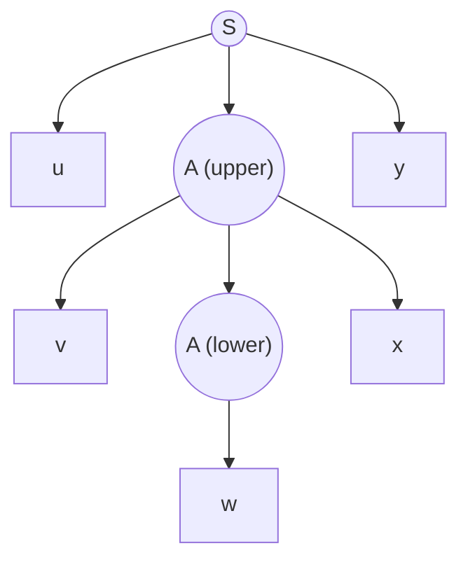

This chapter studies the properties of the class of **context-free languages** as a whole, in one-to-one correspondence with the discussion of **regular languages** in [4.8.6](/4.8.6): the pumping lemma gives a necessary condition for context-free languages and is used to prove that a language is not context-free; closure properties show which operations do not lead out of the class; decision properties show which questions about grammars have algorithms. Compared with regular languages, context-free languages are no longer closed under intersection and complement, and many problems that are decidable for regular languages (equivalence, containment) become undecidable; the proofs of the latter are left to [4.8.11](/4.8.11).

## 9.1. The Pumping Lemma

### 9.1.1. The Size of a Parse Tree

In **Chomsky normal form**, a **parse tree** is binary except for its last level, so there is a simple relation between the height of the tree and the number of its leaves. By the length of a path we mean the number of edges on it.

**Theorem 9.1.1** Let $G$ be a **grammar** in Chomsky normal form and let some parse tree have the terminal string $w$ as its yield. If the longest path from the root to a leaf has length $n$, then $\lvert w\rvert \le 2^{n-1}$.

**Proof** Induction on $n$. For $n = 1$ the tree consists of the root and one leaf, the root uses $A \to a$, and $\lvert w\rvert = 1 = 2^0$. For $n > 1$ the root uses $A \to BC$; the longest paths of the two subtrees have length at most $n - 1$, so by the induction hypothesis each yield has length at most $2^{n-2}$, and the total is at most $2^{n-1}$. $\square$

### 9.1.2. The Pumping Lemma

**Theorem 9.1.2 (Pumping Lemma for Context-Free Languages)** Let $L$ be a **context-free language**. Then there is a constant $n$ such that every $z \in L$ with $\lvert z\rvert \ge n$ can be written as $z = uvwxy$ satisfying
1. $\lvert vwx\rvert \le n$;
2. $vx \ne \varepsilon$;
3. $uv^iwx^iy \in L$ for all $i \ge 0$.

**Proof** If $L \setminus \{\varepsilon\} = \varnothing$, take $n = 1$ (no $z$ satisfies the hypothesis). Otherwise, by Theorem 8.4.1, $L \setminus \{\varepsilon\}$ has a grammar $G = (V, T, P, S)$ in Chomsky normal form; let $\lvert V\rvert = m$ and take $n = 2^m$.

Let $z \in L$ with $\lvert z\rvert \ge 2^m$. By Theorem 9.1.1, the longest path in a parse tree of $z$ has length at least $m + 1$; this path has at least $m + 2$ nodes, all of which except the last leaf are variables. Among the lowest $m + 1$ variables on this path, two are equal by the pigeonhole principle; call the variable $A$, the upper occurrence $A_i$ and the lower one $A_j$.

Let the yield of the subtree rooted at $A_j$ be $w$, the yield of the subtree rooted at $A_i$ be $vwx$, and the whole string $z = uvwxy$.
- $vx \ne \varepsilon$: the production used at $A_i$ is $A \to BC$; $A_j$ lies in one of the two subtrees, and the other subtree has a nonempty yield (in Chomsky normal form variables do not derive the empty string), which is part of $v$ or $x$.
- $\lvert vwx\rvert \le n$: we chose the lowest $m + 1$ variables of the path, so in the subtree rooted at $A_i$ the longest path has length at most $m + 1$ (otherwise the original path would not be longest); by Theorem 9.1.1, $\lvert vwx\rvert \le 2^m = n$.
- Pumping: in the tree, $A_i$ derives $vAx$ and $A_j$ derives $w$, that is, $A \overset{*}{\Rightarrow} vAx$ and $A \overset{*}{\Rightarrow} w$. Replacing the subtree rooted at $A_i$ by the subtree rooted at $A_j$ gives $uwy$; conversely, replacing the subtree rooted at $A_j$ by a copy of the subtree rooted at $A_i$ and repeating this $i - 1$ times gives $uv^iwx^iy$. All of these are valid parse trees, so all belong to $L$. $\square$

Compared with the **pumping lemma for regular languages** ([4.8.6](/4.8.6)), here two segments $v$ and $x$ are pumped simultaneously; they may be far apart in $z$, but both lie within the window $vwx$ of length at most $n$.

### 9.1.3. Applications

The pumping lemma is a necessary condition. To use it to prove that $L$ is not context-free is to prove its negation: for every $n$ there is $z \in L$ with $\lvert z\rvert \ge n$ such that, for every decomposition $z = uvwxy$ satisfying conditions 1 and 2, there is some $i \ge 0$ with $uv^iwx^iy \notin L$. It can be viewed as a game against an adversary: the adversary picks $n$; we pick $z$; the adversary picks a decomposition; we pick $i$, and we win if $uv^iwx^iy \notin L$.

**Example 9.1.1** $L = \{0^k1^k2^k \mid k \ge 1\}$ is not context-free. For any $n$, take $z = 0^n1^n2^n$. Since $\lvert vwx\rvert \le n$, the window $vwx$ cannot contain both 0's and 2's. If $vx$ contains no 2, take $i = 0$: $uwy$ still has $n$ 2's, while the number of 0's or 1's has decreased (because $vx \ne \varepsilon$), so it is not in $L$; if $vx$ contains no 0, the argument is the same.

**Example 9.1.2** $L = \{0^i1^j2^i3^j \mid i, j \ge 1\}$ is not context-free. Take $z = 0^n1^n2^n3^n$. The window $vwx$ spans at most two adjacent blocks. If $vx$ contains 0's, it contains no 2's (the 0 block and the 2 block are separated by $n$ 1's), and $uwy$ has fewer 0's than 2's; the other cases are similar: some pair of blocks that should be equal becomes unequal in $uwy$.

**Example 9.1.3** $L = \{0^p \mid p \text{ is prime}\}$ is not context-free. Take a prime $p \ge n + 2$, $z = 0^p$, and let $\lvert vx\rvert = k \ge 1$. Taking $i = p + 1$, we get $\lvert uv^iwx^iy\rvert = p + pk = p(1 + k)$, which is composite.

A context-free language over a one-letter **alphabet** is in fact a **regular language** (a consequence of Parikh's theorem), so this example can also be settled with the pumping lemma for regular languages.

### 9.1.4. Ogden's Lemma

Some languages are not context-free but cannot be shown so by the pumping lemma, because the adversary can always place $v, x$ in "harmless" positions. Ogden's lemma lets us mark some positions of $z$ and forces $vx$ to fall on marked positions.

**Theorem 9.1.3 (Ogden's Lemma)** Let $L$ be a context-free language. Then there is a constant $n$ such that, whenever at least $n$ positions of a string $z \in L$ are marked, $z$ can be written as $z = uvwxy$ such that $vwx$ contains at most $n$ marked positions; $vx$ contains at least one marked position; and $uv^iwx^iy \in L$ for all $i \ge 0$.

Marking all positions gives Theorem 9.1.2. The proof is the same as that of Theorem 9.1.2, except that going down the path we always move to the subtree containing more marked positions, and we look for a repeated variable only among branch nodes where both subtrees contain marked positions.

**Example 9.1.4** $L = \{a^ib^jc^kd^l \mid i = 0 \text{ or } j = k = l\}$ is not context-free. The pumping lemma fails for it: in strings with $i \ge 1$ we can take $v = a$, $x = \varepsilon$ and pump the $a$'s, and in strings with $i = 0$ pumping any letter keeps the result in $L$. Use **Ogden's lemma**: take $z = ab^nc^nd^n$ and mark all the $b$'s, $c$'s, and $d$'s. If $v$ or $x$ contains two kinds of letters, then in $uv^2wx^2y$ the order of the letters is destroyed, and it is not in $L$. Otherwise $v$ and $x$ each contain only one kind of letter, and $vx$ contains at least one $b$, $c$, or $d$ but at most two of the three kinds; then $uv^2wx^2y$ contains at least one $a$, while the numbers of $b$'s, $c$'s, and $d$'s are not all equal, so it is not in $L$.

## 9.2. Closure Properties

### 9.2.1. Substitution

**Definition 9.2.1 (Substitution)** Let $\Sigma$ be an alphabet. A **substitution** $s$ on $\Sigma$ assigns to every $a \in \Sigma$ a language $s(a)$ (possibly over another alphabet). For strings we put $s(\varepsilon) = \{\varepsilon\}$ and $s(a_1a_2\cdots a_n) = s(a_1)s(a_2)\cdots s(a_n)$ (concatenation of languages); for languages we put $s(L) = \bigcup_{w \in L} s(w)$.

**Theorem 9.2.1** If $L$ is a **context-free language** over $\Sigma$, $s$ is a substitution on $\Sigma$, and every $s(a)$ is a context-free language, then $s(L)$ is a context-free language.

**Proof** Let $G = (V, \Sigma, P, S)$ generate $L$ and $G_a = (V_a, T_a, P_a, S_a)$ generate $s(a)$, with the variables of the grammars pairwise disjoint. Construct $G'$ with variables $V \cup \bigcup_a V_a$, terminals $\bigcup_a T_a$, start symbol $S$, and productions all the $P_a$ together with the productions obtained from each production of $P$ by replacing every terminal $a$ by $S_a$.

The upper part of a **parse tree** of $G'$ is a tree of $G$ (with each leaf $a$ replaced by $S_a$), and below each $S_a$ hangs a tree of $G_a$. So the strings generated by $G'$ are exactly those obtained by taking $a_1\cdots a_k \in L$ and concatenating an arbitrary string from each $s(a_i)$, that is, $s(L)$. $\square$

**Example 9.2.1** Take $\Sigma = \{0, 1\}$, $s(0) = \{a^kb^k \mid k \ge 1\}$, and $s(1) = \{aa, bb\}$. Then $s(01) = \{a^kb^kaa \mid k \ge 1\} \cup \{a^kb^{k+2} \mid k \ge 1\}$; for $L = L(0^*)$, $s(L) = s(0)^* = \{a^{k_1}b^{k_1}\cdots a^{k_r}b^{k_r} \mid r \ge 0,\ k_i \ge 1\}$.

**Theorem 9.2.2** Context-free languages are closed under union, concatenation, **Kleene closure** ($^*$ and $^+$), and homomorphism.

**Proof** All are special cases of Theorem 9.2.1. Let $L, M$ be context-free languages.
- Union: $\{1, 2\}$ is context-free; take $s(1) = L$ and $s(2) = M$, then $s(\{1, 2\}) = L \cup M$.
- Concatenation: with the same $s$, $s(\{12\}) = LM$.
- Closure: take $s(1) = L$; then $s(\{1\}^*) = L^*$ and $s(\{1\}^+) = L^+$.
- Homomorphism $h$: take $s(a) = \{h(a)\}$; a one-element language is context-free, and $s(L) = h(L)$. $\square$

**Theorem 9.2.3** If $L$ is a context-free language, so is its reversal $L^{\mathrm{R}} = \{w^{\mathrm{R}} \mid w \in L\}$.

**Proof** Replace every production $A \to \alpha$ of a grammar generating $L$ by $A \to \alpha^{\mathrm{R}}$. Induction on the number of derivation steps shows that $A \overset{*}{\Rightarrow} w^{\mathrm{R}}$ in the new grammar if and only if $A \overset{*}{\Rightarrow} w$ in the original grammar. $\square$

### 9.2.2. Intersection and Complement

**Theorem 9.2.4** Context-free languages are not closed under intersection.

**Proof** $L = \{0^k1^k2^i \mid k, i \ge 1\}$ is generated by $S \to AB$, $A \to 0A1 \mid 01$, $B \to 2B \mid 2$; $M = \{0^i1^k2^k \mid k, i \ge 1\}$ is generated by $S \to AB$, $A \to 0A \mid 0$, $B \to 1B2 \mid 12$. But $L \cap M = \{0^k1^k2^k \mid k \ge 1\}$ is not context-free (Example 9.1.1). $\square$

**Corollary 9.2.1** Context-free languages are not closed under complement or difference.

**Proof** If they were closed under complement, then by $L \cap M = \overline{\overline{L} \cup \overline{M}}$ and closure under union they would be closed under intersection, a contradiction. The complement $\overline{L} = \Sigma^* \setminus L$ is a special case of difference, so they are not closed under difference either. $\square$

Intuitively, a **PDA** has only one stack and cannot check two groups of counts at the same time, and complement requires "all computations reject", which a nondeterministic machine cannot express directly. For **deterministic context-free languages**, complement is closed (Section 7.6 of [4.8.7](/4.8.7)).

Although intersection is not closed, intersection with a **regular language** is closed: a **finite automaton** needs no stack and can run in parallel with the PDA.

**Theorem 9.2.5** If $L$ is a context-free language and $R$ is a regular language, then $L \cap R$ is a context-free language.

**Proof** Let a PDA $P = (Q_P, \Sigma, \Gamma, \delta_P, q_P, Z_0, F_P)$ accept $L$ by final state and a DFA $A = (Q_A, \Sigma, \delta_A, q_A, F_A)$ accept $R$. Construct the product PDA

$$
P' = (Q_P \times Q_A, \Sigma, \Gamma, \delta, (q_P, q_A), Z_0, F_P \times F_A),
$$
where $((r, s'), \gamma) \in \delta((q, s), a, X)$ if and only if $(r, \gamma) \in \delta_P(q, a, X)$ and $s' = \delta_A(s, a)$ for $a \in \Sigma$, $s' = s$ for $a = \varepsilon$. Induction on the number of steps shows: $((q_P, q_A), w, Z_0) \vdash^*_{P'} ((q, s), \varepsilon, \gamma)$ if and only if $(q_P, w, Z_0) \vdash^*_P (q, \varepsilon, \gamma)$ and the DFA is in state $s$ after reading $w$. Hence $L(P') = L \cap R$. $\square$

**Corollary 9.2.2** If $L$ is a context-free language and $R$ is a regular language, then $L \setminus R = L \cap \overline{R}$ is a context-free language.

### 9.2.3. Inverse Homomorphism

**Theorem 9.2.6** If $L \subseteq T^*$ is a context-free language and $h\colon \Sigma \to T^*$ is a homomorphism, then $h^{-1}(L) = \{w \in \Sigma^* \mid h(w) \in L\}$ is a context-free language.

**Proof** (construction) Let a PDA $P = (Q, T, \Gamma, \delta, q_0, Z_0, F)$ accept $L$ by final state. The states of the new PDA are pairs $(q, x)$, where $x$ is a suffix of some $h(a)$ and serves as a "buffer" holding the symbols not yet handed to $P$:
1. When the buffer is empty, read $a \in \Sigma$ and put $h(a)$ into the buffer: $((q, h(a)), X) \in \delta'((q, \varepsilon), a, X)$;
2. When the buffer is $bx$, read no input and simulate a move of $P$ reading $b$: if $(p, \gamma) \in \delta(q, b, X)$, then $((p, x), \gamma) \in \delta'((q, bx), \varepsilon, X)$; the ε-transitions of $P$ are simulated as usual, with the buffer unchanged.

The final states are $\{(q, \varepsilon) \mid q \in F\}$. When the new PDA reads $w$, $P$ reads exactly $h(w)$, so it accepts $h^{-1}(L)$. The buffer has only finitely many possible contents, so it can be put into the state. $\square$

### 9.2.4. Proving Non-Context-Freeness by Closure Properties

**Example 9.2.2** $L = \{ww \mid w \in \{0, 1\}^*\}$ is not context-free. If it were, then by Theorem 9.2.5 so would be $L \cap L(0^*1^*0^*1^*) = \{0^i1^j0^i1^j \mid i, j \ge 0\}$. For the latter take $z = 0^n1^n0^n1^n$: the window $vwx$ has length at most $n$, so it cannot touch blocks 1 and 3 at the same time, nor blocks 2 and 4. Taking $i = 0$, $uwy$ still has the form $0^*1^*0^*1^*$ (deleting characters does not disturb the order), but the block from which characters were deleted has become shorter while its partner has not, so $uwy$ is not in the language, a contradiction.

Note that the complement $\{0,1\}^* \setminus L$ of $L$ is a context-free language: it consists of the strings of odd length and the strings for which there is a position $k$ at which the $k$-th symbols of the first and second halves differ; the latter can be generated by a **grammar** that "guesses one position in each half and checks that their distances to the midpoint agree". This shows once more that context-free languages are not closed under complement.

### 9.2.5. Summary of Closure Properties

| Operation | Regular languages | Context-free languages | Deterministic context-free languages |
|---|---|---|---|
| Union | closed | closed | not closed |
| Intersection | closed | not closed | not closed |
| Intersection with a regular language | closed | closed | closed |
| Complement | closed | not closed | closed |
| Concatenation, Kleene closure | closed | closed | not closed |
| Homomorphism | closed | closed | not closed |
| **Inverse homomorphism** | closed | closed | closed |
| Reversal | closed | closed | not closed |
| Substitution (by languages of the same class) | closed | closed | not closed |

## 9.3. Decision Properties

### 9.3.1. The Cost of Converting Between Representations

For decision problems about languages, the input is a finite representation of the language (a **grammar** or a **PDA**). The various representations can be converted into one another, at the following costs ($n$ is the length of the input representation):

| Conversion | Cost |
|---|---|
| PDA with **acceptance by final state** ↔ PDA with **acceptance by empty stack** | $O(n)$ |
| Grammar → PDA by empty stack | $O(n)$ |
| PDA by empty stack → grammar | exponential by the direct construction; $O(n^3)$ if every move is first split into moves pushing at most two symbols |
| Grammar → **Chomsky normal form** | $O(n^2)$ with the order arranged as in the remark of [4.8.8](/4.8.8) |

So any representation may be chosen when we discuss decidability.

### 9.3.2. Decidable Problems

**Theorem 9.3.1 (Emptiness)** Given a grammar $G$, we can decide in $O(n)$ time whether $L(G)$ is empty.

**Proof** $L(G) \ne \varnothing$ if and only if the start symbol $S$ is a generating symbol. Compute the set of generating symbols with the algorithm with counters in Section 8.1.2 of [4.8.8](/4.8.8). $\square$

**Theorem 9.3.2 (Membership)** Given a grammar $G$ and a string $w$, we can decide whether $w \in L(G)$. For a fixed grammar the time is $O(\lvert w\rvert^3)$.

**Proof** If $w = \varepsilon$, decide whether $S$ is nullable. Otherwise convert $G$ to a Chomsky normal form grammar generating $L(G) \setminus \{\varepsilon\}$ and use the CYK algorithm (Theorem 8.5.1). $\square$

**Theorem 9.3.3 (Finiteness)** Given a grammar $G$, we can decide whether $L(G)$ is finite.

**Proof** Let $G$ be a grammar in Chomsky normal form without useless symbols ($\varepsilon$ does not affect finiteness). Build a **directed graph** whose vertices are the variables, with edges $A \to B$ and $A \to C$ for every production $A \to BC$. If the graph has a cycle, a variable $A$ on the cycle satisfies $A \overset{*}{\Rightarrow} \alpha A \beta$ with $\alpha\beta \ne \varepsilon$; since there are no useless symbols, $S \overset{*}{\Rightarrow} uAy$ and $A \overset{*}{\Rightarrow} w$, and $\alpha, \beta$ derive terminal strings $v, x$ with $vx \ne \varepsilon$, so $uv^iwx^iy$ ($i \ge 0$) are infinitely many distinct strings. If the graph has no cycle, the variables on every path from the root are distinct, the height of a parse tree is at most $\lvert V\rvert$, the length of the yield is bounded by Theorem 9.1.1, and the language is finite. $\square$

### 9.3.3. Undecidable Problems

The following problems about **context-free grammars** are all undecidable, that is, there is no algorithm that gives the correct answer for all inputs. The proofs use Post's correspondence problem of [4.8.11](/4.8.11).
1. Is a given grammar $G$ ambiguous?
2. Is a given **context-free language** **inherently ambiguous**?
3. Is the intersection of two context-free languages empty?
4. Are two context-free languages equal? Does one contain the other?
5. Is a given context-free language equal to $\Sigma^*$?
6. Is a given context-free language a **regular language**?

In contrast, whether a **deterministic pushdown automaton** is equivalent to another one is decidable; this long-standing open problem was solved by Sénizergues in 1997, for which he received the Gödel Prize in 2002.

## Summary

| Topic | Key points |
|---|---|
| Pumping lemma | $\lvert z\rvert \ge n \Rightarrow z = uvwxy$, $\lvert vwx\rvert \le n$, $vx \ne \varepsilon$, $uv^iwx^iy \in L$; $n = 2^{\lvert V\rvert}$ comes from the **parse tree** in **Chomsky normal form** |
| **Ogden's lemma** | Mark positions to force $vx$ to contain marked ones; handles languages on which the pumping lemma is powerless |
| Closed | Substitution, hence union, concatenation, closure, homomorphism; reversal; **inverse homomorphism**; intersection with a **regular language** |
| Not closed | Intersection, complement, difference |
| Proving non-context-freeness | Pumping lemma (choose $z$, discuss the position of the window $vwx$); intersect with a regular language first to simplify |
| Decidable | Emptiness $O(n)$, membership $O(\lvert w\rvert^3)$, finiteness (cycle in the dependency graph) |
| Undecidable | **Ambiguity**, emptiness of an intersection, equivalence, equality with $\Sigma^*$ |
