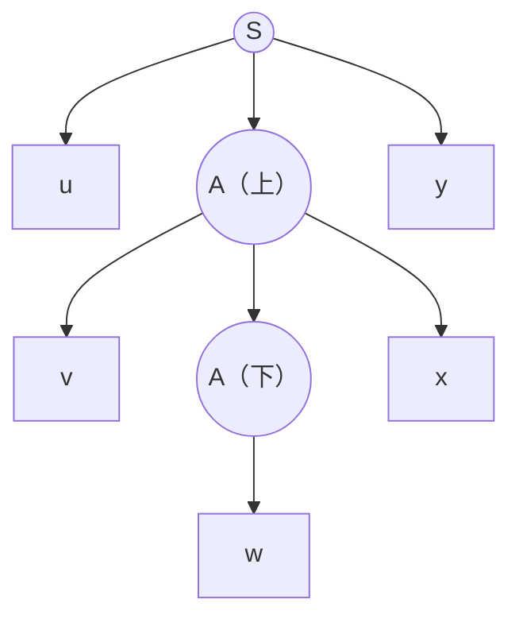

本章研究**上下文无关语言**这一类语言整体的性质，与 [4.8.6](/4.8.6) 对**正规语言**的讨论一一对应：泵引理给出上下文无关语言的必要条件，用来证明某个语言不是上下文无关的；封闭性说明哪些运算不会越出这个类；判定性质说明关于文法的哪些问题有算法。与正规语言相比，上下文无关语言对交和补不再封闭，许多在正规语言中可判定的问题（等价、包含）也变得不可判定，后者的证明留到 [4.8.11](/4.8.11)。

## 9.1. 泵引理

### 9.1.1. 语法分析树的大小

在 **Chomsky 范式**下，**语法分析树**除最后一层外都是二叉的，于是树的高度与叶子数之间有简单的关系。下面说路径的长度，指路径上边的条数。

**定理 9.1.1** 设 $G$ 是 Chomsky 范式的**文法**，某棵语法分析树的产物是终结符串 $w$。若从根到叶的最长路径长度为 $n$，则 $\lvert w\rvert \le 2^{n-1}$。

**证明** 对 $n$ 归纳。$n = 1$ 时树只有根与一个叶子，根用了 $A \to a$，$\lvert w\rvert = 1 = 2^0$。$n > 1$ 时根用了 $A \to BC$，两棵子树的最长路径长度至多为 $n - 1$，由归纳假设各自的产物长度至多 $2^{n-2}$，合计至多 $2^{n-1}$。$\square$

### 9.1.2. 泵引理

**定理 9.1.2（上下文无关语言的泵引理）** 设 $L$ 是**上下文无关语言**，则存在常数 $n$，使得对任意 $z \in L$，只要 $\lvert z\rvert \ge n$，就可以把 $z$ 写成 $z = uvwxy$，满足
1. $\lvert vwx\rvert \le n$；
2. $vx \ne \varepsilon$；
3. 对一切 $i \ge 0$，$uv^iwx^iy \in L$。

**证明** 若 $L \setminus \{\varepsilon\} = \varnothing$，取 $n = 1$ 即可（没有满足条件的 $z$）。否则由定理 8.4.1，$L \setminus \{\varepsilon\}$ 有 Chomsky 范式的文法 $G = (V, T, P, S)$，设 $\lvert V\rvert = m$，取 $n = 2^m$。

设 $z \in L$，$\lvert z\rvert \ge 2^m$。由定理 9.1.1，$z$ 的语法分析树中最长路径的长度至少为 $m + 1$，这条路径上有至少 $m + 2$ 个结点，除最后的叶子外都是变元。在这条路径最靠下的 $m + 1$ 个变元中，由鸽巢原理有两个相同，记为 $A$：上面的一个记作 $A_i$，下面的一个记作 $A_j$。

以 $A_j$ 为根的子树产物记为 $w$，以 $A_i$ 为根的子树产物记为 $vwx$，整个 $z = uvwxy$。
- $vx \ne \varepsilon$：$A_i$ 用的产生式是 $A \to BC$，$A_j$ 在其中一棵子树里，另一棵子树的产物非空（Chomsky 范式中变元不推出空串），它是 $v$ 或 $x$ 的一部分。
- $\lvert vwx\rvert \le n$：选取的是路径最下面的 $m + 1$ 个变元，以 $A_i$ 为根的子树中，最长路径的长度至多为 $m + 1$（否则原路径就不是最长的），由定理 9.1.1，$\lvert vwx\rvert \le 2^m = n$。
- 泵：树中 $A_i$ 推出 $vA x$、$A_j$ 推出 $w$，即 $A \overset{*}{\Rightarrow} vAx$，$A \overset{*}{\Rightarrow} w$。把以 $A_i$ 为根的子树换成以 $A_j$ 为根的子树，得到 $uwy$；反过来把以 $A_j$ 为根的子树换成以 $A_i$ 为根的子树的副本，重复 $i - 1$ 次，得到 $uv^iwx^iy$。它们都是合法的语法分析树，所以都属于 $L$。$\square$

与**正规语言的泵引理**（[4.8.6](/4.8.6)）相比，这里同时泵动两段 $v$ 和 $x$，它们在 $z$ 中可以相隔很远，但都落在长度不超过 $n$ 的窗口 $vwx$ 中。

### 9.1.3. 应用

泵引理是必要条件。用它证明 $L$ 不是上下文无关语言，就是证明它的否定：对任意 $n$，存在 $z \in L$，$\lvert z\rvert \ge n$，使得对 $z$ 的任意满足条件 1、2 的分解 $z = uvwxy$，都存在 $i \ge 0$ 使 $uv^iwx^iy \notin L$。可以把它看作与对手的游戏：对手选 $n$；我们选 $z$；对手选分解；我们选 $i$，若 $uv^iwx^iy \notin L$ 则我们赢。

**例 9.1.1** $L = \{0^k1^k2^k \mid k \ge 1\}$ 不是上下文无关语言。对任意 $n$，取 $z = 0^n1^n2^n$。由于 $\lvert vwx\rvert \le n$，窗口 $vwx$ 不可能同时含有 0 和 2。若 $vx$ 不含 2，取 $i = 0$，$uwy$ 中 2 仍有 $n$ 个，而 0 或 1 的个数减少了（$vx \ne \varepsilon$），不属于 $L$；若 $vx$ 不含 0，同理。

**例 9.1.2** $L = \{0^i1^j2^i3^j \mid i, j \ge 1\}$ 不是上下文无关语言。取 $z = 0^n1^n2^n3^n$。窗口 $vwx$ 至多跨越相邻的两个块。若 $vx$ 含有 0，则它不含 2（0 块与 2 块之间隔着 $n$ 个 1），$uwy$ 中 0 少于 2；其余情形类似，总有一对应当相等的块在 $uwy$ 中变得不等。

**例 9.1.3** $L = \{0^p \mid p \text{ 是素数}\}$ 不是上下文无关语言。取素数 $p \ge n + 2$，$z = 0^p$，设 $\lvert vx\rvert = k \ge 1$。取 $i = p + 1$，$\lvert uv^iwx^iy\rvert = p + pk = p(1 + k)$ 是合数。

单**字母表**上的上下文无关语言其实都是**正规语言**（这是 Parikh 定理的推论），所以这个例子也可以用正规语言的泵引理完成。

### 9.1.4. Ogden 引理

有些语言不是上下文无关的，泵引理却无法证明，因为对手总能把 $v, x$ 放在"无害"的位置。Ogden 引理允许我们标记 $z$ 中的若干位置，强迫 $vx$ 落在标记处。

**定理 9.1.3（Ogden 引理）** 设 $L$ 是上下文无关语言，则存在常数 $n$，使得对任意 $z \in L$，只要在 $z$ 中标记了至少 $n$ 个位置，就可以把 $z$ 写成 $z = uvwxy$，满足：$vwx$ 中至多有 $n$ 个标记位置；$vx$ 中至少有一个标记位置；对一切 $i \ge 0$，$uv^iwx^iy \in L$。

把所有位置都标记，就得到定理 9.1.2。证明与定理 9.1.2 相同，只是沿路径向下时总走向含标记位置较多的子树，并只在"两棵子树都含标记位置"的分叉结点中找重复的变元。

**例 9.1.4** $L = \{a^ib^jc^kd^l \mid i = 0 \text{ 或 } j = k = l\}$ 不是上下文无关语言。泵引理对它无效：$i \ge 1$ 的串取 $v = a$、$x = \varepsilon$ 泵动 $a$，$i = 0$ 的串泵动任何一个字母，结果都仍在 $L$ 中。用 **Ogden 引理**：取 $z = ab^nc^nd^n$，标记全部 $b, c, d$。若 $v$ 或 $x$ 含两种字母，$uv^2wx^2y$ 的字母顺序被打乱，不在 $L$ 中。否则 $v$ 与 $x$ 各只含一种字母，$vx$ 至少含一个 $b$、$c$ 或 $d$，但至多含 $b, c, d$ 中的两种；于是 $uv^2wx^2y$ 中 $a$ 至少有一个，$b, c, d$ 的个数却不全相等，不在 $L$ 中。

## 9.2. 封闭性

### 9.2.1. 替换

**定义 9.2.1（替换）** 设 $\Sigma$ 是字母表。$\Sigma$ 上的一个**替换** $s$ 给每个 $a \in \Sigma$ 指定一个语言 $s(a)$（可以在另一个字母表上）。对串规定 $s(\varepsilon) = \{\varepsilon\}$，$s(a_1a_2\cdots a_n) = s(a_1)s(a_2)\cdots s(a_n)$（语言的连接）；对语言规定 $s(L) = \bigcup_{w \in L} s(w)$。

**定理 9.2.1** 若 $L$ 是 $\Sigma$ 上的**上下文无关语言**，$s$ 是 $\Sigma$ 上的替换，且每个 $s(a)$ 都是上下文无关语言，则 $s(L)$ 是上下文无关语言。

**证明** 设 $G = (V, \Sigma, P, S)$ 生成 $L$，$G_a = (V_a, T_a, P_a, S_a)$ 生成 $s(a)$，各文法的变元互不相交。构造 $G'$：变元为 $V \cup \bigcup_a V_a$，终结符为 $\bigcup_a T_a$，开始符号为 $S$，产生式为全部 $P_a$，以及把 $P$ 的每个产生式中的终结符 $a$ 都换成 $S_a$ 得到的产生式。

$G'$ 的一棵**语法分析树**的上半部分是 $G$ 的一棵树（叶子 $a$ 换成了 $S_a$），每个 $S_a$ 下面挂着 $G_a$ 的一棵树。所以 $G'$ 生成的串恰好是：取 $a_1\cdots a_k \in L$，再从每个 $s(a_i)$ 中任取一个串连接起来，即 $s(L)$。$\square$

**例 9.2.1** 取 $\Sigma = \{0, 1\}$，$s(0) = \{a^kb^k \mid k \ge 1\}$，$s(1) = \{aa, bb\}$。则 $s(01) = \{a^kb^kaa \mid k \ge 1\} \cup \{a^kb^{k+2} \mid k \ge 1\}$；对 $L = L(0^*)$，$s(L) = s(0)^* = \{a^{k_1}b^{k_1}\cdots a^{k_r}b^{k_r} \mid r \ge 0,\ k_i \ge 1\}$。

**定理 9.2.2** 上下文无关语言对并、连接、**Kleene 闭包**（$^*$ 与 $^+$）和同态封闭。

**证明** 都是定理 9.2.1 的特例。设 $L, M$ 是上下文无关语言。
- 并：$\{1, 2\}$ 是上下文无关语言，取 $s(1) = L$、$s(2) = M$，则 $s(\{1, 2\}) = L \cup M$。
- 连接：取同样的 $s$，$s(\{12\}) = LM$。
- 闭包：取 $s(1) = L$，$s(\{1\}^*) = L^*$，$s(\{1\}^+) = L^+$。
- 同态 $h$：取 $s(a) = \{h(a)\}$，单元素语言是上下文无关的，$s(L) = h(L)$。$\square$

**定理 9.2.3** 若 $L$ 是上下文无关语言，则其反转 $L^{\mathrm{R}} = \{w^{\mathrm{R}} \mid w \in L\}$ 也是。

**证明** 把生成 $L$ 的文法中每个产生式 $A \to \alpha$ 换成 $A \to \alpha^{\mathrm{R}}$。对推导步数归纳可证新文法中 $A \overset{*}{\Rightarrow} w^{\mathrm{R}}$ 当且仅当原文法中 $A \overset{*}{\Rightarrow} w$。$\square$

### 9.2.2. 交与补

**定理 9.2.4** 上下文无关语言对交不封闭。

**证明** $L = \{0^k1^k2^i \mid k, i \ge 1\}$ 由 $S \to AB$，$A \to 0A1 \mid 01$，$B \to 2B \mid 2$ 生成；$M = \{0^i1^k2^k \mid k, i \ge 1\}$ 由 $S \to AB$，$A \to 0A \mid 0$，$B \to 1B2 \mid 12$ 生成。但 $L \cap M = \{0^k1^k2^k \mid k \ge 1\}$ 不是上下文无关语言（例 9.1.1）。$\square$

**推论 9.2.1** 上下文无关语言对补和差不封闭。

**证明** 若对补封闭，由 $L \cap M = \overline{\overline{L} \cup \overline{M}}$ 和对并的封闭性，将对交封闭，矛盾。$\overline{L} = \Sigma^* \setminus L$ 是差的特例，所以对差也不封闭。$\square$

直观上，**PDA** 只有一个栈，无法同时核对两组计数；而补需要"所有计算都拒绝"，非确定机器无法直接表达。对**确定上下文无关语言**，补是封闭的（[4.8.7](/4.8.7) 第 7.6 节）。

交虽然不封闭，与**正规语言**的交却是封闭的：**有限自动机**不需要栈，可以与 PDA 并行运行。

**定理 9.2.5** 若 $L$ 是上下文无关语言，$R$ 是正规语言，则 $L \cap R$ 是上下文无关语言。

**证明** 设 PDA $P = (Q_P, \Sigma, \Gamma, \delta_P, q_P, Z_0, F_P)$ 以终态接受 $L$，DFA $A = (Q_A, \Sigma, \delta_A, q_A, F_A)$ 接受 $R$。构造积 PDA

$$
P' = (Q_P \times Q_A, \Sigma, \Gamma, \delta, (q_P, q_A), Z_0, F_P \times F_A),
$$
其中 $((r, s'), \gamma) \in \delta((q, s), a, X)$ 当且仅当 $(r, \gamma) \in \delta_P(q, a, X)$，且 $a \in \Sigma$ 时 $s' = \delta_A(s, a)$，$a = \varepsilon$ 时 $s' = s$。对步数归纳可证：$((q_P, q_A), w, Z_0) \vdash^*_{P'} ((q, s), \varepsilon, \gamma)$ 当且仅当 $(q_P, w, Z_0) \vdash^*_P (q, \varepsilon, \gamma)$ 且 DFA 读完 $w$ 后处于 $s$。所以 $L(P') = L \cap R$。$\square$

**推论 9.2.2** 若 $L$ 是上下文无关语言，$R$ 是正规语言，则 $L \setminus R = L \cap \overline{R}$ 是上下文无关语言。

### 9.2.3. 逆同态

**定理 9.2.6** 若 $L \subseteq T^*$ 是上下文无关语言，$h\colon \Sigma \to T^*$ 是同态，则 $h^{-1}(L) = \{w \in \Sigma^* \mid h(w) \in L\}$ 是上下文无关语言。

**证明**（构造） 设 PDA $P = (Q, T, \Gamma, \delta, q_0, Z_0, F)$ 以终态接受 $L$。新 PDA 的状态是二元组 $(q, x)$，其中 $x$ 是某个 $h(a)$ 的后缀，作为"缓冲区"存放尚未交给 $P$ 处理的符号：
1. 缓冲区为空时，读入 $a \in \Sigma$，把 $h(a)$ 放进缓冲区：$((q, h(a)), X) \in \delta'((q, \varepsilon), a, X)$；
2. 缓冲区为 $bx$ 时，不读输入，模拟 $P$ 读入 $b$ 的一步：若 $(p, \gamma) \in \delta(q, b, X)$，则 $((p, x), \gamma) \in \delta'((q, bx), \varepsilon, X)$；$P$ 自己的 ε 转移照常模拟，缓冲区不变。

终态为 $\{(q, \varepsilon) \mid q \in F\}$。新 PDA 读入 $w$ 时，$P$ 恰好读入 $h(w)$，所以它接受 $h^{-1}(L)$。缓冲区的内容只有有限种，可以放进状态。$\square$

### 9.2.4. 用封闭性证明不是上下文无关语言

**例 9.2.2** $L = \{ww \mid w \in \{0, 1\}^*\}$ 不是上下文无关语言。若它是，由定理 9.2.5，$L \cap L(0^*1^*0^*1^*) = \{0^i1^j0^i1^j \mid i, j \ge 0\}$ 也是。对后者取 $z = 0^n1^n0^n1^n$：窗口 $vwx$ 长度不超过 $n$，不可能同时触及第 1、3 块，也不可能同时触及第 2、4 块。取 $i = 0$，$uwy$ 仍形如 $0^*1^*0^*1^*$（删去字符不会打乱顺序），但被删去字符的块变短了，与之配对的块却没有，因此不属于该语言，矛盾。

注意 $L$ 的补 $\{0,1\}^* \setminus L$ 是上下文无关语言：长度为奇数的串，或者存在位置 $k$ 使前一半与后一半的第 $k$ 个符号不同的串，后者可以用"在两半中各猜一个位置、核对它们到中点的距离"的**文法**生成。这再次说明上下文无关语言对补不封闭。

### 9.2.5. 封闭性一览

| 运算 | 正规语言 | 上下文无关语言 | 确定上下文无关语言 |
|---|---|---|---|
| 并 | 封闭 | 封闭 | 不封闭 |
| 交 | 封闭 | 不封闭 | 不封闭 |
| 与正规语言的交 | 封闭 | 封闭 | 封闭 |
| 补 | 封闭 | 不封闭 | 封闭 |
| 连接、Kleene 闭包 | 封闭 | 封闭 | 不封闭 |
| 同态 | 封闭 | 封闭 | 不封闭 |
| **逆同态** | 封闭 | 封闭 | 封闭 |
| 反转 | 封闭 | 封闭 | 不封闭 |
| 替换（以同类语言替换） | 封闭 | 封闭 | 不封闭 |

## 9.3. 判定性质

### 9.3.1. 表示之间转换的代价

关于语言的判定问题，输入是语言的某种有限表示（**文法**或 **PDA**）。各种表示之间可以互相转换，代价如下（$n$ 为输入表示的长度）：

| 转换 | 代价 |
|---|---|
| **终态接受**的 PDA ↔ **空栈接受**的 PDA | $O(n)$ |
| 文法 → 空栈接受的 PDA | $O(n)$ |
| 空栈接受的 PDA → 文法 | 直接构造是指数的；先把每条转移拆成至多压入两个符号，则为 $O(n^3)$ |
| 文法 → **Chomsky 范式** | 按 [4.8.8](/4.8.8) 的注安排顺序，为 $O(n^2)$ |

所以讨论可判定性时可以任选一种表示。

### 9.3.2. 可判定的问题

**定理 9.3.1（空性）** 给定文法 $G$，可以在 $O(n)$ 时间内判定 $L(G)$ 是否为空。

**证明** $L(G) \ne \varnothing$ 当且仅当开始符号 $S$ 是生成符号。用 [4.8.8](/4.8.8) 第 8.1.2 节带计数器的算法计算生成符号集合即可。$\square$

**定理 9.3.2（成员问题）** 给定文法 $G$ 与串 $w$，可以判定是否 $w \in L(G)$。文法固定时，用时 $O(\lvert w\rvert^3)$。

**证明** $w = \varepsilon$ 时判定 $S$ 是否可致空。否则把 $G$ 化为生成 $L(G) \setminus \{\varepsilon\}$ 的 Chomsky 范式文法，用 CKY 算法（定理 8.5.1）。$\square$

**定理 9.3.3（有限性）** 给定文法 $G$，可以判定 $L(G)$ 是否有限。

**证明** 设 $G$ 是没有无用符号的 Chomsky 范式文法（$\varepsilon$ 不影响有限性）。作**有向图**：顶点是变元，若有产生式 $A \to BC$，则连边 $A \to B$ 与 $A \to C$。若图中有回路，回路上的变元 $A$ 满足 $A \overset{*}{\Rightarrow} \alpha A \beta$，$\alpha\beta \ne \varepsilon$；由于没有无用符号，$S \overset{*}{\Rightarrow} uAy$，$A \overset{*}{\Rightarrow} w$，且 $\alpha, \beta$ 推出终结符串 $v, x$，$vx \ne \varepsilon$，于是 $uv^iwx^iy$（$i \ge 0$）是无穷多个不同的串。若图中无回路，每条从根出发的路径上变元互不相同，语法分析树的高度至多为 $\lvert V\rvert$，由定理 9.1.1 产物长度有界，语言有限。$\square$

### 9.3.3. 不可判定的问题

下列关于**上下文无关文法**的问题都是不可判定的，即不存在对所有输入都能给出正确答案的算法。证明要用到 [4.8.11](/4.8.11) 的 Post 对应问题。
1. 给定文法 $G$ 是否二义？
2. 给定**上下文无关语言**是否**固有二义**？
3. 两个上下文无关语言的交是否为空？
4. 两个上下文无关语言是否相等？一个是否包含另一个？
5. 给定上下文无关语言是否等于 $\Sigma^*$？
6. 给定上下文无关语言是否是**正规语言**？

与此形成对照：两个**确定下推自动机**是否等价是可判定的，这是 Sénizergues 于 1997 年解决的长期公开问题，他因此获得 2002 年的 Gödel 奖。

## 小结

| 主题 | 要点 |
|---|---|
| 泵引理 | $\lvert z\rvert \ge n \Rightarrow z = uvwxy$，$\lvert vwx\rvert \le n$，$vx \ne \varepsilon$，$uv^iwx^iy \in L$；$n = 2^{\lvert V\rvert}$ 来自 **Chomsky 范式**的**分析树** |
| **Ogden 引理** | 标记位置，强迫 $vx$ 含标记；可处理泵引理无能为力的语言 |
| 封闭 | 替换，进而并、连接、闭包、同态；反转；**逆同态**；与**正规语言**的交 |
| 不封闭 | 交、补、差 |
| 证明非上下文无关 | 泵引理（选 $z$、讨论窗口 $vwx$ 的位置）；先与正规语言求交化简 |
| 可判定 | 空性 $O(n)$、成员 $O(\lvert w\rvert^3)$、有限性（依赖图有无回路） |
| 不可判定 | **二义性**、交是否为空、等价、是否等于 $\Sigma^*$ |
