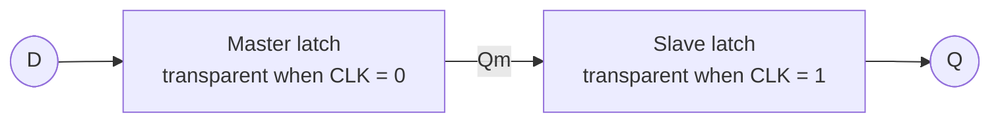

The combinational circuits of the previous chapters have no memory: their outputs depend only on the current inputs. A computer that stores data and executes in steps needs circuits that remember the past. This chapter starts from the bistability produced by feedback and introduces, in turn, the basic SR latch, the gated latch, the edge-triggered D flip-flop, and the JK and T flip-flops. Characteristic equations and excitation tables describe their functions in a uniform way. Finally we discuss the timing parameters that determine the speed and reliability of a circuit, and metastability. These storage elements are the "state register" of the synchronous sequential circuits in the [next chapter](/4.9.7), and the basis of [counters and registers](/4.9.8), of the logic cells of FPGAs ([4.9.9](/4.9.9)) and of the processor datapath ([4.10](/4.10)).

## 6.1. Sequential Circuits and Memory Elements

**Definition 6.1.1 (Sequential Logic Circuit)** A digital circuit whose stable output at a given moment depends not only on the input at that moment but also on the sequence of past inputs is called a **sequential logic circuit**. The influence of past inputs is retained in the internal **state** of the circuit.

The output of a combinational circuit is a function of the current input only; the output of a sequential circuit is a function of the current input and the current state, and the state records the history. Memory is implemented by feedback: the output is wired back to the input. The simplest example is two inverters connected head to tail. If $Q = 1$, the first inverter gives $\bar Q = 0$, and the second inverter gives $Q = 1$ again, so this state sustains itself; the same holds for $Q = 0$.

**Definition 6.1.2 (Bistable Circuit)** A circuit that has two stable states and can hold either of them indefinitely without external excitation is called a **bistable circuit**. A bistable circuit stores one bit.

The loop of two inverters has two stable states, but it has no input, so the value it stores cannot be changed. The storage elements in the following sections all add a means of "writing" to this loop. They fall into two classes according to when writing is allowed.

**Definition 6.1.3 (Latch and Flip-Flop)** A one-bit storage element whose output can change with the input during the whole period in which an enable signal is at its specified level is called a **latch**; a one-bit storage element whose output can change only at a specified transition of a clock signal is called a **flip-flop**.

That is, a latch is level-sensitive and "transparent" while enabled, whereas a flip-flop is edge-sensitive and its output is constant the rest of the time. This is the usage of current English textbooks (Harris & Harris, Patterson & Hennessy, and others). Many Chinese textbooks call all storage elements "flip-flops" and divide them by clocking method into level-triggered (that is, latches), edge-triggered and master-slave (pulse-triggered) types; their "basic RS flip-flop" and "level-triggered D flip-flop" are the SR latch and the D latch of this chapter. By logic function, storage elements are further classified as SR, D, JK and T types.

## 6.2. The Basic SR Latch

### 6.2.1. Structure and Function

Replace the two inverters by two **NAND gates** (or **NOR gates**). The extra input of each gate can then be used to change the state, which gives the simplest storage element that can be written.

**Definition 6.2.1 (SR Latch)** A bistable circuit built from two cross-coupled NAND gates or NOR gates, with a set input $S$ and a reset input $R$ and two complementary outputs $Q$ and $\bar Q$, is called a basic **SR latch**. By convention, $Q = 1, \bar Q = 0$ is the "1" state and $Q = 0, \bar Q = 1$ is the "0" state.

Take the NOR latch (active-high inputs) as an example. Let $Q^n$ be the state before the inputs act (the present state) and $Q^{n+1}$ the state after (the next state):

| $S$ | $R$ | $Q^{n+1}$ | Function |
|---|---|---|---|
| 0 | 0 | $Q^n$ | Hold |
| 1 | 0 | 1 | Set |
| 0 | 1 | 0 | Reset |
| 1 | 1 | — | Forbidden: $Q = \bar Q = 0$; the state is undetermined after the inputs are removed |

The NAND latch has the dual structure: its inputs are active-low and are usually written $\bar S$, $\bar R$. $\bar S = 0$ sets, $\bar R = 0$ resets, and $\bar S = \bar R = 1$ holds; for $\bar S = \bar R = 0$ both outputs are 1. A way to remember this is that a state change of a NAND latch is always caused by a 0 appearing at one of the inputs. An example among integrated circuits is the 74LS279 (four $\bar S\bar R$ latches).

### 6.2.2. Constraint and Characteristic Equation

When both inputs are active, the outputs are no longer complementary, violating the convention that $Q$ and $\bar Q$ are complementary. More seriously, if both inputs are removed at the same time (for the NOR latch, $SR$ changes from 11 to 00 simultaneously), the two gates start to **race**: the final state depends on which gate is faster, and the latch may even oscillate between the two states or enter a metastable state (Section 6.7). So when a basic SR latch is used, the two inputs must never be active at the same time. Writing the function table as a logic equation gives its characteristic equation (Section 6.6):

$$
Q^{n+1} = S + \bar R\, Q^n, \qquad SR = 0 \ (\text{constraint}).
$$

The state of a basic SR latch changes whenever the inputs change, and some input combinations are forbidden. The next two sections improve this in two steps: first an enable input controls when writing is allowed, then a single data input removes the forbidden combination.

## 6.3. Gated Latches

### 6.3.1. The Gated SR Latch

An AND gate is added in front of each of $S$ and $R$ (NAND gates for the NAND form), controlled by an enable signal $E$ (also written $C$, $G$ or $\mathrm{EN}$). When $E = 0$, both inputs of the latch are inactive and the state is held; when $E = 1$, it is a basic SR latch. Hence

$$
Q^{n+1} = E\,(S + \bar R\,Q^n) + \bar E\, Q^n, \qquad E\,SR = 0.
$$

The enable input solves the problem of when to write, but $S = R = 1$ with $E = 1$ is still forbidden. Note that holding for $S = R = 0$ duplicates holding for $E = 0$: as long as $E$ is responsible for holding, the data inputs only need to distinguish "reset" from "set".

### 6.3.2. The D Latch

**Definition 6.3.1 (D Latch)** Setting $S = D$ and $R = \bar D$ in a gated SR latch gives a latch with a single data input $D$ and an enable input $E$, called a **D latch** (a level-triggered D flip-flop in Chinese textbooks). Its function is

$$
Q^{n+1} = \begin{cases} D, & E = 1 \ (\text{transparent, load}),\\ Q^n, & E = 0 \ (\text{hold}). \end{cases}
$$

Since $S$ and $R$ are always complementary, the forbidden combination cannot occur. In a NAND implementation, connecting $\bar D$ directly to the $R$ input of a gated SR latch needs an extra inverter, and the path from $D$ to the output passes through four gate delays. A common improvement lets the output of the NAND gate on the $S$ side (equal to $\bar D$ when $E = 1$) also drive the $R$ side, which saves the inverter and shortens the delay. An integrated example is the 74LS373: eight D latches share one latch-enable input and have outputs on **tri-state buffers**, and it is often used to hold addresses or data temporarily on a bus.

The problem with the D latch is transparency: during the whole time $E = 1$, any change of the input, including noise, propagates to the output. If several D latches are connected head to tail and controlled by the same enable signal (for example, to build a shift register), the data races through several stages during $E = 1$ instead of moving one position at a time. Likewise, a circuit that feeds $Q$ back to $D$ through combinational logic changes state repeatedly while $E = 1$ (a "race-around"). What sequential circuits need is a storage element that is updated exactly once per clock cycle.

## 6.4. Edge-Triggered Flip-Flops

### 6.4.1. Edge Triggering and the D Flip-Flop

**Definition 6.4.1 (D Flip-Flop)** A flip-flop that stores the value of the data input $D$ only at a specified transition of the clock input $\mathrm{CLK}$ (often written $\mathrm{CP}$ in Chinese textbooks) and holds its state at all other times is called a **D flip-flop**. If the specified transition is the rising edge ($0 \to 1$) it is positive-edge-triggered, and if it is the falling edge it is negative-edge-triggered; this method of control is called **edge triggering**. The function of a positive-edge D flip-flop is

$$
Q^{n+1} = D, \qquad \text{at the rising edge of CLK}.
$$

In logic symbols, a small triangle at the clock input denotes edge triggering, and a small circle outside the triangle denotes triggering on the falling edge. Compared with a latch, changes of the input have no effect on the output while $\mathrm{CLK} = 0$, while $\mathrm{CLK} = 1$, or at the non-specified transition. The figure below compares the responses of a D latch and a positive-edge D flip-flop to the same input.

### 6.4.2. The Master-Slave Structure

**Definition 6.4.2 (Master-Slave Flip-Flop)** A flip-flop built from two latches in series with complementary enable signals is called a **master-slave flip-flop**: the first stage is called the master latch (master flip-flop) and the second the slave latch (slave flip-flop).

A positive-edge D flip-flop can be built from two D latches: the master latch is transparent when $\mathrm{CLK} = 0$ and the slave latch is transparent when $\mathrm{CLK} = 1$.

- $\mathrm{CLK} = 0$: the master latch follows $D$ and the slave latch holds, so the output does not change.
- $\mathrm{CLK}$ rises: the master latch closes and locks the value of $D$ just before the rising edge; the slave latch opens and passes this value to the output.
- $\mathrm{CLK} = 1$: the master latch holds, so changes of $D$ cannot get in; the output does not change.

At every moment at least one latch is closed, so data cannot "race through" directly, and the whole behaves as sampling at the rising edge. This is the most common structure of flip-flops in modern CMOS technology (each latch is built from transmission gates and inverters), and D flip-flops in FPGAs and standard-cell libraries can be understood in this way.

### 6.4.3. The Sustain-Block Structure

The classic positive-edge D flip-flop of the TTL era (such as the 74LS74) uses six NAND gates: two NAND gates form the basic SR latch at the output, and the other four form the input stage, two of which are driven directly by the clock.

- When $\mathrm{CLK} = 0$, the two clocked gates both output 1, so the output latch holds; the other two gates of the input stage follow $D$ and prepare $D$ and $\bar D$ in advance.
- When the rising edge arrives, the two clocked gates produce a 0 at one output according to the prepared values, which sets or resets the output latch.
- While $\mathrm{CLK} = 1$, the gate whose output is 0 locks the input stage through an internal feedback line: if a 0 was stored, one line "sustains the 0 and blocks the 1"; if a 1 was stored, the other line "sustains the 1 and blocks the 0". No change of $D$ can get in afterwards, hence the name sustain-block structure.

This structure directly explains the timing parameters of Section 6.7. Before the rising edge, $D$ must have enough time to pass through the two gate levels of the input stage (the setup time is about two gate delays); after the rising edge, $D$ must be held until the feedback line has locked the input stage (the hold time is about one gate delay).

### 6.4.4. Asynchronous Preset and Clear

Real flip-flops usually also have an asynchronous preset input $\overline{\mathrm{PR}}$ (Preset, also written $\bar S_{\mathrm{D}}$) and clear input $\overline{\mathrm{CLR}}$ (Clear, also written $\bar R_{\mathrm{D}}$). They act directly on the output latch, independently of the clock, and are used for initialization at power-up. For the 74LS74:

| $\overline{\mathrm{PR}}$ | $\overline{\mathrm{CLR}}$ | $\mathrm{CLK}$ | $D$ | $Q$ | $\bar Q$ |
|---|---|---|---|---|---|
| 0 | 1 | × | × | 1 | 0 |
| 1 | 0 | × | × | 0 | 1 |
| 0 | 0 | × | × | 1 | 1 (unstable, forbidden) |
| 1 | 1 | ↑ | $D$ | $D$ | $\bar D$ |
| 1 | 1 | 0 or 1 | × | $Q^n$ | $\bar Q^n$ |

In contrast, synchronous clear and load take effect only at a clock edge; they are implemented by adding logic in front of $D$ (the integrated counters of Section 4.9.8 have both kinds).

## 6.5. JK and T Flip-Flops

### 6.5.1. The JK Flip-Flop

The combination $S = R = 1$ is forbidden in an SR latch. The JK flip-flop makes use of it: when both inputs are active, the state toggles.

**Definition 6.5.1 (JK Flip-Flop)** An edge-triggered flip-flop with two data inputs $J$ and $K$ that updates its state at the specified clock transition according to the following table is called a **JK flip-flop**:

| $J$ | $K$ | $Q^{n+1}$ | Function |
|---|---|---|---|
| 0 | 0 | $Q^n$ | Hold |
| 0 | 1 | 0 | Reset |
| 1 | 0 | 1 | Set |
| 1 | 1 | $\bar Q^n$ | Toggle |

Its characteristic equation is

$$
Q^{n+1} = J\,\bar Q^n + \bar K\, Q^n.
$$

The idea of the implementation is to feed the outputs back to the inputs: let the internal SR structure have $S = J\bar Q$ and $R = KQ$. Since $Q$ and $\bar Q$ are complementary, $S$ and $R$ are never 1 at the same time. When $J = K = 1$, $Q = 0$ gives $S = 1$ and sets the flip-flop, and $Q = 1$ gives $R = 1$ and resets it, which is exactly toggling. Substituting into the characteristic equation of the SR latch gives the equation above: $Q^{n+1} = J\bar Q^n + \overline{KQ^n}\,Q^n = J\bar Q^n + \bar K Q^n$.

Integrated examples: the 74LS112 is a dual negative-edge JK flip-flop, and the 74LS109 is a dual positive-edge $J\bar K$ flip-flop (the $K$ input is inverting); both have asynchronous preset and clear inputs. The flexibility of the JK flip-flop makes it convenient when designing counters from discrete chips (4.9.8): the excitation functions contain more **don't-care terms**, so the expressions are often simpler.

### 6.5.2. The Master-Slave JK Flip-Flop and the Ones-Catching Problem

Early JK flip-flops used the master-slave structure. The master flip-flop accepts $J\bar Q$ and $KQ$ while $\mathrm{CLK} = 1$; at the falling edge the slave flip-flop accepts the state of the master. The output changes at the falling edge and looks like that of a negative-edge flip-flop, but the mode of operation is different.

While $\mathrm{CLK} = 1$, the output $Q$ of the slave does not change, so at most one of the two master inputs $J\bar Q$ and $KQ$ can be active: with $Q = 0$ the master can only be set, and with $Q = 1$ it can only be reset. Hence the master changes at most once during one high level of the clock. This leads to the so-called "ones-catching" problem. Let $Q = 0$ and suppose that $J$ shows a brief 1 (for example, noise) while $\mathrm{CLK} = 1$; the master is set. Afterwards $J$ returns to 0 and $K = 1$, but $KQ = 0$, so the master cannot be reset again; at the falling edge the output becomes 1, although $J = 0, K = 1$ at that moment should give $Q = 0$.

So the function table of a master-slave JK flip-flop holds only under the premise that $J$ and $K$ do not change while $\mathrm{CLK} = 1$. Its noise immunity is poor, and only narrow positive clock pulses can be used. An edge-triggered JK flip-flop has no such problem: its output depends only on $J$ and $K$ at the specified transition.

### 6.5.3. The T Flip-Flop

**Definition 6.5.2 (T Flip-Flop)** An edge-triggered flip-flop with one input $T$ that toggles at each specified clock transition when $T = 1$ and holds when $T = 0$ is called a **T flip-flop**. Its characteristic equation is $Q^{n+1} = T \oplus Q^n$. A flip-flop with $T$ fixed at 1, which toggles at every clock, is sometimes called a T′ flip-flop.

T flip-flops are usually not manufactured separately but built from JK or D flip-flops: let $J = K = T$, or let $D = T \oplus Q$. Toggling once is equivalent to dividing the clock frequency by two, so the T flip-flop is the natural cell of a binary counter (4.9.8).

### 6.5.4. Converting Between Flip-Flop Types

Flip-flops of different types can be converted into each other: keep the available flip-flop and add combinational logic in front of its inputs so that the whole satisfies the characteristic equation of the target flip-flop. The method is to equate the characteristic equation of the available flip-flop with the target characteristic equation and solve for its inputs:

| Available | Target | Conversion logic |
|---|---|---|
| D | JK | $D = J\bar Q + \bar K Q$ |
| D | T | $D = T \oplus Q$ |
| JK | D | $J = D,\ K = \bar D$ |
| JK | T | $J = K = T$ |

For example, to build a JK flip-flop from a D flip-flop, we need $Q^{n+1} = J\bar Q^n + \bar K Q^n$, while a D flip-flop satisfies $Q^{n+1} = D$; so the input $D$ is connected to $J\bar Q + \bar K Q$ (an AND-OR gate and an inverter).

## 6.6. Characteristic Equations and Excitation Tables

**Definition 6.6.1 (Characteristic Equation)** The relation, expressed as a logic equation, between the next state $Q^{n+1}$ of a storage element and its present state $Q^n$ and inputs is called the **characteristic equation** (next-state equation) of the element.

**Definition 6.6.2 (Excitation Table)** The table that lists, for each transition $Q^n \to Q^{n+1}$ from present state to next state, the values the inputs of a storage element must take is called an **excitation table**.

A function table answers "given the inputs, how does the state change" and is used for analyzing circuits; an excitation table answers "for the state to change this way, what must the inputs be" and is used for designing circuits (Section 4.9.7). The four flip-flops are summarized below (× means that either 0 or 1 works):

| Flip-flop | Characteristic equation | $0 \to 0$ | $0 \to 1$ | $1 \to 0$ | $1 \to 1$ |
|---|---|---|---|---|---|
| D | $Q^{n+1} = D$ | $D = 0$ | $D = 1$ | $D = 0$ | $D = 1$ |
| T | $Q^{n+1} = T \oplus Q^n$ | $T = 0$ | $T = 1$ | $T = 1$ | $T = 0$ |
| JK | $Q^{n+1} = J\bar Q^n + \bar K Q^n$ | $J = 0, K = \times$ | $J = 1, K = \times$ | $J = \times, K = 1$ | $J = \times, K = 0$ |
| SR | $Q^{n+1} = S + \bar R Q^n$, $SR = 0$ | $S = 0, R = \times$ | $S = 1, R = 0$ | $S = 0, R = 1$ | $S = \times, R = 0$ |

Every row of the excitation table of the JK flip-flop has a don't-care: for example, the transition $0 \to 1$ can be realized either by "set" ($J = 1, K = 0$) or by "toggle" ($J = 1, K = 1$). The excitation of a D flip-flop is the next state itself, which is the most direct, and this is one of the reasons why modern designs (and FPGAs) use almost only D flip-flops.

The behavior of each flip-flop can also be drawn as a two-state state diagram: two circles represent states 0 and 1, and each arrow is labeled with the input that causes the transition. This is the smallest example of the state diagrams of the next chapter.

## 6.7. Timing Parameters and Metastability

### 6.7.1. Setup Time, Hold Time and Propagation Delay

A flip-flop "samples" its input at the clock edge, but the gates in the circuit have delays, so sampling is not instantaneous. Data sheets describe the conditions for correct operation of a flip-flop by several timing parameters.

**Definition 6.7.1 (Setup Time and Hold Time)** To ensure that a flip-flop stores data correctly at the active clock edge, the shortest time for which the data input must be stable before the edge is called the **setup time** $t_{\mathrm{su}}$, and the shortest time for which it must remain stable after the edge is called the **hold time** $t_{\mathrm{h}}$.

**Definition 6.7.2 (Clock-to-Q Delay)** The longest time from the active clock edge until the flip-flop output reaches its new stable value is called the clock-to-output propagation delay $t_{\mathrm{pcq}}$; the shortest time from the active edge until the output starts to change is called the clock-to-output contamination delay $t_{\mathrm{ccq}}$. Together they are called the **clock-to-Q delay**.

![Timing parameters of a positive-edge D flip-flop: D must be stable within $[t - t_{\mathrm{su}},\, t + t_{\mathrm{h}}]$; the output can start to change only after $t_{\mathrm{ccq}}$ and is certainly stable after $t_{\mathrm{pcq}}$](./plots/flipflop-timing.py)

Chinese textbooks and data sheets often write the clock-to-output delay as $t_{\mathrm{pd}}$ or $t_{\mathrm{pLH}}$, $t_{\mathrm{pHL}}$ (for the output going from low to high and from high to low, respectively, which are generally unequal). Data sheets also specify the minimum durations of the clock high and low levels (minimum pulse width) and the recovery time of asynchronous preset and clear. As analyzed in Section 6.4.3, the $t_{\mathrm{su}}$ of the sustain-block structure is about two gate delays and its $t_{\mathrm{h}}$ about one gate delay; the $t_{\mathrm{h}}$ of modern CMOS flip-flops can be close to 0 or even negative.

These parameters determine how fast a synchronous circuit can run. Data leaves one flip-flop, passes through combinational logic and reaches the next flip-flop; it must arrive at least $t_{\mathrm{su}}$ before the next clock edge, and at the same time must not arrive so early that it violates the hold time of the next flip-flop. The resulting setup-time constraint, hold-time constraint and maximum clock frequency are discussed in [Section 7.6 of the next chapter](/4.9.7#sec-7.6).

### 6.7.2. Metastability

What happens if the data changes exactly within the setup-hold window? Return to the bistable loop of Section 6.1: besides its two stable states, it has an unstable equilibrium point, at which both inverter outputs rest at an intermediate level, like a ball balanced on a hilltop. If the input is changing at the sampling instant, the loop can be pushed close to this equilibrium point.

**Definition 6.7.3 (Metastability)** The phenomenon in which the output of a bistable element stays at an indeterminate level between the two stable states and needs an unpredictable time to settle to 0 or 1 is called **metastability**.

Metastability cannot be avoided entirely; one can only make the probability of an error caused by it small enough. The deviation from the equilibrium point grows exponentially with time, and the probability that the output has not resolved after time $t$ decays as $\mathrm{e}^{-t/\tau}$, where $\tau$ is a time constant of the device (of the order of tens of picoseconds in modern technologies). For a sampling circuit with clock frequency $f_{\mathrm{clk}}$ and asynchronous input toggling frequency $f_{\mathrm{d}}$, if the flip-flop is allowed a time $t_{\mathrm{r}}$ to resolve, a commonly used estimate of the mean time between failures is

$$
\mathrm{MTBF} = \frac{\mathrm{e}^{t_{\mathrm{r}}/\tau}}{T_0\, f_{\mathrm{clk}}\, f_{\mathrm{d}}},
$$

where $T_0$ is a device-dependent constant. The numerator is exponential, so a little more resolution time increases the MTBF by many orders of magnitude.

The practical source of metastability is asynchronous inputs: key presses, signals from external chips, data from another clock domain. Their transitions are unrelated to the local clock and sooner or later fall into the setup-hold window. The standard remedy is a synchronizer:

**Definition 6.7.4 (Synchronizer)** A circuit that converts an asynchronous signal into a signal synchronous with the local clock is called a **synchronizer**. The most common one is the two-stage synchronizer: the asynchronous signal enters a first D flip-flop, whose output enters a second D flip-flop, and the following logic uses only the output of the second flip-flop.

Even if the first flip-flop becomes metastable, it has almost a full clock cycle to resolve, and the probability that the second flip-flop samples an indeterminate level is extremely small. The cost is a delay of one to two clock cycles. A multi-bit datum crossing clock domains cannot be synchronized bit by bit (the bits may be sampled in different cycles); methods such as handshake protocols, **Gray code** counters or asynchronous FIFOs are needed, which we return to under the synchronous design principles in Section 4.9.9.

## Summary

- Sequential circuits remember their state through the bistability formed by feedback. A latch is level-sensitive (transparent while enabled), and a flip-flop is edge-sensitive (updated only at the specified transition).
- Basic SR latch → gated latch (enable added) → D latch (a single data input removes the forbidden combination) → edge-triggered D flip-flop of master-slave or sustain-block structure (removes transparency).
- The characteristic equations of the four functions are $Q^{n+1} = D$, $T \oplus Q^n$, $J\bar Q^n + \bar K Q^n$ and $S + \bar R Q^n$ ($SR = 0$). Use the characteristic equation for analysis and the excitation table for design.
- The master-slave JK flip-flop has the ones-catching problem; an edge-triggered flip-flop looks only at its inputs at the specified transition.
- Correct sampling requires the data to be stable within $[t - t_{\mathrm{su}}, t + t_{\mathrm{h}}]$; violating this can cause metastability. Asynchronous inputs must first pass through a synchronizer.
