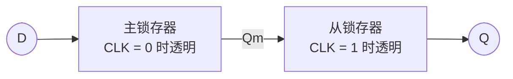

前几章的组合逻辑电路没有记忆：输出只由当前输入决定。计算机要保存数据、按步骤执行，就需要能记住"过去"的电路。本章从反馈引起的双稳态出发，依次介绍基本 RS 锁存器、门控锁存器、边沿触发的 D 触发器、JK 触发器与 T 触发器，用特性方程和激励表统一描述它们的功能，最后讨论决定电路速度和可靠性的时序参数与亚稳态。这些存储元件是[下一章](/4.9.7)同步时序电路的"状态寄存器"，也是[计数器与寄存器](/4.9.8)、FPGA 中的逻辑单元（[4.9.9](/4.9.9)）和处理器数据通路（[4.10](/4.10)）的基础。

## 6.1. 时序逻辑电路与记忆元件

**定义 6.1.1（时序逻辑电路）** 若一个数字电路某一时刻的稳定输出不仅取决于该时刻的输入，还取决于过去的输入序列，则称它为**时序逻辑电路**；过去输入的影响通过电路内部的**状态**保存下来。

组合电路的输出只是当前输入的函数；时序电路的输出是"当前输入 + 当前状态"的函数，而状态记录了历史。实现记忆的办法是反馈：把输出接回输入。最简单的例子是两个首尾相接的反相器：若 $Q = 1$，经过第一个反相器得 $\bar Q = 0$，再经过第二个反相器又得到 $Q = 1$，这个状态会自我维持；$Q = 0$ 同理。

**定义 6.1.2（双稳态电路）** 具有两个稳定状态、在没有外部激励时能无限期保持其中任一状态的电路称为**双稳态电路**。双稳态电路能存储 1 位二进制数。

两个反相器构成的环有两个稳态，但没有输入，无法改变它存储的值。下面各节的存储元件都是在这个环上加入"写入"的手段。按照何时允许写入，它们分为两类。

**定义 6.1.3（锁存器与触发器）** 输出状态在使能信号为约定电平的整个期间都可以随输入改变的 1 位存储元件称为**锁存器**；输出状态只在时钟信号的约定跳变时刻才可能改变的 1 位存储元件称为**触发器**。

即锁存器电平敏感，使能期间"透明"；触发器边沿敏感，其余时间输出不变。这是现行英文教材（Harris & Harris、Patterson & Hennessy 等）的用法。国内教材常把所有存储元件统称为"触发器"，按时钟控制方式分为电位触发（即锁存器）、边沿触发与主从（脉冲）触发三类，"基本 RS 触发器""电位型 D 触发器"就是本章的基本 RS 锁存器、D 锁存器。按逻辑功能，存储元件又分为 RS、D、JK、T 几种。

## 6.2. 基本 RS 锁存器

### 6.2.1. 结构与功能

把两个反相器换成两个与非门（或或非门），每个门多出的一个输入端就可以用来改变状态，得到最简单的、能写入的存储元件。

**定义 6.2.1（RS 锁存器）** 由两个交叉耦合的与非门或或非门构成、具有置位输入 $S$（Set）和复位输入 $R$（Reset）以及两个互补输出 $Q$、$\bar Q$ 的双稳态电路称为**基本 RS 锁存器**（又称基本 RS 触发器）。约定 $Q = 1, \bar Q = 0$ 为"1"态，$Q = 0, \bar Q = 1$ 为"0"态。

以或非门构成的锁存器为例（输入高电平有效），记 $Q^n$ 为输入作用前的状态（现态），$Q^{n+1}$ 为作用后的状态（次态）：

| $S$ | $R$ | $Q^{n+1}$ | 功能 |
|---|---|---|---|
| 0 | 0 | $Q^n$ | 保持 |
| 1 | 0 | 1 | 置 1（置位） |
| 0 | 1 | 0 | 置 0（复位） |
| 1 | 1 | — | 禁止：$Q = \bar Q = 0$，撤去输入后状态不确定 |

与非门构成的锁存器结构对偶：输入低电平有效，常写作 $\bar S$、$\bar R$。$\bar S = 0$ 置 1，$\bar R = 0$ 置 0，$\bar S = \bar R = 1$ 保持；$\bar S = \bar R = 0$ 时两个输出都为 1。可以这样记：与非门构成的锁存器的状态变化总是由某个输入端出现"0"引起的。集成电路中的例子是 74LS279（4 个 $\bar S\bar R$ 锁存器）。

### 6.2.2. 约束条件与特性方程

两个输入同时有效时，两个输出不再互补，违背了"$Q$ 与 $\bar Q$ 互补"的约定；更严重的是，若两个输入同时撤去（或非门形式：$SR$ 从 11 同时变为 00），两个门开始竞争，最终状态取决于哪个门更快，甚至可能在两态之间振荡或进入亚稳态（6.7 节）。因此使用基本 RS 锁存器时必须保证两个输入不同时有效。把功能表写成逻辑式，就得到它的特性方程（6.6 节）：

$$
Q^{n+1} = S + \bar R\, Q^n, \qquad SR = 0 \ (\text{约束条件}).
$$

基本 RS 锁存器的状态随输入随时改变，也有禁止的输入组合。下面两节分两步改进：先加使能控制何时允许写入，再改为单个数据输入以消除禁止组合。

## 6.3. 门控锁存器

### 6.3.1. 门控 RS 锁存器

在 $S$、$R$ 前各加一个与门（与非门形式则加与非门），由使能信号 $E$（也常记为 $C$、$G$ 或 $\mathrm{EN}$）控制：$E = 0$ 时锁存器的两个输入都无效，状态保持；$E = 1$ 时它就是一个基本 RS 锁存器。于是

$$
Q^{n+1} = E\,(S + \bar R\,Q^n) + \bar E\, Q^n, \qquad E\,SR = 0.
$$

使能端解决了"何时写入"的问题，但 $E = 1$ 时 $S = R = 1$ 仍是禁止组合。注意 $S = R = 0$ 时的"保持"与 $E = 0$ 的保持功能重复：只要 $E$ 负责保持，数据输入就只需区分"置 0"和"置 1"两种情况。

### 6.3.2. D 锁存器

**定义 6.3.1（D 锁存器）** 令门控 RS 锁存器的 $S = D$、$R = \bar D$，得到只有一个数据输入 $D$ 和一个使能输入 $E$ 的锁存器，称为 **D 锁存器**（电位型 D 触发器）。它的功能是

$$
Q^{n+1} = \begin{cases} D, & E = 1 \ (\text{透明，置数}),\\ Q^n, & E = 0 \ (\text{保持}). \end{cases}
$$

由于 $S$ 与 $R$ 总是互补，禁止组合不可能出现。用与非门实现时，直接把门控 RS 锁存器的 $R$ 端接 $\bar D$ 需要多一个反相器，从 $D$ 到输出要经过四级门延迟；常见的改进是把 $S$ 侧与非门的输出（$E = 1$ 时等于 $\bar D$）兼作 $R$ 侧的输入，省去反相器，也缩短了延迟。集成电路的例子是 74LS373：8 个 D 锁存器共用一个锁存使能端，输出带三态门，常用于在总线上暂存地址或数据。

D 锁存器的问题在于"透明"：$E = 1$ 的整个期间，输入的任何变化（包括干扰）都会传到输出。如果把几个 D 锁存器首尾相接、用同一个使能信号控制（例如想构成移位寄存器），$E = 1$ 期间数据会一口气穿过好几级，而不是每次只移动一位；同样，一个从 $Q$ 经组合逻辑反馈回 $D$ 的电路在 $E = 1$ 期间会反复改变状态（"空翻"）。时序电路需要的是"每个时钟周期恰好更新一次"的存储元件。

## 6.4. 边沿触发器

### 6.4.1. 边沿触发与 D 触发器

**定义 6.4.1（D 触发器）** 只在时钟输入 $\mathrm{CLK}$（教材中常记为 $\mathrm{CP}$）的约定跳变时刻把数据输入 $D$ 的值存入、其余时间保持状态的触发器称为 **D 触发器**。约定跳变为上升沿（$0 \to 1$）的称为正边沿触发，为下降沿的称为负边沿触发；这种控制方式称为**边沿触发**。正边沿 D 触发器的功能为

$$
Q^{n+1} = D, \qquad \text{在 CLK 的上升沿}.
$$

在逻辑符号上，时钟输入端画一个小三角表示边沿触发，三角外再加小圆圈表示下降沿触发。与锁存器相比：$\mathrm{CLK} = 0$、$\mathrm{CLK} = 1$ 期间以及非约定跳变时，输入的变化都不影响输出。下图对比了 D 锁存器与正边沿 D 触发器对同一输入的响应。

### 6.4.2. 主从结构

**定义 6.4.2（主从触发器）** 由两个串联的锁存器构成、两者使能信号互补的触发器称为**主从触发器**：前级称为主锁存器（主触发器），后级称为从锁存器（从触发器）。

用两个 D 锁存器构成正边沿 D 触发器：主锁存器在 $\mathrm{CLK} = 0$ 时透明，从锁存器在 $\mathrm{CLK} = 1$ 时透明。

- $\mathrm{CLK} = 0$：主锁存器跟随 $D$，从锁存器保持，输出不变。
- $\mathrm{CLK}$ 上升：主锁存器关闭，锁住上升沿前一刻的 $D$；从锁存器打开，把这个值送到输出。
- $\mathrm{CLK} = 1$：主锁存器保持，$D$ 的变化进不来；输出不变。

任何时刻都至少有一个锁存器是关闭的，所以数据不可能直接"穿透"，整体表现为上升沿采样。这是现代 CMOS 工艺中触发器最常用的结构（每个锁存器由传输门和反相器构成），FPGA 与标准单元库中的 D 触发器都可以这样理解。

### 6.4.3. 维持阻塞结构

TTL 时代的经典正边沿 D 触发器（如 74LS74）用六个与非门实现：两个与非门组成输出端的基本 RS 锁存器，另外四个组成输入级，其中两个直接受时钟控制。

- $\mathrm{CLK} = 0$ 时，受时钟控制的两个门输出都为 1，输出锁存器保持；输入级的另两个门则跟随 $D$，提前准备好 $D$ 与 $\bar D$。
- 上升沿到来时，受时钟控制的两个门按准备好的值输出一个 0，使输出锁存器置 1 或置 0。
- $\mathrm{CLK} = 1$ 期间，输出为 0 的那个门通过内部的反馈线把输入级锁住：若存入的是 0，一条线"维持 0、阻塞 1"；若存入的是 1，另一条线"维持 1、阻塞 0"。此后 $D$ 再怎样变化也进不来，因此称为维持阻塞结构。

这个结构直接解释了 6.7 节的时序参数：上升沿之前，$D$ 必须有足够时间穿过输入级的两级门（建立时间约为两级门延迟）；上升沿之后，$D$ 必须再保持到反馈线把输入级锁住为止（保持时间约为一级门延迟）。

### 6.4.4. 异步置位与复位

实际的触发器通常还有异步的置位端 $\overline{\mathrm{PR}}$（Preset，又记 $\bar S_{\mathrm{D}}$）和复位端 $\overline{\mathrm{CLR}}$（Clear，又记 $\bar R_{\mathrm{D}}$），它们直接作用于输出锁存器，不受时钟控制，用于上电初始化。以 74LS74 为例：

| $\overline{\mathrm{PR}}$ | $\overline{\mathrm{CLR}}$ | $\mathrm{CLK}$ | $D$ | $Q$ | $\bar Q$ |
|---|---|---|---|---|---|
| 0 | 1 | × | × | 1 | 0 |
| 1 | 0 | × | × | 0 | 1 |
| 0 | 0 | × | × | 1 | 1（不稳定，禁止） |
| 1 | 1 | ↑ | $D$ | $D$ | $\bar D$ |
| 1 | 1 | 0 或 1 | × | $Q^n$ | $\bar Q^n$ |

与之相对，同步清零/置数只在时钟边沿生效，实现方法是在 $D$ 端前加逻辑（4.9.8 节的集成计数器两种都有）。

## 6.5. JK 触发器与 T 触发器

### 6.5.1. JK 触发器

RS 锁存器的 $S = R = 1$ 是禁止组合。JK 触发器把这一组合利用起来：两者同时有效时让状态翻转。

**定义 6.5.1（JK 触发器）** 具有两个数据输入 $J$、$K$ 的边沿触发器，在时钟约定跳变时按下表更新状态，称为 **JK 触发器**：

| $J$ | $K$ | $Q^{n+1}$ | 功能 |
|---|---|---|---|
| 0 | 0 | $Q^n$ | 保持 |
| 0 | 1 | 0 | 置 0 |
| 1 | 0 | 1 | 置 1 |
| 1 | 1 | $\bar Q^n$ | 翻转（计数） |

其特性方程为

$$
Q^{n+1} = J\,\bar Q^n + \bar K\, Q^n.
$$

实现思路是把输出反馈到输入：令内部 RS 结构的 $S = J\bar Q$、$R = KQ$。由于 $Q$ 与 $\bar Q$ 互补，$S$、$R$ 不会同时为 1；$J = K = 1$ 时，若 $Q = 0$ 则 $S = 1$ 置 1，若 $Q = 1$ 则 $R = 1$ 置 0，正好翻转。代入 RS 的特性方程即得上式：$Q^{n+1} = J\bar Q^n + \overline{KQ^n}\,Q^n = J\bar Q^n + \bar K Q^n$。

集成电路的例子：74LS112 是双负边沿 JK 触发器，74LS109 是双正边沿 $J\bar K$ 触发器（$K$ 端为反相输入），两者都带异步置位、复位端。JK 触发器的灵活性使它在用分立芯片设计计数器时很方便（4.9.8）：激励函数里的无关项更多，表达式往往更简单。

### 6.5.2. 主从 JK 触发器与一次变化问题

早期的 JK 触发器采用主从结构：主触发器在 $\mathrm{CLK} = 1$ 期间接收 $J\bar Q$、$KQ$，下降沿时从触发器接收主触发器的状态，输出在下降沿改变，看起来像负边沿触发器，但工作方式不同。

$\mathrm{CLK} = 1$ 期间从触发器的输出 $Q$ 不变，所以主触发器的两个输入 $J\bar Q$ 与 $KQ$ 中只有一个可能有效：$Q = 0$ 时主触发器只能被置 1，$Q = 1$ 时只能被置 0，因此主触发器在一个时钟高电平期间至多改变一次。这带来所谓"一次变化"问题：设 $Q = 0$，若 $\mathrm{CLK} = 1$ 期间 $J$ 出现一个短暂的 1（例如干扰），主触发器被置 1；之后 $J$ 回到 0、$K = 1$，但 $KQ = 0$，主触发器无法再被置 0，下降沿时输出变为 1，与下降沿时刻 $J = 0, K = 1$ 应得的 $Q = 0$ 不符。

所以主从 JK 触发器的功能表只在"$\mathrm{CLK} = 1$ 期间 $J$、$K$ 不变"的前提下成立，抗干扰能力差，使用时只能用窄的时钟正脉冲。边沿触发的 JK 触发器没有这个问题，它的输出只取决于约定跳变时刻的 $J$、$K$。

### 6.5.3. T 触发器

**定义 6.5.2（T 触发器）** 具有一个输入 $T$ 的边沿触发器，$T = 1$ 时每来一个时钟约定跳变状态翻转一次，$T = 0$ 时保持，称为 **T 触发器**，其特性方程为 $Q^{n+1} = T \oplus Q^n$。$T$ 恒为 1、每个时钟都翻转的触发器有时称为 T′ 触发器。

T 触发器通常不单独生产，而由 JK 或 D 触发器构成：令 $J = K = T$，或令 $D = T \oplus Q$。翻转一次相当于对时钟"二分频"，T 触发器因此是二进制计数器的天然单元（4.9.8）。

### 6.5.4. 触发器的功能转换

各种触发器可以互相转换：保留已有的触发器，在它的输入端前加组合逻辑，使整体满足目标触发器的特性方程。方法是让已有触发器的特性方程与目标特性方程相等，解出它的输入：

| 已有 | 目标 | 转换逻辑 |
|---|---|---|
| D | JK | $D = J\bar Q + \bar K Q$ |
| D | T | $D = T \oplus Q$ |
| JK | D | $J = D,\ K = \bar D$ |
| JK | T | $J = K = T$ |

例如用 D 触发器构成 JK 触发器：要求 $Q^{n+1} = J\bar Q^n + \bar K Q^n$，而 D 触发器满足 $Q^{n+1} = D$，所以在 $D$ 端接 $J\bar Q + \bar K Q$（一个与或门加一个反相器）。

## 6.6. 特性方程与激励表

**定义 6.6.1（特性方程）** 用逻辑式表示的存储元件的次态 $Q^{n+1}$ 与现态 $Q^n$ 及其输入之间的关系，称为该存储元件的**特性方程**（次态方程）。

**定义 6.6.2（激励表）** 对现态到次态的每一种转换 $Q^n \to Q^{n+1}$，列出存储元件输入应取的值，所得的表称为**激励表**。

功能表回答"给定输入，状态怎样变"，用于分析电路；激励表回答"要让状态这样变，输入应是什么"，用于设计电路（4.9.7 节）。四种触发器汇总如下（× 表示取 0 或 1 均可）：

| 触发器 | 特性方程 | $0 \to 0$ | $0 \to 1$ | $1 \to 0$ | $1 \to 1$ |
|---|---|---|---|---|---|
| D | $Q^{n+1} = D$ | $D = 0$ | $D = 1$ | $D = 0$ | $D = 1$ |
| T | $Q^{n+1} = T \oplus Q^n$ | $T = 0$ | $T = 1$ | $T = 1$ | $T = 0$ |
| JK | $Q^{n+1} = J\bar Q^n + \bar K Q^n$ | $J = 0, K = \times$ | $J = 1, K = \times$ | $J = \times, K = 1$ | $J = \times, K = 0$ |
| RS | $Q^{n+1} = S + \bar R Q^n$，$SR = 0$ | $S = 0, R = \times$ | $S = 1, R = 0$ | $S = 0, R = 1$ | $S = \times, R = 0$ |

JK 触发器的激励表中每一行都有一个无关项：例如 $0 \to 1$ 既可以用"置 1"（$J = 1, K = 0$），也可以用"翻转"（$J = 1, K = 1$）实现。D 触发器的激励就是次态本身，最直接，这也是现代设计（以及 FPGA）几乎只用 D 触发器的原因之一。

每种触发器的行为也可以画成两状态的状态图：两个圆圈表示状态 0 与 1，箭头上标注引起该转换的输入；这正是下一章状态图的最小例子。

## 6.7. 时序参数与亚稳态

### 6.7.1. 建立时间、保持时间与传播延迟

触发器在时钟边沿"采样"输入，但电路中的门有延迟，采样不是瞬间完成的。器件手册用几个时间参数描述触发器正常工作的条件。

**定义 6.7.1（建立时间与保持时间）** 为保证触发器在时钟有效边沿正确地存入数据，数据输入必须在边沿到来之前保持稳定的最短时间称为**建立时间** $t_{\mathrm{su}}$，在边沿之后继续保持稳定的最短时间称为**保持时间** $t_{\mathrm{h}}$。

**定义 6.7.2（时钟到输出延迟）** 从时钟有效边沿到触发器输出达到新的稳定值的最长时间称为时钟到输出的传播延迟 $t_{\mathrm{pcq}}$；从有效边沿到输出开始变化的最短时间称为时钟到输出的污染延迟 $t_{\mathrm{ccq}}$。二者统称**时钟到输出延迟**。

![正边沿 D 触发器的时序参数：D 必须在 $[t - t_{\mathrm{su}},\, t + t_{\mathrm{h}}]$ 内保持稳定；输出在 $t_{\mathrm{ccq}}$ 之后才可能开始变化，$t_{\mathrm{pcq}}$ 之后一定已经稳定](./plots/flipflop-timing.py)

国内教材和器件手册常把时钟到输出延迟写作 $t_{\mathrm{pd}}$ 或 $t_{\mathrm{pLH}}$、$t_{\mathrm{pHL}}$（分别对应输出由低变高、由高变低，两者一般不相等）。手册还会规定时钟高、低电平的最短持续时间（最小脉宽）和异步置位/复位的恢复时间。6.4.3 节分析过，维持阻塞结构的 $t_{\mathrm{su}}$ 约为两级门延迟、$t_{\mathrm{h}}$ 约为一级门延迟；现代 CMOS 触发器的 $t_{\mathrm{h}}$ 可以接近 0 甚至为负。

这些参数决定了一个同步电路能跑多快：数据从一个触发器出发，经过组合逻辑到达下一个触发器，必须在下一个时钟边沿之前至少 $t_{\mathrm{su}}$ 到达，同时又不能快到破坏下一个触发器的保持时间。由此得到的建立时间约束、保持时间约束与最高时钟频率在[下一章的 7.6 节](/4.9.7#sec-7.6)讨论。

### 6.7.2. 亚稳态

如果数据恰好在建立—保持窗口内变化，触发器会怎样？回到 6.1 节的双稳态环：它除了两个稳态，还有一个不稳定的平衡点——两个反相器的输出都停在中间电平，就像立在山顶的球。采样时刻输入正在变化，环就可能被推到这个平衡点附近。

**定义 6.7.3（亚稳态）** 双稳态元件的输出停留在两个稳定状态之间的不确定电平、需要一段不可预知的时间才落到 0 或 1 的现象称为**亚稳态**。

亚稳态无法完全避免，只能使它造成错误的概率足够小。偏离平衡点的程度随时间按指数增长，输出在时间 $t$ 后仍未分辨的概率按 $\mathrm{e}^{-t/\tau}$ 衰减，$\tau$ 是器件的时间常数（现代工艺中为几十皮秒量级）。对时钟频率为 $f_{\mathrm{clk}}$、异步输入的翻转频率为 $f_{\mathrm{d}}$ 的采样电路，若允许触发器用时间 $t_{\mathrm{r}}$ 来分辨，常用的平均无故障时间估计为

$$
\mathrm{MTBF} = \frac{\mathrm{e}^{t_{\mathrm{r}}/\tau}}{T_0\, f_{\mathrm{clk}}\, f_{\mathrm{d}}},
$$

其中 $T_0$ 是与器件有关的常数。分子是指数函数，所以只要多给一点分辨时间，MTBF 就会增长若干个数量级。

亚稳态的实际来源是异步输入：按键、外部芯片的信号、另一个时钟域的数据，它们的变化时刻与本地时钟无关，迟早会落进建立—保持窗口。标准做法是同步器：

**定义 6.7.4（同步器）** 把异步信号转换为与本地时钟同步的信号的电路称为**同步器**。最常用的是两级同步器：异步信号先进入第一个 D 触发器，其输出再进入第二个 D 触发器，后续逻辑只使用第二个触发器的输出。

第一个触发器即使进入亚稳态，也有将近一个完整的时钟周期去分辨，第二个触发器采样到不确定电平的概率极小。代价是信号延迟一到两个时钟周期。多位数据跨时钟域不能各位分别同步（各位可能在不同周期被采到），需要握手协议、Gray 码计数器或异步 FIFO 等方法，这些在 4.9.9 节的同步设计原则中再提。

## 小结

- 时序电路靠反馈形成的双稳态记忆状态。锁存器电平敏感（使能期间透明），触发器边沿敏感（只在约定跳变时刻更新）。
- 基本 RS 锁存器 → 门控锁存器（加使能）→ D 锁存器（单数据输入，消除禁止组合）→ 主从或维持阻塞结构的边沿 D 触发器（消除透明）。
- 四种功能的特性方程：$Q^{n+1} = D$、$T \oplus Q^n$、$J\bar Q^n + \bar K Q^n$、$S + \bar R Q^n$（$SR = 0$）。分析用特性方程，设计用激励表。
- 主从 JK 触发器有一次变化问题；边沿触发器只看约定跳变时刻的输入。
- 正确采样要求数据在 $[t - t_{\mathrm{su}}, t + t_{\mathrm{h}}]$ 内稳定；违反时可能出现亚稳态。异步输入必须先经同步器。
