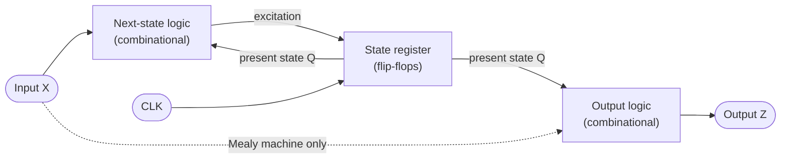
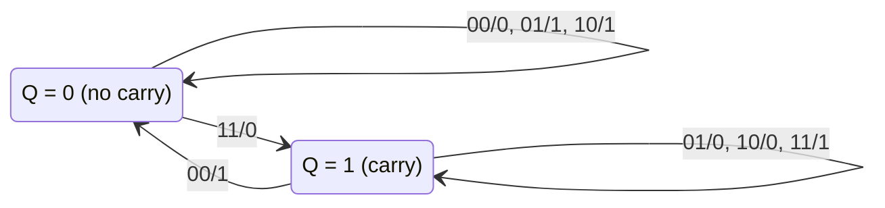
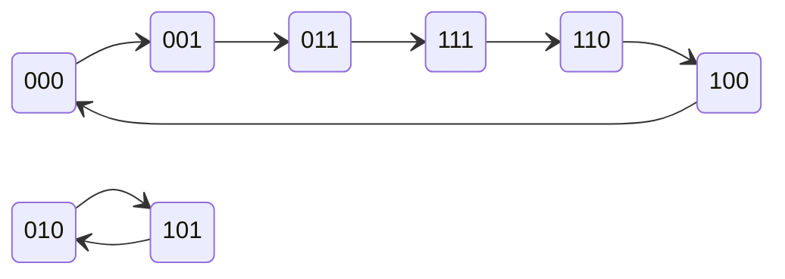
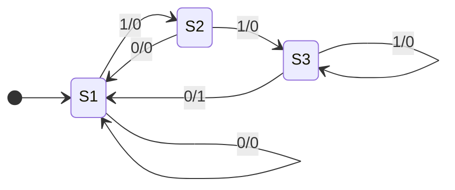

With **flip-flops** ([4.9.6](/4.9.6)) we can build arbitrary **sequential circuits**. This chapter treats the most important class: synchronous sequential circuits, in which all flip-flops are controlled by the same clock. Their mathematical model is the finite-state machine, which comes in Moore and Mealy types and corresponds one to one with the **finite automata** ([4.8.4](/4.8.4)) of formal language theory: an automaton only answers "accept or reject", whereas a state machine produces an output at every step. We first establish the model and the descriptive tools (state tables and state diagrams), then give methods of analysis (from circuit to function) and of design (from function to circuit). State minimization in design uses **equivalence relations** and **partitions** from discrete mathematics. Finally we discuss the timing constraints of synchronous circuits and the maximum clock frequency. The counters and registers of the next chapter are direct applications of the methods here; the hidden Markov model ([4.6.8](/4.6.8)) is the probabilistic version of a finite-state machine, in which both state transitions and outputs occur with probabilities.

## 7.1. Models of Synchronous Sequential Circuits

### 7.1.1. General Structure

**Definition 7.1.1 (Synchronous Sequential Circuit)** A sequential circuit all of whose storage elements are edge-triggered flip-flops controlled by the same clock signal, so that the state changes only at the active clock edge, is called a **synchronous sequential circuit**. A sequential circuit whose storage elements have no common clock (for example, the output of one flip-flop is used as the clock of another) is called an asynchronous sequential circuit.

A synchronous sequential circuit has two parts: a state register holding the current state ($k$ flip-flops, representing at most $2^k$ states), and combinational logic computing the next state and the outputs. Let the external input be $X$, the external output $Z$, and the output of the state register (the present state) $Q^n$. Then the circuit is completely described by three groups of equations:

- excitation equations: flip-flop inputs $= f(X, Q^n)$;
- state equations: substituting the excitation equations into the **characteristic equations** of the flip-flops ([4.9.6](/4.9.6#sec-6.6)) gives $Q^{n+1} = \delta(X, Q^n)$;
- output equations: $Z = \lambda(X, Q^n)$ or $Z = \lambda(Q^n)$.



The benefit of synchronous circuits is that time is discretized: in each clock cycle the combinational logic computes the next state from the present state and the input; when the next active edge arrives, all flip-flops are updated simultaneously, and only once per cycle. As long as the combinational logic settles within one cycle (Section 7.6), intermediate **glitches** and **races** do not affect the result. This allows the designer to reason about the circuit as a discrete system that executes step by step.

### 7.1.2. Finite-State Machines

**Definition 7.1.2 (Finite-State Machine)** A **finite-state machine** is a 6-tuple $M = (I, O, S, s_0, \delta, \lambda)$, where $I$, $O$ and $S$ are the finite input alphabet, output alphabet and set of states, $s_0 \in S$ is the initial state, $\delta\colon S \times I \to S$ is the state transition function, and $\lambda$ is the output function.

**Definition 7.1.3 (Moore Machine)** A finite-state machine whose output function is $\lambda\colon S \to O$, that is, whose output depends only on the present state, is called a **Moore machine**.

**Definition 7.1.4 (Mealy Machine)** A finite-state machine whose output function is $\lambda\colon S \times I \to O$, that is, whose output depends on the present state and the current input, is called a **Mealy machine**.

A synchronous sequential circuit is a hardware implementation of a finite-state machine: $I = \{0,1\}^m$ and $O = \{0,1\}^p$ are the value combinations of the input and output signals, the states are encoded by the values of the flip-flops, and the initial state is set by a reset signal. Dropping the output and designating a set of accepting states gives the deterministic finite automaton of [4.8.4](/4.8.4); state minimization (Section 7.5) is therefore the same problem as the minimization of automata.

| | Moore machine | Mealy machine |
|---|---|---|
| Output | Determined by the present state only; written inside the state | Determined by the present state and the input; written on the transition ("input/output") |
| When the output changes | After the clock edge; stable for the whole cycle | Possibly as soon as the input changes; glitches may occur |
| Response to input | The effect of an input shows in the output only after the next edge | Responds in the same cycle, one cycle earlier |
| Number of states | Often larger | Often smaller |

The two models can be converted into each other. To convert a Moore machine into a Mealy machine, move the output of each state onto all transitions entering it. To convert a Mealy machine into a Moore machine, if the transitions entering a state $s$ have different outputs, split $s$ into several states according to the output, so the number of states may increase; the output of the resulting Moore machine is one clock cycle later than that of the original Mealy machine.

## 7.2. State Tables and State Diagrams

**Definition 7.2.1 (State Table and State Diagram)** A table that lists the next state and the output of a finite-state machine for each present state and each input is called a **state table** (state transition table). A directed graph that uses nodes for states and directed edges for transitions, with inputs and outputs written on the edges (Mealy machine) or in the nodes (Moore machine), is called a **state diagram**.

In this chapter $Q^n$ denotes the present state and $Q^{n+1}$ the next state; with several flip-flops we write $Q_2^n Q_1^n$ and so on. A state table usually has the present state as rows and the input as columns, with "next state/output" in the cells. In a state diagram, an edge of a Mealy machine is labeled "input/output" and a node of a Moore machine "state/output". State tables are convenient for algebraic treatment (minimization, deriving equations), and state diagrams for seeing loops and functions. In a state diagram, exactly one edge should leave each state for each input (a completely specified machine). When describing a circuit, all $2^k$ encoded states must be drawn, including those not used in the design, in order to decide whether the circuit is self-starting (Section 7.4.3).

A single flip-flop is the smallest state machine: the state diagram of a **D flip-flop** has two states, with all edges for $D = 0$ pointing to state 0 and all edges for $D = 1$ pointing to state 1; a **T flip-flop** moves back and forth between the two states when $T = 1$.

## 7.3. Analysis of Synchronous Sequential Circuits

Analysis finds the function of a given circuit. The steps are:

1. From the circuit, write the excitation equations of the flip-flops and the output equations of the circuit.
2. Substitute the excitation equations into the **characteristic equations** of the flip-flops to obtain the state equations; list the state table, assuming an initial state if necessary.
3. Draw the state diagram, and a timing diagram if necessary.
4. Describe the logic function of the circuit from the state diagram, and check whether invalid states can return to the valid cycle (self-starting).

In practice one need not follow the steps rigidly: first look over the circuit and pick out its features (for example, flip-flops connected head to tail are most likely a shift register, and several **exclusive or** gates are most likely related to addition or parity), propose a hypothesis, and then verify it wire by wire following the steps above.

**Example 7.3.1 (Serial Adder)** A circuit consists of a **JK flip-flop** and some gates. Its inputs are $A$ and $B$, its output is $Z$, and the excitation and output equations are

$$
J = AB, \qquad K = \bar A \bar B, \qquad Z = A \oplus B \oplus Q^n.
$$

Substituting into the characteristic equation of the JK flip-flop gives

$$
Q^{n+1} = J\bar Q^n + \bar K Q^n = AB\,\bar Q^n + (A + B)\,Q^n = AB + AQ^n + BQ^n.
$$

The state table is as follows (each entry is "next state/output"):

| Present state $Q^n$ | $AB = 00$ | $AB = 01$ | $AB = 11$ | $AB = 10$ |
|---|---|---|---|---|
| 0 | 0/0 | 0/1 | 1/0 | 0/1 |
| 1 | 0/1 | 1/0 | 1/1 | 1/0 |



$Z$ is the modulo-2 sum of $A$, $B$ and $Q^n$, and $Q^{n+1}$ is their majority function, which are exactly the sum and carry of a **full adder**. If two binary numbers are fed in one bit per clock starting from the least significant bit, $Z$ gives the bits of the sum in turn and the flip-flop stores the carry: this is a serial adder, and it is a Mealy machine. Compared with the parallel adder ([4.9.5](/4.9.5)), it uses only one full adder, but an $n$-bit addition takes $n$ clock cycles, a typical example of trading time for area.

**Example 7.3.2 (A Counter That Is Not Self-Starting)** The excitation equations of three **D flip-flops** are

$$
D_2 = Q_1^n, \qquad D_1 = Q_0^n, \qquad D_0 = \bar Q_2^n,
$$

so the state equations are $Q_2^{n+1} = Q_1^n$, $Q_1^{n+1} = Q_0^n$, $Q_0^{n+1} = \bar Q_2^n$. Starting from $Q_2Q_1Q_0 = 000$ we obtain in turn

$$
000 \to 001 \to 011 \to 111 \to 110 \to 100 \to 000,
$$

which is a mod-6 counter in which adjacent states differ in only one bit (this code is a unit-distance code of the Gray type). But three flip-flops have 8 states, and two have not been analyzed: $010 \to 101 \to 010$, which form another cycle.



At power-up the state of the flip-flops is random, and once the circuit falls into $\{010, 101\}$ it can never count. This circuit is a 3-bit twisted-ring counter (Johnson counter, [4.9.8](/4.9.8)), and its function can be described as "a mod-6 counter that is not self-starting". Modify $D_0$ so that the next states of the two invalid states enter the valid cycle: let

$$
D_0 = \bar Q_2^n\,(Q_0^n + \bar Q_1^n).
$$

The next states of the six states in the valid cycle are unchanged (verify one by one), while $010 \to 100$ and $101 \to 010 \to 100$. The modified circuit is self-starting.

More examples of analysis (binary counters, decimal counters) are in [4.9.8](/4.9.8).

## 7.4. Design of Synchronous Sequential Circuits

### 7.4.1. Design Steps

Design is the inverse of analysis: find the circuit from a verbal description of the function.

1. Determine the input and output variables, and choose the Moore or Mealy type.
2. Draw the original state diagram and list the original state table: assign a state to each "history" that must be distinguished. Do not try to save states at this point, but consider where each state goes under each input.
3. State minimization: merge **equivalent states** to obtain the minimal state table (Section 7.5).
4. State assignment: assign a binary code to each state, which determines the number of flip-flops (Section 7.5.4).
5. Choose the type of flip-flop; from the encoded state table and the **excitation table** of the flip-flop, find the excitation functions and output functions and simplify them with **Karnaugh maps**.
6. Check self-starting and draw the logic diagram.

The hardest step is step 2: it requires translating the functional description accurately into states. Once a correct original state diagram is available, the remaining steps have fixed methods, and are now all performed automatically by synthesis tools ([4.9.9](/4.9.9)).

### 7.4.2. Example: A 110 Sequence Detector

**Example 7.4.1** Design a synchronous sequential circuit whose input is a serial binary sequence $X$. Whenever the last three input bits are 1, 1, 0 in order, the output is $Z = 1$; otherwise $Z = 0$ (overlaps are allowed; for instance, $X = 1110110$ contains two occurrences).

Steps 1 and 2, the original state table. Use the Mealy type. From the initial state a, the machine goes to b (0 received) or c (1 received). After one more bit, the states are called d, e, f, g according to whether the last two input bits are 00, 01, 10, 11; from then on every state records "the last two bits", and the output is 1 only when g (last two bits 11) receives 0.

| Present state | $X = 0$ | $X = 1$ |
|---|---|---|
| a | b/0 | c/0 |
| b | d/0 | e/0 |
| c | f/0 | g/0 |
| d | d/0 | e/0 |
| e | f/0 | g/0 |
| f | d/0 | e/0 |
| g | f/1 | g/0 |

Step 3, state minimization. The rows of b, d and f are identical (on input 0 they all go to d with output 0, and on input 1 they all go to e with output 0) and can be merged; the rows of c and e are also identical. After merging, the row of a becomes the same as that of {b, d, f} and can be merged as well. The partition algorithm of Section 7.5.2 gives the same result systematically: $S_1 = \{a, b, d, f\}$, $S_2 = \{c, e\}$, $S_3 = \{g\}$. Their meanings are intuitive: $S_1$ means "no useful prefix yet", $S_2$ means "the last bit is 1", and $S_3$ means "the last two bits are 11".

| Present state | $X = 0$ | $X = 1$ |
|---|---|---|
| $S_1$ | $S_1$/0 | $S_2$/0 |
| $S_2$ | $S_1$/0 | $S_3$/0 |
| $S_3$ | $S_1$/1 | $S_3$/0 |



Step 4, state assignment. Three states need at least two flip-flops $Q_2Q_1$. Take $S_1 = 00$, $S_2 = 10$, $S_3 = 11$; the code 01 is unused.

Step 5, find the excitation and output functions with **D flip-flops**. The excitation of a D flip-flop equals the next state and is read directly from the encoded state table (the two rows with 01 are **don't-care terms** ×):

| $X$ | $Q_2^n Q_1^n$ | $Q_2^{n+1} Q_1^{n+1} = D_2 D_1$ | $Z$ |
|---|---|---|---|
| 0 | 00 | 00 | 0 |
| 0 | 10 | 00 | 0 |
| 0 | 11 | 00 | 1 |
| 1 | 00 | 10 | 0 |
| 1 | 10 | 11 | 0 |
| 1 | 11 | 11 | 0 |
| 0, 1 | 01 | ×× | × |

Simplifying with Karnaugh maps (using the don't-cares) gives

$$
D_2 = X, \qquad D_1 = X Q_2^n, \qquad Z = \bar X Q_1^n.
$$

With **JK flip-flops** instead, find the values of $J$ and $K$ row by row from the excitation table of the JK flip-flop and simplify; the result is $J_2 = X$, $K_2 = \bar X$, $J_1 = X Q_2^n$, $K_1 = \bar X$, with the output unchanged.

Step 6, self-starting check. Substitute the invalid state 01 into the excitation equations of the D flip-flops: the next state is 00 for $X = 0$ and 10 for $X = 1$, both valid, so the circuit is self-starting. Note, however, that in state 01 with $X = 0$ we have $Z = \bar X Q_1 = 1$, which produces one erroneous output. If this is unacceptable, use $Z = \bar X Q_2^n Q_1^n$ (one more input), or use a reset signal to guarantee entry into $S_1$ at power-up. Real designs usually do both: self-starting is the last safeguard, and reset is the normal means of initialization.

### 7.4.3. Self-Starting

**Definition 7.4.1 (Self-Starting)** A sequential circuit is called **self-starting** if, from any invalid state (a state whose code is not used), it enters the cycle of valid states after a finite number of clock cycles.

A circuit that is not self-starting will stay wrong forever once it enters an invalid cycle because of power-up or interference, so self-starting must be checked in every sequential design. The method is to substitute each invalid state into the excitation equations to find its next state and to draw the complete state diagram. When the circuit is not self-starting there are two remedies. The first is not to treat some invalid states as don't-cares in step 5 but to assign them a valid next state (this is how $D_0$ was modified in Example 7.3.2). The second is to add reset or load logic that forces the circuit into a valid state when an invalid state is detected.

## 7.5. State Minimization and State Assignment

### 7.5.1. Equivalent States

An original state table often has redundant states. The fewer the states, the fewer flip-flops are needed and the fewer inputs the next-state logic has. Minimization rests on the fact that two states that cannot be distinguished from outside can be merged.

**Definition 7.5.1 (Equivalent States)** Let $M$ be a completely specified finite-state machine. If, for every input sequence, the output sequences produced by $M$ starting from states $s$ and $t$ are the same, then $s$ and $t$ are called **equivalent states**, written $s \equiv t$. If the output sequences are the same for every input sequence of length at most $k$, then $s$ and $t$ are said to be $k$-equivalent, written $s \equiv_k t$.

It is immediate from the definition that $\equiv$ and each $\equiv_k$ are **equivalence relations** on the set of states $S$, and hence each induces a **partition** of $S$; denote the partition induced by $\equiv_k$ by $P_k$. We have $s \equiv t$ if and only if $s \equiv_k t$ for all $k$.

**Theorem 7.5.1 (Recursive Characterization of Equivalence)** For a Mealy machine, $s \equiv_1 t$ if and only if $\lambda(s, x) = \lambda(t, x)$ for every input $x$; for $k \ge 1$,

$$
s \equiv_{k+1} t \iff s \equiv_1 t \ \text{and } \delta(s, x) \equiv_k \delta(t, x) \text{ for every input } x.
$$

Moreover, if $P_{k+1} = P_k$, then $P_j = P_k$ for all $j \ge k$, and $P_k$ is the partition induced by $\equiv$. A state machine with $n$ states stabilizes after at most $n - 1$ genuine refinements.

**Proof** An input sequence of length at most $k + 1$ is either the empty sequence or an input $x$ followed by a sequence of length at most $k$. After input $x$ from $s$, the first output is $\lambda(s, x)$, and the subsequent outputs are those obtained from $\delta(s, x)$ for the remaining sequence; this gives the recursion. The recursion shows that $P_{k+1}$ is determined by $P_k$ alone, so once $P_{k+1} = P_k$ all later partitions are unchanged; and since $s \equiv t$ is equivalent to $s \equiv_k t$ for all $k$, the stable partition is the partition of $\equiv$. Each genuine refinement increases the number of blocks by at least one and the number of blocks is at most $n$, so there are at most $n - 1$ genuine refinements. $\square$

**Definition 7.5.2 (State Minimization)** The process of merging each equivalence class of a state machine into one state, to obtain a machine with the fewest states that produces the same output sequence as the original for every input sequence, is called **state minimization** (state reduction).

### 7.5.2. The Partition Algorithm

Theorem 7.5.1 gives the algorithm directly (Moore's algorithm). First group the states by their output rows to obtain $P_1$. Then repeatedly examine each block; if two states in a block have successors under some input that fall in different blocks, separate them; stop when nothing changes. The following Python implementation is applied to the original state table of Example 7.4.1:

```python
def minimize(table, inputs):
    """Partition refinement for a completely specified Mealy state table.

    table[s][x] = (next_state, output). Returns the blocks of equivalent states."""
    # P1: states with identical output rows are 1-equivalent
    blocks = {}
    for s, row in table.items():
        blocks.setdefault(tuple(row[x][1] for x in inputs), []).append(s)
    partition = list(blocks.values())
    k = 1
    while True:
        print(f"P{k} =", " ".join("{" + ",".join(b) + "}" for b in partition))
        block_of = {s: i for i, b in enumerate(partition) for s in b}
        refined = []
        for block in partition:
            # split a block by which blocks its successors fall into
            sub = {}
            for s in block:
                key = tuple(block_of[table[s][x][0]] for x in inputs)
                sub.setdefault(key, []).append(s)
            refined.extend(sub.values())
        if len(refined) == len(partition):
            return partition
        partition, k = refined, k + 1


table = {  # the original state table of the "110" detector
    "a": {0: ("b", 0), 1: ("c", 0)},
    "b": {0: ("d", 0), 1: ("e", 0)},
    "c": {0: ("f", 0), 1: ("g", 0)},
    "d": {0: ("d", 0), 1: ("e", 0)},
    "e": {0: ("f", 0), 1: ("g", 0)},
    "f": {0: ("d", 0), 1: ("e", 0)},
    "g": {0: ("f", 1), 1: ("g", 0)},
}
print("equivalence classes:", minimize(table, [0, 1]))
```

```text
P1 = {a,b,c,d,e,f} {g}
P2 = {a,b,d,f} {c,e} {g}
equivalence classes: [['a', 'b', 'd', 'f'], ['c', 'e'], ['g']]
```

In $P_1$ only g has a distinctive output row. Under $P_1$, on input 1 the states c and e reach the block containing g, whereas a, b, d, f reach the first block, so they are separated and $P_2$ results. One more check gives $P_3 = P_2$, and the algorithm ends. The step-by-step refinement scans all states and inputs in each round, so its complexity is $O(n^2 m)$ ($m$ is the number of input combinations); Hopcroft's algorithm organizes the work by "which block to split with" and has complexity $O(nm\log n)$; it is the standard algorithm for minimizing finite automata.

The implication-table method commonly used in Chinese textbooks is equivalent. Draw a triangular table of all pairs of states; first cross out the pairs with different outputs, then in each cell write which pairs of next states must be equivalent for this pair to be equivalent, and repeatedly cross out cells that depend on crossed-out pairs; the remaining pairs are the equivalent ones. It suits hand computation and is essentially the same fixed-point iteration carried out from the "inequivalent" side.

If the state table has don't-cares (an incompletely specified machine, for example because some input combinations never occur), equivalence must be replaced by compatibility: two states are compatible if their outputs agree wherever both are defined and their next states are compatible. Compatibility is not transitive and no longer induces a partition. Finding the minimal machine requires finding a minimal cover by compatible classes satisfying a closure condition, which is in general an NP-hard problem, and in hand design it is usually handled by inspection.

### 7.5.3. State Assignment

**Definition 7.5.3 (State Assignment)** The process of assigning a distinct binary code to each state of a finite-state machine (that is, determining the values of the flip-flops) is called **state assignment** (state encoding).

$N$ states need at least $\lceil \log_2 N \rceil$ flip-flops, but the number of assignments grows rapidly with $N$, and different assignments can make the complexity of the next-state and output logic differ greatly. Commonly used schemes:

| Encoding | Flip-flops | Characteristics |
|---|---|---|
| Binary code | $\lceil \log_2 N \rceil$ | Fewest flip-flops; the next-state logic may be complex |
| **Gray code** | $\lceil \log_2 N \rceil$ | Only one bit changes per transition when the states are traversed in sequence: few toggles, low power, glitch-free decoding; suits counter-like machines |
| One-hot code | $N$ | One flip-flop per state; the simplest next-state logic and high speed |

**Definition 7.5.4 (One-Hot Encoding)** A state assignment that represents $N$ states with $N$-bit codes, with exactly one bit equal to 1 in the code of each state, is called **one-hot encoding**.

The next-state logic of a one-hot encoding can be read directly from the state diagram: the flip-flop of state $S_i$ is 1 in the next cycle if and only if the machine is now in some predecessor state and the input satisfies the condition of the corresponding transition. Taking Example 7.4.1 and using $S_1, S_2, S_3$ to denote both the three states and the outputs of the three flip-flops:

$$
D_{S_1} = \bar X, \qquad D_{S_2} = X S_1, \qquad D_{S_3} = X(S_2 + S_3), \qquad Z = \bar X S_3.
$$

An FPGA has plenty of flip-flops but a limited number of inputs per **lookup table** ([4.9.9](/4.9.9)), so the one-hot encoding's "many flip-flops, shallow logic" fits well, and synthesis tools often use one-hot encoding for state machines by default. The cost is $2^N - N$ invalid codes; when reliability requirements are high, extra detection and recovery logic is needed (the "safe state machine" option of synthesis tools).

For hand design with the binary code that uses the fewest flip-flops, there is a set of rules of thumb whose purpose is to make the 1s in the Karnaugh maps adjacent so that they can be merged:

1. Present states with the same next state under the same input should have adjacent codes (differing in one bit only).
2. The next states of the same present state under adjacent inputs should have adjacent codes.
3. Present states with the same output should have adjacent codes.
4. The initial state should be all 0s, which makes reset easy.

Earlier rules have priority over later ones. In Example 7.4.1, $S_1, S_2, S_3$ all have next state $S_1$ when $X = 0$, so by rule 1 they should be pairwise adjacent; this is impossible with 2-bit codes, and $S_1 = 00$, $S_2 = 10$, $S_3 = 11$ makes $S_1$–$S_2$ and $S_2$–$S_3$ adjacent; the resulting equations are indeed simple. For complex state machines, finding the optimal assignment is a hard combinatorial optimization problem, which is now handled by synthesis tools with heuristic algorithms.

## 7.6. Timing Constraints and Maximum Clock Frequency

The correctness of a synchronous circuit rests on one premise: in each clock cycle the outputs of the combinational logic must settle in time, but must not change too early. Consider a path from flip-flop FF1 through combinational logic to flip-flop FF2, both using the same clock with period $T_{\mathrm{c}}$. Let the longest **propagation delay** of the combinational logic be $t_{\mathrm{pd}}$ and the shortest contamination delay $t_{\mathrm{cd}}$; the flip-flop parameters are as defined in [4.9.6](/4.9.6#sec-6.7).


### 7.6.1. Setup-Time and Hold-Time Constraints

Data leaves FF1 at the first edge and must arrive at FF2 at least $t_{\mathrm{su}}$ before the next edge:

$$
T_{\mathrm{c}} \ge t_{\mathrm{pcq}} + t_{\mathrm{pd}} + t_{\mathrm{su}}. \tag{7.1}
$$

At the same edge, the new value of FF1 can reach the input of FF2 as early as $t_{\mathrm{ccq}} + t_{\mathrm{cd}}$ later. It must not arrive before the **hold time** of FF2 is over; otherwise FF2 samples something other than the data of the previous cycle:

$$
t_{\mathrm{ccq}} + t_{\mathrm{cd}} \ge t_{\mathrm{h}}. \tag{7.2}
$$

Eq. (7.1) must hold for all register-to-register paths of the circuit. The path with the longest delay is called the critical path, and it determines the maximum clock frequency

$$
f_{\max} = \frac{1}{t_{\mathrm{pcq}} + t_{\mathrm{pd,max}} + t_{\mathrm{su}}}.
$$

Eq. (7.2) is independent of the clock period: a violation of the **setup time** can be fixed by lowering the clock frequency, but a hold-time violation cannot; the only remedy is to add delay on the path (insert buffers) or to redesign. In a shift register two flip-flops are connected directly, so $t_{\mathrm{cd}} = 0$, and correct operation depends on $t_{\mathrm{ccq}} \ge t_{\mathrm{h}}$, which the device design guarantees.

**Example 7.6.1** Let a flip-flop have $t_{\mathrm{pcq}} = 2\,\mathrm{ns}$, $t_{\mathrm{ccq}} = 1\,\mathrm{ns}$, $t_{\mathrm{su}} = 1.5\,\mathrm{ns}$, $t_{\mathrm{h}} = 0.5\,\mathrm{ns}$, and let the longest path of the combinational logic be $6.5\,\mathrm{ns}$ and the shortest $0.8\,\mathrm{ns}$. Then $T_{\mathrm{c}} \ge 2 + 6.5 + 1.5 = 10\,\mathrm{ns}$, so $f_{\max} = 100\,\mathrm{MHz}$; the hold-time constraint $1 + 0.8 = 1.8\,\mathrm{ns} \ge 0.5\,\mathrm{ns}$ is satisfied. To raise the frequency, the critical path must be shortened, for example by cutting the combinational logic into two parts with a register stage in between (pipelining), at the cost of the result appearing one cycle later.

### 7.6.2. Clock Skew

In real circuits the clock does not reach all flip-flops at exactly the same time. Let the maximum difference between the arrival times of the clock at two flip-flops be $t_{\mathrm{skew}}$. In the worst case

$$
T_{\mathrm{c}} \ge t_{\mathrm{pcq}} + t_{\mathrm{pd}} + t_{\mathrm{su}} + t_{\mathrm{skew}}, \qquad t_{\mathrm{ccq}} + t_{\mathrm{cd}} \ge t_{\mathrm{h}} + t_{\mathrm{skew}}.
$$

Skew worsens both constraints at once, so chips and FPGAs distribute the clock with dedicated low-skew clock networks. In real designs these constraints are checked automatically on all paths by static timing analysis tools ([4.9.9](/4.9.9)).

### 7.6.3. Outputs of Mealy Machines

The output of a Mealy machine is a combinational function of the input. If it in turn feeds another synchronous circuit, two stages of combinational logic are chained within one clock cycle and the critical path becomes longer; if the input changes in the middle of a cycle, the output also glitches. When a stable output is needed, the output of the Mealy machine can be registered by another flip-flop (equivalent to converting it into a Moore machine, with the output one cycle later), or a Moore machine can be used directly.

## Summary

- A synchronous sequential circuit is a state register plus combinational logic, described by excitation, state and output equations; its mathematical model is a Moore or Mealy machine.
- Analysis: circuit → equations → state table/state diagram → function, checking all $2^k$ states. Design: function → original state diagram → minimization → assignment → excitation and output functions → self-starting check → circuit.
- State equivalence is an equivalence relation on the set of states, and the minimal state machine is found by the partition-refinement algorithm, the same as the minimization of finite automata.
- State assignment trades off the number of flip-flops against the complexity of the logic: the binary code uses the fewest flip-flops, one-hot encoding gives the simplest logic, and the **Gray code** gives the fewest toggles.
- The setup-time constraint $T_{\mathrm{c}} \ge t_{\mathrm{pcq}} + t_{\mathrm{pd}} + t_{\mathrm{su}}$ determines the maximum frequency; the hold-time constraint $t_{\mathrm{ccq}} + t_{\mathrm{cd}} \ge t_{\mathrm{h}}$ is independent of the frequency.
