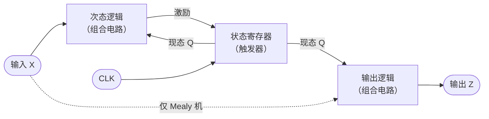
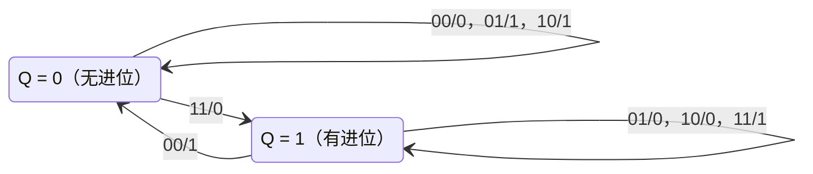
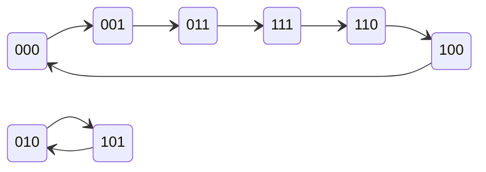
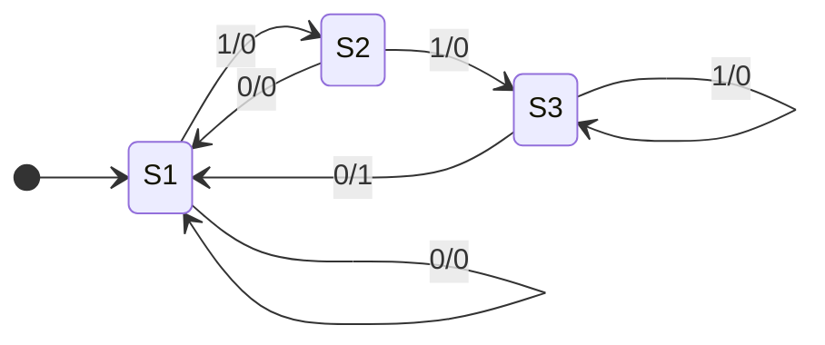

有了**触发器**（[4.9.6](/4.9.6)），就可以搭建任意的**时序电路**。本章讨论其中最重要的一类：所有触发器由同一个时钟控制的同步时序电路。它的数学模型是有限状态机，分为 Moore 型与 Mealy 型，与形式语言课程中的**有限自动机**（[4.8.4](/4.8.4)）一一对应：自动机只回答"接受或拒绝"，状态机在每一步都产生输出。本章先建立模型和描述工具（状态表、状态图），再给出分析方法（由电路求功能）和设计方法（由功能求电路），设计中的状态化简用到离散数学中的**等价关系**与**划分**，最后讨论同步电路的时序约束与最高时钟频率。下一章的计数器、寄存器都是本章方法的直接应用；隐 Markov 模型（[4.6.8](/4.6.8)）则是有限状态机的概率版本：状态转移与输出都按概率发生。

## 7.1. 同步时序电路的模型

### 7.1.1. 一般结构

**定义 7.1.1（同步时序电路）** 所有存储元件都是由同一个时钟信号控制的边沿触发器、状态只在时钟有效边沿改变的时序电路称为**同步时序电路**。存储元件没有统一时钟（例如用某个触发器的输出作为另一个触发器的时钟）的时序电路称为异步时序电路。

同步时序电路由两部分组成：存放当前状态的状态寄存器（$k$ 个触发器，最多表示 $2^k$ 个状态），以及计算次态和输出的组合逻辑。设外部输入为 $X$，外部输出为 $Z$，状态寄存器的输出（现态）为 $Q^n$，则电路由三组方程完全描述：

- 激励方程：触发器的输入 $= f(X, Q^n)$；
- 状态方程：将激励方程代入触发器的**特性方程**（[4.9.6](/4.9.6#sec-6.6)），得 $Q^{n+1} = \delta(X, Q^n)$；
- 输出方程：$Z = \lambda(X, Q^n)$ 或 $Z = \lambda(Q^n)$。



同步电路的好处在于时间被离散化：每个时钟周期内，组合逻辑根据现态和输入算出次态；下一个有效边沿到来时，所有触发器同时更新，而且每个周期只更新一次。只要组合逻辑在一个周期内稳定下来（7.6 节），中间的**毛刺**、**竞争**都不影响结果。这使得设计者可以把电路当作一个按步执行的离散系统来推理。

### 7.1.2. 有限状态机

**定义 7.1.2（有限状态机）** 一个**有限状态机**是六元组 $M = (I, O, S, s_0, \delta, \lambda)$，其中 $I$、$O$、$S$ 分别是有限的输入字母表、输出字母表和状态集合，$s_0 \in S$ 是初始状态，$\delta\colon S \times I \to S$ 是状态转移函数，$\lambda$ 是输出函数。

**定义 7.1.3（Moore 机）** 输出函数为 $\lambda\colon S \to O$，即输出只取决于现态的有限状态机称为 **Moore 机**。

**定义 7.1.4（Mealy 机）** 输出函数为 $\lambda\colon S \times I \to O$，即输出取决于现态和当前输入的有限状态机称为 **Mealy 机**。

同步时序电路就是有限状态机的硬件实现：$I = \{0,1\}^m$、$O = \{0,1\}^p$ 是输入、输出信号的取值组合，状态由触发器的取值编码，初始状态由复位信号设定。去掉输出、改为指定一组接受状态，就得到 [4.8.4](/4.8.4) 的确定型有限自动机；因此状态化简（7.5 节）与自动机的最小化是同一个问题。

| | Moore 机 | Mealy 机 |
|---|---|---|
| 输出 | 只由现态决定，标在状态内 | 由现态和输入决定，标在转移上（"输入/输出"） |
| 输出时刻 | 在时钟边沿后改变，整个周期稳定 | 输入一变就可能改变，可能出现毛刺 |
| 对输入的响应 | 输入的影响要到下一个边沿后才体现在输出上 | 当拍即可响应，早一个周期 |
| 状态数 | 往往多一些 | 往往少一些 |

两种模型可以互相转换。Moore 机转为 Mealy 机：把每个状态的输出移到所有进入它的转移上。Mealy 机转为 Moore 机：若进入状态 $s$ 的各条转移输出不同，就把 $s$ 按输出拆成几个状态，因此状态数可能增加；转换后的 Moore 机的输出比原 Mealy 机晚一个时钟周期。

## 7.2. 状态表与状态图

**定义 7.2.1（状态表与状态图）** 列出有限状态机每个现态在每种输入下的次态和输出的表称为**状态表**（状态转移表）。用结点表示状态、用有向边表示转移、在边上（Mealy 机）或结点中（Moore 机）标注输入与输出的有向图称为**状态图**。

本章用 $Q^n$ 表示现态，$Q^{n+1}$ 表示次态，多个触发器时写 $Q_2^n Q_1^n$ 等。状态表通常以现态为行、输入为列，表格中写"次态/输出"；状态图中 Mealy 机的边标注"输入/输出"，Moore 机的结点标注"状态/输出"。状态表便于代数处理（化简、求方程），状态图便于看清循环和功能。状态图中从每个状态出发、对每种输入都应恰好有一条边（完全确定的状态机）；描述电路时还要画出全部 $2^k$ 个编码状态，包括设计中没有使用的状态，才能判断电路能否自启动（7.4.3 节）。

单个触发器就是最小的状态机：**D 触发器**的状态图有两个状态，$D = 0$ 的边都指向状态 0，$D = 1$ 的边都指向状态 1；**T 触发器**在 $T = 1$ 时在两个状态间来回转移。

## 7.3. 同步时序电路的分析

分析是由给定的电路求出它的功能，步骤如下：

1. 根据电路写出各触发器的激励方程和电路的输出方程；
2. 把激励方程代入触发器的**特性方程**，得到状态方程；列出状态表，必要时假定一个初始状态；
3. 画出状态图，必要时画出时序图；
4. 由状态图说明电路的逻辑功能，并检查无效状态能否回到有效循环（自启动）。

分析时常常不必死板地按部就班：先浏览电路抓住特征（例如触发器首尾相接多半是移位寄存器，几个**异或**门多半与加法或奇偶有关），提出假设，再按上述步骤逐条连线地验证。

**例 7.3.1（串行加法器）** 一个 **JK 触发器**和若干门构成的电路，输入为 $A$、$B$，输出为 $Z$，激励方程与输出方程为

$$
J = AB, \qquad K = \bar A \bar B, \qquad Z = A \oplus B \oplus Q^n.
$$

代入 JK 触发器的特性方程：

$$
Q^{n+1} = J\bar Q^n + \bar K Q^n = AB\,\bar Q^n + (A + B)\,Q^n = AB + AQ^n + BQ^n.
$$

状态表如下（表中为"次态/输出"）：

| 现态 $Q^n$ | $AB = 00$ | $AB = 01$ | $AB = 11$ | $AB = 10$ |
|---|---|---|---|---|
| 0 | 0/0 | 0/1 | 1/0 | 0/1 |
| 1 | 0/1 | 1/0 | 1/1 | 1/0 |



$Z$ 是 $A$、$B$、$Q^n$ 三者的模 2 和，$Q^{n+1}$ 是三者的多数函数，正是**全加器**的和与进位。若两个二进制数从最低位起每个时钟送入一位，$Z$ 依次给出和的各位，触发器保存进位：这是一个串行加法器，它是 Mealy 机。与并行加法器（[4.9.5](/4.9.5)）相比，它只用一个全加器，但 $n$ 位加法要 $n$ 个时钟周期，是"以时间换面积"的典型例子。

**例 7.3.2（不能自启动的计数器）** 三个 **D 触发器**的激励方程为

$$
D_2 = Q_1^n, \qquad D_1 = Q_0^n, \qquad D_0 = \bar Q_2^n,
$$

状态方程即 $Q_2^{n+1} = Q_1^n$，$Q_1^{n+1} = Q_0^n$，$Q_0^{n+1} = \bar Q_2^n$。从 $Q_2Q_1Q_0 = 000$ 出发依次得到

$$
000 \to 001 \to 011 \to 111 \to 110 \to 100 \to 000,
$$

这是一个六进制计数器，相邻状态只有一位不同（这种编码属于 Gray 型的单位距离码）。但三个触发器有 8 个状态，还有两个没有分析：$010 \to 101 \to 010$，它们构成另一个循环。



上电时触发器的状态是随机的，一旦落入 $\{010, 101\}$，电路就永远不能计数。这个电路是 3 位扭环形计数器（Johnson 计数器，[4.9.8](/4.9.8)），它的功能可以描述为"不能自启动的六进制计数器"。修改 $D_0$，让两个无效状态的次态进入有效循环：令

$$
D_0 = \bar Q_2^n\,(Q_0^n + \bar Q_1^n),
$$

有效循环中的 6 个状态的次态不变（可以逐一验证），而 $010 \to 100$，$101 \to 010 \to 100$。修改后的电路能够自启动。

更多的分析例子（二进制计数器、十进制计数器）放在 [4.9.8](/4.9.8)。

## 7.4. 同步时序电路的设计

### 7.4.1. 设计步骤

设计是分析的逆过程：由文字描述的功能求出电路。

1. 确定输入变量和输出变量，选择 Moore 型或 Mealy 型；
2. 画原始状态图、列原始状态表：每个需要区分的"历史情况"设一个状态，此时不要试图节省状态，但要考虑每个状态在每种输入下的去向；
3. 状态化简：合并**等价状态**，得到最简状态表（7.5 节）；
4. 状态编码（状态分配）：给每个状态分配一个二进制码，确定触发器的个数（7.5.4 节）；
5. 选定触发器类型，由编码后的状态表和触发器的**激励表**求激励函数与输出函数，用**卡诺图**化简；
6. 检查能否自启动，画出逻辑图。

最困难的是第 2 步：它要求把功能描述准确地翻译成状态。一旦有了正确的原始状态图，后面的步骤都有固定的方法，现在也都由综合工具自动完成（[4.9.9](/4.9.9)）。

### 7.4.2. 例：110 序列检测器

**例 7.4.1** 设计一个同步时序电路，输入为串行的二进制序列 $X$；每当最近三位输入依次为 1、1、0 时，输出 $Z = 1$，否则 $Z = 0$（允许重叠，如 $X = 1110110$ 中有两次）。

第 1、2 步，原始状态表。采用 Mealy 型。从初始状态 a 出发，按收到的输入分别进入 b（收到 0）、c（收到 1）；再收到一位后，按最近两位输入为 00、01、10、11 分别记为 d、e、f、g；之后每个状态都记录"最近两位"，只有在 g（最近两位为 11）收到 0 时输出 1。

| 现态 | $X = 0$ | $X = 1$ |
|---|---|---|
| a | b/0 | c/0 |
| b | d/0 | e/0 |
| c | f/0 | g/0 |
| d | d/0 | e/0 |
| e | f/0 | g/0 |
| f | d/0 | e/0 |
| g | f/1 | g/0 |

第 3 步，状态化简。b、d、f 三行完全相同（输入 0 时都到 d 并输出 0，输入 1 时都到 e 并输出 0），可以合并；c 与 e 两行也相同。合并后 a 的行变得与 {b, d, f} 相同，也可以并入。7.5.2 节的划分算法系统地给出同一结果：$S_1 = \{a, b, d, f\}$，$S_2 = \{c, e\}$，$S_3 = \{g\}$。它们的含义很直观：$S_1$ 表示"还没有有用的前缀"，$S_2$ 表示"最近一位是 1"，$S_3$ 表示"最近两位是 11"。

| 现态 | $X = 0$ | $X = 1$ |
|---|---|---|
| $S_1$ | $S_1$/0 | $S_2$/0 |
| $S_2$ | $S_1$/0 | $S_3$/0 |
| $S_3$ | $S_1$/1 | $S_3$/0 |



第 4 步，状态编码。3 个状态至少需要 2 个触发器 $Q_2Q_1$。取 $S_1 = 00$，$S_2 = 10$，$S_3 = 11$，编码 01 不用。

第 5 步，用 **D 触发器**求激励函数与输出函数。D 触发器的激励等于次态，直接由编码后的状态表得到（01 两行为**无关项** ×）：

| $X$ | $Q_2^n Q_1^n$ | $Q_2^{n+1} Q_1^{n+1} = D_2 D_1$ | $Z$ |
|---|---|---|---|
| 0 | 00 | 00 | 0 |
| 0 | 10 | 00 | 0 |
| 0 | 11 | 00 | 1 |
| 1 | 00 | 10 | 0 |
| 1 | 10 | 11 | 0 |
| 1 | 11 | 11 | 0 |
| 0、1 | 01 | ×× | × |

用卡诺图化简（利用无关项）得

$$
D_2 = X, \qquad D_1 = X Q_2^n, \qquad Z = \bar X Q_1^n.
$$

若改用 **JK 触发器**，按 JK 触发器的激励表逐行求出 $J$、$K$ 的取值，再化简得 $J_2 = X$，$K_2 = \bar X$，$J_1 = X Q_2^n$，$K_1 = \bar X$，输出不变。

第 6 步，自启动检查。把无效状态 01 代入 D 触发器的激励方程：$X = 0$ 时次态为 00，$X = 1$ 时次态为 10，都进入有效状态，电路能自启动。但要注意，处于 01 且 $X = 0$ 时 $Z = \bar X Q_1 = 1$，会产生一次错误的输出。若这不能接受，可以改用 $Z = \bar X Q_2^n Q_1^n$（多一个输入），或者用复位信号保证上电时进入 $S_1$。实际设计中两者通常都做：自启动是最后的保险，复位才是正常的初始化手段。

### 7.4.3. 自启动

**定义 7.4.1（自启动）** 若一个时序电路从任何一个无效状态（编码中未使用的状态）出发，经过有限个时钟周期后都能进入有效状态的循环，则称该电路能够**自启动**。

不能自启动的电路一旦因上电、干扰进入无效循环就会一直错下去，因此自启动是所有时序电路设计都必须检查的。检查方法是把每个无效状态代入激励方程求出次态，画出完整的状态图。不能自启动时，有两种修正方法：一是在第 5 步化简时不把某些无效状态当作无关项，而是指定它们的次态为某个有效状态（例 7.3.2 正是这样修改 $D_0$ 的）；二是增加复位或置数逻辑，检测到无效状态时强制进入有效状态。

## 7.5. 状态化简与状态编码

### 7.5.1. 等价状态

原始状态表往往有冗余的状态。状态越少，需要的触发器越少，次态逻辑的输入也越少。化简的依据是：两个状态若从外部无法区分，就可以合并。

**定义 7.5.1（等价状态）** 设 $M$ 是完全确定的有限状态机。若对任意输入序列，$M$ 分别从状态 $s$ 和 $t$ 出发产生的输出序列都相同，则称 $s$ 与 $t$ 为**等价状态**，记作 $s \equiv t$。若对任意长度不超过 $k$ 的输入序列输出序列都相同，则称 $s$ 与 $t$ 是 $k$-等价的，记作 $s \equiv_k t$。

由定义直接可见，$\equiv$ 与每个 $\equiv_k$ 都是状态集合 $S$ 上的**等价关系**，因而各自诱导 $S$ 的一个**划分**；记 $\equiv_k$ 诱导的划分为 $P_k$。$s \equiv t$ 当且仅当对所有 $k$ 都有 $s \equiv_k t$。

**定理 7.5.1（等价的递推刻画）** 对 Mealy 机，$s \equiv_1 t$ 当且仅当对每个输入 $x$ 都有 $\lambda(s, x) = \lambda(t, x)$；对 $k \ge 1$，

$$
s \equiv_{k+1} t \iff s \equiv_1 t \ \text{且对每个输入 } x \text{ 都有 } \delta(s, x) \equiv_k \delta(t, x).
$$

进而，若 $P_{k+1} = P_k$，则对所有 $j \ge k$ 都有 $P_j = P_k$，且 $P_k$ 就是 $\equiv$ 诱导的划分。$n$ 个状态的状态机至多经过 $n - 1$ 次真正的细分就会稳定。

**证明** 长度不超过 $k + 1$ 的输入序列是空序列，或者某个输入 $x$ 后接一个长度不超过 $k$ 的序列。从 $s$ 出发输入 $x$ 后，第一个输出是 $\lambda(s, x)$，之后的输出就是从 $\delta(s, x)$ 出发对剩余序列的输出，由此得到递推式。递推式表明 $P_{k+1}$ 只由 $P_k$ 决定，所以一旦 $P_{k+1} = P_k$，以后的划分都不再变化；而 $s \equiv t$ 等价于对所有 $k$ 有 $s \equiv_k t$，故稳定的划分就是 $\equiv$ 的划分。每次真正的细分至少增加一个划分块，划分块数不超过 $n$，所以真正的细分至多 $n - 1$ 次。$\square$

**定义 7.5.2（状态化简）** 把状态机中每个等价类合并为一个状态，得到状态数最少、且与原状态机对任意输入序列产生相同输出序列的状态机，这一过程称为**状态化简**（状态最小化）。

### 7.5.2. 划分算法

定理 7.5.1 直接给出算法（Moore 算法）：先按输出行把状态分组得到 $P_1$；然后反复检查每个块，若块中两个状态在某个输入下的次态落在不同的块里，就把它们分开；直到不再变化。下面用 Python 实现，并作用于例 7.4.1 的原始状态表：

```python
def minimize(table, inputs):
    """Partition refinement for a completely specified Mealy state table.

    table[s][x] = (next_state, output). Returns the blocks of equivalent states."""
    # P1: states with identical output rows are 1-equivalent
    blocks = {}
    for s, row in table.items():
        blocks.setdefault(tuple(row[x][1] for x in inputs), []).append(s)
    partition = list(blocks.values())
    k = 1
    while True:
        print(f"P{k} =", " ".join("{" + ",".join(b) + "}" for b in partition))
        block_of = {s: i for i, b in enumerate(partition) for s in b}
        refined = []
        for block in partition:
            # split a block by which blocks its successors fall into
            sub = {}
            for s in block:
                key = tuple(block_of[table[s][x][0]] for x in inputs)
                sub.setdefault(key, []).append(s)
            refined.extend(sub.values())
        if len(refined) == len(partition):
            return partition
        partition, k = refined, k + 1


table = {  # the original state table of the "110" detector
    "a": {0: ("b", 0), 1: ("c", 0)},
    "b": {0: ("d", 0), 1: ("e", 0)},
    "c": {0: ("f", 0), 1: ("g", 0)},
    "d": {0: ("d", 0), 1: ("e", 0)},
    "e": {0: ("f", 0), 1: ("g", 0)},
    "f": {0: ("d", 0), 1: ("e", 0)},
    "g": {0: ("f", 1), 1: ("g", 0)},
}
print("equivalence classes:", minimize(table, [0, 1]))
```

```text
P1 = {a,b,c,d,e,f} {g}
P2 = {a,b,d,f} {c,e} {g}
equivalence classes: [['a', 'b', 'd', 'f'], ['c', 'e'], ['g']]
```

$P_1$ 中只有 g 的输出行与众不同。在 $P_1$ 下，c、e 在输入 1 时到达 g 所在的块，而 a、b、d、f 到达第一个块，于是分开得到 $P_2$。再检查一次，$P_3 = P_2$，算法结束。逐步细分的做法每轮要扫描全部状态和输入，复杂度为 $O(n^2 m)$（$m$ 为输入组合数）；Hopcroft 算法按"用哪个块去细分"安排工作，复杂度为 $O(nm\log n)$，是有限自动机最小化的标准算法。

国内教材常用的隐含表法与此等价：画出所有状态对组成的三角形表格，先划去输出不同的状态对，再在每个格子里写出"要使这一对等价，还需要哪些次态对等价"，反复划去依赖于已划去状态对的格子，剩下的就是等价对。它适合手工计算，本质上就是从"不等价"一侧进行的同一个不动点迭代。

若状态表中有无关项（不完全确定的状态机，例如某些输入组合不会出现），等价要换成"相容"：两个状态在所有都有定义的地方输出一致、次态相容。相容关系不满足传递性，不再诱导划分，求最小状态机需要寻找满足闭合条件的最小相容类覆盖，一般情形是 NP 困难的问题，手工设计时通常靠观察处理。

### 7.5.3. 状态编码

**定义 7.5.3（状态编码）** 为有限状态机的每个状态分配一个互不相同的二进制代码（即确定各触发器取值）的过程称为**状态编码**（状态分配）。

$N$ 个状态至少需要 $\lceil \log_2 N \rceil$ 个触发器，但编码方案的数目随 $N$ 急剧增长，不同的编码会使次态逻辑和输出逻辑的复杂程度差别很大。常用的方案：

| 编码 | 触发器数 | 特点 |
|---|---|---|
| 二进制码 | $\lceil \log_2 N \rceil$ | 触发器最少；次态逻辑可能较复杂 |
| **Gray 码** | $\lceil \log_2 N \rceil$ | 按状态序列依次转移时每次只有一位变化，翻转少、功耗低，译码无毛刺；适合计数类状态机 |
| 独热码 | $N$ | 每个状态一个触发器；次态逻辑最简单、速度快 |

**定义 7.5.4（独热码）** 用 $N$ 位代码表示 $N$ 个状态、每个状态的代码中恰有一位为 1 的状态编码称为**独热码**。

独热码的次态逻辑可以直接从状态图读出：状态 $S_i$ 的触发器在下一拍为 1，当且仅当现在处于某个前驱状态、且输入满足相应转移的条件。以例 7.4.1 为例，用 $S_1, S_2, S_3$ 同时表示三个状态和三个触发器的输出：

$$
D_{S_1} = \bar X, \qquad D_{S_2} = X S_1, \qquad D_{S_3} = X(S_2 + S_3), \qquad Z = \bar X S_3.
$$

FPGA 中触发器数量充裕而每个查找表的输入数有限（[4.9.9](/4.9.9)），独热码的"多触发器、浅逻辑"正好适合，综合工具也常默认对状态机采用独热码。代价是 $2^N - N$ 个无效编码，可靠性要求高时需要额外的检测与恢复逻辑（综合工具的"安全状态机"选项）。

手工设计时，使用最少触发器的二进制编码有一组经验原则，目的是让卡诺图中的 1 尽量相邻、便于合并：

1. 在同一输入下次态相同的几个现态，编码应相邻（只有一位不同）；
2. 同一现态在相邻输入下的几个次态，编码应相邻；
3. 输出相同的现态，编码应相邻；
4. 初始状态取全 0，便于复位。

前一条的优先级高于后一条。例 7.4.1 中，$S_1, S_2, S_3$ 在 $X = 0$ 时次态都是 $S_1$，按原则 1 它们应两两相邻，2 位码做不到，取 $S_1 = 00$、$S_2 = 10$、$S_3 = 11$ 使 $S_1$–$S_2$、$S_2$–$S_3$ 相邻；结果的方程确实很简单。对复杂的状态机，求最优编码是困难的组合优化问题，现在由综合工具用启发式算法完成。

## 7.6. 时序约束与最高时钟频率

同步电路的正确性依赖于一个前提：每个时钟周期内，组合逻辑的输出要及时稳定下来，但又不能变得太快。考虑一条从触发器 FF1 经组合逻辑到触发器 FF2 的路径，两者使用同一个时钟，周期为 $T_{\mathrm{c}}$。设组合逻辑的最长**传播延迟**为 $t_{\mathrm{pd}}$、最短的污染延迟为 $t_{\mathrm{cd}}$，触发器的参数如 [4.9.6](/4.9.6#sec-6.7) 所定义。


### 7.6.1. 建立时间约束与保持时间约束

数据在第一个边沿从 FF1 出发，必须在下一个边沿之前至少 $t_{\mathrm{su}}$ 到达 FF2：

$$
T_{\mathrm{c}} \ge t_{\mathrm{pcq}} + t_{\mathrm{pd}} + t_{\mathrm{su}}. \tag{7.1}
$$

在同一个边沿，FF1 输出的新值最早经过 $t_{\mathrm{ccq}} + t_{\mathrm{cd}}$ 就会到达 FF2 的输入，它不能在 FF2 的**保持时间**结束之前到达，否则 FF2 采到的就不是上一周期的数据：

$$
t_{\mathrm{ccq}} + t_{\mathrm{cd}} \ge t_{\mathrm{h}}. \tag{7.2}
$$

式 (7.1) 对电路中所有寄存器到寄存器的路径都要成立，延迟最长的那条路径称为关键路径，它决定了最高时钟频率

$$
f_{\max} = \frac{1}{t_{\mathrm{pcq}} + t_{\mathrm{pd,max}} + t_{\mathrm{su}}}.
$$

式 (7.2) 与时钟周期无关：**建立时间**违例可以靠降低时钟频率解决，保持时间违例却不能，只能在路径上增加延迟（插入缓冲器）重新设计。移位寄存器中两个触发器直接相连，$t_{\mathrm{cd}} = 0$，它能正常工作依赖于 $t_{\mathrm{ccq}} \ge t_{\mathrm{h}}$，器件设计时会保证这一点。

**例 7.6.1** 设触发器 $t_{\mathrm{pcq}} = 2\,\mathrm{ns}$，$t_{\mathrm{ccq}} = 1\,\mathrm{ns}$，$t_{\mathrm{su}} = 1.5\,\mathrm{ns}$，$t_{\mathrm{h}} = 0.5\,\mathrm{ns}$；组合逻辑最长路径 $6.5\,\mathrm{ns}$，最短路径 $0.8\,\mathrm{ns}$。则 $T_{\mathrm{c}} \ge 2 + 6.5 + 1.5 = 10\,\mathrm{ns}$，$f_{\max} = 100\,\mathrm{MHz}$；保持时间约束 $1 + 0.8 = 1.8\,\mathrm{ns} \ge 0.5\,\mathrm{ns}$ 满足。若要提高频率，就要缩短关键路径，例如把组合逻辑切成两段、中间插入一级寄存器（流水线），代价是结果晚一个周期出来。

### 7.6.2. 时钟偏斜

实际电路中时钟到达各触发器的时刻不完全相同。设两个触发器的时钟到达时刻之差的最大值为 $t_{\mathrm{skew}}$，最坏情况下

$$
T_{\mathrm{c}} \ge t_{\mathrm{pcq}} + t_{\mathrm{pd}} + t_{\mathrm{su}} + t_{\mathrm{skew}}, \qquad t_{\mathrm{ccq}} + t_{\mathrm{cd}} \ge t_{\mathrm{h}} + t_{\mathrm{skew}}.
$$

偏斜同时恶化两个约束，所以芯片和 FPGA 都用专门的低偏斜时钟网络分配时钟。实际设计中，这些约束由静态时序分析工具对所有路径自动检查（[4.9.9](/4.9.9)）。

### 7.6.3. Mealy 机的输出

Mealy 机的输出是输入的组合函数，若它又作为另一个同步电路的输入，两段组合逻辑就串在同一个时钟周期里，关键路径变长；输入若在周期中间变化，输出还会产生毛刺。需要稳定输出时，可以把 Mealy 机的输出再经过一个触发器寄存（相当于转换为 Moore 机，输出晚一个周期），或者直接采用 Moore 机。

## 小结

- 同步时序电路 = 状态寄存器 + 组合逻辑，用激励方程、状态方程、输出方程描述，数学模型是 Moore 机或 Mealy 机。
- 分析：电路 → 方程 → 状态表/状态图 → 功能，并检查所有 $2^k$ 个状态。设计：功能 → 原始状态图 → 化简 → 编码 → 激励与输出函数 → 自启动检查 → 电路。
- 状态等价是状态集上的等价关系，最简状态机由划分细分算法求出，与有限自动机最小化相同。
- 编码在触发器数目与逻辑复杂度之间权衡：二进制码最省触发器，独热码逻辑最简，**Gray 码**翻转最少。
- 建立时间约束 $T_{\mathrm{c}} \ge t_{\mathrm{pcq}} + t_{\mathrm{pd}} + t_{\mathrm{su}}$ 决定最高频率；保持时间约束 $t_{\mathrm{ccq}} + t_{\mathrm{cd}} \ge t_{\mathrm{h}}$ 与频率无关。
