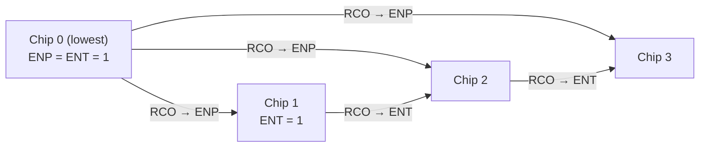

Counters and registers are the two most frequently used kinds of sequential components in digital systems. A counter counts clock pulses and is used for frequency division, timing, and generating sequencing signals and addresses. A register holds a group of binary data bits, and a shift register can also move the data bit by bit, which is used for serial-parallel conversion and arithmetic shifts. Their structures are very regular, so they can be derived one by one with the analysis and design methods of the [previous chapter](/4.9.7) and are the best examples to test those methods. This chapter first designs synchronous binary, decimal and reversible counters, then uses the classic integrated counter 74163 to discuss several ways of building counters of arbitrary modulus. It then introduces registers, shift registers, and the ring and twisted-ring counters built from shift registers. Finally, two comprehensive examples, a sequence detector and a sequence generator, are completed with shift registers and counters. The program counter and the register file of a processor ([4.10](/4.10)) are direct generalizations of the components of this chapter, and on an FPGA ([4.9.9](/4.9.9)) these components take only a few lines of hardware description language.

## 8.1. Synchronous Counters

### 8.1.1. Counters and Modulus

**Definition 8.1.1 (Counter)** A sequential circuit that cycles through $M$ states in a fixed order under clock pulses is called a **counter**, and $M$ is called its **modulus** (counting capacity). A counter with modulus $M$ is also called a mod-$M$ counter.

Counters can be classified from several points of view:

| Basis | Types |
|---|---|
| Whether the **flip-flops** share a clock | Synchronous counters, asynchronous counters |
| Counting direction | Up, down, up/down (reversible) counters |
| Modulus and encoding | Binary ($M = 2^n$), decimal (**BCD**), arbitrary modulus; **Gray code**, ring, twisted-ring, and so on |

A counter has only a clock input (and control inputs such as enable and clear) and no data input, so it is a **Moore machine**. The period of the most significant bit $Q_{n-1}$ of an $n$-bit binary counter is $2^n$ times the clock period, that is, it divides the clock frequency by $2^n$; this is one of the most common uses of counters.

### 8.1.2. Synchronous Binary Counters

Let us design a 4-bit binary up counter following the design steps of the previous chapter. The state is the count $Q_3Q_2Q_1Q_0$, and the **state diagram** is the single cycle $0000 \to 0001 \to \cdots \to 1111 \to 0000$, so there is no minimization or assignment problem. Observe the rule of binary increment: bit $i$ toggles if and only if all lower bits are 1. The next-state equations are therefore

$$
Q_0^{n+1} = \bar Q_0^n, \qquad Q_i^{n+1} = Q_i^n \oplus \left(Q_{i-1}^n Q_{i-2}^n \cdots Q_0^n\right), \quad i = 1, 2, 3.
$$

The **excitation tables** of the flip-flops ([4.9.6](/4.9.6#sec-6.6)) give three implementations directly:

| Flip-flop | Excitation equations |
|---|---|
| T | $T_0 = 1$, $T_i = Q_{i-1} \cdots Q_1 Q_0$ |
| JK | $J_0 = K_0 = 1$, $J_i = K_i = Q_{i-1} \cdots Q_1 Q_0$ |
| D | $D_0 = \bar Q_0$, $D_i = Q_i \oplus (Q_{i-1} \cdots Q_1 Q_0)$ |

With T or **JK flip-flops**, each bit needs only one AND gate; with **D flip-flops**, each bit needs an additional **exclusive or** gate. When the count reaches $1111$, a carry output $\mathrm{RCO} = Q_3Q_2Q_1Q_0$ is produced, used to cascade counters of higher bits (Section 8.2.3). The product terms $Q_{i-1}\cdots Q_0$ of the bits can be generated in parallel by multi-input AND gates (the lookahead style), or passed along stage by stage by two-input AND gates ($T_i = T_{i-1} Q_{i-1}$, the ripple style). The latter saves gates, but the excitation of the most significant bit then passes through $n - 1$ gate delays, which limits the clock frequency; this is the same problem as the carry chain of an adder ([4.9.5](/4.9.5)).

### 8.1.3. Asynchronous Counters

Connect T′ flip-flops (which toggle at every clock, [4.9.6](/4.9.6#sec-6.5)) in series, using the output of each stage as the clock of the next, and we obtain the simplest binary counter: $Q_0$ toggles at every clock edge; $Q_1$ toggles when $Q_0$ goes from 1 to 0 (for falling-edge-triggered flip-flops), and so on. Such a circuit is called an asynchronous counter (also a ripple counter). It needs no gates at all, but changes of state propagate from the low bits to the high bits like a wave: in going from $0111$ to $1000$ the bits toggle one after another, and wrong states such as $0110$, $0100$, $0000$ appear briefly in between, so decoding the count produces **glitches**; moreover the total delay grows linearly with the number of bits. Asynchronous counters are suitable only for low-speed frequency division; both this course and modern design are based mainly on synchronous counters (the synchronous design principles of [4.9.9](/4.9.9)).

### 8.1.4. Decimal Counters

A decimal counter cycles from $0000$ to $1001$ and returns to $0000$ after $1001$; each decimal digit is represented by one group of BCD code. To design it with D flip-flops, write $D_i = Q_i^{n+1}$ from the **state table**, treat the next states of the six unused states $1010$–$1111$ as **don't-care terms**, and simplify with **Karnaugh maps**:

$$
\begin{aligned}
D_0 &= \bar Q_0, \\
D_1 &= \bar Q_3 \bar Q_1 Q_0 + Q_1 \bar Q_0, \\
D_2 &= \bar Q_2 Q_1 Q_0 + Q_2 \bar Q_1 + Q_2 \bar Q_0, \\
D_3 &= Q_3 \bar Q_0 + \bar Q_3 Q_2 Q_1 Q_0.
\end{aligned}
$$

Compared with the binary counter, only $D_1$ and $D_3$ differ: at $1001$, the $\bar Q_3$ in $D_1$ prevents $Q_1$ from becoming 1, and the term $Q_3\bar Q_0$ in $D_3$ returns $Q_3$ to 0.

The values of the don't-cares are determined by the simplified result, so a **self-starting** check is necessary. Substituting the six invalid states into the equations above:

$$
1010 \to 1011 \to 0100, \qquad 1100 \to 1101 \to 0100, \qquad 1110 \to 1111 \to 0000,
$$

all enter the valid cycle within two clock cycles, so the circuit is self-starting. Take the carry output as $\mathrm{RC} = Q_3 Q_0$ (it is 1 when the count is 9; $1011$, $1101$ and $1111$ also satisfy it, but they are invalid states and can therefore be exploited).

### 8.1.5. Reversible Counters

A reversible counter has an additional direction control input $X$: it counts up by 1 when $X = 1$ and down by 1 when $X = 0$. The rule of down counting is dual to that of up counting: bit $i$ toggles if and only if all lower bits are 0 (a borrow is needed). With **T flip-flops**, the two cases combine into

$$
T_0 = 1, \qquad T_i = X\, Q_{i-1} \cdots Q_0 + \bar X\, \bar Q_{i-1} \cdots \bar Q_0,
$$

and the carry/borrow output is $Z = X Q_3Q_2Q_1Q_0 + \bar X \bar Q_3 \bar Q_2 \bar Q_1 \bar Q_0$: a carry is produced when counting up reaches $1111$ and a borrow when counting down reaches $0000$. A counter controlled by one direction signal is called a single-clock reversible counter; the other kind, a dual-clock reversible counter, has two clock inputs, one for counting up and one for counting down (such as the 74193), and the direction is determined by the clock input on which the pulse arrives.

## 8.2. Integrated Counters and Counters of Arbitrary Modulus

### 8.2.1. Functions of the 74163

A medium-scale integrated counter puts counting and several commonly used control functions on one chip: clear (initialization), load (setting the initial count), count, hold, and a carry output for cascading. The 74163 is the classic synchronous 4-bit binary counter; its inputs and outputs are as follows:

| Pin | Function |
|---|---|
| $\mathrm{CLK}$ | Clock, active on the rising edge |
| $\overline{\mathrm{CLR}}$ | Synchronous clear, active low |
| $\overline{\mathrm{LOAD}}$ | Synchronous load, active low |
| $A, B, C, D$ | Parallel data inputs for loading |
| $\mathrm{ENP}, \mathrm{ENT}$ | Count enables (written P and T in some textbooks); the counter counts when both are 1 |
| $Q_A, Q_B, Q_C, Q_D$ | Count outputs; $Q_A$ is the least significant bit |
| $\mathrm{RCO}$ | Carry output, $\mathrm{RCO} = \mathrm{ENT} \cdot Q_D Q_C Q_B Q_A$ |

The function table (the priority of the control signals decreases from top to bottom):

| $\overline{\mathrm{CLR}}$ | $\overline{\mathrm{LOAD}}$ | $\mathrm{ENP}$ | $\mathrm{ENT}$ | $\mathrm{CLK}$ | Function |
|---|---|---|---|---|---|
| 0 | × | × | × | ↑ | Clear: $Q_DQ_CQ_BQ_A = 0000$ |
| 1 | 0 | × | × | ↑ | Load: $Q_DQ_CQ_BQ_A = DCBA$ |
| 1 | 1 | 1 | 1 | ↑ | Count: add 1 |
| 1 | 1 | 0 | × | × | Hold |
| 1 | 1 | × | 0 | × | Hold (and $\mathrm{RCO} = 0$) |

The 74161 has exactly the same pins and functions as the 74163; the only difference is that the clear of the 74161 is asynchronous: $\overline{\mathrm{CLR}} = 0$ clears immediately without waiting for the clock.

All these functions are implemented by adding combinational logic in front of the excitation of the binary counter, which is exactly the method of "designing excitation functions" in the previous chapter. Take bit $i$ built with a **D flip-flop** as an example. Let $P_i$ be the data input of the bit, $\mathrm{clr}$ and $\mathrm{ld}$ the active-high internal clear and load signals (the complements of $\overline{\mathrm{CLR}}$ and $\overline{\mathrm{LOAD}}$), and $\mathrm{en} = \mathrm{ENP}\cdot\mathrm{ENT}$:

$$
D_i = \overline{\mathrm{clr}} \left[\, \mathrm{ld}\, P_i + \overline{\mathrm{ld}} \left( Q_i \oplus \mathrm{en}\, Q_{i-1} \cdots Q_0 \right) \right].
$$

Loading is in essence a two-way selection (multiplexing) of the excitation, and the synchronous clear sets all excitations to 0 before the next clock edge; the priority is determined by the nesting order of the logic. An asynchronous clear acts directly on the asynchronous reset input of the flip-flops ([4.9.6](/4.9.6#sec-6.4.4)).

### 8.2.2. Counters of Arbitrary Modulus

To build a counter of modulus $M < 16$ from the mod-16 74163, two methods are commonly used; both make the counter return to its starting point early, after the $M$-th state.

1. Feedback clear: when the count is $M - 1$, make $\overline{\mathrm{CLR}} = 0$; the counter is cleared synchronously at the next clock edge and cycles through $0, 1, \dots, M - 1$. For a decimal counter, for example, $M - 1 = 9 = 1001$ and we take $\overline{\mathrm{CLR}} = \overline{Q_D Q_A}$ (a **NAND gate**; it suffices to detect the bits that are 1, because among $0$–$9$ only 9 has $Q_D$ and $Q_A$ both equal to 1).
2. Feedback load: in some state make $\overline{\mathrm{LOAD}} = 0$; the initial value $N_0$ is loaded at the next clock edge and the counter cycles through $N_0, \dots, N_0 + M - 1$. The most convenient way is to use the carry output: $\overline{\mathrm{LOAD}} = \overline{\mathrm{RCO}}$ with data inputs $DCBA = 16 - M$, so the counter cycles through $16 - M, \dots, 15$ without any extra gate; for $M = 10$, for example, $0110$ is loaded and the counter cycles through $6$–$15$. One can also load $0000$ at $M - 1$, with the same effect as feedback clear.

With the 74161, whose clear is asynchronous, feedback clear must detect $M$ rather than $M - 1$: as soon as the counter enters state $M$ it is cleared immediately, so state $M$ lasts only a very short time (a "transient state"). This transient state produces a glitch on the outputs, the width of the clear pulse depends on gate delays, and if the flip-flops reset at different speeds the clear may be incomplete; synchronous clear or synchronous load should therefore be preferred.

**Example 8.2.1 (Variable-Modulus Counter)** Design a counter with variable modulus using the 74163: with an external input $N = N_3N_2N_1N_0$, the counter counts from 0 to $N$ and returns to 0 (modulus $N + 1$). A 4-bit comparator detects $Q = N$:

$$
\overline{\mathrm{CLR}} = (Q_D \oplus N_3) + (Q_C \oplus N_2) + (Q_B \oplus N_1) + (Q_A \oplus N_0),
$$

that is, when $Q \ne N$, $\overline{\mathrm{CLR}} = 1$ and the counter counts normally; when $Q = N$ it is cleared at the next edge. The same circuit can also be realized with a **PLA** ([4.9.9](/4.9.9)): AND the excitation of the counter with the "not equal" signal; the idea is exactly the same.

### 8.2.3. Cascading

A counter with modulus larger than 16 is built by cascading several chips. The design rule is that the higher chip holds while the lower chip has not reached its full count, and when the lower chip is full and one more clock arrives, the higher chip and the lower chip act together. All chips share the same clock (the circuit is still synchronous), and only the enable inputs control when the higher chips count.

- Ripple carry: the lowest chip has $\mathrm{ENP} = \mathrm{ENT} = 1$, the $\mathrm{RCO}$ of each chip is connected to the $\mathrm{ENT}$ of the adjacent higher chip, and all higher chips have $\mathrm{ENP} = 1$. Since $\mathrm{RCO} = \mathrm{ENT}\cdot Q_DQ_CQ_BQ_A$, the $\mathrm{RCO}$ of chip $k$ passes through the carry chain of the previous $k - 1$ chips, and the clock period must accommodate the delay of the whole chain.
- Parallel carry (fast cascading): the $\mathrm{RCO}$ of the lowest chip is connected to the $\mathrm{ENP}$ of all higher chips at the same time, while $\mathrm{ENT}$ is still chained chip by chip. The signal on the $\mathrm{ENT}$ chain changes only once for every 16 counts of the lowest chip, so it has 16 clock cycles to propagate; only the stage from the $\mathrm{RCO}$ of the lowest chip to the $\mathrm{ENP}$ of each chip must be stable in every clock cycle, so the counting frequency does not decrease with the number of chips. Note that in this case the $\mathrm{RCO}$ of the highest chip does not include $\mathrm{ENP}$, so its being 1 does not mean that the whole counter is full; the overall carry should be taken as the AND of it with the $\mathrm{RCO}$ of the lowest chip.

A large modulus that is not a power of 2 can be factored into a product of smaller moduli and cascaded: for example, the seconds counter of a clock has $60 = 10 \times 6$; the units digit is a decimal counter and the tens digit a mod-6 counter, the tens digit is allowed to count only when the units digit reaches 9 (the enable of the tens digit is connected to the carry $Q_D Q_A$ of the units digit), and when the tens digit is 5 and the units digit is 9, both return to 0. The count obtained this way is encoded by decimal digits, which is convenient for directly driving a display.

## 8.3. Registers

**Definition 8.3.1 (Register)** A sequential component built from $n$ flip-flops sharing a clock and capable of storing $n$ bits of binary data is called an ($n$-bit) **register**.

A register is the component of a computer that holds instructions, data and results of operations, and is the fastest and smallest level of the storage hierarchy. The simplest 4-bit register is four **D flip-flops** sharing a clock, storing $D_3D_2D_1D_0$ at every clock edge; its problem is that it is overwritten in every cycle and cannot hold data after the input is removed. Practical registers add controls on top of this:

- Hold (write enable): add an enable signal $E$, load when $E = 1$ and hold when $E = 0$; for each bit
  $$
  Q^{n+1} = E\,D + \bar E\,Q^n,
  $$
  that is, a two-way **multiplexer** is added in front of $D$ and the output $Q$ is fed back. Do not implement holding by ANDing the clock with $E$: a gated clock introduces clock skew and glitches ([4.9.7](/4.9.7#sec-7.6)) and violates the principle of synchronous design.
- Select input: with several data sources, replace the two-way selection by a multi-way one, for example $Q^{n+1} = E(\bar S D_A + S D_B) + \bar E\, Q^n$, where $S$ selects whether $D_A$ or $D_B$ is stored.
- Output enable: add **tri-state buffers** to the outputs, controlled by $\mathrm{OE}$. If the inputs and outputs of several registers are connected to the same bus, with writing from the bus when $E = 1$ and driving the contents onto the bus when $\mathrm{OE} = 1$ (the two never active at the same time), we obtain a bidirectional bus register.

An integrated example is the 74LS374 (an 8-bit D flip-flop register with **tri-state buffer** outputs); by contrast, the 74LS373 of [4.9.6](/4.9.6#sec-6.3.2) is a **latch**. The register file of a processor consists of several registers with write enables plus address decoding and a read-data multiplexer ([4.10](/4.10)).

## 8.4. Shift Registers

### 8.4.1. Implementing Shifts

**Definition 8.4.1 (Shift Register)** A register whose stored data move one position to the left or right at each active clock edge is called a **shift register**.

The simplest serial-in serial-out (also serial-in parallel-out) right-shift register consists of $n$ **D flip-flops** connected head to tail: $D_0 = D_{\mathrm{in}}$ (the serial input) and $D_i = Q_{i-1}$. At each clock the serial input enters bit 0, the old bits move one position to the right, and the rightmost bit is shifted out. It must be built from **edge-triggered** flip-flops: with latches, data would pass through several stages during the enable period ([4.9.6](/4.9.6#sec-6.3.2)). On the path where flip-flops are directly connected the combinational delay is zero, and the **hold time** constraint (Eq. (7.2)) requires $t_{\mathrm{ccq}} \ge t_{\mathrm{h}}$, that is, the clock-to-Q delay of each flip-flop must be greater than the hold time of the next one, which the device design guarantees.

By the way data enter and leave, shift registers are classified as serial-in serial-out, serial-in parallel-out, parallel-in serial-out and parallel-in parallel-out. Serial-in parallel-out converts serial data into parallel data and parallel-in serial-out does the reverse; this is the core of serial communication interfaces (such as UART and SPI). Shifting a binary number left by one position is equivalent to multiplying by 2 and shifting right by one position to dividing by 2; the shifting of partial products and remainders in multipliers and dividers is also done by shift registers ([4.10.5](/4.10.5)).

### 8.4.2. Bidirectional Shift Registers

The most versatile is the bidirectional shift register with parallel load (such as the 74194), in which two control inputs $S_1S_0$ select among four operations:

| $S_1$ | $S_0$ | Function | Next state of bit $i$ |
|---|---|---|---|
| 0 | 0 | Hold | $Q_i$ |
| 0 | 1 | Shift right (toward the high bits) | $Q_{i-1}$ (bit 0 takes the right-shift serial input $D_{\mathrm{SR}}$) |
| 1 | 0 | Shift left (toward the low bits) | $Q_{i+1}$ (the highest bit takes the left-shift serial input $D_{\mathrm{SL}}$) |
| 1 | 1 | Parallel load | $P_i$ |

Each bit is built as "D flip-flop + 4-to-1 multiplexer":

$$
Q_i^{n+1} = \bar S_1 \bar S_0\, Q_i + \bar S_1 S_0\, Q_{i-1} + S_1 \bar S_0\, Q_{i+1} + S_1 S_0\, P_i.
$$

There is also an asynchronous clear input. This example shows the general design method for register-type components: each bit uses one D flip-flop, and a multiplexer in front of $D$ chooses among the data needed by the various functions, the choice being made by the control signals.

## 8.5. Shift-Type Counters

Feeding the serial output of a shift register back to its serial input through combinational logic gives a class of counters with a simple structure. All the following use right shifting: $Q_0$ receives the feedback $D_0$, $Q_i^{n+1} = Q_{i-1}^n$, and the state is written $Q_0Q_1\cdots Q_{n-1}$.

### 8.5.1. Ring Counters

**Definition 8.5.1 (Ring Counter)** A counter of modulus $n$ obtained by connecting the output of the last bit of an $n$-bit shift register directly back to the serial input ($D_0 = Q_{n-1}$) and presetting the register to a state with exactly one bit equal to 1 is called a **ring counter**.

A 4-bit ring counter cycles through $1000 \to 0100 \to 0010 \to 0001 \to 1000$, the single 1 circulating in the ring. Its states are the **one-hot encoding** ([4.9.7](/4.9.7#sec-7.5.3)): each state is given directly by one flip-flop and no decoding is needed, so it is often used as a sequencer (generating $n$ non-overlapping timing pulses in turn). The cost is the low utilization of flip-flops: $n$ flip-flops use only $n$ of the $2^n$ states.

A ring counter with direct feedback is not self-starting: $0000$ and $1111$ each form a cycle, and states such as $1100$ form other cycles. Modify the feedback logic by letting

$$
D_0 = \overline{Q_0 + Q_1 + \cdots + Q_{n-2}}.
$$

The valid cycle is unchanged (the first $n - 1$ bits are all 0 only when $Q_{n-1} = 1$, and then $D_0 = 1$), whereas in any state, as long as there is still a 1 among the first $n - 1$ bits, the feedback shifts in a 0; after at most $n - 1$ clocks the first $n - 1$ bits are all 0, the next clock shifts in a 1, and the circuit enters the valid state $10\cdots0$. Such a circuit is self-starting.

### 8.5.2. Twisted-Ring Counters

**Definition 8.5.2 (Johnson Counter)** A counter of modulus $2n$ obtained by connecting the inverted output of the last bit of an $n$-bit shift register back to the serial input ($D_0 = \bar Q_{n-1}$) is called a **twisted-ring counter**, also a **Johnson counter**.

A 4-bit twisted-ring counter starts from $0000$, first shifts 1s in from the left one by one, then shifts 0s in one by one:

$$
0000 \to 1000 \to 1100 \to 1110 \to 1111 \to 0111 \to 0011 \to 0001 \to 0000.
$$

Its characteristics are:

- $n$ flip-flops give modulus $2n$, twice that of the ring counter;
- adjacent states differ in only one bit (a unit-distance code), so decoding at state transitions produces no **race** glitches;
- each state can be decoded by one two-input AND gate (for example, $1100$ is the only valid state with $Q_1 = 1, Q_2 = 0$, decoded as $Q_1 \bar Q_2$).

The remaining $2^n - 2n$ states form other cycles, so a twisted-ring counter with direct feedback is not self-starting; Example 7.3.2 of [4.9.7](/4.9.7#sec-7.3) analyzes the 3-bit case. For 4 bits, modify the feedback in the same way and take

$$
D_0 = \bar Q_3 \left(Q_0 + \bar Q_2\right).
$$

One can verify case by case that the next states of the 8 states of the valid cycle are unchanged, while all 8 invalid states enter the valid cycle within at most 5 clocks (for example, $0100 \to 1010 \to 1101 \to 0110 \to 0011$).

A comparison of the two counters:

| | Binary counter | Ring counter | Twisted-ring counter |
|---|---|---|---|
| Modulus with $n$ flip-flops | $2^n$ | $n$ | $2n$ |
| Feedback / excitation logic | AND-gate chain or adder | None (one **NOR gate** if self-starting) | One inverter (a few gates if self-starting) |
| State decoding | $n$-input AND gates, possible glitches | Not needed | Two-input AND gates, no glitches |

## 8.6. Comprehensive Examples

### 8.6.1. A Sequence Detector Using a Shift Register

Consider again the "110" sequence detector of Example 7.4.1. Take another approach: store the last three input bits directly in a 3-bit serial-in parallel-out shift register, with $X$ connected to the serial input; then $Q_0$ is the latest bit, $Q_1$ the previous one and $Q_2$ the one before that, and

$$
Z = Q_2\, Q_1\, \bar Q_0.
$$

Detecting a longer sequence is equally direct; for example, detecting "101001" needs only a 6-bit shift register and $Z = Q_5 \bar Q_4 Q_3 \bar Q_2 \bar Q_1 Q_0$. Compared with the **finite-state machine** design of Example 7.4.1:

| | State-machine design (Example 7.4.1) | Shift register |
|---|---|---|
| Flip-flops | 2 (after **state minimization**) | 3 (the length of the sequence) |
| Design effort | Build the state diagram, minimize, assign | Almost none |
| Output type | Mealy: output in the same cycle in which the last 0 is received | Moore: output in the cycle after the last bit is stored |

The shift-register scheme trades flip-flops for simplicity of design. Its state (the last $k$ input bits) is the "original state" before minimization: the four cases d, e, f, g of Example 7.4.1, in which the last two bits are 00, 01, 10, 11, are exactly the four states of a 2-bit shift register, and state minimization merged those that need not be distinguished.

### 8.6.2. A Sequence Generator

A sequence generator produces a given serial sequence cyclically; it is used for synchronization codes in communication systems, timing signals in control systems, and so on. Take the cyclic generation of $101000$ as an example; there are two commonly used methods.

Method 1, a counter plus combinational logic: use a mod-6 counter (for example, a 74163 with feedback clear, $\overline{\mathrm{CLR}} = \overline{Q_C Q_A}$) to produce $0$–$5$, and obtain the $k$-th bit of the sequence from the count by combinational logic (or a multiplexer). This method applies to any sequence, and the length of the sequence can be changed by changing the modulus of the counter.

Method 2, a shift register plus feedback logic: use an $n$-bit shift register, and obtain the bits of the sequence in turn from $Q_0$; the bit outputs carry the same sequence, each delayed by one more cycle. The key is to determine the number of bits $n$: for a sequence of length $m = 6$ we need at least $2^n \ge m$, but we must also ensure that the 6 states formed by $n$ consecutive bits are pairwise different; otherwise the same state would need two different next states.

- With $n = 3$, the states $Q_0Q_1Q_2$ taken successively from the sequence are $100, 010, 101, 010, 001, 000$; $010$ appears twice with successors $101$ and $001$, so this cannot be realized.
- With $n = 4$, the states $Q_0Q_1Q_2Q_3$ are in turn $1000, 0100, 1010, 0101, 0010, 0001$, all different.

List the **truth table** of $D_0$ from the "$Q_0$ of the next state" of these 6 states, treat the other 10 states as don't-cares, and simplify to get $D_0 = Q_1 \oplus Q_3$. A self-starting check finds that it is not self-starting: the remaining states form three non-working cycles

$$
\{0000\}, \qquad \{0011, 1001, 1100, 1110, 1111, 0111\}, \qquad \{0110, 1011, 1101\}.
$$

The remedy is to choose one or more states from each non-working cycle, let their next states fall into the working cycle, and simplify again. For example, letting $0000 \to 1000$, $0011 \to 0001$ and $1011 \to 0101$ gives

$$
D_0 = \bar Q_0 \bar Q_1 \bar Q_2 + Q_1 \bar Q_3,
$$

which takes the same values as $Q_1 \oplus Q_3$ on the working cycle, while all 10 invalid states enter the working cycle within at most 5 clocks (for example, $1100 \to 1110 \to 1111 \to 0111 \to 0011 \to 0001$), so the circuit is self-starting.

A shift register whose feedback function is an exclusive or is called a linear-feedback shift register (LFSR). With suitably chosen taps, an $n$-bit LFSR traverses all $2^n - 1$ states except all-zero, and the pseudorandom sequences it generates are widely used in built-in self-test, scrambling and CRC checking ([4.9.1](/4.9.1)).

## Summary

- A counter is a **Moore machine** with only a clock input. Bit $i$ of a synchronous binary counter toggles when all lower bits are 1: $T_i = Q_{i-1} \cdots Q_0$. Decimal and reversible counters are designed by the methods of the previous chapter, with unused states as don't-cares, and self-starting must be checked afterwards.
- Integrated counter 74163: synchronous clear > synchronous load > count > hold. Counters of arbitrary modulus are built with feedback clear or feedback load, preferring the synchronous methods; large moduli use cascading, and fast cascading drives the ENP of each chip from the RCO of the lowest chip.
- A register = **D flip-flops** + a multiplexer in front of $D$ (hold, select, load, shift); do not implement holding with a gated clock.
- Ring counters (modulus $n$, one-hot) and twisted-ring counters (modulus $2n$, unit-distance code) have the simplest structure, but both need modified feedback to be self-starting.
- Sequence detection and generation can be done either with state-machine design or directly with shift registers; the latter trades flip-flops for simplicity of design.
