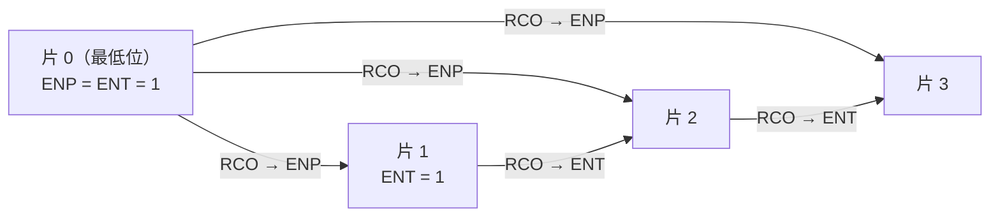

计数器和寄存器是数字系统中用得最多的两类时序部件：计数器对时钟脉冲计数，用于分频、定时、产生节拍和地址；寄存器保存一组二进制数据，移位寄存器还能让数据逐位移动，用于串并转换和算术移位。它们的结构都很规则，正好用[上一章](/4.9.7)的分析与设计方法逐一推导，也是检验这套方法的最好例子。本章先设计同步二进制、十进制和可逆计数器，再以经典的集成计数器 74163 为例讨论任意模计数器的几种实现；然后介绍寄存器、移位寄存器和由移位寄存器构成的环形计数器与扭环形计数器；最后用移位寄存器与计数器完成序列检测器和序列信号发生器两个综合例子。处理器中的程序计数器、寄存器堆（[4.10](/4.10)）都是本章部件的直接推广，而在 FPGA 上（[4.9.9](/4.9.9)）这些部件只需几行硬件描述语言代码。

## 8.1. 同步计数器

### 8.1.1. 计数器与模

**定义 8.1.1（计数器）** 在时钟脉冲作用下按固定顺序循环经过 $M$ 个状态的时序电路称为**计数器**，$M$ 称为计数器的**模**（计数容量）。模为 $M$ 的计数器又称 $M$ 进制计数器。

计数器可以按几个角度分类：

| 分类依据 | 类型 |
|---|---|
| 触发器是否共用时钟 | 同步计数器、异步计数器 |
| 计数方向 | 加法（递增）、减法（递减）、可逆计数器 |
| 模与编码 | 二进制（$M = 2^n$）、十进制（BCD 码）、任意模；Gray 码、环形、扭环形等 |

计数器只有时钟输入（以及使能、清零等控制输入），没有数据输入，因此是 Moore 机。$n$ 位二进制计数器的最高位 $Q_{n-1}$ 的周期是时钟周期的 $2^n$ 倍，即对时钟 $2^n$ 分频；这也是计数器最常见的用途之一。

### 8.1.2. 同步二进制计数器

按上一章的设计步骤设计 4 位二进制加法计数器。状态就是计数值 $Q_3Q_2Q_1Q_0$，状态图是 $0000 \to 0001 \to \cdots \to 1111 \to 0000$ 的单一循环，没有化简与编码问题。观察二进制加 1 的规律：第 $i$ 位翻转，当且仅当比它低的各位全为 1。于是次态方程为

$$
Q_0^{n+1} = \bar Q_0^n, \qquad Q_i^{n+1} = Q_i^n \oplus \left(Q_{i-1}^n Q_{i-2}^n \cdots Q_0^n\right), \quad i = 1, 2, 3.
$$

由触发器的激励表（[4.9.6](/4.9.6#sec-6.6)）直接得到三种实现：

| 触发器 | 激励方程 |
|---|---|
| T | $T_0 = 1$，$T_i = Q_{i-1} \cdots Q_1 Q_0$ |
| JK | $J_0 = K_0 = 1$，$J_i = K_i = Q_{i-1} \cdots Q_1 Q_0$ |
| D | $D_0 = \bar Q_0$，$D_i = Q_i \oplus (Q_{i-1} \cdots Q_1 Q_0)$ |

用 T 或 JK 触发器时，每一位只需一个与门；用 D 触发器时每一位多一个异或门。计满 $1111$ 时产生进位输出 $\mathrm{RCO} = Q_3Q_2Q_1Q_0$，用于级联更高位的计数器（8.2.3 节）。各位的与项 $Q_{i-1}\cdots Q_0$ 可以并行地由多输入与门产生（超前进位方式），也可以逐级用两输入与门传递（$T_i = T_{i-1} Q_{i-1}$，串行进位方式），后者省门，但最高位的激励要经过 $n - 1$ 级门延迟，限制了时钟频率，与加法器的进位链（[4.9.5](/4.9.5)）是同一个问题。

### 8.1.3. 异步计数器

把 T′ 触发器（每个时钟都翻转，[4.9.6](/4.9.6#sec-6.5)）串联起来，用前一级的输出作为后一级的时钟，就得到最简单的二进制计数器：$Q_0$ 在每个时钟边沿翻转；$Q_1$ 在 $Q_0$ 由 1 变 0 时翻转（下降沿触发的触发器），等等。这种电路称为异步计数器（又称行波计数器）。它不需要任何门，但状态的变化像波一样从低位传到高位：从 $0111$ 变到 $1000$ 时，各位依次翻转，中间短暂地出现 $0110$、$0100$、$0000$ 等错误状态，对计数值译码就会产生毛刺；而且总延迟随位数线性增长。异步计数器只适合低速的分频，本课程和现代设计都以同步计数器为主（[4.9.9](/4.9.9) 的同步设计原则）。

### 8.1.4. 十进制计数器

十进制计数器在 $0000$ 到 $1001$ 之间循环，计到 $1001$ 后回到 $0000$，每一位十进制数用一组 BCD 码表示。用 D 触发器设计：由状态表写出 $D_i = Q_i^{n+1}$，6 个未用状态 $1010$–$1111$ 的次态作为无关项，用卡诺图化简得

$$
\begin{aligned}
D_0 &= \bar Q_0, \\
D_1 &= \bar Q_3 \bar Q_1 Q_0 + Q_1 \bar Q_0, \\
D_2 &= \bar Q_2 Q_1 Q_0 + Q_2 \bar Q_1 + Q_2 \bar Q_0, \\
D_3 &= Q_3 \bar Q_0 + \bar Q_3 Q_2 Q_1 Q_0.
\end{aligned}
$$

与二进制计数器相比，只有 $D_1$ 和 $D_3$ 不同：在 $1001$ 时，$D_1$ 中的 $\bar Q_3$ 阻止 $Q_1$ 变为 1，$D_3$ 中的 $Q_3\bar Q_0$ 一项使 $Q_3$ 回到 0。

无关项的取值由化简结果决定，必须做自启动检查。把 6 个无效状态代入上面的方程：

$$
1010 \to 1011 \to 0100, \qquad 1100 \to 1101 \to 0100, \qquad 1110 \to 1111 \to 0000,
$$

都在两个时钟周期内进入有效循环，电路能够自启动。进位输出取 $\mathrm{RC} = Q_3 Q_0$（计数值为 9 时为 1；$1011$、$1101$、$1111$ 也满足，它们是无效状态，因此可以利用）。

### 8.1.5. 可逆计数器

可逆计数器增加一个方向控制输入 $X$：$X = 1$ 时加 1，$X = 0$ 时减 1。减法计数的规律与加法对偶：第 $i$ 位翻转，当且仅当比它低的各位全为 0（需要借位）。用 T 触发器，两种情况合起来为

$$
T_0 = 1, \qquad T_i = X\, Q_{i-1} \cdots Q_0 + \bar X\, \bar Q_{i-1} \cdots \bar Q_0,
$$

进位/借位输出为 $Z = X Q_3Q_2Q_1Q_0 + \bar X \bar Q_3 \bar Q_2 \bar Q_1 \bar Q_0$：加法计到 $1111$ 时产生进位，减法计到 $0000$ 时产生借位。这种由一个方向信号控制的称为单时钟可逆计数器；另一种双时钟可逆计数器有加计数和减计数两个时钟输入（如 74193），由哪个时钟输入脉冲决定计数方向。

## 8.2. 集成计数器与任意模计数器

### 8.2.1. 74163 的功能

中规模集成计数器把计数和几种常用的控制功能做在一块芯片上：清零（初始化）、置数（设定计数的初值）、计数、保持，以及用于级联的进位输出。74163 是同步 4 位二进制计数器的经典型号，输入输出如下：

| 引脚 | 功能 |
|---|---|
| $\mathrm{CLK}$ | 时钟，上升沿有效 |
| $\overline{\mathrm{CLR}}$ | 同步清零，低电平有效 |
| $\overline{\mathrm{LOAD}}$ | 同步置数，低电平有效 |
| $A, B, C, D$ | 置数时的并行数据输入 |
| $\mathrm{ENP}, \mathrm{ENT}$ | 计数使能（教材中记为 P、T），两者都为 1 时计数 |
| $Q_A, Q_B, Q_C, Q_D$ | 计数输出，$Q_A$ 为最低位 |
| $\mathrm{RCO}$ | 进位输出，$\mathrm{RCO} = \mathrm{ENT} \cdot Q_D Q_C Q_B Q_A$ |

功能表（控制信号的优先级自上而下递减）：

| $\overline{\mathrm{CLR}}$ | $\overline{\mathrm{LOAD}}$ | $\mathrm{ENP}$ | $\mathrm{ENT}$ | $\mathrm{CLK}$ | 功能 |
|---|---|---|---|---|---|
| 0 | × | × | × | ↑ | 清零：$Q_DQ_CQ_BQ_A = 0000$ |
| 1 | 0 | × | × | ↑ | 置数：$Q_DQ_CQ_BQ_A = DCBA$ |
| 1 | 1 | 1 | 1 | ↑ | 计数：加 1 |
| 1 | 1 | 0 | × | × | 保持 |
| 1 | 1 | × | 0 | × | 保持（且 $\mathrm{RCO} = 0$） |

74161 与 74163 的引脚和功能完全相同，唯一区别是 74161 的清零是异步的：$\overline{\mathrm{CLR}} = 0$ 立即清零，不等时钟。

这些功能都是在二进制计数器的激励前面加组合逻辑实现的，正是上一章"设计激励函数"的方法。以 D 触发器构成的第 $i$ 位为例，记 $P_i$ 为该位的数据输入，$\mathrm{clr}$、$\mathrm{ld}$ 为高电平有效的内部清零、置数信号（$\overline{\mathrm{CLR}}$、$\overline{\mathrm{LOAD}}$ 取反），$\mathrm{en} = \mathrm{ENP}\cdot\mathrm{ENT}$：

$$
D_i = \overline{\mathrm{clr}} \left[\, \mathrm{ld}\, P_i + \overline{\mathrm{ld}} \left( Q_i \oplus \mathrm{en}\, Q_{i-1} \cdots Q_0 \right) \right].
$$

置数本质上是对激励做一次二选一（数据选择），同步清零是在下一个时钟边沿前把所有激励置为 0，优先级由逻辑的嵌套次序决定。异步清零则直接作用于触发器的异步复位端（[4.9.6](/4.9.6#sec-6.4.4)）。

### 8.2.2. 任意模计数器

用模 16 的 74163 构成模 $M < 16$ 的计数器，常用两种办法：让计数器在第 $M$ 个状态之后提前回到起点。

1. 反馈清零法：在计数值为 $M - 1$ 时使 $\overline{\mathrm{CLR}} = 0$，下一个时钟边沿同步清零，计数器在 $0, 1, \dots, M - 1$ 之间循环。例如十进制计数器：$M - 1 = 9 = 1001$，取 $\overline{\mathrm{CLR}} = \overline{Q_D Q_A}$（一个与非门；只检测为 1 的位即可，因为 $0$–$9$ 中只有 9 的 $Q_D$ 与 $Q_A$ 同时为 1）。
2. 反馈置数法：在某个状态使 $\overline{\mathrm{LOAD}} = 0$，下一个时钟边沿置入初值 $N_0$，计数器在 $N_0, \dots, N_0 + M - 1$ 之间循环。最方便的做法是用进位输出：$\overline{\mathrm{LOAD}} = \overline{\mathrm{RCO}}$，数据输入 $DCBA = 16 - M$，计数器在 $16 - M, \dots, 15$ 之间循环，不需要额外的门；例如 $M = 10$ 时置入 $0110$，在 $6$–$15$ 之间循环。也可以在 $M - 1$ 时置入 $0000$，效果与反馈清零相同。

用异步清零的 74161 时，反馈清零要检测 $M$ 而不是 $M - 1$：计数器进入状态 $M$ 后立即被清零，状态 $M$ 只持续极短的时间（一个"过渡状态"）。这个过渡状态会在输出上产生毛刺，清零脉冲的宽度又取决于门延迟，若各触发器的复位速度不同还可能清零不完全，所以应尽量使用同步清零或同步置数。

**例 8.2.1（可变模计数器）** 用 74163 设计模可变的计数器：外部输入 $N = N_3N_2N_1N_0$，计数器从 0 计到 $N$ 后回到 0（模为 $N + 1$）。用一个 4 位比较器检测 $Q = N$：

$$
\overline{\mathrm{CLR}} = (Q_D \oplus N_3) + (Q_C \oplus N_2) + (Q_B \oplus N_1) + (Q_A \oplus N_0),
$$

即 $Q \ne N$ 时 $\overline{\mathrm{CLR}} = 1$ 正常计数，$Q = N$ 时下一个边沿清零。课件中用 PLA 实现同一电路（[4.9.9](/4.9.9)）：把计数器的激励与"不相等"信号相与，思路完全相同。

### 8.2.3. 级联

模大于 16 的计数器由多片级联构成。设计规则是：低位片未计满时高位片保持，低位片计满后再来一个时钟时，高位片与低位片同时动作。所有芯片共用同一个时钟（仍是同步电路），只用使能端控制高位片何时计数。

- 串行进位：最低位片的 $\mathrm{ENP} = \mathrm{ENT} = 1$，每一片的 $\mathrm{RCO}$ 接到相邻高位片的 $\mathrm{ENT}$，所有高位片的 $\mathrm{ENP} = 1$。由于 $\mathrm{RCO} = \mathrm{ENT}\cdot Q_DQ_CQ_BQ_A$，第 $k$ 片的 $\mathrm{RCO}$ 要经过前面 $k - 1$ 片的进位链，时钟周期必须容纳整条链的延迟。
- 并行进位（快速级联）：最低位片的 $\mathrm{RCO}$ 同时接到所有高位片的 $\mathrm{ENP}$，$\mathrm{ENT}$ 仍逐片串接。$\mathrm{ENT}$ 链上的信号只在最低位片每计满 16 次时才变化一次，有 16 个时钟周期的时间传递；而每个时钟周期都要稳定的只有最低位片的 $\mathrm{RCO}$ 到各片 $\mathrm{ENP}$ 这一级，计数频率因此不随片数下降。注意此时最高位片的 $\mathrm{RCO}$ 不包含 $\mathrm{ENP}$，它为 1 并不表示整体计满，整体进位应取它与最低位片 $\mathrm{RCO}$ 的与。

非 2 的幂的大模数可以分解为几个较小模数的乘积级联：例如时钟的秒计数器 $60 = 10 \times 6$，个位是十进制计数器，十位是六进制计数器，个位计到 9 时才允许十位计数（十位的使能接个位的进位 $Q_D Q_A$），十位在 5 且个位在 9 时一起回到 0。这样得到的计数值是按十进制位编码的，便于直接驱动显示。

## 8.3. 寄存器

**定义 8.3.1（寄存器）** 由 $n$ 个共用时钟的触发器构成、能够存储 $n$ 位二进制数据的时序部件称为（$n$ 位）**寄存器**。

寄存器是计算机中存放指令、数据和运算结果的部件，是存储层次中最快、容量最小的一级。最简单的 4 位寄存器就是 4 个共用时钟的 D 触发器，每个时钟边沿把 $D_3D_2D_1D_0$ 存入；它的问题是每个周期都会被改写，不能在输入撤去后保持数据。实用的寄存器在此基础上加控制：

- 保持（写使能）：加使能信号 $E$，$E = 1$ 时置数、$E = 0$ 时保持，每一位为
  $$
  Q^{n+1} = E\,D + \bar E\,Q^n,
  $$
  即在 D 端前加一个二选一数据选择器，把输出 $Q$ 反馈回来。不要用"把时钟和 $E$ 相与"的办法实现保持：门控时钟会引入时钟偏斜和毛刺（[4.9.7](/4.9.7#sec-7.6)），违反同步设计原则。
- 选择输入：多个数据源时把二选一换成多选一，例如 $Q^{n+1} = E(\bar S D_A + S D_B) + \bar E\, Q^n$，由 $S$ 选择存入 $D_A$ 还是 $D_B$。
- 输出使能：输出端加三态门，由 $\mathrm{OE}$ 控制。若干寄存器的输入与输出接在同一组总线上：$E = 1$ 时从总线写入，$\mathrm{OE} = 1$ 时把内容送到总线上，两者不同时有效，就构成了双向的总线寄存器。

集成电路的例子是 74LS374（8 位 D 触发器寄存器，三态输出）；与之对照，[4.9.6](/4.9.6#sec-6.3.2) 的 74LS373 是锁存器。处理器的寄存器堆是多个带写使能的寄存器加上地址译码与读出数据选择器（[4.10](/4.10)）。

## 8.4. 移位寄存器

### 8.4.1. 移位的实现

**定义 8.4.1（移位寄存器）** 每来一个时钟有效边沿，所存的数据就依次向左或向右移动一位的寄存器称为**移位寄存器**。

最简单的串入串出（同时也是串入并出）右移寄存器由 $n$ 个 D 触发器首尾相接构成：$D_0 = D_{\mathrm{in}}$（串行输入），$D_i = Q_{i-1}$。每个时钟，串行输入进入第 0 位，原来的各位依次右移一位，最右一位移出。它必须由边沿触发器构成：用锁存器时，使能期间数据会穿过多级（[4.9.6](/4.9.6#sec-6.3.2)）。触发器直接相连的路径上组合逻辑延迟为零，保持时间约束（式 (7.2)）要求 $t_{\mathrm{ccq}} \ge t_{\mathrm{h}}$，即每个触发器的时钟到输出延迟要大于下一个触发器的保持时间，器件设计时就保证了这一点。

按数据的进出方式，移位寄存器有串入串出、串入并出、并入串出、并入并出几种。串入并出把串行数据转为并行数据，并入串出反之，这是串行通信接口（如 UART、SPI）的核心。二进制数左移一位相当于乘 2、右移一位相当于除以 2，乘除法器中部分积和余数的移位也由移位寄存器完成（[4.10.5](/4.10.5)）。

### 8.4.2. 双向移位寄存器

功能最全的是带并行置数的双向移位寄存器（如 74194），由两个控制输入 $S_1S_0$ 选择四种操作：

| $S_1$ | $S_0$ | 功能 | 第 $i$ 位的次态 |
|---|---|---|---|
| 0 | 0 | 保持 | $Q_i$ |
| 0 | 1 | 右移（向高位移动） | $Q_{i-1}$（第 0 位取右移串行输入 $D_{\mathrm{SR}}$） |
| 1 | 0 | 左移（向低位移动） | $Q_{i+1}$（最高位取左移串行输入 $D_{\mathrm{SL}}$） |
| 1 | 1 | 并行置数 | $P_i$ |

每一位的结构是"D 触发器 + 四选一数据选择器"：

$$
Q_i^{n+1} = \bar S_1 \bar S_0\, Q_i + \bar S_1 S_0\, Q_{i-1} + S_1 \bar S_0\, Q_{i+1} + S_1 S_0\, P_i.
$$

另有一个异步清零端。这个例子体现了寄存器类部件的一般设计方法：每一位用一个 D 触发器，在 D 端前用数据选择器在各种功能所需的数据之间选择，"选择"由控制信号决定。

## 8.5. 移位型计数器

移位寄存器的串行输出经过组合逻辑反馈到串行输入，就构成了一类结构简单的计数器。以下都采用右移：$Q_0$ 接收反馈 $D_0$，$Q_i^{n+1} = Q_{i-1}^n$，状态写成 $Q_0Q_1\cdots Q_{n-1}$。

### 8.5.1. 环形计数器

**定义 8.5.1（环形计数器）** 把 $n$ 位移位寄存器的最后一位输出直接接回串行输入（$D_0 = Q_{n-1}$），并预置为只有一位为 1 的状态，得到的模为 $n$ 的计数器称为**环形计数器**。

4 位环形计数器在 $1000 \to 0100 \to 0010 \to 0001 \to 1000$ 之间循环，唯一的 1 在环中转圈。它的状态就是独热码（[4.9.7](/4.9.7#sec-7.5.3)），每个状态由一个触发器直接给出，不需要译码，常用作节拍发生器（依次产生 $n$ 个不重叠的节拍脉冲）。代价是触发器利用率低：$n$ 个触发器只用了 $2^n$ 个状态中的 $n$ 个。

直接反馈的环形计数器不能自启动：$0000$、$1111$ 各自构成循环，$1100$ 之类的状态构成别的循环。修改反馈逻辑，令

$$
D_0 = \overline{Q_0 + Q_1 + \cdots + Q_{n-2}},
$$

有效循环不变（只有 $Q_{n-1} = 1$ 时前 $n - 1$ 位全为 0，这时 $D_0 = 1$），而任何状态下，只要前 $n - 1$ 位中还有 1，反馈就移入 0；经过至多 $n - 1$ 个时钟，前 $n - 1$ 位全部变为 0，下一个时钟移入 1，进入有效状态 $10\cdots0$。这样的电路能够自启动。

### 8.5.2. 扭环形计数器

**定义 8.5.2（Johnson 计数器）** 把 $n$ 位移位寄存器最后一位的反相输出接回串行输入（$D_0 = \bar Q_{n-1}$）得到的模为 $2n$ 的计数器称为**扭环形计数器**，又称 **Johnson 计数器**。

4 位扭环形计数器从 $0000$ 开始，先从左边逐位移入 1，再逐位移入 0：

$$
0000 \to 1000 \to 1100 \to 1110 \to 1111 \to 0111 \to 0011 \to 0001 \to 0000.
$$

它的特点是：

- $n$ 个触发器得到模 $2n$，比环形计数器多一倍；
- 相邻状态只有一位不同（单位距离码），状态转换时译码不会产生竞争毛刺；
- 每个状态都可以用一个两输入与门译出（例如 $1100$ 是唯一满足 $Q_1 = 1, Q_2 = 0$ 的有效状态，译码为 $Q_1 \bar Q_2$）。

剩下的 $2^n - 2n$ 个状态构成别的循环，直接反馈的扭环形计数器不能自启动，[4.9.7](/4.9.7#sec-7.3) 的例 7.3.2 分析的就是 3 位的情形。4 位时同样修改反馈，取

$$
D_0 = \bar Q_3 \left(Q_0 + \bar Q_2\right),
$$

可以逐一验证有效循环中的 8 个状态的次态不变，而 8 个无效状态都在至多 5 个时钟后进入有效循环（例如 $0100 \to 1010 \to 1101 \to 0110 \to 0011$）。

两种计数器的比较：

| | 二进制计数器 | 环形计数器 | 扭环形计数器 |
|---|---|---|---|
| $n$ 个触发器的模 | $2^n$ | $n$ | $2n$ |
| 反馈 / 激励逻辑 | 与门链或加法 | 无（自启动时一个或非门） | 一个反相器（自启动时少量门） |
| 状态译码 | $n$ 输入与门，可能有毛刺 | 不需要 | 两输入与门，无毛刺 |

## 8.6. 综合例子

### 8.6.1. 用移位寄存器实现序列检测器

再看例 7.4.1 的"110"序列检测器。换一种思路：用 3 位串入并出移位寄存器把最近三位输入直接存下来，$X$ 接串行输入，则 $Q_0$ 是最近一位、$Q_1$ 是前一位、$Q_2$ 是再前一位，

$$
Z = Q_2\, Q_1\, \bar Q_0.
$$

检测更长的序列也一样直接，例如检测"101001"只需 6 位移位寄存器和 $Z = Q_5 \bar Q_4 Q_3 \bar Q_2 \bar Q_1 Q_0$。与例 7.4.1 的状态机设计相比：

| | 状态机设计（例 7.4.1） | 移位寄存器 |
|---|---|---|
| 触发器数 | 2（状态化简后） | 3（序列长度） |
| 设计工作 | 建立状态图、化简、编码 | 几乎不需要 |
| 输出类型 | Mealy：收到最后一个 0 的当拍输出 | Moore：最后一位存入后的下一个周期输出 |

移位寄存器方案用触发器换取设计的简单，它的状态（最近 $k$ 位输入）就是化简之前的"原始状态"：例 7.4.1 中最近两位为 00、01、10、11 的四种情况 d、e、f、g 正是 2 位移位寄存器的四种状态，状态化简把其中不需要区分的合并了。

### 8.6.2. 序列信号发生器

序列信号发生器循环地产生一个给定的串行序列，用于通信系统的同步码、控制系统的节拍信号等。以循环产生 $101000$ 为例，有两种常用的方法。

方法一，计数器加组合逻辑：用一个模 6 计数器（例如 74163 反馈清零，$\overline{\mathrm{CLR}} = \overline{Q_C Q_A}$）产生 $0$–$5$，再由计数值通过组合逻辑（或数据选择器）给出序列的第 $k$ 位。这种方法适用于任意序列，计数器换成其他模就能改变序列长度。

方法二，移位寄存器加反馈逻辑：用 $n$ 位移位寄存器，从 $Q_0$ 依次得到序列的各位，各位输出的序列相同、只是依次延迟一个周期。关键是确定位数 $n$：序列长 $m = 6$ 时至少需要 $2^n \ge m$，但还要保证连续 $n$ 位构成的 6 个状态互不相同，否则同一个状态必须有两个不同的次态。

- 取 $n = 3$，从序列中依次截取的状态 $Q_0Q_1Q_2$ 为 $100, 010, 101, 010, 001, 000$，$010$ 出现两次，后继分别是 $101$ 和 $001$，无法实现。
- 取 $n = 4$，状态 $Q_0Q_1Q_2Q_3$ 依次为 $1000, 0100, 1010, 0101, 0010, 0001$，互不相同。

由这 6 个状态的"次态的 $Q_0$"列出 $D_0$ 的真值表，其余 10 个状态作为无关项，化简得 $D_0 = Q_1 \oplus Q_3$。自启动检查发现它并不能自启动：其余状态构成了三个非工作循环

$$
\{0000\}, \qquad \{0011, 1001, 1100, 1110, 1111, 0111\}, \qquad \{0110, 1011, 1101\}.
$$

修改的办法是从每个非工作循环中选一个或几个状态，令它的次态落入工作循环，再重新化简。例如令 $0000 \to 1000$、$0011 \to 0001$、$1011 \to 0101$，可得

$$
D_0 = \bar Q_0 \bar Q_1 \bar Q_2 + Q_1 \bar Q_3,
$$

它在工作循环上的取值与 $Q_1 \oplus Q_3$ 相同，而所有 10 个无效状态都在至多 5 个时钟后进入工作循环（如 $1100 \to 1110 \to 1111 \to 0111 \to 0011 \to 0001$），电路能够自启动。

反馈函数为异或的移位寄存器称为线性反馈移位寄存器（LFSR）。适当选取抽头时，$n$ 位 LFSR 能遍历除全 0 以外的全部 $2^n - 1$ 个状态，产生的伪随机序列广泛用于内置自测试、扰码和 CRC 校验（[4.9.1](/4.9.1)）。

## 小结

- 计数器是只有时钟输入的 Moore 机。同步二进制计数器第 $i$ 位在低位全为 1 时翻转：$T_i = Q_{i-1} \cdots Q_0$。十进制、可逆计数器按上一章的方法设计，未用状态作无关项，之后必须检查自启动。
- 集成计数器 74163：同步清零 > 同步置数 > 计数 > 保持；任意模计数器用反馈清零或反馈置数实现，优先使用同步方式；大模数用级联，快速级联用最低位片的 RCO 驱动各片 ENP。
- 寄存器 = D 触发器 + D 端前的数据选择器（保持、选择、置数、移位）；不要用门控时钟实现保持。
- 环形计数器（模 $n$，独热）与扭环形计数器（模 $2n$，单位距离码）结构最简单，但都需要修改反馈才能自启动。
- 序列检测与序列发生既可以用状态机设计，也可以用移位寄存器直接实现：后者用触发器换取设计的简单。
