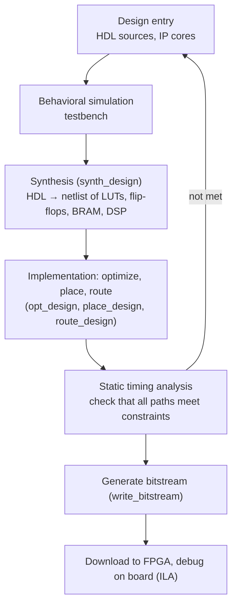

In the previous chapters we built circuits from gates, **flip-flops** and medium-scale chips, where the function of a circuit is determined by the wiring between chips and changing the function means rewiring. Programmable logic devices make the "wiring" a writable configuration as well: the same chip becomes a different circuit when a different configuration is written to it. Following the historical development of the devices, this chapter proceeds from simple devices built around an AND-OR array (ROM, **PLA**, PAL, GAL) to CPLDs and to FPGAs built around lookup tables, and uses current AMD (formerly Xilinx) devices as examples of the on-chip resources of an FPGA. Once devices reach millions of logic cells, circuits can no longer be drawn as logic diagrams and must be written in a hardware description language. The second half of the chapter therefore introduces, mainly in SystemVerilog (with VHDL for comparison), how to write combinational logic, sequential logic and **finite-state machines**, together with testbenches and simulation, the flow of synthesis and implementation, and the principles of synchronous design. The Karnaugh-map minimization, state assignment and timing constraints learned earlier are all done automatically by EDA tools here, but understanding them is what makes it possible to write good hardware descriptions; the experiments of computer organization ([4.10](/4.10)) implement a processor on an FPGA using the methods of this chapter.

## 9.1. Overview of Programmable Logic Devices

**Definition 9.1.1 (Programmable Logic Device)** An integrated circuit whose logic function is determined by the user by writing configuration data is called a **programmable logic device** (PLD).

Any combinational logic function can be written in sum-of-products form (the **minimal sum of products** or a sum of **minterms**, [4.9.2](/4.9.2)), so a structure of an "AND array followed by an OR array" can implement arbitrary combinational logic as long as the connections in the two arrays can be selected; adding flip-flops allows sequential logic. Simple PLDs differ only in which array is programmable:

| Device | AND array | OR array | Output | Remarks |
|---|---|---|---|---|
| ROM | Fixed (full decoding, producing all minterms) | Programmable | Combinational | Actually a memory |
| PLA | Programmable | Programmable | Combinational (flip-flops can be added externally) | Most flexible; medium speed and cost |
| PAL | Programmable | Fixed | Combinational or **register** type, depending on the part | Mostly one-time programmable |
| GAL | Programmable | Fixed | Configurable output logic macrocell | Electrically erasable, reprogrammable |

Array diagrams use a simplified notation: one horizontal line stands for all the inputs of a multi-input AND (or OR) gate; a dot at a crossing with a vertical line means that the connection is made (programmed), and no dot means no connection.

The technology that stores the configuration determines whether a device can be reprogrammed and whether the configuration is lost at power-off:

- Fuse and antifuse: one-time programmable (early PROMs, PALs, and some radiation-hardened FPGAs).
- EPROM, EEPROM, Flash: nonvolatile, erasable and rewritable (GALs, CPLDs, and some FPGAs).
- SRAM: volatile, with the configuration loaded from external memory at power-up, rewritable without limit (the vast majority of FPGAs).

## 9.2. Read-Only Memory

### 9.2.1. Structure

**Definition 9.2.1 (Read-Only Memory)** A memory whose stored data can only be read, and cannot be written at will, in normal operation is called a **read-only memory** (ROM). A ROM with $n$ address bits and $m$ bits per word has a capacity of $2^n \times m$ bits.

A ROM consists of an address **decoder** and a storage matrix: the $n$ address bits select one of the $2^n$ word lines through the decoder, and the contents of the $m$ storage cells on the selected word line are sent to the $m$ bit lines through sense amplifiers. Logically, the decoder is a fixed AND array in which each word line is a minterm of the address variables; the storage matrix is a programmable OR array in which output bit $j$ is the OR of "those word lines whose cell is 1".

By the way of writing, ROMs include mask ROM (written at manufacture), PROM (written once by the user), EPROM (erased by ultraviolet light), EEPROM (electrically erased) and Flash (electrically erased by block). The latter kinds can in fact all be written, but writing is much slower than reading and needs special operations, so they are still counted as ROM; the program memory of today's microcontrollers and solid-state drives use Flash ([4.11.8](/4.11.8)).

### 9.2.2. Implementing Combinational Logic with a ROM

The outputs of a ROM are sums of minterms of the inputs, so writing a **truth table** into a ROM as it is implements the combinational function: the address is the input, the stored word is the output, and no minimization is needed. For example, the conversion from 4-bit binary code to the standard reflected **Gray code** ([4.9.1](/4.9.1)) is implemented by a $16 \times 4$ ROM whose $k$-th word stores the Gray code $k \oplus (k \gg 1)$ of $k$:

| Address $B_3B_2B_1B_0$ | 0000 | 0001 | 0010 | 0011 | 0100 | 0101 | 0110 | 0111 |
|---|---|---|---|---|---|---|---|---|
| Content $G_3G_2G_1G_0$ | 0000 | 0001 | 0011 | 0010 | 0110 | 0111 | 0101 | 0100 |

| Address $B_3B_2B_1B_0$ | 1000 | 1001 | 1010 | 1011 | 1100 | 1101 | 1110 | 1111 |
|---|---|---|---|---|---|---|---|---|
| Content $G_3G_2G_1G_0$ | 1100 | 1101 | 1111 | 1110 | 1010 | 1011 | 1001 | 1000 |

Counting the connection points in the arrays, the AND array has $8 \times 16 = 128$ points (the true and complemented forms of 4 variables times 16 minterms), and the OR array has $4 \times 16 = 64$ points, 192 in all. Connecting the outputs of a 4-bit binary **counter** ([4.9.8](/4.9.8)) to the address of this ROM gives a Gray-code counter. Because the bits of the counter do not change at exactly the same instant, the ROM outputs may show **glitches** at the moment of transition; when a stable output is required, another register stage should be added after the ROM.

The advantages of a ROM are simple design and equal delay for any function; the disadvantage is that the capacity grows exponentially with the number of inputs, while most functions use very few minterms, so utilization is low.

## 9.3. Programmable Logic Arrays

**Definition 9.3.1 (Programmable Logic Array)** A programmable logic device in which both the AND array and the OR array are programmable is called a **programmable logic array** (PLA).

The PLA addresses the low utilization of ROMs: the AND array no longer produces all $2^n$ minterms but only the product terms the functions actually need. To implement combinational logic with a PLA, first minimize each output to a minimal sum of products, sharing product terms between different outputs as much as possible. Take again the conversion from binary code to **Gray code**:

$$
G_3 = B_3, \qquad G_2 = B_3 \bar B_2 + \bar B_3 B_2, \qquad G_1 = B_2 \bar B_1 + \bar B_2 B_1, \qquad G_0 = B_1 \bar B_0 + \bar B_1 B_0,
$$

which has 7 distinct product terms $P_0, \dots, P_6$. The AND array has $8 \times 7 = 56$ points and the OR array $4 \times 7 = 28$ points, 84 in all, less than half of the ROM solution. The size of a PLA is expressed as "inputs × product terms × outputs".


A PLA with **D flip-flops** (outputs fed back through the flip-flops to the inputs of the AND array) can implement **sequential circuits**. For example, the four excitation functions of the decimal counter of [4.9.8](/4.9.8) use 8 product terms in all ($\bar Q_0$, $\bar Q_3\bar Q_1Q_0$, $Q_1\bar Q_0$, $\bar Q_2Q_1Q_0$, $Q_2\bar Q_1$, $Q_2\bar Q_0$, $Q_3\bar Q_0$, $\bar Q_3Q_2Q_1Q_0$), and a $4 \times 8 \times 4$ PLA plus 4 D flip-flops suffices. The variable-modulus counter (Example 8.2.1) can be done the same way: AND each excitation of the mod-16 counter with the signal "count not equal to $N$"; after counting to $N$ all excitations are 0 and the next clock returns to $0000$.

The problem of the PLA is that both arrays are programmable, so the programming technology is complicated and signals pass through two programmable connections, which makes it slow. It is now rare as a stand-alone device, but the regular structure of "programmable AND array + programmable OR array" is still used inside chips (for example, in the control logic of early processors).

## 9.4. PAL and GAL

### 9.4.1. PAL

**Definition 9.4.1 (PAL)** A programmable logic device whose AND array is programmable and whose OR array is fixed (each output is the OR of a fixed number of product terms) is called a **programmable array logic** (PAL).

The PAL was introduced by MMI in the late 1970s, and PAL is its registered trademark. The fixed OR array simplifies the technology and raises the speed, at the cost that the number of product terms available to each output is fixed (for example, 8), and a minimized function must not need more. By output structure there are several types of PAL:

- Combinational type: the output goes through a **tri-state buffer** and is fed back to the AND array (it can be used as an input, or to build multilevel logic); the enable of the tri-state buffer is also controlled by a product term.
- Registered type: the output of the OR gate is first stored in a **D flip-flop**, whose output is fed back to the AND array, so it can implement a **synchronous sequential circuit** directly.
- **Exclusive or** type: the sum of two groups of product terms goes through an XOR gate and is then stored in the flip-flop, which is convenient for counters, adders and subtractors, and similar operations.

PALs mostly use fuse technology and can be programmed only once; the output structure of a part is fixed, so a combinational part cannot do sequential logic and a registered part is inconvenient for combinational logic, and users have to stock many part types.

### 9.4.2. GAL

**Definition 9.4.2 (GAL)** A programmable logic device whose AND array is programmable and whose OR array is fixed, which uses electrically erasable technology, and each of whose outputs passes through a configurable output logic macrocell, is called a **generic array logic** (GAL).

The GAL was introduced by Lattice in 1985 and solved two problems of the PAL: the EEPROM technology can be erased and rewritten repeatedly, and the output logic macrocell (OLMC) is controlled by configuration bits, so one part type can replace many PALs. Take the GAL16V8 as an example: 20 pins, at most 16 inputs and 8 outputs, and an AND array with 64 product terms, 8 for each output. Each OLMC contains:

| Component | Function |
|---|---|
| 8-input OR gate | ORs the 8 product terms of the output (the fixed OR array is here) |
| XOR gate | Configuration bit $\mathrm{XOR}(n)$ selects whether the output is the function or its complement |
| D flip-flop | Registers the output of the XOR gate, for sequential logic |
| Output **multiplexer** | Selects the combinational output (XOR gate) or the registered output (flip-flop) |
| Tri-state and feedback multiplexers | Select the source of the output enable (always on, external $\overline{\mathrm{OE}}$, or a product term) and the signal fed back to the AND array |

The global configuration bits ($\mathrm{SYN}$ and $\mathrm{AC0}$) and the $\mathrm{AC1}(n)$ of each macrocell configure the OLMC into modes of operation such as dedicated input, combinational output, combinational output with feedback, or registered output. The "generic" nature of the GAL means that in one chip some outputs can do combinational logic and others sequential logic, and pins can be configured as inputs or outputs.

Devices such as GALs and PALs are today collectively called simple programmable logic devices (SPLDs). Lattice has discontinued the GAL, but pin-compatible devices such as the ATF16V8 and ATF22V10 from Microchip (formerly Atmel) are still available for maintaining old designs and for simple glue logic; new designs generally use a CPLD or a small FPGA directly.

## 9.5. CPLDs

**Definition 9.5.1 (CPLD)** A programmable logic device that integrates several PAL/GAL-like logic blocks on one chip (each block consisting of a programmable AND array, product-term allocation and several macrocells) and connects them with a programmable global interconnect matrix is called a **complex programmable logic device** (CPLD).

The characteristics of a CPLD follow from its structure:

- The configuration is stored in on-chip EEPROM or Flash and is not lost at power-off, so the device works as soon as it is powered up.
- Any two macrocells are connected through the same interconnect matrix, so the delay is fixed and predictable.
- The product-term structure suits wide-input decoding logic, but the number of macrocells is usually only tens to hundreds, with few flip-flops.

CPLDs are therefore suited to "glue logic" such as address decoding, level translation and power-up sequencing, and on motherboards and computer-organization lab boards they are often used to assist the FPGA (for example, a CPLD implementing the serial port on a lab board). Current products include AMD's CoolRunner-II and XC9500XL (both mature, older products) and Intel's MAX V. Larger needs are now met by small FPGAs with on-chip Flash (the Intel MAX 10 and Lattice MachXO series), which are also ready for use at power-up and are often put by vendors in the same category of use.

## 9.6. FPGAs

### 9.6.1. Lookup Tables and Logic Blocks

**Definition 9.6.1 (FPGA)** A programmable logic device consisting of a large number of configurable logic blocks, programmable interconnect resources and configurable input/output cells, whose logic blocks implement combinational logic with lookup tables and sequential logic with flip-flops, and whose configuration is usually held in SRAM, is called a **field-programmable gate array** (FPGA).

"Field-programmable" means that the user writes the configuration on his or her own circuit board rather than in the chip factory. The core of an FPGA is the lookup table:

**Definition 9.6.2 (Lookup Table)** A configurable logic element with $k$ inputs and 1 output, consisting of $2^k$ bits of storage and a $2^k$-to-1 multiplexer selected by the $k$ inputs, that can implement any $k$-input logic function is called a $k$-input **lookup table** (LUT).

A lookup table is a small $2^k \times 1$ memory: the EDA tool computes the truth table of the function and writes it into the storage cells; in operation the $k$ inputs act as the address and the function value is read out by "looking up the table". This is the same principle as implementing combinational logic with a ROM in Section 9.2, only at a very small scale and rewritable at any time. For example, the truth table of a 4-input AND gate is 1 only at address $1111$, and the corresponding 16-bit configuration is $1000\,0000\,0000\,0000$ (written $\mathrm{INIT} = 16\text{'h}8000$ in AMD devices). The delay of any $k$-input function is the same, independent of the complexity of the function; a function with more than $k$ inputs must use several cascaded lookup tables, and then the way the function is decomposed determines the number of levels and the delay.

Current AMD devices (7 series, UltraScale/UltraScale+, Versal) use 6-input lookup tables; each LUT6 can also be split into two 5-input lookup tables sharing 5 inputs, with two outputs. Lookup tables and flip-flops form logic slices:

| Level | 7 series | UltraScale/UltraScale+ |
|---|---|---|
| slice | 4 LUT6s, 8 flip-flops, carry chain, wide multiplexers | — |
| CLB | 2 slices | 1 slice: 8 LUT6s, 16 flip-flops |

The flip-flops are all **D flip-flops** with clock enable (CE) and synchronous or asynchronous set and reset inputs (such as the FDRE: synchronous reset, with enable); there are no JK or **T flip-flops** and no dual-**edge-triggered** flip-flops, and the need for them is met by combinational logic in the LUTs. A dedicated carry chain (CARRY4 in the 7 series) connects adjacent slices with fast lookahead-carry logic ([4.9.5](/4.9.5)), so adders and counters do not have to occupy general interconnect. In some slices (SLICEM) the lookup tables can also be used as small distributed RAMs or shift registers.

Other vendors have similar structures with different details: Altera (Intel) Agilex and Stratix 10 use the adaptive logic module (ALM), a splittable 8-input lookup table with 4 registers; Lattice low-power devices such as the iCE40 and ECP5 use 4-input lookup tables.

### 9.6.2. Other On-Chip Resources

- Block RAM (BRAM): dedicated synchronous SRAM blocks, 36 Kb each in the 7 series and UltraScale (splittable into two 18 Kb blocks), true dual-port with configurable width; UltraScale+ additionally has 288 Kb UltraRAM. For example, the Artix-7 XC7A100T has 135 block RAMs of 36 Kb, 4860 Kb in all. The instruction memory, data memory, register file and FIFOs in processor experiments can all be implemented with it.
- DSP slices: hardware multiply-accumulators. The DSP48E1 of the 7 series contains a 25×18-bit multiplier, a pre-adder and a 48-bit adder/accumulator, the DSP48E2 of UltraScale is 27×18 bits, and the DSP58 of Versal is 27×24 bits. Synthesis tools automatically map multiplications and multiply-accumulates in the code onto DSP slices.
- Clock management and clock networks: in the 7 series each clock management tile (CMT) contains a mixed-mode clock manager (MMCM) and a phase-locked loop (PLL), which multiply, divide and phase-shift the input clock to produce clocks of several frequencies (the DCM found in older material is a module of earlier devices such as Virtex-4 and Spartan-6). Clocks enter dedicated low-skew clock networks through global buffers (BUFG) and are distributed to the flip-flops ([4.9.7](/4.9.7#sec-7.6.2)).
- Input/output blocks (IOB): they support many voltage standards (LVCMOS, LVDS, SSTL, and so on), tri-state output control, input and output registers, double data rate (DDR) and serialization/deserialization; high-end devices also have high-speed serial transceivers at tens of Gb/s. The tools automatically choose input, output or bidirectional buffers according to whether a top-level port is `input`, `output` or `inout`.
- Hard blocks: some devices integrate hardware modules such as processors (the Arm cores of the Zynq series), PCIe, Ethernet MACs and DDR memory controllers.

### 9.6.3. Current Devices and Configuration

AMD completed its acquisition of Xilinx in 2022, and the current FPGA product lines include: the 28 nm 7 series (Spartan-7, Artix-7, Kintex-7, Virtex-7, still the most commonly used in teaching and in low- and mid-range applications); the 20/16 nm UltraScale and UltraScale+ (including Spartan UltraScale+, released in 2024, and the Zynq UltraScale+ MPSoC with integrated Arm processors); and the 7 nm Versal adaptive SoCs. Other major vendors are Altera (acquired by Intel in 2015 and operating independently under the Altera brand again since 2024; the Agilex, Cyclone and MAX series), Lattice (low-power, small devices) and Microchip (the Flash-based nonvolatile PolarFire series); in China there are Pango Microsystems (Unigroup Tongchuang), Anlogic, Gowin and others.

The configuration of an SRAM-based FPGA is lost at power-off; at every power-up the configuration data (the bitstream) must be loaded from an external Flash, or downloaded by a processor or **debugger** over JTAG. Flash-based FPGAs and CPLDs need no external configuration memory.

| | CPLD | FPGA | ASIC (application-specific integrated circuit) |
|---|---|---|---|
| Logic cell | Product-term macrocell | Lookup table + flip-flop | Standard cell, fixed at manufacture |
| Size | Tens to hundreds of macrocells | Thousands to millions of lookup tables | Unlimited |
| Configuration | Nonvolatile, ready at power-up | Mostly SRAM, loaded at power-up | Cannot be changed |
| Delay | Fixed and predictable | Depends on placement and routing | Fastest |
| Suited to | Glue logic | Prototyping, small and medium volume products, accelerated computing | High-volume products |

## 9.7. Hardware Description Languages

### 9.7.1. Overview

**Definition 9.7.1 (Hardware Description Language)** A computer language that describes the structure and behavior of a digital circuit in text, so that a simulator can simulate its behavior and a synthesis tool can convert it into a circuit, is called a **hardware description language** (HDL). The hardware description languages in general use today are **Verilog** and its extension **SystemVerilog**, and **VHDL**.

Verilog was introduced around 1984 by Gateway Design Automation (Phil Moorby and others) and became the IEEE 1364 standard in 1995. SystemVerilog adds to Verilog stricter design constructs (the `logic` type, `always_comb`, `always_ff`, enumerations, structures, interfaces) and many verification features (**assertions**, randomization, object-oriented testbenches); it became the IEEE 1800 standard in 2005, the Verilog standard was merged into it in 2009, and the current version is IEEE 1800-2023. VHDL originated in the VHSIC program of the US Department of Defense in the 1980s and became the IEEE 1076 standard in 1987; the current version is IEEE 1076-2019. Its syntax derives from Ada, with strict type checking and a verbose style, and it is commonly used in Europe, in aerospace and in some Chinese universities. The two have comparable descriptive power, and their commonly used synthesizable subsets correspond statement by statement. Digital design and verification in industry are now mainly done in SystemVerilog, which is supported by tools such as Vivado and Quartus, and the code in this chapter is written in SystemVerilog.

The most important point in learning an HDL is that it describes hardware, not a program. Every part of the code ultimately corresponds to combinational logic, registers or wires, and modules and statement blocks work concurrently rather than executing in sequence. Before writing code one should think clearly about the structure of the circuit: which parts are registers, which are combinational logic, what the states of the **finite-state machine** are, and preferably draw the modules and wires on paper first. If you do not know what circuit a piece of code will be synthesized into, it is most likely wrong.

Only a subset of the language is synthesizable (can be converted to a circuit); the rest (delays `#10`, stimulus sequences in `initial`, `$display`, file I/O and so on) can be used only in simulation and testbenches (Section 9.8).

### 9.7.2. Modules, Ports and Data

The module (`module`) is the basic unit of SystemVerilog and corresponds to a component of the circuit; its ports are its pins:

```systemverilog
module mux2 #(
    parameter int W = 8                 // parameter with a default value
) (
    input  logic [W-1:0] d0, d1,
    input  logic         s,
    output logic [W-1:0] y
);
    assign y = s ? d1 : d0;             // continuous assignment: combinational logic
endmodule
```

- Data types: in SystemVerilog `logic` (values 0, 1, X for unknown and Z for high impedance) can be used throughout, and the usage decides whether it is a wire or a register; there is no need to distinguish `wire` from `reg` as in Verilog (and a `reg` is not necessarily synthesized into a register either).
- Bit vectors and constants: `logic [31:0] a` is 32 bits wide and `a[7:0]` takes the low 8 bits; constants are written as "width'base value", such as `8'b0000_0001`, `12'hFA3`, `4'd5`, and `'0` denotes all zeros; `{a, b}` concatenates and `{4{a[0]}}` replicates.
- Operators: bitwise `& | ^ ~`, reduction `&a` (AND of all bits), arithmetic `+ - *`, comparison `== !=`, conditional `s ? x : y` (synthesized into a multiplexer).

Hierarchical design uses module instantiation, and ports should be connected by name (`.port(signal)`); connecting by position is error-prone and hard to maintain. Parameters are overridden with `#(.W(16))`, so that the same module can generate circuits of different widths. Below is the seconds counter of [4.9.8](/4.9.8#sec-8.2.3): a counter with configurable modulus, instantiated twice as the units digit (mod 10) and the tens digit (mod 6):

```systemverilog
module mod_counter #(
    parameter int N = 10                    // modulus, N >= 2
) (
    input  logic                 clk,
    input  logic                 rst,
    input  logic                 en,
    output logic [$clog2(N)-1:0] q,
    output logic                 wrap       // carry to the next stage
);
    localparam logic [$clog2(N)-1:0] LAST = N - 1;

    assign wrap = en && (q == LAST);

    always_ff @(posedge clk) begin
        if (rst || wrap)
            q <= '0;
        else if (en)
            q <= q + 1'b1;
    end
endmodule

// Seconds counter 00-59: a mod-10 stage followed by a mod-6 stage
module seconds (
    input  logic       clk,
    input  logic       rst,
    input  logic       tick,                // one pulse per second
    output logic [3:0] ones,
    output logic [2:0] tens,
    output logic       minute               // one pulse per minute
);
    logic carry;

    mod_counter #(.N(10)) u_ones (.clk(clk), .rst(rst), .en(tick),  .q(ones), .wrap(carry));
    mod_counter #(.N(6))  u_tens (.clk(clk), .rst(rst), .en(carry), .q(tens), .wrap(minute));
endmodule
```

`$clog2(N)` computes the required number of bits $\lceil \log_2 N \rceil$ at compile time. The two stages share one clock and the tens digit is controlled only by an enable, which is exactly the way synchronous cascading is written ([4.9.8](/4.9.8#sec-8.2.3)).

### 9.7.3. Combinational Logic

There are two ways to write combinational logic: simple logic uses a continuous assignment with `assign`; complex logic is written in an `always_comb` block, in which statements such as `if` and `case` can be used, with blocking assignments `=`. An `always_comb` block has no sensitivity list; it is automatically sensitive to all signals read in the block.

```systemverilog
module sevenseg (
    input  logic [3:0] digit,
    output logic [6:0] seg              // segments a..g, active high
);
    always_comb begin
        case (digit)
            4'd0:    seg = 7'b111_1110;
            4'd1:    seg = 7'b011_0000;
            4'd2:    seg = 7'b110_1101;
            4'd3:    seg = 7'b111_1001;
            4'd4:    seg = 7'b011_0011;
            4'd5:    seg = 7'b101_1011;
            4'd6:    seg = 7'b101_1111;
            4'd7:    seg = 7'b111_0000;
            4'd8:    seg = 7'b111_1111;
            4'd9:    seg = 7'b111_1011;
            default: seg = 7'b000_0000;  // blank for 10-15
        endcase
    end
endmodule
```

The most common error in combinational logic is the unintended generation of a **latch**: if an output is not assigned under some conditions (`if` without `else`, `case` without `default`), it must "keep its old value", and the synthesis tool can implement such memory only with a latch, so the circuit is no longer combinational logic ([4.9.6](/4.9.6#sec-6.3.2) pointed out the transparency problem of latches).

```systemverilog
// Wrong: y keeps its old value when en = 0, so a latch is inferred
always_comb begin
    if (en) y = d;
end

// Right: a default assignment at the top covers every path
always_comb begin
    y = '0;
    if (en) y = d;
end
```

With `always_comb` instead of Verilog's `always @(*)`, the tool reports a warning or an error when a latch is inferred. `case` can also take the qualifiers `unique` (the branches are mutually exclusive and exactly one must match) or `priority` (priority in the order written); violations are reported as warnings in simulation, and synthesis can optimize on this basis, but they do not prevent latches and the default assignment must still be written. For comparisons with wildcards use `casez` (`?` means don't-care), and do not use `casex`, which also treats the unknown value X in simulation as a wildcard and thus hides errors.

### 9.7.4. Sequential Logic

Sequential logic is written in an `always_ff @(posedge clk)` block, which executes only at the rising clock edge; variables keep their old values when it does not execute, and so are synthesized into flip-flops. Nonblocking assignments `<=` are used throughout the block.

```systemverilog
module bcd_counter (
    input  logic       clk,
    input  logic       rst,      // synchronous reset, active high
    input  logic       en,       // count enable
    output logic [3:0] q,
    output logic       carry     // high while counting from 9 to 0
);
    always_ff @(posedge clk) begin
        if (rst)
            q <= 4'd0;
        else if (en)
            q <= (q == 4'd9) ? 4'd0 : q + 4'd1;
    end

    assign carry = en && (q == 4'd9);
endmodule
```

This is the decimal counter of [4.9.8](/4.9.8#sec-8.1.4) with synchronous reset and enable added, leaving the minimization of the next-state logic to the synthesis tool.

Blocking and nonblocking assignments. A blocking assignment `=` takes effect immediately, and later statements read the new value, just like assignment in software; a nonblocking assignment `<=` first evaluates all the right-hand sides in the block and updates the left-hand sides together at the end of the time step. The latter models exactly the behavior of all flip-flops sampling and updating simultaneously at the same clock edge:

```systemverilog
always_ff @(posedge clk) begin
    a <= b;      // both right-hand sides are sampled first,
    b <= a;      // so a and b swap on every clock edge
end
```

With blocking assignments instead, after `a = b; b = a;` both would equal the original `b`, which does not match hardware, and the result would also depend on the execution order of several `always` blocks. The rule is simple: use `<=` in sequential logic (`always_ff`) and `=` in combinational logic (`always_comb`); assign a signal in only one `always` block, otherwise it has several drivers.

Reset. A synchronous reset acts only at the clock edge (the counter above) and corresponds to the synchronous clear of the 74163 in [4.9.8](/4.9.8#sec-8.2.1); an asynchronous reset also puts the reset signal in the sensitivity list and corresponds to the asynchronous clear of the 74161 and the asynchronous reset input of a flip-flop:

```systemverilog
module shift_reg #(
    parameter int W = 8
) (
    input  logic         clk,
    input  logic         rst_n,    // asynchronous reset, active low
    input  logic         load,     // parallel load
    input  logic         shift,    // shift towards the MSB
    input  logic [W-1:0] d,
    input  logic         sin,      // serial input
    output logic [W-1:0] q
);
    always_ff @(posedge clk or negedge rst_n) begin
        if (!rst_n)
            q <= '0;
        else if (load)
            q <= d;
        else if (shift)
            q <= {q[W-2:0], sin};
    end
endmodule
```

The order of `if`–`else if` is the priority of the control signals (reset > load > shift > hold); a branch with no assignment means hold, which is synthesized as the clock enable of the flip-flop rather than a gated clock.

### 9.7.5. Finite-State Machines

A **finite-state machine** is written in three parts following the structure of [4.9.7](/4.9.7#sec-7.1): the state register (`always_ff`), the next-state logic (`always_comb`) and the output logic (`assign` or `always_comb`). States are named with an enumeration type and the encoding is left to the synthesis tool. Below is the "110" sequence detector of Example 7.4.1 (a **Mealy machine**):

```systemverilog
`timescale 1ns / 1ps

module detect110 (
    input  logic clk,
    input  logic rst,
    input  logic x,
    output logic z
);
    // S1: no useful prefix, S2: last input was 1, S3: last two inputs were 11
    typedef enum logic [1:0] {S1, S2, S3} state_t;
    state_t state, next;

    // state register
    always_ff @(posedge clk) begin
        if (rst) state <= S1;
        else     state <= next;
    end

    // next-state logic
    always_comb begin
        case (state)
            S1:      next = x ? S2 : S1;
            S2:      next = x ? S3 : S1;
            S3:      next = x ? S3 : S1;
            default: next = S1;
        endcase
    end

    // output logic (Mealy: depends on the current input)
    assign z = (state == S3) && !x;
endmodule
```

The code corresponds line by line to the **state table**, and the `default` branch returns invalid encodings to $S_1$, which guarantees **self-starting**. The synthesis tool recognizes the state machine and chooses the encoding again: for example, when the open-source synthesis tool Yosys synthesizes this module for the AMD 7 series, it changes it to **one-hot encoding** and obtains 3 flip-flops and 4 lookup tables; Vivado also chooses the encoding automatically by default, and it can be specified with attributes such as `(* fsm_encoding = "one_hot" *)`. A Moore machine is written in the same way, except that the output logic reads only `state`.

### 9.7.6. Comparison with VHDL

Below is the VHDL version of a decimal counter (asynchronous clear, count enable), together with the equivalent SystemVerilog:

```vhdl
library ieee;
use ieee.std_logic_1164.all;
use ieee.numeric_std.all;

entity count10 is
    port (
        clk, clr, en : in  std_logic;
        q            : out std_logic_vector(3 downto 0)
    );
end entity count10;

architecture rtl of count10 is
    signal count : unsigned(3 downto 0);
begin
    process (clk, clr)
    begin
        if clr = '1' then                   -- asynchronous clear
            count <= (others => '0');
        elsif rising_edge(clk) then
            if en = '1' then
                if count = 9 then
                    count <= (others => '0');
                else
                    count <= count + 1;
                end if;
            end if;
        end if;
    end process;

    q <= std_logic_vector(count);
end architecture rtl;
```

```systemverilog
module count10 (
    input  logic       clk,
    input  logic       clr,      // asynchronous clear, active high
    input  logic       en,
    output logic [3:0] q
);
    always_ff @(posedge clk or posedge clr) begin
        if (clr)
            q <= 4'd0;
        else if (en)
            q <= (q == 4'd9) ? 4'd0 : q + 4'd1;
    end
endmodule
```

| SystemVerilog | VHDL |
|---|---|
| `module … endmodule` | `entity` (ports) + `architecture` (implementation) |
| `logic [3:0]` | `std_logic_vector(3 downto 0)`; arithmetic uses `unsigned` of `numeric_std` |
| `always_ff @(posedge clk or posedge clr)` | `if clr = '1' … elsif rising_edge(clk)` in `process (clk, clr)` |
| `<=` (nonblocking assignment) | signal assignment `<=` (updated at the end of the process, same semantics) |
| `=` (blocking assignment) | variable assignment `:=` |
| `assign y = s ? a : b;` | `y <= a when s = '1' else b;` |

VHDL is strongly typed: a `std_logic_vector` is just a group of bits and cannot be added directly; it must be converted to `unsigned` or `signed`. The `std_logic_unsigned` package commonly used in old code is not an IEEE standard and should be replaced by `numeric_std`; write the clock edge as `rising_edge(clk)`, which is more precise than `clk'event and clk = '1'`.

## 9.8. Simulation and Testbenches

### 9.8.1. Testbenches

After a circuit has been downloaded into an FPGA, its internal signals are hard to observe and the input cases are hard to cover completely, so debugging of hardware designs relies mainly on simulation before downloading. The module under test is called the DUT (Device Under Test); it can be the whole design or one of its components (such as the register file).

**Definition 9.8.1 (Testbench)** A simulation module that instantiates the design under test, generates the clock and input stimuli for it, and checks or records its outputs is called a **testbench**.

A testbench is not itself synthesized into a circuit, so it can use all the simulation features of SystemVerilog:

| Statement | Function |
|---|---|
| `` `timescale 1ns / 1ps `` | Time unit 1 ns, precision 1 ps (at the start of every source file generated by Vivado; it should be consistent across files) |
| `#10` | Wait for 10 time units |
| `@(posedge clk)` | Wait for an event (the rising clock edge) |
| `initial begin … end` | Executes once at the start of simulation, used to generate stimulus sequences |
| `always #5 clk = ~clk;` | A clock with a period of 10 time units |
| `$display`, `$monitor` | Print information; `$monitor` prints automatically when a signal changes |
| `assert (…) else $error(…)` | **Assertion**: reports an error when the condition does not hold |
| `$finish` | End the simulation |
| `task`, `function` | Encapsulate reusable operation sequences (a task can consume simulation time) and computations (a function cannot) |

A good testbench is self-checking: it contains a reference model and compares the outputs of the DUT with the expected values automatically instead of relying on a person reading waveforms. The testbench below checks the "110" detector: the reference model only needs to remember the previous two inputs; it first sends the sequence $1110110$ and then 1000 random input bits.

```systemverilog
`timescale 1ns / 1ps

module tb_detect110;
    logic clk = 1'b0;
    logic rst, x, z;
    logic [1:0] prev;                 // reference model: the two previous inputs
    int errors = 0;
    logic pattern[] = '{1, 1, 1, 0, 1, 1, 0};

    detect110 dut (.clk(clk), .rst(rst), .x(x), .z(z));

    always #5 clk = ~clk;             // 10 ns period

    // Apply one input bit after a falling edge and check the output before the rising edge
    task automatic send(input logic b);
        x = b;
        #1;
        assert (z == (prev == 2'b11 && b == 1'b0))
            else begin
                $error("t=%0t: x=%b z=%b", $time, x, z);
                errors++;
            end
        @(posedge clk);
        prev = {prev[0], b};
        @(negedge clk);
    endtask

    initial begin
        rst  = 1'b1;
        x    = 1'b0;
        prev = 2'b00;
        repeat (2) @(posedge clk);
        @(negedge clk);
        rst = 1'b0;
        foreach (pattern[i]) send(pattern[i]);
        repeat (1000) send(1'($urandom_range(0, 1)));
        $display("%s: %0d error(s)", errors == 0 ? "PASS" : "FAIL", errors);
        $finish;
    end
endmodule
```

Inputs change after the falling clock edge and outputs are checked before the rising edge, which avoids the **race** caused by changing inputs at the clock edge simultaneously (it is undefined whether the testbench or the DUT executes first). The output of a **Mealy machine** changes with the input in the same cycle, so it must be checked after the input is applied and before the clock edge.

### 9.8.2. Levels of Simulation

| Simulation | When | Information included | Use |
|---|---|---|---|
| Behavioral simulation (RTL simulation) | Before synthesis | Logic function only, no delays | Most debugging is done here |
| Post-synthesis functional simulation | After synthesis | Netlist mapped to device primitives | Check whether synthesis changed the function (such as unintended latches) |
| Timing simulation | After place and route | Gate and wire delays | Check timing problems; slow and resource-hungry, so usually replaced by static timing analysis |

Behavioral simulation is enough to find the vast majority of logic errors. In simulation waveforms, Vivado shows unknown values X in red (mostly due to missing reset or multiple drivers) and high impedance Z in blue (mostly due to missing connections).

There are also problems simulation cannot see: interaction with real peripherals, clock-domain crossings and timing violations. These are debugged with an on-chip logic analyzer: insert an ILA (Integrated Logic Analyzer) IP core into the design, specify the signals to observe and the trigger conditions, re-synthesize and re-implement, download, and observe the waveforms inside the chip in real time in Vivado. It uses block RAM to store the samples, and every change of the observed signals requires a new implementation.

## 9.9. The Design Flow

From code to a circuit running on an FPGA, the following steps are needed (the corresponding Vivado commands are in parentheses):



**Definition 9.9.1 (Logic Synthesis)** The process of converting a register-transfer-level description written in a hardware description language into a netlist consisting of the basic elements of the target technology (gates, lookup tables, flip-flops and so on) and their connections is called **logic synthesis**.

During synthesis the tool infers registers, multiplexers, adders, state machines and memories, performs logic minimization (industrial versions of the **Karnaugh map** and the Quine-McCluskey method) and **state assignment**, and then maps onto the lookup tables and dedicated resources of the device. The synthesis report gives resource utilization (the numbers of lookup tables, flip-flops, block RAMs and DSPs) and warnings such as inferred latches, and should be read carefully. The implementation stage puts each element of the netlist at a specific location on the chip (placement) and connects them with the programmable interconnect (routing); wire delay is often larger than logic delay, so placement strongly influences speed.

The constraints the tools need are written in a constraint file (XDC for Vivado, with Tcl-based syntax), of two main kinds:

```tcl
# Pin assignment and I/O standard of the top-level ports
set_property -dict {PACKAGE_PIN E3 IOSTANDARD LVCMOS33} [get_ports clk]
# A 100 MHz clock: every register-to-register path must fit in 10 ns
create_clock -period 10.000 -name sys_clk [get_ports clk]
```

The clock constraint tells the static timing analysis tool the **setup time** and **hold time** constraints that every path must satisfy (Eq. (7.1) and Eq. (7.2) of [4.9.7](/4.9.7#sec-7.6)). In the post-implementation timing report, a negative worst negative slack (WNS) means that timing is not met, and the design must be optimized (pipelining, fewer logic levels) or the frequency lowered.

Besides the vendor tools (AMD Vivado, Altera Quartus Prime, Lattice Radiant/Diamond), there are mature open-source toolchains:

| Tool | Function |
|---|---|
| Icarus Verilog, Verilator | Simulation (Verilator compiles SystemVerilog into C++, is fast, and supports most of the synthesizable subset and a growing part of testbench syntax) |
| GHDL | VHDL simulation |
| Yosys | Synthesis; supports the synthesizable subset of Verilog and SystemVerilog and can target many FPGAs and ASIC technologies |
| nextpnr | Place and route, used with the reverse-engineered bitstream documentation of Project IceStorm (Lattice iCE40), Project Trellis (ECP5), Project Apicula (Gowin) and others |
| cocotb | Writing testbenches in Python |

For the AMD 7 series there are also open-source flows such as Project X-Ray and openXC7, but they are still experimental; course experiments should be based on Vivado.

## 9.10. Principles of Hardware Design

### 9.10.1. The Principle of Synchronous Design

**Definition 9.10.1 (Synchronous Design)** A design method in which all sequential elements are edge-triggered flip-flops triggered by the same edge of the same clock (or of a few clocks derived from the same source with definite phase relationships), the combinational logic contains no feedback loops, and asynchronous inputs are passed through a synchronizer before use, is called **synchronous design**.

The structure of FPGAs and the timing analysis of EDA tools are optimized for synchronous circuits: the clock network has low skew, the flip-flops have clock enables, and static timing analysis checks only paths between registers. As long as a synchronous circuit meets the setup-time and hold-time constraints ([4.9.7](/4.9.7#sec-7.6)), glitches and races in the combinational logic do not affect the result, which is the premise for complex designs to work correctly. The specific rules are:

1. Use only one system clock where possible. When a slow operation is needed, use a counter to produce an enable pulse one clock cycle wide (like `tick` of the seconds counter above) instead of using the output of a counter as another clock (which would form an asynchronous counter, [4.9.8](/4.9.8#sec-8.1.3)). When clocks of different frequencies are needed, generate them from the same input clock with an MMCM/PLL.
2. Do not gate clocks: implement the hold function with the clock enable of the flip-flop (`if (en) q <= d;`).
3. Use no latches and write no combinational loops; write combinational logic in `always_comb` and give default assignments.
4. Use only one clock edge: do not mix rising and falling edges in one design, and do not write processes sensitive to both edges (an FPGA has no dual-edge flip-flops).
5. Pass asynchronous inputs (buttons, signals from external chips) through a two-stage **synchronizer** ([4.9.6](/4.9.6#sec-6.7.2)) before use; mechanical buttons also need debouncing.
6. Reset: an asynchronous reset signal must also be released synchronously (asserted asynchronously, deasserted synchronously), otherwise the flip-flops may leave reset in different cycles.
7. When passing multi-bit data across clock domains, the bits cannot be synchronized one by one; use handshake protocols, asynchronous FIFOs with **Gray code** pointers, or CDC modules provided by the vendor.

The two-stage synchronizer is written as follows:

```systemverilog
module sync2 (
    input  logic clk,
    input  logic async_in,     // from a button, another chip or another clock domain
    output logic sync_out
);
    (* ASYNC_REG = "TRUE" *) logic s1, s2;   // keep both flip-flops close together

    always_ff @(posedge clk) begin
        s1 <= async_in;
        s2 <= s1;
    end

    assign sync_out = s2;
endmodule
```

The attribute `ASYNC_REG` tells Vivado that the two flip-flops form a synchronizer and places them next to each other, to leave as much resolution time as possible for **metastability**.

### 9.10.2. Area, Speed and Power

- Trading area for speed: area is the logic resources a design occupies (lookup tables, flip-flops, block RAMs, DSPs, pins), and speed is the clock frequency and throughput that can be reached. Duplicating a reused module into several working in parallel trades area for speed; conversely, merging several identical parallel modules into one that is time-multiplexed trades speed for area (the serial adder of [4.9.7](/4.9.7#sec-7.3) is an example). Inserting pipeline registers shortens the critical path and trades a few flip-flops and some latency for frequency.
- Power: the dynamic power of an FPGA is proportional to the toggling frequency of the signals, so reducing power means reducing unnecessary toggling: turn off the clock enable of unused modules, and encode counter-type state machines with Gray code ([4.9.7](/4.9.7#sec-7.5.3)).
- System level: consider first the global partitioning into modules, reuse and the organization of data paths, which influence the result far more than repeated polishing of local code; learn the low-level resources of the target device before designing (the number of inputs of a lookup table, the ports and widths of block RAM, the width of DSP slices) and write code that the tools can map efficiently.

## Summary

- The simple PLDs are all AND-OR arrays: ROM (fixed AND, programmable OR, storing a truth table), PLA (both programmable), PAL (programmable AND, fixed OR) and GAL (PAL + configurable output macrocells + electrical erasability). A CPLD is several PAL-type logic blocks plus a global interconnect, nonvolatile with predictable delay.
- An FPGA implements combinational logic with lookup tables and sequential logic with **D flip-flops**, and also has block RAM, DSP slices, clock management tiles and configurable IO; current AMD devices use 6-input lookup tables, and the configuration is mostly stored in SRAM, with the bitstream loaded at power-up.
- SystemVerilog describes hardware: combinational logic uses `assign` or `always_comb` with blocking assignments and default values, sequential logic uses `always_ff` with nonblocking assignments, and a state machine is divided into the state register, next-state logic and output logic. VHDL corresponds to it statement by statement.
- Design flow: design entry → behavioral simulation (self-checking testbench) → synthesis → place and route → static timing analysis → bitstream → on-board debugging.
- Principles of synchronous design: a single clock, clock enables instead of gated clocks, no latches, asynchronous inputs synchronized first.
