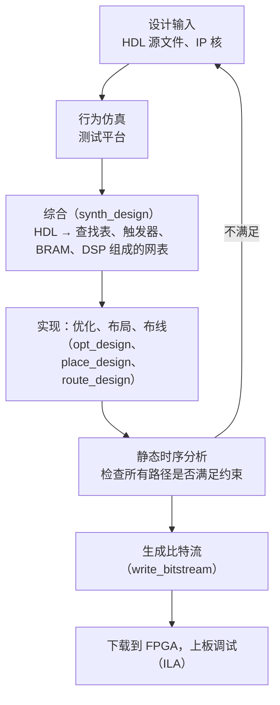

前面各章用门、**触发器**和中规模芯片搭建电路，电路的功能由芯片之间的连线决定，修改功能就要重新连线。可编程逻辑器件把"连线"也变成可以写入的配置：同一块芯片，写入不同的配置就成为不同的电路。本章沿着器件发展的顺序，从 ROM、**PLA**、PAL、GAL 这些以与或阵列为核心的简单器件，讲到 CPLD 和以查找表为核心的 FPGA，并以现行的 AMD（原 Xilinx）等器件为例介绍 FPGA 的片内资源。器件规模达到数百万个逻辑单元后，电路不可能再用逻辑图来画，而要用硬件描述语言来写：本章后半以 SystemVerilog 为主（VHDL 作对照）介绍组合逻辑、时序逻辑与**有限状态机**的写法，以及测试平台与仿真、综合与实现的流程和同步设计原则。前面学过的卡诺图化简、状态编码、时序约束，在这里都由 EDA 工具自动完成，但理解它们才能写出好的硬件描述；计算机组成原理的实验（[4.10](/4.10)）就是用本章的方法在 FPGA 上实现处理器。

## 9.1. 可编程逻辑器件概述

**定义 9.1.1（可编程逻辑器件）** 由用户通过写入配置数据来确定其逻辑功能的集成电路统称为**可编程逻辑器件**（PLD）。

任何组合逻辑函数都可以写成与或式（**最简与或式**或**最小项**之和，[4.9.2](/4.9.2)），所以一个"与阵列 + 或阵列"的结构，只要两个阵列中的连接可以选择，就能实现任意组合逻辑；再加上触发器，就能实现时序逻辑。简单 PLD 的区别只在于哪个阵列可编程：

| 器件 | 与阵列 | 或阵列 | 输出 | 说明 |
|---|---|---|---|---|
| ROM | 固定（全译码，产生全部最小项） | 可编程 | 组合 | 实际上是存储器 |
| PLA | 可编程 | 可编程 | 组合（可外加触发器） | 最灵活，速度和成本居中 |
| PAL | 可编程 | 固定 | 组合型或**寄存器**型，型号决定 | 多为一次性编程 |
| GAL | 可编程 | 固定 | 输出逻辑宏单元可配置 | 电可擦除，可反复编程 |

画阵列图时采用简化画法：一条横线代表一个多输入与门（或或门）的全部输入，与竖线交叉处画点表示该处有连接（已编程），不画点表示没有连接。

保存配置的技术决定了器件能否重复编程、掉电后是否丢失配置：

- 熔丝与反熔丝：一次性编程（早期 PROM、PAL，一些抗辐射 FPGA）。
- EPROM、EEPROM、Flash：非易失，可擦除重写（GAL、CPLD、部分 FPGA）。
- SRAM：易失，上电时从外部存储器加载配置，可无限次重写（绝大多数 FPGA）。

## 9.2. 只读存储器

### 9.2.1. 结构

**定义 9.2.1（只读存储器）** 正常工作时只能读出、不能随时写入所存数据的存储器称为**只读存储器**（ROM）。$n$ 位地址、每个字 $m$ 位的 ROM 容量为 $2^n \times m$ 位。

ROM 由地址**译码器**和存储矩阵组成：$n$ 位地址经译码器选中 $2^n$ 条字线中的一条，被选中字线上的 $m$ 个存储单元的内容经读出放大器送到 $m$ 条位线上。从逻辑上看，译码器就是一个固定的与阵列，每条字线是地址变量的一个最小项；存储矩阵是一个可编程的或阵列，第 $j$ 位输出等于"存储单元为 1 的那些字线"之或。

按写入方式，ROM 有掩模 ROM（制造时写入）、PROM（用户一次写入）、EPROM（紫外线擦除）、EEPROM（电擦除）和 Flash（按块电擦除）。后几种其实都可以写，只是写入比读出慢得多、需要专门的操作，所以仍归入 ROM；今天单片机的程序存储器和固态硬盘用的就是 Flash（[4.11.8](/4.11.8)）。

### 9.2.2. 用 ROM 实现组合逻辑

ROM 的输出就是输入的最小项之和，所以把**真值表**原样写入 ROM，就实现了这个组合逻辑函数：地址是输入，所存的字是输出，不需要化简。例如 4 位二进制码到典型 **Gray 码**（[4.9.1](/4.9.1)）的转换用一个 $16 \times 4$ 的 ROM 实现，第 $k$ 个字存放 $k$ 的 Gray 码 $k \oplus (k \gg 1)$：

| 地址 $B_3B_2B_1B_0$ | 0000 | 0001 | 0010 | 0011 | 0100 | 0101 | 0110 | 0111 |
|---|---|---|---|---|---|---|---|---|
| 内容 $G_3G_2G_1G_0$ | 0000 | 0001 | 0011 | 0010 | 0110 | 0111 | 0101 | 0100 |

| 地址 $B_3B_2B_1B_0$ | 1000 | 1001 | 1010 | 1011 | 1100 | 1101 | 1110 | 1111 |
|---|---|---|---|---|---|---|---|---|
| 内容 $G_3G_2G_1G_0$ | 1100 | 1101 | 1111 | 1110 | 1010 | 1011 | 1001 | 1000 |

按阵列中的连接点计算，与阵列有 $8 \times 16 = 128$ 个点（4 个变量的原变量与反变量，乘 16 个最小项），或阵列有 $4 \times 16 = 64$ 个点，共 192 个。把 4 位二进制**计数器**（[4.9.8](/4.9.8)）的输出接到这个 ROM 的地址上，就得到 Gray 码计数器。由于计数器各位不是绝对同时变化，ROM 的输出在转换瞬间可能出现**毛刺**，需要稳定的输出时应在 ROM 后面再加一级寄存器。

ROM 的优点是设计简单、任意函数的延迟相同；缺点是容量随输入数指数增长，而大多数函数只用到很少的最小项，利用率低。

## 9.3. 可编程逻辑阵列

**定义 9.3.1（可编程逻辑阵列）** 与阵列和或阵列都可编程的可编程逻辑器件称为**可编程逻辑阵列**（PLA）。

PLA 针对 ROM 利用率低的问题：与阵列不再产生全部 $2^n$ 个最小项，只产生函数实际需要的乘积项。用 PLA 实现组合逻辑时，先把各输出化简为最简与或式，并尽量让不同输出共用乘积项。仍以二进制码到 **Gray 码**的转换为例：

$$
G_3 = B_3, \qquad G_2 = B_3 \bar B_2 + \bar B_3 B_2, \qquad G_1 = B_2 \bar B_1 + \bar B_2 B_1, \qquad G_0 = B_1 \bar B_0 + \bar B_1 B_0,
$$

共 7 个不同的乘积项 $P_0, \dots, P_6$。与阵列有 $8 \times 7 = 56$ 个点，或阵列有 $4 \times 7 = 28$ 个点，共 84 个，不到 ROM 方案的一半。PLA 的规模用"输入数 × 乘积项数 × 输出数"表示。


PLA 加上 **D 触发器**（输出经触发器反馈到与阵列的输入）就能实现**时序电路**。例如 [4.9.8](/4.9.8) 的十进制计数器，4 个激励函数共用到 8 个乘积项（$\bar Q_0$、$\bar Q_3\bar Q_1Q_0$、$Q_1\bar Q_0$、$\bar Q_2Q_1Q_0$、$Q_2\bar Q_1$、$Q_2\bar Q_0$、$Q_3\bar Q_0$、$\bar Q_3Q_2Q_1Q_0$），用一个 $4 \times 8 \times 4$ 的 PLA 加 4 个 D 触发器即可实现。可变模计数器（例 8.2.1）也可以这样做：把模 16 计数器的每个激励与"计数值不等于 $N$"的信号相与，计到 $N$ 后所有激励为 0，下一个时钟回到 $0000$。

PLA 的问题是两个阵列都可编程，编程工艺复杂、信号经过两级可编程连接，速度较慢。它作为独立器件已经少见，但"可编程与阵列 + 可编程或阵列"的规整结构在芯片内部仍有使用（例如早期处理器的控制逻辑）。

## 9.4. PAL 与 GAL

### 9.4.1. PAL

**定义 9.4.1（PAL）** 与阵列可编程、或阵列固定（每个输出固定地由若干个乘积项相或）的可编程逻辑器件称为**可编程阵列逻辑**（PAL）。

PAL 由 MMI 公司在 20 世纪 70 年代末推出，PAL 是它的注册商标。或阵列固定简化了工艺、提高了速度，代价是每个输出能用的乘积项个数固定（例如 8 个），函数化简后的乘积项不能超过这个数。按输出结构，PAL 有几种型号：

- 组合型：输出经**三态门**输出，并反馈回与阵列（可以作为输入，或构成多级逻辑），三态门的使能也由一个乘积项控制；
- 寄存器型：或门的输出先存入 **D 触发器**，触发器的输出再反馈回与阵列，可以直接实现**同步时序电路**；
- **异或**型：两组乘积项之和经异或门后存入触发器，便于实现计数器、加减法等运算。

PAL 多用熔丝工艺，只能编程一次；而且一种型号的输出结构固定，组合型的不能做时序逻辑，寄存器型的不便做组合逻辑，用户要备很多种型号。

### 9.4.2. GAL

**定义 9.4.2（GAL）** 与阵列可编程、或阵列固定、采用电可擦除工艺，并且每个输出都经过一个可配置的输出逻辑宏单元的可编程逻辑器件称为**通用阵列逻辑**（GAL）。

GAL 由 Lattice 公司于 1985 年推出，解决了 PAL 的两个问题：EEPROM 工艺可以反复擦写；输出逻辑宏单元（OLMC）由配置位控制，一种型号就能代替多种 PAL。以 GAL16V8 为例：20 个引脚，最多 16 个输入、8 个输出，与阵列有 64 个乘积项，每个输出 8 个。每个 OLMC 包含：

| 部件 | 作用 |
|---|---|
| 8 输入或门 | 把该输出的 8 个乘积项相或（固定的或阵列就在这里） |
| 异或门 | 由配置位 $\mathrm{XOR}(n)$ 选择输出原函数还是反函数 |
| D 触发器 | 寄存异或门的输出，用于时序逻辑 |
| 输出**数据选择器** | 选择组合输出（异或门）或寄存器输出（触发器） |
| 三态与反馈数据选择器 | 选择输出使能的来源（常通、外部 $\overline{\mathrm{OE}}$ 或一个乘积项）以及反馈回与阵列的信号 |

全局的配置位（$\mathrm{SYN}$、$\mathrm{AC0}$）和每个宏单元的 $\mathrm{AC1}(n)$ 把 OLMC 配置成专用输入、组合输出、带反馈的组合输出或寄存器输出等工作模式。GAL 的"通用"体现在：同一块芯片中，有的输出可以做组合逻辑，有的可以做时序逻辑，引脚也可以配置为输入或输出。

GAL 和 PAL 这类器件今天统称为简单可编程逻辑器件（SPLD）。Lattice 已经停产 GAL，但 Microchip（原 Atmel）的 ATF16V8、ATF22V10 等引脚兼容器件仍有供应，用于维护老设计和简单的胶合逻辑；新设计一般直接用 CPLD 或小规模 FPGA。

## 9.5. CPLD

**定义 9.5.1（CPLD）** 在一块芯片上集成多个类似 PAL/GAL 的逻辑块（每块由可编程与阵列、乘积项分配和若干宏单元组成），并用一个可编程的全局互连矩阵把它们连接起来的可编程逻辑器件称为**复杂可编程逻辑器件**（CPLD）。

CPLD 的特点来自它的结构：

- 配置存储在片内 EEPROM 或 Flash 中，掉电不丢失，上电即可工作；
- 任意两个宏单元之间都经过同一个互连矩阵，延迟固定、可以预测；
- 乘积项结构适合宽输入的译码类逻辑，但宏单元数量通常只有几十到几百个，触发器少。

因此 CPLD 适合做地址译码、电平转换、上电时序控制这类"胶合逻辑"，在主板和计算机组成原理实验板上常用来辅助 FPGA（例如实验板上用 CPLD 实现串口）。现行产品如 AMD 的 CoolRunner-II、XC9500XL（都已是成熟的老产品）和 Intel 的 MAX V。规模更大的需求已经由带片内 Flash 的小规模 FPGA（Intel MAX 10、Lattice MachXO 系列）承担，它们也能上电即用，常被厂商归入同一用途。

## 9.6. FPGA

### 9.6.1. 查找表与逻辑块

**定义 9.6.1（FPGA）** 由大量可配置逻辑块、可编程互连资源和可配置输入输出单元组成，逻辑块以查找表实现组合逻辑、以触发器实现时序逻辑，配置通常保存在 SRAM 中的可编程逻辑器件称为**现场可编程门阵列**（FPGA）。

"现场可编程"指用户在自己的电路板上（而不是在芯片工厂里）写入配置。FPGA 的核心是查找表：

**定义 9.6.2（查找表）** $k$ 个输入、1 个输出，由 $2^k$ 位存储单元和一个以 $k$ 个输入为选择信号的 $2^k$ 选 1 数据选择器组成，能实现任意 $k$ 输入逻辑函数的可配置逻辑元件称为 $k$ 输入**查找表**（LUT）。

查找表就是一个 $2^k \times 1$ 的小存储器：EDA 工具算出函数的真值表，把它写入存储单元；工作时 $k$ 个输入作为地址，"查表"读出函数值。这与 9.2 节用 ROM 实现组合逻辑的原理相同，只是规模很小、可以随时重写。例如 4 输入与门的真值表只有地址 $1111$ 处为 1，对应的 16 位配置为 $1000\,0000\,0000\,0000$（AMD 器件中写作 $\mathrm{INIT} = 16\text{'h}8000$）。任何 $k$ 输入函数的延迟都相同，与函数的复杂程度无关；超过 $k$ 个输入的函数要用几个查找表级联，此时函数的分解方式决定了级数和延迟。

现行 AMD 器件（7 系列、UltraScale/UltraScale+、Versal）用 6 输入查找表，每个 LUT6 也可以拆成两个共用 5 个输入的 5 输入查找表，有两个输出。查找表与触发器组成逻辑片（slice）：

| 层次 | 7 系列 | UltraScale/UltraScale+ |
|---|---|---|
| slice | 4 个 LUT6、8 个触发器、进位链、宽数据选择器 | — |
| CLB | 2 个 slice | 1 个 slice：8 个 LUT6、16 个触发器 |

触发器都是带时钟使能（CE）和同步或异步置位、复位端的 **D 触发器**（如 FDRE：同步复位、带使能），没有 JK、**T 触发器**，也没有双**边沿触发**器；对它们的需求由 LUT 中的组合逻辑满足。专用的进位链（7 系列为 CARRY4）用快速的超前进位逻辑（[4.9.5](/4.9.5)）连接相邻 slice，加法器和计数器因此不必占用通用互连。一部分 slice（SLICEM）中的查找表还可以用作小容量的分布式 RAM 或移位寄存器。

其他厂商的结构类似但细节不同：Altera（Intel）的 Agilex、Stratix 10 用自适应逻辑模块（ALM），一个可拆分的 8 输入查找表配 4 个寄存器；Lattice 的 iCE40、ECP5 等低功耗器件用 4 输入查找表。

### 9.6.2. 片内其他资源

- 块 RAM（BRAM）：专用的同步 SRAM 块，7 系列与 UltraScale 中每块 36 Kb（可拆为两个 18 Kb），真双端口，宽度可配置；UltraScale+ 另有 288 Kb 的 UltraRAM。例如 Artix-7 XC7A100T 有 135 个 36 Kb 的块 RAM，共 4860 Kb。处理器实验中的指令存储器、数据存储器、寄存器堆和 FIFO 都可以用它实现。
- DSP 单元：硬件乘加器。7 系列的 DSP48E1 包含 25×18 位乘法器、预加器和 48 位的加法/累加器，UltraScale 的 DSP48E2 为 27×18 位，Versal 的 DSP58 为 27×24 位。综合工具会把代码中的乘法和乘加自动映射到 DSP 单元。
- 时钟管理与时钟网络：7 系列每个时钟管理单元（CMT）含一个混合模式时钟管理器（MMCM）和一个锁相环（PLL），对输入时钟倍频、分频、移相，产生多个频率的时钟（较早资料中常见的 DCM 是更早的 Virtex-4、Spartan-6 等器件中的模块）。时钟经全局缓冲器（BUFG）进入专用的低偏斜时钟网络分配到各触发器（[4.9.7](/4.9.7#sec-7.6.2)）。
- 输入输出单元（IOB）：支持多种电平标准（LVCMOS、LVDS、SSTL 等）、输出三态控制、输入输出寄存器、双倍数据率（DDR）与串并转换；高端器件还有数十 Gb/s 的高速串行收发器。工具根据顶层端口是 `input`、`output` 还是 `inout` 自动选用输入、输出或双向缓冲器。
- 硬核：部分器件集成了处理器（Zynq 系列的 Arm 核）、PCIe、以太网 MAC、DDR 存储器控制器等硬件模块。

### 9.6.3. 现行器件与配置

AMD 于 2022 年完成对 Xilinx 的收购，现行 FPGA 产品线包括：28 nm 的 7 系列（Spartan-7、Artix-7、Kintex-7、Virtex-7，教学与中低端应用中仍最常用）；20/16 nm 的 UltraScale 与 UltraScale+（含 2024 年发布的 Spartan UltraScale+，以及集成 Arm 处理器的 Zynq UltraScale+ MPSoC）；7 nm 的 Versal 自适应 SoC。其他主要厂商有 Altera（2015 年被 Intel 收购，2024 年起重新以 Altera 品牌独立运营；Agilex、Cyclone、MAX 系列）、Lattice（低功耗、小规模器件）、Microchip（基于 Flash 的非易失 PolarFire 系列），国内有紫光同创、安路、高云等。

基于 SRAM 的 FPGA 掉电后配置丢失，每次上电要从外部的 Flash 加载配置数据（比特流），或者由处理器、**调试器**通过 JTAG 下载。基于 Flash 的 FPGA 和 CPLD 不需要外部配置存储器。

| | CPLD | FPGA | ASIC（专用集成电路） |
|---|---|---|---|
| 逻辑单元 | 乘积项宏单元 | 查找表 + 触发器 | 标准单元，制造时确定 |
| 规模 | 几十到几百个宏单元 | 数千到数百万个查找表 | 不限 |
| 配置 | 非易失，上电即用 | 多为 SRAM，上电加载 | 不可改 |
| 延迟 | 固定、可预测 | 取决于布局布线 | 最快 |
| 适用 | 胶合逻辑 | 原型验证、中小批量产品、加速计算 | 大批量产品 |

## 9.7. 硬件描述语言

### 9.7.1. 概述

**定义 9.7.1（硬件描述语言）** 用文本描述数字电路的结构与行为、既可供仿真器模拟其行为又可供综合工具转换为电路的计算机语言称为**硬件描述语言**（HDL）。现在通用的硬件描述语言是 **Verilog** 及其扩展 **SystemVerilog**，以及 **VHDL**。

Verilog 由 Gateway Design Automation 公司（Phil Moorby 等）于 1984 年前后推出，1995 年成为 IEEE 1364 标准；SystemVerilog 在 Verilog 的基础上增加了更严格的设计构造（`logic` 类型、`always_comb`、`always_ff`、枚举、结构体、接口）和大量验证功能（**断言**、随机化、面向对象的测试平台），2005 年成为 IEEE 1800 标准，2009 年起 Verilog 标准并入其中，现行版本为 IEEE 1800-2023。VHDL 起源于美国国防部 20 世纪 80 年代的 VHSIC 计划，1987 年成为 IEEE 1076 标准，现行版本为 IEEE 1076-2019，语法源自 Ada，类型检查严格、风格冗长，在欧洲、航空航天与部分国内高校中常用。两者描述能力相当，常用的可综合子集可以逐句对应。现在工业界的数字设计和验证以 SystemVerilog 为主，Vivado、Quartus 等工具都支持它，本章的代码用 SystemVerilog 写。

学习 HDL 最重要的一点是：它描述的是硬件，不是程序。代码的每一部分最终都对应组合逻辑、寄存器或连线，模块之间、语句块之间是同时工作的，而不是按顺序执行。写代码之前应先想清楚电路的结构：哪些是寄存器、哪些是组合逻辑、**状态机**有哪些状态，最好先在纸上画出模块和连线。不知道一段代码会被综合成什么电路，它多半就是错的。

只有语言的一个子集是可综合的（能转换为电路），其余部分（延时 `#10`、`initial` 中的激励序列、`$display`、文件读写等）只能用于仿真和测试平台（9.8 节）。

### 9.7.2. 模块、端口与数据

模块（`module`）是 SystemVerilog 的基本单元，对应电路中的一个部件，端口是它的引脚：

```systemverilog
module mux2 #(
    parameter int W = 8                 // parameter with a default value
) (
    input  logic [W-1:0] d0, d1,
    input  logic         s,
    output logic [W-1:0] y
);
    assign y = s ? d1 : d0;             // continuous assignment: combinational logic
endmodule
```

- 数据类型：SystemVerilog 中可以统一用 `logic`（取值 0、1、X 未知、Z 高阻），由用法决定它是连线还是寄存器，不必像 Verilog 那样区分 `wire` 与 `reg`（`reg` 也不一定综合成寄存器）。
- 位向量与常数：`logic [31:0] a` 是 32 位，`a[7:0]` 取低 8 位；常数写成"位数'进制数值"，如 `8'b0000_0001`、`12'hFA3`、`4'd5`，`'0` 表示全 0；`{a, b}` 拼接，`{4{a[0]}}` 重复。
- 运算：按位 `& | ^ ~`，归约 `&a`（各位相与），算术 `+ - *`，比较 `== !=`，条件 `s ? x : y`（综合为数据选择器）。

层次化设计用模块实例化实现，端口应按名字连接（`.端口(信号)`），按位置连接容易接错、难以维护。参数用 `#(.W(16))` 覆盖，使同一个模块可以生成不同位宽的电路。下面是 [4.9.8](/4.9.8#sec-8.2.3) 的秒计数器：一个模可配置的计数器，实例化两次分别作个位（模 10）和十位（模 6）：

```systemverilog
module mod_counter #(
    parameter int N = 10                    // modulus, N >= 2
) (
    input  logic                 clk,
    input  logic                 rst,
    input  logic                 en,
    output logic [$clog2(N)-1:0] q,
    output logic                 wrap       // carry to the next stage
);
    localparam logic [$clog2(N)-1:0] LAST = N - 1;

    assign wrap = en && (q == LAST);

    always_ff @(posedge clk) begin
        if (rst || wrap)
            q <= '0;
        else if (en)
            q <= q + 1'b1;
    end
endmodule

// Seconds counter 00-59: a mod-10 stage followed by a mod-6 stage
module seconds (
    input  logic       clk,
    input  logic       rst,
    input  logic       tick,                // one pulse per second
    output logic [3:0] ones,
    output logic [2:0] tens,
    output logic       minute               // one pulse per minute
);
    logic carry;

    mod_counter #(.N(10)) u_ones (.clk(clk), .rst(rst), .en(tick),  .q(ones), .wrap(carry));
    mod_counter #(.N(6))  u_tens (.clk(clk), .rst(rst), .en(carry), .q(tens), .wrap(minute));
endmodule
```

`$clog2(N)` 在编译时算出需要的位数 $\lceil \log_2 N \rceil$。两级共用一个时钟，十位只由使能控制，正是同步级联（[4.9.8](/4.9.8#sec-8.2.3)）的写法。

### 9.7.3. 组合逻辑

组合逻辑有两种写法：简单的用 `assign` 连续赋值；复杂的写在 `always_comb` 块中，块内可以用 `if`、`case` 等语句，使用阻塞赋值 `=`。`always_comb` 不写敏感信号列表，它自动对块内读到的所有信号敏感。

```systemverilog
module sevenseg (
    input  logic [3:0] digit,
    output logic [6:0] seg              // segments a..g, active high
);
    always_comb begin
        case (digit)
            4'd0:    seg = 7'b111_1110;
            4'd1:    seg = 7'b011_0000;
            4'd2:    seg = 7'b110_1101;
            4'd3:    seg = 7'b111_1001;
            4'd4:    seg = 7'b011_0011;
            4'd5:    seg = 7'b101_1011;
            4'd6:    seg = 7'b101_1111;
            4'd7:    seg = 7'b111_0000;
            4'd8:    seg = 7'b111_1111;
            4'd9:    seg = 7'b111_1011;
            default: seg = 7'b000_0000;  // blank for 10-15
        endcase
    end
endmodule
```

组合逻辑最常见的错误是意外生成**锁存器**：若某个输出在某些条件下没有被赋值（`if` 缺 `else`，`case` 缺 `default`），它就要"保持原值"，综合工具只能用锁存器实现这种记忆，电路就不再是组合逻辑了（[4.9.6](/4.9.6#sec-6.3.2) 指出了锁存器的透明问题）。

```systemverilog
// Wrong: y keeps its old value when en = 0, so a latch is inferred
always_comb begin
    if (en) y = d;
end

// Right: a default assignment at the top covers every path
always_comb begin
    y = '0;
    if (en) y = d;
end
```

用 `always_comb` 而不是 Verilog 的 `always @(*)`，工具会在推断出锁存器时报告警告或错误。`case` 还可以加修饰词 `unique`（各分支互斥、且必有一项命中）或 `priority`（按书写顺序优先），仿真时违反会报警告，综合时可以据此优化；但它们并不能防止锁存器，默认赋值仍然要写。需要通配的比较用 `casez`（`?` 表示不关心），不要用 `casex`，后者会把仿真中的未知值 X 也当作通配，掩盖错误。

### 9.7.4. 时序逻辑

时序逻辑写在 `always_ff @(posedge clk)` 块中，只在时钟上升沿执行，没有执行时变量保持原值，于是被综合为触发器；块内一律使用非阻塞赋值 `<=`。

```systemverilog
module bcd_counter (
    input  logic       clk,
    input  logic       rst,      // synchronous reset, active high
    input  logic       en,       // count enable
    output logic [3:0] q,
    output logic       carry     // high while counting from 9 to 0
);
    always_ff @(posedge clk) begin
        if (rst)
            q <= 4'd0;
        else if (en)
            q <= (q == 4'd9) ? 4'd0 : q + 4'd1;
    end

    assign carry = en && (q == 4'd9);
endmodule
```

这就是 [4.9.8](/4.9.8#sec-8.1.4) 的十进制计数器加上同步复位和使能，次态逻辑的化简交给综合工具。

阻塞与非阻塞赋值。阻塞赋值 `=` 立即生效，后面的语句读到的是新值，和软件中的赋值一样；非阻塞赋值 `<=` 先计算块内所有右边的值，到这一时间步结束时才统一更新左边。后者正好模拟了同一个时钟边沿上所有触发器同时采样、同时更新的行为：

```systemverilog
always_ff @(posedge clk) begin
    a <= b;      // both right-hand sides are sampled first,
    b <= a;      // so a and b swap on every clock edge
end
```

若改用阻塞赋值，`a = b; b = a;` 执行后两者都等于原来的 `b`，与硬件不符，而且结果还会依赖于多个 `always` 块的执行顺序。规则很简单：时序逻辑（`always_ff`）用 `<=`，组合逻辑（`always_comb`）用 `=`；一个信号只在一个 `always` 块中赋值，否则就有多个驱动源。

复位。同步复位只在时钟边沿起作用（上面的计数器），对应 [4.9.8](/4.9.8#sec-8.2.1) 74163 的同步清零；异步复位把复位信号也写进敏感列表，对应 74161 的异步清零和触发器的异步复位端：

```systemverilog
module shift_reg #(
    parameter int W = 8
) (
    input  logic         clk,
    input  logic         rst_n,    // asynchronous reset, active low
    input  logic         load,     // parallel load
    input  logic         shift,    // shift towards the MSB
    input  logic [W-1:0] d,
    input  logic         sin,      // serial input
    output logic [W-1:0] q
);
    always_ff @(posedge clk or negedge rst_n) begin
        if (!rst_n)
            q <= '0;
        else if (load)
            q <= d;
        else if (shift)
            q <= {q[W-2:0], sin};
    end
endmodule
```

`if`–`else if` 的顺序就是控制信号的优先级（复位 > 置数 > 移位 > 保持），没有赋值的分支表示保持，综合为触发器的时钟使能，而不是门控时钟。

### 9.7.5. 有限状态机

**有限状态机**按 [4.9.7](/4.9.7#sec-7.1) 的结构分三部分写：状态寄存器（`always_ff`）、次态逻辑（`always_comb`）和输出逻辑（`assign` 或 `always_comb`）。状态用枚举类型命名，编码交给综合工具。下面是例 7.4.1 的"110"序列检测器（**Mealy 机**）：

```systemverilog
`timescale 1ns / 1ps

module detect110 (
    input  logic clk,
    input  logic rst,
    input  logic x,
    output logic z
);
    // S1: no useful prefix, S2: last input was 1, S3: last two inputs were 11
    typedef enum logic [1:0] {S1, S2, S3} state_t;
    state_t state, next;

    // state register
    always_ff @(posedge clk) begin
        if (rst) state <= S1;
        else     state <= next;
    end

    // next-state logic
    always_comb begin
        case (state)
            S1:      next = x ? S2 : S1;
            S2:      next = x ? S3 : S1;
            S3:      next = x ? S3 : S1;
            default: next = S1;
        endcase
    end

    // output logic (Mealy: depends on the current input)
    assign z = (state == S3) && !x;
endmodule
```

代码与**状态表**逐行对应，`default` 分支让无效编码回到 $S_1$，保证了**自启动**。综合工具会识别出状态机并重新选择编码：例如开源综合工具 Yosys 面向 AMD 7 系列综合这个模块时，把它改为**独热码**，得到 3 个触发器和 4 个查找表；Vivado 也默认自动选择编码，可以用属性 `(* fsm_encoding = "one_hot" *)` 等指定。Moore 机的写法相同，只是输出逻辑只读 `state`。

### 9.7.6. 与 VHDL 对照

下面是一个十进制计数器（异步清零、计数使能）的 VHDL 写法，以及等价的 SystemVerilog：

```vhdl
library ieee;
use ieee.std_logic_1164.all;
use ieee.numeric_std.all;

entity count10 is
    port (
        clk, clr, en : in  std_logic;
        q            : out std_logic_vector(3 downto 0)
    );
end entity count10;

architecture rtl of count10 is
    signal count : unsigned(3 downto 0);
begin
    process (clk, clr)
    begin
        if clr = '1' then                   -- asynchronous clear
            count <= (others => '0');
        elsif rising_edge(clk) then
            if en = '1' then
                if count = 9 then
                    count <= (others => '0');
                else
                    count <= count + 1;
                end if;
            end if;
        end if;
    end process;

    q <= std_logic_vector(count);
end architecture rtl;
```

```systemverilog
module count10 (
    input  logic       clk,
    input  logic       clr,      // asynchronous clear, active high
    input  logic       en,
    output logic [3:0] q
);
    always_ff @(posedge clk or posedge clr) begin
        if (clr)
            q <= 4'd0;
        else if (en)
            q <= (q == 4'd9) ? 4'd0 : q + 4'd1;
    end
endmodule
```

| SystemVerilog | VHDL |
|---|---|
| `module … endmodule` | `entity`（端口）+ `architecture`（实现） |
| `logic [3:0]` | `std_logic_vector(3 downto 0)`；算术用 `numeric_std` 的 `unsigned` |
| `always_ff @(posedge clk or posedge clr)` | `process (clk, clr)` 中 `if clr = '1' … elsif rising_edge(clk)` |
| `<=`（非阻塞赋值） | 信号赋值 `<=`（在进程结束时更新，语义相同） |
| `=`（阻塞赋值） | 变量赋值 `:=` |
| `assign y = s ? a : b;` | `y <= a when s = '1' else b;` |

VHDL 是强类型的：`std_logic_vector` 只是一组位，不能直接做加法，要转换为 `unsigned` 或 `signed`。旧代码常用的 `std_logic_unsigned` 程序包不是 IEEE 标准，应改用 `numeric_std`；时钟边沿写 `rising_edge(clk)`，比 `clk'event and clk = '1'` 更准确。

## 9.8. 仿真与测试平台

### 9.8.1. 测试平台

电路下载到 FPGA 之后，内部信号很难观察，输入情况也难以覆盖完全，所以硬件设计的调试主要靠下载之前的仿真。被测的模块称为 DUT（Device Under Test），它可以是整个设计，也可以是其中一个部件（如寄存器堆）。

**定义 9.8.1（测试平台）** 实例化被测设计、为它产生时钟与输入激励、并检查或记录其输出的仿真模块称为**测试平台**（testbench）。

测试平台本身不综合成电路，所以可以使用 SystemVerilog 的全部仿真功能：

| 语句 | 作用 |
|---|---|
| `` `timescale 1ns / 1ps `` | 时间单位 1 ns、精度 1 ps（Vivado 生成的每个源文件开头都有，各文件应一致） |
| `#10` | 等待 10 个时间单位 |
| `@(posedge clk)` | 等待事件（时钟上升沿） |
| `initial begin … end` | 仿真开始时执行一次，用来产生激励序列 |
| `always #5 clk = ~clk;` | 周期为 10 个时间单位的时钟 |
| `$display`、`$monitor` | 打印信息；`$monitor` 在信号变化时自动打印 |
| `assert (…) else $error(…)` | **断言**：条件不成立时报错 |
| `$finish` | 结束仿真 |
| `task`、`function` | 封装可复用的操作序列（task 可以消耗仿真时间）与计算（function 不能） |

好的测试平台是自检的：它包含一个参考模型，自动比较 DUT 的输出与期望值，而不是靠人读波形。下面的测试平台检查"110"检测器：参考模型只需记住前两位输入，先送入例题中的序列 $1110110$，再送入 1000 位随机输入。

```systemverilog
`timescale 1ns / 1ps

module tb_detect110;
    logic clk = 1'b0;
    logic rst, x, z;
    logic [1:0] prev;                 // reference model: the two previous inputs
    int errors = 0;
    logic pattern[] = '{1, 1, 1, 0, 1, 1, 0};

    detect110 dut (.clk(clk), .rst(rst), .x(x), .z(z));

    always #5 clk = ~clk;             // 10 ns period

    // Apply one input bit after a falling edge and check the output before the rising edge
    task automatic send(input logic b);
        x = b;
        #1;
        assert (z == (prev == 2'b11 && b == 1'b0))
            else begin
                $error("t=%0t: x=%b z=%b", $time, x, z);
                errors++;
            end
        @(posedge clk);
        prev = {prev[0], b};
        @(negedge clk);
    endtask

    initial begin
        rst  = 1'b1;
        x    = 1'b0;
        prev = 2'b00;
        repeat (2) @(posedge clk);
        @(negedge clk);
        rst = 1'b0;
        foreach (pattern[i]) send(pattern[i]);
        repeat (1000) send(1'($urandom_range(0, 1)));
        $display("%s: %0d error(s)", errors == 0 ? "PASS" : "FAIL", errors);
        $finish;
    end
endmodule
```

输入在时钟下降沿后改变、输出在上升沿前检查，避免了在时钟边沿同时改变输入所造成的**竞争**（测试平台与 DUT 谁先执行不确定）。**Mealy 机**的输出随输入当拍变化，因此要在送入输入之后、时钟边沿之前检查。

### 9.8.2. 仿真的层次

| 仿真 | 时机 | 包含的信息 | 用途 |
|---|---|---|---|
| 行为仿真（RTL 仿真） | 综合之前 | 只有逻辑功能，无延迟 | 绝大部分调试在这里完成 |
| 综合后功能仿真 | 综合之后 | 映射到器件原语的网表 | 检查综合是否改变了功能（如意外的锁存器） |
| 时序仿真 | 布局布线之后 | 门延迟与连线延迟 | 检查时序问题，慢且耗资源，一般由静态时序分析代替 |

行为仿真足以发现绝大多数逻辑错误。仿真波形中，Vivado 用红色表示未知值 X（多半是没有复位或多个驱动），用蓝色表示高阻 Z（多半是没有连接）。

仿真也有看不到的问题：与真实外设的交互、跨时钟域、时序违例。这时用片内逻辑分析仪调试：在设计中插入 ILA（Integrated Logic Analyzer）IP 核，指定要观察的信号和触发条件，重新综合实现后下载，在 Vivado 中实时观察芯片内部的波形。它要占用块 RAM 来存储采样数据，并且每改一次观察的信号都要重新实现。

## 9.9. 设计流程

从代码到运行在 FPGA 上的电路，要经过以下步骤（括号中为 Vivado 中对应的命令）：



**定义 9.9.1（综合）** 把用硬件描述语言写成的寄存器传输级描述转换为由目标工艺的基本元件（门、查找表、触发器等）及其连接组成的网表的过程称为**综合**。

综合时，工具推断出寄存器、数据选择器、加法器、状态机和存储器，做逻辑化简（**卡诺图**、Q-M 法的工业版本）和**状态编码**，再映射到器件的查找表与专用资源上；综合报告给出资源占用（查找表、触发器、块 RAM、DSP 的个数）和推断出的锁存器等警告，应当认真阅读。实现阶段把网表中的每个元件放到芯片上的具体位置（布局），再用可编程互连把它们连起来（布线）；连线延迟往往比逻辑延迟还大，所以布局对速度影响很大。

工具需要的约束写在约束文件（Vivado 为 XDC，语法基于 Tcl）中，主要有两类：

```tcl
# Pin assignment and I/O standard of the top-level ports
set_property -dict {PACKAGE_PIN E3 IOSTANDARD LVCMOS33} [get_ports clk]
# A 100 MHz clock: every register-to-register path must fit in 10 ns
create_clock -period 10.000 -name sys_clk [get_ports clk]
```

时钟约束告诉静态时序分析工具每条路径必须满足的**建立时间**与**保持时间**约束（[4.9.7](/4.9.7#sec-7.6) 的式 (7.1)、式 (7.2)），实现后的时序报告中，最差裕量（WNS）为负就说明时序不满足，要优化设计（流水线、减少逻辑级数）或降低频率。

除了厂商工具（AMD Vivado、Altera Quartus Prime、Lattice Radiant/Diamond），还有成熟的开源工具链：

| 工具 | 作用 |
|---|---|
| Icarus Verilog、Verilator | 仿真（Verilator 把 SystemVerilog 编译成 C++，速度快，支持大部分可综合子集和越来越多的测试平台语法） |
| GHDL | VHDL 仿真 |
| Yosys | 综合，支持 Verilog 与 SystemVerilog 的可综合子集，可面向多种 FPGA 和 ASIC 工艺 |
| nextpnr | 布局布线，配合 Project IceStorm（Lattice iCE40）、Project Trellis（ECP5）、Project Apicula（高云）等对比特流格式的逆向文档 |
| cocotb | 用 Python 写测试平台 |

对 AMD 7 系列，也有 Project X-Ray 与 openXC7 等开源流程，但仍属实验性质；课程实验应以 Vivado 为准。

## 9.10. 硬件设计原则

### 9.10.1. 同步设计原则

**定义 9.10.1（同步设计）** 全部时序元件都是由同一个（或同源、相位关系确定的少数几个）时钟的同一边沿触发的边沿触发器，组合逻辑中没有反馈回路，异步输入先经同步器再使用的设计方法称为**同步设计**。

FPGA 的结构和 EDA 工具的时序分析都是为同步电路优化的：时钟网络低偏斜，触发器带时钟使能，静态时序分析只检查寄存器之间的路径。同步电路只要满足建立时间与保持时间约束（[4.9.7](/4.9.7#sec-7.6)），组合逻辑中的毛刺和竞争就不影响结果，这是复杂设计能够正确工作的前提。具体的规则：

1. 尽量只用一个系统时钟。需要低频的操作时，用计数器产生一个时钟周期宽的使能脉冲（如上面秒计数器的 `tick`），而不是把计数器的输出当作另一个时钟（那会构成异步计数器，[4.9.8](/4.9.8#sec-8.1.3)）。需要不同频率的时钟时，用 MMCM/PLL 从同一个输入时钟产生。
2. 不门控时钟：保持功能用触发器的时钟使能（`if (en) q <= d;`）实现。
3. 不用锁存器，不写组合逻辑环路；组合逻辑写在 `always_comb` 中并给出默认赋值。
4. 只用一种时钟边沿，不要在同一个设计中混用上升沿和下降沿，也不要写同时对两个边沿敏感的进程（FPGA 中没有双边沿触发器）。
5. 异步输入（按键、外部芯片的信号）先经两级**同步器**（[4.9.6](/4.9.6#sec-6.7.2)）再使用；机械按键还要消抖。
6. 复位：异步复位信号也要同步释放（异步置位、同步撤销），否则各触发器可能在不同周期退出复位。
7. 跨时钟域传递多位数据时，不能对每一位分别同步，要用握手协议、**Gray 码**指针的异步 FIFO 等方法，或使用厂商提供的 CDC 模块。

两级同步器的写法：

```systemverilog
module sync2 (
    input  logic clk,
    input  logic async_in,     // from a button, another chip or another clock domain
    output logic sync_out
);
    (* ASYNC_REG = "TRUE" *) logic s1, s2;   // keep both flip-flops close together

    always_ff @(posedge clk) begin
        s1 <= async_in;
        s2 <= s1;
    end

    assign sync_out = s2;
endmodule
```

属性 `ASYNC_REG` 告诉 Vivado 这两个触发器构成同步器，把它们放在相邻的位置，以给**亚稳态**留出尽可能多的分辨时间。

### 9.10.2. 面积、速度与功耗

- 面积与速度的互换：面积指设计占用的逻辑资源（查找表、触发器、块 RAM、DSP、引脚），速度指能达到的时钟频率和吞吐率。把一个被复用的模块复制成多个并行工作，以面积换速度；反过来，把多个相同的并行模块合并为一个分时复用，以速度换面积（[4.9.7](/4.9.7#sec-7.3) 的串行加法器就是例子）。插入流水线寄存器缩短关键路径，以少量触发器和延迟换取频率。
- 功耗：FPGA 的动态功耗与信号翻转的频率成正比，降低功耗就要减少不必要的翻转：不用的模块关闭时钟使能，计数类状态机用 Gray 码编码（[4.9.7](/4.9.7#sec-7.5.3)）。
- 系统层面：先从全局考虑模块划分、复用和数据通路的组织，它们对结果的影响远大于对局部代码的反复推敲；设计之前要了解目标器件的底层资源（查找表的输入数、块 RAM 的端口与位宽、DSP 的位宽），写出能被工具高效映射的代码。

## 小结

- 简单 PLD 都是与或阵列：ROM（与固定、或可编程，存真值表）、PLA（两者都可编程）、PAL（与可编程、或固定）、GAL（PAL + 可配置的输出宏单元 + 电可擦除）。CPLD 是多个 PAL 型逻辑块加全局互连，非易失、延迟可预测。
- FPGA 以查找表实现组合逻辑、以 **D 触发器**实现时序逻辑，另有块 RAM、DSP、时钟管理单元和可配置 IO；现行 AMD 器件用 6 输入查找表，配置多存储在 SRAM 中，上电加载比特流。
- SystemVerilog 描述的是硬件：组合逻辑用 `assign` 或 `always_comb` 加阻塞赋值并给出默认值，时序逻辑用 `always_ff` 加非阻塞赋值，状态机分为状态寄存器、次态逻辑和输出逻辑三部分。VHDL 与它逐句对应。
- 设计流程：设计输入 → 行为仿真（自检的测试平台）→ 综合 → 布局布线 → 静态时序分析 → 比特流 → 上板调试。
- 同步设计原则：单一时钟、时钟使能代替门控时钟、不用锁存器、异步输入先同步。
