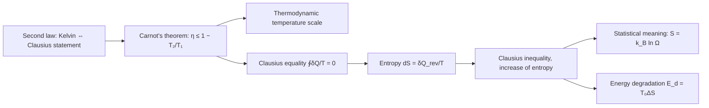

Thermodynamics rests on three laws drawn from experiment: the zeroth law gives **temperature** ([5.2.1](/5.2.1)), the first law gives **internal energy** and energy conservation ([5.2.3](/5.2.3)), and the second law, the subject of this chapter, gives the direction of natural processes; in thermal physics they play the role that Newton's laws play in mechanics. The first law says only that energy is conserved in transformations and places no restriction on their direction: at the end of the previous chapter we saw that turning all the absorbed **heat** into **work** does not violate energy conservation, yet it has never been achieved. This chapter first states the second law in the two forms due to Kelvin and Clausius, and derives from it Carnot's theorem and the **thermodynamic temperature scale**; it then introduces a new state function, the entropy, from the Clausius equality, and writes the second law in the quantitative form of the principle of increase of entropy; finally it uses Boltzmann's statistical viewpoint to explain the microscopic meaning of entropy: entropy is the logarithm of the number of microstates, and the second law is a statistical law. The concept of entropy will reappear in physical chemistry (chemical equilibrium and free energy), information theory and statistical learning.

## 4.1. The Direction of Natural Processes

A process that satisfies the first law cannot necessarily occur in nature. A falling weight drives a paddle wheel that stirs water, and all the work becomes internal energy of the water; this can happen spontaneously. Conversely, if the water cooled spontaneously and the heat released turned the paddle wheel and lifted the weight, this would also satisfy energy conservation, yet it never happens.

| Process | Only effect | Can it occur spontaneously? |
|---|---|---|
| Conversion between heat and work | Work is entirely converted into heat | Yes |
| | Heat is entirely converted into work | No |
| Heat conduction | Heat flows from a hotter body to a colder body | Yes |
| | Heat flows from a colder body to a hotter body | No |
| Gas diffusion | Two gases go from separated to mixed | Yes |
| | Going from mixed to spontaneously separated | No |

"Only effect" is the key: with the help of changes in the surroundings, heat can be turned into work (a heat engine releases heat to a low-temperature reservoir), and heat can also be moved from low to high temperature (a refrigerator consumes work from the surroundings). All natural processes involving thermal phenomena have a definite direction, and the second law of thermodynamics is the general law about this directionality.

## 4.2. The Second Law of Thermodynamics

### 4.2.1. Two Statements

**Theorem 4.2.1 (Second Law of Thermodynamics)** The following two statements are equivalent, and each is called the second law of thermodynamics:

- The *Kelvin statement* (1851): It is impossible to absorb heat from a single reservoir and convert it entirely into work without producing any other effect;
- The *Clausius statement* (1850): It is impossible to transfer heat from a colder body to a hotter body without producing any other effect; that is, heat cannot flow spontaneously from a colder body to a hotter body.

The Kelvin statement (also called the Kelvin–Planck statement) rules out a single-reservoir heat engine with **thermal efficiency** $\eta = 1$. Such a machine would not violate energy conservation, and if it could be built, work could be obtained inexhaustibly from seawater or the atmosphere; it is called a *perpetual motion machine of the second kind*. The Kelvin statement says that a perpetual motion machine of the second kind cannot be built. The Clausius statement says that the **coefficient of performance** of a refrigerator cannot be infinite: to move heat from a low-temperature reservoir to a high-temperature reservoir, the surroundings must do work.

### 4.2.2. Equivalence of the Two Statements

We prove both directions by contradiction. Let the temperatures of the two reservoirs be $T_1 > T_2$.

(1) If the Kelvin statement fails, then the Clausius statement fails. Suppose there is a single-reservoir heat engine that absorbs heat $Q_1$ from $T_1$ and converts it entirely into work $Q_1$. Use this work to drive a refrigerator that absorbs heat $Q_2$ from $T_2$ and releases heat $Q_1 + Q_2$ to $T_1$. When the two machines work together, there is no other change in the surroundings, and the only effect is that heat $Q_2$ has been transferred from the low-temperature reservoir to the high-temperature reservoir, which violates the Clausius statement.

(2) If the Clausius statement fails, then the Kelvin statement fails. Suppose heat can flow spontaneously from $T_2$ to $T_1$. Let an ordinary heat engine work between $T_1$ and $T_2$, absorbing heat $Q_1$ from $T_1$, releasing heat $\lvert Q_2\rvert$ to $T_2$ and doing work $Q_1 - \lvert Q_2\rvert$; then let $\lvert Q_2\rvert$ flow spontaneously from $T_2$ back to $T_1$. The combined effect is that the low-temperature reservoir is unchanged and the heat $Q_1 - \lvert Q_2\rvert$ absorbed from the single high-temperature reservoir is entirely converted into work, which violates the Kelvin statement. $\square$

**Example 4.2.1** Prove that in the $p$–$V$ diagram, an isotherm and a quasi-static adiabat of any substance cannot intersect twice.

Proof: Suppose the isotherm and the adiabat intersect at two points $A$ and $B$ ($V_A < V_B$). Then we can form a cycle: expand quasi-statically along the isotherm from $A$ to $B$, then return from $B$ to $A$ along the adiabat. After one cycle $\Delta U = 0$; heat is exchanged with the surroundings only on the isothermal segment, and only with a reservoir at a single temperature; the area enclosed by the cycle is nonzero, so the system does net work $-W \neq 0$. If $-W > 0$, the system absorbs heat $Q = -W$ from a single reservoir and converts it entirely into work, which violates the Kelvin statement; if $-W < 0$, running the cycle in reverse gives the same contradiction. Hence the assumption is false. $\square$

## 4.3. Reversibility of Processes

### 4.3.1. Reversible and Irreversible Processes

**Definition 4.3.1** If, after a process has occurred, there exists another process that restores both the system and the surroundings completely to their original states, the original process is called a **reversible process**; otherwise it is called an **irreversible process**.

A reversible process can run backward along the original path, and in the reverse run every change of the system and the surroundings exactly cancels the original one. If a process is driven by a difference in some **intensive quantity** (pressure $p$, temperature $T$), and at every step the system and the surroundings differ in this intensive quantity by only an infinitesimal amount, the process is reversible. For example:

- A frictionless **quasi-static process** is reversible;
- Heat conduction across an infinitesimal temperature difference is reversible;
- The **Carnot cycle** (frictionless, quasi-static, in contact with reservoirs only at equal temperatures during the isothermal steps) is reversible.

Frictional heating, heat conduction across a finite temperature difference, free expansion of a gas into a vacuum, diffusion and all kinds of chemical reactions are irreversible processes. A reversible process is an idealized limit, and all real macroscopic thermal processes are irreversible.

### 4.3.2. Connections among Irreversible Processes

By the Kelvin statement, a process in which work is entirely converted into heat without producing any other effect (frictional heating) is irreversible; by the Clausius statement, heat conduction across a finite temperature difference is irreversible. The two statements being equivalent shows that these two kinds of irreversibility are connected: the irreversibility of either implies that of the other. In fact all irreversible processes are connected, and the statement of the irreversibility of any one of them can serve as a statement of the second law.

**Example 4.3.1** Derive the irreversibility of the free expansion of a gas from the irreversibility of the conversion of work into heat (the Kelvin statement).

Proof: Let an **ideal gas** be in contact with a reservoir at temperature $T$ and expand isothermally and quasi-statically, absorbing heat $Q$ and doing work $Q$ ($\Delta U = 0$); the consequence is that the volume of the gas has increased. Suppose free expansion were reversible, that is, that the gas could contract spontaneously to its original volume without producing any other effect; then it could be used to undo the consequence of the isothermal expansion. Together, the only effect would be that the heat $Q$ absorbed from a single reservoir has been entirely converted into work, which violates the Kelvin statement. Hence the gas cannot contract spontaneously, and free expansion is irreversible. $\square$

## 4.4. Carnot's Theorem

### 4.4.1. Carnot's Theorem

**Theorem 4.4.1 (Carnot's Theorem)** For heat engines operating between a high-temperature reservoir at temperature $T_1$ and a low-temperature reservoir at temperature $T_2$:

1. All reversible heat engines have the same efficiency, independent of the working substance, equal to $\eta_{\mathrm{C}} = 1 - \frac{T_2}{T_1}$;
2. The efficiency of any irreversible heat engine is no greater than that of a reversible heat engine: $\eta \le 1 - \frac{T_2}{T_1}$ (in fact strictly smaller).

**Proof** Let $R$ be a reversible heat engine and $X$ any heat engine, both operating between these two reservoirs. Adjust their sizes so that in each cycle both absorb heat $Q_1$ from the high-temperature reservoir; then $X$ does work $\eta_XQ_1$ on the surroundings. Run $R$ in reverse, so that it becomes a refrigerator: it consumes work $\eta_RQ_1$ and releases heat $Q_1$ to the high-temperature reservoir. Use the work output by $X$ to drive the reversed $R$. If $\eta_X > \eta_R$, then in each cycle of the combined machine the high-temperature reservoir is unchanged and net work $(\eta_X - \eta_R)Q_1 > 0$ is done on the surroundings, which can only come from the heat released by the low-temperature reservoir: this is a single-reservoir heat engine, violating the Kelvin statement. Hence $\eta_X \le \eta_R$. If $X$ is also reversible, exchanging the roles of $X$ and $R$ gives $\eta_R \le \eta_X$, so all reversible heat engines have the same efficiency. A reversible cycle that exchanges heat with only two reservoirs is a Carnot cycle, whose efficiency with an ideal gas as the working substance is $1 - T_2/T_1$ ([5.2.3](/5.2.3), Formula 3.7.1); hence it has this value for any working substance. $\square$

Carnot obtained this conclusion in 1824 (he used the incorrect caloric theory at the time, but the conclusion is correct). The theorem applies equally to refrigerators: all reversible refrigerators operating between two reservoirs have the coefficient of performance $\varepsilon_{\mathrm{C}} = T_2/(T_1 - T_2)$, and irreversible refrigerators do not have a larger one.

### 4.4.2. The Thermodynamic Temperature Scale

An important theoretical consequence of Carnot's theorem is that it allows us to define a temperature scale independent of any thermometric substance. By Carnot's theorem, the ratio $\lvert Q_2\rvert/Q_1$ of the heats exchanged by any reversible heat engine operating between two reservoirs depends only on the two reservoirs and not on the working substance. We can therefore define

**Definition 4.4.1 (Thermodynamic Temperature Scale)** The ratio of the thermodynamic temperatures of two reservoirs equals the ratio of the heats exchanged with them by a reversible heat engine operating between them:
$$
\frac{T_2}{T_1} = \frac{\lvert Q_2\rvert}{Q_1}.
$$

Measuring the ratio of heats measures the ratio of temperatures; once a unit is also fixed, the scale is completely determined. Historically the triple point of water was assigned $273.16\,\mathrm{K}$; since 2019 the scale has been fixed by the numerical value of the **Boltzmann constant** ([5.2.1](/5.2.1), Remark 1.1.1). By [5.2.3](/5.2.3), Formula 3.7.1, this scale agrees with the ideal gas scale. By this definition, thermodynamic temperature has no negative values, and $T = 0$ corresponds to the limit in which a reversible heat engine releases no heat to the low-temperature reservoir and has efficiency 1. Absolute zero cannot be reached by a finite number of operations; this is the content of the third law of thermodynamics, an experimental law independent of the second law.

### 4.4.3. Efficiency of an Arbitrary Reversible Cycle

**Corollary 4.4.1** The efficiency of an arbitrary reversible cycle satisfies
$$
\eta \le 1 - \frac{T_{\min}}{T_{\max}},
$$
where $T_{\max}$ and $T_{\min}$ are the highest and lowest temperatures of the working substance in the cycle (in a reversible cycle the working substance is always in thermal equilibrium with the reservoir it contacts, so these are also the highest and lowest temperatures of the reservoirs).

**Proof** Cut the reversible cycle into many narrow strips with a dense family of adiabats, and replace the upper and lower ends of each strip by short isothermal segments (chosen so that the two small areas between the isotherm and the original curve are equal, so that the work and heat are unchanged). The adiabatic segment shared by two adjacent small cycles is traversed in opposite directions, so its contributions cancel, and the original cycle is therefore equivalent to the sum of many small Carnot cycles. The $i$th small Carnot cycle absorbs heat $Q_{1i}$ at $T_{1i}$ and has efficiency $1 - T_{2i}/T_{1i} \le 1 - T_{\min}/T_{\max}$, so
$$
\eta = \frac{\sum_i(-W_i)}{\sum_iQ_{1i}} = \frac{\sum_i\left(1 - \frac{T_{2i}}{T_{1i}}\right)Q_{1i}}{\sum_iQ_{1i}} \le 1 - \frac{T_{\min}}{T_{\max}}.
$$
$\square$

Thus, between given highest and lowest temperatures, the Carnot cycle has the highest efficiency.

## 4.5. The Clausius Entropy Formula

The zeroth law led to the temperature $T$, and the first law to the internal energy $U$; the state function that the second law leads to is the entropy $S$.

### 4.5.1. The Clausius Equality

For a Carnot cycle, with the sign convention ($Q_2 < 0$ is the heat absorbed by the working substance from the low-temperature reservoir), [5.2.3](/5.2.3), Formula 3.7.1 gives
$$
\frac{Q_1}{T_1} + \frac{Q_2}{T_2} = 0.
$$
Decompose an arbitrary reversible cycle into $n$ small Carnot cycles as in Corollary 4.4.1 and sum over all of them to obtain $\sum_{j=1}^{2n}\frac{Q_j}{T_j} = 0$. Letting the subdivision become infinitely fine:

**Theorem 4.5.1 (Clausius Equality)** For any reversible cycle,
$$
\oint_{\mathrm{R}}\frac{\delta Q}{T} = 0,
\tag{4.1}
$$
where $\delta Q$ is the heat absorbed by the system, $T$ is the temperature of the system (and hence of the reservoir in contact with it), and the subscript $\mathrm{R}$ denotes reversible.

### 4.5.2. Entropy

Between states 1 and 2 take two arbitrary reversible paths $\mathrm{R}_1$ and $\mathrm{R}_2$; going from 1 to 2 along $\mathrm{R}_1$ and back from 2 to 1 along $\mathrm{R}_2$ forms a reversible cycle. By Eq. (4.1), $\int_{1,\mathrm{R}_1}^{2}\frac{\delta Q}{T} = \int_{1,\mathrm{R}_2}^{2}\frac{\delta Q}{T}$: the integral of the heat-to-temperature ratio of a reversible process depends only on the initial and final states and not on the path. This is the same logic by which the work done by a **conservative force** is path-independent, so that a **potential energy** can be defined ([5.1.4](/5.1.4)).

**Definition 4.5.1 (Entropy)** There exists a state function $S$ such that, when a system changes from **equilibrium state** 1 to equilibrium state 2,
$$
S_2 - S_1 = \int_1^2\frac{\delta Q}{T}\quad(\text{along any reversible path}),
\qquad \mathrm{d}S = \frac{\delta Q_{\mathrm{rev}}}{T},
$$
and $S$ is called the **entropy** of the system, with unit $\mathrm{J\,K^{-1}}$.

In mathematical language: $\delta Q_{\mathrm{rev}}$ is not a total differential, but after multiplication by $1/T$ it becomes the total differential of a state function, and $1/T$ is an **integrating factor** of $\delta Q_{\mathrm{rev}}$. Like internal energy, entropy is determined only up to an additive constant, and what matters physically is the change of entropy.

Substituting $\delta Q_{\mathrm{rev}} = T\,\mathrm{d}S$ into the first law $\mathrm{d}U = \delta Q + \delta W$, and assuming only **pressure–volume work**, gives the combination of the first and second laws:

**Formula 4.5.1 (Fundamental Thermodynamic Relation)**
$$
\mathrm{d}U = T\,\mathrm{d}S - p\,\mathrm{d}V.
\tag{4.2}
$$

Equation (4.2) is obtained from reversible processes, but only state functions appear in it, so it holds for the change between any two neighboring equilibrium states; only in an irreversible process $T\,\mathrm{d}S$ no longer equals the heat absorbed. In a reversible **adiabatic process** $\mathrm{d}S = 0$, so a reversible adiabatic process is also called an *isentropic process*, and a quasi-static adiabat is an isentrope. Physical chemistry starts from Eq. (4.2) and introduces the Helmholtz free energy $A = U - TS$ and the Gibbs free energy $G = H - TS$ to study the direction of processes at constant temperature and volume and at constant temperature and pressure.

### 4.5.3. Entropy of an Ideal Gas

From Eq. (4.2), $\mathrm{d}U = nC_{V,\mathrm{m}}\,\mathrm{d}T$ and $p = nRT/V$,
$$
\mathrm{d}S = nC_{V,\mathrm{m}}\frac{\mathrm{d}T}{T} + nR\frac{\mathrm{d}V}{V}.
$$

**Formula 4.5.2 (Entropy of an Ideal Gas)** With $C_{V,\mathrm{m}}$ constant,
$$
S(T, V) = nC_{V,\mathrm{m}}\ln\frac{T}{T_0} + nR\ln\frac{V}{V_0} + S_0,
$$
$$
S(T, p) = nC_{p,\mathrm{m}}\ln\frac{T}{T_0} - nR\ln\frac{p}{p_0} + S_0', \qquad
S(p, V) = nC_{V,\mathrm{m}}\ln\frac{p}{p_0} + nC_{p,\mathrm{m}}\ln\frac{V}{V_0} + S_0''.
$$

The last two follow from the first, from $T \propto pV$ and from **Mayer's relation**. From the third, constant $S$ means constant $pV^\gamma$, which is the adiabatic process equation ([5.2.3](/5.2.3), Formula 3.5.1).

### 4.5.4. Calculating Entropy Changes

Entropy is a state function and is determined only by the initial and final equilibrium states. Whether or not the actual process is reversible, the entropy change is determined once the initial and final states are given, so we may design any reversible process connecting them to compute it. The steps are: choose the system, determine the initial and final states, design a reversible process, and integrate $\delta Q/T$ along it.

**Example 4.5.1** A copper block of mass $m$, specific **heat capacity** $c$ (constant) and temperature $T_1$ is dropped into a large amount of water at temperature $T_2 < T_1$, and the water temperature remains unchanged. Find the entropy changes of the copper block, of the water, and of the two together after equilibrium is reached.

Solution: The copper block cools from $T_1$ to $T_2$. Imagine bringing it successively into contact with a series of reservoirs at temperatures $T_1 - \mathrm{d}T, T_1 - 2\,\mathrm{d}T, \dots, T_2$, each step being a reversible heat transfer across an infinitesimal temperature difference:
$$
\Delta S_{\mathrm{Cu}} = \int_{T_1}^{T_2}\frac{mc\,\mathrm{d}T}{T} = mc\ln\frac{T_2}{T_1} < 0.
$$
The water absorbs heat $mc(T_1 - T_2)$ at constant temperature $T_2$, which can be treated as a reversible isothermal absorption of heat: $\Delta S_{\mathrm{w}} = \frac{mc(T_1 - T_2)}{T_2} > 0$. The total entropy change is
$$
\Delta S_{\mathrm{tot}} = mc\left(\frac{T_1}{T_2} - 1 - \ln\frac{T_1}{T_2}\right) > 0,
$$
because $x - 1 - \ln x > 0$ holds for $x \neq 1$. Heat conduction across a finite temperature difference is an irreversible process, and the entropy of the **isolated system** consisting of the copper block and the water increases.

**Example 4.5.2** An ideal gas of amount of substance $n$ undergoes adiabatic free expansion, with its volume changing from $V_1$ to $V_2$. Find the entropy change.

Solution: Free expansion is irreversible, and we cannot integrate along the actual process (in the actual process $\delta Q = 0$ but $\Delta S \neq 0$). The initial and final temperatures are equal, and there are three methods of calculation:

1. Design a reversible isothermal expansion: $\mathrm{d}U = 0$, $\delta Q = p\,\mathrm{d}V = nRT\,\mathrm{d}V/V$, and $\Delta S = \int_{V_1}^{V_2}nR\frac{\mathrm{d}V}{V} = nR\ln\frac{V_2}{V_1}$.
2. Design a reversible adiabatic expansion $1 \to 3$ (to volume $V_2$ and temperature $T_3$) followed by isochoric heating $3 \to 2$: $\Delta S_{13} = 0$; from $TV^{\gamma - 1} = \text{const}$, $T/T_3 = (V_2/V_1)^{\gamma - 1}$, so $\Delta S_{32} = nC_{V,\mathrm{m}}\ln\frac{T}{T_3} = nC_{V,\mathrm{m}}(\gamma - 1)\ln\frac{V_2}{V_1} = nR\ln\frac{V_2}{V_1}$.
3. Use Formula 4.5.2 directly: $T$ is unchanged, so $\Delta S = nR\ln\frac{V_2}{V_1}$.

The three methods give the same result, $\Delta S > 0$: an irreversible process in an **adiabatic system** increases the entropy. This is no accident, but a consequence of the principle of increase of entropy in the next section.

## 4.6. The Principle of Increase of Entropy

### 4.6.1. The Clausius Inequality

For an irreversible heat engine operating between two reservoirs, Carnot's theorem gives $\eta_{\mathrm{irr}} = 1 + \frac{Q_2}{Q_1} < 1 - \frac{T_2}{T_1}$, that is, $\frac{Q_1}{T_1} + \frac{Q_2}{T_2} < 0$. Generalizing to an arbitrary cycle in contact with many reservoirs:

**Theorem 4.6.1 (Clausius Inequality)** For any cycle,
$$
\oint\frac{\delta Q}{T_{\mathrm{e}}} \le 0,
$$
where $\delta Q$ is the heat absorbed by the system from the reservoir at temperature $T_{\mathrm{e}}$, and $T_{\mathrm{e}}$ is the temperature of the reservoir (the surroundings); equality holds if and only if the cycle is reversible.

In an irreversible process the temperature inside the system is not necessarily uniform, so the temperature of the reservoir must be used in the formula. In the reversible case the two coincide, and we return to the Clausius equality.

### 4.6.2. The Principle of Increase of Entropy

Let a system go from equilibrium state 1 to equilibrium state 2 by an irreversible process $\mathrm{Ir}$, and return to 1 by an arbitrary reversible process $\mathrm{R}$. By the Clausius inequality,
$$
\int_{1,\mathrm{Ir}}^{2}\frac{\delta Q}{T_{\mathrm{e}}} + \int_{2,\mathrm{R}}^{1}\frac{\delta Q}{T} < 0,
\qquad\text{i.e.}\qquad
S_2 - S_1 > \int_{1,\mathrm{Ir}}^{2}\frac{\delta Q}{T_{\mathrm{e}}}.
$$
Including the reversible case, for any process $\Delta S \ge \int\frac{\delta Q}{T_{\mathrm{e}}}$ and $\mathrm{d}S \ge \frac{\delta Q}{T_{\mathrm{e}}}$. This is the mathematical expression of the second law. For an adiabatic process $\delta Q = 0$, and therefore

**Theorem 4.6.2 (Principle of Increase of Entropy)** When a system goes from one equilibrium state to another by an adiabatic process, its entropy never decreases:
$$
\Delta S \ge 0,
$$
the entropy is unchanged in a reversible adiabatic process and increases in an irreversible adiabatic process. All processes in an isolated system are adiabatic, so the entropy of an isolated system never decreases.

When an isolated system passes from a nonequilibrium state toward equilibrium, its entropy increases, and the final equilibrium state is the state of maximum entropy. The principle of increase of entropy thus gives both the direction (entropy increases) and the limit (entropy reaches its maximum) of processes in an isolated system. In applications, all bodies participating in the process must be included in one isolated (or adiabatic) system, such as the copper block and the water in Example 4.5.1.

**Example 4.6.1 (Maximum Work)** A heat engine operates between a low-temperature reservoir (at constant temperature $T_0$) and a hot body. The body has mass $m$, constant specific heat capacity at constant pressure $c_p$ and initial temperature $T_1$. Find the maximum work the heat engine can output.

Solution: The heat engine stops working when the temperature of the body has fallen to $T_0$. Let the heat engine output total work $W_{\mathrm{out}} = -W$, and let the low-temperature reservoir absorb total heat $Q_0$. Regard the low-temperature reservoir, the body and the working substance as one adiabatic system. The entropy changes of the parts are: low-temperature reservoir, $\Delta S_0 = Q_0/T_0$; body (designing a reversible isobaric cooling), $\Delta S_{\mathrm{b}} = \int_{T_1}^{T_0}\frac{mc_p\,\mathrm{d}T}{T} = mc_p\ln\frac{T_0}{T_1}$; working substance, which operates cyclically, $\Delta S = 0$. By the principle of increase of entropy and energy conservation,
$$
\frac{Q_0}{T_0} + mc_p\ln\frac{T_0}{T_1} \ge 0, \qquad Q_0 = mc_p(T_1 - T_0) - W_{\mathrm{out}}.
$$
Eliminating $Q_0$:
$$
W_{\mathrm{out}} \le mc_p(T_1 - T_0) - mc_pT_0\ln\frac{T_1}{T_0},
$$
with equality in the reversible case. One can also use Carnot's theorem: when the body is at temperature $T$ it releases heat $mc_p\,\mathrm{d}T$, an infinitesimal Carnot cycle can convert at most $\left(1 - \frac{T_0}{T}\right)mc_p\,\mathrm{d}T$ of it into work, and integrating over $T$ from $T_0$ to $T_1$ gives the same result.

## 4.7. The Statistical Meaning of the Second Law

### 4.7.1. Microstates and Macrostates

**Definition 4.7.1** The state specified by the state of every particle in the system (in classical mechanics, the positions and **momenta** of all the particles, $\boldsymbol{r}_1, \dots, \boldsymbol{r}_N;\ \boldsymbol{p}_1, \dots, \boldsymbol{p}_N$) is called a **microstate** of the system; a state described by only a few **macroscopic quantities** is called a **macrostate**.

Boltzmann pointed out that the macroscopic description is very coarse: the same macrostate corresponds to a very large number of microstates, which the macroscopic description cannot distinguish. Take the free expansion of a gas as an example: the container is divided into a left and a right half; after the partition is removed, a macrostate specifies only how many molecules are on each side, whereas a microstate also specifies which molecules. For 4 distinguishable molecules $a, b, c, d$ the situation is as follows:

| Macrostate (left, right) | 4, 0 | 3, 1 | 2, 2 | 1, 3 | 0, 4 |
|---|---|---|---|---|---|
| Number of microstates | 1 | 4 | 6 | 4 | 1 |

In general, the macrostate with $n$ of the $N$ molecules on the left corresponds to $\binom{N}{n}$ microstates, and the total number of microstates is $2^N$.

### 4.7.2. The Principle of Equal A Priori Probabilities

**Property 4.7.1 (Equal A Priori Probabilities)** When an isolated system is in an equilibrium state, each of its possible microstates occurs with equal probability.

This is a basic assumption of statistical mechanics, and its correctness is guaranteed by the agreement of its consequences with experiment. By it, the probability of a macrostate is proportional to the number of microstates it contains, as in the **classical probability model** of probability theory: each molecule is independently on the left with probability $\frac{1}{2}$, and the number $n$ of molecules on the left follows the **binomial distribution** $\mathrm{Bin}(N, \frac{1}{2})$.

### 4.7.3. Thermodynamic Probability

**Definition 4.7.2** The number $\Omega$ of microstates corresponding to a macrostate is called the **thermodynamic probability** of that macrostate.

The thermodynamic probability is not a probability in the usual sense (it is an integer greater than 1); dividing by the total number of microstates gives a probability. For large $N$ the binomial distribution is sharply concentrated near $n = N/2$: the standard deviation is $\frac{1}{2}\sqrt{N}$ and the relative **fluctuation** is $\sim 1/\sqrt{N}$; by Stirling's formula ([3.1.13](/3.1.13#ex-13.4.3)),
$$
\Omega\left(\tfrac{N}{2}\right) = \frac{N!}{\left[(N/2)!\right]^2} \approx 2^N\sqrt{\frac{2}{\pi N}}.
$$
For $N = 10^{23}$, the single macrostate with exactly half the molecules on each side accounts for only $\sim 10^{-12}$ of all microstates, but the total probability of all macrostates in which $n/N$ deviates from $\frac{1}{2}$ by more than $10^{-10}$ is unimaginably small: almost all microstates belong to the macrostate "approximately half on each side", which is precisely the **law of large numbers**. The probability that all the molecules spontaneously return to the left is $2^{-N} = 10^{-3 \times 10^{22}}$, possible in principle but never observed in practice.

It follows that:

- The thermodynamic probability is a measure of the disorder of the system: molecules spread uniformly through the container are "more disordered" than molecules crowded to one side, and correspond to far more microstates;
- The equilibrium state is the macrostate of maximum thermodynamic probability (the most probable state), $\Omega_{\mathrm{eq}} = \Omega_{\max}$, and $\Omega$ of a nonequilibrium state is smaller than $\Omega_{\mathrm{eq}}$;
- Small deviations from equilibrium (fluctuations) always exist, but are extremely small for a macroscopic system.

### 4.7.4. The Statistical Meaning of the Second Law

The spontaneous passage of a nonequilibrium state of an isolated system toward equilibrium is the process in which the thermodynamic probability grows to its maximum: a process occurring spontaneously inside an isolated system always goes from a macrostate of smaller thermodynamic probability to one of larger thermodynamic probability. This is the statistical meaning of the second law of thermodynamics.

The second law is therefore a statistical law, applicable only to systems consisting of a large number of particles; for a small number of particles, the "reverse" process may well occur with appreciable probability. "Impossible" means that the probability is so small that the event would not occur even once in the age of the universe.

## 4.8. The Boltzmann Entropy Formula

**Formula 4.8.1 (Boltzmann Entropy Formula)** The entropy of a macrostate is related to its thermodynamic probability by
$$
S = k_{\mathrm{B}}\ln\Omega.
\tag{4.3}
$$

Boltzmann proposed $S \propto \ln\Omega$ in 1877, and Planck wrote $S = k\ln\Omega$ in 1900 and introduced the constant $k$ (later called the Boltzmann constant). The meaning of the formula:

1. Like the thermodynamic probability, entropy is a measure of the disorder of the **thermal motion** of the molecules in the system;
2. A macrostate corresponds to one $\Omega$ and hence one $S$: entropy is a state function;
3. Entropy is an **extensive quantity**. The microstates of two independent subsystems can be combined arbitrarily, $\Omega = \Omega_1\Omega_2$, and the logarithm turns the product into a sum: $S = S_1 + S_2$. The logarithmic form is precisely determined by additivity.

There are two kinds of disorder in a system: disorder in the spatial distribution of the molecules and disorder in the distribution of **velocities**, and correspondingly there are configurational entropy and velocity (thermal) entropy. In the entropy of an ideal gas, $S = nC_{V,\mathrm{m}}\ln\frac{T}{T_0} + nR\ln\frac{V}{V_0} + S_0$, the first term increases as the temperature rises (the velocity distribution broadens) and the second increases as the volume increases (the position distribution becomes more dispersed). Natural processes always proceed in the direction of increasing disorder: converting work into heat turns ordered directed motion into disordered thermal motion, heat conduction increases the disorder of the velocity distribution, and free expansion increases the disorder of the spatial distribution.

**Example 4.8.1** Use the Boltzmann entropy formula to compute the entropy change of the adiabatic free expansion ($V_1 \to V_2$) of an ideal gas.

Solution: The initial and final temperatures are equal and the velocity distribution is unchanged, so we need only compute the thermodynamic probability by position. Divide space into small cells of volume $V_0$; the number of position states of one molecule is $V/V_0$, and for $N$ independent molecules it is $(V/V_0)^N$. Then $\Omega_2/\Omega_1 = (V_2/V_1)^N$, so
$$
\Delta S = k_{\mathrm{B}}\ln\frac{\Omega_2}{\Omega_1} = Nk_{\mathrm{B}}\ln\frac{V_2}{V_1} = nR\ln\frac{V_2}{V_1},
$$
the same as the result obtained with Clausius entropy in Example 4.5.2. The size $V_0$ of the cells cancels in the entropy change.

Statistical physics can prove in general that the Boltzmann entropy and the Clausius entropy are equivalent. More generally, if the system is in the microstates with probabilities $p_i$, the entropy is $S = -k_{\mathrm{B}}\sum_ip_i\ln p_i$ (the Gibbs entropy), which returns to Eq. (4.3) when the probabilities are equal; apart from the constant $k_{\mathrm{B}}$ and the base of the logarithm, this is the same expression as Shannon's [information entropy](/4.5.6#def-6.2.1).

## 4.9. The Temperature–Entropy Diagram

A diagram of **state variables** with $T$ and $S$ as coordinates is called a temperature–entropy diagram ($T$–$S$ diagram). The heat absorbed in a reversible process, $Q = \int T\,\mathrm{d}S$, is the area under the process curve, so the $T$–$S$ diagram is convenient for representing heat, just as the $p$–$V$ diagram is convenient for representing work.

The Carnot cycle is a rectangle in the $T$–$S$ diagram: the two isotherms are horizontal lines and the two adiabats (isentropes) are vertical lines. Let the entropies of the two isentropes be $S_1 < S_2$; then $Q_1 = T_1(S_2 - S_1)$ and $\lvert Q_2\rvert = T_2(S_2 - S_1)$, so
$$
\eta_{\mathrm{C}} = 1 - \frac{\lvert Q_2\rvert}{Q_1} = 1 - \frac{T_2}{T_1},
$$
which is evidently independent of the working substance. Any reversible cycle lies between $T_{\max}$ and $T_{\min}$, and the ratio of the area it encloses (the net work) to the area of heat absorption does not exceed that of the Carnot rectangle of the same height; this is the geometric interpretation of Corollary 4.4.1.

## 4.10. Entropy and Energy Degradation

Work can be entirely converted into heat, but heat cannot be entirely converted into work. Friction turns work $W$ into heat $Q = W$; if a heat engine is used to turn this heat back into work, the efficiency being less than 1, less work is obtained; repeating this, less and less energy is able to do work. When heat flows from a hotter body to a colder body, the two bodies, once at the same temperature, become a single reservoir and can no longer be used to do work. The amount of energy is unchanged, but irreversible processes turn part of the energy from a form that can do work into a form that cannot, which is called *energy degradation*.

**Formula 4.10.1** Let the temperature of the environment (the available reservoir of lowest temperature) be $T_0$, and let an irreversible process increase the entropy of an isolated system by $\Delta S$. The degraded energy is
$$
E_{\mathrm{d}} = T_0\,\Delta S.
$$
The increase of entropy is a measure of energy degradation.

**Example 4.10.1 (Work into Heat)** Work $W$ is turned by friction into heat $Q = W$ in a reservoir at temperature $T$, and the entropy increases by $\Delta S = W/T$. The best way to reuse this heat is to run a Carnot engine between $T$ and $T_0$, which yields at most work $W(1 - T_0/T)$. The degraded energy is $E_{\mathrm{d}} = W - W(1 - T_0/T) = T_0W/T = T_0\,\Delta S$.

**Example 4.10.2 (Heat Conduction across a Finite Temperature Difference)** Heat $Q$ flows from a body at temperature $T_{\mathrm{h}}$ to a body at temperature $T_{\mathrm{l}}$, and the entropy increases by $\Delta S = Q\left(\frac{1}{T_{\mathrm{l}}} - \frac{1}{T_{\mathrm{h}}}\right)$. While $Q$ is in the hotter body it can be converted into at most work $Q(1 - T_0/T_{\mathrm{h}})$; after flowing to the colder body it can be converted into only $Q(1 - T_0/T_{\mathrm{l}})$. The degraded energy is the difference of the two, $QT_0\left(\frac{1}{T_{\mathrm{l}}} - \frac{1}{T_{\mathrm{h}}}\right) = T_0\,\Delta S$.

Energy degradation is a consequence of the second law and reflects the passage of natural processes from order to disorder. In the 19th century Clausius extended the principle of increase of entropy to the whole universe, arguing that the universe would eventually reach a "heat death" in which the temperature is the same everywhere and no macroscopic process occurs any more. On the other hand, the world we see is full of processes that go from disorder to order: the evolution of life, the development of organisms, the growth of crystals, the regular patterns formed in convection. This does not violate the second law: living organisms and other self-organizing systems are all **open systems**; they obtain low-entropy energy from the environment (for the Earth, radiation from the hot Sun) and discharge high-entropy heat and matter into the environment, so that their own entropy can decrease while the total entropy of system and environment still increases. Whether the universe as a whole can be regarded as an isolated system and whether the "heat death" hypothesis holds involve the expansion of the universe and the peculiar thermodynamic properties of gravitating systems; these are questions of cosmology and cannot simply be deduced from the principle of increase of entropy.

## Summary

| Topic | Result |
|---|---|
| Second law of thermodynamics | Theorem 4.2.1: the Kelvin statement (no perpetual motion machine of the second kind) and the Clausius statement are equivalent; every real process involving heat is irreversible (Definition 4.3.1), and the various irreversibilities imply one another |
| Carnot's theorem | Theorem 4.4.1: all reversible engines have efficiency $1 - T_2/T_1$ and no irreversible engine exceeds it; this defines the thermodynamic temperature scale (Definition 4.4.1), and Corollary 4.4.1 bounds the efficiency of any reversible cycle |
| Entropy | Defined through the Clausius equality (Theorem 4.5.1) as $\mathrm{d}S = \delta Q_{\mathrm{rev}}/T$ (Definition 4.5.1); $\mathrm{d}U = T\,\mathrm{d}S - p\,\mathrm{d}V$ (Eq. (4.2)); entropy of an ideal gas in Formula 4.5.2; the entropy change of an irreversible process is computed along a reversible path joining the same end states |
| Principle of increase of entropy | Clausius inequality (Theorem 4.6.1) $\oint\delta Q/T_{\mathrm{e}} \le 0$; $\Delta S \ge 0$ for adiabatic processes and isolated systems (Theorem 4.6.2) |
| Statistical meaning | Under equal a priori probabilities (Property 4.7.1), an isolated system evolves toward the macrostate of largest thermodynamic probability $\Omega$; Boltzmann entropy formula $S = k_{\mathrm{B}}\ln\Omega$ (Eq. (4.3)) |
| $T$–$S$ diagram and energy degradation | The area under a curve on the $T$–$S$ diagram is the heat, and the Carnot cycle is a rectangle; the energy degraded by an irreversible process is $E_{\mathrm{d}} = T_0\,\Delta S$ (Formula 4.10.1) |

## Questions

1. A cup of hot water cools at room temperature, and the entropy of the water decreases. Does this contradict the principle of increase of entropy?

   **Answer** the water is not an isolated system; the entropy of the isolated system consisting of the water and the surrounding air increases (compare Example 4.5.1).

2. In summer an air conditioner moves heat from the room to the hotter outdoors. Does this violate the Clausius statement?

   **Answer** no, the surroundings (the power grid) do work on it, and the transfer of heat is not the "only effect".
