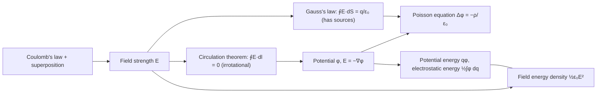

[The previous chapter](/5.3.1) used **Gauss's law** to describe the flux of the electrostatic field; this chapter studies its circulation. The work done by electrostatic forces is independent of the path, so the electrostatic field is a **conservative vector field**, and just as potential energy is introduced from a conservative force in mechanics ([5.1.4](/5.1.4)), we can introduce a scalar function, the electric potential, that describes the electrostatic field equivalently. The potential is a scalar and adds algebraically, which makes it easier to compute than the **electric field strength**; taking the **gradient** of the potential gives the field strength. Combining Gauss's law with $\boldsymbol{E}=-\nabla\varphi$ reduces electrostatics to the **Poisson equation** for the potential, the very equation studied in [2.5.8](/2.5.8). The chapter ends with the electrostatic energy of charge systems and shows that this energy is stored in the electric field. The next chapter, [5.3.3](/5.3.3), uses these tools to treat conductors; in steady currents ([5.3.5](/5.3.5)) the potential generalizes to voltage. Section 2.6 is optional.

## 2.1. The Conservative Nature of the Electrostatic Field

When a **test charge** $q_0$ is moved along a path $L$ from $P_1$ to $P_2$ in an electrostatic field, the electrostatic force does work

$$
W_{12}=\int_{P_1}^{P_2}q_0\boldsymbol{E}\cdot\mathrm{d}\boldsymbol{l}=q_0\int_{P_1(L)}^{P_2}\boldsymbol{E}\cdot\mathrm{d}\boldsymbol{l}.
$$
We therefore need the line integral of the field strength along a path (a **line integral of a vector field**). For the field of a **point charge** $q$, $\boldsymbol{e}_r\cdot\mathrm{d}\boldsymbol{l}=\mathrm{d}r$, so

$$
\int_{P_1(L)}^{P_2}\boldsymbol{E}\cdot\mathrm{d}\boldsymbol{l}=\int_{r_1}^{r_2}\frac{q\,\mathrm{d}r}{4\pi\varepsilon_0r^2}=\frac{q}{4\pi\varepsilon_0}\Big(\frac{1}{r_1}-\frac{1}{r_2}\Big),
$$
which depends only on the initial and final positions and not on the path. The field of any system of stationary charges is a superposition of point-charge fields, and the line integral of each term is path independent, so the line integral of the total field is path independent as well. This is the same fact as the conservative nature of central forces ([5.1.4](/5.1.4#sec-4.4.1)).

**Theorem 2.1.1 (Circulation Theorem for the Electrostatic Field)** In an electrostatic field, the line integral of the field strength along any closed path is zero:

$$
\oint_L\boldsymbol{E}\cdot\mathrm{d}\boldsymbol{l}=0 .
$$
Its differential form is $\nabla\times\boldsymbol{E}=\boldsymbol{0}$.

**Proof** Choose two points $P_1$, $P_2$ on a closed path $L$ and split $L$ into two segments $L_1$, $L_2$ from $P_1$ to $P_2$. The line integral is path independent, so $\oint_L=\int_{P_1(L_1)}^{P_2}+\int_{P_2(L_2)}^{P_1}=\int_{P_1(L_1)}^{P_2}-\int_{P_1(L_2)}^{P_2}=0$. The differential form follows from **Stokes' theorem** ([Theorem 14.3.1](/2.2.14#thm-14.3.1)): for any small surface $S$, $\iint_S(\nabla\times\boldsymbol{E})\cdot\mathrm{d}\boldsymbol{S}=\oint_{\partial S}\boldsymbol{E}\cdot\mathrm{d}\boldsymbol{l}=0$, and since the integrand is continuous it vanishes everywhere. $\square$

The integral $\oint_L\boldsymbol{E}\cdot\mathrm{d}\boldsymbol{l}$ is the **circulation** of the electrostatic field along $L$, which measures the degree to which a vector field "rotates". The circulation theorem says that the electrostatic field is an **irrotational vector field**: its **electric field lines** have no vortex structure and cannot close. Mathematically, "the line integral is path independent", "the integral around any closed path vanishes" and "a potential function exists" are equivalent ([Theorem 14.4.1](/2.2.14#thm-14.4.1)), which is the basis for introducing the potential in the next section. Gauss's law (the field has sources) and the circulation theorem (the field is irrotational) together describe the electrostatic field completely; the induced electric field produced by a changing magnetic field, in contrast, has nonzero curl and does not satisfy the circulation theorem ([5.3.9](/5.3.9)).

**Example 2.1.1 (No Electrostatic Field Has Parallel but Unevenly Spaced Field Lines)** Suppose that in some region all field lines point in the $x$ direction but the field strength varies with $y$, $\boldsymbol{E}=E(y)\boldsymbol{e}_x$. Take a rectangular loop with sides parallel to the coordinate axes. On the two vertical sides $\boldsymbol{E}\perp\mathrm{d}\boldsymbol{l}$, and the integrals along the two horizontal sides ($y=y_1,y_2$, length $a$) give $[E(y_1)-E(y_2)]a$. By the circulation theorem this must vanish, so $E(y_1)=E(y_2)$: parallel field lines of an electrostatic field must be equally spaced and the field uniform. Such a field may or may not have sources in the region (for example, if the field varies along the $x$ direction), but it cannot vary in a direction perpendicular to the field lines.

## 2.2. Potential Difference and Electric Potential

### 2.2.1. Potential Difference and Potential

Because the line integral in an electrostatic field is path independent, we can introduce a scalar that depends only on position.

**Definition 2.2.1 (Potential Difference)** The **potential difference** between two points $P_1$ and $P_2$ in an electrostatic field is

$$
U_{12}=\varphi_1-\varphi_2=\int_{P_1}^{P_2}\boldsymbol{E}\cdot\mathrm{d}\boldsymbol{l},
$$
that is, the work done by the electrostatic force when a unit positive charge is moved from $P_1$ to $P_2$.

**Definition 2.2.2 (Electric Potential)** Choose a point $O$ as the zero of potential, $\varphi_O=0$. The **electric potential** at a point $P$ of an electrostatic field is

$$
\varphi_P=\int_P^O\boldsymbol{E}\cdot\mathrm{d}\boldsymbol{l}=-\int_O^P\boldsymbol{E}\cdot\mathrm{d}\boldsymbol{l},
$$
that is, the work done by the electrostatic force when a unit positive charge is moved from $P$ to the zero of potential.

From the definition, $\varphi_1-\varphi_2=\int_{P_1}^{O}\boldsymbol{E}\cdot\mathrm{d}\boldsymbol{l}-\int_{P_2}^{O}\boldsymbol{E}\cdot\mathrm{d}\boldsymbol{l}=\int_{P_1}^{P_2}\boldsymbol{E}\cdot\mathrm{d}\boldsymbol{l}$, so the potential difference does not depend on the choice of zero, and only potential differences have physical meaning. The unit of potential is the volt, $1\,\mathrm{V}=1\,\mathrm{J\,C^{-1}}$, so the unit of field strength can also be written $\mathrm{V\,m^{-1}}$. The differential form $\mathrm{d}\varphi=-\boldsymbol{E}\cdot\mathrm{d}\boldsymbol{l}$ shows that the potential decreases along the direction of the field lines.

Some remarks on the potential:

- Relativity: the numerical value of the potential at a point depends on the choice of zero.
- Intrinsic nature: the potential is a property of the electric field itself and does not depend on whether, or how much, charge is placed at the point.
- Relation to mathematics: $-\varphi$ is the **potential function** of the electrostatic field ([Definition 14.4.2](/2.2.14#def-14.4.2)); the sign difference arises for the same reason as for potential energy: physically, "the electrostatic force does positive work" corresponds to "the potential decreases".
- Notation: in this wiki the potential is written $\varphi$ and the potential difference (voltage) $U$; the phase in vibrations and waves is also written $\varphi$, but the two never occur in the same place.

The choice of the zero of potential is arbitrary. In theoretical calculations the zero is usually taken at infinity, $\varphi_\infty=0$, for a finite charge distribution; when the charge distribution extends to infinity (an infinite line or plane), the integral to infinity diverges, and the zero must be placed at some finite point. In practice the earth, the chassis of an instrument or a common ground wire is often taken as the zero. A lineworker wearing a metal shielding suit at the same potential as a high-voltage line has no potential difference across the body, so no current flows through it.

### 2.2.2. Potentials of Some Typical Charge Distributions

When the field strength is known, we can integrate it from the definition along the most convenient path (usually along a field line); this is called the method of integrating the field strength.

**Example 2.2.1 (Potential of a Point Charge)** Take infinity as the zero and integrate radially:

$$
\varphi(r)=\int_r^\infty\frac{q\,\mathrm{d}r'}{4\pi\varepsilon_0r'^2}=\frac{q}{4\pi\varepsilon_0r}.
$$
The potential is positive for $q>0$ and decreases with $r$; it is negative for $q<0$. It is just the fundamental solution $\Gamma(\boldsymbol{r})=\frac{1}{4\pi r}$ of the **Laplace equation** ([Definition 8.1.1](/2.5.8#def-8.1.1)) multiplied by $q/\varepsilon_0$.

**Example 2.2.2 (Potential of a Uniformly Charged Spherical Surface)** The radius is $R$ and the charge $q$. By [Example 1.7.1](/5.3.1#ex-1.7.1), $E=0$ inside the surface and $E=\frac{q}{4\pi\varepsilon_0r^2}$ outside. Hence

$$
\varphi(r)=\int_r^\infty E\,\mathrm{d}r'=\begin{cases}\dfrac{q}{4\pi\varepsilon_0R},&r\le R,\\[3mm]\dfrac{q}{4\pi\varepsilon_0r},&r\ge R.\end{cases}
$$
The interior is a region of constant potential, and outside the potential is the same as that of a point charge. The field strength jumps at $r=R$, but the potential is continuous: the potential is an integral of the field strength, and a finite jump does not affect the continuity of an integral.

**Example 2.2.3 (Potential of an Infinitely Long Uniformly Charged Line)** The linear **charge density** is $\lambda$ and $E=\frac{\lambda}{2\pi\varepsilon_0r}$. Infinity cannot be the zero, so we take the zero at distance $r_0$ from the line:

$$
\varphi(r)=\int_r^{r_0}\frac{\lambda\,\mathrm{d}r'}{2\pi\varepsilon_0r'}=\frac{\lambda}{2\pi\varepsilon_0}\ln\frac{r_0}{r}.
$$
It is a multiple of the fundamental solution $-\frac{1}{2\pi}\ln r$ in the plane: the problem of an infinite line is essentially two-dimensional.

**Example 2.2.4 (Potential of a Uniformly Charged Ball)** The radius is $R$ and the charge $Q$. Outside the ball the potential is that of a point charge; inside ($r<R$) the field strength is $\frac{Qr}{4\pi\varepsilon_0R^3}$, so

$$
\varphi(r)=\int_r^R\frac{Qr'\,\mathrm{d}r'}{4\pi\varepsilon_0R^3}+\frac{Q}{4\pi\varepsilon_0R}=\frac{Q(3R^2-r^2)}{8\pi\varepsilon_0R^3}.
$$
At the center $\varphi(0)=\frac{3Q}{8\pi\varepsilon_0R}$, which is $1.5$ times the potential at the surface.

## 2.3. The Superposition Principle for Potentials

### 2.3.1. Superposition of Potentials

**Property 2.3.1 (Superposition Principle of Electric Potential)** The potential at a point in the field of a charge system equals the algebraic sum of the potentials produced there by each charge alone:

$$
\varphi=\sum_i\varphi_i .
$$
All the potentials must use the same zero.

**Proof** From $\varphi_P=\int_P^O\boldsymbol{E}\cdot\mathrm{d}\boldsymbol{l}$ and the **superposition principle of electric fields**, $\boldsymbol{E}=\sum_i\boldsymbol{E}_i$, we get $\varphi_P=\sum_i\int_P^O\boldsymbol{E}_i\cdot\mathrm{d}\boldsymbol{l}=\sum_i\varphi_i$. $\square$

Taking infinity as the zero, the potentials of a system of point charges and of a continuous charged body are

$$
\varphi=\sum_i\frac{q_i}{4\pi\varepsilon_0r_i},\qquad\varphi=\int_q\frac{\mathrm{d}q}{4\pi\varepsilon_0r}.
$$
This method of computing the potential from a known charge distribution by superposition is called the method of superposing potentials. It involves a scalar integral and, unlike the field strength, does not require resolving components, so it is usually simpler than computing the field directly. For a continuous distribution the formula is $\varphi=\frac{1}{\varepsilon_0}\iiint\Gamma(\boldsymbol{r}-\boldsymbol{r}')\rho(\boldsymbol{r}')\,\mathrm{d}V'$: the potential is the **convolution** of the charge density with the fundamental solution ([2.5.8](/2.5.8)).

### 2.3.2. Examples

**Example 2.3.1 (Potential of an Electric Dipole)** The **electric dipole moment** is $\boldsymbol{p}=q\boldsymbol{l}$, the distance from the field point to the midpoint is $r\gg l$, and $\theta$ is the angle between $\boldsymbol{r}$ and $\boldsymbol{p}$. The distances from the field point to $\pm q$ are $r_\pm=\lvert\boldsymbol{r}\mp\boldsymbol{l}/2\rvert\approx r\mp\frac l2\cos\theta$, so

$$
\varphi=\frac{q}{4\pi\varepsilon_0}\Big(\frac{1}{r_+}-\frac{1}{r_-}\Big)\approx\frac{q}{4\pi\varepsilon_0}\frac{l\cos\theta}{r^2}=\frac{p\cos\theta}{4\pi\varepsilon_0r^2}=\frac{\boldsymbol{p}\cdot\boldsymbol{e}_r}{4\pi\varepsilon_0r^2}.
$$
The potential of a dipole is inversely proportional to $r^2$, and the potential is zero everywhere on the perpendicular bisector plane ($\theta=\pi/2$).

**Example 2.3.2 (Potential on the Axis of a Uniformly Charged Ring)** The ring has radius $R$ and charge $Q$, and the field point lies on the axis at distance $x$ from the center.

- Superposition of potentials: every charge element is at distance $\sqrt{x^2+R^2}$ from the field point, so $\varphi=\dfrac{1}{4\pi\varepsilon_0\sqrt{x^2+R^2}}\displaystyle\int\mathrm{d}q=\dfrac{Q}{4\pi\varepsilon_0\sqrt{x^2+R^2}}$.
- Integration of the field strength: on the axis $E_x=\dfrac{Qx}{4\pi\varepsilon_0(x^2+R^2)^{3/2}}$, and $\varphi=\displaystyle\int_x^\infty\dfrac{Qx'\,\mathrm{d}x'}{4\pi\varepsilon_0(x'^2+R^2)^{3/2}}=\dfrac{Q}{4\pi\varepsilon_0\sqrt{x^2+R^2}}$.

The two methods agree, but the first needs only one scalar integral. At the center $\varphi=\frac{Q}{4\pi\varepsilon_0R}$ while the field strength is zero: potential and field strength are not directly related in magnitude, since the field strength is determined by the rate of change of the potential (§2.4). For $x\gg R$, $\varphi\to\frac{Q}{4\pi\varepsilon_0x}$, which is the point-charge result.

### 2.3.3. Equipotential Surfaces

**Definition 2.3.1 (Equipotential Surface)** The surface $\varphi(x,y,z)=C$ formed by the points of an electric field that have the same potential is called an **equipotential surface**.

Equipotential surfaces are the level surfaces of the potential, a **scalar field** (in two dimensions, **level curves**). When drawing them, we require the potential difference between adjacent surfaces to be the same, so that the spacing of the surfaces reflects the magnitude of the field strength.

**Property 2.3.2** Equipotential surfaces have the following properties:

1. Field lines are everywhere orthogonal to equipotential surfaces and point toward decreasing potential.
2. The field is strong where equipotential surfaces are close together and weak where they are far apart.
3. Different equipotential surfaces do not intersect.
4. When a charge moves along an equipotential surface, the electrostatic force does no work.

**Proof** Let a charge $q_0$ move by $\mathrm{d}\boldsymbol{l}$ along an equipotential surface. The work done by the electrostatic force is $q_0\boldsymbol{E}\cdot\mathrm{d}\boldsymbol{l}=-q_0\,\mathrm{d}\varphi=0$, which is item 4. Since $q_0\ne0$, $E\ne0$ and $\mathrm{d}l\ne0$, we must have $\boldsymbol{E}\perp\mathrm{d}\boldsymbol{l}$, and as $\mathrm{d}\boldsymbol{l}$ is an arbitrary direction on the surface, $\boldsymbol{E}$ is perpendicular to the surface; along the direction of $\boldsymbol{E}$, $\mathrm{d}\varphi=-E\,\mathrm{d}l<0$, which is item 1. The potential difference $\Delta\varphi$ between adjacent surfaces is fixed, so the spacing is $\Delta n\approx\Delta\varphi/E$, which is item 2. A point has only one value of the potential, which is item 3. $\square$

Field lines and equipotential surfaces are two geometric pictures of the electrostatic field: the former correspond to the field strength (the viewpoint of force), the latter to the potential (the viewpoint of energy). Potentials are easier to measure than field strengths, so equipotential surfaces are often measured first and the field lines, orthogonal to them, drawn afterward. The electrostatic lens in an electron microscope is a set of equipotential surfaces formed by a group of electrodes and curved near the axis of symmetry; electrons passing through are deflected much as light rays are by an optical lens.

## 2.4. The Potential Gradient

### 2.4.1. Differential Relation Between Field Strength and Potential

From $\mathrm{d}\varphi=-\boldsymbol{E}\cdot\mathrm{d}\boldsymbol{l}=-E_l\,\mathrm{d}l$, the component of the field strength along any direction $\boldsymbol{l}$ equals the negative of the **directional derivative** of the potential in that direction:

$$
E_l=-\frac{\partial\varphi}{\partial l}.
$$
The absolute value of the **directional derivative** is largest along the normal to the equipotential surface (the direction of the field line), which is the direction of the **gradient**.

**Formula 2.4.1 (Relation Between Field Strength and Potential)**

$$
\boldsymbol{E}=-\nabla\varphi=-\operatorname{grad}\varphi=-\Big(\frac{\partial\varphi}{\partial x}\boldsymbol{e}_x+\frac{\partial\varphi}{\partial y}\boldsymbol{e}_y+\frac{\partial\varphi}{\partial z}\boldsymbol{e}_z\Big).
$$

The quantity $\nabla\varphi$ is called the *potential gradient*. It is a vector pointing in the direction in which the potential increases fastest near the point, with magnitude equal to the rate of change in that direction; the field strength points in the direction of fastest decrease. This is exactly analogous to the mechanical statement that a conservative force is the negative gradient of the potential energy ([5.1.4](/5.1.4)). Formula 2.4.1 automatically satisfies $\nabla\times\boldsymbol{E}=-\nabla\times\nabla\varphi=\boldsymbol{0}$ ([Theorem 14.1.1](/2.2.14#thm-14.1.1)).

A third method of finding the field strength is therefore to find the potential by superposition and then take its gradient.

**Example 2.4.1 (Field of a Dipole from Its Potential)** Use the gradient in **spherical coordinates** with $\varphi=\frac{p\cos\theta}{4\pi\varepsilon_0r^2}$ from Example 2.3.1:

$$
E_r=-\frac{\partial\varphi}{\partial r}=\frac{2p\cos\theta}{4\pi\varepsilon_0r^3},\qquad E_\theta=-\frac1r\frac{\partial\varphi}{\partial\theta}=\frac{p\sin\theta}{4\pi\varepsilon_0r^3},
$$
which together give [Formula 1.4.1](/5.3.1#fml-1.4.1): $\boldsymbol{E}=\frac{1}{4\pi\varepsilon_0r^3}\big[3(\boldsymbol{p}\cdot\boldsymbol{e}_r)\boldsymbol{e}_r-\boldsymbol{p}\big]$. This is much simpler than superposing field strengths directly as in [5.3.1](/5.3.1).

### 2.4.2. Poisson's Equation and Laplace's Equation

Substituting $\boldsymbol{E}=-\nabla\varphi$ into the differential form of Gauss's law, $\nabla\cdot\boldsymbol{E}=\rho/\varepsilon_0$, gives the basic equation of electrostatics,

$$
\Delta\varphi=\nabla^2\varphi=-\frac{\rho}{\varepsilon_0},
$$
that is, the potential satisfies the **Poisson equation**. In a region without charge, $\Delta\varphi=0$, and the potential satisfies the **Laplace equation** and is a **harmonic function** ([2.2.14](/2.2.14#sec-14.5.2), [2.5.8](/2.5.8)). A system of vector equations (Gauss's law and the circulation theorem) is thus reduced to a single scalar equation, and finding the electrostatic field means solving this equation under given boundary conditions; its uniqueness is discussed in [5.3.3](/5.3.3). The properties of harmonic functions immediately yield a physical conclusion.

**Theorem 2.4.1 (Earnshaw's Theorem)** A point charge cannot be in stable equilibrium under electrostatic forces alone.

**Proof** Suppose a point charge $q>0$ is in stable equilibrium at $P_0$. Then its potential energy $q\varphi$ has a strict minimum at $P_0$, where $\varphi$ is the potential produced by the other charges. There are no other charges near $P_0$, so $\varphi$ is harmonic in a small ball around $P_0$; by the **strong maximum principle** ([Theorem 8.2.2](/2.5.8#thm-8.2.2)), a harmonic function that attains its minimum in the interior of the ball must be constant, contradicting "strict minimum". For $q<0$, replace minimum by maximum. $\square$

Intuitively, $\nabla\cdot\boldsymbol{E}=0$ in a charge-free region, so field lines cannot point toward one point from all directions, and there is always some direction in which the charge is pushed away from the equilibrium position. It follows that stationary classical point charges cannot form a stable atom, and the stability of atoms must be explained by quantum mechanics ([5.5.4](/5.5.4)); in the laboratory, ions can be trapped only with alternating electric fields (Paul trap) or with an added magnetic field (Penning trap).

## 2.5. Electrostatic Potential Energy of a Charge in an External Field

### 2.5.1. Potential Energy of a Point Charge

The electrostatic force is conservative, so a potential energy can be introduced. When a charge $q$ moves from $P_1$ to $P_2$ in an external field, the electrostatic force does work $W_{12}=q(\varphi_1-\varphi_2)$, independent of the path.

**Definition 2.5.1 (Electrostatic Potential Energy)** A point charge $q$ located at a point of potential $\varphi$ in an external electric field has **electrostatic potential energy**

$$
E_{\mathrm{p}}=q\varphi .
$$
The work done by the electrostatic force equals the decrease of the electrostatic potential energy, $W_{12}=E_{\mathrm{p}1}-E_{\mathrm{p}2}$; the work done by an external force against the electrostatic force equals its increase.

As with potential energy in mechanics ([Definition 4.5.1](/5.1.4#def-4.5.1)), the electrostatic potential energy belongs to the system consisting of the charge and the charges producing the external field; it is their interaction energy, and its zero is the zero of potential. Where the potential is high, a positive charge has large electrostatic potential energy and a negative charge has small. The electronvolt, a common unit of energy in atomic and particle physics, is the change of electrostatic potential energy of an electron passing through a potential difference of $1\,\mathrm{V}$: $1\,\mathrm{eV}=1.602\,176\,634\times10^{-19}\,\mathrm{J}$ (exact).

### 2.5.2. Potential Energy of an Electric Dipole

**Example 2.5.1 (Potential Energy of a Dipole in a Uniform External Field)** Place an electric dipole $\boldsymbol{p}=q\boldsymbol{l}$ in a uniform field $\boldsymbol{E}$:

$$
E_{\mathrm{p}}=q\varphi_+-q\varphi_-=-q(\varphi_--\varphi_+)=-q\int_{-}^{+}\boldsymbol{E}\cdot\mathrm{d}\boldsymbol{l}=-q\boldsymbol{E}\cdot\boldsymbol{l}=-\boldsymbol{p}\cdot\boldsymbol{E}=-pE\cos\theta .
$$
When $\boldsymbol{p}$ is parallel to $\boldsymbol{E}$ ($\theta=0$) the energy is lowest and the equilibrium is stable; when they are antiparallel the energy is highest and the equilibrium is unstable. The derivative with respect to $\theta$, $-\frac{\partial E_{\mathrm{p}}}{\partial\theta}=-pE\sin\theta$, is exactly the magnitude of the torque in [Example 1.4.3](/5.3.1#ex-1.4.3), the minus sign meaning that the torque tends to decrease $\theta$. The result holds for any dipole: a magnetic moment in a magnetic field has potential energy of the same form, $-\boldsymbol{m}\cdot\boldsymbol{B}$ ([5.3.7](/5.3.7)).

## 2.6. Electrostatic Energy of Charge Systems

### 2.6.1. Interaction Energy of Point Charges

The external field of the previous section was given; we now consider the interaction energy within a set of charges.

**Definition 2.6.1 (Electrostatic Energy)** The work done by electrostatic forces as the parts of a system of stationary charges are separated from their present positions to infinite mutual distances is called the **electrostatic energy** of the system in its present state. For a system of point charges it is also called the interaction energy between the point charges, or **mutual energy** for short; for a continuous charged body, the interaction energy among its charge elements is called its **self-energy**.

For two point charges, first hold $q_1$ fixed and move $q_2$ from its present position to infinity. The electrostatic force does work $q_2\varphi_{21}$, where $\varphi_{21}=\frac{q_1}{4\pi\varepsilon_0r_{12}}$ is the potential of $q_1$ at the position of $q_2$; afterward $q_1$ is alone and moving it does no work. Hence $W_{\mathrm{int}}=q_2\varphi_{21}$, which by the same argument also equals $q_1\varphi_{12}$, and in symmetric form

$$
W_{\mathrm{int}}=\frac12(q_1\varphi_{12}+q_2\varphi_{21})=\frac{q_1q_2}{4\pi\varepsilon_0r_{12}}.
$$
For three point charges, first remove $q_3$, which takes work $q_3(\varphi_{31}+\varphi_{32})$, and then remove $q_2$, which takes $q_2\varphi_{21}$. Writing each pair in symmetric form and regrouping gives $W_{\mathrm{int}}=\frac12[q_1(\varphi_{12}+\varphi_{13})+q_2(\varphi_{21}+\varphi_{23})+q_3(\varphi_{31}+\varphi_{32})]$. For $n$ point charges the generalization is:

**Formula 2.6.1 (Electrostatic Energy of a System of Point Charges)**

$$
W_{\mathrm{int}}=\frac12\sum_{i=1}^nq_i\varphi_i=\sum_{i<j}\frac{q_iq_j}{4\pi\varepsilon_0r_{ij}},
$$
where $\varphi_i$ is the potential at $q_i$ produced by all the other charges. The factor $\frac12$ arises because each pair of charges is counted twice.

The mutual energy can be positive or negative: that of opposite charges is negative, meaning that work must be done from outside to separate them. The binding energy of atoms and molecules is mainly this electrostatic energy (plus quantum-mechanical kinetic energy).

### 2.6.2. Energy of Continuous Charged Bodies

For a continuous charged body, divide it into charge elements, and the sum becomes an integral:

$$
W_{\mathrm{e}}=\frac12\int_q\varphi\,\mathrm{d}q=\frac12\iiint_V\rho\varphi\,\mathrm{d}V,
$$
where $\varphi$ is the potential at $\mathrm{d}q$ produced by all the charges (the contribution of a charge element to the potential at its own position is infinitesimal). This formula applies to volume and surface charges, but not to the self-energy of point charges or line charges: the potential at a point charge itself is infinite, and the potential at a line charge diverges logarithmically. The total electrostatic energy of a system of several charged bodies equals the sum of their self-energies and the mutual energies of all pairs, $W_{\mathrm{e}}=\sum_iW_{\mathrm{self},i}+\sum_{i<j}W_{\mathrm{int},ij}$.

**Example 2.6.1 (Electrostatic Energy of a Uniformly Charged Spherical Surface)** The radius is $R$ and the charge $Q$. The potential everywhere on the surface is $\frac{Q}{4\pi\varepsilon_0R}$, so

$$
W_{\mathrm{e}}=\frac12\cdot\frac{Q}{4\pi\varepsilon_0R}\int\mathrm{d}q=\frac{Q^2}{8\pi\varepsilon_0R}.
$$
As $R\to0$ it diverges: the self-energy of a point charge is infinite, a fundamental difficulty of classical electromagnetic theory. If the rest energy of the electron, $m_{\mathrm{e}}c^2$ ([5.1.8](/5.1.8)), were entirely electrostatic self-energy, the length scale obtained would be the classical electron radius $r_{\mathrm{e}}=\frac{e^2}{4\pi\varepsilon_0m_{\mathrm{e}}c^2}\approx2.82\times10^{-15}\,\mathrm{m}$; experimentally the electron has no such size, and the difficulty is ultimately handled by renormalization in quantum electrodynamics.

**Example 2.6.2 (Electrostatic Energy of a Uniformly Charged Ball)** The radius is $R$ and the charge $Q$. Consider a thin shell between radii $r$ and $r+\mathrm{d}r$, with $\mathrm{d}q=\frac{3Qr^2}{R^3}\,\mathrm{d}r$; by Example 2.2.4 the potential there is $\varphi(r)=\frac{Q(3R^2-r^2)}{8\pi\varepsilon_0R^3}$, so

$$
W_{\mathrm{e}}=\frac12\int_0^R\frac{Q(3R^2-r^2)}{8\pi\varepsilon_0R^3}\cdot\frac{3Qr^2}{R^3}\,\mathrm{d}r=\frac{3Q^2}{16\pi\varepsilon_0R^6}\Big(R^5-\frac{R^5}{5}\Big)=\frac{3Q^2}{20\pi\varepsilon_0R}=\frac35\cdot\frac{Q^2}{4\pi\varepsilon_0R}.
$$
This result is used to estimate the Coulomb energy of nuclei: with $Z$ protons uniformly distributed in a ball of radius $R\approx1.2A^{1/3}\,\mathrm{fm}$, the Coulomb energy is about $0.72\,Z^2A^{-1/3}\,\mathrm{MeV}$ (using $\frac{e^2}{4\pi\varepsilon_0}\approx1.44\,\mathrm{MeV\,fm}$), consistent with the coefficient of the Coulomb term (about $0.7\,\mathrm{MeV}$) in the semiempirical binding-energy formula of nuclei. Growing as $Z^2$, it is the main reason heavy nuclei are unstable and can undergo fission.

## 2.7. Energy of the Electrostatic Field

### 2.7.1. Energy Stored in the Field

From $W_{\mathrm{e}}=\frac12\int\varphi\,\mathrm{d}q$ it might seem that the electrostatic energy is concentrated where the charge is. But take the uniformly charged spherical surface: the charge is only on the surface, yet $E=0$ inside, and the energy must reside somewhere. In fact, the electrostatic energy is stored in the space occupied by the electric field. In electrostatics both views give the same total energy and cannot be distinguished; for time-varying fields, the field can exist independently of charge and carry energy as it propagates (electromagnetic waves, [5.3.10](/5.3.10)), and only the view that the energy belongs to the field is correct.

**Formula 2.7.1 (Energy Density of the Electrostatic Field)** The *energy density of the electric field* in vacuum is

$$
w_{\mathrm{e}}=\frac{\mathrm{d}W_{\mathrm{e}}}{\mathrm{d}V}=\frac12\varepsilon_0E^2,
$$
and the electrostatic field energy stored in a region $V$ is $W_{\mathrm{e}}=\iiint_V\frac12\varepsilon_0E^2\,\mathrm{d}V$.

**Proof** For a bounded charge distribution, take a sufficiently large region $V$ (with boundary $S$) containing all the charge. Using $\rho=\varepsilon_0\nabla\cdot\boldsymbol{E}$, $\nabla\cdot(\varphi\boldsymbol{E})=\varphi\nabla\cdot\boldsymbol{E}+\nabla\varphi\cdot\boldsymbol{E}$ ([Property 14.1.1](/2.2.14#pty-14.1.1)) and then the **divergence theorem**,

$$
\frac12\iiint_V\rho\varphi\,\mathrm{d}V=\frac{\varepsilon_0}{2}\iiint_V\big[\nabla\cdot(\varphi\boldsymbol{E})+E^2\big]\mathrm{d}V=\frac{\varepsilon_0}{2}\oiint_S\varphi\boldsymbol{E}\cdot\mathrm{d}\boldsymbol{S}+\frac{\varepsilon_0}{2}\iiint_VE^2\,\mathrm{d}V,
$$
where we used $\nabla\varphi=-\boldsymbol{E}$. Take $S$ to be a sphere of radius $R\to\infty$: $\varphi\sim R^{-1}$, $E\sim R^{-2}$ and the area $\sim R^2$, so the surface integral is $\sim R^{-1}\to0$. $\square$

The energy density $\frac12\varepsilon_0E^2$ is always nonnegative, while the mutual energy of a system of point charges can be negative; there is no contradiction, because $\frac12\int\varepsilon_0E^2\,\mathrm{d}V$ includes the infinite self-energy of every point charge, whereas $\frac12\sum q_i\varphi_i$ does not. In the presence of a dielectric the energy density takes the form $\frac12\boldsymbol{E}\cdot\boldsymbol{D}$ ([5.3.4](/5.3.4)), which together with the magnetic energy density $\frac12\boldsymbol{B}\cdot\boldsymbol{H}$ ([5.3.9](/5.3.9)) makes up the energy of the electromagnetic field.

**Example 2.7.1 (Recomputing the Energy of a Charged Spherical Surface from the Field Energy)** Inside the surface $E=0$; outside, $w_{\mathrm{e}}=\frac12\varepsilon_0\Big(\frac{Q}{4\pi\varepsilon_0r^2}\Big)^2=\frac{Q^2}{32\pi^2\varepsilon_0r^4}$. Taking a spherical shell of radius $r$ and thickness $\mathrm{d}r$ as the volume element,

$$
W_{\mathrm{e}}=\int_R^\infty\frac{Q^2}{32\pi^2\varepsilon_0r^4}\cdot4\pi r^2\,\mathrm{d}r=\frac{Q^2}{8\pi\varepsilon_0R},
$$
in agreement with Example 2.6.1. The energy is distributed over all space outside the surface, half of it in the shell $R<r<2R$.

## Summary

The theoretical structure of electrostatics can be summarized as follows. From **Coulomb's law** and the **superposition principle of electric fields** we obtain two global properties of the field strength, Gauss's law (flux) and the circulation theorem (circulation); their differential forms say that the electrostatic field has sources and is irrotational. Irrotationality allows us to introduce the potential, and everything then reduces to the Poisson equation for the potential.

| Quantity | Definition or relation | Point of view |
|---|---|---|
| Field strength $\boldsymbol{E}$ | $\boldsymbol{F}=q\boldsymbol{E}$; field lines | Force |
| Electric flux $\Phi_{\mathrm{e}}$ | $\oiint_S\boldsymbol{E}\cdot\mathrm{d}\boldsymbol{S}=q_{\mathrm{enc}}/\varepsilon_0$ | Sources |
| Potential $\varphi$ | $\varphi_P=\int_P^O\boldsymbol{E}\cdot\mathrm{d}\boldsymbol{l}$; $\boldsymbol{E}=-\nabla\varphi$; equipotential surfaces | Work and energy |
| Electrostatic potential energy | $E_{\mathrm{p}}=q\varphi$; dipole $-\boldsymbol{p}\cdot\boldsymbol{E}$ | Energy |
| Electrostatic energy | $\frac12\sum q_i\varphi_i$, $\frac12\int\varphi\,\mathrm{d}q=\int\frac12\varepsilon_0E^2\,\mathrm{d}V$ | Energy |

## Questions

1. Are the potentials at any two points on the same field line equal?

   **Answer** no. Along a field line the potential decreases monotonically.

2. Is the electrostatic potential energy of a charge always larger where the potential is higher?

   **Answer** not necessarily. $E_{\mathrm{p}}=q\varphi$, and for a negative charge the higher the potential, the lower the energy.

3. Can the field lines of an electrostatic field close?

   **Answer** no. Along a closed field line $\oint\boldsymbol{E}\cdot\mathrm{d}\boldsymbol{l}>0$, contradicting the circulation theorem.

4. Show that the potential is zero at every point of the perpendicular bisector plane of an electric dipole.

   **Answer** every point of the plane is equidistant from $+q$ and $-q$, whose potentials there are equal and opposite (with the zero at infinity).

5. Is the potential necessarily zero where the field strength is zero? Is the field strength necessarily zero where the potential is zero?

   **Answer** neither. Inside a uniformly charged spherical surface $E=0$ but $\varphi\ne0$; on the perpendicular bisector plane of a dipole $\varphi=0$ but $E\ne0$. The field strength is determined only by the spatial rate of change of the potential.

6. Where the field strength is larger, is the energy density of the field higher? And where the potential is higher?

   **Answer** the former, yes, since $w_{\mathrm{e}}=\frac12\varepsilon_0E^2$; the latter, not necessarily, since the value of the potential depends on the choice of zero and is not directly related to the energy density.
