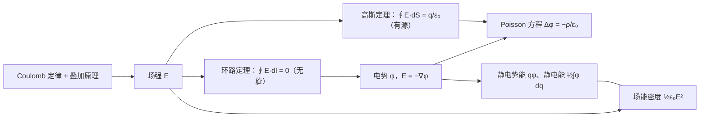

[上一章](/5.3.1)用**高斯定理**刻画了静电场的通量；本章研究它的环量。静电力做功与路径无关，静电场是**保守场**，于是可以像力学中由保守力引入势能（[5.1.4](/5.1.4)）那样，引入一个标量函数——电势——来等价地描述静电场。电势是标量，叠加时只需代数相加，比**场强**容易计算；由电势求**梯度**就得到场强。把高斯定理与 $\boldsymbol{E}=-\nabla\varphi$ 结合，静电学的问题归结为电势的 **Poisson 方程**，这正是 [2.5.8](/2.5.8) 研究的方程。本章最后讨论电荷系的静电能，并说明静电能储存在电场之中。下一章 [5.3.3](/5.3.3) 用这些工具讨论导体；电势的概念在恒定电流（[5.3.5](/5.3.5)）中推广为电压。§2.6 是选讲内容。

## 2.1. 静电场的保守性

在静电场中把**检验电荷** $q_0$ 沿路径 $L$ 从 $P_1$ 移到 $P_2$，静电力做功

$$
W_{12}=\int_{P_1}^{P_2}q_0\boldsymbol{E}\cdot\mathrm{d}\boldsymbol{l}=q_0\int_{P_1(L)}^{P_2}\boldsymbol{E}\cdot\mathrm{d}\boldsymbol{l}.
$$
所以要研究场强沿路径的线积分（**第二型曲线积分**）。对**点电荷** $q$ 的场，$\boldsymbol{e}_r\cdot\mathrm{d}\boldsymbol{l}=\mathrm{d}r$，

$$
\int_{P_1(L)}^{P_2}\boldsymbol{E}\cdot\mathrm{d}\boldsymbol{l}=\int_{r_1}^{r_2}\frac{q\,\mathrm{d}r}{4\pi\varepsilon_0r^2}=\frac{q}{4\pi\varepsilon_0}\Big(\frac{1}{r_1}-\frac{1}{r_2}\Big),
$$
只由始末位置决定，与路径无关。任意静止电荷系的场是点电荷场的叠加，每一项的线积分都与路径无关，所以总场的线积分也与路径无关。这与有心力是保守力（[5.1.4](/5.1.4#sec-4.4.1)）是同一回事。

**定理 2.1.1（静电场环路定理）** 在静电场中，场强沿任意闭合路径的线积分为零：

$$
\oint_L\boldsymbol{E}\cdot\mathrm{d}\boldsymbol{l}=0 .
$$
其微分形式为 $\nabla\times\boldsymbol{E}=\boldsymbol{0}$。

**证明** 在闭合路径 $L$ 上任取两点 $P_1$、$P_2$，把 $L$ 分成从 $P_1$ 到 $P_2$ 的两段 $L_1$、$L_2$。线积分与路径无关，所以 $\oint_L=\int_{P_1(L_1)}^{P_2}+\int_{P_2(L_2)}^{P_1}=\int_{P_1(L_1)}^{P_2}-\int_{P_1(L_2)}^{P_2}=0$。微分形式由 **Stokes 公式**（[定理 14.3.1](/2.2.14#thm-14.3.1)）得到：对任意小曲面 $S$，$\iint_S(\nabla\times\boldsymbol{E})\cdot\mathrm{d}\boldsymbol{S}=\oint_{\partial S}\boldsymbol{E}\cdot\mathrm{d}\boldsymbol{l}=0$，被积函数连续，故处处为零。$\square$

$\oint_L\boldsymbol{E}\cdot\mathrm{d}\boldsymbol{l}$ 是静电场沿 $L$ 的**环量**（也称环流），它反映矢量场"旋转"的程度。环路定理说明静电场是**无旋场**，**电场线**没有涡旋结构，不会闭合。数学上，"线积分与路径无关""闭路积分为零""存在势函数"三者等价（[定理 14.4.1](/2.2.14#thm-14.4.1)），这正是下一节引入电势的依据。高斯定理（有源）和环路定理（无旋）一起完整地刻画了静电场；变化的磁场产生的感生电场则是有旋的，不满足环路定理（[5.3.9](/5.3.9)）。

**例 2.1.1（电场线平行而疏密不均的静电场不存在）** 设某区域内电场线都沿 $x$ 方向，但场强随 $y$ 变化，$\boldsymbol{E}=E(y)\boldsymbol{e}_x$。取边平行于坐标轴的矩形回路，两条竖直边上 $\boldsymbol{E}\perp\mathrm{d}\boldsymbol{l}$，两条水平边（$y=y_1,y_2$，长 $a$）上的积分为 $[E(y_1)-E(y_2)]a$。由环路定理它必须为零，所以 $E(y_1)=E(y_2)$：平行的静电场电场线必定等间距，场是均匀的。这样的场在区域内可以无源也可以有源（例如场沿 $x$ 方向变化），但不能沿垂直于电场线的方向变化。

## 2.2. 电势差、电势

### 2.2.1. 电势差与电势

静电场的线积分与路径无关，因此可以引入一个只与位置有关的标量。

**定义 2.2.1（电势差）** 静电场中 $P_1$ 与 $P_2$ 两点的**电势差**为

$$
U_{12}=\varphi_1-\varphi_2=\int_{P_1}^{P_2}\boldsymbol{E}\cdot\mathrm{d}\boldsymbol{l},
$$
即把单位正电荷从 $P_1$ 移到 $P_2$ 时静电力所做的功。

**定义 2.2.2（电势）** 选定某点 $O$ 为电势零点，$\varphi_O=0$，静电场中 $P$ 点的**电势**为

$$
\varphi_P=\int_P^O\boldsymbol{E}\cdot\mathrm{d}\boldsymbol{l}=-\int_O^P\boldsymbol{E}\cdot\mathrm{d}\boldsymbol{l},
$$
即静电力把单位正电荷从 $P$ 移到电势零点所做的功。

由定义 $\varphi_1-\varphi_2=\int_{P_1}^{O}\boldsymbol{E}\cdot\mathrm{d}\boldsymbol{l}-\int_{P_2}^{O}\boldsymbol{E}\cdot\mathrm{d}\boldsymbol{l}=\int_{P_1}^{P_2}\boldsymbol{E}\cdot\mathrm{d}\boldsymbol{l}$，所以电势差与零点的选取无关，有物理意义的总是电势差。电势的单位是伏特，$1\,\mathrm{V}=1\,\mathrm{J\,C^{-1}}$，场强的单位因此也可以写成 $\mathrm{V\,m^{-1}}$。微分形式 $\mathrm{d}\varphi=-\boldsymbol{E}\cdot\mathrm{d}\boldsymbol{l}$ 说明：沿电场线方向，电势降低。

关于电势有几点说明：

- 相对性：一点电势的数值依赖于零点的选择。
- 固有性：电势是电场本身的性质，与该点是否放有电荷、放多少电荷无关。
- 与数学的关系：$-\varphi$ 是静电场的**势函数**（[定义 14.4.2](/2.2.14#def-14.4.2)），差一个负号的原因与势能相同：物理上让"静电力做正功"对应"电势降低"。
- 记号：本站电势写 $\varphi$，电势差（电压）写 $U$；振动与波中的相位也写 $\varphi$，两者不在同一处出现。

电势零点的选择有任意性。理论计算中，有限的电荷分布通常取无穷远处为零点，$\varphi_\infty=0$；电荷分布延伸到无穷远（无限长直线、无限大平面）时，无穷远处的积分发散，要选有限远处的某点为零点。实际中常取大地或仪器的机壳、公共地线为零点。带电作业的工人穿着金属屏蔽服、与高压线处于同一电势，身上没有电势差，所以不会有电流通过身体。

### 2.2.2. 几种典型电荷分布的电势

已知场强分布时，由定义沿最方便的路径（通常是沿电场线）积分，称为场强积分法。

**例 2.2.1（点电荷的电势）** 取无穷远为零点，沿径向积分：

$$
\varphi(r)=\int_r^\infty\frac{q\,\mathrm{d}r'}{4\pi\varepsilon_0r'^2}=\frac{q}{4\pi\varepsilon_0r}.
$$
$q>0$ 时电势为正，随 $r$ 增大而降低；$q<0$ 时电势为负。它正是 **Laplace 方程**的基本解 $\Gamma(\boldsymbol{r})=\frac{1}{4\pi r}$（[定义 8.1.1](/2.5.8#def-8.1.1)）乘以 $q/\varepsilon_0$。

**例 2.2.2（均匀带电球面的电势）** 半径 $R$、电荷 $q$。由 [例 1.7.1](/5.3.1#ex-1.7.1)，球面内 $E=0$，球面外 $E=\frac{q}{4\pi\varepsilon_0r^2}$。所以

$$
\varphi(r)=\int_r^\infty E\,\mathrm{d}r'=\begin{cases}\dfrac{q}{4\pi\varepsilon_0R},&r\le R,\\[3mm]\dfrac{q}{4\pi\varepsilon_0r},&r\ge R.\end{cases}
$$
球面内是等势区，球面外与点电荷的电势相同。场强在 $r=R$ 处跃变，电势却是连续的：电势是场强的积分，有限的跃变不影响积分的连续性。

**例 2.2.3（无限长均匀带电直线的电势）** 线**电荷密度** $\lambda$，$E=\frac{\lambda}{2\pi\varepsilon_0r}$。无穷远处不能作为零点，取距直线 $r_0$ 处为零点：

$$
\varphi(r)=\int_r^{r_0}\frac{\lambda\,\mathrm{d}r'}{2\pi\varepsilon_0r'}=\frac{\lambda}{2\pi\varepsilon_0}\ln\frac{r_0}{r}.
$$
它是平面上的基本解 $-\frac{1}{2\pi}\ln r$ 的倍数：无限长直线的问题本质上是二维问题。

**例 2.2.4（均匀带电球体的电势）** 半径 $R$、电荷 $Q$。球外同点电荷；球内（$r<R$）场强为 $\frac{Qr}{4\pi\varepsilon_0R^3}$，

$$
\varphi(r)=\int_r^R\frac{Qr'\,\mathrm{d}r'}{4\pi\varepsilon_0R^3}+\frac{Q}{4\pi\varepsilon_0R}=\frac{Q(3R^2-r^2)}{8\pi\varepsilon_0R^3}.
$$
球心处 $\varphi(0)=\frac{3Q}{8\pi\varepsilon_0R}$，是球面处电势的 $1.5$ 倍。

## 2.3. 电势叠加原理

### 2.3.1. 电势叠加原理

**性质 2.3.1（电势叠加原理）** 电荷系的电场中某点的电势，等于各电荷单独存在时在该点产生的电势的代数和：

$$
\varphi=\sum_i\varphi_i .
$$
各电势必须取同一个零点。

**证明** 由 $\varphi_P=\int_P^O\boldsymbol{E}\cdot\mathrm{d}\boldsymbol{l}$ 与**场强叠加原理** $\boldsymbol{E}=\sum_i\boldsymbol{E}_i$，$\varphi_P=\sum_i\int_P^O\boldsymbol{E}_i\cdot\mathrm{d}\boldsymbol{l}=\sum_i\varphi_i$。$\square$

取无穷远为零点，点电荷系与连续带电体的电势分别为

$$
\varphi=\sum_i\frac{q_i}{4\pi\varepsilon_0r_i},\qquad\varphi=\int_q\frac{\mathrm{d}q}{4\pi\varepsilon_0r}.
$$
这种已知电荷分布、由叠加原理计算电势的方法称为电势叠加法。它是标量积分，不必像场强那样分解分量，通常比直接求场强简单。连续分布时，上式就是 $\varphi=\frac{1}{\varepsilon_0}\iiint\Gamma(\boldsymbol{r}-\boldsymbol{r}')\rho(\boldsymbol{r}')\,\mathrm{d}V'$：电势是电荷密度与基本解的卷积（[2.5.8](/2.5.8)）。

### 2.3.2. 例题

**例 2.3.1（电偶极子的电势）** **电偶极矩** $\boldsymbol{p}=q\boldsymbol{l}$，场点到中点的距离 $r\gg l$，$\boldsymbol{r}$ 与 $\boldsymbol{p}$ 的夹角为 $\theta$。场点到 $\pm q$ 的距离为 $r_\pm=\lvert\boldsymbol{r}\mp\boldsymbol{l}/2\rvert\approx r\mp\frac l2\cos\theta$，

$$
\varphi=\frac{q}{4\pi\varepsilon_0}\Big(\frac{1}{r_+}-\frac{1}{r_-}\Big)\approx\frac{q}{4\pi\varepsilon_0}\frac{l\cos\theta}{r^2}=\frac{p\cos\theta}{4\pi\varepsilon_0r^2}=\frac{\boldsymbol{p}\cdot\boldsymbol{e}_r}{4\pi\varepsilon_0r^2}.
$$
电偶极子的电势与 $r^2$ 成反比，中垂面（$\theta=\pi/2$）上各点电势为零。

**例 2.3.2（均匀带电圆环轴线上的电势）** 圆环半径 $R$、电荷 $Q$，场点在轴线上距环心 $x$ 处。

- 电势叠加法：各电荷元到场点的距离都是 $\sqrt{x^2+R^2}$，所以 $\varphi=\dfrac{1}{4\pi\varepsilon_0\sqrt{x^2+R^2}}\displaystyle\int\mathrm{d}q=\dfrac{Q}{4\pi\varepsilon_0\sqrt{x^2+R^2}}$。
- 场强积分法：轴线上 $E_x=\dfrac{Qx}{4\pi\varepsilon_0(x^2+R^2)^{3/2}}$，$\varphi=\displaystyle\int_x^\infty\dfrac{Qx'\,\mathrm{d}x'}{4\pi\varepsilon_0(x'^2+R^2)^{3/2}}=\dfrac{Q}{4\pi\varepsilon_0\sqrt{x^2+R^2}}$。

两种方法结果相同；前者只用了一次标量积分。环心处 $\varphi=\frac{Q}{4\pi\varepsilon_0R}$，而场强为零：电势与场强没有直接的大小关系，场强由电势的变化率决定（§2.4）。$x\gg R$ 时 $\varphi\to\frac{Q}{4\pi\varepsilon_0x}$，回到点电荷。

### 2.3.3. 等势面

**定义 2.3.1（等势面）** 电场中电势相等的点组成的曲面 $\varphi(x,y,z)=C$ 称为**等势面**。

等势面就是电势这个**数量场**的等值面（二维情形是**等值线**）。作图时规定相邻两个等势面之间的电势差都相等，这样等势面的疏密就反映场强的大小。

**性质 2.3.2** 等势面有以下性质：

1. 电场线与等势面处处正交，并指向电势降低的方向。
2. 等势面密集处场强大，稀疏处场强小。
3. 不同的等势面不相交。
4. 电荷沿等势面移动时，静电力不做功。

**证明** 设电荷 $q_0$ 在等势面上移动 $\mathrm{d}\boldsymbol{l}$，静电力做功 $q_0\boldsymbol{E}\cdot\mathrm{d}\boldsymbol{l}=-q_0\,\mathrm{d}\varphi=0$，即第 4 条。由于 $q_0\ne0$、$E\ne0$、$\mathrm{d}l\ne0$，只能 $\boldsymbol{E}\perp\mathrm{d}\boldsymbol{l}$，而 $\mathrm{d}\boldsymbol{l}$ 是等势面上的任意方向，所以 $\boldsymbol{E}$ 垂直于等势面；沿 $\boldsymbol{E}$ 方向 $\mathrm{d}\varphi=-E\,\mathrm{d}l<0$，即第 1 条。相邻等势面的电势差 $\Delta\varphi$ 固定，间距 $\Delta n\approx\Delta\varphi/E$，即第 2 条。一点只有一个电势值，即第 3 条。$\square$

电场线与等势面是描述静电场的两种几何图像，前者对应场强（力的观点），后者对应电势（能量的观点）。实验上测量电势比测量场强容易，所以常先测出等势面，再画出与它正交的电场线。电子显微镜中的静电透镜就是由一组电极形成的、对称轴附近弯曲的等势面，电子穿过时像光线穿过透镜一样偏折。

## 2.4. 电势梯度

### 2.4.1. 场强与电势的微分关系

由 $\mathrm{d}\varphi=-\boldsymbol{E}\cdot\mathrm{d}\boldsymbol{l}=-E_l\,\mathrm{d}l$，场强沿任一方向 $\boldsymbol{l}$ 的分量等于电势沿该方向的**方向导数**的负值：

$$
E_l=-\frac{\partial\varphi}{\partial l}.
$$
沿等势面的法向（电场线方向）**方向导数**的绝对值最大，这就是**梯度**的方向。

**公式 2.4.1（场强与电势的关系）**

$$
\boldsymbol{E}=-\nabla\varphi=-\operatorname{grad}\varphi=-\Big(\frac{\partial\varphi}{\partial x}\boldsymbol{e}_x+\frac{\partial\varphi}{\partial y}\boldsymbol{e}_y+\frac{\partial\varphi}{\partial z}\boldsymbol{e}_z\Big).
$$

$\nabla\varphi$ 称为电势梯度（potential gradient）。它是一个矢量，方向是该点附近电势升高最快的方向，大小是沿这个方向的变化率；场强指向电势降低最快的方向。这与力学中保守力等于势能梯度的负值（[5.1.4](/5.1.4)）完全类似。公式 2.4.1 自动满足 $\nabla\times\boldsymbol{E}=-\nabla\times\nabla\varphi=\boldsymbol{0}$（[定理 14.1.1](/2.2.14#thm-14.1.1)）。

求场强的第三种方法因此是：先用电势叠加法求出电势，再求梯度。

**例 2.4.1（由电偶极子的电势求场强）** 用**球坐标**中的梯度，由例 2.3.1 的 $\varphi=\frac{p\cos\theta}{4\pi\varepsilon_0r^2}$，

$$
E_r=-\frac{\partial\varphi}{\partial r}=\frac{2p\cos\theta}{4\pi\varepsilon_0r^3},\qquad E_\theta=-\frac1r\frac{\partial\varphi}{\partial\theta}=\frac{p\sin\theta}{4\pi\varepsilon_0r^3},
$$
合起来就是 [公式 1.4.1](/5.3.1#fml-1.4.1)：$\boldsymbol{E}=\frac{1}{4\pi\varepsilon_0r^3}\big[3(\boldsymbol{p}\cdot\boldsymbol{e}_r)\boldsymbol{e}_r-\boldsymbol{p}\big]$。比 [5.3.1](/5.3.1) 中直接叠加场强简单得多。

### 2.4.2. Poisson 方程与 Laplace 方程

把 $\boldsymbol{E}=-\nabla\varphi$ 代入高斯定理的微分形式 $\nabla\cdot\boldsymbol{E}=\rho/\varepsilon_0$，得到静电学的基本方程

$$
\Delta\varphi=\nabla^2\varphi=-\frac{\rho}{\varepsilon_0},
$$
即电势满足 **Poisson 方程**；在没有电荷的区域，$\Delta\varphi=0$，电势满足 **Laplace 方程**，是**调和函数**（[2.2.14](/2.2.14#sec-14.5.2)、[2.5.8](/2.5.8)）。一个矢量方程组（高斯定理与环路定理）由此化为一个标量方程，求静电场就是在给定的边界条件下解这个方程，[5.3.3](/5.3.3) 讨论它的唯一性。调和函数的性质立刻给出一个物理结论。

**定理 2.4.1（Earnshaw 定理）** 点电荷不可能仅在静电力作用下处于稳定平衡。

**证明** 设点电荷 $q>0$ 在 $P_0$ 处稳定平衡，则它的势能 $q\varphi$ 在 $P_0$ 处有严格的极小值，这里 $\varphi$ 是其他电荷产生的电势。在 $P_0$ 附近没有其他电荷，$\varphi$ 在 $P_0$ 的一个小球内调和，而由**强极值原理**（[定理 8.2.2](/2.5.8#thm-8.2.2)），在小球内部取到最小值的调和函数必为常数，与"严格极小"矛盾。$q<0$ 时把极小改为极大即可。$\square$

直观地说，在无电荷区域 $\nabla\cdot\boldsymbol{E}=0$，电场线不能从各个方向都指向一点，所以总有某个方向会把电荷推离平衡位置。由此可知，静止的经典点电荷不能组成稳定的原子，原子的稳定性要用量子力学解释（[5.5.4](/5.5.4)）；实验室中囚禁离子必须用交变电场（Paul 阱）或加上磁场（Penning 阱）。

## 2.5. 电荷在外电场中的静电势能

### 2.5.1. 点电荷的静电势能

静电力是保守力，可以引入势能。电荷 $q$ 在外电场中从 $P_1$ 移到 $P_2$，静电力做功 $W_{12}=q(\varphi_1-\varphi_2)$，与路径无关。

**定义 2.5.1（静电势能）** 点电荷 $q$ 在外电场中位于电势为 $\varphi$ 处时，它的**静电势能**为

$$
E_{\mathrm{p}}=q\varphi .
$$
静电力做的功等于静电势能的减少，$W_{12}=E_{\mathrm{p}1}-E_{\mathrm{p}2}$；外力克服静电力做的功等于静电势能的增加。

与力学中的势能（[定义 4.5.1](/5.1.4#def-4.5.1)）一样，静电势能属于电荷与产生外电场的电荷组成的系统，是两者的相互作用能；它的零点就是电势的零点。电势高的地方，正电荷的静电势能大，负电荷的静电势能反而小。原子与粒子物理中常用的能量单位电子伏特就是一个电子经过 $1\,\mathrm{V}$ 电势差时静电势能的变化：$1\,\mathrm{eV}=1.602\,176\,634\times10^{-19}\,\mathrm{J}$（精确值）。

### 2.5.2. 电偶极子的静电势能

**例 2.5.1（均匀外电场中电偶极子的静电势能）** 电偶极子 $\boldsymbol{p}=q\boldsymbol{l}$ 放在均匀电场 $\boldsymbol{E}$ 中，

$$
E_{\mathrm{p}}=q\varphi_+-q\varphi_-=-q(\varphi_--\varphi_+)=-q\int_{-}^{+}\boldsymbol{E}\cdot\mathrm{d}\boldsymbol{l}=-q\boldsymbol{E}\cdot\boldsymbol{l}=-\boldsymbol{p}\cdot\boldsymbol{E}=-pE\cos\theta .
$$
$\boldsymbol{p}$ 与 $\boldsymbol{E}$ 同向（$\theta=0$）时势能最低，是稳定平衡；反向时势能最高，是不稳定平衡。对 $\theta$ 求导，$-\frac{\partial E_{\mathrm{p}}}{\partial\theta}=-pE\sin\theta$，正是 [例 1.4.3](/5.3.1#ex-1.4.3) 中力矩的大小，负号表示力矩使 $\theta$ 减小。这一结果对任何偶极子都成立：磁场中的磁矩有同样形式的势能 $-\boldsymbol{m}\cdot\boldsymbol{B}$（[5.3.7](/5.3.7)）。

## 2.6. 电荷系的静电能

### 2.6.1. 点电荷系的相互作用能

上一节的外电场是给定的；现在考虑一组电荷之间的相互作用能。

**定义 2.6.1（静电能）** 把一个静止电荷系的各部分从当前位置彼此分散到相距无穷远的过程中，静电力所做的功，称为电荷系在当前状态的**静电能**。对点电荷系，它也称为点电荷之间的相互作用能，简称**互能**；对连续带电体，各电荷元之间的相互作用能称为该带电体的**自能**。

两个点电荷：先固定 $q_1$，把 $q_2$ 从当前位置移到无穷远，静电力做功 $q_2\varphi_{21}$，$\varphi_{21}=\frac{q_1}{4\pi\varepsilon_0r_{12}}$ 是 $q_1$ 在 $q_2$ 处的电势；此后 $q_1$ 单独存在，移动它不做功。所以 $W_{\mathrm{int}}=q_2\varphi_{21}$，同理也等于 $q_1\varphi_{12}$，写成对称形式

$$
W_{\mathrm{int}}=\frac12(q_1\varphi_{12}+q_2\varphi_{21})=\frac{q_1q_2}{4\pi\varepsilon_0r_{12}}.
$$
三个点电荷：先移走 $q_3$，做功 $q_3(\varphi_{31}+\varphi_{32})$；再移走 $q_2$，做功 $q_2\varphi_{21}$。把每一对写成对称形式并重新组合，得 $W_{\mathrm{int}}=\frac12[q_1(\varphi_{12}+\varphi_{13})+q_2(\varphi_{21}+\varphi_{23})+q_3(\varphi_{31}+\varphi_{32})]$。推广到 $n$ 个点电荷：

**公式 2.6.1（点电荷系的静电能）**

$$
W_{\mathrm{int}}=\frac12\sum_{i=1}^nq_i\varphi_i=\sum_{i<j}\frac{q_iq_j}{4\pi\varepsilon_0r_{ij}},
$$
其中 $\varphi_i$ 是除 $q_i$ 以外的其他电荷在 $q_i$ 处产生的电势。因子 $\frac12$ 来自每一对电荷被计算了两次。

互能可正可负：异号电荷的互能为负，表示要把它们分开，外界必须做功。原子与分子的结合能主要就是这种静电能（加上量子力学的动能）。

### 2.6.2. 连续带电体的静电能

对连续带电体，把它分成电荷元，求和变为积分：

$$
W_{\mathrm{e}}=\frac12\int_q\varphi\,\mathrm{d}q=\frac12\iiint_V\rho\varphi\,\mathrm{d}V,
$$
$\varphi$ 是全部电荷在 $\mathrm{d}q$ 处产生的电势（一个电荷元自身对该处电势的贡献是无穷小量）。这个式子适用于体电荷和面电荷，但不能用于点电荷或线电荷的自能：点电荷自身处的电势为无穷大，线电荷处的电势对数发散。几个带电体组成的系统的总静电能等于各自的自能与两两之间的互能之和，$W_{\mathrm{e}}=\sum_iW_{\mathrm{self},i}+\sum_{i<j}W_{\mathrm{int},ij}$。

**例 2.6.1（均匀带电球面的静电能）** 半径 $R$、电荷 $Q$。球面上各处的电势都是 $\frac{Q}{4\pi\varepsilon_0R}$，所以

$$
W_{\mathrm{e}}=\frac12\cdot\frac{Q}{4\pi\varepsilon_0R}\int\mathrm{d}q=\frac{Q^2}{8\pi\varepsilon_0R}.
$$
$R\to0$ 时它发散：点电荷的自能是无穷大，这是经典电磁理论的一个基本困难。若认为电子的静能 $m_{\mathrm{e}}c^2$（[5.1.8](/5.1.8)）全部来自静电自能，得到的长度量级就是经典电子半径 $r_{\mathrm{e}}=\frac{e^2}{4\pi\varepsilon_0m_{\mathrm{e}}c^2}\approx2.82\times10^{-15}\,\mathrm{m}$；实验上电子并没有这样的大小，这个困难最终在量子电动力学中通过重整化处理。

**例 2.6.2（均匀带电球体的静电能）** 半径 $R$、电荷 $Q$。考虑半径 $r$ 到 $r+\mathrm{d}r$ 的薄球壳，$\mathrm{d}q=\frac{3Qr^2}{R^3}\,\mathrm{d}r$，所在处电势由例 2.2.4 为 $\varphi(r)=\frac{Q(3R^2-r^2)}{8\pi\varepsilon_0R^3}$，

$$
W_{\mathrm{e}}=\frac12\int_0^R\frac{Q(3R^2-r^2)}{8\pi\varepsilon_0R^3}\cdot\frac{3Qr^2}{R^3}\,\mathrm{d}r=\frac{3Q^2}{16\pi\varepsilon_0R^6}\Big(R^5-\frac{R^5}{5}\Big)=\frac{3Q^2}{20\pi\varepsilon_0R}=\frac35\cdot\frac{Q^2}{4\pi\varepsilon_0R}.
$$
这一结果用于估算原子核的 Coulomb 能：$Z$ 个质子均匀分布在半径 $R\approx1.2A^{1/3}\,\mathrm{fm}$ 的球内，Coulomb 能约为 $0.72\,Z^2A^{-1/3}\,\mathrm{MeV}$（用 $\frac{e^2}{4\pi\varepsilon_0}\approx1.44\,\mathrm{MeV\,fm}$），与原子核结合能半经验公式中 Coulomb 项的系数（约 $0.7\,\mathrm{MeV}$）一致。它随 $Z^2$ 增长，是重核不稳定、可以裂变的主要原因。

## 2.7. 静电场的能量

### 2.7.1. 能量储存在电场中

由 $W_{\mathrm{e}}=\frac12\int\varphi\,\mathrm{d}q$，似乎静电能集中在有电荷的地方。但以均匀带电球面为例，电荷只在球面上，而球面以内 $E=0$、能量又必须存在于某处。实际上，静电能储存在电场所占据的空间中。在静电学中两种看法给出相同的总能量，无法区分；对变化的电磁场，场可以脱离电荷独立存在并携带能量传播（电磁波，[5.3.10](/5.3.10)），只有"能量属于场"的观点是正确的。

**公式 2.7.1（静电场的能量密度）** 真空中静电场的能量密度为

$$
w_{\mathrm{e}}=\frac{\mathrm{d}W_{\mathrm{e}}}{\mathrm{d}V}=\frac12\varepsilon_0E^2,
$$
区域 $V$ 中储存的静电场能量为 $W_{\mathrm{e}}=\iiint_V\frac12\varepsilon_0E^2\,\mathrm{d}V$。

**证明** 对有界的电荷分布，取足够大的区域 $V$（边界为 $S$）包含全部电荷。由 $\rho=\varepsilon_0\nabla\cdot\boldsymbol{E}$ 与 $\nabla\cdot(\varphi\boldsymbol{E})=\varphi\nabla\cdot\boldsymbol{E}+\nabla\varphi\cdot\boldsymbol{E}$（[性质 14.1.1](/2.2.14#pty-14.1.1)），再用 **Gauss 公式**，

$$
\frac12\iiint_V\rho\varphi\,\mathrm{d}V=\frac{\varepsilon_0}{2}\iiint_V\big[\nabla\cdot(\varphi\boldsymbol{E})+E^2\big]\mathrm{d}V=\frac{\varepsilon_0}{2}\oiint_S\varphi\boldsymbol{E}\cdot\mathrm{d}\boldsymbol{S}+\frac{\varepsilon_0}{2}\iiint_VE^2\,\mathrm{d}V,
$$
这里用了 $\nabla\varphi=-\boldsymbol{E}$。取 $S$ 为半径 $R\to\infty$ 的球面，$\varphi\sim R^{-1}$，$E\sim R^{-2}$，面积 $\sim R^2$，面积分 $\sim R^{-1}\to0$。$\square$

能量密度 $\frac12\varepsilon_0E^2$ 总是非负的，而点电荷系的互能可以为负，两者并不矛盾：$\frac12\int\varepsilon_0E^2\,\mathrm{d}V$ 包含了每个点电荷自身无穷大的自能，$\frac12\sum q_i\varphi_i$ 不包含。能量密度的形式在有电介质时变为 $\frac12\boldsymbol{E}\cdot\boldsymbol{D}$（[5.3.4](/5.3.4)），与磁场能量密度 $\frac12\boldsymbol{B}\cdot\boldsymbol{H}$（[5.3.9](/5.3.9)）一起构成电磁场的能量。

**例 2.7.1（用场能重算均匀带电球面的静电能）** 球面内 $E=0$，球面外 $w_{\mathrm{e}}=\frac12\varepsilon_0\Big(\frac{Q}{4\pi\varepsilon_0r^2}\Big)^2=\frac{Q^2}{32\pi^2\varepsilon_0r^4}$。取半径 $r$、厚 $\mathrm{d}r$ 的球壳为体积元，

$$
W_{\mathrm{e}}=\int_R^\infty\frac{Q^2}{32\pi^2\varepsilon_0r^4}\cdot4\pi r^2\,\mathrm{d}r=\frac{Q^2}{8\pi\varepsilon_0R},
$$
与例 2.6.1 一致。能量分布在球面外的全部空间中，其中一半在 $R<r<2R$ 的球壳内。

## 小结

静电场的理论结构可以概括如下：由 **Coulomb 定律**和**场强叠加原理**出发，得到场强的两条整体性质——高斯定理（通量）与环路定理（环量），它们的微分形式说明静电场有源、无旋；无旋性允许引入电势，于是全部内容归结为电势的 Poisson 方程。

| 物理量 | 定义或关系 | 描述的角度 |
|---|---|---|
| 场强 $\boldsymbol{E}$ | $\boldsymbol{F}=q\boldsymbol{E}$；电场线 | 力 |
| 电通量 $\Phi_{\mathrm{e}}$ | $\oiint_S\boldsymbol{E}\cdot\mathrm{d}\boldsymbol{S}=q_{\mathrm{enc}}/\varepsilon_0$ | 源 |
| 电势 $\varphi$ | $\varphi_P=\int_P^O\boldsymbol{E}\cdot\mathrm{d}\boldsymbol{l}$；$\boldsymbol{E}=-\nabla\varphi$；等势面 | 功与能 |
| 静电势能 | $E_{\mathrm{p}}=q\varphi$，偶极子 $-\boldsymbol{p}\cdot\boldsymbol{E}$ | 能 |
| 静电能 | $\frac12\sum q_i\varphi_i$，$\frac12\int\varphi\,\mathrm{d}q=\int\frac12\varepsilon_0E^2\,\mathrm{d}V$ | 能 |

## 思考题

1. 同一条电场线上任意两点的电势是否相等？
   提示：不相等。沿电场线方向电势单调降低。
2. 电荷在电势高的地方，静电势能是否一定比在电势低的地方大？
   提示：不一定。$E_{\mathrm{p}}=q\varphi$，对负电荷，电势越高势能越低。
3. 静电场的电场线能否闭合？
   提示：不能。沿闭合的电场线 $\oint\boldsymbol{E}\cdot\mathrm{d}\boldsymbol{l}>0$，与环路定理矛盾。
4. 试说明电偶极子中垂面上各点的电势为零。
   提示：中垂面上各点到 $+q$、$-q$ 的距离相等，两者电势等值异号（取无穷远为零点）。
5. 场强为零的地方电势是否一定为零？电势为零的地方场强是否一定为零？
   提示：都不一定。均匀带电球面内 $E=0$ 而 $\varphi\ne0$；电偶极子中垂面上 $\varphi=0$ 而 $E\ne0$。场强只由电势的空间变化率决定。
6. 场强越大的地方，电场的能量密度是否越高？电势越高的地方呢？
   提示：前者是，$w_{\mathrm{e}}=\frac12\varepsilon_0E^2$；后者不一定，电势的数值依赖于零点的选择，与能量密度没有直接关系。
