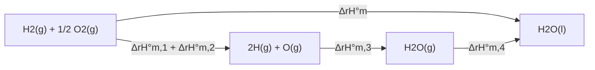

In studying a chemical reaction we care first about the transformation of matter (the synthesis of ammonia, the removal of mercury) and second about the transformation of energy (the heat released in combustion, the discharge of a storage battery). Starting from the conversion of energy, chemical thermodynamics answers three questions: how much heat a reaction absorbs or releases (thermochemistry), whether a reaction can proceed spontaneously under given conditions (the direction of reaction), and how far it proceeds (chemical equilibrium, [6.1.8](/6.1.8)). The basic laws of thermodynamics were established in physics: Carnot studied the efficiency of heat engines in 1824, Mayer (1842), Joule (1843–1850), and Helmholtz (1847) established the conservation of energy, and Clausius introduced entropy in 1865; the first and second laws are treated in [5.2.3](/5.2.3) and [5.2.4](/5.2.4). It was Gibbs (1876–1878) who applied them systematically to chemical systems and founded chemical thermodynamics. This chapter first reviews the basic concepts and the first law briefly (6.1, 6.2) and then concentrates on what is specific to chemistry: the extent of reaction, standard states, and the calculation of the various reaction enthalpies (6.3), and the use of entropy and the Gibbs energy to determine the direction of reaction (6.4). The results are used in chemical equilibrium ([6.1.8](/6.1.8)), electrode potentials ([6.1.11](/6.1.11)), and the chapters on descriptive chemistry of the elements. More advanced topics such as chemical potential, partial molar quantities, the Gibbs–Helmholtz equation, and statistical thermodynamics are treated in [Physical Chemistry](/6.3).

## 6.1. Basic Concepts of Thermodynamics

### 6.1.1. System and Surroundings

The object under study in thermodynamics is called the **thermodynamic system**, and the part outside the system that interacts with it is the surroundings. According to what is exchanged between system and surroundings, a system is an **open system** (exchanging both energy and matter), a **closed system** (exchanging energy only), or an **isolated system** (exchanging neither); see the definitions in [5.2.1](/5.2.1#sec-1.1.1). The closed system is the one studied most in chemistry: a reaction mixture together with any gas in it exchanges only heat and work with its surroundings.

### 6.1.2. State and State Functions

The state of a system is determined by a set of macroscopic properties, and the quantities that describe the state are the **state variables** of physics. Chemical thermodynamics emphasizes a common property of these quantities:

**Definition 6.1.1 (State Function)** A physical quantity whose value is uniquely determined once the state of the system is fixed is called a **state function**.

The change of a state function depends only on the initial and final states and not on the path: $\Delta X = X_{\mathrm{final}} - X_{\mathrm{initial}}$; when the system goes through a cycle and returns to its original state, $\oint \mathrm{d}X = 0$. Mathematically, this means that the differential $\mathrm{d}X$ of a state function is a **total differential** ([2.2.10](/2.2.10)). The quantities $p$, $V$, $T$, $n$, $U$, $H$, $S$, and $G$ are all state functions; heat and work, in contrast, depend on the path and are not state functions, and their infinitesimal amounts are written $\delta Q$ and $\delta W$ to distinguish them from total differentials.

State functions fall into two classes: **extensive quantities**, which are proportional to the amount of substance and additive (such as $V$, $n$, $m$, $U$, $H$, $S$, and $G$), and **intensive quantities**, which are independent of the amount of substance and not additive (such as $T$, $p$, and density). The ratio of two extensive quantities is intensive, such as the molar volume $V_{\mathrm{m}} = V/n$; in general every molar quantity $X_{\mathrm{m}} = X/n$ is intensive.

### 6.1.3. Processes and Paths

When a system changes from an initial to a final state, it undergoes a thermodynamic process. Common processes in chemistry are isothermal processes (the initial and final temperatures are equal to the constant temperature of the surroundings; a process whose temperature stays constant throughout is a constant-temperature process, see [6.3.1](/6.3.1)), constant-pressure processes (the pressure of the system always equals the constant external pressure), constant-volume processes, and adiabatic processes. The specific way a process is carried out is called its path. For example, a given amount of ideal gas going from $(p_1, V_1, T)$ to $(p_2, V_2, T)$ can expand in one step against a constant external pressure, in two steps, or reversibly: all paths have the same $\Delta p$, $\Delta V$, and $\Delta U$, but different heat and work.

### 6.1.4. Heat and Work

The energy transferred between system and surroundings because of a temperature difference is **heat** $Q$, and energy transferred in other forms is **work** $W$. In this wiki both are taken as positive when received by the system: $Q > 0$ means that the system absorbs heat and $W > 0$ means that the surroundings do work on the system (consistent with [5.2.3](/5.2.3) and IUPAC).

Chemical reactions are often accompanied by volume changes, and the work exchanged when the system expands against an external pressure $p_{\mathrm{ex}}$ or is compressed is the **pressure–volume work**:
$$
W = -\int_{V_1}^{V_2} p_{\mathrm{ex}}\,\mathrm{d}V, \qquad \text{at constant external pressure}\quad W = -p_{\mathrm{ex}}\Delta V.
$$
If the external pressure differs from the pressure of the system by only an infinitesimal amount throughout ($p_{\mathrm{ex}} = p - \mathrm{d}p$), the system undergoes a quasi-static **reversible process**, and $W_{\mathrm{rev}} = -\int p\,\mathrm{d}V$. In an expansion the work $-W$ done by the system is largest along the reversible path, and in a compression the work done by the surroundings is smallest along the reversible path.

**Definition 6.1.2 (Non-Expansion Work)** All forms of work other than pressure–volume work (electrical work, surface work, and so on) are collectively called **non-expansion work**, denoted $W'$. The total work received by the system is $W = -\int p_{\mathrm{ex}}\,\mathrm{d}V + W'$.

The electrical work done by a galvanic cell ([6.1.11](/6.1.11)) is the most important non-expansion work in chemistry.

### 6.1.5. Internal Energy

The sum of all forms of energy inside a system is called its **internal energy** (in Chinese chemistry textbooks, "thermodynamic energy"), denoted $U$; it includes the translational, rotational, and vibrational energies of the molecules, the potential energy between molecules, and the energies of the electrons and nuclei. The internal energy is an extensive state function, but its absolute value cannot be determined, and thermodynamics needs only its change $\Delta U$. The internal energy of an ideal gas is a function of temperature alone, so $\Delta U = 0$ in an isothermal process; this does not mean $U = 0$ at $T = 0$, since the zero of internal energy can be chosen arbitrarily.

## 6.2. The First Law of Thermodynamics

When a closed system changes from one state to another, the change in its internal energy equals the sum of the heat absorbed by the system and the work done on the system by the surroundings (the **first law of thermodynamics**, [5.2.3](/5.2.3#sec-3.3.3)):
$$
\Delta U = Q + W, \qquad \mathrm{d}U = \delta Q + \delta W.
\tag{6.1}
$$
It is the law of conservation of energy including thermal phenomena. $Q$ and $W$ separately depend on the path, but their sum does not. For chemical reactions the first law connects the measurable heat and work of a reaction with the change in internal energy of the system: at constant volume with only pressure–volume work, $W = 0$ and the heat of reaction equals $\Delta U$; at constant pressure it equals the enthalpy change of the next section.

## 6.3. Thermochemistry

The branch that applies the first law of thermodynamics to chemical reactions and studies the measurement and calculation of the heats of reaction is called *thermochemistry*. Thermochemical data are the basis of energy utilization and chemical process safety, and together with the entropy of the next section they allow us to calculate equilibrium constants ([6.1.8](/6.1.8)).

### 6.3.1. Heat of Reaction

**Definition 6.3.1 (Heat of Reaction)** When a chemical reaction takes place in a closed system that does only pressure–volume work, and the products are brought back to the initial temperature of the reactants, the heat absorbed by the system is called the **heat of reaction** (heat effect).

Requiring the products to return to the initial temperature ensures that the heat of reaction reflects only the energy of the chemical change itself, such as the breaking and forming of chemical bonds, and does not include the heat for warming or cooling the substances.

Heat of reaction at constant volume, $Q_V$. When a reaction proceeds at constant volume, $\Delta V = 0$ and the pressure–volume work is zero, so by Eq. (6.1)
$$
Q_V = \Delta U.
$$
The constant-volume heat of reaction is measured with a bomb calorimeter: the reaction takes place in a sealed steel bomb immersed in a water bath of known total heat capacity $C$ (water plus calorimeter). If the temperature of the bath rises by $\Delta T$, then $Q_V = -C\Delta T$ for the reaction (an exothermic reaction warms the surroundings, $Q_V < 0$).

Heat of reaction at constant pressure, $Q_p$. When a reaction proceeds at constant pressure $p = p_{\mathrm{ex}}$, $W = -p\Delta V$, so $\Delta U = Q_p - p\Delta V$ and
$$
Q_p = (U_2 + pV_2) - (U_1 + pV_1) = \Delta(U + pV) = \Delta H,
$$
that is, the constant-pressure heat of reaction equals the change in the **enthalpy** of the system (for the definition of the enthalpy $H = U + pV$ see [5.2.3](/5.2.3#def-3.5.4)). Reactions in open vessels all take place at constant pressure, so the enthalpy change is the quantity most often used in chemistry. Heats of reaction in solution (heats of neutralization and of dissolution) are measured at constant pressure in a coffee-cup calorimeter.

For the same reaction $Q_p$ and $Q_V$ differ by $\Delta(pV)$. The $pV$ of liquids and solids is small and can be neglected; treating the gases as **ideal gases**, $\Delta(pV) = \Delta n_{\mathrm{g}}RT$, where $\Delta n_{\mathrm{g}}$ is the change in the amount of gaseous substance in the reaction. Hence
$$
Q_p = Q_V + \Delta n_{\mathrm{g}}RT.
\tag{6.2}
$$

**Example 6.3.1** The constant-volume heat of complete combustion of 1 mol of n-heptane at 298.15 K, measured in a bomb calorimeter, is $Q_V = -4807.12\,\mathrm{kJ}$. Find $Q_p$.

Solution: $\ce{C7H16(l) + 11O2(g) -> 7CO2(g) + 8H2O(l)}$, and the change in the amount of gas is $\Delta n_{\mathrm{g}} = 7 - 11 = -4\,\mathrm{mol}$. By Eq. (6.2),
$$
Q_p = -4807.12\,\mathrm{kJ} + (-4\,\mathrm{mol})(8.314\,\mathrm{J\,mol^{-1}\,K^{-1}})(298.15\,\mathrm{K}) = -4817.04\,\mathrm{kJ}.
$$
The number of gas molecules decreases, so at constant pressure the surroundings do work on the system and more heat is released; the difference is only 0.2%, which shows that for reactions dominated by condensed phases $Q_p$ and $Q_V$ differ very little.

### 6.3.2. Extent of Reaction and Molar Reaction Enthalpy

The heat released by burning is proportional to the amount of coal burned. To describe "how far the reaction has gone" by a single quantity, we write the chemical equation in the form $0 = \sum_{\mathrm{B}} \nu_{\mathrm{B}}\mathrm{B}$.

**Definition 6.3.2 (Stoichiometric Number)** The coefficient $\nu_{\mathrm{B}}$ of substance B in the chemical equation $0 = \sum_{\mathrm{B}}\nu_{\mathrm{B}}\mathrm{B}$ is called the **stoichiometric number** of B; it is negative for reactants and positive for products.

For example, in $\ce{N2 + 3H2 -> 2NH3}$ we have $\nu(\ce{N2}) = -1$, $\nu(\ce{H2}) = -3$, and $\nu(\ce{NH3}) = +2$. Stoichiometric numbers are dimensionless pure numbers and may be fractions.

**Definition 6.3.3 (Extent of Reaction)** Let the amount of substance B be $n_{\mathrm{B}}(0)$ at the beginning of the reaction and $n_{\mathrm{B}}(\xi)$ at some moment. Then
$$
\xi = \frac{n_{\mathrm{B}}(\xi) - n_{\mathrm{B}}(0)}{\nu_{\mathrm{B}}}, \qquad \mathrm{d}\xi = \frac{\mathrm{d}n_{\mathrm{B}}}{\nu_{\mathrm{B}}}
$$
is called the **extent of reaction** at that moment, with unit mol.

Because the change of each substance is proportional to its stoichiometric number, the same $\xi$ is obtained from any substance at the same moment. For the synthesis of ammonia, $\xi = 1\,\mathrm{mol}$ means that 1 mol of $\ce{N2}$ and 3 mol of $\ce{H2}$ have been consumed and 2 mol of $\ce{NH3}$ formed; the reaction is said to have proceeded by 1 mol. The extent of reaction depends on how the equation is written: with $\ce{1/2N2 + 3/2H2 -> NH3}$, $\xi = 1\,\mathrm{mol}$ produces only 1 mol of $\ce{NH3}$. The chemical equation must therefore be specified whenever the extent of reaction is mentioned.

**Definition 6.3.4 (Molar Enthalpy of Reaction)** The ratio of the enthalpy change $\Delta_{\mathrm{r}}H$ of the system to the change $\Delta\xi$ in the extent of reaction,
$$
\Delta_{\mathrm{r}}H_{\mathrm{m}} = \frac{\Delta_{\mathrm{r}}H}{\Delta\xi},
$$
is called the **molar enthalpy of reaction**, with unit $\mathrm{J\,mol^{-1}}$ or $\mathrm{kJ\,mol^{-1}}$; the molar internal energy of reaction is defined similarly, $\Delta_{\mathrm{r}}U_{\mathrm{m}} = \Delta_{\mathrm{r}}U/\Delta\xi$.

The $\mathrm{mol^{-1}}$ in the unit means "per mole of reaction", that is, per 1 mol of reaction as the equation is written. The subscript r stands for reaction and m for per mole. From Eq. (6.2),
$$
\Delta_{\mathrm{r}}H_{\mathrm{m}} = \Delta_{\mathrm{r}}U_{\mathrm{m}} + \Delta\nu_{\mathrm{g}}RT, \qquad \Delta\nu_{\mathrm{g}} = \sum_{\mathrm{B(g)}}\nu_{\mathrm{B}},
$$
where $\Delta\nu_{\mathrm{g}}$ is the sum of the stoichiometric numbers of the gaseous substances in the equation (it is $-4$ in Example 6.3.1).

### 6.3.3. Standard States and Thermochemical Equations

The enthalpy change of a reaction depends on the state (temperature, pressure, concentration, phase) of the substances. To allow tabulation and comparison, a set of standard states is defined.

**Definition 6.3.5 (Standard State)** The pressure $p^\circ = 10^5\,\mathrm{Pa} = 100\,\mathrm{kPa}$ is called the **standard pressure**. The **standard state** of a substance is defined as follows:

- for a gas, the pure gas at the standard pressure with ideal-gas behavior;
- for a liquid or solid, the pure liquid or pure solid at the standard pressure;
- for a solute in solution, the state at the standard pressure with concentration $c^\circ = 1\,\mathrm{mol\,L^{-1}}$ (or molality $b^\circ = 1\,\mathrm{mol\,kg^{-1}}$) that behaves as an ideal dilute solution.

Historically the standard pressure was $101.325\,\mathrm{kPa}$ (1 atm); IUPAC changed it to $100\,\mathrm{kPa}$ in 1982. The difference in the data is small, but attention must be paid to the source when consulting tables. The standard state does not specify a temperature, and thermodynamic data are usually listed for $298.15\,\mathrm{K}$. The molar enthalpy of reaction when all reactants and products are each in their standard states (pure and unmixed) is called the standard molar enthalpy of reaction, denoted $\Delta_{\mathrm{r}}H^\circ_{\mathrm{m}}(T)$; likewise there is $\Delta_{\mathrm{r}}U^\circ_{\mathrm{m}}$. The standard state of a solute is used in chemical equilibrium ([6.1.8](/6.1.8)).

**Definition 6.3.6 (Thermochemical Equation)** A chemical equation together with its heat of reaction is called a **thermochemical equation**.

In writing one, note the following:

1. Express the heat of reaction as $\Delta_{\mathrm{r}}H^\circ_{\mathrm{m}}$ (constant pressure) or $\Delta_{\mathrm{r}}U^\circ_{\mathrm{m}}$ (constant volume) and state the temperature (298.15 K may be omitted).
2. State the physical state of each substance (g, l, s, aq) or crystal form (graphite, diamond).
3. Stoichiometric numbers may be fractions; doubling the numbers of a reaction doubles $\Delta_{\mathrm{r}}H^\circ_{\mathrm{m}}$.
4. The values of $\Delta_{\mathrm{r}}H^\circ_{\mathrm{m}}$ of the forward and reverse reactions are equal in magnitude and opposite in sign.

$$
\begin{aligned}
&\ce{C(graphite) + O2(g) -> CO2(g)} && \Delta_{\mathrm{r}}H^\circ_{\mathrm{m}} = -393.5\,\mathrm{kJ\,mol^{-1}}\\
&\ce{C(diamond) + O2(g) -> CO2(g)} && \Delta_{\mathrm{r}}H^\circ_{\mathrm{m}} = -395.4\,\mathrm{kJ\,mol^{-1}}\\
&\ce{H2(g) + 1/2O2(g) -> H2O(g)} && \Delta_{\mathrm{r}}H^\circ_{\mathrm{m}} = -241.8\,\mathrm{kJ\,mol^{-1}}\\
&\ce{H2(g) + 1/2O2(g) -> H2O(l)} && \Delta_{\mathrm{r}}H^\circ_{\mathrm{m}} = -285.8\,\mathrm{kJ\,mol^{-1}}\\
&\ce{2H2(g) + O2(g) -> 2H2O(l)} && \Delta_{\mathrm{r}}H^\circ_{\mathrm{m}} = -571.7\,\mathrm{kJ\,mol^{-1}}\\
&\ce{2H2O(l) -> 2H2(g) + O2(g)} && \Delta_{\mathrm{r}}H^\circ_{\mathrm{m}} = +571.7\,\mathrm{kJ\,mol^{-1}}
\end{aligned}
$$

The difference of the first two equations shows that diamond has an enthalpy $1.9\,\mathrm{kJ\,mol^{-1}}$ higher than graphite; the difference of the third and fourth, $44.0\,\mathrm{kJ\,mol^{-1}}$, is the molar enthalpy of vaporization of water at 298.15 K.

### 6.3.4. Hess's Law

**Theorem 6.3.1 (Hess's Law)** Whether a chemical reaction is carried out in one step or in several, its heat of reaction is the same, provided the reaction takes place at constant pressure (or constant volume) with only pressure–volume work.

Hess deduced this law from calorimetric experiments in 1840, before the first law of thermodynamics had been established. Today it is seen as a direct consequence of the first law: the constant-pressure heat of reaction is $Q_p = \Delta H$ and the constant-volume heat of reaction is $Q_V = \Delta U$, and since $H$ and $U$ are state functions, their changes are independent of the path as long as the initial and final states are the same. Thermochemical equations can therefore be added and subtracted like algebraic equations, and the corresponding $\Delta_{\mathrm{r}}H^\circ_{\mathrm{m}}$ values are added and subtracted in the same way. For example, water can form directly, or we can imagine that the molecules are first taken apart into atoms, the atoms combine into gaseous water, and this then condenses to liquid water:

$$
\Delta_{\mathrm{r}}H^\circ_{\mathrm{m}} = \Delta_{\mathrm{r}}H^\circ_{\mathrm{m},1} + \Delta_{\mathrm{r}}H^\circ_{\mathrm{m},2} + \Delta_{\mathrm{r}}H^\circ_{\mathrm{m},3} + \Delta_{\mathrm{r}}H^\circ_{\mathrm{m},4}.
$$

The value of Hess's law is that a heat of reaction that is difficult to measure directly can be calculated from heats of reaction that are easy to measure.

**Example 6.3.2** The incomplete combustion of carbon to CO is always accompanied by $\ce{CO2}$, so its heat of reaction cannot be measured directly. Given
$$
\begin{aligned}
&(1)\ \ce{C(graphite) + O2(g) -> CO2(g)} && \Delta_{\mathrm{r}}H^\circ_{\mathrm{m}}(1) = -393.5\,\mathrm{kJ\,mol^{-1}}\\
&(2)\ \ce{CO(g) + 1/2O2(g) -> CO2(g)} && \Delta_{\mathrm{r}}H^\circ_{\mathrm{m}}(2) = -283.0\,\mathrm{kJ\,mol^{-1}}
\end{aligned}
$$
find $\Delta_{\mathrm{r}}H^\circ_{\mathrm{m}}$ of $\ce{C(graphite) + 1/2O2(g) -> CO(g)}$.

Solution: The required reaction is (1) − (2), so $\Delta_{\mathrm{r}}H^\circ_{\mathrm{m}} = -393.5 - (-283.0) = -110.5\,\mathrm{kJ\,mol^{-1}}$. The key to applying Hess's law is to devise suitable reaction steps.

### 6.3.5. Standard Molar Enthalpy of Formation

The absolute value of the enthalpy cannot be determined, but if a common zero is chosen for each element, every substance can be assigned a relative enthalpy with which the enthalpy change of any reaction can be calculated. This is like measuring heights from an arbitrarily chosen reference level: the height difference between two points does not depend on the reference.

**Definition 6.3.7 (Standard Molar Enthalpy of Formation)** The standard molar enthalpy of reaction for the formation of 1 mol of substance B in its standard state from the reference-state elements in their standard states at temperature $T$ is called the **standard molar enthalpy of formation** of B at that temperature, denoted $\Delta_{\mathrm{f}}H^\circ_{\mathrm{m}}(\mathrm{B}, \text{phase}, T)$ or simply $\Delta_{\mathrm{f}}H^\circ$.

The reference-state element is usually the most stable form of the element at $T$ and $p^\circ$, such as C (graphite), $\ce{O2(g)}$, $\ce{H2(g)}$, $\ce{Br2(l)}$, $\ce{I2(s)}$, and $\ce{Hg(l)}$. Phosphorus is an exception: the reference state is taken as white phosphorus $\ce{P4}$ (s, white), because its composition and structure are the best defined and most reproducible, although red and black phosphorus are both more stable (for red phosphorus $\Delta_{\mathrm{f}}H^\circ = -17.6\,\mathrm{kJ\,mol^{-1}}$). By definition, the standard molar enthalpy of formation of a reference-state element is zero at any temperature. Ions in aqueous solution are referred to $\Delta_{\mathrm{f}}H^\circ(\ce{H+}, \mathrm{aq}) = 0$.

For example, $\Delta_{\mathrm{r}}H^\circ_{\mathrm{m}} = -285.83\,\mathrm{kJ\,mol^{-1}}$ for $\ce{H2(g) + 1/2O2(g) -> H2O(l)}$, so $\Delta_{\mathrm{f}}H^\circ(\ce{H2O}, \mathrm{l}) = -285.83\,\mathrm{kJ\,mol^{-1}}$; $\Delta_{\mathrm{r}}H^\circ_{\mathrm{m}} = -201.0\,\mathrm{kJ\,mol^{-1}}$ for $\ce{C(graphite) + 2H2(g) + 1/2O2(g) -> CH3OH(g)}$ is the $\Delta_{\mathrm{f}}H^\circ$ of gaseous methanol. Note that the definition of the enthalpy of formation requires "1 mol of product formed from the elements", so the reaction enthalpy of $\ce{2H2(g) + O2(g) -> 2H2O(l)}$ is $2\Delta_{\mathrm{f}}H^\circ(\ce{H2O}, \mathrm{l})$, and the reaction enthalpy of $\ce{CO(g) + 1/2O2(g) -> CO2(g)}$ is not the enthalpy of formation of $\ce{CO2}$.

Imagine that the reactants of any reaction first decompose into the reference-state elements and these then combine to form the products. By Hess's law, with signed stoichiometric numbers this can be written as a sum:

**Formula 6.3.1**
$$
\Delta_{\mathrm{r}}H^\circ_{\mathrm{m}} = \sum_{\mathrm{B}}\nu_{\mathrm{B}}\,\Delta_{\mathrm{f}}H^\circ_{\mathrm{m}}(\mathrm{B}),
$$
that is, the sum of the enthalpies of formation of the products minus that of the reactants (each multiplied by the magnitude of its stoichiometric number).

**Example 6.3.3** Find $\Delta_{\mathrm{r}}H^\circ_{\mathrm{m}}$ for $\ce{2Na2O2(s) + 2H2O(l) -> 4NaOH(s) + O2(g)}$.

Solution: From tables, $\Delta_{\mathrm{f}}H^\circ(\ce{NaOH}, \mathrm{s}) = -425.8$, $\Delta_{\mathrm{f}}H^\circ(\ce{Na2O2}, \mathrm{s}) = -510.9$, and $\Delta_{\mathrm{f}}H^\circ(\ce{H2O}, \mathrm{l}) = -285.83$ (in $\mathrm{kJ\,mol^{-1}}$); that of $\ce{O2(g)}$ is zero.
$$
\Delta_{\mathrm{r}}H^\circ_{\mathrm{m}} = 4(-425.8) + 0 - 2(-510.9) - 2(-285.83) = -109.7\,\mathrm{kJ\,mol^{-1}}.
$$

### 6.3.6. Standard Molar Enthalpy of Combustion

The enthalpy of formation takes the elements on the reactant side as the common starting point; the enthalpy of combustion takes the products of complete combustion as the common end point.

**Definition 6.3.8 (Standard Molar Enthalpy of Combustion)** The standard molar enthalpy of reaction when 1 mol of substance B in its standard state burns completely in pure oxygen at temperature $T$ to give the specified products in their standard states is called the **standard molar enthalpy of combustion** of B, denoted $\Delta_{\mathrm{c}}H^\circ_{\mathrm{m}}(\mathrm{B}, \text{phase}, T)$. The specified combustion products are: C → $\ce{CO2(g)}$, H → $\ce{H2O(l)}$, S → $\ce{SO2(g)}$, N → $\ce{N2(g)}$.

By definition the enthalpy of combustion of the specified products is zero: $\Delta_{\mathrm{c}}H^\circ(\ce{H2O}, \mathrm{l}) = \Delta_{\mathrm{c}}H^\circ(\ce{CO2}, \mathrm{g}) = 0$; and $\Delta_{\mathrm{f}}H^\circ(\ce{H2O}, \mathrm{l}) = \Delta_{\mathrm{c}}H^\circ(\ce{H2}, \mathrm{g})$ and $\Delta_{\mathrm{f}}H^\circ(\ce{CO2}, \mathrm{g}) = \Delta_{\mathrm{c}}H^\circ(\mathrm{graphite})$. Imagine that the reactants first burn completely and the products are then formed from the combustion products by "reverse combustion"; Hess's law again gives

**Formula 6.3.2**
$$
\Delta_{\mathrm{r}}H^\circ_{\mathrm{m}} = -\sum_{\mathrm{B}}\nu_{\mathrm{B}}\,\Delta_{\mathrm{c}}H^\circ_{\mathrm{m}}(\mathrm{B}),
$$
that is, the sum of the enthalpies of combustion of the reactants minus that of the products.

Most organic compounds cannot be synthesized directly from the elements, so their enthalpies of formation are hard to measure directly, whereas enthalpies of combustion can be measured accurately in a bomb calorimeter. The enthalpies of formation of organic compounds are therefore mostly converted from enthalpies of combustion, and heats of organic reactions are often calculated from enthalpies of combustion.

**Example 6.3.4** Find $\Delta_{\mathrm{r}}H^\circ_{\mathrm{m}}$ for the oxidation of methanol to formaldehyde, $\ce{CH3OH(l) + 1/2O2(g) -> HCHO(g) + H2O(l)}$.

Solution: From tables, $\Delta_{\mathrm{c}}H^\circ(\ce{CH3OH}, \mathrm{l}) = -726.1\,\mathrm{kJ\,mol^{-1}}$ and $\Delta_{\mathrm{c}}H^\circ(\ce{HCHO}, \mathrm{g}) = -570.7\,\mathrm{kJ\,mol^{-1}}$; the enthalpies of combustion of $\ce{O2}$ and $\ce{H2O(l)}$ are zero:
$$
\Delta_{\mathrm{r}}H^\circ_{\mathrm{m}} = -726.1 - (-570.7) = -155.4\,\mathrm{kJ\,mol^{-1}}.
$$
Using enthalpies of formation ($\Delta_{\mathrm{f}}H^\circ$: $\ce{CH3OH(l)}$ $-239.2$, $\ce{HCHO(g)}$ $-108.6$, $\ce{H2O(l)}$ $-285.83$) gives $-155.2\,\mathrm{kJ\,mol^{-1}}$; the two agree within the rounding error of the data.

### 6.3.7. Bond Enthalpy

The essence of a chemical reaction is the breaking of bonds in the reactants and the formation of bonds in the products, so the heat of reaction can also be estimated from bond strengths.

**Definition 6.3.9 (Bond Enthalpy)** The standard molar enthalpy of reaction for breaking 1 mol of a given kind of bond in gaseous molecules to give gaseous fragments at temperature $T$ (usually 298.15 K) is called the **bond enthalpy** of that bond, denoted $D(\ce{X-Y})$. The average of the bond enthalpies of the same kind of bond in different molecules is called the **mean bond enthalpy**, denoted $\bar D(\ce{X-Y})$.

For example, for $\ce{H2(g) -> 2H(g)}$, $\Delta_{\mathrm{r}}H^\circ_{\mathrm{m}} = D(\ce{H-H}) = 436.0\,\mathrm{kJ\,mol^{-1}}$. Breaking a bond is always endothermic and the bond enthalpy is positive; it is a measure of bond strength and is the **bond energy** defined at $298.15\,\mathrm{K}$ in [6.1.3](/6.1.3). The dissociation energy $D_0$ at $0\,\mathrm{K}$ obtained from spectra is a few $\mathrm{kJ\,mol^{-1}}$ smaller ($432$ versus $436$ for $\ce{H2}$). The bond enthalpy of a diatomic molecule is definite; in polyatomic molecules the bond enthalpy of the same kind of bond varies with its environment. The four C–H bonds of $\ce{CH4}$ break in turn as follows:
$$
\begin{aligned}
&\ce{CH4(g) -> CH3(g) + H(g)} && 439\,\mathrm{kJ\,mol^{-1}}\\
&\ce{CH3(g) -> CH2(g) + H(g)} && 462\,\mathrm{kJ\,mol^{-1}}\\
&\ce{CH2(g) -> CH(g) + H(g)} && 424\,\mathrm{kJ\,mol^{-1}}\\
&\ce{CH(g) -> C(g) + H(g)} && 338\,\mathrm{kJ\,mol^{-1}}
\end{aligned}
$$
The sum of the four steps, $1663\,\mathrm{kJ\,mol^{-1}}$, is the enthalpy of atomization of $\ce{CH4}$ (which can be calculated from enthalpies of formation), and the average, $415.8\,\mathrm{kJ\,mol^{-1}}$, is the mean bond enthalpy of the C–H bond in $\ce{CH4}$. Tabulated bond enthalpies are generally averages over many compounds.

| Bond | H–H | C–H | C–C | C=C | C≡C | C–O | C=O | O–H | O=O | N–H | N≡N |
|---|---|---|---|---|---|---|---|---|---|---|---|
| $\bar D/(\mathrm{kJ\,mol^{-1}})$ | 436 | 413 | 346 | 610 | 835 | 358 | 745 | 463 | 498 | 388 | 945 |

When reactants and products are all gases, the reaction enthalpy can be estimated as the sum of the bond enthalpies of the bonds broken minus the sum of those of the bonds formed:
$$
\Delta_{\mathrm{r}}H^\circ_{\mathrm{m}} \approx \sum \bar D(\text{bonds broken}) - \sum \bar D(\text{bonds formed}).
$$

**Example 6.3.5** Estimate the reaction enthalpy of the hydration of ethylene to ethanol, $\ce{C2H4(g) + H2O(g) -> C2H5OH(g)}$.

Solution: Only the bonds that change need be compared: one C=C and one O–H (the other O–H of water stays in ethanol) are broken, and one C–C, one C–H, and one C–O are formed.
$$
\Delta_{\mathrm{r}}H^\circ_{\mathrm{m}} \approx (610 + 463) - (346 + 413 + 358) = -44\,\mathrm{kJ\,mol^{-1}}.
$$
The accurate value from enthalpies of formation ($\ce{C2H4(g)}$ $+52.4$, $\ce{H2O(g)}$ $-241.8$, $\ce{C2H5OH(g)}$ $-234.8\,\mathrm{kJ\,mol^{-1}}$) is $-45.4\,\mathrm{kJ\,mol^{-1}}$. The agreement here is partly accidental, and estimates from mean bond enthalpies generally have errors of $10$–$20\,\mathrm{kJ\,mol^{-1}}$. If a reactant or product is a liquid (such as liquid ethanol), the enthalpy of vaporization must also be included, since bond enthalpies apply only to the gas phase.

### 6.3.8. The Born–Haber Cycle

The **lattice enthalpy** $\Delta_{\mathrm{latt}}H^\circ$ of an ionic crystal (the standard molar enthalpy change for dissociating 1 mol of the ionic crystal into gaseous ions infinitely far apart, [6.1.4](/6.1.4)) cannot be measured directly. In 1919 Born and Haber related it to measurable quantities through a thermochemical cycle, now called the *Born–Haber cycle*: the formation of an ionic crystal from the elements can be carried out in one step (the standard enthalpy of formation) or through atomization, ionization, electron attachment, and combination of the ions into the crystal, and by Hess's law the enthalpy changes along the two routes are equal.

**Example 6.3.6** Find the lattice enthalpy of KBr from the following data (298.15 K, in $\mathrm{kJ\,mol^{-1}}$).

| Step | Process | $\Delta H^\circ$ |
|---|---|---|
| 1 | $\ce{K(s) -> K(g)}$, enthalpy of sublimation $\Delta_{\mathrm{sub}}H^\circ$ | $+89.0$ |
| 2 | $\ce{K(g) -> K+(g) + e-}$, **ionization energy** $I_1$ | $+418.8$ |
| 3 | $\ce{1/2Br2(l) -> 1/2Br2(g)}$, $\frac{1}{2}\Delta_{\mathrm{vap}}H^\circ$ | $+15.5$ |
| 4 | $\ce{1/2Br2(g) -> Br(g)}$, $\frac{1}{2}D(\ce{Br-Br})$ | $+96.4$ |
| 5 | $\ce{Br(g) + e- -> Br-(g)}$, $-E_{\mathrm{ea}}$ (**electron affinity** $E_{\mathrm{ea}}$) | $-324.5$ |
| 6 | $\ce{K+(g) + Br-(g) -> KBr(s)}$ | $-\Delta_{\mathrm{latt}}H^\circ$ |
| Total | $\ce{K(s) + 1/2Br2(l) -> KBr(s)}$, $\Delta_{\mathrm{f}}H^\circ$ | $-393.8$ |

Solution: By Hess's law the sum of steps 1–6 equals $\Delta_{\mathrm{f}}H^\circ(\ce{KBr}, \mathrm{s})$, so
$$
\Delta_{\mathrm{latt}}H^\circ = 89.0 + 418.8 + 15.5 + 96.4 - 324.5 - (-393.8) = 689.0\,\mathrm{kJ\,mol^{-1}}.
$$
Strictly speaking, the enthalpy changes of ionization and electron attachment at 298.15 K each differ from the ionization energy and electron affinity at 0 K by $\pm\frac{5}{2}RT$; for a 1∶1 salt the two corrections cancel exactly, so the ionization energy and electron affinity can be used directly.

The steps of the cycle show that KBr is stable because of its large lattice enthalpy: the ionization of K ($+418.8$) is much larger than the energy released when Br gains an electron ($324.5$), so a gaseous ion pair is itself not more stable than the atoms. Other uses of the Born–Haber cycle include calculating hard-to-measure electron affinities from theoretical lattice enthalpies, judging the degree of covalent character in a crystal by comparison with values calculated from the ionic model (the ionic polarization of [6.1.4](/6.1.4)), and explaining why $\ce{NaCl2}$ does not exist: the second ionization energy of Na ($4562\,\mathrm{kJ\,mol^{-1}}$) is so large that no lattice enthalpy can compensate for it.

## 6.4. The Direction of Chemical Reactions

### 6.4.1. Spontaneous Processes

Water flows from high to low, heat flows from a hot body to a cold one, iron rusts in moist air, and zinc displaces copper from copper sulfate solution: $\ce{Zn(s) + Cu^2+(aq) -> Zn^2+(aq) + Cu(s)}$. These processes occur without outside help.

**Definition 6.4.1 (Spontaneous Process)** A process that can proceed on its own under given conditions, without non-expansion work being done on the system by the surroundings, is called a **spontaneous process**.

The reverse of a spontaneous process is nonspontaneous and can occur only if the surroundings do work (electrolysis can reduce $\ce{Zn^2+}$). A spontaneous process has three characteristics. It always proceeds in one direction toward equilibrium. It can, if properly arranged, do useful work (the reaction of Zn with $\ce{Cu^2+}$ produces electrical work in a galvanic cell, [6.1.11](/6.1.11)). And "spontaneous" speaks only to possibility, not to speed: a mixture of $\ce{H2}$ and $\ce{O2}$ can be kept at room temperature for years without reacting, and for rates see [6.1.7](/6.1.7).

The direction of a reaction also depends on conditions. $\ce{Ag+}$ and $\ce{Cl-}$ form a precipitate of AgCl when mixed, yet some AgCl dissolves when a little of it is put into a large amount of water; water vapor at 100 kPa in contact with liquid water condenses, whereas a glass of water in a dry room evaporates. The "direction" discussed in this chapter is the direction in which the reaction proceeds spontaneously when all substances are in their standard states; the direction at an arbitrary composition is determined by the reaction quotient, see [6.1.8](/6.1.8).

### 6.4.2. The Enthalpy Criterion and Its Limitations

Many spontaneous reactions are exothermic:
$$
\begin{aligned}
&\ce{H2(g) + 1/2O2(g) -> H2O(l)} && \Delta_{\mathrm{r}}H^\circ_{\mathrm{m}} = -285.83\,\mathrm{kJ\,mol^{-1}}\\
&\ce{H+(aq) + OH-(aq) -> H2O(l)} && \Delta_{\mathrm{r}}H^\circ_{\mathrm{m}} = -55.84\,\mathrm{kJ\,mol^{-1}}
\end{aligned}
$$
In the mid-nineteenth century Thomsen and Berthelot proposed, on the basis of many calorimetric data, that spontaneous chemical reactions tend to release the most heat, that is, $\Delta H < 0$ as the criterion of spontaneity. This enthalpy criterion holds for many reactions but is not general. Some endothermic processes also proceed spontaneously:

- $\ce{NH4Cl(s) -> NH4+(aq) + Cl-(aq)}$, $\Delta_{\mathrm{r}}H^\circ_{\mathrm{m}} = +14.7\,\mathrm{kJ\,mol^{-1}}$; the solution cools when ammonium chloride dissolves in water.
- $\ce{H2O(l) -> H2O(g)}$, $\Delta_{\mathrm{vap}}H_{\mathrm{m}} = +40.7\,\mathrm{kJ\,mol^{-1}}$ at 100 °C; water boils at 100 °C and 101.325 kPa.
- $\ce{NH4HCO3(s) -> NH3(g) + H2O(l) + CO2(g)}$ and $\ce{N2O4(g) -> 2NO2(g)}$ are both endothermic and occur on heating or even at room temperature.

What these processes have in common is that the disorder of the system increases: a solid dissolves into freely moving ions, a liquid becomes a gas, the number of gas molecules increases. Heat release is only one of the factors favoring spontaneity; the other is the increase of disorder, which is measured by the entropy.

### 6.4.3. Entropy

**Entropy** $S$ is a state function introduced by Clausius in 1865, with $\mathrm{d}S = \delta Q_{\mathrm{rev}}/T$ in a reversible process ([5.2.4](/5.2.4#sec-4.5.2)). Its microscopic meaning is given by the **Boltzmann entropy formula** $S = k_{\mathrm{B}}\ln\Omega$ ([5.2.4](/5.2.4#sec-4.8)), where $\Omega$ is the number of **microstates** corresponding to the macroscopic state of the system. A macroscopic chemical system consists of a large number of molecules, each of which is at every moment in a different translational, rotational, vibrational, and electronic state, so one macroscopic state corresponds to an enormous number of microstates.

Take 50 molecules distributed between the left and right halves of a container. The macrostate with 10 on the left and 40 on the right corresponds to $\binom{50}{10} \approx 1.0\times10^{10}$ microstates, while the macrostate with 25 on each side corresponds to $\binom{50}{25} \approx 1.3\times10^{14}$, more than ten thousand times as many. The larger the number of molecules, the more the microstates concentrate near the uniform distribution; this is the concentration of the **binomial distribution** as $N$ increases ([3.1.4](/3.1.4); for a detailed discussion see [5.2.4](/5.2.4#sec-4.7.3)): the equilibrium state is the macrostate with the largest number of microstates and the largest entropy.

A spontaneous process in an isolated system always proceeds in the direction of increasing entropy, and the entropy is at a maximum at equilibrium (the **principle of entropy increase**, [5.2.4](/5.2.4#sec-4.6.2)):
$$
\Delta S_{\mathrm{isolated}} \ge 0.
$$
If a chemical reaction increases the number of microstates of the system (producing gas, dissolution, an increase in the number of molecules), the entropy increases, $\Delta_{\mathrm{r}}S > 0$, and this is the second factor favoring spontaneity. The entropy change of a reaction, however, is generally not calculated from $S = k_{\mathrm{B}}\ln\Omega$ but determined from calorimetric data.

### 6.4.4. The Third Law and Standard Molar Entropy

Enthalpy has only relative values, but entropy can have an absolute zero.

**Theorem 6.4.1 (Third Law of Thermodynamics)** At 0 K the entropy of a perfect crystal of any pure substance is zero:
$$
\lim_{T \to 0\,\mathrm{K}} S(\text{perfect crystal}) = 0.
$$

Microscopically, in a perfect crystal at 0 K every particle is in its ground state and the arrangement is completely ordered, so there is only one microstate, $\Omega = 1$, and $S = k_{\mathrm{B}}\ln 1 = 0$. This formulation is due to Planck (1911) and Lewis and Randall (1923); the earlier Nernst heat theorem (1906) states that the entropy change of an isothermal process in a condensed system tends to zero as $T \to 0$. A substance that is not a perfect crystal retains a residual entropy at 0 K: in solid CO the molecules can take two orientations, CO and OC, and the residual entropy is close to $R\ln 2$.

With a zero available, the entropy of a substance at any temperature can be found from calorimetric data. Heating at constant pressure by $\mathrm{d}T$ absorbs heat $C_{p,\mathrm{m}}\,\mathrm{d}T$ and increases the entropy by $C_{p,\mathrm{m}}\,\mathrm{d}T/T$; a reversible phase transition at the transition temperature $T_{\mathrm{trs}}$ increases the entropy by $\Delta_{\mathrm{trs}}H_{\mathrm{m}}/T_{\mathrm{trs}}$. Heating from 0 K to a temperature $T$ in the gas phase,
$$
S_{\mathrm{m}}(T) = \int_0^{T_{\mathrm{fus}}}\frac{C_{p,\mathrm{m}}(\mathrm{s})}{T}\,\mathrm{d}T + \frac{\Delta_{\mathrm{fus}}H_{\mathrm{m}}}{T_{\mathrm{fus}}} + \int_{T_{\mathrm{fus}}}^{T_{\mathrm{b}}}\frac{C_{p,\mathrm{m}}(\mathrm{l})}{T}\,\mathrm{d}T + \frac{\Delta_{\mathrm{vap}}H_{\mathrm{m}}}{T_{\mathrm{b}}} + \int_{T_{\mathrm{b}}}^{T}\frac{C_{p,\mathrm{m}}(\mathrm{g})}{T}\,\mathrm{d}T.
\tag{6.3}
$$
Heat capacities can be measured only down to a few kelvin; below that they are extrapolated with Debye's $T^3$ law, $C_{p,\mathrm{m}} \approx aT^3$, and the contribution of this range equals one third of the value of $C_{p,\mathrm{m}}$ at the lowest measured temperature.

**Definition 6.4.2 (Standard Molar Entropy)** The entropy of 1 mol of a pure substance in its standard state at temperature $T$ (taking the entropy of a perfect crystal at 0 K as zero) is called the **standard molar entropy** of the substance, denoted $S^\circ_{\mathrm{m}}(\mathrm{B}, \text{phase}, T)$, with unit $\mathrm{J\,mol^{-1}\,K^{-1}}$.

Unlike $\Delta_{\mathrm{f}}H^\circ$, $S^\circ_{\mathrm{m}}$ is not a value relative to the elements: the standard molar entropies of elements are not zero (graphite $5.74$, $\ce{O2(g)}$ $205.2\,\mathrm{J\,mol^{-1}\,K^{-1}}$). The standard molar entropies of aqueous ions are referred to $S^\circ_{\mathrm{m}}(\ce{H+}, \mathrm{aq}) = 0$ and can therefore be negative, as for $\ce{Mg^2+(aq)}$, $-138\,\mathrm{J\,mol^{-1}\,K^{-1}}$: an ion of high charge and small radius orders the surrounding water molecules to a high degree. The regularities of standard molar entropies at 298.15 K (in $\mathrm{J\,mol^{-1}\,K^{-1}}$) are:

1. For the same substance $S^\circ_{\mathrm{m}}(\mathrm{g}) > S^\circ_{\mathrm{m}}(\mathrm{l}) > S^\circ_{\mathrm{m}}(\mathrm{s})$: $\ce{H2O(g)}$ 188.8, $\ce{H2O(l)}$ 70.0.
2. For similar structures, the larger the molar mass and the more complex the molecule, the larger the entropy: $\ce{F2}$ 202.8 < $\ce{Cl2}$ 223.1; $\ce{CH4}$ 186.3 < $\ce{C2H6}$ 229.1 < $\ce{C3H8}$ 270.3; hard and ordered diamond (2.38) is smaller than graphite (5.74).
3. For the same substance the entropy increases with temperature.
4. The entropy of a gas decreases with increasing pressure, $S_{\mathrm{m}} = S^\circ_{\mathrm{m}} - R\ln(p/p^\circ)$ for an ideal gas; the entropy of liquids and solids hardly changes with pressure.

### 6.4.5. Entropy Change of Chemical Reactions

Entropy is a state function, and the standard molar entropy change of a reaction is obtained, like the reaction enthalpy, by summing the values for the individual substances:
$$
\Delta_{\mathrm{r}}S^\circ_{\mathrm{m}} = \sum_{\mathrm{B}}\nu_{\mathrm{B}}\,S^\circ_{\mathrm{m}}(\mathrm{B}).
$$

**Example 6.4.1** Calculate $\Delta_{\mathrm{r}}S^\circ_{\mathrm{m}}$ at 298.15 K for $\ce{Ba(OH)2*8H2O(s) + 2NH4+(aq) -> Ba^2+(aq) + 2NH3(g) + 10H2O(l)}$.

Solution: From tables (in $\mathrm{J\,mol^{-1}\,K^{-1}}$): $S^\circ_{\mathrm{m}}(\ce{Ba(OH)2*8H2O}, \mathrm{s}) = 427$, $S^\circ_{\mathrm{m}}(\ce{NH4+}, \mathrm{aq}) = 113.4$, $S^\circ_{\mathrm{m}}(\ce{Ba^2+}, \mathrm{aq}) = 9.6$, $S^\circ_{\mathrm{m}}(\ce{NH3}, \mathrm{g}) = 192.8$, and $S^\circ_{\mathrm{m}}(\ce{H2O}, \mathrm{l}) = 69.95$.
$$
\Delta_{\mathrm{r}}S^\circ_{\mathrm{m}} = 9.6 + 2(192.8) + 10(69.95) - 427 - 2(113.4) = +441\,\mathrm{J\,mol^{-1}\,K^{-1}}.
$$
The water of crystallization bound in the crystal becomes liquid water and a gas is released, so the entropy increases greatly. The mixing of barium hydroxide crystals with an ammonium salt is strongly endothermic (it can freeze the water under the beaker), yet the reaction proceeds spontaneously, and it is this entropy increase that drives it.

The sign of the entropy change can also be judged qualitatively without tables: the entropy increases when particles gain more room to move and when the number of particles increases. The most important rule is that a reaction in which the number of gas molecules increases ($\Delta\nu_{\mathrm{g}} > 0$) has $\Delta_{\mathrm{r}}S^\circ_{\mathrm{m}} > 0$, such as $\ce{2Na2O2(s) + 2H2O(l) -> 4NaOH(s) + O2(g)}$, and one in which the number of gas molecules decreases has $\Delta_{\mathrm{r}}S^\circ_{\mathrm{m}} < 0$, such as $\ce{CO(g) -> C(s) + 1/2O2(g)}$.

Thus $\Delta_{\mathrm{r}}H$ and $\Delta_{\mathrm{r}}S$ are the two factors that determine the direction of a reaction: an exothermic reaction with increasing entropy always proceeds spontaneously, and an endothermic reaction with decreasing entropy never does; when the two factors act in opposite directions, a quantitative criterion combining them is needed.

### 6.4.6. The Entropy Criterion

There are several equivalent statements of the **second law of thermodynamics** ([5.2.4](/5.2.4#sec-4.2.1)): the Clausius statement (heat cannot flow spontaneously from a colder to a hotter body), the Kelvin–Planck statement (heat cannot be converted completely into work in a cyclic process), and the entropy statement. Regarding system and surroundings together as an isolated system, the total entropy of system and surroundings increases in any spontaneous process:
$$
\Delta S_{\mathrm{total}} = \Delta S_{\mathrm{system}} + \Delta S_{\mathrm{surr}}
\begin{cases}
> 0 & \text{spontaneous (irreversible)}\\
= 0 & \text{equilibrium (reversible)}\\
< 0 & \text{cannot occur spontaneously}
\end{cases}
$$

To use this to judge the direction of a reaction we also need the entropy change of the surroundings. At constant temperature and pressure with only pressure–volume work, the system absorbs heat $Q_p = \Delta H_{\mathrm{system}}$ from the surroundings, and the surroundings lose the same amount of heat. The surroundings are normally a huge heat reservoir at temperature $T$, whose temperature and internal equilibrium are unchanged by the flow of a finite amount of heat, so the heat transfer can be regarded as reversible from its point of view, and
$$
\Delta S_{\mathrm{surr}} = -\frac{\Delta H_{\mathrm{system}}}{T}.
$$

**Example 6.4.2** Determine whether the oxidation of iron, $\ce{4Fe(s) + 3O2(g) -> 2Fe2O3(s)}$, can proceed spontaneously at 298.15 K in the standard state.

Solution: From tables, $S^\circ_{\mathrm{m}}$: Fe 27.28, $\ce{O2}$ 205.15, $\ce{Fe2O3}$ 87.40 ($\mathrm{J\,mol^{-1}\,K^{-1}}$); $\Delta_{\mathrm{f}}H^\circ(\ce{Fe2O3}, \mathrm{s}) = -824.2\,\mathrm{kJ\,mol^{-1}}$.
$$
\begin{aligned}
\Delta S_{\mathrm{system}} &= 2(87.40) - 4(27.28) - 3(205.15) = -549.8\,\mathrm{J\,mol^{-1}\,K^{-1}},\\
\Delta_{\mathrm{r}}H^\circ_{\mathrm{m}} &= 2(-824.2) = -1648.4\,\mathrm{kJ\,mol^{-1}},\\
\Delta S_{\mathrm{surr}} &= \frac{1648.4\times10^3}{298.15} = +5529\,\mathrm{J\,mol^{-1}\,K^{-1}},\\
\Delta S_{\mathrm{total}} &= -549.8 + 5529 = +4979\,\mathrm{J\,mol^{-1}\,K^{-1}} > 0.
\end{aligned}
$$
The entropy of the system decreases, but the large amount of heat released raises the entropy of the surroundings even more; the total entropy increases and the reaction can proceed spontaneously.

Substituting $\Delta S_{\mathrm{surr}} = -\Delta H/T$ into $\Delta S_{\mathrm{total}} \ge 0$ and multiplying by $T$ gives a criterion containing only properties of the system: at constant temperature and pressure with only pressure–volume work,
$$
T\Delta S_{\mathrm{total}} = T\Delta S - \Delta H \ge 0.
$$

### 6.4.7. Gibbs Energy

This relation suggests defining a new state function that replaces the total-entropy criterion by changes of the system itself.

**Definition 6.4.3 (Gibbs Free Energy)** The state function
$$
G = H - TS
$$
is called the **Gibbs free energy** of the system (IUPAC calls it the Gibbs energy; formerly the free enthalpy), with unit J.

$H$, $T$, and $S$ are all state functions, so $G$ is also a state function and is extensive. At constant temperature $\Delta G = \Delta H - T\Delta S$, and comparison with the previous subsection shows that at constant temperature and pressure with only pressure–volume work $\Delta G = -T\Delta S_{\mathrm{total}}$: a decrease of the Gibbs energy is another expression of an increase of the total entropy.

**Theorem 6.4.2 (Gibbs Criterion)** For a closed system at constant temperature and pressure that does no non-expansion work:

- if $\Delta G < 0$, the process can proceed spontaneously;
- if $\Delta G = 0$, the system is at equilibrium;
- if $\Delta G > 0$, the process cannot proceed spontaneously (its reverse can).

In other words, at constant temperature and pressure without non-expansion work, a system always changes in the direction of decreasing Gibbs energy and reaches equilibrium when the Gibbs energy is at a minimum; this is the principle of minimum Gibbs energy. Chemical equilibrium is the minimum of $G$ of the reaction system as a function of the extent of reaction $\xi$ ([6.1.8](/6.1.8)).

$\Delta G$ has a more direct physical meaning. When a system in surroundings at temperature $T$ absorbs heat $\delta Q$, the Clausius inequality $\mathrm{d}S \ge \delta Q/T$ ([5.2.4](/5.2.4#sec-4.6.1)) gives $\delta Q \le T\,\mathrm{d}S$. At constant pressure the work received by the system is $\delta W = -p\,\mathrm{d}V + \delta W'$, and by the first law $\mathrm{d}U = \delta Q - p\,\mathrm{d}V + \delta W'$. Hence at constant temperature and pressure
$$
\mathrm{d}G = \mathrm{d}U + p\,\mathrm{d}V - T\,\mathrm{d}S = \delta Q - T\,\mathrm{d}S + \delta W' \le \delta W',
$$
and integrating gives

**Formula 6.4.1**
$$
\Delta G \le W' \qquad (\text{constant } T \text{ and } p),
$$
with equality for a reversible process. Here $W'$ is the non-expansion work done on the system by the surroundings. This has two implications. If no non-expansion work is done ($W' = 0$), it reduces to the Gibbs criterion $\Delta G \le 0$. For a process with $\Delta G < 0$, the non-expansion work $-W'$ that the system can do on the surroundings is at most $-\Delta G$, attained only if the process is carried out reversibly. For example, $\Delta_{\mathrm{r}}G^\circ_{\mathrm{m}} = -237.1\,\mathrm{kJ\,mol^{-1}}$ for $\ce{H2(g) + 1/2O2(g) -> H2O(l)}$; if this reaction is run in a galvanic cell, at most $237.1\,\mathrm{kJ}$ of electrical work can be obtained per mole of reaction, not the full $285.8\,\mathrm{kJ}$ of the reaction enthalpy. The electromotive force of a galvanic cell follows from exactly this relation, $\Delta_{\mathrm{r}}G_{\mathrm{m}} = -zFE_{\mathrm{cell}}$ ([6.1.11](/6.1.11)). Conversely, a process with $\Delta G > 0$ can occur only if the surroundings do non-expansion work, as in electrolysis.

### 6.4.8. Standard Molar Gibbs Energy of Formation

As with enthalpy, the absolute value of the Gibbs energy cannot be determined, and a common zero must be chosen for the substances.

**Definition 6.4.4 (Standard Molar Gibbs Energy of Formation)** The change in Gibbs energy for the formation of 1 mol of substance B in its standard state from the reference-state elements in their standard states at temperature $T$ is called the **standard molar Gibbs energy of formation** of B, denoted $\Delta_{\mathrm{f}}G^\circ_{\mathrm{m}}(\mathrm{B}, \text{phase}, T)$ or simply $\Delta_{\mathrm{f}}G^\circ$.

For reference-state elements $\Delta_{\mathrm{f}}G^\circ = 0$, and aqueous ions are referred to $\Delta_{\mathrm{f}}G^\circ(\ce{H+}, \mathrm{aq}) = 0$. For example, $\Delta_{\mathrm{f}}G^\circ(\ce{H2O}, \mathrm{l}) = -237.1\,\mathrm{kJ\,mol^{-1}}$. $G$ is a state function and Hess's law applies equally, so the standard molar Gibbs energy change of a reaction can be calculated in two ways:
$$
\Delta_{\mathrm{r}}G^\circ_{\mathrm{m}} = \sum_{\mathrm{B}}\nu_{\mathrm{B}}\,\Delta_{\mathrm{f}}G^\circ_{\mathrm{m}}(\mathrm{B}) = \Delta_{\mathrm{r}}H^\circ_{\mathrm{m}} - T\Delta_{\mathrm{r}}S^\circ_{\mathrm{m}}.
$$

**Example 6.4.3** Calculate $\Delta_{\mathrm{r}}G^\circ_{\mathrm{m}}$ at 298.15 K for the synthesis of ammonia, $\ce{N2(g) + 3H2(g) -> 2NH3(g)}$.

Solution: $\Delta_{\mathrm{f}}G^\circ(\ce{NH3}, \mathrm{g}) = -16.4\,\mathrm{kJ\,mol^{-1}}$, so $\Delta_{\mathrm{r}}G^\circ_{\mathrm{m}} = 2(-16.4) = -32.8\,\mathrm{kJ\,mol^{-1}}$. Alternatively, use $\Delta_{\mathrm{f}}H^\circ(\ce{NH3}, \mathrm{g}) = -45.9\,\mathrm{kJ\,mol^{-1}}$ and $S^\circ_{\mathrm{m}}$ ($\ce{NH3}$ 192.8, $\ce{N2}$ 191.6, $\ce{H2}$ 130.7):
$$
\Delta_{\mathrm{r}}H^\circ_{\mathrm{m}} = -91.8\,\mathrm{kJ\,mol^{-1}}, \qquad \Delta_{\mathrm{r}}S^\circ_{\mathrm{m}} = 2(192.8) - 191.6 - 3(130.7) = -198.1\,\mathrm{J\,mol^{-1}\,K^{-1}},
$$
$$
\Delta_{\mathrm{r}}G^\circ_{\mathrm{m}} = -91.8 - 298.15\times(-0.1981) = -32.7\,\mathrm{kJ\,mol^{-1}},
$$
and the two methods agree.

$\Delta_{\mathrm{r}}G^\circ_{\mathrm{m}}$ determines the direction of reaction only when all substances are in their standard states and cannot be used directly for an arbitrary composition; at an arbitrary composition $\Delta_{\mathrm{r}}G_{\mathrm{m}} = \Delta_{\mathrm{r}}G^\circ_{\mathrm{m}} + RT\ln Q$ (the **reaction isotherm**, [6.1.8](/6.1.8)). When $\lvert\Delta_{\mathrm{r}}G^\circ_{\mathrm{m}}\rvert$ exceeds about $40\,\mathrm{kJ\,mol^{-1}}$, however, the equilibrium constant at room temperature is larger than $10^7$ or smaller than $10^{-7}$, a change of composition can hardly reverse the direction of the reaction, and the sign of $\Delta_{\mathrm{r}}G^\circ_{\mathrm{m}}$ in effect determines the direction.

The $\Delta_{\mathrm{f}}G^\circ$ of a compound measures its thermodynamic stability relative to decomposition into the elements: a compound with $\Delta_{\mathrm{f}}G^\circ < 0$ does not spontaneously decompose into the elements in the standard state, and the more negative the value, the more stable it is; a compound with $\Delta_{\mathrm{f}}G^\circ > 0$ tends to decompose into the elements. For example, $\Delta_{\mathrm{f}}G^\circ = -910\,\mathrm{kJ\,mol^{-1}}$ for glucose (s) and $+124.5\,\mathrm{kJ\,mol^{-1}}$ for benzene (l). Benzene is thermodynamically unstable, yet under ordinary conditions it does not decompose into carbon and hydrogen: the rate of decomposition is extremely small and benzene is kinetically stable ([6.1.7](/6.1.7)). Thermodynamic stability and kinetic stability are different things: the former concerns possibility, the latter actuality.

### 6.4.9. Effect of Temperature on the Direction of Reaction

The variation of $\Delta_{\mathrm{r}}H^\circ_{\mathrm{m}}$ and $\Delta_{\mathrm{r}}S^\circ_{\mathrm{m}}$ with temperature depends on the difference between the heat capacities of the products and the reactants and is generally small, so over a modest temperature range the values at 298.15 K can be used instead:
$$
\Delta_{\mathrm{r}}G^\circ_{\mathrm{m}}(T) \approx \Delta_{\mathrm{r}}H^\circ_{\mathrm{m}}(298.15\,\mathrm{K}) - T\Delta_{\mathrm{r}}S^\circ_{\mathrm{m}}(298.15\,\mathrm{K}).
\tag{6.4}
$$
This is an approximation that neglects the change of heat capacity during the reaction; it is not the Gibbs–Helmholtz equation (which is the rigorous relation $\left(\frac{\partial(G/T)}{\partial T}\right)_p = -\frac{H}{T^2}$, see [Physical Chemistry](/6.3)). In this approximation $\Delta_{\mathrm{r}}G^\circ_{\mathrm{m}}$ is a linear function of $T$ with intercept $\Delta_{\mathrm{r}}H^\circ_{\mathrm{m}}$ and slope $-\Delta_{\mathrm{r}}S^\circ_{\mathrm{m}}$. The signs of the two give four cases:

| $\Delta_{\mathrm{r}}H^\circ_{\mathrm{m}}$ | $\Delta_{\mathrm{r}}S^\circ_{\mathrm{m}}$ | $\Delta_{\mathrm{r}}G^\circ_{\mathrm{m}}$ | Direction | Example |
|---|---|---|---|---|
| $-$ | $+$ | always negative | spontaneous at all temperatures | $\ce{2H2O2(l) -> 2H2O(l) + O2(g)}$ |
| $+$ | $-$ | always positive | nonspontaneous at all temperatures | $\ce{CO(g) -> C(s) + 1/2O2(g)}$ |
| $-$ | $-$ | negative at low $T$ | spontaneous at low temperature | $\ce{N2(g) + 3H2(g) -> 2NH3(g)}$ |
| $+$ | $+$ | negative at high $T$ | spontaneous at high temperature | $\ce{CaCO3(s) -> CaO(s) + CO2(g)}$ |

In the last two cases, the temperature at which $\Delta_{\mathrm{r}}G^\circ_{\mathrm{m}} = 0$,
$$
T_{\mathrm{cross}} \approx \frac{\Delta_{\mathrm{r}}H^\circ_{\mathrm{m}}}{\Delta_{\mathrm{r}}S^\circ_{\mathrm{m}}}
$$
is called the crossover temperature, and the direction of the reaction is opposite on its two sides.

**Example 6.4.4** Estimate $\Delta_{\mathrm{r}}G^\circ_{\mathrm{m}}$ of the synthesis of ammonia at 673 K and its crossover temperature.

Solution: From Example 6.4.3 and Eq. (6.4),
$$
\Delta_{\mathrm{r}}G^\circ_{\mathrm{m}}(673\,\mathrm{K}) \approx -91.8 - 673\times(-0.1981) = +41.5\,\mathrm{kJ\,mol^{-1}},
$$
and $T_{\mathrm{cross}} \approx 91.8/0.1981 = 463\,\mathrm{K}$. The synthesis of ammonia is exothermic with decreasing entropy, so a higher temperature is unfavorable, and above 463 K the forward reaction cannot proceed in the standard state. Ammonia is nevertheless synthesized industrially at 673–773 K because the reaction is too slow at low temperature: a higher temperature and a catalyst are needed to raise the rate ([6.1.7](/6.1.7)), while high pressure and continuous removal of ammonia shift the equilibrium to the right ([6.1.8](/6.1.8)).

**Example 6.4.5** Estimate the lowest temperature at which $\ce{CaCO3(s) -> CaO(s) + CO2(g)}$ can proceed spontaneously in the standard state.

Solution: From tables, $\Delta_{\mathrm{f}}H^\circ$: $\ce{CaCO3}$ $-1207.6$, CaO $-634.9$, $\ce{CO2}$ $-393.5\,\mathrm{kJ\,mol^{-1}}$; $S^\circ_{\mathrm{m}}$: $\ce{CaCO3}$ 91.7, CaO 38.1, $\ce{CO2}$ 213.8 ($\mathrm{J\,mol^{-1}\,K^{-1}}$). Then $\Delta_{\mathrm{r}}H^\circ_{\mathrm{m}} = +179.2\,\mathrm{kJ\,mol^{-1}}$ and $\Delta_{\mathrm{r}}S^\circ_{\mathrm{m}} = +160.2\,\mathrm{J\,mol^{-1}\,K^{-1}}$, so
$$
T_{\mathrm{cross}} \approx \frac{179.2\times10^3}{160.2} = 1119\,\mathrm{K} \approx 846\,^\circ\mathrm{C}.
$$
At 298.15 K, $\Delta_{\mathrm{r}}G^\circ_{\mathrm{m}} = +131.4\,\mathrm{kJ\,mol^{-1}}$ and limestone is stable at room temperature; above 1119 K the equilibrium pressure of the $\ce{CO2}$ released exceeds $p^\circ$. The measured value is about 1170 K; the discrepancy comes from neglecting the change of heat capacity and shows that Eq. (6.4) should be used only for estimates.

## Summary

| Question | State function and criterion | Method of calculation |
|---|---|---|
| Heat of reaction | $Q_V = \Delta U$, $Q_p = \Delta H$, $Q_p = Q_V + \Delta n_{\mathrm{g}}RT$ | Hess's law; $\Delta_{\mathrm{r}}H^\circ_{\mathrm{m}} = \sum\nu_{\mathrm{B}}\Delta_{\mathrm{f}}H^\circ = -\sum\nu_{\mathrm{B}}\Delta_{\mathrm{c}}H^\circ$; estimation from bond enthalpies (gases); Born–Haber cycle |
| Entropy change | the third law gives absolute values of $S^\circ_{\mathrm{m}}$ | $\Delta_{\mathrm{r}}S^\circ_{\mathrm{m}} = \sum\nu_{\mathrm{B}}S^\circ_{\mathrm{m}}$; $\Delta S > 0$ if the number of gas molecules increases |
| Direction | isolated system $\Delta S_{\mathrm{total}} \ge 0$; constant $T$ and $p$, no non-expansion work, $\Delta G \le 0$ | $\Delta_{\mathrm{r}}G^\circ_{\mathrm{m}} = \sum\nu_{\mathrm{B}}\Delta_{\mathrm{f}}G^\circ = \Delta_{\mathrm{r}}H^\circ_{\mathrm{m}} - T\Delta_{\mathrm{r}}S^\circ_{\mathrm{m}}$ |
| Maximum useful work | $\Delta G \le W'$ | electrical work of a galvanic cell ([6.1.11](/6.1.11)) |
| Effect of temperature | $T_{\mathrm{cross}} \approx \Delta_{\mathrm{r}}H^\circ_{\mathrm{m}}/\Delta_{\mathrm{r}}S^\circ_{\mathrm{m}}$ | Eq. (6.4), neglecting changes of heat capacity |

The thermodynamic data used in this chapter are taken from the CRC Handbook of Chemistry and Physics (298.15 K, $p^\circ = 100\,\mathrm{kPa}$); $R = N_{\mathrm{A}}k_{\mathrm{B}} = 8.314\,\mathrm{J\,mol^{-1}\,K^{-1}}$.
