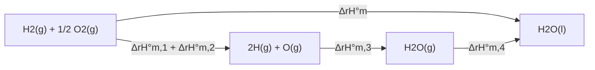

研究化学反应，一要关心物质的转化（合成氨、除汞），二要关心能量的转化（燃烧放热、蓄电池放电）。化学热力学从能量转换出发回答三个问题：反应吸收或放出多少热（热化学），在给定条件下反应能否自发进行（反应的方向），以及进行到什么程度（化学平衡，[6.1.8](/6.1.8)）。热力学的基本定律已在物理中建立：Carnot 在 1824 年研究热机效率，Mayer（1842）、Joule（1843–1850）与 Helmholtz（1847）确立能量守恒，Clausius 在 1865 年引入熵，热力学第一、第二定律的内容见 [5.2.3](/5.2.3) 与 [5.2.4](/5.2.4)。把它们系统地用于化学系统、建立化学热力学的是 Gibbs（1876–1878）。本章先简要回顾基本概念与第一定律（6.1、6.2），重点是化学特有的部分：反应进度、标准态与各种反应焓的计算（6.3），以及用熵与 Gibbs 自由能判断反应方向（6.4）。本章的结论将用于化学平衡（[6.1.8](/6.1.8)）、电极电势（[6.1.11](/6.1.11)）与元素化学各章；化学势、偏摩尔量、Gibbs–Helmholtz 方程与统计热力学等深入内容见[物理化学](/6.3)。

## 6.1. 热力学的基本概念

### 6.1.1. 系统与环境

热力学中被研究的对象称为**热力学系统**（化学教材常称体系），系统以外与之相互作用的部分称为环境。按系统与环境之间的交换，系统分为**开放系统**（既交换能量又交换物质）、**封闭系统**（只交换能量）与**孤立系统**（都不交换），定义见 [5.2.1](/5.2.1#sec-1.1.1)。化学中研究最多的是封闭系统：一个反应体系连同其中的气体，与外界只有热和功的交换。

### 6.1.2. 状态与状态函数

系统的状态由它的一组宏观性质确定，描述状态的物理量就是物理学中的**态参量**。化学热力学更强调这些量的共同性质：

**定义 6.1.1（状态函数）** 系统的状态确定后数值就唯一确定的物理量称为**状态函数**。

状态函数的改变量只取决于始态与终态，与经历的途径无关：$\Delta X = X_{\text{终}} - X_{\text{始}}$；系统经过一个循环回到原状态时 $\oint \mathrm{d}X = 0$。数学上，这就是说状态函数的微分 $\mathrm{d}X$ 是一个**全微分**（[2.2.10](/2.2.10)）。$p$、$V$、$T$、$n$、$U$、$H$、$S$、$G$ 都是状态函数；热量与功则与途径有关，不是状态函数，它们的微小量写作 $\delta Q$、$\delta W$，以区别于全微分。

状态函数分为两类：与物质的量成正比、具有加和性的**广延量**（化学教材称广度性质，如 $V$、$n$、$m$、$U$、$H$、$S$、$G$），与物质的量无关、没有加和性的**强度量**（如 $T$、$p$、密度）。两个广延量之比是强度量，如摩尔体积 $V_{\mathrm{m}} = V/n$；一般地，摩尔量 $X_{\mathrm{m}} = X/n$ 都是强度量。

### 6.1.3. 过程与途径

系统从始态变到终态，经历了一个热力学过程。化学中常见的过程有：等温过程（始、终态温度相同且等于恒定的环境温度；全程温度不变的称为恒温过程，见 [6.3.1](/6.3.1)）、恒压过程（系统压力始终等于恒定的外压）、恒容过程，以及绝热过程。实现同一过程的具体方式称为途径。例如一定量理想气体从 $(p_1, V_1, T)$ 变到 $(p_2, V_2, T)$，可以一步恒外压膨胀，也可以分两步或可逆地膨胀：各途径的 $\Delta p$、$\Delta V$、$\Delta U$ 相同，但热量与功不同。

### 6.1.4. 热与功

系统与环境之间因温度差而传递的能量是**热量** $Q$，其余形式传递的能量是**功** $W$。本站一律以系统得到为正：$Q > 0$ 表示系统吸热，$W > 0$ 表示环境对系统做功（与 [5.2.3](/5.2.3) 和 IUPAC 一致）。

化学反应常伴随体积变化，系统反抗外压 $p_{\mathrm{ex}}$ 膨胀或被压缩时交换的功是**体积功**：
$$
W = -\int_{V_1}^{V_2} p_{\mathrm{ex}}\,\mathrm{d}V, \qquad \text{恒外压时}\quad W = -p_{\mathrm{ex}}\Delta V.
$$
若过程中外压始终只比系统的压力小一个无穷小量（$p_{\mathrm{ex}} = p - \mathrm{d}p$），系统经历的是准静态的**可逆过程**，$W_{\mathrm{rev}} = -\int p\,\mathrm{d}V$。膨胀时可逆途径中系统对外做的功 $-W$ 最大，压缩时可逆途径中环境做的功最小。

**定义 6.1.2（非体积功）** 体积功以外的各种功（电功、表面功等）统称为**非体积功**，记作 $W'$。系统得到的总功为 $W = -\int p_{\mathrm{ex}}\,\mathrm{d}V + W'$。

原电池对外做电功（[6.1.11](/6.1.11)）是化学中最重要的非体积功。

### 6.1.5. 内能

系统内部一切能量的总和称为**内能**（化学教材称热力学能），记作 $U$，包括分子的平动、转动、振动能，分子间的势能，电子与原子核的能量等。内能是广延的状态函数，但它的绝对值无法确定，热力学只需要它的改变量 $\Delta U$。理想气体的内能只是温度的函数，等温过程中 $\Delta U = 0$；这并不意味着 $T = 0$ 时 $U = 0$，内能的零点可以任意选取。

## 6.2. 热力学第一定律

封闭系统从一个状态变到另一个状态，内能的改变量等于系统吸收的热量与环境对系统做的功之和（**热力学第一定律**，[5.2.3](/5.2.3#sec-3.3.3)）：
$$
\Delta U = Q + W, \qquad \mathrm{d}U = \delta Q + \delta W.
\tag{6.1}
$$
它是包括热现象在内的能量守恒定律。$Q$ 与 $W$ 各自与途径有关，它们的和却与途径无关。对化学反应来说，第一定律把反应中可测的热和功与系统内能的变化联系起来：在恒容、只做体积功的条件下 $W = 0$，反应热就等于 $\Delta U$；在恒压下则等于下一节的焓变。

## 6.3. 热化学

把热力学第一定律用于化学反应、研究反应热效应的测量与计算的分支称为热化学（Thermochemistry）。热化学数据是能源利用与化工安全的依据，与下一节的熵一起又可以算出平衡常数（[6.1.8](/6.1.8)）。

### 6.3.1. 反应热

**定义 6.3.1（反应热）** 封闭系统中发生化学反应，只做体积功，且使产物的温度回到反应物的起始温度时，系统吸收的热量称为该反应的**反应热**（热效应）。

规定产物回到起始温度，是为了让反应热只反映化学键的断裂与形成等化学变化本身的能量，而不包含物质升温或降温的热量。

恒容反应热 $Q_V$：反应在恒容下进行，$\Delta V = 0$，体积功为零，由式 (6.1)
$$
Q_V = \Delta U.
$$
恒容反应热用弹式量热计测量：反应在密闭的钢弹中进行，钢弹浸在已知总热容 $C$（水与量热计）的水浴里。测出水浴的温度升高 $\Delta T$，反应的 $Q_V = -C\Delta T$（放热反应使环境升温，$Q_V < 0$）。

恒压反应热 $Q_p$：反应在恒压 $p = p_{\mathrm{ex}}$ 下进行，$W = -p\Delta V$，于是 $\Delta U = Q_p - p\Delta V$，
$$
Q_p = (U_2 + pV_2) - (U_1 + pV_1) = \Delta(U + pV) = \Delta H,
$$
即恒压反应热等于系统的**焓**变（焓 $H = U + pV$ 的定义见 [5.2.3](/5.2.3#def-3.5.4)）。敞口容器中的反应都在恒压下进行，所以化学中最常用的是焓变。溶液中的反应热（中和热、溶解热）用杯式（保温杯式）量热计在恒压下测量。

同一反应的 $Q_p$ 与 $Q_V$ 相差 $\Delta(pV)$。液体与固体的 $pV$ 很小，可以忽略；把气体看作**理想气体**，$\Delta(pV) = \Delta n_{\mathrm{g}}RT$，$\Delta n_{\mathrm{g}}$ 是反应前后气体物质的量的变化。所以
$$
Q_p = Q_V + \Delta n_{\mathrm{g}}RT.
\tag{6.2}
$$

**例 6.3.1** 用弹式量热计测得 298.15 K 时 1 mol 正庚烷完全燃烧的恒容反应热 $Q_V = -4807.12\,\mathrm{kJ}$，求 $Q_p$。

解：$\ce{C7H16(l) + 11O2(g) -> 7CO2(g) + 8H2O(l)}$，气体物质的量的变化 $\Delta n_{\mathrm{g}} = 7 - 11 = -4\,\mathrm{mol}$。由式 (6.2)
$$
Q_p = -4807.12\,\mathrm{kJ} + (-4\,\mathrm{mol})(8.314\,\mathrm{J\,mol^{-1}\,K^{-1}})(298.15\,\mathrm{K}) = -4817.04\,\mathrm{kJ}.
$$
气体分子数减少，恒压下环境对系统做功，所以恒压时放出的热多一些；差值只占 0.2%，可见对凝聚相为主的反应，$Q_p$ 与 $Q_V$ 相差很小。

### 6.3.2. 反应进度与摩尔反应焓

燃烧放出的热与烧掉了多少煤成正比。为了用一个量描述"反应进行了多少"，把化学方程式写成 $0 = \sum_{\mathrm{B}} \nu_{\mathrm{B}}\mathrm{B}$ 的形式。

**定义 6.3.2（化学计量数）** 化学方程式 $0 = \sum_{\mathrm{B}}\nu_{\mathrm{B}}\mathrm{B}$ 中物质 B 的系数 $\nu_{\mathrm{B}}$ 称为 B 的**化学计量数**：反应物取负值，产物取正值。

例如 $\ce{N2 + 3H2 -> 2NH3}$ 中，$\nu(\ce{N2}) = -1$，$\nu(\ce{H2}) = -3$，$\nu(\ce{NH3}) = +2$。化学计量数是量纲一的纯数，可以是分数。

**定义 6.3.3（反应进度）** 反应开始时物质 B 的物质的量为 $n_{\mathrm{B}}(0)$，某时刻为 $n_{\mathrm{B}}(\xi)$，则
$$
\xi = \frac{n_{\mathrm{B}}(\xi) - n_{\mathrm{B}}(0)}{\nu_{\mathrm{B}}}, \qquad \mathrm{d}\xi = \frac{\mathrm{d}n_{\mathrm{B}}}{\nu_{\mathrm{B}}}
$$
称为该时刻的**反应进度**，单位为 mol。

由于各物质的变化量都与各自的化学计量数成正比，用任何一种物质计算，同一时刻的 $\xi$ 都相同。对合成氨反应，$\xi = 1\,\mathrm{mol}$ 表示消耗了 1 mol $\ce{N2}$ 与 3 mol $\ce{H2}$、生成了 2 mol $\ce{NH3}$，称为进行了 1 mol 反应。反应进度依赖于方程式的写法：按 $\ce{1/2N2 + 3/2H2 -> NH3}$ 计算，$\xi = 1\,\mathrm{mol}$ 只生成 1 mol $\ce{NH3}$。所以提到反应进度时必须指明化学方程式。

**定义 6.3.4（摩尔反应焓）** 反应进度变化 $\Delta\xi$ 时系统的焓变 $\Delta_{\mathrm{r}}H$ 与 $\Delta\xi$ 之比
$$
\Delta_{\mathrm{r}}H_{\mathrm{m}} = \frac{\Delta_{\mathrm{r}}H}{\Delta\xi}
$$
称为该反应的**摩尔反应焓**，单位 $\mathrm{J\,mol^{-1}}$ 或 $\mathrm{kJ\,mol^{-1}}$；类似地定义摩尔反应内能 $\Delta_{\mathrm{r}}U_{\mathrm{m}} = \Delta_{\mathrm{r}}U/\Delta\xi$。

单位中的 $\mathrm{mol^{-1}}$ 指"每摩尔反应"，即按所写方程式进行 1 mol 反应。下标 r 表示反应（reaction），m 表示每摩尔。由式 (6.2)，
$$
\Delta_{\mathrm{r}}H_{\mathrm{m}} = \Delta_{\mathrm{r}}U_{\mathrm{m}} + \Delta\nu_{\mathrm{g}}RT, \qquad \Delta\nu_{\mathrm{g}} = \sum_{\mathrm{B(g)}}\nu_{\mathrm{B}},
$$
$\Delta\nu_{\mathrm{g}}$ 是方程式中气态物质化学计量数之和（例 6.3.1 中为 $-4$）。

### 6.3.3. 标准态与热化学方程式

反应的焓变与各物质所处的状态（温度、压力、浓度、相态）有关。为了能够列表与比较，规定一套标准状态。

**定义 6.3.5（标准态）** 压力 $p^\circ = 10^5\,\mathrm{Pa} = 100\,\mathrm{kPa}$ 称为**标准压力**。物质的**标准态**规定为：

- 气体：标准压力下具有理想气体性质的纯气体；
- 液体与固体：标准压力下的纯液体与纯固体；
- 溶液中的溶质：标准压力下、浓度为 $c^\circ = 1\,\mathrm{mol\,L^{-1}}$（或质量摩尔浓度 $b^\circ = 1\,\mathrm{mol\,kg^{-1}}$）且具有理想稀溶液性质的状态。

历史上标准压力取 $101.325\,\mathrm{kPa}$（1 atm），IUPAC 在 1982 年改为 $100\,\mathrm{kPa}$，两者造成的数据差别很小，但查表时要注意来源。标准态没有规定温度，热力学数据通常列出 $298.15\,\mathrm{K}$ 的值。所有反应物与产物都各自处于标准态（纯态、互不混合）时的摩尔反应焓称为标准摩尔反应焓，记作 $\Delta_{\mathrm{r}}H^\circ_{\mathrm{m}}(T)$；同样有 $\Delta_{\mathrm{r}}U^\circ_{\mathrm{m}}$。溶质的标准态在化学平衡（[6.1.8](/6.1.8)）中用到。

**定义 6.3.6（热化学方程式）** 注明了反应热的化学方程式称为**热化学方程式**。

书写时要注意：

1. 用 $\Delta_{\mathrm{r}}H^\circ_{\mathrm{m}}$（恒压）或 $\Delta_{\mathrm{r}}U^\circ_{\mathrm{m}}$（恒容）表示反应热，注明温度（298.15 K 可以省略）；
2. 注明各物质的聚集状态（g、l、s、aq）或晶型（石墨、金刚石）；
3. 化学计量数可以是分数；同一反应的计量数加倍，$\Delta_{\mathrm{r}}H^\circ_{\mathrm{m}}$ 也加倍；
4. 正、逆反应的 $\Delta_{\mathrm{r}}H^\circ_{\mathrm{m}}$ 数值相等、符号相反。

$$
\begin{aligned}
&\ce{C(graphite) + O2(g) -> CO2(g)} && \Delta_{\mathrm{r}}H^\circ_{\mathrm{m}} = -393.5\,\mathrm{kJ\,mol^{-1}}\\
&\ce{C(diamond) + O2(g) -> CO2(g)} && \Delta_{\mathrm{r}}H^\circ_{\mathrm{m}} = -395.4\,\mathrm{kJ\,mol^{-1}}\\
&\ce{H2(g) + 1/2O2(g) -> H2O(g)} && \Delta_{\mathrm{r}}H^\circ_{\mathrm{m}} = -241.8\,\mathrm{kJ\,mol^{-1}}\\
&\ce{H2(g) + 1/2O2(g) -> H2O(l)} && \Delta_{\mathrm{r}}H^\circ_{\mathrm{m}} = -285.8\,\mathrm{kJ\,mol^{-1}}\\
&\ce{2H2(g) + O2(g) -> 2H2O(l)} && \Delta_{\mathrm{r}}H^\circ_{\mathrm{m}} = -571.7\,\mathrm{kJ\,mol^{-1}}\\
&\ce{2H2O(l) -> 2H2(g) + O2(g)} && \Delta_{\mathrm{r}}H^\circ_{\mathrm{m}} = +571.7\,\mathrm{kJ\,mol^{-1}}
\end{aligned}
$$

前两式之差说明金刚石的焓比石墨高 $1.9\,\mathrm{kJ\,mol^{-1}}$；第三、四式之差 $44.0\,\mathrm{kJ\,mol^{-1}}$ 是 298.15 K 时水的摩尔蒸发焓。

### 6.3.4. Hess 定律

**定理 6.3.1（Hess 定律）** 一个化学反应不论是一步完成还是分几步完成，在恒压（或恒容）且只做体积功的条件下，其反应热都相同。

Hess 在 1840 年由量热实验总结出这条定律，当时热力学第一定律还没有建立。今天看来它是第一定律的直接推论：恒压反应热 $Q_p = \Delta H$、恒容反应热 $Q_V = \Delta U$，而 $H$ 与 $U$ 都是状态函数，只要始态与终态相同，改变量就与途径无关。由此，热化学方程式可以像代数方程一样相加减，相应的 $\Delta_{\mathrm{r}}H^\circ_{\mathrm{m}}$ 也同样相加减。例如水的生成可以直接进行，也可以设想先把分子拆成原子、原子结合成气态水、再凝结成液态水：

$$
\Delta_{\mathrm{r}}H^\circ_{\mathrm{m}} = \Delta_{\mathrm{r}}H^\circ_{\mathrm{m},1} + \Delta_{\mathrm{r}}H^\circ_{\mathrm{m},2} + \Delta_{\mathrm{r}}H^\circ_{\mathrm{m},3} + \Delta_{\mathrm{r}}H^\circ_{\mathrm{m},4}.
$$

Hess 定律的价值在于：难以直接测量的反应热，可以由容易测量的反应热算出。

**例 6.3.2** 碳不完全燃烧生成 CO 时总会混有 $\ce{CO2}$，它的反应热无法直接测定。已知
$$
\begin{aligned}
&(1)\ \ce{C(graphite) + O2(g) -> CO2(g)} && \Delta_{\mathrm{r}}H^\circ_{\mathrm{m}}(1) = -393.5\,\mathrm{kJ\,mol^{-1}}\\
&(2)\ \ce{CO(g) + 1/2O2(g) -> CO2(g)} && \Delta_{\mathrm{r}}H^\circ_{\mathrm{m}}(2) = -283.0\,\mathrm{kJ\,mol^{-1}}
\end{aligned}
$$
求 $\ce{C(graphite) + 1/2O2(g) -> CO(g)}$ 的 $\Delta_{\mathrm{r}}H^\circ_{\mathrm{m}}$。

解：所求反应 = (1) − (2)，所以 $\Delta_{\mathrm{r}}H^\circ_{\mathrm{m}} = -393.5 - (-283.0) = -110.5\,\mathrm{kJ\,mol^{-1}}$。应用 Hess 定律的关键是设计合适的反应步骤。

### 6.3.5. 标准摩尔生成焓

焓的绝对值无法确定，但只要对每种元素选定一个共同的零点，就能给每种物质一个相对的焓值，用它计算任何反应的焓变。这就像量高度时可以任选一个水平面作基准：两点的高度差与基准无关。

**定义 6.3.7（标准摩尔生成焓）** 在温度 $T$ 下，由处于标准态的参考态单质生成 1 mol 处于标准态的物质 B 的标准摩尔反应焓，称为 B 在该温度下的**标准摩尔生成焓**，记作 $\Delta_{\mathrm{f}}H^\circ_{\mathrm{m}}(\mathrm{B}, \text{相态}, T)$，简写为 $\Delta_{\mathrm{f}}H^\circ$。

参考态单质一般是该元素在 $T$ 与 $p^\circ$ 下最稳定的单质，如 C（石墨）、$\ce{O2(g)}$、$\ce{H2(g)}$、$\ce{Br2(l)}$、$\ce{I2(s)}$、$\ce{Hg(l)}$。磷是例外：参考态取白磷 $\ce{P4}$（s，白），因为白磷的组成与结构最确定、最容易重现，虽然红磷与黑磷都比它稳定（红磷的 $\Delta_{\mathrm{f}}H^\circ = -17.6\,\mathrm{kJ\,mol^{-1}}$）。由定义，参考态单质在任何温度下的标准摩尔生成焓都为零。水溶液中的离子另以 $\Delta_{\mathrm{f}}H^\circ(\ce{H+}, \mathrm{aq}) = 0$ 为基准。

例如 $\ce{H2(g) + 1/2O2(g) -> H2O(l)}$ 的 $\Delta_{\mathrm{r}}H^\circ_{\mathrm{m}} = -285.83\,\mathrm{kJ\,mol^{-1}}$，所以 $\Delta_{\mathrm{f}}H^\circ(\ce{H2O}, \mathrm{l}) = -285.83\,\mathrm{kJ\,mol^{-1}}$；$\ce{C(graphite) + 2H2(g) + 1/2O2(g) -> CH3OH(g)}$ 的 $\Delta_{\mathrm{r}}H^\circ_{\mathrm{m}} = -201.0\,\mathrm{kJ\,mol^{-1}}$，就是气态甲醇的 $\Delta_{\mathrm{f}}H^\circ$。注意生成焓的定义要求"由单质生成 1 mol 产物"，所以 $\ce{2H2(g) + O2(g) -> 2H2O(l)}$ 的反应焓是 $2\Delta_{\mathrm{f}}H^\circ(\ce{H2O}, \mathrm{l})$，而 $\ce{CO(g) + 1/2O2(g) -> CO2(g)}$ 的反应焓不是 $\ce{CO2}$ 的生成焓。

设想任一反应的反应物先分解为参考态单质，单质再化合成产物。由 Hess 定律，用带符号的化学计量数可以写成一个求和：

**公式 6.3.1**
$$
\Delta_{\mathrm{r}}H^\circ_{\mathrm{m}} = \sum_{\mathrm{B}}\nu_{\mathrm{B}}\,\Delta_{\mathrm{f}}H^\circ_{\mathrm{m}}(\mathrm{B}),
$$
即产物的生成焓之和减去反应物的生成焓之和（各乘以计量数的绝对值）。

**例 6.3.3** 求 $\ce{2Na2O2(s) + 2H2O(l) -> 4NaOH(s) + O2(g)}$ 的 $\Delta_{\mathrm{r}}H^\circ_{\mathrm{m}}$。

解：查表，$\Delta_{\mathrm{f}}H^\circ(\ce{NaOH}, \mathrm{s}) = -425.8$，$\Delta_{\mathrm{f}}H^\circ(\ce{Na2O2}, \mathrm{s}) = -510.9$，$\Delta_{\mathrm{f}}H^\circ(\ce{H2O}, \mathrm{l}) = -285.83$（单位 $\mathrm{kJ\,mol^{-1}}$），$\ce{O2(g)}$ 为零。
$$
\Delta_{\mathrm{r}}H^\circ_{\mathrm{m}} = 4(-425.8) + 0 - 2(-510.9) - 2(-285.83) = -109.7\,\mathrm{kJ\,mol^{-1}}.
$$

### 6.3.6. 标准摩尔燃烧焓

生成焓以反应物一方的单质为共同的起点；燃烧焓则以完全燃烧的产物为共同的终点。

**定义 6.3.8（标准摩尔燃烧焓）** 在温度 $T$ 下，1 mol 处于标准态的物质 B 在纯氧中完全燃烧、生成处于标准态的指定产物时的标准摩尔反应焓，称为 B 的**标准摩尔燃烧焓**，记作 $\Delta_{\mathrm{c}}H^\circ_{\mathrm{m}}(\mathrm{B}, \text{相态}, T)$。指定的燃烧产物是：C → $\ce{CO2(g)}$，H → $\ce{H2O(l)}$，S → $\ce{SO2(g)}$，N → $\ce{N2(g)}$。

由定义，指定产物的燃烧焓为零：$\Delta_{\mathrm{c}}H^\circ(\ce{H2O}, \mathrm{l}) = \Delta_{\mathrm{c}}H^\circ(\ce{CO2}, \mathrm{g}) = 0$；而 $\Delta_{\mathrm{f}}H^\circ(\ce{H2O}, \mathrm{l}) = \Delta_{\mathrm{c}}H^\circ(\ce{H2}, \mathrm{g})$，$\Delta_{\mathrm{f}}H^\circ(\ce{CO2}, \mathrm{g}) = \Delta_{\mathrm{c}}H^\circ(\text{石墨})$。设想反应物先完全燃烧，再由燃烧产物"逆燃烧"生成产物，同样由 Hess 定律得

**公式 6.3.2**
$$
\Delta_{\mathrm{r}}H^\circ_{\mathrm{m}} = -\sum_{\mathrm{B}}\nu_{\mathrm{B}}\,\Delta_{\mathrm{c}}H^\circ_{\mathrm{m}}(\mathrm{B}),
$$
即反应物的燃烧焓之和减去产物的燃烧焓之和。

有机化合物大多不能由单质直接合成，生成焓难以直接测定，燃烧焓却可以用弹式量热计精确测量，所以有机物的生成焓多由燃烧焓换算，有机反应的反应热也常由燃烧焓计算。

**例 6.3.4** 求甲醇氧化制甲醛 $\ce{CH3OH(l) + 1/2O2(g) -> HCHO(g) + H2O(l)}$ 的 $\Delta_{\mathrm{r}}H^\circ_{\mathrm{m}}$。

解：查表，$\Delta_{\mathrm{c}}H^\circ(\ce{CH3OH}, \mathrm{l}) = -726.1\,\mathrm{kJ\,mol^{-1}}$，$\Delta_{\mathrm{c}}H^\circ(\ce{HCHO}, \mathrm{g}) = -570.7\,\mathrm{kJ\,mol^{-1}}$，$\ce{O2}$、$\ce{H2O(l)}$ 的燃烧焓为零：
$$
\Delta_{\mathrm{r}}H^\circ_{\mathrm{m}} = -726.1 - (-570.7) = -155.4\,\mathrm{kJ\,mol^{-1}}.
$$
用生成焓计算（$\Delta_{\mathrm{f}}H^\circ$：$\ce{CH3OH(l)}$ $-239.2$，$\ce{HCHO(g)}$ $-108.6$，$\ce{H2O(l)}$ $-285.83$）得 $-155.2\,\mathrm{kJ\,mol^{-1}}$，两者在数据的舍入误差内一致。

### 6.3.7. 键焓

化学反应的实质是反应物中化学键的断裂与产物中化学键的形成，所以反应热也可以从键的强弱来估计。

**定义 6.3.9（键焓）** 在温度 $T$（通常为 298.15 K）下，使气态分子中 1 mol 某种化学键断开、生成气态碎片的标准摩尔反应焓称为该键的**键焓**，记作 $D(\ce{X-Y})$。同一种键在不同分子中键焓的平均值称为**平均键焓**，记作 $\bar D(\ce{X-Y})$。

例如 $\ce{H2(g) -> 2H(g)}$ 的 $\Delta_{\mathrm{r}}H^\circ_{\mathrm{m}} = D(\ce{H-H}) = 436.0\,\mathrm{kJ\,mol^{-1}}$。断键总是吸热的，键焓为正，它是键的强度的量度，就是 [6.1.3](/6.1.3) 中按 $298.15\,\mathrm{K}$ 定义的**键能**；光谱测得的 $0\,\mathrm{K}$ 离解能 $D_0$ 比它小几个 $\mathrm{kJ\,mol^{-1}}$（$\ce{H2}$ 为 $432$ 对 $436$）。双原子分子的键焓是确定的；多原子分子中同一种键的键焓随所处的环境而变。$\ce{CH4}$ 中四个 C–H 键依次断开：
$$
\begin{aligned}
&\ce{CH4(g) -> CH3(g) + H(g)} && 439\,\mathrm{kJ\,mol^{-1}}\\
&\ce{CH3(g) -> CH2(g) + H(g)} && 462\,\mathrm{kJ\,mol^{-1}}\\
&\ce{CH2(g) -> CH(g) + H(g)} && 424\,\mathrm{kJ\,mol^{-1}}\\
&\ce{CH(g) -> C(g) + H(g)} && 338\,\mathrm{kJ\,mol^{-1}}
\end{aligned}
$$
四步之和 $1663\,\mathrm{kJ\,mol^{-1}}$ 是 $\ce{CH4}$ 的原子化焓（可由生成焓算出），平均值 $415.8\,\mathrm{kJ\,mol^{-1}}$ 是 $\ce{CH4}$ 中 C–H 键的平均键焓。表中给出的键焓一般是许多化合物的平均值。

| 键 | H–H | C–H | C–C | C=C | C≡C | C–O | C=O | O–H | O=O | N–H | N≡N |
|---|---|---|---|---|---|---|---|---|---|---|---|
| $\bar D/(\mathrm{kJ\,mol^{-1}})$ | 436 | 413 | 346 | 610 | 835 | 358 | 745 | 463 | 498 | 388 | 945 |

反应物与产物都是气态时，反应焓可以估计为断开的键的键焓之和减去形成的键的键焓之和：
$$
\Delta_{\mathrm{r}}H^\circ_{\mathrm{m}} \approx \sum \bar D(\text{断开的键}) - \sum \bar D(\text{形成的键}).
$$

**例 6.3.5** 估算乙烯水合制乙醇 $\ce{C2H4(g) + H2O(g) -> C2H5OH(g)}$ 的反应焓。

解：只需比较发生变化的键：断开 1 个 C=C 与 1 个 O–H（水中的另一个 O–H 留在乙醇中），形成 1 个 C–C、1 个 C–H 与 1 个 C–O。
$$
\Delta_{\mathrm{r}}H^\circ_{\mathrm{m}} \approx (610 + 463) - (346 + 413 + 358) = -44\,\mathrm{kJ\,mol^{-1}}.
$$
由生成焓（$\ce{C2H4(g)}$ $+52.4$，$\ce{H2O(g)}$ $-241.8$，$\ce{C2H5OH(g)}$ $-234.8\,\mathrm{kJ\,mol^{-1}}$）算得的准确值为 $-45.4\,\mathrm{kJ\,mol^{-1}}$。这里的吻合有一定偶然性，平均键焓的估算一般有 $10$–$20\,\mathrm{kJ\,mol^{-1}}$ 的误差。若反应物或产物是液体（如液态乙醇），还必须计入蒸发焓，键焓本身只适用于气态。

### 6.3.8. Born–Haber 循环

离子晶体的**晶格焓** $\Delta_{\mathrm{latt}}H^\circ$（1 mol 离子晶体解离为相距无穷远的气态离子的标准摩尔焓变，[6.1.4](/6.1.4)）无法直接测量。1919 年，Born 与 Haber 用一个热化学循环把它与可测的量联系起来，这种循环称为 Born–Haber 循环（Born–Haber cycle）：由单质生成离子晶体，可以一步完成（标准生成焓），也可以经过原子化、电离、结合电子、离子结合成晶体等步骤完成，由 Hess 定律两条途径的焓变相等。

**例 6.3.6** 由下列数据求 KBr 的晶格焓（298.15 K，单位 $\mathrm{kJ\,mol^{-1}}$）。

| 步骤 | 过程 | $\Delta H^\circ$ |
|---|---|---|
| 1 | $\ce{K(s) -> K(g)}$，升华焓 $\Delta_{\mathrm{sub}}H^\circ$ | $+89.0$ |
| 2 | $\ce{K(g) -> K+(g) + e-}$，**电离能** $I_1$ | $+418.8$ |
| 3 | $\ce{1/2Br2(l) -> 1/2Br2(g)}$，$\frac{1}{2}\Delta_{\mathrm{vap}}H^\circ$ | $+15.5$ |
| 4 | $\ce{1/2Br2(g) -> Br(g)}$，$\frac{1}{2}D(\ce{Br-Br})$ | $+96.4$ |
| 5 | $\ce{Br(g) + e- -> Br-(g)}$，$-E_{\mathrm{ea}}$（**电子亲和能** $E_{\mathrm{ea}}$） | $-324.5$ |
| 6 | $\ce{K+(g) + Br-(g) -> KBr(s)}$ | $-\Delta_{\mathrm{latt}}H^\circ$ |
| 总 | $\ce{K(s) + 1/2Br2(l) -> KBr(s)}$，$\Delta_{\mathrm{f}}H^\circ$ | $-393.8$ |

解：由 Hess 定律，步骤 1–6 之和等于 $\Delta_{\mathrm{f}}H^\circ(\ce{KBr}, \mathrm{s})$，所以
$$
\Delta_{\mathrm{latt}}H^\circ = 89.0 + 418.8 + 15.5 + 96.4 - 324.5 - (-393.8) = 689.0\,\mathrm{kJ\,mol^{-1}}.
$$
严格地说，298.15 K 时电离与结合电子的焓变与 0 K 的电离能、电子亲和能各差 $\pm\frac{5}{2}RT$，对 1∶1 型的盐两项正好抵消，所以可以直接使用电离能与电子亲和能。

循环的各步表明，KBr 能够稳定存在，靠的是巨大的晶格焓：K 的电离（$+418.8$）远大于 Br 结合电子放出的能量（$324.5$），气态离子对本身并不比原子稳定。Born–Haber 循环的其他用途包括：由晶格焓的理论计算值反求难以测量的电子亲和能；与离子模型的计算值比较，判断晶体中共价成分的多少（[6.1.4](/6.1.4) 的离子极化）；以及解释为什么不存在 $\ce{NaCl2}$——Na 的第二电离能（$4562\,\mathrm{kJ\,mol^{-1}}$）大到任何晶格焓都无法补偿。

## 6.4. 化学反应的方向

### 6.4.1. 自发过程

水从高处流向低处，热从高温物体传向低温物体，铁在潮湿的空气中生锈，锌置换出硫酸铜溶液中的铜：$\ce{Zn(s) + Cu^2+(aq) -> Zn^2+(aq) + Cu(s)}$。这些过程不需要外界帮助就会发生。

**定义 6.4.1（自发过程）** 在一定条件下，不需要外界对系统做非体积功就能自动进行的过程称为**自发过程**。

自发过程的逆过程是非自发的，必须由外界做功才能实现（电解可以把 $\ce{Zn^2+}$ 还原）。自发过程有三个特点：它总是单向地趋于平衡；只要设计得当，它可以对外做有用功（Zn 与 $\ce{Cu^2+}$ 的反应在原电池中产生电功，[6.1.11](/6.1.11)）；"自发"只说明可能性，不涉及快慢——$\ce{H2}$ 与 $\ce{O2}$ 的混合物在室温下可以保存多年而不反应，速率问题见 [6.1.7](/6.1.7)。

反应的方向还与条件有关。$\ce{Ag+}$ 与 $\ce{Cl-}$ 混合会生成 AgCl 沉淀，但把少量 AgCl 投入大量水中，它又会溶解一些；与液态水共存的 100 kPa 水蒸气会凝结，而放在干燥室内的一杯水会蒸发。本章讨论的"方向"指各物质都处于标准态时反应自发进行的方向；任意组成下的方向由反应商决定，见 [6.1.8](/6.1.8)。

### 6.4.2. 焓判据及其局限

许多自发反应是放热的：
$$
\begin{aligned}
&\ce{H2(g) + 1/2O2(g) -> H2O(l)} && \Delta_{\mathrm{r}}H^\circ_{\mathrm{m}} = -285.83\,\mathrm{kJ\,mol^{-1}}\\
&\ce{H+(aq) + OH-(aq) -> H2O(l)} && \Delta_{\mathrm{r}}H^\circ_{\mathrm{m}} = -55.84\,\mathrm{kJ\,mol^{-1}}
\end{aligned}
$$
19 世纪中叶，Thomsen 与 Berthelot 由大量量热数据提出：自发的化学反应趋向于放出最多的热，即以 $\Delta H < 0$ 作为自发的判据。这个焓判据对许多反应成立，但并不普遍。有些吸热过程也能自发进行：

- $\ce{NH4Cl(s) -> NH4+(aq) + Cl-(aq)}$，$\Delta_{\mathrm{r}}H^\circ_{\mathrm{m}} = +14.7\,\mathrm{kJ\,mol^{-1}}$，氯化铵溶于水时溶液变冷；
- $\ce{H2O(l) -> H2O(g)}$，100 °C 时 $\Delta_{\mathrm{vap}}H_{\mathrm{m}} = +40.7\,\mathrm{kJ\,mol^{-1}}$，水在 100 °C、101.325 kPa 下沸腾；
- $\ce{NH4HCO3(s) -> NH3(g) + H2O(l) + CO2(g)}$ 与 $\ce{N2O4(g) -> 2NO2(g)}$ 都是吸热的，在加热或常温下都能进行。

这些过程的共同点是系统的混乱程度增大：固体溶解成自由运动的离子，液体变成气体，气体分子数增多。放热只是有利于自发进行的因素之一，另一个因素是混乱度的增大，它由熵来量度。

### 6.4.3. 熵

**熵** $S$ 是 Clausius 在 1865 年引入的状态函数，可逆过程中 $\mathrm{d}S = \delta Q_{\mathrm{rev}}/T$（[5.2.4](/5.2.4#sec-4.5.2)）。它的微观意义由 **Boltzmann 熵公式** $S = k_{\mathrm{B}}\ln\Omega$ 给出（[5.2.4](/5.2.4#sec-4.8)），$\Omega$ 是系统的宏观状态所对应的**微观态**数。一个宏观的化学系统由大量分子组成，每个分子时刻处在不同的平动、转动、振动与电子状态中，同一个宏观状态对应着数目巨大的微观状态。

以 50 个分子分布在容器的左右两半为例：左边 10 个、右边 40 个的宏观态对应 $\binom{50}{10} \approx 1.0\times10^{10}$ 个微观态，左右各 25 个的宏观态则对应 $\binom{50}{25} \approx 1.3\times10^{14}$ 个，是前者的一万多倍。分子数越多，微观态越集中在均匀分布附近，这就是**二项分布**随 $N$ 增大而集中的性质（[3.1.4](/3.1.4)，详细讨论见 [5.2.4](/5.2.4#sec-4.7.3)）：平衡态是微观态数最多、熵最大的宏观态。

孤立系统中自发进行的过程，总是朝着熵增大的方向，到达平衡态时熵最大（**熵增加原理**，[5.2.4](/5.2.4#sec-4.6.2)）：
$$
\Delta S_{\text{孤立}} \ge 0.
$$
化学反应若使系统的微观态数增多（产生气体、溶解、分子数增多），熵就增大，$\Delta_{\mathrm{r}}S > 0$，这是有利于反应自发进行的第二个因素。但反应的熵变一般不用 $S = k_{\mathrm{B}}\ln\Omega$ 计算，而是由量热数据确定。

### 6.4.4. 热力学第三定律与标准摩尔熵

焓只有相对值，熵却可以有绝对的零点。

**定理 6.4.1（热力学第三定律）** 0 K 时，任何纯物质的完美晶体的熵等于零：
$$
\lim_{T \to 0\,\mathrm{K}} S(\text{完美晶体}) = 0.
$$

微观上，0 K 的完美晶体中每个粒子都处于基态、排列完全有序，只有一个微观态，$\Omega = 1$，$S = k_{\mathrm{B}}\ln 1 = 0$。这一表述属于 Planck（1911）与 Lewis–Randall（1923）；更早的 Nernst 热定理（1906）说的是：凝聚系统中等温过程的熵变在 $T \to 0$ 时趋于零。不是完美晶体的物质在 0 K 仍有残余熵：固态 CO 中分子可以取 CO 或 OC 两种朝向，残余熵接近 $R\ln 2$。

有了零点，就可以由量热数据求出物质在任意温度的熵。恒压下加热 $\mathrm{d}T$ 吸收的热为 $C_{p,\mathrm{m}}\,\mathrm{d}T$，熵增 $C_{p,\mathrm{m}}\,\mathrm{d}T/T$；在相变温度 $T_{\mathrm{trs}}$ 可逆相变的熵增为 $\Delta_{\mathrm{trs}}H_{\mathrm{m}}/T_{\mathrm{trs}}$。从 0 K 加热到气态的温度 $T$：
$$
S_{\mathrm{m}}(T) = \int_0^{T_{\mathrm{fus}}}\frac{C_{p,\mathrm{m}}(\mathrm{s})}{T}\,\mathrm{d}T + \frac{\Delta_{\mathrm{fus}}H_{\mathrm{m}}}{T_{\mathrm{fus}}} + \int_{T_{\mathrm{fus}}}^{T_{\mathrm{b}}}\frac{C_{p,\mathrm{m}}(\mathrm{l})}{T}\,\mathrm{d}T + \frac{\Delta_{\mathrm{vap}}H_{\mathrm{m}}}{T_{\mathrm{b}}} + \int_{T_{\mathrm{b}}}^{T}\frac{C_{p,\mathrm{m}}(\mathrm{g})}{T}\,\mathrm{d}T.
\tag{6.3}
$$
热容只能测到几 K，更低温度用 Debye 的 $T^3$ 定律 $C_{p,\mathrm{m}} \approx aT^3$ 外推，这一段的贡献等于最低测量温度处 $C_{p,\mathrm{m}}$ 值的三分之一。

**定义 6.4.2（标准摩尔熵）** 1 mol 纯物质在标准态、温度 $T$ 下的熵（以 0 K 完美晶体的熵为零）称为该物质的**标准摩尔熵**，记作 $S^\circ_{\mathrm{m}}(\mathrm{B}, \text{相态}, T)$，单位 $\mathrm{J\,mol^{-1}\,K^{-1}}$。

与 $\Delta_{\mathrm{f}}H^\circ$ 不同，$S^\circ_{\mathrm{m}}$ 不是相对于单质的值：单质的标准摩尔熵不为零（石墨 $5.74$，$\ce{O2(g)}$ $205.2\,\mathrm{J\,mol^{-1}\,K^{-1}}$）。水合离子的标准摩尔熵则以 $S^\circ_{\mathrm{m}}(\ce{H+}, \mathrm{aq}) = 0$ 为基准，所以可以为负值，如 $\ce{Mg^2+(aq)}$ 为 $-138\,\mathrm{J\,mol^{-1}\,K^{-1}}$：电荷高、半径小的离子使周围的水分子高度有序。298.15 K 时标准摩尔熵的规律（单位 $\mathrm{J\,mol^{-1}\,K^{-1}}$）：

1. 同一物质 $S^\circ_{\mathrm{m}}(\mathrm{g}) > S^\circ_{\mathrm{m}}(\mathrm{l}) > S^\circ_{\mathrm{m}}(\mathrm{s})$：$\ce{H2O(g)}$ 188.8，$\ce{H2O(l)}$ 70.0；
2. 结构相似时，摩尔质量越大、分子越复杂，熵越大：$\ce{F2}$ 202.8 < $\ce{Cl2}$ 223.1；$\ce{CH4}$ 186.3 < $\ce{C2H6}$ 229.1 < $\ce{C3H8}$ 270.3；硬而有序的金刚石（2.38）小于石墨（5.74）；
3. 同一物质温度越高，熵越大；
4. 气体的熵随压力增大而减小，理想气体 $S_{\mathrm{m}} = S^\circ_{\mathrm{m}} - R\ln(p/p^\circ)$；液体与固体的熵几乎不随压力变化。

### 6.4.5. 化学反应的熵变

熵是状态函数，反应的标准摩尔熵变与反应焓一样由各物质的值加和：
$$
\Delta_{\mathrm{r}}S^\circ_{\mathrm{m}} = \sum_{\mathrm{B}}\nu_{\mathrm{B}}\,S^\circ_{\mathrm{m}}(\mathrm{B}).
$$

**例 6.4.1** 计算 298.15 K 时 $\ce{Ba(OH)2*8H2O(s) + 2NH4+(aq) -> Ba^2+(aq) + 2NH3(g) + 10H2O(l)}$ 的 $\Delta_{\mathrm{r}}S^\circ_{\mathrm{m}}$。

解：查表（$\mathrm{J\,mol^{-1}\,K^{-1}}$）：$S^\circ_{\mathrm{m}}(\ce{Ba(OH)2*8H2O}, \mathrm{s}) = 427$，$S^\circ_{\mathrm{m}}(\ce{NH4+}, \mathrm{aq}) = 113.4$，$S^\circ_{\mathrm{m}}(\ce{Ba^2+}, \mathrm{aq}) = 9.6$，$S^\circ_{\mathrm{m}}(\ce{NH3}, \mathrm{g}) = 192.8$，$S^\circ_{\mathrm{m}}(\ce{H2O}, \mathrm{l}) = 69.95$。
$$
\Delta_{\mathrm{r}}S^\circ_{\mathrm{m}} = 9.6 + 2(192.8) + 10(69.95) - 427 - 2(113.4) = +441\,\mathrm{J\,mol^{-1}\,K^{-1}}.
$$
晶体中束缚的结晶水变成液态水，又放出气体，熵大大增加。氢氧化钡晶体与铵盐混合时强烈吸热（可使烧杯底部的水结冰），但反应自发进行，靠的就是这个熵增。

不查表也可以定性判断熵变的符号：粒子的活动范围变大、粒子数目增多，熵增大。最重要的规律是：气体分子数增加（$\Delta\nu_{\mathrm{g}} > 0$）的反应 $\Delta_{\mathrm{r}}S^\circ_{\mathrm{m}} > 0$，如 $\ce{2Na2O2(s) + 2H2O(l) -> 4NaOH(s) + O2(g)}$；气体分子数减少的反应 $\Delta_{\mathrm{r}}S^\circ_{\mathrm{m}} < 0$，如 $\ce{CO(g) -> C(s) + 1/2O2(g)}$。

于是 $\Delta_{\mathrm{r}}H$ 与 $\Delta_{\mathrm{r}}S$ 是决定反应方向的两个因素：放热且熵增的反应一定能自发进行，吸热且熵减的反应一定不能；两个因素方向相反时，需要一个把它们结合起来的定量判据。

### 6.4.6. 熵判据

热力学第二定律有多种等价的表述（**热力学第二定律**，[5.2.4](/5.2.4#sec-4.2.1)）：Clausius 表述（热不能自发地从低温物体传到高温物体）、Kelvin–Planck 表述（不能通过循环过程把热完全转化为功），以及熵表述：把系统与环境合在一起看作一个孤立系统，任何自发过程中系统与环境的总熵都增加：
$$
\Delta S_{\text{总}} = \Delta S_{\text{系统}} + \Delta S_{\text{环境}}
\begin{cases}
> 0 & \text{自发（不可逆）}\\
= 0 & \text{平衡（可逆）}\\
< 0 & \text{不可能自发进行}
\end{cases}
$$

用它判断反应方向还要知道环境的熵变。在等温等压、只做体积功的条件下，系统从环境吸收热量 $Q_p = \Delta H_{\text{系统}}$，环境就放出同样多的热。环境通常是一个温度为 $T$ 的巨大热源，有限的热量流入或流出不改变它的温度与内部平衡，对环境而言可以看作可逆的传热，所以
$$
\Delta S_{\text{环境}} = -\frac{\Delta H_{\text{系统}}}{T}.
$$

**例 6.4.2** 判断 298.15 K、标准态下铁被氧化 $\ce{4Fe(s) + 3O2(g) -> 2Fe2O3(s)}$ 能否自发进行。

解：查表，$S^\circ_{\mathrm{m}}$：Fe 27.28，$\ce{O2}$ 205.15，$\ce{Fe2O3}$ 87.40（$\mathrm{J\,mol^{-1}\,K^{-1}}$）；$\Delta_{\mathrm{f}}H^\circ(\ce{Fe2O3}, \mathrm{s}) = -824.2\,\mathrm{kJ\,mol^{-1}}$。
$$
\begin{aligned}
\Delta S_{\text{系统}} &= 2(87.40) - 4(27.28) - 3(205.15) = -549.8\,\mathrm{J\,mol^{-1}\,K^{-1}},\\
\Delta_{\mathrm{r}}H^\circ_{\mathrm{m}} &= 2(-824.2) = -1648.4\,\mathrm{kJ\,mol^{-1}},\\
\Delta S_{\text{环境}} &= \frac{1648.4\times10^3}{298.15} = +5529\,\mathrm{J\,mol^{-1}\,K^{-1}},\\
\Delta S_{\text{总}} &= -549.8 + 5529 = +4979\,\mathrm{J\,mol^{-1}\,K^{-1}} > 0.
\end{aligned}
$$
系统的熵减小，但反应放出的大量热使环境的熵增加得更多，总熵增加，反应能自发进行。

把 $\Delta S_{\text{环境}} = -\Delta H/T$ 代入 $\Delta S_{\text{总}} \ge 0$ 并乘以 $T$，得到只含系统性质的判据：等温等压、只做体积功时，
$$
T\Delta S_{\text{总}} = T\Delta S - \Delta H \ge 0.
$$

### 6.4.7. Gibbs 自由能

上式启发我们定义一个新的状态函数，用系统自身的变化代替总熵判据。

**定义 6.4.3（Gibbs 自由能）** 状态函数
$$
G = H - TS
$$
称为系统的 **Gibbs 自由能**（IUPAC 称 Gibbs 能，旧称自由焓），单位 J。

$H$、$T$、$S$ 都是状态函数，所以 $G$ 也是状态函数，并且是广延量。恒温时 $\Delta G = \Delta H - T\Delta S$，与上一小节比较，等温等压、只做体积功时 $\Delta G = -T\Delta S_{\text{总}}$：Gibbs 自由能的减少就是总熵增加的另一种表达。

**定理 6.4.2（Gibbs 判据）** 封闭系统在等温等压、不做非体积功的条件下：

- $\Delta G < 0$，过程能自发进行；
- $\Delta G = 0$，系统处于平衡；
- $\Delta G > 0$，过程不能自发进行（其逆过程能自发进行）。

换句话说，等温等压、不做非体积功时，系统总是向 Gibbs 自由能减小的方向变化，到 Gibbs 自由能最小时达到平衡，这称为最小 Gibbs 自由能原理。化学平衡就是反应系统的 $G$ 随反应进度 $\xi$ 变化的极小点（[6.1.8](/6.1.8)）。

$\Delta G$ 还有更直接的物理意义。系统在温度为 $T$ 的环境中吸热 $\delta Q$ 时，由 Clausius 不等式 $\mathrm{d}S \ge \delta Q/T$（[5.2.4](/5.2.4#sec-4.6.1)），$\delta Q \le T\,\mathrm{d}S$。恒压下系统得到的功为 $\delta W = -p\,\mathrm{d}V + \delta W'$，由第一定律 $\mathrm{d}U = \delta Q - p\,\mathrm{d}V + \delta W'$。于是等温等压下
$$
\mathrm{d}G = \mathrm{d}U + p\,\mathrm{d}V - T\,\mathrm{d}S = \delta Q - T\,\mathrm{d}S + \delta W' \le \delta W',
$$
积分得

**公式 6.4.1**
$$
\Delta G \le W' \qquad (\text{等温等压}),
$$
等号对可逆过程成立。这里 $W'$ 是环境对系统做的非体积功。它有两层含义：不做非体积功（$W' = 0$）时，它就是 Gibbs 判据 $\Delta G \le 0$；一个 $\Delta G < 0$ 的过程，系统对外所能做的非体积功 $-W'$ 最多等于 $-\Delta G$，只有可逆进行时才能达到。例如 $\ce{H2(g) + 1/2O2(g) -> H2O(l)}$ 的 $\Delta_{\mathrm{r}}G^\circ_{\mathrm{m}} = -237.1\,\mathrm{kJ\,mol^{-1}}$，若让这个反应在原电池中进行，每摩尔反应最多可得 $237.1\,\mathrm{kJ}$ 电功，而不是全部的 $285.8\,\mathrm{kJ}$ 反应焓。原电池的电动势正是由这个关系 $\Delta_{\mathrm{r}}G_{\mathrm{m}} = -zFE_{\mathrm{cell}}$ 而来（[6.1.11](/6.1.11)）。反过来，$\Delta G > 0$ 的过程必须由外界做非体积功才能实现，如电解。

### 6.4.8. 标准摩尔生成 Gibbs 自由能

与焓一样，Gibbs 自由能的绝对值无法确定，需要为各物质选定共同的零点。

**定义 6.4.4（标准摩尔生成 Gibbs 自由能）** 在温度 $T$ 下，由处于标准态的参考态单质生成 1 mol 处于标准态的物质 B 时的 Gibbs 自由能变化，称为 B 的**标准摩尔生成 Gibbs 自由能**，记作 $\Delta_{\mathrm{f}}G^\circ_{\mathrm{m}}(\mathrm{B}, \text{相态}, T)$，简写为 $\Delta_{\mathrm{f}}G^\circ$。

参考态单质的 $\Delta_{\mathrm{f}}G^\circ = 0$，水合离子以 $\Delta_{\mathrm{f}}G^\circ(\ce{H+}, \mathrm{aq}) = 0$ 为基准。例如 $\Delta_{\mathrm{f}}G^\circ(\ce{H2O}, \mathrm{l}) = -237.1\,\mathrm{kJ\,mol^{-1}}$。$G$ 是状态函数，Hess 定律同样适用，反应的标准摩尔 Gibbs 自由能变可以用两种方法计算：
$$
\Delta_{\mathrm{r}}G^\circ_{\mathrm{m}} = \sum_{\mathrm{B}}\nu_{\mathrm{B}}\,\Delta_{\mathrm{f}}G^\circ_{\mathrm{m}}(\mathrm{B}) = \Delta_{\mathrm{r}}H^\circ_{\mathrm{m}} - T\Delta_{\mathrm{r}}S^\circ_{\mathrm{m}}.
$$

**例 6.4.3** 计算 298.15 K 时合成氨 $\ce{N2(g) + 3H2(g) -> 2NH3(g)}$ 的 $\Delta_{\mathrm{r}}G^\circ_{\mathrm{m}}$。

解：$\Delta_{\mathrm{f}}G^\circ(\ce{NH3}, \mathrm{g}) = -16.4\,\mathrm{kJ\,mol^{-1}}$，所以 $\Delta_{\mathrm{r}}G^\circ_{\mathrm{m}} = 2(-16.4) = -32.8\,\mathrm{kJ\,mol^{-1}}$。也可以用 $\Delta_{\mathrm{f}}H^\circ(\ce{NH3}, \mathrm{g}) = -45.9\,\mathrm{kJ\,mol^{-1}}$ 与 $S^\circ_{\mathrm{m}}$（$\ce{NH3}$ 192.8，$\ce{N2}$ 191.6，$\ce{H2}$ 130.7）：
$$
\Delta_{\mathrm{r}}H^\circ_{\mathrm{m}} = -91.8\,\mathrm{kJ\,mol^{-1}}, \qquad \Delta_{\mathrm{r}}S^\circ_{\mathrm{m}} = 2(192.8) - 191.6 - 3(130.7) = -198.1\,\mathrm{J\,mol^{-1}\,K^{-1}},
$$
$$
\Delta_{\mathrm{r}}G^\circ_{\mathrm{m}} = -91.8 - 298.15\times(-0.1981) = -32.7\,\mathrm{kJ\,mol^{-1}},
$$
两种算法一致。

$\Delta_{\mathrm{r}}G^\circ_{\mathrm{m}}$ 只判断各物质都处于标准态时反应的方向，不能直接用来判断任意组成下的方向；任意组成下 $\Delta_{\mathrm{r}}G_{\mathrm{m}} = \Delta_{\mathrm{r}}G^\circ_{\mathrm{m}} + RT\ln Q$（**化学反应等温式**，[6.1.8](/6.1.8)）。不过 $\lvert\Delta_{\mathrm{r}}G^\circ_{\mathrm{m}}\rvert$ 超过约 $40\,\mathrm{kJ\,mol^{-1}}$ 时，室温下的平衡常数大于 $10^7$ 或小于 $10^{-7}$，组成的变化很难改变反应方向，此时 $\Delta_{\mathrm{r}}G^\circ_{\mathrm{m}}$ 的符号实际上就决定了方向。

化合物的 $\Delta_{\mathrm{f}}G^\circ$ 量度它相对于分解为单质的热力学稳定性：$\Delta_{\mathrm{f}}G^\circ < 0$ 的化合物在标准态下不会自发分解为单质，而且越负越稳定；$\Delta_{\mathrm{f}}G^\circ > 0$ 的化合物有分解为单质的倾向。例如葡萄糖（s）的 $\Delta_{\mathrm{f}}G^\circ = -910\,\mathrm{kJ\,mol^{-1}}$，苯（l）为 $+124.5\,\mathrm{kJ\,mol^{-1}}$，苯在热力学上不稳定，但通常条件下苯并不分解成碳和氢：分解的速率极慢，苯是动力学稳定的（[6.1.7](/6.1.7)）。热力学稳定与动力学稳定是两回事，前者讲可能性，后者讲现实性。

### 6.4.9. 温度对反应方向的影响

$\Delta_{\mathrm{r}}H^\circ_{\mathrm{m}}$ 与 $\Delta_{\mathrm{r}}S^\circ_{\mathrm{m}}$ 随温度的变化取决于产物与反应物的热容之差，一般不大，在温度范围不太宽时可以用 298.15 K 的值代替，于是
$$
\Delta_{\mathrm{r}}G^\circ_{\mathrm{m}}(T) \approx \Delta_{\mathrm{r}}H^\circ_{\mathrm{m}}(298.15\,\mathrm{K}) - T\Delta_{\mathrm{r}}S^\circ_{\mathrm{m}}(298.15\,\mathrm{K}).
\tag{6.4}
$$
这是忽略反应热容变化的近似，不是 Gibbs–Helmholtz 方程（后者是严格的关系 $\left(\frac{\partial(G/T)}{\partial T}\right)_p = -\frac{H}{T^2}$，见[物理化学](/6.3)）。在这个近似下 $\Delta_{\mathrm{r}}G^\circ_{\mathrm{m}}$ 是 $T$ 的线性函数，截距为 $\Delta_{\mathrm{r}}H^\circ_{\mathrm{m}}$，斜率为 $-\Delta_{\mathrm{r}}S^\circ_{\mathrm{m}}$。按两者的符号分为四种情形：

| $\Delta_{\mathrm{r}}H^\circ_{\mathrm{m}}$ | $\Delta_{\mathrm{r}}S^\circ_{\mathrm{m}}$ | $\Delta_{\mathrm{r}}G^\circ_{\mathrm{m}}$ | 方向 | 例 |
|---|---|---|---|---|
| $-$ | $+$ | 恒为负 | 任何温度都自发 | $\ce{2H2O2(l) -> 2H2O(l) + O2(g)}$ |
| $+$ | $-$ | 恒为正 | 任何温度都不自发 | $\ce{CO(g) -> C(s) + 1/2O2(g)}$ |
| $-$ | $-$ | 低温为负 | 低温自发 | $\ce{N2(g) + 3H2(g) -> 2NH3(g)}$ |
| $+$ | $+$ | 高温为负 | 高温自发 | $\ce{CaCO3(s) -> CaO(s) + CO2(g)}$ |

后两种情形中，$\Delta_{\mathrm{r}}G^\circ_{\mathrm{m}} = 0$ 的温度
$$
T_{\text{转}} \approx \frac{\Delta_{\mathrm{r}}H^\circ_{\mathrm{m}}}{\Delta_{\mathrm{r}}S^\circ_{\mathrm{m}}}
$$
称为转折温度，反应在它两侧的方向相反。

**例 6.4.4** 估算合成氨反应在 673 K 时的 $\Delta_{\mathrm{r}}G^\circ_{\mathrm{m}}$ 与转折温度。

解：由例 6.4.3 与式 (6.4)，
$$
\Delta_{\mathrm{r}}G^\circ_{\mathrm{m}}(673\,\mathrm{K}) \approx -91.8 - 673\times(-0.1981) = +41.5\,\mathrm{kJ\,mol^{-1}},
$$
$T_{\text{转}} \approx 91.8/0.1981 = 463\,\mathrm{K}$。合成氨是放热、熵减的反应，温度升高对它不利，463 K 以上标准态下就不能正向进行。工业上仍在 673–773 K 下合成氨，是因为低温下反应太慢，需要较高温度与催化剂提高速率（[6.1.7](/6.1.7)），同时用高压与不断移走氨使平衡右移（[6.1.8](/6.1.8)）。

**例 6.4.5** 估算 $\ce{CaCO3(s) -> CaO(s) + CO2(g)}$ 在标准态下能自发进行的最低温度。

解：查表，$\Delta_{\mathrm{f}}H^\circ$：$\ce{CaCO3}$ $-1207.6$，CaO $-634.9$，$\ce{CO2}$ $-393.5\,\mathrm{kJ\,mol^{-1}}$；$S^\circ_{\mathrm{m}}$：$\ce{CaCO3}$ 91.7，CaO 38.1，$\ce{CO2}$ 213.8（$\mathrm{J\,mol^{-1}\,K^{-1}}$）。$\Delta_{\mathrm{r}}H^\circ_{\mathrm{m}} = +179.2\,\mathrm{kJ\,mol^{-1}}$，$\Delta_{\mathrm{r}}S^\circ_{\mathrm{m}} = +160.2\,\mathrm{J\,mol^{-1}\,K^{-1}}$，
$$
T_{\text{转}} \approx \frac{179.2\times10^3}{160.2} = 1119\,\mathrm{K} \approx 846\,^\circ\mathrm{C}.
$$
298.15 K 时 $\Delta_{\mathrm{r}}G^\circ_{\mathrm{m}} = +131.4\,\mathrm{kJ\,mol^{-1}}$，石灰石在常温下稳定；在 1119 K 以上，分解出的 $\ce{CO2}$ 的平衡压力超过 $p^\circ$。实测值约为 1170 K，偏差来自忽略了热容变化，说明式 (6.4) 只宜作估计。

## 小结

| 问题 | 状态函数与判据 | 计算方法 |
|---|---|---|
| 反应热 | $Q_V = \Delta U$，$Q_p = \Delta H$，$Q_p = Q_V + \Delta n_{\mathrm{g}}RT$ | Hess 定律；$\Delta_{\mathrm{r}}H^\circ_{\mathrm{m}} = \sum\nu_{\mathrm{B}}\Delta_{\mathrm{f}}H^\circ = -\sum\nu_{\mathrm{B}}\Delta_{\mathrm{c}}H^\circ$；键焓估算（气态）；Born–Haber 循环 |
| 熵变 | 第三定律给出 $S^\circ_{\mathrm{m}}$ 的绝对值 | $\Delta_{\mathrm{r}}S^\circ_{\mathrm{m}} = \sum\nu_{\mathrm{B}}S^\circ_{\mathrm{m}}$；气体分子数增加则 $\Delta S > 0$ |
| 方向 | 孤立系统 $\Delta S_{\text{总}} \ge 0$；等温等压、无非体积功 $\Delta G \le 0$ | $\Delta_{\mathrm{r}}G^\circ_{\mathrm{m}} = \sum\nu_{\mathrm{B}}\Delta_{\mathrm{f}}G^\circ = \Delta_{\mathrm{r}}H^\circ_{\mathrm{m}} - T\Delta_{\mathrm{r}}S^\circ_{\mathrm{m}}$ |
| 最大有用功 | $\Delta G \le W'$ | 原电池的电功（[6.1.11](/6.1.11)） |
| 温度的影响 | $T_{\text{转}} \approx \Delta_{\mathrm{r}}H^\circ_{\mathrm{m}}/\Delta_{\mathrm{r}}S^\circ_{\mathrm{m}}$ | 式 (6.4)，忽略热容变化 |

本章用到的热力学数据取自 CRC Handbook of Chemistry and Physics（298.15 K，$p^\circ = 100\,\mathrm{kPa}$）；$R = N_{\mathrm{A}}k_{\mathrm{B}} = 8.314\,\mathrm{J\,mol^{-1}\,K^{-1}}$。
