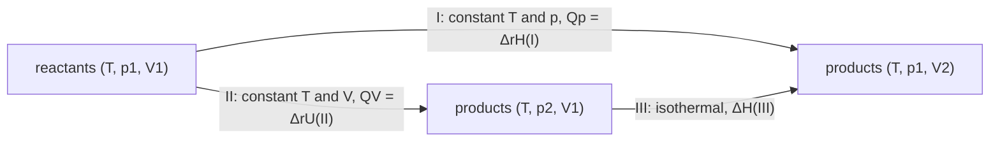

Physical chemistry studies chemical change with the principles and methods of physics, and thermodynamics is its earliest mature and most reliable part: starting from a few empirical laws, deduction yields conclusions of complete generality that do not depend on the microscopic structure of matter. The first law of thermodynamics was established in physics ([5.2.3](/5.2.3)), and the basic concepts of chemical thermodynamics and the methods of thermochemical calculation were introduced in [6.1.6](/6.1.6). The task of this chapter is to make them rigorous and quantitative: to state the conditions of validity of every formula, to learn to compute changes of state functions for complicated processes by "designing a path", and to apply the first law to three kinds of objects, namely simple $pVT$ changes (ideal and real gases), phase transitions and chemical reactions. The treatment of real gases is new material: the virial equation, the principle of corresponding states and compressibility charts underlie chemical-engineering calculations, and throttling and the Joule–Thomson coefficient are the principle behind gas liquefaction and refrigeration. The next chapter ([6.3.2](/6.3.2)) introduces entropy through the second law and answers the question of the direction of processes, which the first law cannot; the heat capacities, enthalpies of transition and reaction enthalpies of this chapter are the raw data from which entropy changes are computed there, and Gibbs energies and equilibrium constants later ([6.3.3](/6.3.3), [6.3.7](/6.3.7)).

## 1.1. The Method and Basic Concepts of Thermodynamics

### 1.1.1. Characteristics of Thermodynamics

Classical thermodynamics (equilibrium thermodynamics) studies macroscopic systems composed of a very large number of particles; its conclusions do not apply to the behavior of single particles or of a few particles. Its method is to deduce from empirical laws (the zeroth to third laws), which gives it great generality and reliability. Its limitations follow from the same source:

- It considers only the initial and final states of a process, not the details or the mechanism.
- It does not involve time, so it cannot say how fast a process occurs. At ordinary temperature and pressure the reaction $\ce{2H2 + O2 -> 2H2O}$ goes essentially to completion thermodynamically, yet in practice hardly occurs; questions of rate belong to kinetics ([6.3.15](/6.3.15)).
- It does not involve the microscopic structure of matter. The connection between macroscopic properties and molecular properties is made by statistical thermodynamics ([6.3.10](/6.3.10)).

Systems away from equilibrium (those with temperature gradients, concentration gradients or ongoing reactions) are studied by non-equilibrium thermodynamics ([6.3.18](/6.3.18)).

### 1.1.2. Systems, Equilibrium States and State Functions

A **thermodynamic system** is the part of the world singled out for study; the part outside it that interacts with it is the surroundings. The system is chosen for convenience in solving the problem at hand; different choices of system for the same problem give different values of heat and work (Question 1). According to what is exchanged between system and surroundings, systems are **open systems**, **closed systems** or **isolated systems** ([5.2.1](/5.2.1#sec-1.1.1)). Physical chemistry mostly deals with closed systems; an isolated system exists only approximately, and one often treats a system together with its surroundings as a single isolated system ([6.3.2](/6.3.2)).

Under given environmental conditions, a system is in a thermodynamic **equilibrium state** if all its properties are independent of time and isolating it from the surroundings would cause no change in any property ([5.2.1](/5.2.1#def-1.1.2)). The second condition distinguishes equilibrium from a steady state: in a metal rod whose ends are in contact with a hot and a cold reservoir, the temperature at each point does not change with time, but if the reservoirs are removed the temperature redistributes, so the rod is in a steady state and not in equilibrium. Thermodynamic equilibrium comprises four aspects at once:

| Equilibrium | Condition | Constraint that prevents it |
|---|---|---|
| Thermal | The temperature is the same in all parts of the system and in the surroundings | Adiabatic wall |
| Mechanical | In the absence of external fields, the pressure is uniform within the system and balances the surroundings | Rigid wall |
| Phase | The composition and amount of each **phase** do not change with time ([6.3.8](/6.3.8)) | Semipermeable membrane, etc. |
| Chemical | If a chemical reaction is possible, the composition does not change with time ([6.3.7](/6.3.7)) | Absence of a catalyst (kinetic barrier) |

Equilibrium is always relative to constraints. He at $200\,\mathrm{K}$ and $\ce{H2}$ at $300\,\mathrm{K}$ separated by a fixed adiabatic partition form an equilibrium state as long as the partition is there; if the partition is replaced by a conducting one, the constraint is removed and the system moves toward a new equilibrium ([6.3.2](/6.3.2), Example 2.3.2).

The macroscopic properties that describe an equilibrium state ($n$, $T$, $p$, $V$, density, viscosity, refractive index, and so on) are called thermodynamic properties, that is, **state functions** ([6.1.6](/6.1.6#def-6.1.1)). The change of a state function depends only on the initial and final states; mathematically, its differential is a **total differential** ([2.2.10](/2.2.10#sec-10.5)). For a fixed amount of a pure substance, for example, $V = V(T, p)$ and

$$
\mathrm{d}V = \left(\frac{\partial V}{\partial T}\right)_p\mathrm{d}T + \left(\frac{\partial V}{\partial p}\right)_T\mathrm{d}p.
$$

A single-phase pure substance of fixed composition has only two independent intensive variables: once any two intensive properties (such as $T$ and $p$) are given, all other intensive properties ($V_{\mathrm{m}}$, density, $C_{p,\mathrm{m}}$, and so on) are determined.

State functions are either **extensive quantities** (proportional to the amount of substance and additive: $V$, $U$, $H$, $S$) or **intensive quantities** (independent of the amount of substance: $T$, $p$, $V_{\mathrm{m}}$, density). In mathematical language, at fixed $T$ and $p$ an extensive quantity is a first-degree **homogeneous function** of the amounts $n_1, n_2, \dots$ of the components, and an intensive quantity is homogeneous of degree zero ([2.2.10, Definition 10.7.1](/2.2.10#def-10.7.1)): $V(T, p, \lambda n_1, \lambda n_2) = \lambda V(T, p, n_1, n_2)$. The ratio of two extensive quantities is intensive, for example $V_{\mathrm{m}} = V/n$ and $\rho = m/V$. This statement will be used in the additivity formula for partial molar quantities ([6.3.4](/6.3.4)). Note that additivity refers to dividing one system into parts: when two gases are mixed, $V = V_1 + V_2$, but the pressures do not satisfy $p = p_1 + p_2$.

### 1.1.3. Processes and Paths

A change of state of the system is called a process, and the specific way in which it is carried out is called a path. By the difference between initial and final states, processes are classified as simple physical changes (only $p$, $V$, $T$ change), complex physical changes (phase transitions, mixing) and chemical changes. By the character of the process itself, the following processes commonly used in physical chemistry must be distinguished carefully:

| Process | Condition | Remark |
|---|---|---|
| Isothermal | $T_1 = T_2 = T_{\mathrm{sur}} =$ constant | Requires only that the initial and final temperatures equal the constant temperature of the surroundings; the temperature of the system may vary during the process |
| At constant temperature | $T = T_{\mathrm{sur}} =$ constant throughout | A stronger requirement than isothermal |
| Isobaric | $p_1 = p_2 = p_{\mathrm{ex}} =$ constant | Requires only that the initial and final pressures equal the constant external pressure |
| At constant pressure | $p = p_{\mathrm{ex}} =$ constant throughout | |
| At constant external pressure | $p_{\mathrm{ex}} =$ constant | The pressure of the system itself may differ from $p_{\mathrm{ex}}$ |
| Isochoric | $V =$ constant | |
| **Adiabatic process** | No heat is exchanged between system and surroundings | |
| Cyclic | Final state is the same as the initial state | |

Textbooks do not use the terms "isothermal" and "constant temperature" (nor "isobaric" and "constant pressure") in exactly the same way ([6.1.6](/6.1.6#sec-6.1.3) makes the same distinction as is made here); what matters is which condition each formula requires. For example, an expansion against a constant external pressure in a single step to the final pressure (Example 1.2.1) is isothermal but not at constant temperature.

### 1.1.4. Heat and Work

The energy transferred between system and surroundings because of a temperature difference is **heat** $Q$; all other energy transferred between system and surroundings is work $W$. This wiki always counts both as positive when received by the system: heat absorbed by the system has $Q > 0$, and work done on the system by the surroundings has $W > 0$ ([6.1.6](/6.1.6#sec-6.1.4)). Microscopically, heat is energy exchanged between system and surroundings because of a difference in the intensity of the disordered motion of particles, while work is energy exchanged through the ordered motion of particles (the bulk movement of a piston, the directed flow of electrons).

Several points about heat and work deserve attention:

1. Heat and work are exchanged only at the boundary between system and surroundings, and every exchange is either heat or work; changes occurring inside the system are not counted in $Q$ or $W$. To decide whether an exchange is heat or work, imagine separating the system from its surroundings with an adiabatic wall: if the exchange is affected, it is heat; otherwise it is work. When an electric current dissipates heat in a resistance wire inside the system, it is heat if the gas alone is the system (an adiabatic wall would block it), and electrical work if the gas and the wire together are the system.
2. Heat and work are path functions, depending on the path; their infinitesimal amounts are written $\delta Q$ and $\delta W$. For a state function the reverse process satisfies $\Delta X_{\text{rev}} = -\Delta X$; for path functions in general $Q_{\text{rev}} \ne -Q$, which holds only for reversible processes (Section 1.2.3).

The **first law of thermodynamics** for a closed system ([5.2.3, Theorem 3.3.1](/5.2.3#thm-3.3.1)) is

$$
\Delta U = Q + W, \qquad \mathrm{d}U = \delta Q + \delta W,
\tag{1.1}
$$

and holds for a closed system that is macroscopically at rest and free of external fields. It is the form taken by the law of conservation of energy for macroscopic systems involving thermal phenomena, and is equivalent to the statement that a perpetual motion machine of the first kind cannot be built. Eq. (1.1) is itself very simple; applying the first law is really a matter of calculating and measuring the heat and work of various processes. Some textbooks count the work done by the system as positive and write $\Delta U = Q - W$; physics textbooks write $Q = \Delta U + W'$ ([5.2.3, Remark 3.3.1](/5.2.3#rem-3.3.1)). The three conventions have the same physical content; this wiki uses Eq. (1.1) throughout, in agreement with IUPAC.

## 1.2. Expansion Work and Reversible Processes

### 1.2.1. Expansion Work

Work in general has the form "generalized force × generalized displacement", $\delta W = F\,\mathrm{d}l$. For the needs of physical chemistry it is divided into **pressure–volume work** (expansion work) and **non-expansion work** $W'$ (electrical work, surface work, shaft work, light energy, and so on; [6.1.6, Definition 6.1.2](/6.1.6#def-6.1.2)). When the volume of the system changes by $\mathrm{d}V$, the surroundings act with external pressure $p_{\mathrm{ex}}$ on a piston of area $A$, the piston moves by $\mathrm{d}l$, and the work received by the system is

$$
\delta W = -p_{\mathrm{ex}}A\,\mathrm{d}l = -p_{\mathrm{ex}}\,\mathrm{d}V, \qquad W = -\int_{V_1}^{V_2}p_{\mathrm{ex}}\,\mathrm{d}V.
\tag{1.2}
$$

The integrand is the external pressure and not the pressure of the system: work is energy exchanged at the boundary and is determined by the force exerted by the surroundings. Only when mechanical equilibrium is maintained throughout ($p_{\mathrm{ex}} = p \pm \mathrm{d}p$) may $p_{\mathrm{ex}}$ be replaced by the pressure $p$ of the system. The expansion work in several special processes is:

| Process | Expansion work $W$ |
|---|---|
| Free expansion (into vacuum, $p_{\mathrm{ex}} = 0$) | $0$ |
| Isochoric process | $0$ |
| Constant external pressure | $-p_{\mathrm{ex}}\Delta V$ |
| Constant pressure | $-p\Delta V = -(p_2V_2 - p_1V_1)$ |
| Reversible isothermal process of an ideal gas | $-nRT\ln(V_2/V_1) = -nRT\ln(p_1/p_2)$ |

### 1.2.2. Multistep Expansion and the Reversible Limit

**Example 1.2.1** A fixed amount of ideal gas expands isothermally in a constant-temperature reservoir from $p_1 = 4\,\mathrm{kPa}$, $V_1 = 6\,\mathrm{m^3}$ to $p_2 = 1\,\mathrm{kPa}$, $V_2 = 24\,\mathrm{m^3}$ ($pV = nRT = 24\,\mathrm{kJ}$). Compare the work for expansion in one, two and three steps against constant external pressures and for reversible expansion, and the work for the corresponding compressions.

Solution: In each step the gas expands against a constant external pressure until its pressure equals that external pressure, and the volume is fixed by $pV = 24\,\mathrm{kJ}$. One step: $W = -(1\,\mathrm{kPa})(24 - 6)\,\mathrm{m^3} = -18\,\mathrm{kJ}$. Two steps ($4 \to 2 \to 1\,\mathrm{kPa}$, volume $6 \to 12 \to 24\,\mathrm{m^3}$): $W = -2 \times 6 - 1 \times 12 = -24\,\mathrm{kJ}$. Three steps ($4 \to 3 \to 2 \to 1\,\mathrm{kPa}$): $W = -3 \times 2 - 2 \times 4 - 1 \times 12 = -26\,\mathrm{kJ}$. Reversible expansion: $W = -nRT\ln(V_2/V_1) = -24\ln 4 = -33.3\,\mathrm{kJ}$. Compression proceeds in the opposite direction, and the external pressure in each step is the pressure of the final state of that step:

| Path | One step | Two steps | Three steps | Reversible |
|---|---|---|---|---|
| Expansion $W/\mathrm{kJ}$ | $-18$ | $-24$ | $-26$ | $-33.3$ |
| Compression $W/\mathrm{kJ}$ | $72$ | $48$ | $44$ | $33.3$ |
| Full cycle $\sum W/\mathrm{kJ}$ | $54$ | $24$ | $18$ | $0$ |


For the same initial and final states the work depends on the path, so the process must always be specified when work is calculated. In the $p$–$V$ diagram the work is minus the area under the external-pressure curve: the more steps in the expansion, the closer the staircase is to the isotherm and the more work the system does on the surroundings; as the number of steps tends to infinity one obtains reversible expansion, in which the system does the maximum work. For compression the reverse holds: reversible compression requires the least work from the surroundings. For an isothermal process of an ideal gas $\Delta U = 0$, so in each cycle the extra work $\sum W$ done by the surroundings remains as heat in the reservoir: after an irreversible cycle the system has been restored, but the surroundings have "lost work and gained heat".

### 1.2.3. Reversible Processes

The definition of a **reversible process** is given in [5.2.4, Definition 4.3.1](/5.2.4#def-4.3.1). The example above leads to the formulation commonly used in chemical thermodynamics:

**Definition 1.2.1 (Reversible Process)** A process is called a **reversible process** if, after it has taken place, the system can be returned to its original state by retracing the path in reverse while leaving no effect whatsoever on the surroundings (the surroundings are also restored); otherwise it is an **irreversible process**.

From the definition and Example 1.2.1, the characteristics of a reversible process can be summarized:

1. Double restoration: after the reverse process both system and surroundings are restored. In terms of energy, $W_{\mathrm{r}} = -W_{\text{rev}}$ and $Q_{\mathrm{r}} = -Q_{\text{rev}}$. Note that "reversible" does not mean "able to come back": any process can be followed by some way of returning the system to its original state; the point is whether the surroundings can be restored at the same time.
2. Reversibility implies equilibrium: throughout the process, system and surroundings are infinitesimally close to equilibrium ($p_{\mathrm{ex}} = p \pm \mathrm{d}p$, $T_{\mathrm{sur}} = T \pm \mathrm{d}T$), the driving force is infinitesimal, the process proceeds infinitely slowly, and every intermediate state is an equilibrium state. A reversible process is an idealized limit.
3. The work and heat of a reversible process are limiting values: in isothermal reversible expansion the system does the maximum work on the surroundings, and in isothermal reversible compression the surroundings do the minimum work.

A reversible process is necessarily quasi-static, but not conversely: if a quasi-static process involves dissipation such as friction, it is irreversible (Question 2). Typical reversible processes are expansion or compression with the external and internal pressures differing only by $\mathrm{d}p$ (mechanical equilibrium); heat transfer in contact with a series of reservoirs whose temperatures differ only by $\mathrm{d}T$ (thermal equilibrium); a phase transition at the temperature and pressure of two-phase equilibrium (phase equilibrium); and a cell reaction with an applied electromotive force smaller than the cell's by only $\mathrm{d}E$ (chemical equilibrium, [6.3.13](/6.3.13)). Reversible processes matter for two reasons: they give the limit for the use of energy in real processes, and they are the tool for computing changes of state functions, entropy in particular, because an entropy change can be calculated only along a reversible path ([6.3.2](/6.3.2)).

## 1.3. Heat and Heat Capacity

### 1.3.1. Heat at Constant Volume, Heat at Constant Pressure and Enthalpy

Heat at constant volume: in an isochoric process the expansion work is zero. If there is also no non-expansion work ($W' = 0$), then by Eq. (1.1)

$$
Q_V = \Delta U \qquad (\mathrm{d}V = 0,\ W' = 0).
$$

At constant volume and without non-expansion work, all the heat absorbed by the system goes to increase its internal energy.

Heat at constant pressure: in an isobaric process $p_1 = p_2 = p_{\mathrm{ex}}$ and $W = -p_{\mathrm{ex}}\Delta V + W'$, so

$$
Q_p = \Delta U + p_{\mathrm{ex}}(V_2 - V_1) - W' = (U_2 + p_2V_2) - (U_1 + p_1V_1) - W' = \Delta H - W',
$$

where $H = U + pV$ is the **enthalpy** ([5.2.3, Definition 3.5.4](/5.2.3#def-3.5.4)). If $W' = 0$,

$$
Q_p = \Delta H \qquad (p_1 = p_2 = p_{\mathrm{ex}},\ W' = 0).
$$

The derivation uses only that the pressures of the initial and final states equal the constant external pressure; the pressure of the system during the process need not equal the external pressure, so what is required here is only that the process be isobaric, not that it take place at constant pressure. About enthalpy:

- Enthalpy is an extensive state function with the unit J. It is a function constructed for convenience and has no independent physical meaning; its absolute value cannot be measured. The product $pV$ is a property of the system, not work.
- Enthalpy is not "the heat contained in the system", and it obeys no conservation law. $Q_p = \Delta H$ only says that under particular conditions a path function is numerically equal to the change of a state function; it does not make $Q_p$ a state function. Every process has an enthalpy change: $\Delta H = \Delta U + \Delta(pV)$.
- The advantage of defining enthalpy is that $Q_p$ is easy to measure, while $\Delta H$ is independent of path and can be calculated along any convenient path. Most chemical reactions occur at constant pressure without non-expansion work, so enthalpy is more useful than internal energy.

### 1.3.2. Heat Capacity

A process involving only $pVT$ changes, with no phase transition or chemical change, is called a simple temperature change. For a homogeneous closed system undergoing such a process with $W' = 0$, the heat absorbed per unit temperature rise is the **heat capacity** $C = \delta Q/\mathrm{d}T$ ([5.2.3, Definition 3.4.1](/5.2.3#def-3.4.1)). By Section 1.3.1,

$$
C_V = \frac{\delta Q_V}{\mathrm{d}T} = \left(\frac{\partial U}{\partial T}\right)_V, \qquad C_p = \frac{\delta Q_p}{\mathrm{d}T} = \left(\frac{\partial H}{\partial T}\right)_p.
$$

The two partial-derivative forms do not depend on the process and can serve as the definitions of heat capacity. The **molar heat capacities** are $C_{V,\mathrm{m}} = C_V/n$ and $C_{p,\mathrm{m}} = C_p/n$, with the unit $\mathrm{J\,mol^{-1}\,K^{-1}}$. Regarding $U$ as a function of $T$ and $V$ and $H$ as a function of $T$ and $p$,

$$
\mathrm{d}U = C_V\,\mathrm{d}T + \left(\frac{\partial U}{\partial V}\right)_T\mathrm{d}V, \qquad \mathrm{d}H = C_p\,\mathrm{d}T + \left(\frac{\partial H}{\partial p}\right)_T\mathrm{d}p.
$$

Hence for a simple temperature change

$$
Q_V = \Delta U = n\int_{T_1}^{T_2}C_{V,\mathrm{m}}\,\mathrm{d}T \quad(\text{isochoric}), \qquad Q_p = \Delta H = n\int_{T_1}^{T_2}C_{p,\mathrm{m}}\,\mathrm{d}T \quad(\text{isobaric}).
$$

The conditions for the two equalities differ. $Q_V = \Delta U$ requires an isochoric process with $W' = 0$; the second equality requires only $\mathrm{d}V = 0$, for which $\mathrm{d}U = C_V\,\mathrm{d}T$, so "$\Delta U = n\int C_{V,\mathrm{m}}\,\mathrm{d}T$" also holds for an isochoric process with non-expansion work, although then $Q_V \ne \Delta U$.

$C_{p,\mathrm{m}}$ is a function of $T$ and $p$; the effect of pressure is very small and can be neglected when the pressure changes little. Its variation with temperature is determined experimentally and expressed by empirical formulas:

$$
C_{p,\mathrm{m}} = a + bT + cT^2 \qquad \text{or} \qquad C_{p,\mathrm{m}} = a + bT + \frac{c'}{T^2},
$$

where $a$, $b$, $c$ depend on the substance and are obtained from experimental data over a given temperature range by least-squares fitting (`scipy.optimize.curve_fit`, [4.4.4](/4.4.4)). The parameters for several gases used in this chapter and the next (second form, valid for $298$–$2000\,\mathrm{K}$) are:

| Substance | $a/(\mathrm{J\,mol^{-1}\,K^{-1}})$ | $10^3b/(\mathrm{J\,mol^{-1}\,K^{-2}})$ | $10^{-5}c'/(\mathrm{J\,mol^{-1}\,K})$ | $C_{p,\mathrm{m}}(298.15\,\mathrm{K})$ |
|---|---|---|---|---|
| $\ce{H2(g)}$ | $27.28$ | $3.26$ | $0.50$ | $28.8$ |
| $\ce{N2(g)}$ | $28.58$ | $3.77$ | $-0.50$ | $29.1$ |
| $\ce{O2(g)}$ | $29.96$ | $4.18$ | $-1.67$ | $29.3$ |
| $\ce{CO2(g)}$ | $44.22$ | $8.79$ | $-8.62$ | $37.1$ |
| $\ce{H2O(g)}$ | $30.54$ | $10.29$ | $0$ | $33.6$ |
| $\ce{NH3(g)}$ | $29.75$ | $25.1$ | $-1.55$ | $35.5$ |

When consulting handbooks, pay attention to the form of the empirical formula, the temperature range of validity, and the powers of 10 and the units in the column headings. If the temperature change is small, $C_{p,\mathrm{m}}$ may be taken as constant.

### 1.3.3. The General Relation between $C_p$ and $C_V$

$$
C_p - C_V = \left(\frac{\partial H}{\partial T}\right)_p - \left(\frac{\partial U}{\partial T}\right)_V = \left(\frac{\partial U}{\partial T}\right)_p + p\left(\frac{\partial V}{\partial T}\right)_p - \left(\frac{\partial U}{\partial T}\right)_V.
$$

Regard $U$ as a function of $T$ and $V$ and differentiate with respect to $T$ at constant $p$; by the chain rule for composite functions ([2.2.10, Theorem 10.7.1](/2.2.10#thm-10.7.1)),

$$
\left(\frac{\partial U}{\partial T}\right)_p = \left(\frac{\partial U}{\partial T}\right)_V + \left(\frac{\partial U}{\partial V}\right)_T\left(\frac{\partial V}{\partial T}\right)_p.
$$

Substituting into the previous expression gives

$$
C_p - C_V = \left[\left(\frac{\partial U}{\partial V}\right)_T + p\right]\left(\frac{\partial V}{\partial T}\right)_p.
\tag{1.3}
$$

Eq. (1.3) holds for any homogeneous pure substance (or system of fixed composition). The heat absorbed on heating at constant pressure exceeds that absorbed at constant volume by two terms: $p(\partial V/\partial T)_p$ is the work done against the external pressure as the system expands, and $(\partial U/\partial V)_T(\partial V/\partial T)_p$ is the energy needed to overcome intermolecular attraction as the volume increases.

**Definition 1.3.1 (Internal Pressure)** The partial derivative

$$
\pi_T = \left(\frac{\partial U}{\partial V}\right)_T
$$
is called the **internal pressure** of the substance; it has the dimensions of pressure.

Internal pressure is a measure of intermolecular interactions. For an ideal gas $\pi_T = 0$. For a van der Waals gas the internal energy is $U_{\mathrm{m}} = U_{\mathrm{m}}^{\mathrm{id}}(T) - a/V_{\mathrm{m}}$ ([5.2.2](/5.2.2#sec-2.2.4)), and $\pi_T = a/V_{\mathrm{m}}^2$. For $\ce{N2}$ at ordinary temperature and pressure $\pi_T \approx 2 \times 10^2\,\mathrm{Pa}$, only two thousandths of the external pressure; for liquids the internal pressure can reach $10^8$–$10^9\,\mathrm{Pa}$. The second law can be used to prove that $\pi_T = T(\partial p/\partial T)_V - p$, which turns Eq. (1.3) into the relation $C_p - C_V = TV\alpha_V^2/\kappa_T$ containing only measurable quantities ([6.3.3](/6.3.3)).

## 1.4. The Ideal Gas

### 1.4.1. Internal Energy and Enthalpy Depend Only on Temperature

An **ideal gas** obeys $pV = nRT$ strictly at all temperatures and pressures ([5.2.1, Definition 1.1.6](/5.2.1#def-1.1.6)); its microscopic model consists of point particles with no volume and no interactions. In the Gay-Lussac–Joule experiment on free expansion of a low-pressure gas ([5.2.3](/5.2.3#sec-3.3.4)) the temperature of the water bath does not change. Taking the gas as the system, $W = 0$ and $Q = 0$, so $\Delta U = 0$, that is,

$$
\left(\frac{\partial U}{\partial V}\right)_T = 0, \qquad \left(\frac{\partial U}{\partial p}\right)_T = 0, \qquad U = U(T).
$$

From $H = U + nRT$ it follows that $H = H(T)$ as well. (The experiment is not sensitive: the heat capacity of the water is far greater than that of a low-pressure gas, so the small temperature change of a real gas cannot be detected. The rigorous conclusion comes from the definition of the ideal gas and the second law, [6.3.3](/6.3.3).) Hence for any simple physical change of an ideal gas, whether or not isochoric or isobaric,

$$
\mathrm{d}U = C_V\,\mathrm{d}T, \qquad \mathrm{d}H = C_p\,\mathrm{d}T, \qquad \Delta U = n\int_{T_1}^{T_2}C_{V,\mathrm{m}}\,\mathrm{d}T, \qquad \Delta H = n\int_{T_1}^{T_2}C_{p,\mathrm{m}}\,\mathrm{d}T,
$$

and in an isothermal process $\Delta U = \Delta H = 0$. $C_V$ and $C_p$ are also functions of temperature only: $(\partial C_V/\partial V)_T = \frac{\partial}{\partial T}\left(\frac{\partial U}{\partial V}\right)_T = 0$. From Eq. (1.3), $\pi_T = 0$ and $p(\partial V/\partial T)_p = nR$, which gives **Mayer's relation**

$$
C_p - C_V = nR, \qquad C_{p,\mathrm{m}} - C_{V,\mathrm{m}} = R.
$$

At ordinary temperature monatomic gases (He, Ar) have $C_{V,\mathrm{m}} = \frac{3}{2}R$ and $C_{p,\mathrm{m}} = \frac{5}{2}R$, and diatomic gases ($\ce{H2}$, $\ce{N2}$, $\ce{O2}$) have $C_{V,\mathrm{m}} = \frac{5}{2}R$ and $C_{p,\mathrm{m}} = \frac{7}{2}R$. The origin of these values (equipartition of energy and the freezing out of vibrational degrees of freedom) is explained in [5.2.3](/5.2.3#sec-3.4.4), and the statistical-thermodynamic calculation in [6.3.11](/6.3.11).

### 1.4.2. Reversible Adiabatic Processes

In an adiabatic process $Q = 0$ and $\Delta U = W$: an adiabatic process converts between internal energy and work, and in general $p$, $V$ and $T$ all change; starting from the same initial state, different adiabatic processes reach different final states. For a reversible adiabatic process of an ideal gas with $W' = 0$, $\mathrm{d}U = \delta W = -p\,\mathrm{d}V$, that is,

$$
C_V\,\mathrm{d}T = -\frac{nRT}{V}\,\mathrm{d}V = -\frac{(C_p - C_V)T}{V}\,\mathrm{d}V, \qquad \frac{\mathrm{d}T}{T} = -(\gamma - 1)\frac{\mathrm{d}V}{V},
$$

where $\gamma = C_p/C_V$ is the **heat capacity ratio**. This is a **separable differential equation** ([2.2.15](/2.2.15#sec-15.2.1)); for constant $\gamma$ integration gives

$$
TV^{\gamma - 1} = \text{constant}, \qquad T^\gamma p^{1 - \gamma} = \text{constant}, \qquad pV^\gamma = \text{constant}.
\tag{1.4}
$$

Eq. (1.4) holds under these conditions: ideal gas, adiabatic, reversible, $W' = 0$ and constant $\gamma$. It describes the relation among the states passed through in one process, and its use is to find the final state. In the $p$–$V$ diagram the slope of the isotherm is $(\partial p/\partial V)_T = -p/V$ and that of the adiabat is $(\partial p/\partial V)_S = -\gamma p/V$, so at any given point the adiabat is steeper than the isotherm ([5.2.3](/5.2.3#sec-3.5.1)).

### 1.4.3. Comparison of Four Processes

The general procedure for a thermodynamic problem is: choose the system; determine the initial and final states (the amount of substance of a closed system is conserved); identify the character of the process and use formulas whose conditions match.

**Example 1.4.1** $10\,\mathrm{dm^3}$ of He (treated as an ideal gas with $C_{V,\mathrm{m}} = \frac{3}{2}R$) at $273.15\,\mathrm{K}$ and $1000\,\mathrm{kPa}$ is expanded to $100\,\mathrm{kPa}$ by each of the following processes: (1) reversible isothermal expansion; (2) isothermal expansion against a constant external pressure of $100\,\mathrm{kPa}$; (3) reversible adiabatic expansion; (4) adiabatic expansion against a constant external pressure of $100\,\mathrm{kPa}$. Find the final volume and $W$, $Q$, $\Delta U$, $\Delta H$ for each process.

Solution: $n = p_1V_1/(RT_1) = 4.403\,\mathrm{mol}$, $p_1V_1 = 10.00\,\mathrm{kJ}$.

(1) $V_2 = p_1V_1/p_2 = 0.100\,\mathrm{m^3}$; $\Delta U = \Delta H = 0$; $W = -nRT\ln(p_1/p_2) = -p_1V_1\ln 10 = -23.03\,\mathrm{kJ}$, $Q = -W = 23.03\,\mathrm{kJ}$.

(2) The final state is the same as in (1), $\Delta U = \Delta H = 0$; $W = -p_{\mathrm{ex}}(V_2 - V_1) = -100\,\mathrm{kPa} \times 0.090\,\mathrm{m^3} = -9.00\,\mathrm{kJ}$, $Q = 9.00\,\mathrm{kJ}$.

(3) $\gamma = 5/3$; by Eq. (1.4), $V_2 = V_1(p_1/p_2)^{1/\gamma} = 0.0398\,\mathrm{m^3}$ and $T_2 = p_2V_2/(nR) = 108.7\,\mathrm{K}$; $Q = 0$, $W = \Delta U = nC_{V,\mathrm{m}}(T_2 - T_1) = -9.03\,\mathrm{kJ}$, $\Delta H = nC_{p,\mathrm{m}}(T_2 - T_1) = -15.05\,\mathrm{kJ}$.

(4) The process is irreversible, so Eq. (1.4) cannot be used. $Q = 0$ and $\Delta U = W$:

$$
nC_{V,\mathrm{m}}(T_2 - T_1) = -p_2\left(\frac{nRT_2}{p_2} - \frac{nRT_1}{p_1}\right) \;\Rightarrow\; T_2 = \frac{C_{V,\mathrm{m}} + Rp_2/p_1}{C_{p,\mathrm{m}}}\,T_1 = 174.8\,\mathrm{K},
$$

$V_2 = nRT_2/p_2 = 0.0640\,\mathrm{m^3}$; $W = \Delta U = -5.40\,\mathrm{kJ}$, $\Delta H = -9.00\,\mathrm{kJ}$.

| Process | $V_2/\mathrm{m^3}$ | $T_2/\mathrm{K}$ | $W/\mathrm{kJ}$ | $Q/\mathrm{kJ}$ | $\Delta U/\mathrm{kJ}$ | $\Delta H/\mathrm{kJ}$ |
|---|---|---|---|---|---|---|
| (1) Reversible isothermal | $0.100$ | $273.15$ | $-23.03$ | $23.03$ | $0$ | $0$ |
| (2) Isothermal, constant external pressure | $0.100$ | $273.15$ | $-9.00$ | $9.00$ | $0$ | $0$ |
| (3) Reversible adiabatic | $0.0398$ | $108.7$ | $-9.03$ | $0$ | $-9.03$ | $-15.05$ |
| (4) Adiabatic, constant external pressure | $0.0640$ | $174.8$ | $-5.40$ | $0$ | $-5.40$ | $-9.00$ |

Several general conclusions follow. Starting from the same initial state, reversible and irreversible isothermal processes can reach the same final state, but reversible and irreversible adiabatic processes cannot ($108.7\,\mathrm{K}$ versus $174.8\,\mathrm{K}$); this is explained by entropy in the next chapter ([6.3.2](/6.3.2), Example 2.3.1). In an adiabatic expansion all the work done by the system comes from its internal energy, and reversible expansion does the most work and therefore cools the gas the most. Among the four processes, reversible isothermal expansion does the most work and adiabatic expansion against a constant external pressure the least.

## 1.5. Real Gases

The ideal-gas equation of state deviates from the behavior of real gases, and the deviation grows as the pressure rises and the temperature falls (that is, as the gas approaches liquefaction). There are two approaches to the $pVT$ relations of real gases: equations of state, and compressibility charts based on the principle of corresponding states.

### 1.5.1. Equations of State and the Boyle Temperature

The derivation of the **van der Waals equation** $\left(p + \frac{a}{V_{\mathrm{m}}^2}\right)(V_{\mathrm{m}} - b) = RT$ and the isotherms it gives are in [5.2.2](/5.2.2#sec-2.2.3): the term $a/V_{\mathrm{m}}^2$ corrects for intermolecular attraction and $b$ for the volume of the molecules themselves. It was the first theoretical account of the difference between real and ideal gases, and it is quite accurate for many gases in the medium-pressure range from a few hundred kPa to a few MPa; but because $a$ and $b$ are treated as constants independent of the state, its errors are large at high pressure. More than two hundred equations of state have been proposed; by form they fall into pressure-explicit types $p = f(T, V_{\mathrm{m}})$ (the vdW equation), volume-explicit types and series types. The most significant theoretically is the series type:

**Definition 1.5.1 (Virial Equation of State)** The expansion of the compressibility factor $Z = pV_{\mathrm{m}}/(RT)$ in powers of $1/V_{\mathrm{m}}$ (or of $p$),

$$
Z = 1 + \frac{B(T)}{V_{\mathrm{m}}} + \frac{C(T)}{V_{\mathrm{m}}^2} + \cdots = 1 + B'(T)p + C'(T)p^2 + \cdots,
$$

is called the **virial equation of state**; the coefficients $B$, $C$, … ($B'$, $C'$, …), which depend only on temperature, are called the second, third, … **virial coefficients**.

The virial coefficients have a definite microscopic meaning: statistical mechanics shows that $B$ is determined by the interaction potential between two molecules and $C$ by the interactions among three molecules. As $p \to 0$, $Z \to 1$, and every equation of state must reduce to the ideal-gas equation; comparing the linear terms of the two expansions gives $B' = B/(RT)$. Writing the vdW equation as $Z = \frac{V_{\mathrm{m}}}{V_{\mathrm{m}} - b} - \frac{a}{RTV_{\mathrm{m}}}$ and expanding the first term in $b/V_{\mathrm{m}}$ gives

$$
Z = 1 + \left(b - \frac{a}{RT}\right)\frac{1}{V_{\mathrm{m}}} + \frac{b^2}{V_{\mathrm{m}}^2} + \cdots, \qquad B = b - \frac{a}{RT}.
\tag{1.5}
$$

At low temperature the attraction term dominates and $B < 0$, so the gas is more compressible than an ideal gas; at high temperature repulsion (the volume of the molecules) dominates and $B > 0$.

**Definition 1.5.2 (Boyle Temperature)** The temperature at which the second virial coefficient vanishes is called the **Boyle temperature** $T_{\mathrm{B}}$; equivalently, $T_{\mathrm{B}}$ is the temperature at which $\lim_{p \to 0}\left(\partial(pV_{\mathrm{m}})/\partial p\right)_T = 0$.

At the Boyle temperature the variation of $Z$ with pressure starts with zero slope, and the gas approximately obeys Boyle's law over a fairly wide range of low pressures. From Eq. (1.5), the Boyle temperature of a vdW gas is $T_{\mathrm{B}} = a/(Rb) = \frac{27}{8}T_{\mathrm{c}}$. With the vdW constants of $\ce{N2}$ ($a = 0.1370\,\mathrm{Pa\,m^6\,mol^{-2}}$, $b = 3.87 \times 10^{-5}\,\mathrm{m^3\,mol^{-1}}$) one finds $426\,\mathrm{K}$, whereas the measured value is $327\,\mathrm{K}$; the vdW equation is correct only qualitatively.

### 1.5.2. Critical Constants, Reduced Variables and the Principle of Corresponding States

The **critical point** is the state at which the difference between the gas and liquid phases disappears. The **critical temperature** $T_{\mathrm{c}}$ is the highest temperature at which a gas can be liquefied by pressure; the **critical pressure** $p_{\mathrm{c}}$ is the lowest pressure that liquefies the gas at the critical temperature (and also the maximum saturated vapor pressure of the liquid); the **critical volume** $V_{\mathrm{m,c}}$ is the molar volume at the critical point ([5.2.2, Definition 2.1.1](/5.2.2#def-2.1.1), [6.1.1](/6.1.1#def-1.1.3)). They are characteristic parameters of a substance: the weaker the intermolecular attraction, the lower $T_{\mathrm{c}}$; He has $T_{\mathrm{c}} = 5.2\,\mathrm{K}$ and is the hardest to liquefy. Of the three critical constants $V_{\mathrm{m,c}}$ is the hardest to measure accurately. At the critical point the vdW equation satisfies $(\partial p/\partial V_{\mathrm{m}})_T = 0$ and $(\partial^2 p/\partial V_{\mathrm{m}}^2)_T = 0$ (the maximum, minimum and inflection point coincide, and the three real roots of the cubic equation merge), which gives $V_{\mathrm{m,c}} = 3b$, $T_{\mathrm{c}} = 8a/(27Rb)$ and $p_{\mathrm{c}} = a/(27b^2)$ ([5.2.2, Eq. 2.2.1](/5.2.2#sec-2.2.5)). Because $V_{\mathrm{m,c}}$ is inaccurate, in practice the vdW constants are computed in reverse from $T_{\mathrm{c}}$ and $p_{\mathrm{c}}$:

$$
a = \frac{27R^2T_{\mathrm{c}}^2}{64p_{\mathrm{c}}}, \qquad b = \frac{RT_{\mathrm{c}}}{8p_{\mathrm{c}}}.
$$

**Definition 1.5.3 (Reduced Variables)** The ratios of the temperature, pressure and molar volume to their critical values,

$$
T_{\mathrm{r}} = \frac{T}{T_{\mathrm{c}}}, \qquad p_{\mathrm{r}} = \frac{p}{p_{\mathrm{c}}}, \qquad V_{\mathrm{r}} = \frac{V_{\mathrm{m}}}{V_{\mathrm{m,c}}}
$$
are called the reduced temperature, reduced pressure and reduced volume, collectively the **reduced variables**. Substances with the same reduced variables are said to be in corresponding states. Gases (and even liquids) in corresponding states have similar properties, such as compressibility factor, molar heat capacity, expansion coefficient, viscosity and refractive index; this approximate empirical regularity is called the **principle of corresponding states**.

Substituting $a = 3p_{\mathrm{c}}V_{\mathrm{m,c}}^2$, $b = V_{\mathrm{m,c}}/3$ and $R = 8p_{\mathrm{c}}V_{\mathrm{m,c}}/(3T_{\mathrm{c}})$ into the vdW equation gives the reduced vdW equation

$$
\left(p_{\mathrm{r}} + \frac{3}{V_{\mathrm{r}}^2}\right)\left(V_{\mathrm{r}} - \frac{1}{3}\right) = \frac{8}{3}T_{\mathrm{r}},
\tag{1.6}
$$

which contains no parameter characteristic of any substance: for every gas obeying the vdW equation, the same $p_{\mathrm{r}}$ and $T_{\mathrm{r}}$ give the same $V_{\mathrm{r}}$. This is one theoretical source of the principle of corresponding states and the most useful "by-product" of the vdW equation. The principle does not, however, depend on the accuracy of the vdW equation: it can be shown to hold whenever the intermolecular potential energies of the substances have the same functional form and differ only in the scales of energy and distance. It therefore works best for spherical, nonpolar molecules (Ar, $\ce{CH4}$, $\ce{N2}$) and less well for strongly polar molecules that form hydrogen bonds ($\ce{H2O}$, $\ce{NH3}$). For light molecules with marked quantum effects, such as $\ce{H2}$ and He, empirically corrected "effective critical constants" must be used ($p_{\mathrm{c}} + 0.81\,\mathrm{MPa}$, $T_{\mathrm{c}} + 8\,\mathrm{K}$). The principle of corresponding states does not apply to solids.

### 1.5.3. The Compressibility Chart

The deviation of a real gas from ideal behavior is measured by the **compressibility factor** $Z = pV_{\mathrm{m}}/(RT)$ ([6.1.1](/6.1.1)): when $Z > 1$ the real gas is harder to compress than an ideal gas at the same temperature and pressure, and when $Z < 1$ it is easier. Replacing $p$, $V_{\mathrm{m}}$ and $T$ by the reduced variables,

$$
Z = \frac{p_{\mathrm{c}}V_{\mathrm{m,c}}}{RT_{\mathrm{c}}}\cdot\frac{p_{\mathrm{r}}V_{\mathrm{r}}}{T_{\mathrm{r}}} = Z_{\mathrm{c}}\frac{p_{\mathrm{r}}V_{\mathrm{r}}}{T_{\mathrm{r}}},
$$

where $Z_{\mathrm{c}}$ is the critical compressibility factor. If the principle of corresponding states holds, $V_{\mathrm{r}}$ is a universal function of $p_{\mathrm{r}}$ and $T_{\mathrm{r}}$; and experiment shows that most gases have similar $Z_{\mathrm{c}}$ (Ne 0.31; Ar, $\ce{CH4}$, $\ce{O2}$, $\ce{N2}$ 0.29; CO 0.30; strongly polar $\ce{H2O}$ only 0.23), so that $Z \approx f(p_{\mathrm{r}}, T_{\mathrm{r}})$ is approximately the same for all gases. Plotting a large amount of measured data as $Z$–$p_{\mathrm{r}}$ curves with $T_{\mathrm{r}}$ as a parameter gives the generalized compressibility chart. It is not restricted by the range of validity of an equation of state and is very useful in high-pressure chemical-engineering calculations. The vdW equation gives $Z_{\mathrm{c}} = 3/8$, which is clearly too large, and the "compressibility chart" computed from Eq. (1.6) (figure below) differs greatly from the measured chart near the critical region, though it agrees qualitatively far from it: at low temperature $Z$ first falls with pressure and then rises, and the range over which $Z \approx 1$ is widest when $T_{\mathrm{r}}$ is near the Boyle temperature.


**Example 1.5.1** Find the molar volume of $\ce{CO2}$ at $304\,\mathrm{K}$ and $11.15\,\mathrm{MPa}$. Given $T_{\mathrm{c}} = 304.13\,\mathrm{K}$ and $p_{\mathrm{c}} = 7.38\,\mathrm{MPa}$.

Solution: $T_{\mathrm{r}} = 1.00$ and $p_{\mathrm{r}} = 1.51$; the compressibility chart gives $Z \approx 0.25$, so

$$
V_{\mathrm{m}} = \frac{ZRT}{p} = \frac{0.25 \times 8.314 \times 304}{11.15 \times 10^6}\,\mathrm{m^3\,mol^{-1}} = 5.7 \times 10^{-5}\,\mathrm{m^3\,mol^{-1}},
$$

only a quarter of the ideal-gas value ($2.27 \times 10^{-4}\,\mathrm{m^3\,mol^{-1}}$). Near the critical point the density of $\ce{CO2}$ is about $0.78\,\mathrm{g\,cm^{-3}}$, already close to that of a liquid, which is the property exploited in supercritical $\ce{CO2}$ extraction ([6.1.1](/6.1.1)). The vdW equation ($a = 0.364\,\mathrm{Pa\,m^6\,mol^{-2}}$, $b = 4.27 \times 10^{-5}\,\mathrm{m^3\,mol^{-1}}$, solving the cubic equation for $V_{\mathrm{m}}$ with `numpy.roots`) gives $Z = 0.35$, an error of 40%.

### 1.5.4. Throttling and the Joule–Thomson Coefficient

In a **throttling process** ([5.2.3, Definition 3.5.3](/5.2.3#def-3.5.3)) a gas flows steadily through a porous plug in an adiabatic cylinder, from a side at constant pressure $p_1$ to a side at constant pressure $p_2 < p_1$. Take a fixed amount of gas as the system, which goes from $(p_1, V_1, T_1)$ to $(p_2, V_2, T_2)$. Then $Q = 0$, the surroundings on the left do work $p_1V_1$ on it, and it does work $p_2V_2$ on the surroundings on the right:

$$
U_2 - U_1 = W = p_1V_1 - p_2V_2 \;\Rightarrow\; U_2 + p_2V_2 = U_1 + p_1V_1,\quad \Delta H = 0.
$$

Throttling is an adiabatic, irreversible, isenthalpic process (the intermediate states are not equilibrium states, and "isenthalpic" means only that the enthalpies of the initial and final states are equal). Experiment shows that near room temperature and atmospheric pressure most gases cool on throttling, while a few ($\ce{H2}$, He) warm; this is the **Joule–Thomson effect**.

**Definition 1.5.4 (Joule–Thomson Coefficient)** The partial derivative

$$
\mu_{\mathrm{JT}} = \left(\frac{\partial T}{\partial p}\right)_H
$$
is called the **Joule–Thomson coefficient**; it is an intensive state function giving the temperature change caused by a unit pressure decrease at constant enthalpy. When $\mu_{\mathrm{JT}} > 0$ the gas cools on throttling (positive effect), and when $\mu_{\mathrm{JT}} < 0$ it warms. The temperature at which $\mu_{\mathrm{JT}} = 0$ is called the **inversion temperature** $T_{\mathrm{inv}}$; it depends on the gas and on the pressure.

At $298\,\mathrm{K}$ and near atmospheric pressure, $\mu_{\mathrm{JT}} \approx 2.7\,\mathrm{K\,MPa^{-1}}$ for $\ce{N2}$, about $11\,\mathrm{K\,MPa^{-1}}$ for $\ce{CO2}$ and about $-0.6\,\mathrm{K\,MPa^{-1}}$ for He; the enthalpy of an ideal gas depends only on temperature, so $\mu_{\mathrm{JT}} = 0$. For a real gas $H = H(T, p)$, and along an isenthalp $\mathrm{d}H = C_p\,\mathrm{d}T + (\partial H/\partial p)_T\,\mathrm{d}p = 0$, which is the cyclic relation of implicit differentiation ([2.2.10](/2.2.10#sec-10.8.1)):

$$
\mu_{\mathrm{JT}} = -\frac{(\partial H/\partial p)_T}{(\partial H/\partial T)_p} = -\frac{1}{C_p}\left(\frac{\partial H}{\partial p}\right)_T, \qquad \left(\frac{\partial H}{\partial p}\right)_T = -C_p\mu_{\mathrm{JT}}.
\tag{1.7}
$$

Measuring $\mu_{\mathrm{JT}}$ and $C_p$ therefore gives the variation of enthalpy with pressure, and from $U = H - pV$ one obtains $(\partial U/\partial p)_T = -C_p\mu_{\mathrm{JT}} - (\partial(pV)/\partial p)_T$. The variation of enthalpy with pressure comes from intermolecular interactions. For a vdW gas at low pressure, $U_{\mathrm{m}} = U_{\mathrm{m}}^{\mathrm{id}}(T) - a/V_{\mathrm{m}}$; by Eq. (1.5), $pV_{\mathrm{m}} \approx RT + Bp$, and $a/V_{\mathrm{m}} \approx ap/(RT)$, so

$$
H_{\mathrm{m}} = U_{\mathrm{m}} + pV_{\mathrm{m}} \approx H_{\mathrm{m}}^{\mathrm{id}}(T) + \left(b - \frac{2a}{RT}\right)p, \qquad \mu_{\mathrm{JT}} \approx \frac{1}{C_{p,\mathrm{m}}}\left(\frac{2a}{RT} - b\right).
$$

Attraction ($a$) makes a gas cool on throttling: on expansion the distances between molecules increase, and kinetic energy is consumed in overcoming attraction; repulsion ($b$) has the opposite effect. For $\ce{N2}$ at $298\,\mathrm{K}$ this expression gives $2.5\,\mathrm{K\,MPa^{-1}}$, close to the measured value. The low-pressure inversion temperature is $T_{\mathrm{inv}} = 2a/(Rb) = 2T_{\mathrm{B}} = \frac{27}{4}T_{\mathrm{c}}$.

At higher pressures $\mu_{\mathrm{JT}}$ also varies with pressure, and the points where $\mu_{\mathrm{JT}} = 0$ form the inversion curve in the $T$–$p$ plane. For a vdW gas it can be found exactly. Since $(\partial V/\partial p)_T$ is not zero, $(\partial H/\partial p)_T = 0$ is equivalent to $(\partial H/\partial V)_T = 0$; and $H_{\mathrm{m}} = U_{\mathrm{m}} + pV_{\mathrm{m}} = U_{\mathrm{m}}^{\mathrm{id}}(T) + \frac{RTV_{\mathrm{m}}}{V_{\mathrm{m}} - b} - \frac{2a}{V_{\mathrm{m}}}$, and setting its partial derivative with respect to $V_{\mathrm{m}}$ to zero gives $RTbV_{\mathrm{m}}^2 = 2a(V_{\mathrm{m}} - b)^2$. Converting to reduced variables and eliminating $V_{\mathrm{r}}$ with Eq. (1.6) gives

$$
p_{\mathrm{r}} = 24\sqrt{3T_{\mathrm{r}}} - 12T_{\mathrm{r}} - 27, \qquad \tfrac{3}{4} \le T_{\mathrm{r}} \le \tfrac{27}{4}.
$$

Inside the curve $\mu_{\mathrm{JT}} > 0$; for $p_{\mathrm{r}} > 9$ throttling warms the gas at any temperature.


The measured low-pressure inversion temperatures are $621\,\mathrm{K}$ for $\ce{N2}$, $723\,\mathrm{K}$ for Ar and about $1500\,\mathrm{K}$ for $\ce{CO2}$, all far above room temperature, so these gases can be cooled directly by throttling. For $\ce{H2}$ the value is $202\,\mathrm{K}$ and for He only $40\,\mathrm{K}$; they must first be precooled below the inversion temperature with liquid nitrogen or by other means before throttling can liquefy them. The Linde process for liquefying air is throttling combined with countercurrent heat exchange: the gas cooled by throttling returns to precool the high-pressure gas that follows, and the temperature falls stage by stage until liquefaction. In refrigerators and air conditioners, when the liquid refrigerant is throttled through the expansion valve it partly vaporizes and cools sharply; this step is also throttling (here accompanied by a phase change, and the cooling comes mainly from the heat absorbed in vaporization).

Throttling differs from reversible adiabatic expansion. The latter does work on the surroundings at constant entropy and cools any gas; the former does no net work on the surroundings, keeps the enthalpy constant and increases the entropy, leaves the temperature of an ideal gas unchanged, and may cool or warm a real gas.

## 1.6. Enthalpies of Transition

### 1.6.1. Enthalpy of Transition

The conversion of a substance from one **phase** to another is called a phase transition: vaporization (vap), fusion (fus), sublimation (sub), transition between crystal forms (trs), and their reverses. A transition carried out at the temperature and pressure of two-phase equilibrium is a reversible phase transition, for example water vaporizing at $100\,\mathrm{kPa}$ and $99.61\,{}^\circ\mathrm{C}$, or at another temperature and the corresponding **saturated vapor pressure**; a transition not carried out under equilibrium conditions is irreversible, for example water evaporating into vacuum or into dry air, or supercooled water freezing ([6.3.2](/6.3.2), Example 2.3.6).

**Definition 1.6.1 (Enthalpy of Transition)** The heat absorbed when a fixed amount of a pure substance changes from one phase to another at constant temperature and pressure without non-expansion work is equal to the enthalpy change of the process and is called the **enthalpy of transition** (heat of transition, latent heat). The enthalpy of transition of $1\,\mathrm{mol}$ of substance is the molar enthalpy of transition, written $\Delta_{\mathrm{vap}}H_{\mathrm{m}}$, $\Delta_{\mathrm{fus}}H_{\mathrm{m}}$, $\Delta_{\mathrm{sub}}H_{\mathrm{m}}$, $\Delta_{\mathrm{trs}}H_{\mathrm{m}}$, and so on.

The enthalpy of transition depends on temperature and pressure, the effect of pressure being generally very small. Handbooks mostly list data at normal transition points (the boiling point, melting point or crystal-form transition point under an external pressure of $101.325\,\mathrm{kPa}$); for example, for water the **molar enthalpy of vaporization** at the **normal boiling point** ($373.12\,\mathrm{K}$) is $\Delta_{\mathrm{vap}}H_{\mathrm{m}} = 40.65\,\mathrm{kJ\,mol^{-1}}$, and $\Delta_{\mathrm{fus}}H_{\mathrm{m}} = 6.01\,\mathrm{kJ\,mol^{-1}}$ at $273.15\,\mathrm{K}$. The transition temperature at the standard pressure of $100\,\mathrm{kPa}$ is called the standard transition point (the standard boiling point of water is $372.76\,\mathrm{K}$); the two should not be confused. At the same temperature $\Delta_{\mathrm{sub}}H_{\mathrm{m}} = \Delta_{\mathrm{fus}}H_{\mathrm{m}} + \Delta_{\mathrm{vap}}H_{\mathrm{m}}$ (**Hess's law**).

The expansion work of a phase transition, usually at constant pressure, is $W = -p\Delta V$. When a gas phase is involved, the volume of the condensed phase can be neglected and the vapor treated as an ideal gas, $W \approx -pV_{\mathrm{g}} = -nRT$; for example, for the vaporization of $1\,\mathrm{mol}$ of water at the normal boiling point, $W = -3.10\,\mathrm{kJ}$ and $\Delta_{\mathrm{vap}}U_{\mathrm{m}} = \Delta_{\mathrm{vap}}H_{\mathrm{m}} + W = 37.55\,\mathrm{kJ\,mol^{-1}}$. When no gas phase is involved the expansion work is very small: for graphite (density $2.260\,\mathrm{g\,cm^{-3}}$) turning into diamond ($3.513\,\mathrm{g\,cm^{-3}}$), $\Delta V_{\mathrm{m}} = -1.90\,\mathrm{cm^3\,mol^{-1}}$, $W = +0.19\,\mathrm{J\,mol^{-1}}$ at $100\,\mathrm{kPa}$, and $\Delta U \approx \Delta H$. At extremely high pressures, however, this term can no longer be neglected: that graphite turns into diamond only at pressures of the order of GPa is precisely because of this volume difference ([6.3.3](/6.3.3)).

### 1.6.2. Enthalpies of Transition Away from the Normal Transition Point

The enthalpy of transition under nonequilibrium conditions cannot be looked up directly, but $H$ is a state function, so one can design a path composed of reversible steps with the same initial and final states; the path must contain one reversible phase transition.

**Example 1.6.1** From the enthalpy of vaporization of water at the normal boiling point, $\Delta_{\mathrm{vap}}H_{\mathrm{m}} = 40.65\,\mathrm{kJ\,mol^{-1}}$, calculate the molar enthalpy of vaporization at $298.15\,\mathrm{K}$. Take $C_{p,\mathrm{m}}(\mathrm{l}) = 75.3$ and $C_{p,\mathrm{m}}(\mathrm{g}) = 33.6\,\mathrm{J\,mol^{-1}\,K^{-1}}$.

Solution: Design a path (neglecting the effect of pressure and treating the vapor as an ideal gas):


$$
\Delta_{\mathrm{vap}}H_{\mathrm{m}}(298.15\,\mathrm{K}) = \Delta H_1 + \Delta H_2 + \Delta H_3 = 40.65\,\mathrm{kJ\,mol^{-1}} + (C_{p,\mathrm{m}}(\mathrm{g}) - C_{p,\mathrm{m}}(\mathrm{l}))(298.15 - 373.12)\,\mathrm{K} = 43.78\,\mathrm{kJ\,mol^{-1}}.
$$

The tabulated value is $44.0\,\mathrm{kJ\,mol^{-1}}$; the difference comes from the variation of heat capacity with temperature. The enthalpy of vaporization decreases as temperature rises ($C_{p,\mathrm{m}}(\mathrm{g}) < C_{p,\mathrm{m}}(\mathrm{l})$) and falls to zero at the critical temperature; this is Kirchhoff's law of Section 1.7.3 applied to a phase transition, and it affects the integration of the **Clausius–Clapeyron equation** ([6.3.8](/6.3.8)).

## 1.7. Thermochemistry

The basic content of **thermochemistry** (the **extent of reaction**, the **molar enthalpy of reaction**, the **standard state**, **Hess's law**, the **standard molar enthalpy of formation**, the **standard molar enthalpy of combustion**, and bond enthalpies) is in [6.1.6](/6.1.6#sec-6.3). Three questions that need rigorous treatment are added here: the relation between heat at constant pressure and heat at constant volume, the variation of the reaction enthalpy with temperature, and nonisothermal (adiabatic) reactions.

### 1.7.1. The Relation between $\Delta_{\mathrm{r}}H_{\mathrm{m}}$ and $\Delta_{\mathrm{r}}U_{\mathrm{m}}$

The **heat of reaction** is the heat absorbed by the system when the reaction proceeds isothermally without non-expansion work: $Q_V = \Delta_{\mathrm{r}}U$ for a reaction at constant volume and $Q_p = \Delta_{\mathrm{r}}H$ for a reaction at constant pressure ([6.1.6, Definition 6.3.1](/6.1.6#def-6.3.1)). Calculations always use a "reaction model": the reaction goes to completion as written ($\xi = 1\,\mathrm{mol}$), and reactants and products are each pure substances that do not mix. The same reaction carried out at constant pressure and at constant volume does not end in the same final state:



Since $H$ is a state function, $\Delta_{\mathrm{r}}H_{\mathrm{I}} = \Delta_{\mathrm{r}}H_{\mathrm{II}} + \Delta H_{\mathrm{III}} = \Delta_{\mathrm{r}}U_{\mathrm{II}} + \Delta(pV)_{\mathrm{II}} + \Delta H_{\mathrm{III}}$, so

$$
Q_p - Q_V = \Delta(pV)_{\mathrm{II}} + \Delta H_{\mathrm{III}}.
$$

If all gases can be treated as ideal, $\Delta H_{\mathrm{III}} = 0$ (the enthalpy of an ideal gas is independent of pressure, and the enthalpy of a condensed phase varies very little with pressure), and $\Delta(pV)_{\mathrm{II}}$ need include only the gases, $= \Delta n_{\mathrm{g}}RT$; hence

$$
\Delta_{\mathrm{r}}H_{\mathrm{m}} = \Delta_{\mathrm{r}}U_{\mathrm{m}} + RT\sum_{\mathrm{B(g)}}\nu_{\mathrm{B}}, \qquad Q_{p,\mathrm{m}} = Q_{V,\mathrm{m}} + RT\sum_{\mathrm{B(g)}}\nu_{\mathrm{B}},
\tag{1.8}
$$

where the sum runs over the **stoichiometric numbers** of the gaseous species only. For example, for $\ce{2HCl(g) + Ca(OH)2(s) -> CaCl2(s) + 2H2O(l)}$, $\sum\nu_{\mathrm{B(g)}} = -2$ and $\Delta_{\mathrm{r}}H_{\mathrm{m}} = \Delta_{\mathrm{r}}U_{\mathrm{m}} - 2RT$; for a reaction involving only condensed phases $\Delta_{\mathrm{r}}H_{\mathrm{m}} \approx \Delta_{\mathrm{r}}U_{\mathrm{m}}$.

A common shortcut derivation is "$\Delta_{\mathrm{r}}H = \Delta_{\mathrm{r}}U + \Delta(pV) = \Delta_{\mathrm{r}}U + \Delta n_{\mathrm{g}}RT$". It is not rigorous: $H = U + pV$ relates $\Delta H$ and $\Delta U$ of the same process, whereas $Q_p$ and $Q_V$ belong to two different processes (with different final states). The conclusion agrees because $\Delta H_{\mathrm{III}}$ has been neglected; for real gases at high pressure $\Delta H_{\mathrm{III}}$ must be computed with Eq. (1.7).

### 1.7.2. Standard Molar Enthalpy of Reaction

The molar enthalpy of reaction when all substances are in their **standard states** (pure ideal gas, pure liquid or pure solid at the **standard pressure** $p^\circ = 100\,\mathrm{kPa}$; the standard state does not specify a temperature) is the standard molar enthalpy of reaction $\Delta_{\mathrm{r}}H^\circ_{\mathrm{m}}(T)$. The $\Delta_{\mathrm{r}}H_{\mathrm{m}}$ of a real reaction differs from it in two respects: the effect of pressure on enthalpy, and the heat of mixing of reactants and products. Strictly, $\Delta_{\mathrm{r}}H^\circ_{\mathrm{m}} \ne \Delta_{\mathrm{r}}H_{\mathrm{m}}$; if reactants and products can all be treated as ideal gases (zero heat of mixing, enthalpy independent of pressure), the two are equal.

The definition of the standard pressure has changed over time: at first $1\,\mathrm{atm}$ was used, IUPAC changed to $10^5\,\mathrm{Pa}$ in 1982, and the Chinese national standard adopted it in 1993. Changing the standard pressure has almost no effect on data for condensed phases, but affects the entropy and Gibbs energy of gases ($R\ln(101.325/100) = 0.11\,\mathrm{J\,mol^{-1}\,K^{-1}}$), so the standard pressure should be checked when thermodynamic tables are used.

The reaction enthalpy is computed from enthalpies of formation as $\Delta_{\mathrm{r}}H^\circ_{\mathrm{m}} = \sum_{\mathrm{B}}\nu_{\mathrm{B}}\Delta_{\mathrm{f}}H^\circ_{\mathrm{m}}(\mathrm{B})$ ([6.1.6, Eq. 6.3.1](/6.1.6#sec-6.3.5)). In the definition of the enthalpy of formation, the starting point is the reference state of each element, generally the most stable form of the element at that temperature and $p^\circ$, though not always: the reference state of phosphorus is white phosphorus and not the more stable red or black phosphorus, because white phosphorus has a definite composition and is easy to reproduce and purify ([6.1.6, Definition 6.3.7](/6.1.6#def-6.3.7)). The statement "formed from the most stable elements" is therefore not accurate. Cations and anions always occur together in solution, so the enthalpy of formation of a single ion cannot be measured; by convention $\Delta_{\mathrm{f}}H^\circ(\ce{H+}, \mathrm{aq}) = 0$ in infinitely dilute aqueous solution, and the enthalpies of formation of all other ions are relative to it.

### 1.7.3. Kirchhoff's Law

Handbooks generally list data only at $298.15\,\mathrm{K}$, and reaction enthalpies at other temperatures must be converted by means of heat capacities. Design a path: bring the reactants at $T_2$ to $T_1 = 298.15\,\mathrm{K}$, let them react at $T_1$, and bring the products back to $T_2$. If no substance undergoes a phase transition between $T_1$ and $T_2$,

$$
\Delta_{\mathrm{r}}H^\circ_{\mathrm{m}}(T_2) = \int_{T_2}^{T_1}\sum_{\text{reactants}}|\nu_{\mathrm{B}}|C_{p,\mathrm{m}}(\mathrm{B})\,\mathrm{d}T + \Delta_{\mathrm{r}}H^\circ_{\mathrm{m}}(T_1) + \int_{T_1}^{T_2}\sum_{\text{products}}\nu_{\mathrm{B}}C_{p,\mathrm{m}}(\mathrm{B})\,\mathrm{d}T.
$$

**Theorem 1.7.1 (Kirchhoff's Law)** At constant pressure, in a temperature range in which no substance undergoes a phase transition,

$$
\left(\frac{\partial\Delta_{\mathrm{r}}H^\circ_{\mathrm{m}}}{\partial T}\right)_p = \Delta_{\mathrm{r}}C^\circ_{p,\mathrm{m}}, \qquad \Delta_{\mathrm{r}}H^\circ_{\mathrm{m}}(T_2) = \Delta_{\mathrm{r}}H^\circ_{\mathrm{m}}(T_1) + \int_{T_1}^{T_2}\Delta_{\mathrm{r}}C^\circ_{p,\mathrm{m}}\,\mathrm{d}T,
$$
where $\Delta_{\mathrm{r}}C^\circ_{p,\mathrm{m}} = \sum_{\mathrm{B}}\nu_{\mathrm{B}}C^\circ_{p,\mathrm{m}}(\mathrm{B})$ is the change of heat capacity caused by $1\,\mathrm{mol}$ of reaction (the heat capacity of the products minus that of the reactants).

**Proof** The differential form follows by differentiating $\Delta_{\mathrm{r}}H^\circ_{\mathrm{m}} = \sum_{\mathrm{B}}\nu_{\mathrm{B}}H^\circ_{\mathrm{m}}(\mathrm{B})$ with respect to $T$ and using $(\partial H_{\mathrm{m}}/\partial T)_p = C_{p,\mathrm{m}}$; the integrated form follows by integrating the differential form, which is also the result of the path designed above. $\square$

The variation of the reaction enthalpy with temperature depends on the difference between the heat capacities of products and reactants: when $\Delta_{\mathrm{r}}C_{p,\mathrm{m}} > 0$ the reaction enthalpy increases with temperature, when $< 0$ it decreases, and when $= 0$ it is independent of temperature. For an exothermic reaction with $\Delta_{\mathrm{r}}C_{p,\mathrm{m}} > 0$, for example, raising the temperature reduces the magnitude of the reaction enthalpy, and less heat is released. If some substance undergoes a phase transition between $T_1$ and $T_2$, the integral must be split at the transition temperature and the enthalpy of transition added (or subtracted); Example 1.6.1 is Kirchhoff's law applied to vaporization. The same relation holds for phase transitions, mixing and dissolution at constant temperature and pressure. With $C_{p,\mathrm{m}} = a + bT + c'/T^2$ the integral gives

$$
\Delta_{\mathrm{r}}H^\circ_{\mathrm{m}}(T) = \Delta H_0 + \Delta a\,T + \frac{\Delta b}{2}T^2 - \frac{\Delta c'}{T},
$$

with $\Delta a = \sum\nu_{\mathrm{B}}a_{\mathrm{B}}$ and so on; the integration constant $\Delta H_0$ is fixed by the value at $298.15\,\mathrm{K}$.

**Example 1.7.1** For ammonia synthesis $\ce{N2(g) + 3H2(g) -> 2NH3(g)}$, $\Delta_{\mathrm{r}}H^\circ_{\mathrm{m}} = -91.8\,\mathrm{kJ\,mol^{-1}}$ at $298.15\,\mathrm{K}$ ($\Delta_{\mathrm{f}}H^\circ(\ce{NH3}, \mathrm{g}) = -45.9\,\mathrm{kJ\,mol^{-1}}$). Using the heat-capacity parameters in the table of Section 1.3.2, calculate $\Delta_{\mathrm{r}}H^\circ_{\mathrm{m}}$ at $723\,\mathrm{K}$ (the temperature of industrial ammonia synthesis).

Solution: $\Delta a = 2(29.75) - 28.58 - 3(27.28) = -50.92\,\mathrm{J\,mol^{-1}\,K^{-1}}$, $\Delta b = (2 \times 25.1 - 3.77 - 3 \times 3.26) \times 10^{-3} = 36.65 \times 10^{-3}\,\mathrm{J\,mol^{-1}\,K^{-2}}$, $\Delta c' = (2 \times (-1.55) + 0.50 - 3 \times 0.50) \times 10^5 = -4.10 \times 10^5\,\mathrm{J\,mol^{-1}\,K}$. At $298.15\,\mathrm{K}$, $\Delta_{\mathrm{r}}C^\circ_{p,\mathrm{m}} = -44.6\,\mathrm{J\,mol^{-1}\,K^{-1}}$ (the reaction reduces the number of gas molecules and the heat capacity decreases).

$$
\int_{298.15}^{723}\Delta_{\mathrm{r}}C^\circ_{p,\mathrm{m}}\,\mathrm{d}T = \Delta a(T_2 - T_1) + \frac{\Delta b}{2}(T_2^2 - T_1^2) - \Delta c'\left(\frac{1}{T_2} - \frac{1}{T_1}\right) = -14.5\,\mathrm{kJ\,mol^{-1}},
$$

so $\Delta_{\mathrm{r}}H^\circ_{\mathrm{m}}(723\,\mathrm{K}) = -106.3\,\mathrm{kJ\,mol^{-1}}$, which releases 16% more heat than at $298.15\,\mathrm{K}$. In the calculation of equilibrium constants, this correction corresponds to the variation of $\Delta_{\mathrm{r}}H^\circ_{\mathrm{m}}$ with temperature in the van 't Hoff equation ([6.3.7](/6.3.7)).

### 1.7.4. Adiabatic Reactions and Flame Temperature

Reactions such as combustion and explosion proceed so fast that the heat has no time to escape, and they may be treated approximately as adiabatic reactions at constant pressure: $Q_p = \Delta H = 0$, and all the heat released by the reaction goes into heating the products.

**Definition 1.7.1 (Adiabatic Flame Temperature)** The temperature that the products can reach when a fuel and an oxidant burn completely at constant pressure under adiabatic conditions is called the **adiabatic flame temperature** (maximum flame temperature).

The calculation again uses a designed path: the reactants react at $298.15\,\mathrm{K}$ to give the products ($\Delta H_1 = \Delta_{\mathrm{r}}H^\circ_{\mathrm{m}}$), and then all the products (including excess oxygen, the nitrogen of the air and other inert components) are heated from $298.15\,\mathrm{K}$ to the final temperature $T$ ($\Delta H_2$); $T$ is found from $\Delta H_1 + \Delta H_2 = 0$. If the final temperature is above the boiling point of water, the water in the products is taken as gas, and $\Delta_{\mathrm{r}}H^\circ_{\mathrm{m}}$ is also computed for the formation of gaseous water. When the heat capacities are functions of temperature, $\Delta H_2(T) = -\Delta H_1$ is a nonlinear equation, whose root is found numerically (for example with `scipy.optimize.brentq`, [4.4.4](/4.4.4)).

**Example 1.7.2** Find the flame temperature for adiabatic combustion at constant pressure of methane at $298.15\,\mathrm{K}$ with the stoichiometric amount of air (amount-of-substance ratio $\ce{O2}$ to $\ce{N2}$ of $21:79$).

Solution: $\ce{CH4(g) + 2O2(g) + 7.52N2(g) -> CO2(g) + 2H2O(g) + 7.52N2(g)}$. From the enthalpies of formation ($\ce{CH4}$ $-74.6$, $\ce{CO2}$ $-393.5$, $\ce{H2O(g)}$ $-241.8\,\mathrm{kJ\,mol^{-1}}$), $\Delta_{\mathrm{r}}H^\circ_{\mathrm{m}} = -802.5\,\mathrm{kJ\,mol^{-1}}$. If the heat capacities of the products are taken as the constant values at $298.15\,\mathrm{K}$, $C_p = 37.1 + 2 \times 33.6 + 7.52 \times 29.1 = 323.1\,\mathrm{J\,K^{-1}}$, and a rough estimate is $T = 298 + 802.5 \times 10^3/323.1 \approx 2780\,\mathrm{K}$. The heat capacities increase with temperature; solving with the empirical formulas of Section 1.3.2:

```python
from scipy.optimize import brentq

# Cp,m = a + b T + c / T^2 in J K^-1 mol^-1
CP = {"CO2": (44.22, 8.79e-3, -8.62e5), "H2O": (30.54, 10.29e-3, 0.0), "N2": (28.58, 3.77e-3, -0.50e5)}
T0, DH = 298.15, -802.5e3  # J/mol


def heat_products(t, products):
    """Enthalpy needed to heat the products from T0 to t."""
    total = 0.0
    for s, n in products.items():
        a, b, c = CP[s]
        total += n * (a * (t - T0) + b / 2 * (t**2 - T0**2) - c * (1 / t - 1 / T0))
    return total


products = {"CO2": 1, "H2O": 2, "N2": 2 * 79 / 21}
print(brentq(lambda t: DH + heat_products(t, products), 300, 5000))  # about 2332 K
```

The result is $T \approx 2330\,\mathrm{K}$. Excess air lowers the flame temperature (figure below), because the surplus $\ce{O2}$ and $\ce{N2}$ must also be heated. The actual flame temperature is somewhat lower (about $2225\,\mathrm{K}$), because at high temperature $\ce{CO2}$ and $\ce{H2O}$ partly dissociate into CO, $\ce{H2}$, OH and so on, and dissociation absorbs heat; accounting for dissociation requires solving the chemical equilibrium at the same time ([6.3.7](/6.3.7)). With pure oxygen in place of air the calculated value without dissociation is as high as $4800\,\mathrm{K}$, but dissociation brings the actual value down to about $3000\,\mathrm{K}$. An acetylene–oxygen flame ($\ce{C2H2 + 5/2O2 -> 2CO2 + H2O}$, $\Delta_{\mathrm{r}}H^\circ_{\mathrm{m}} = -1256.2\,\mathrm{kJ\,mol^{-1}}$ for gaseous water, with fewer product molecules and a smaller heat capacity) reaches about $3400\,\mathrm{K}$ and is used in gas welding and cutting.


The choice of rocket propellants rests on the same thermochemistry: hydrazine and dinitrogen tetroxide, $\ce{2N2H4(l) + N2O4(g) -> 3N2(g) + 4H2O(l)}$, release $1.26 \times 10^3\,\mathrm{kJ\,mol^{-1}}$ (for liquid water), and the products are gases of small molar mass, which gives a high exhaust velocity.

### 1.7.5. Calorimetry

The discipline concerned with how to measure accurately the heat effects of physical changes, chemical reactions, biological metabolism and other processes is called calorimetry.

**Definition 1.7.2 (Calorimeter)** An instrument for measuring the heat effect of a process is called a **calorimeter**. By mode of operation, calorimeters are isochoric or isobaric, adiabatic or isothermal, compensation or temperature-difference types, and so on. The two most common are:

- The **bomb calorimeter**: the sample is burned, ignited electrically, in a sealed steel bomb filled with high-pressure oxygen; the bomb is immersed in an adiabatic water bath, and from the temperature rise $\Delta T$ of the bath and the total heat capacity $C_{\mathrm{cal}}$ of the calorimeter one obtains $Q_V = -C_{\mathrm{cal}}\Delta T$.
- **Differential scanning calorimetry** (DSC): the sample and a reference are placed in identical temperature environments and heated or cooled according to a program, and either power compensation keeps their temperatures equal (power-compensation type) or the temperature difference between them is measured and converted to a heat flow (heat-flux type); the compensating power or heat flow as a function of temperature is the heat effect of the sample.

A bomb calorimeter is calibrated for $C_{\mathrm{cal}}$ with a standard substance whose enthalpy of combustion is accurately known (benzoic acid, $\Delta_{\mathrm{c}}U \approx -26.43\,\mathrm{kJ\,g^{-1}}$); what it measures is the heat of combustion at constant volume $\Delta_{\mathrm{c}}U$, which is converted to $\Delta_{\mathrm{c}}H$ by Eq. (1.8) ([6.1.6, Example 6.3.1](/6.1.6#sec-6.3.1)). Precise determinations must also correct for the heat of combustion of the ignition wire, the heat of formation of nitric acid, and the difference between the high-pressure state in the bomb and the standard state (the Washburn correction). The enthalpies of formation of most organic compounds are converted from enthalpies of combustion measured in this way ([6.1.6](/6.1.6#sec-6.3.6)).

The endothermic and exothermic peaks on a DSC curve correspond to processes such as melting, crystal-form transition, crystallization and curing; the peak area gives the enthalpy of transition and a step in the baseline gives the jump in heat capacity, so that melting points, glass transition temperatures $T_{\mathrm{g}}$, degrees of crystallinity and heat capacities can be determined. For a semicrystalline polymer on heating, for example, the exothermic peak of cold crystallization of the amorphous part appears first ($\Delta H_{\mathrm{cc}} < 0$), followed by the endothermic melting peak $\Delta H_{\mathrm{fus}}$, and the crystallinity of the original sample is

$$
w_{\mathrm{c}} = \frac{\Delta H_{\mathrm{fus}} + \Delta H_{\mathrm{cc}}}{\Delta H^\circ_{\mathrm{fus}}},
$$

where $\Delta H^\circ_{\mathrm{fus}}$ is the enthalpy of fusion of a completely crystalline sample. In biophysics DSC is used to measure the thermal denaturation of proteins, nucleic acids and lipid membranes: on heating a protein solution an endothermic peak appears near the unfolding temperature $T_{\mathrm{m}}$; the peak area is the calorimetric enthalpy of unfolding, and the difference between the baselines before and after the peak is the heat-capacity change $\Delta C_p$ caused by unfolding (due to the exposure of hydrophobic groups to water). Comparing the calorimetric enthalpy with the enthalpy obtained by fitting the peak shape with the van 't Hoff equation shows whether unfolding is a two-state process. Isothermal titration calorimetry (ITC), which measures the heat of molecular binding, is also a commonly used method ([7.5](/7.5)).

## Summary

| Quantity or process | Formula | Conditions |
|---|---|---|
| First law | $\Delta U = Q + W$ | Closed system |
| Expansion work | $W = -\int p_{\mathrm{ex}}\,\mathrm{d}V$ | $p_{\mathrm{ex}} = p$ if reversible |
| Heat at constant volume, at constant pressure | $Q_V = \Delta U$, $Q_p = \Delta H$ | Isochoric or isobaric, $W' = 0$ |
| Simple temperature change | $\Delta U = \int C_V\,\mathrm{d}T$, $\Delta H = \int C_p\,\mathrm{d}T$ | Isochoric, isobaric respectively; any process for an ideal gas |
| Difference of heat capacities | $C_p - C_V = (\pi_T + p)(\partial V/\partial T)_p$; ideal gas $= nR$ | Homogeneous pure substance |
| Reversible adiabatic | $pV^\gamma = $ constant | Ideal gas, $W' = 0$, constant $\gamma$ |
| Throttling | $\Delta H = 0$, $\mu_{\mathrm{JT}} = -(\partial H/\partial p)_T/C_p$ | Adiabatic steady flow |
| Corresponding states | $Z \approx f(p_{\mathrm{r}}, T_{\mathrm{r}})$ | Approximate; quantum gases need correction |
| Heat of reaction | $\Delta_{\mathrm{r}}H_{\mathrm{m}} = \Delta_{\mathrm{r}}U_{\mathrm{m}} + RT\sum\nu_{\mathrm{B(g)}}$ | Ideal gases, condensed-phase volumes neglected |
| Kirchhoff's law | $\partial\Delta_{\mathrm{r}}H_{\mathrm{m}}/\partial T = \Delta_{\mathrm{r}}C_{p,\mathrm{m}}$ | Constant pressure, no phase transition |

Changes of state functions such as $\Delta U$ and $\Delta H$ can be computed along a designed path; $Q$ and $W$ are path functions and must be calculated for the actual process.

## Questions

1. An adiabatic cylinder contains an ideal gas, with an ideal adiabatic piston carrying weights on top, and a resistance wire wound on the inner wall. When a current is passed, the gas expands slowly. Someone says: "This is an isobaric process, so $\Delta H = Q$; it is also adiabatic, $Q = 0$, so $\Delta H = 0$." What is wrong?
   Answer: The system has not been specified. If the gas is the system, the resistance wire transfers heat to the gas, $Q > 0$ and $\Delta H = Q_p > 0$; if the gas and the wire together are the system, $Q = 0$, but the surroundings do electrical work $W' \ne 0$ on the system, and $\Delta H = Q_p + W' = W' > 0$. Both choices give $\Delta H > 0$.
2. A cylinder contains a gas; above the ideal piston is vacuum, and the piston is held by a row of almost infinitely closely spaced pins on the cylinder wall. The pins are pulled out one by one from the bottom up, and the piston rises almost infinitely slowly. Is this process reversible?
   Answer: No. Although the process is approximately quasi-static, there is vacuum above the piston, the external pressure is zero, the gas does no work on the surroundings, and the final state is the same as for free expansion into vacuum; each time a pin is pulled the piston jumps a short distance and dissipates its kinetic energy against the next pin. To restore the system the surroundings would have to do work on it, and the surroundings cannot be restored. Being quasi-static is a necessary condition for reversibility, not a sufficient one.
3. When an ideal gas is heated at constant volume, can the enthalpy change be calculated with $\mathrm{d}H = C_p\,\mathrm{d}T$?
   Answer: Yes. The $H$ of an ideal gas is a function of $T$ only, and $\mathrm{d}H = C_p\,\mathrm{d}T$ holds for any simple temperature change; only here $\Delta H \ne Q$.
4. An ideal gas starts from the same state and is compressed to the same volume by reversible adiabatic compression and by reversible isothermal compression. Which process requires more work?
   Answer: Reversible adiabatic compression. In the $p$–$V$ diagram the adiabat is steeper than the isotherm, so at the same volume the pressure on the adiabat is higher and the area under the curve larger. In terms of energy, in adiabatic compression all the work done by the surroundings becomes internal energy and heats the gas, whereas in isothermal compression part of it is passed to the reservoir as heat.
