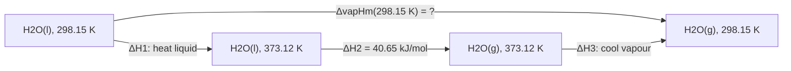
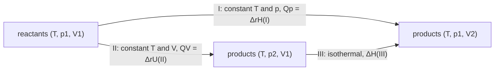

物理化学用物理学的原理与方法研究化学变化，热力学是它最早成熟、也最可靠的部分：从少数几条经验定律出发，经过演绎得到普遍成立的结论，不依赖物质的微观结构。热力学第一定律在物理中已经建立（[5.2.3](/5.2.3)），化学热力学的基本概念与热化学的计算方法在 [6.1.6](/6.1.6) 中介绍过。本章的任务是把它们严格化与定量化：写清每个公式的适用条件，学会用"设计途径"计算复杂过程的状态函数变化，并把第一定律用于三类对象——简单的 $pVT$ 变化（理想气体与实际气体）、相变与化学反应。实际气体部分是新内容：位力方程、对应状态原理与压缩因子图是化工计算的基础，节流过程与 Joule–Thomson 系数是气体液化与制冷的原理。下一章（[6.3.2](/6.3.2)）由第二定律引入熵，回答第一定律无法回答的过程方向问题；本章的热容、相变焓与反应焓是那里计算熵变、以后计算 Gibbs 自由能与平衡常数（[6.3.3](/6.3.3)、[6.3.7](/6.3.7)）的原始数据。

## 1.1. 热力学的方法与基本概念

### 1.1.1. 热力学的特点

经典热力学（平衡态热力学）的研究对象是由大量粒子组成的宏观系统，结论不适用于单个或少数粒子的行为；研究方法是从经验定律（第零至第三定律）出发进行演绎，因而具有很高的普适性与可靠性。它的局限也由此而来：

- 只考虑过程的始态与终态，不考虑过程的细节与机理；
- 不涉及时间，因而不能回答过程的快慢。常温常压下 $\ce{2H2 + O2 -> 2H2O}$ 在热力学上进行得非常彻底，实际上却几乎不发生；速率问题属于动力学（[6.3.15](/6.3.15)）。
- 不涉及物质的微观结构。宏观性质与分子性质之间的联系由统计热力学建立（[6.3.10](/6.3.10)）。

偏离平衡的系统（有温度梯度、浓度梯度或持续反应的系统）由非平衡态热力学研究（[6.3.18](/6.3.18)）。

### 1.1.2. 系统、平衡态与状态函数

**热力学系统**是人为划出的研究对象，系统以外与之相互作用的部分是环境。选择系统的原则是方便解决问题；同一个问题选择不同的系统，热与功的数值会不同（思考题 1）。按系统与环境之间的交换，系统分为**开放系统**、**封闭系统**与**孤立系统**（[5.2.1](/5.2.1#sec-1.1.1)）；物理化学讨论的大多是封闭系统，孤立系统只是近似存在，常把系统与它的环境合在一起当作一个孤立系统处理（[6.3.2](/6.3.2)）。

在一定的环境条件下，如果系统的所有性质都不随时间变化，而且把系统与环境隔离后也不会引起任何性质的变化，系统就处于热力学**平衡态**（[5.2.1](/5.2.1#def-1.1.2)）。后一个条件把平衡态与稳态区分开：一根两端分别接触高温与低温热源的金属棒，各处温度不随时间变化，但切断热源后温度会重新分布，它处于稳态而不是平衡态。热力学平衡同时包含四个方面：

| 平衡 | 条件 | 打破它的约束 |
|---|---|---|
| 热平衡 | 系统各部分之间、系统与环境之间温度相等 | 绝热壁 |
| 力平衡 | 不考虑外场时，系统内部各处压力相等，且与环境的力平衡 | 刚性壁 |
| 相平衡 | 各**相**的组成与数量不随时间变化（[6.3.8](/6.3.8)） | 半透膜等 |
| 化学平衡 | 有化学反应时，系统的组成不随时间变化（[6.3.7](/6.3.7)） | 缺少催化剂（动力学阻碍） |

平衡总是相对于约束而言的：用固定的绝热隔板隔开的 $200\,\mathrm{K}$ 的 He 与 $300\,\mathrm{K}$ 的 $\ce{H2}$，在隔板存在时是一个平衡态；隔板换成导热板，约束解除，系统才走向新的平衡（[6.3.2](/6.3.2) 例 2.3.2）。

描述平衡态的宏观性质（$n$、$T$、$p$、$V$、密度、黏度、折射率……）称为热力学性质，也就是**状态函数**（[6.1.6](/6.1.6#def-6.1.1)）。状态函数的变化值只取决于始态与终态，数学上它的微分是**全微分**（[2.2.10](/2.2.10#sec-10.5)）。例如一定量的纯物质 $V = V(T, p)$，

$$
\mathrm{d}V = \left(\frac{\partial V}{\partial T}\right)_p\mathrm{d}T + \left(\frac{\partial V}{\partial p}\right)_T\mathrm{d}p.
$$

组成不变的单相纯物质只有两个独立的强度变量：给定任意两个强度性质（如 $T$ 与 $p$），其余强度性质（$V_{\mathrm{m}}$、密度、$C_{p,\mathrm{m}}$……）就都确定了。

状态函数分为**广延量**（广度性质，与物质的量成正比，有加和性：$V$、$U$、$H$、$S$）与**强度量**（与物质的量无关：$T$、$p$、$V_{\mathrm{m}}$、密度）。用数学语言说，在 $T$、$p$ 一定时，广延量是各组分物质的量 $n_1, n_2, \dots$ 的一次**齐次函数**，强度量是零次齐次函数（[2.2.10 定义 10.7.1](/2.2.10#def-10.7.1)）：$V(T, p, \lambda n_1, \lambda n_2) = \lambda V(T, p, n_1, n_2)$。两个广延量之比是强度量，如 $V_{\mathrm{m}} = V/n$、$\rho = m/V$。这一表述将在偏摩尔量的加和公式中用到（[6.3.4](/6.3.4)）。注意加和性指同一系统分成几部分时的加和：两种气体混合后 $V = V_1 + V_2$，压力却不满足 $p = p_1 + p_2$。

### 1.1.3. 过程与途径

系统的状态发生变化称为过程，实现过程的具体方式称为途径。按始态与终态的差别，过程分为简单物理变化（只有 $p$、$V$、$T$ 变化）、复杂物理变化（相变、混合）与化学变化。按过程本身的特点，物理化学中常用的几种过程要注意区分：

| 过程 | 条件 | 说明 |
|---|---|---|
| 等温过程 | $T_1 = T_2 = T_{\mathrm{sur}} =$ 常数 | 只要求始、终态温度等于恒定的环境温度，过程中系统的温度可以变化 |
| 恒温过程 | 过程中始终 $T = T_{\mathrm{sur}} =$ 常数 | 比等温过程更强的要求 |
| 等压过程 | $p_1 = p_2 = p_{\mathrm{ex}} =$ 常数 | 只要求始、终态压力等于恒定的外压 |
| 恒压过程 | 过程中始终 $p = p_{\mathrm{ex}} =$ 常数 | |
| 恒外压过程 | $p_{\mathrm{ex}} =$ 常数 | 系统自身的压力可以不等于外压 |
| 等容过程 | $V =$ 常数 | |
| **绝热过程** | 系统与环境之间没有热交换 | |
| 循环过程 | 始态与终态相同 | |

"等温""恒温"的用法各教材不完全一致（[6.1.6](/6.1.6#sec-6.1.3) 采用与这里相同的区分），重要的是每个公式要求的是哪一种条件。例如恒外压下一次膨胀到终压的过程（例 1.2.1）是等温过程，但不是恒温过程。

### 1.1.4. 热与功

由于温度不同而在系统与环境之间传递的能量是**热量** $Q$；除热以外，在系统与环境之间传递的其他一切能量都是功 $W$。本站一律以系统得到为正：系统吸热 $Q > 0$，环境对系统做功 $W > 0$（[6.1.6](/6.1.6#sec-6.1.4)）。从微观上看，热是系统与环境之间由于粒子无序运动的强度不同而交换的能量，功则是通过粒子的有序运动（活塞的整体移动、电子的定向流动）交换的能量。

关于热与功有几点要注意：

1. 热与功只在系统与环境的界面上交换，非热即功；系统内部发生的变化不计入 $Q$、$W$。判断一种交换是热还是功的办法是：设想把系统用绝热壁与环境隔开，若这种交换因此受到影响，就是热，否则是功。电流通过系统内的电阻丝放热：以气体为系统时是热（绝热壁会阻断它），以气体与电阻丝为系统时则是电功。
2. 热与功是过程量，与途径有关，它们的微小量写作 $\delta Q$、$\delta W$。状态函数的逆过程满足 $\Delta X_{\text{逆}} = -\Delta X$；过程量一般不满足 $Q_{\text{逆}} = -Q$，只有可逆过程才满足（§1.2.3）。

封闭系统的**热力学第一定律**（[5.2.3 定理 3.3.1](/5.2.3#thm-3.3.1)）

$$
\Delta U = Q + W, \qquad \mathrm{d}U = \delta Q + \delta W,
\tag{1.1}
$$

适用于宏观静止、没有外场作用的封闭系统。它是能量守恒定律在涉及热现象的宏观系统中的形式，等价于"第一类永动机不可能造成"。式 (1.1) 本身很简单，第一定律的应用实际上就是怎样计算与测量各种过程的热与功。有些教材以系统对外做的功为正，写作 $\Delta U = Q - W$；物理教材则写作 $Q = \Delta U + W'$（[5.2.3 注 3.3.1](/5.2.3#rem-3.3.1)）。三种写法物理内容相同，本站统一用式 (1.1)，与 IUPAC 一致。

## 1.2. 体积功与可逆过程

### 1.2.1. 体积功

功的一般形式是"广义力 × 广义位移"，$\delta W = F\,\mathrm{d}l$。按物理化学的需要分为**体积功**（膨胀功）与**非体积功** $W'$（电功、表面功、轴功、光能等，[6.1.6 定义 6.1.2](/6.1.6#def-6.1.2)）。系统的体积变化 $\mathrm{d}V$ 时，环境以外压 $p_{\mathrm{ex}}$ 作用在面积为 $A$ 的活塞上，活塞移动 $\mathrm{d}l$，系统得到的功为

$$
\delta W = -p_{\mathrm{ex}}A\,\mathrm{d}l = -p_{\mathrm{ex}}\,\mathrm{d}V, \qquad W = -\int_{V_1}^{V_2}p_{\mathrm{ex}}\,\mathrm{d}V.
\tag{1.2}
$$

被积函数是外压而不是系统的压力：功是在界面上交换的能量，由环境施加的力决定。只有在力平衡始终保持（$p_{\mathrm{ex}} = p \pm \mathrm{d}p$）时，才能把 $p_{\mathrm{ex}}$ 换成系统的压力 $p$。几种特殊过程的体积功：

| 过程 | 体积功 $W$ |
|---|---|
| 自由膨胀（向真空，$p_{\mathrm{ex}} = 0$） | $0$ |
| 等容过程 | $0$ |
| 恒外压过程 | $-p_{\mathrm{ex}}\Delta V$ |
| 恒压过程 | $-p\Delta V = -(p_2V_2 - p_1V_1)$ |
| 理想气体等温可逆过程 | $-nRT\ln(V_2/V_1) = -nRT\ln(p_1/p_2)$ |

### 1.2.2. 多次膨胀与可逆极限

**例 1.2.1** 一定量理想气体在恒温热源中从 $p_1 = 4\,\mathrm{kPa}$、$V_1 = 6\,\mathrm{m^3}$ 等温膨胀到 $p_2 = 1\,\mathrm{kPa}$、$V_2 = 24\,\mathrm{m^3}$（$pV = nRT = 24\,\mathrm{kJ}$）。比较一次、两次、三次恒外压膨胀与可逆膨胀的功，以及相应的压缩过程的功。

解：每一步在恒定外压下膨胀到压力等于该外压的状态，体积由 $pV = 24\,\mathrm{kJ}$ 决定。一次膨胀：$W = -(1\,\mathrm{kPa})(24 - 6)\,\mathrm{m^3} = -18\,\mathrm{kJ}$。两次膨胀（$4 \to 2 \to 1\,\mathrm{kPa}$，体积 $6 \to 12 \to 24\,\mathrm{m^3}$）：$W = -2 \times 6 - 1 \times 12 = -24\,\mathrm{kJ}$。三次膨胀（$4 \to 3 \to 2 \to 1\,\mathrm{kPa}$）：$W = -3 \times 2 - 2 \times 4 - 1 \times 12 = -26\,\mathrm{kJ}$。可逆膨胀：$W = -nRT\ln(V_2/V_1) = -24\ln 4 = -33.3\,\mathrm{kJ}$。压缩过程反向进行，每一步的外压是该步终态的压力：

| 途径 | 一次 | 两次 | 三次 | 可逆 |
|---|---|---|---|---|
| 膨胀 $W/\mathrm{kJ}$ | $-18$ | $-24$ | $-26$ | $-33.3$ |
| 压缩 $W/\mathrm{kJ}$ | $72$ | $48$ | $44$ | $33.3$ |
| 循环一周 $\sum W/\mathrm{kJ}$ | $54$ | $24$ | $18$ | $0$ |


同样的始态与终态，途径不同，功就不同，所以计算功一定要说清过程。在 $p$–$V$ 图上，功等于外压曲线下面积的负值：膨胀的步数越多，阶梯越贴近等温线，系统对外做的功越多；步数趋于无穷时得到可逆膨胀，系统做功最多；压缩时反之，可逆压缩环境做的功最少。理想气体等温过程 $\Delta U = 0$，所以每个循环中环境多做的功 $\sum W$ 都以热的形式留在了热源中：经过不可逆循环，系统复原了，环境却"失功得热"。

### 1.2.3. 可逆过程

**可逆过程**的定义见 [5.2.4 定义 4.3.1](/5.2.4#def-4.3.1)。上例给出了它在化学热力学中常用的表述：

**定义 1.2.1（可逆过程）** 系统经过某一过程后，如果能使系统沿原途径逆向进行恢复到原状态，同时在环境中不留下任何影响（环境也复原），这个过程称为**可逆过程**；否则称为**不可逆过程**。

由定义与例 1.2.1 可以总结出可逆过程的特点：

1. "双复原"：逆向进行后系统与环境都复原。能量上就是 $W_{\mathrm{r}} = -W_{\text{逆}}$、$Q_{\mathrm{r}} = -Q_{\text{逆}}$。注意"可逆"不等于"能回来"：任何过程都可以设法让系统回到原状态，关键在于环境能否同时复原。
2. 可逆意味着平衡：过程中系统与环境之间始终无限接近平衡（$p_{\mathrm{ex}} = p \pm \mathrm{d}p$，$T_{\mathrm{sur}} = T \pm \mathrm{d}T$），推动力无限小，进行得无限缓慢，经历的每一个中间态都是平衡态。可逆过程是一种理想的极限。
3. 可逆过程的功与热是极限值：等温可逆膨胀时系统对外做功最多，等温可逆压缩时环境做功最少。

可逆过程一定是准静态的，反之不然：准静态过程中若有摩擦等耗散，就不可逆（思考题 2）。几种典型的可逆过程是：外压与内压只差 $\mathrm{d}p$ 的膨胀或压缩（力平衡）；与温度只差 $\mathrm{d}T$ 的一系列热源接触的传热（热平衡）；在两相平衡的温度与压力下的相变（相平衡）；外加电动势只比电池电动势小 $\mathrm{d}E$ 的电池反应（化学平衡，[6.3.13](/6.3.13)）。可逆过程的意义在于两点：它给出实际过程能量利用的极限；它是计算状态函数（尤其是熵）变化的工具——熵变只能沿可逆途径计算（[6.3.2](/6.3.2)）。

## 1.3. 热与热容

### 1.3.1. 恒容热、恒压热与焓

恒容热：等容过程中体积功为零。若同时没有非体积功（$W' = 0$），由式 (1.1)

$$
Q_V = \Delta U \qquad (\mathrm{d}V = 0,\ W' = 0).
$$

在恒容且不做非体积功的条件下，系统吸收的热全部用来增加内能。

恒压热：在等压过程中 $p_1 = p_2 = p_{\mathrm{ex}}$，$W = -p_{\mathrm{ex}}\Delta V + W'$，于是

$$
Q_p = \Delta U + p_{\mathrm{ex}}(V_2 - V_1) - W' = (U_2 + p_2V_2) - (U_1 + p_1V_1) - W' = \Delta H - W',
$$

其中 $H = U + pV$ 是**焓**（[5.2.3 定义 3.5.4](/5.2.3#def-3.5.4)）。若 $W' = 0$，

$$
Q_p = \Delta H \qquad (p_1 = p_2 = p_{\mathrm{ex}},\ W' = 0).
$$

推导只用到始、终态的压力等于恒定的外压，过程中系统的压力可以不等于外压，所以这里只要求等压而不要求恒压。关于焓：

- 焓是广延的状态函数，单位 J；它是为了方便而组合出来的函数，没有独立的物理意义，绝对值也无法测定。$pV$ 是系统的性质，不是功。
- 焓不是"系统所含的热量"，也不遵守守恒定律；$Q_p = \Delta H$ 只说明在特定条件下一个过程量在数值上等于一个状态函数的变化，并不意味着 $Q_p$ 成了状态函数。任何过程都有焓变：$\Delta H = \Delta U + \Delta(pV)$。
- 定义焓的好处在于：$Q_p$ 容易测定，而 $\Delta H$ 与途径无关，可以沿任何方便的途径计算；化学反应大多在恒压、不做非体积功的条件下进行，所以焓比内能更有用。

### 1.3.2. 热容

只发生 $pVT$ 变化、没有相变与化学变化的过程称为简单变温过程。对这样的均相封闭系统，在 $W' = 0$ 的条件下，系统升高单位温度所吸收的热称为**热容** $C = \delta Q/\mathrm{d}T$（[5.2.3 定义 3.4.1](/5.2.3#def-3.4.1)）。由 §1.3.1，

$$
C_V = \frac{\delta Q_V}{\mathrm{d}T} = \left(\frac{\partial U}{\partial T}\right)_V, \qquad C_p = \frac{\delta Q_p}{\mathrm{d}T} = \left(\frac{\partial H}{\partial T}\right)_p,
$$

两个偏导数形式不依赖过程，可以作为热容的定义；**摩尔热容** $C_{V,\mathrm{m}} = C_V/n$、$C_{p,\mathrm{m}} = C_p/n$，单位 $\mathrm{J\,mol^{-1}\,K^{-1}}$。把 $U$ 看作 $T$、$V$ 的函数，$H$ 看作 $T$、$p$ 的函数，

$$
\mathrm{d}U = C_V\,\mathrm{d}T + \left(\frac{\partial U}{\partial V}\right)_T\mathrm{d}V, \qquad \mathrm{d}H = C_p\,\mathrm{d}T + \left(\frac{\partial H}{\partial p}\right)_T\mathrm{d}p.
$$

于是对简单变温过程

$$
Q_V = \Delta U = n\int_{T_1}^{T_2}C_{V,\mathrm{m}}\,\mathrm{d}T \quad(\text{等容}), \qquad Q_p = \Delta H = n\int_{T_1}^{T_2}C_{p,\mathrm{m}}\,\mathrm{d}T \quad(\text{等压}).
$$

两个等号的条件不同：$Q_V = \Delta U$ 要求等容且 $W' = 0$，后一个等号只要求 $\mathrm{d}V = 0$ 时 $\mathrm{d}U = C_V\,\mathrm{d}T$，因此"$\Delta U = n\int C_{V,\mathrm{m}}\,\mathrm{d}T$"对等容过程中有非体积功的情形也成立，此时却 $Q_V \ne \Delta U$。

$C_{p,\mathrm{m}}$ 是 $T$、$p$ 的函数，压力的影响很小，压力变化不大时可以忽略。它随温度的变化由实验测定，用经验式表示：

$$
C_{p,\mathrm{m}} = a + bT + cT^2 \qquad \text{或} \qquad C_{p,\mathrm{m}} = a + bT + \frac{c'}{T^2},
$$

$a$、$b$、$c$ 由物质决定，在给定的温度范围内由实验数据用最小二乘拟合（`scipy.optimize.curve_fit`，[4.4.4](/4.4.4)）得到。本章与下一章用到的几种气体的参数（第二种形式，适用于 $298$–$2000\,\mathrm{K}$）：

| 物质 | $a/(\mathrm{J\,mol^{-1}\,K^{-1}})$ | $10^3b/(\mathrm{J\,mol^{-1}\,K^{-2}})$ | $10^{-5}c'/(\mathrm{J\,mol^{-1}\,K})$ | $C_{p,\mathrm{m}}(298.15\,\mathrm{K})$ |
|---|---|---|---|---|
| $\ce{H2(g)}$ | $27.28$ | $3.26$ | $0.50$ | $28.8$ |
| $\ce{N2(g)}$ | $28.58$ | $3.77$ | $-0.50$ | $29.1$ |
| $\ce{O2(g)}$ | $29.96$ | $4.18$ | $-1.67$ | $29.3$ |
| $\ce{CO2(g)}$ | $44.22$ | $8.79$ | $-8.62$ | $37.1$ |
| $\ce{H2O(g)}$ | $30.54$ | $10.29$ | $0$ | $33.6$ |
| $\ce{NH3(g)}$ | $29.75$ | $25.1$ | $-1.55$ | $35.5$ |

查手册时要注意经验式的形式、适用温度范围、表头中的 10 的幂次与单位。温度变化不大时，可以把 $C_{p,\mathrm{m}}$ 近似当作常数。

### 1.3.3. $C_p$ 与 $C_V$ 的一般关系

$$
C_p - C_V = \left(\frac{\partial H}{\partial T}\right)_p - \left(\frac{\partial U}{\partial T}\right)_V = \left(\frac{\partial U}{\partial T}\right)_p + p\left(\frac{\partial V}{\partial T}\right)_p - \left(\frac{\partial U}{\partial T}\right)_V.
$$

把 $U$ 看作 $T$、$V$ 的函数，再沿 $p$ 不变的方向对 $T$ 求导，由复合函数的链式法则（[2.2.10 定理 10.7.1](/2.2.10#thm-10.7.1)），

$$
\left(\frac{\partial U}{\partial T}\right)_p = \left(\frac{\partial U}{\partial T}\right)_V + \left(\frac{\partial U}{\partial V}\right)_T\left(\frac{\partial V}{\partial T}\right)_p.
$$

代入上式得

$$
C_p - C_V = \left[\left(\frac{\partial U}{\partial V}\right)_T + p\right]\left(\frac{\partial V}{\partial T}\right)_p.
\tag{1.3}
$$

式 (1.3) 适用于任何均相的纯物质（或组成不变的系统）。等压升温时系统吸收的热比等容时多出的部分有两项：$p(\partial V/\partial T)_p$ 是系统膨胀时反抗外压做的功，$(\partial U/\partial V)_T(\partial V/\partial T)_p$ 是体积增大时克服分子间引力所需的能量。

**定义 1.3.1（内压）** 偏导数

$$
\pi_T = \left(\frac{\partial U}{\partial V}\right)_T
$$
称为物质的**内压**，它的量纲与压力相同。

内压是分子间相互作用的标志。理想气体 $\pi_T = 0$；van der Waals 气体的内能 $U_{\mathrm{m}} = U_{\mathrm{m}}^{\mathrm{id}}(T) - a/V_{\mathrm{m}}$（[5.2.2](/5.2.2#sec-2.2.4)），$\pi_T = a/V_{\mathrm{m}}^2$。常温常压下的 $\ce{N2}$，$\pi_T \approx 2 \times 10^2\,\mathrm{Pa}$，只有外压的千分之二；液体的内压可达 $10^8$–$10^9\,\mathrm{Pa}$。由第二定律可以证明 $\pi_T = T(\partial p/\partial T)_V - p$，并把式 (1.3) 化为只含可测量的 $C_p - C_V = TV\alpha_V^2/\kappa_T$（[6.3.3](/6.3.3)）。

## 1.4. 理想气体

### 1.4.1. 内能与焓只是温度的函数

**理想气体**在任何温度与压力下都严格服从 $pV = nRT$（[5.2.1 定义 1.1.6](/5.2.1#def-1.1.6)），微观模型是没有体积、没有相互作用的质点。Gay-Lussac–Joule 的低压气体自由膨胀实验（[5.2.3](/5.2.3#sec-3.3.4)）中水浴温度不变：以气体为系统，$W = 0$、$Q = 0$，故 $\Delta U = 0$，即

$$
\left(\frac{\partial U}{\partial V}\right)_T = 0, \qquad \left(\frac{\partial U}{\partial p}\right)_T = 0, \qquad U = U(T).
$$

由 $H = U + nRT$ 也有 $H = H(T)$。（这个实验并不灵敏：水的热容远大于低压气体的热容，实际气体的微小温度变化测不出来。严格的结论来自理想气体的定义与第二定律，[6.3.3](/6.3.3)。）于是对理想气体的任何简单物理变化，不论是否等容、等压，都有

$$
\mathrm{d}U = C_V\,\mathrm{d}T, \qquad \mathrm{d}H = C_p\,\mathrm{d}T, \qquad \Delta U = n\int_{T_1}^{T_2}C_{V,\mathrm{m}}\,\mathrm{d}T, \qquad \Delta H = n\int_{T_1}^{T_2}C_{p,\mathrm{m}}\,\mathrm{d}T,
$$

等温过程 $\Delta U = \Delta H = 0$。$C_V$ 与 $C_p$ 也只是温度的函数：$(\partial C_V/\partial V)_T = \frac{\partial}{\partial T}\left(\frac{\partial U}{\partial V}\right)_T = 0$。由式 (1.3)，$\pi_T = 0$，$p(\partial V/\partial T)_p = nR$，得到 **Mayer 公式**

$$
C_p - C_V = nR, \qquad C_{p,\mathrm{m}} - C_{V,\mathrm{m}} = R.
$$

常温下单原子气体（He、Ar）$C_{V,\mathrm{m}} = \frac{3}{2}R$、$C_{p,\mathrm{m}} = \frac{5}{2}R$，双原子气体（$\ce{H2}$、$\ce{N2}$、$\ce{O2}$）$C_{V,\mathrm{m}} = \frac{5}{2}R$、$C_{p,\mathrm{m}} = \frac{7}{2}R$；这些值的来历（能量均分与振动自由度的冻结）见 [5.2.3](/5.2.3#sec-3.4.4)，统计热力学的计算见 [6.3.11](/6.3.11)。

### 1.4.2. 绝热可逆过程

绝热过程 $Q = 0$，$\Delta U = W$：绝热过程是内能与功的转化，一般 $p$、$V$、$T$ 同时变化；从同一始态出发，不同的绝热过程到达不同的终态。对理想气体、$W' = 0$ 的可逆绝热过程，$\mathrm{d}U = \delta W = -p\,\mathrm{d}V$，即

$$
C_V\,\mathrm{d}T = -\frac{nRT}{V}\,\mathrm{d}V = -\frac{(C_p - C_V)T}{V}\,\mathrm{d}V, \qquad \frac{\mathrm{d}T}{T} = -(\gamma - 1)\frac{\mathrm{d}V}{V},
$$

其中 $\gamma = C_p/C_V$ 是**比热容比**。这是一个**变量分离方程**（[2.2.15](/2.2.15#sec-15.2.1)）；$\gamma$ 为常数时积分得

$$
TV^{\gamma - 1} = \text{常数}, \qquad T^\gamma p^{1 - \gamma} = \text{常数}, \qquad pV^\gamma = \text{常数}.
\tag{1.4}
$$

式 (1.4) 的适用条件是：理想气体、绝热、可逆、$W' = 0$、$\gamma$ 为常数。它描述的是一个过程中各状态之间的关系，用途是求终态。在 $p$–$V$ 图上，等温线的斜率 $(\partial p/\partial V)_T = -p/V$，绝热线的斜率 $(\partial p/\partial V)_S = -\gamma p/V$，所以同一点处绝热线比等温线陡（[5.2.3](/5.2.3#sec-3.5.1)）。

### 1.4.3. 四种过程的比较

解决热力学问题的一般步骤是：选定系统；确定始态与终态（封闭系统的物质的量守恒）；明确过程的特点，选用条件相符的公式。

**例 1.4.1** $273.15\,\mathrm{K}$、$1000\,\mathrm{kPa}$ 下 $10\,\mathrm{dm^3}$ 的 He（视为理想气体，$C_{V,\mathrm{m}} = \frac{3}{2}R$）分别经下列过程膨胀到 $100\,\mathrm{kPa}$：(1) 等温可逆膨胀；(2) 在恒外压 $100\,\mathrm{kPa}$ 下等温膨胀；(3) 绝热可逆膨胀；(4) 在恒外压 $100\,\mathrm{kPa}$ 下绝热膨胀。求终态体积与各过程的 $W$、$Q$、$\Delta U$、$\Delta H$。

解：$n = p_1V_1/(RT_1) = 4.403\,\mathrm{mol}$，$p_1V_1 = 10.00\,\mathrm{kJ}$。

(1) $V_2 = p_1V_1/p_2 = 0.100\,\mathrm{m^3}$；$\Delta U = \Delta H = 0$；$W = -nRT\ln(p_1/p_2) = -p_1V_1\ln 10 = -23.03\,\mathrm{kJ}$，$Q = -W = 23.03\,\mathrm{kJ}$。

(2) 终态与 (1) 相同，$\Delta U = \Delta H = 0$；$W = -p_{\mathrm{ex}}(V_2 - V_1) = -100\,\mathrm{kPa} \times 0.090\,\mathrm{m^3} = -9.00\,\mathrm{kJ}$，$Q = 9.00\,\mathrm{kJ}$。

(3) $\gamma = 5/3$，由式 (1.4) $V_2 = V_1(p_1/p_2)^{1/\gamma} = 0.0398\,\mathrm{m^3}$，$T_2 = p_2V_2/(nR) = 108.7\,\mathrm{K}$；$Q = 0$，$W = \Delta U = nC_{V,\mathrm{m}}(T_2 - T_1) = -9.03\,\mathrm{kJ}$，$\Delta H = nC_{p,\mathrm{m}}(T_2 - T_1) = -15.05\,\mathrm{kJ}$。

(4) 过程不可逆，不能用式 (1.4)。$Q = 0$，$\Delta U = W$：

$$
nC_{V,\mathrm{m}}(T_2 - T_1) = -p_2\left(\frac{nRT_2}{p_2} - \frac{nRT_1}{p_1}\right) \;\Rightarrow\; T_2 = \frac{C_{V,\mathrm{m}} + Rp_2/p_1}{C_{p,\mathrm{m}}}\,T_1 = 174.8\,\mathrm{K},
$$

$V_2 = nRT_2/p_2 = 0.0640\,\mathrm{m^3}$；$W = \Delta U = -5.40\,\mathrm{kJ}$，$\Delta H = -9.00\,\mathrm{kJ}$。

| 过程 | $V_2/\mathrm{m^3}$ | $T_2/\mathrm{K}$ | $W/\mathrm{kJ}$ | $Q/\mathrm{kJ}$ | $\Delta U/\mathrm{kJ}$ | $\Delta H/\mathrm{kJ}$ |
|---|---|---|---|---|---|---|
| (1) 等温可逆 | $0.100$ | $273.15$ | $-23.03$ | $23.03$ | $0$ | $0$ |
| (2) 等温恒外压 | $0.100$ | $273.15$ | $-9.00$ | $9.00$ | $0$ | $0$ |
| (3) 绝热可逆 | $0.0398$ | $108.7$ | $-9.03$ | $0$ | $-9.03$ | $-15.05$ |
| (4) 绝热恒外压 | $0.0640$ | $174.8$ | $-5.40$ | $0$ | $-5.40$ | $-9.00$ |

由此可以得出几条一般结论：从同一始态出发，等温可逆与等温不可逆过程可以到达同一终态，绝热可逆与绝热不可逆过程却不能（$108.7\,\mathrm{K}$ 对 $174.8\,\mathrm{K}$），这在下一章由熵得到解释（[6.3.2](/6.3.2) 例 2.3.1）；绝热膨胀中系统对外做的功全部来自内能，可逆膨胀做功最多，所以降温最多；四个过程中等温可逆膨胀做功最多，绝热恒外压膨胀做功最少。

## 1.5. 实际气体

理想气体状态方程用于实际气体会产生偏差，压力越高、温度越低（越接近液化），偏差越大。处理实际气体的 $pVT$ 关系有两条途径：状态方程，以及基于对应状态原理的压缩因子图。

### 1.5.1. 状态方程与 Boyle 温度

**van der Waals 方程** $\left(p + \frac{a}{V_{\mathrm{m}}^2}\right)(V_{\mathrm{m}} - b) = RT$ 的推导与等温线见 [5.2.2](/5.2.2#sec-2.2.3)：$a/V_{\mathrm{m}}^2$ 修正分子间引力，$b$ 修正分子本身的体积。它第一次从理论上说明了实际气体与理想气体的区别，在几百 kPa 到几 MPa 的中压范围内对许多气体相当准确；但把 $a$、$b$ 当作与状态无关的常数，高压下误差很大。已提出的状态方程有两百多种，形式上分为显压型 $p = f(T, V_{\mathrm{m}})$（vdW 方程）、显容型与级数型。理论上最有意义的是级数型：

**定义 1.5.1（位力方程）** 把压缩因子 $Z = pV_{\mathrm{m}}/(RT)$ 展开为 $1/V_{\mathrm{m}}$（或 $p$）的幂级数，

$$
Z = 1 + \frac{B(T)}{V_{\mathrm{m}}} + \frac{C(T)}{V_{\mathrm{m}}^2} + \cdots = 1 + B'(T)p + C'(T)p^2 + \cdots,
$$
称为**位力方程**；只依赖温度的系数 $B$、$C$……（$B'$、$C'$……）称为第二、第三……**位力系数**。

位力系数有明确的微观意义：统计力学证明，$B$ 由两个分子之间的相互作用势决定，$C$ 由三个分子的相互作用决定。$p \to 0$ 时 $Z \to 1$，一切状态方程都应还原为理想气体方程；比较两种展开式的一次项，$B' = B/(RT)$。把 vdW 方程写成 $Z = \frac{V_{\mathrm{m}}}{V_{\mathrm{m}} - b} - \frac{a}{RTV_{\mathrm{m}}}$ 并把第一项按 $b/V_{\mathrm{m}}$ 展开，得到

$$
Z = 1 + \left(b - \frac{a}{RT}\right)\frac{1}{V_{\mathrm{m}}} + \frac{b^2}{V_{\mathrm{m}}^2} + \cdots, \qquad B = b - \frac{a}{RT}.
\tag{1.5}
$$

低温时引力项占优，$B < 0$，气体比理想气体容易压缩；高温时斥力（分子体积）占优，$B > 0$。

**定义 1.5.2（Boyle 温度）** 第二位力系数等于零的温度称为 **Boyle 温度** $T_{\mathrm{B}}$；等价地，$T_{\mathrm{B}}$ 是使 $\lim_{p \to 0}\left(\partial(pV_{\mathrm{m}})/\partial p\right)_T = 0$ 的温度。

在 Boyle 温度下，$Z$ 随压力的变化从零斜率开始，气体在相当宽的低压范围内近似服从 Boyle 定律。由式 (1.5)，vdW 气体的 $T_{\mathrm{B}} = a/(Rb) = \frac{27}{8}T_{\mathrm{c}}$。用 $\ce{N2}$ 的 vdW 常数（$a = 0.1370\,\mathrm{Pa\,m^6\,mol^{-2}}$，$b = 3.87 \times 10^{-5}\,\mathrm{m^3\,mol^{-1}}$）算得 $426\,\mathrm{K}$，实测为 $327\,\mathrm{K}$，可见 vdW 方程只是定性正确。

### 1.5.2. 临界常数、对比参量与对应状态原理

**临界点**是气液两相差别消失的状态，**临界温度** $T_{\mathrm{c}}$ 是加压能使气体液化的最高温度，**临界压力** $p_{\mathrm{c}}$ 是在临界温度下使气体液化的最低压力（也是液体的最大饱和蒸气压），**临界体积** $V_{\mathrm{m,c}}$ 是临界点的摩尔体积（[5.2.2 定义 2.1.1](/5.2.2#def-2.1.1)、[6.1.1](/6.1.1#def-1.1.3)）。它们是物质的特性参数；分子间引力越弱，$T_{\mathrm{c}}$ 越低，He 的 $T_{\mathrm{c}} = 5.2\,\mathrm{K}$，最难液化。三个临界常数中 $V_{\mathrm{m,c}}$ 最难测准。vdW 方程在临界点满足 $(\partial p/\partial V_{\mathrm{m}})_T = 0$、$(\partial^2 p/\partial V_{\mathrm{m}}^2)_T = 0$（极大点、极小点与拐点三点合一，三次方程的三个实根重合），解得 $V_{\mathrm{m,c}} = 3b$、$T_{\mathrm{c}} = 8a/(27Rb)$、$p_{\mathrm{c}} = a/(27b^2)$（[5.2.2 公式 2.2.1](/5.2.2#sec-2.2.5)）。由于 $V_{\mathrm{m,c}}$ 不准，实际中反过来由 $T_{\mathrm{c}}$ 与 $p_{\mathrm{c}}$ 计算 vdW 常数：

$$
a = \frac{27R^2T_{\mathrm{c}}^2}{64p_{\mathrm{c}}}, \qquad b = \frac{RT_{\mathrm{c}}}{8p_{\mathrm{c}}}.
$$

**定义 1.5.3（对比参量）** 温度、压力与摩尔体积分别与临界值之比

$$
T_{\mathrm{r}} = \frac{T}{T_{\mathrm{c}}}, \qquad p_{\mathrm{r}} = \frac{p}{p_{\mathrm{c}}}, \qquad V_{\mathrm{r}} = \frac{V_{\mathrm{m}}}{V_{\mathrm{m,c}}}
$$
称为对比温度、对比压力与对比体积，统称**对比参量**（约化参量）。各种物质处在相同的对比参量时，称它们处于对应状态。处于对应状态的各种气体（乃至液体）具有相近的物性——压缩因子、摩尔热容、膨胀系数、黏度、折射率等，这条近似的经验规律称为**对应状态原理**。

把 $a = 3p_{\mathrm{c}}V_{\mathrm{m,c}}^2$、$b = V_{\mathrm{m,c}}/3$、$R = 8p_{\mathrm{c}}V_{\mathrm{m,c}}/(3T_{\mathrm{c}})$ 代入 vdW 方程，得到 vdW 对比方程

$$
\left(p_{\mathrm{r}} + \frac{3}{V_{\mathrm{r}}^2}\right)\left(V_{\mathrm{r}} - \frac{1}{3}\right) = \frac{8}{3}T_{\mathrm{r}},
\tag{1.6}
$$

它不含任何物质的特性参数：凡是服从 vdW 方程的气体，只要 $p_{\mathrm{r}}$、$T_{\mathrm{r}}$ 相同，$V_{\mathrm{r}}$ 就相同。这是对应状态原理的一个理论来源，也是 vdW 方程最有用的"副产品"。不过对应状态原理并不依赖 vdW 方程是否准确：只要各物质的分子间势能具有同样的函数形式、只是能量与距离的尺度不同，就能证明它成立。所以它对球形、非极性的分子（Ar、$\ce{CH4}$、$\ce{N2}$）最好，对极性强、能形成氢键的分子（$\ce{H2O}$、$\ce{NH3}$）较差；对 $\ce{H2}$、He 等量子效应显著的轻分子，要用经验修正的"有效临界常数"（$p_{\mathrm{c}} + 0.81\,\mathrm{MPa}$、$T_{\mathrm{c}} + 8\,\mathrm{K}$）。对应状态原理不适用于固体。

### 1.5.3. 压缩因子图

实际气体对理想气体的偏差可以用**压缩因子** $Z = pV_{\mathrm{m}}/(RT)$ 衡量（[6.1.1](/6.1.1)）：$Z > 1$ 时实际气体比同温同压下的理想气体难压缩，$Z < 1$ 时容易压缩。把 $p$、$V_{\mathrm{m}}$、$T$ 换成对比参量，

$$
Z = \frac{p_{\mathrm{c}}V_{\mathrm{m,c}}}{RT_{\mathrm{c}}}\cdot\frac{p_{\mathrm{r}}V_{\mathrm{r}}}{T_{\mathrm{r}}} = Z_{\mathrm{c}}\frac{p_{\mathrm{r}}V_{\mathrm{r}}}{T_{\mathrm{r}}},
$$

$Z_{\mathrm{c}}$ 是临界压缩因子。若对应状态原理成立，$V_{\mathrm{r}}$ 是 $p_{\mathrm{r}}$、$T_{\mathrm{r}}$ 的普适函数；而实验表明大多数气体的 $Z_{\mathrm{c}}$ 相近（Ne 0.31，Ar、$\ce{CH4}$、$\ce{O2}$、$\ce{N2}$ 0.29，CO 0.30，强极性的 $\ce{H2O}$ 只有 0.23），所以 $Z \approx f(p_{\mathrm{r}}, T_{\mathrm{r}})$ 对各种气体近似相同。把大量实测数据画成以 $T_{\mathrm{r}}$ 为参数的 $Z$–$p_{\mathrm{r}}$ 曲线，就是普遍化压缩因子图。它不受状态方程适用范围的限制，在高压化工计算中很有用。vdW 方程给出的 $Z_{\mathrm{c}} = 3/8$ 明显偏大，用式 (1.6) 算出的"压缩因子图"（下图）在临界区附近与实测图差别很大，远离临界区时定性一致：低温时 $Z$ 先随压力下降、后上升，$T_{\mathrm{r}}$ 在 Boyle 温度附近时 $Z \approx 1$ 的范围最宽。


**例 1.5.1** 求 $304\,\mathrm{K}$、$11.15\,\mathrm{MPa}$ 下 $\ce{CO2}$ 的摩尔体积。已知 $T_{\mathrm{c}} = 304.13\,\mathrm{K}$，$p_{\mathrm{c}} = 7.38\,\mathrm{MPa}$。

解：$T_{\mathrm{r}} = 1.00$，$p_{\mathrm{r}} = 1.51$，由压缩因子图读得 $Z \approx 0.25$，

$$
V_{\mathrm{m}} = \frac{ZRT}{p} = \frac{0.25 \times 8.314 \times 304}{11.15 \times 10^6}\,\mathrm{m^3\,mol^{-1}} = 5.7 \times 10^{-5}\,\mathrm{m^3\,mol^{-1}},
$$

只有理想气体值（$2.27 \times 10^{-4}\,\mathrm{m^3\,mol^{-1}}$）的四分之一：临界点附近的 $\ce{CO2}$ 密度约 $0.78\,\mathrm{g\,cm^{-3}}$，已经接近液体，这正是超临界 $\ce{CO2}$ 萃取所利用的性质（[6.1.1](/6.1.1)）。用 vdW 方程（$a = 0.364\,\mathrm{Pa\,m^6\,mol^{-2}}$，$b = 4.27 \times 10^{-5}\,\mathrm{m^3\,mol^{-1}}$，用 `numpy.roots` 解 $V_{\mathrm{m}}$ 的三次方程）则得 $Z = 0.35$，误差达 40%。

### 1.5.4. 节流过程与 Joule–Thomson 系数

**节流过程**（[5.2.3 定义 3.5.3](/5.2.3#def-3.5.3)）中，气体在绝热筒中由压力恒为 $p_1$ 的一侧经多孔塞持续流向压力恒为 $p_2 < p_1$ 的一侧。取一定量的气体为系统，它从 $(p_1, V_1, T_1)$ 变到 $(p_2, V_2, T_2)$；$Q = 0$，左侧环境对它做功 $p_1V_1$，它对右侧环境做功 $p_2V_2$：

$$
U_2 - U_1 = W = p_1V_1 - p_2V_2 \;\Rightarrow\; U_2 + p_2V_2 = U_1 + p_1V_1,\quad \Delta H = 0.
$$

节流是绝热、不可逆的等焓过程（中间状态不是平衡态，"等焓"只指始、终态的焓相等）。实验发现，室温常压附近大多数气体节流后温度降低，少数气体（$\ce{H2}$、He）温度升高，即 **Joule–Thomson 效应**。

**定义 1.5.4（Joule–Thomson 系数）** 偏导数

$$
\mu_{\mathrm{JT}} = \left(\frac{\partial T}{\partial p}\right)_H
$$
称为 **Joule–Thomson 系数**，它是强度性质的状态函数，表示等焓条件下压力降低单位值引起的温度变化。$\mu_{\mathrm{JT}} > 0$ 时节流后降温（正效应），$\mu_{\mathrm{JT}} < 0$ 时升温（负效应）。$\mu_{\mathrm{JT}} = 0$ 的温度称为**转换温度** $T_{\mathrm{inv}}$，它与气体的种类和压力有关。

$298\,\mathrm{K}$、常压附近，$\ce{N2}$ 的 $\mu_{\mathrm{JT}} \approx 2.7\,\mathrm{K\,MPa^{-1}}$，$\ce{CO2}$ 约 $11\,\mathrm{K\,MPa^{-1}}$，He 约 $-0.6\,\mathrm{K\,MPa^{-1}}$；理想气体的焓只与温度有关，$\mu_{\mathrm{JT}} = 0$。实际气体的焓 $H = H(T, p)$，在等焓线上 $\mathrm{d}H = C_p\,\mathrm{d}T + (\partial H/\partial p)_T\,\mathrm{d}p = 0$，这就是隐函数求导的循环关系（[2.2.10](/2.2.10#sec-10.8.1)）：

$$
\mu_{\mathrm{JT}} = -\frac{(\partial H/\partial p)_T}{(\partial H/\partial T)_p} = -\frac{1}{C_p}\left(\frac{\partial H}{\partial p}\right)_T, \qquad \left(\frac{\partial H}{\partial p}\right)_T = -C_p\mu_{\mathrm{JT}}.
\tag{1.7}
$$

所以测定 $\mu_{\mathrm{JT}}$ 与 $C_p$ 就得到焓随压力的变化，再由 $U = H - pV$ 得 $(\partial U/\partial p)_T = -C_p\mu_{\mathrm{JT}} - (\partial(pV)/\partial p)_T$。焓随压力的变化来自分子间作用：对低压下的 vdW 气体，$U_{\mathrm{m}} = U_{\mathrm{m}}^{\mathrm{id}}(T) - a/V_{\mathrm{m}}$，由式 (1.5) $pV_{\mathrm{m}} \approx RT + Bp$，且 $a/V_{\mathrm{m}} \approx ap/(RT)$，于是

$$
H_{\mathrm{m}} = U_{\mathrm{m}} + pV_{\mathrm{m}} \approx H_{\mathrm{m}}^{\mathrm{id}}(T) + \left(b - \frac{2a}{RT}\right)p, \qquad \mu_{\mathrm{JT}} \approx \frac{1}{C_{p,\mathrm{m}}}\left(\frac{2a}{RT} - b\right).
$$

引力（$a$）使气体节流后降温：膨胀时分子间距离增大，克服引力消耗分子的动能；斥力（$b$）的作用相反。对 $298\,\mathrm{K}$ 的 $\ce{N2}$ 此式给出 $2.5\,\mathrm{K\,MPa^{-1}}$，与实测接近。低压下的转换温度 $T_{\mathrm{inv}} = 2a/(Rb) = 2T_{\mathrm{B}} = \frac{27}{4}T_{\mathrm{c}}$。

压力较高时 $\mu_{\mathrm{JT}}$ 也随压力变化，在 $T$–$p$ 平面上 $\mu_{\mathrm{JT}} = 0$ 的点连成转换曲线。对 vdW 气体可以精确求出：由于 $(\partial V/\partial p)_T$ 不为零，$(\partial H/\partial p)_T = 0$ 等价于 $(\partial H/\partial V)_T = 0$；而 $H_{\mathrm{m}} = U_{\mathrm{m}} + pV_{\mathrm{m}} = U_{\mathrm{m}}^{\mathrm{id}}(T) + \frac{RTV_{\mathrm{m}}}{V_{\mathrm{m}} - b} - \frac{2a}{V_{\mathrm{m}}}$，令它对 $V_{\mathrm{m}}$ 的偏导数为零得 $RTbV_{\mathrm{m}}^2 = 2a(V_{\mathrm{m}} - b)^2$。化为对比参量并与式 (1.6) 联立消去 $V_{\mathrm{r}}$，得到

$$
p_{\mathrm{r}} = 24\sqrt{3T_{\mathrm{r}}} - 12T_{\mathrm{r}} - 27, \qquad \tfrac{3}{4} \le T_{\mathrm{r}} \le \tfrac{27}{4}.
$$

曲线以内 $\mu_{\mathrm{JT}} > 0$；$p_{\mathrm{r}} > 9$ 时任何温度下节流都升温。


实测的低压转换温度：$\ce{N2}$ $621\,\mathrm{K}$，Ar $723\,\mathrm{K}$，$\ce{CO2}$ 约 $1500\,\mathrm{K}$，都远高于室温，可以直接节流制冷；$\ce{H2}$ 为 $202\,\mathrm{K}$，He 只有 $40\,\mathrm{K}$，必须先用液氮或其他方法预冷到转换温度以下，才能用节流液化。Linde 液化空气的方法就是节流加逆流换热：节流后变冷的气体回过头来预冷后来的高压气体，温度逐级下降直到液化。冰箱与空调中，液态制冷剂通过膨胀阀节流时部分汽化而强烈降温，这一步也是节流（此时伴随相变，降温主要来自汽化吸热）。

节流膨胀与绝热可逆膨胀的区别：后者对外做功、熵不变，任何气体都降温；前者对外不做净功、焓不变、熵增加，理想气体温度不变，实际气体可能降温也可能升温。

## 1.6. 相变焓

### 1.6.1. 相变焓

物质从一个**相**转变为另一个相的过程称为相变：蒸发（vap）、熔化（fus）、升华（sub）、晶型转变（trs）及其逆过程。在两相平衡的温度与压力下进行的相变是可逆相变，例如水在 $100\,\mathrm{kPa}$、$99.61\,{}^\circ\mathrm{C}$ 下汽化，或在其他温度及相应的**饱和蒸气压**下汽化；不在平衡条件下进行的是不可逆相变，例如水向真空蒸发、向干燥空气中蒸发，过冷水结冰（[6.3.2](/6.3.2) 例 2.3.6）。

**定义 1.6.1（相变焓）** 一定量的纯物质在恒定的温度与压力下、不做非体积功时由一相转变为另一相，吸收的热量等于这一过程的焓变，称为**相变焓**（相变热、相变潜热）。$1\,\mathrm{mol}$ 物质的相变焓称为摩尔相变焓，记作 $\Delta_{\mathrm{vap}}H_{\mathrm{m}}$、$\Delta_{\mathrm{fus}}H_{\mathrm{m}}$、$\Delta_{\mathrm{sub}}H_{\mathrm{m}}$、$\Delta_{\mathrm{trs}}H_{\mathrm{m}}$ 等。

相变焓与温度、压力有关，压力的影响一般很小。手册中列出的多是正常相变点（外压 $101.325\,\mathrm{kPa}$ 下的沸点、熔点、晶型转变点）的数据，例如水在**正常沸点**（$373.12\,\mathrm{K}$）的**摩尔蒸发焓** $\Delta_{\mathrm{vap}}H_{\mathrm{m}} = 40.65\,\mathrm{kJ\,mol^{-1}}$、在 $273.15\,\mathrm{K}$ 的 $\Delta_{\mathrm{fus}}H_{\mathrm{m}} = 6.01\,\mathrm{kJ\,mol^{-1}}$。外压为标准压力 $100\,\mathrm{kPa}$ 时的相变温度另称标准相变点（水的标准沸点为 $372.76\,\mathrm{K}$），两者不要混淆。同一温度下 $\Delta_{\mathrm{sub}}H_{\mathrm{m}} = \Delta_{\mathrm{fus}}H_{\mathrm{m}} + \Delta_{\mathrm{vap}}H_{\mathrm{m}}$（**Hess 定律**）。

相变的体积功：通常在恒压下，$W = -p\Delta V$。有气相参加时可以忽略凝聚相的体积并把蒸气看作理想气体，$W \approx -pV_{\mathrm{g}} = -nRT$，例如 $1\,\mathrm{mol}$ 水在正常沸点汽化，$W = -3.10\,\mathrm{kJ}$，$\Delta_{\mathrm{vap}}U_{\mathrm{m}} = \Delta_{\mathrm{vap}}H_{\mathrm{m}} + W = 37.55\,\mathrm{kJ\,mol^{-1}}$。没有气相参加时体积功极小：石墨（密度 $2.260\,\mathrm{g\,cm^{-3}}$）变为金刚石（$3.513\,\mathrm{g\,cm^{-3}}$），$\Delta V_{\mathrm{m}} = -1.90\,\mathrm{cm^3\,mol^{-1}}$，在 $100\,\mathrm{kPa}$ 下 $W = +0.19\,\mathrm{J\,mol^{-1}}$，$\Delta U \approx \Delta H$。但在极高的压力下这一项不再能忽略：石墨变金刚石需要 GPa 级的压力，正是因为这个体积差（[6.3.3](/6.3.3)）。

### 1.6.2. 非正常相变点的相变焓

非平衡条件下的相变焓不能直接查表，但 $H$ 是状态函数，可以设计一条由可逆步骤组成、始态与终态相同的途径来计算，途径中必须包含一步可逆相变。

**例 1.6.1** 由水在正常沸点的 $\Delta_{\mathrm{vap}}H_{\mathrm{m}} = 40.65\,\mathrm{kJ\,mol^{-1}}$ 计算 $298.15\,\mathrm{K}$ 的摩尔蒸发焓。取 $C_{p,\mathrm{m}}(\mathrm{l}) = 75.3$、$C_{p,\mathrm{m}}(\mathrm{g}) = 33.6\,\mathrm{J\,mol^{-1}\,K^{-1}}$。

解：设计途径（压力的影响忽略，蒸气看作理想气体）：



$$
\Delta_{\mathrm{vap}}H_{\mathrm{m}}(298.15\,\mathrm{K}) = \Delta H_1 + \Delta H_2 + \Delta H_3 = 40.65\,\mathrm{kJ\,mol^{-1}} + (C_{p,\mathrm{m}}(\mathrm{g}) - C_{p,\mathrm{m}}(\mathrm{l}))(298.15 - 373.12)\,\mathrm{K} = 43.78\,\mathrm{kJ\,mol^{-1}}.
$$

表值为 $44.0\,\mathrm{kJ\,mol^{-1}}$，差别来自热容随温度的变化。蒸发焓随温度升高而减小（$C_{p,\mathrm{m}}(\mathrm{g}) < C_{p,\mathrm{m}}(\mathrm{l})$），到临界温度降为零；这正是 §1.7.3 的 Kirchhoff 定律用于相变的结果，它对 **Clausius–Clapeyron 方程**的积分有影响（[6.3.8](/6.3.8)）。

## 1.7. 热化学

**热化学**的基本内容——**反应进度**、**摩尔反应焓**、**标准态**、**Hess 定律**、**标准摩尔生成焓**与**标准摩尔燃烧焓**、键焓——见 [6.1.6](/6.1.6#sec-6.3)。这里补充三个需要严格处理的问题：恒压热与恒容热之间的关系，反应焓随温度的变化，以及非等温（绝热）反应。

### 1.7.1. $\Delta_{\mathrm{r}}H_{\mathrm{m}}$ 与 $\Delta_{\mathrm{r}}U_{\mathrm{m}}$ 的关系

**反应热**指反应在等温、不做非体积功的条件下进行时系统吸收的热：恒容反应 $Q_V = \Delta_{\mathrm{r}}U$，恒压反应 $Q_p = \Delta_{\mathrm{r}}H$（[6.1.6 定义 6.3.1](/6.1.6#def-6.3.1)）。计算时都采用一个"反应模型"：反应按方程式进行到底（$\xi = 1\,\mathrm{mol}$），反应物与产物各自是纯物质、互不混合。同一个反应在恒压与恒容下进行，终态并不相同：



由于 $H$ 是状态函数，$\Delta_{\mathrm{r}}H_{\mathrm{I}} = \Delta_{\mathrm{r}}H_{\mathrm{II}} + \Delta H_{\mathrm{III}} = \Delta_{\mathrm{r}}U_{\mathrm{II}} + \Delta(pV)_{\mathrm{II}} + \Delta H_{\mathrm{III}}$，所以

$$
Q_p - Q_V = \Delta(pV)_{\mathrm{II}} + \Delta H_{\mathrm{III}}.
$$

若气体都可看作理想气体，$\Delta H_{\mathrm{III}} = 0$（理想气体的焓与压力无关，凝聚相的焓随压力的变化很小），$\Delta(pV)_{\mathrm{II}}$ 只需计入气体，$= \Delta n_{\mathrm{g}}RT$；于是

$$
\Delta_{\mathrm{r}}H_{\mathrm{m}} = \Delta_{\mathrm{r}}U_{\mathrm{m}} + RT\sum_{\mathrm{B(g)}}\nu_{\mathrm{B}}, \qquad Q_{p,\mathrm{m}} = Q_{V,\mathrm{m}} + RT\sum_{\mathrm{B(g)}}\nu_{\mathrm{B}},
\tag{1.8}
$$

求和只对气态物质的**化学计量数**进行。例如 $\ce{2HCl(g) + Ca(OH)2(s) -> CaCl2(s) + 2H2O(l)}$ 的 $\sum\nu_{\mathrm{B(g)}} = -2$，$\Delta_{\mathrm{r}}H_{\mathrm{m}} = \Delta_{\mathrm{r}}U_{\mathrm{m}} - 2RT$；只有凝聚相的反应 $\Delta_{\mathrm{r}}H_{\mathrm{m}} \approx \Delta_{\mathrm{r}}U_{\mathrm{m}}$。

常见的简便推导是"$\Delta_{\mathrm{r}}H = \Delta_{\mathrm{r}}U + \Delta(pV) = \Delta_{\mathrm{r}}U + \Delta n_{\mathrm{g}}RT$"。这个推导不严格：$H = U + pV$ 给出的是同一过程的 $\Delta H$ 与 $\Delta U$ 的关系，而 $Q_p$ 与 $Q_V$ 对应两个不同的过程（终态不同）。结论之所以相同，是因为忽略了 $\Delta H_{\mathrm{III}}$；对高压下的实际气体，$\Delta H_{\mathrm{III}}$ 要用式 (1.7) 计算。

### 1.7.2. 标准摩尔反应焓

所有物质都处于**标准态**（**标准压力** $p^\circ = 100\,\mathrm{kPa}$ 下的纯理想气体、纯液体、纯固体；标准态不规定温度）时的摩尔反应焓是标准摩尔反应焓 $\Delta_{\mathrm{r}}H^\circ_{\mathrm{m}}(T)$。实际反应的 $\Delta_{\mathrm{r}}H_{\mathrm{m}}$ 与之有两点差别：压力对焓的影响，以及反应物与产物的混合热。严格地说 $\Delta_{\mathrm{r}}H^\circ_{\mathrm{m}} \ne \Delta_{\mathrm{r}}H_{\mathrm{m}}$；若反应物与产物都可看作理想气体（混合热为零，焓与压力无关），两者相等。

标准压力的规定随时代变化：最早取 $1\,\mathrm{atm}$，IUPAC 在 1982 年改为 $10^5\,\mathrm{Pa}$，我国国家标准在 1993 年采用。改变标准压力对凝聚相的数据几乎没有影响，对气体的熵与 Gibbs 自由能有影响（$R\ln(101.325/100) = 0.11\,\mathrm{J\,mol^{-1}\,K^{-1}}$），使用热力学数据表时要注意它的标准压力。

由生成焓计算反应焓 $\Delta_{\mathrm{r}}H^\circ_{\mathrm{m}} = \sum_{\mathrm{B}}\nu_{\mathrm{B}}\Delta_{\mathrm{f}}H^\circ_{\mathrm{m}}(\mathrm{B})$（[6.1.6 公式 6.3.1](/6.1.6#sec-6.3.5)）。生成焓的定义中，起点是各元素的参考态单质，一般是该温度与 $p^\circ$ 下最稳定的单质，但并非一定如此：磷的参考态是白磷而不是更稳定的红磷或黑磷，这是因为白磷组成确定、容易重现与提纯（[6.1.6 定义 6.3.7](/6.1.6#def-6.3.7)）。所以"由最稳定的单质生成"的说法并不准确。溶液中的离子总是正、负离子同时存在，单一离子的生成焓无法测定，规定无限稀薄水溶液中 $\Delta_{\mathrm{f}}H^\circ(\ce{H+}, \mathrm{aq}) = 0$，其他离子的生成焓都是相对于它的值。

### 1.7.3. Kirchhoff 定律

手册一般只列出 $298.15\,\mathrm{K}$ 的数据，其他温度的反应焓要由热容换算。设计途径：把温度为 $T_2$ 的反应物先变到 $T_1 = 298.15\,\mathrm{K}$，在 $T_1$ 反应，再把产物变回 $T_2$。若在 $T_1$–$T_2$ 之间各物质都没有相变，

$$
\Delta_{\mathrm{r}}H^\circ_{\mathrm{m}}(T_2) = \int_{T_2}^{T_1}\sum_{\text{反应物}}|\nu_{\mathrm{B}}|C_{p,\mathrm{m}}(\mathrm{B})\,\mathrm{d}T + \Delta_{\mathrm{r}}H^\circ_{\mathrm{m}}(T_1) + \int_{T_1}^{T_2}\sum_{\text{产物}}\nu_{\mathrm{B}}C_{p,\mathrm{m}}(\mathrm{B})\,\mathrm{d}T.
$$

**定理 1.7.1（Kirchhoff 定律）** 在等压、各物质都不发生相变的温度范围内，

$$
\left(\frac{\partial\Delta_{\mathrm{r}}H^\circ_{\mathrm{m}}}{\partial T}\right)_p = \Delta_{\mathrm{r}}C^\circ_{p,\mathrm{m}}, \qquad \Delta_{\mathrm{r}}H^\circ_{\mathrm{m}}(T_2) = \Delta_{\mathrm{r}}H^\circ_{\mathrm{m}}(T_1) + \int_{T_1}^{T_2}\Delta_{\mathrm{r}}C^\circ_{p,\mathrm{m}}\,\mathrm{d}T,
$$
其中 $\Delta_{\mathrm{r}}C^\circ_{p,\mathrm{m}} = \sum_{\mathrm{B}}\nu_{\mathrm{B}}C^\circ_{p,\mathrm{m}}(\mathrm{B})$ 是进行 $1\,\mathrm{mol}$ 反应引起的热容变化（产物与反应物的热容之差）。

**证明** 微分式由 $\Delta_{\mathrm{r}}H^\circ_{\mathrm{m}} = \sum_{\mathrm{B}}\nu_{\mathrm{B}}H^\circ_{\mathrm{m}}(\mathrm{B})$ 对 $T$ 求导，并用 $(\partial H_{\mathrm{m}}/\partial T)_p = C_{p,\mathrm{m}}$ 得到；积分式由微分式积分，也就是上面设计途径的结果。$\square$

反应焓随温度的变化取决于产物与反应物的热容之差：$\Delta_{\mathrm{r}}C_{p,\mathrm{m}} > 0$ 时反应焓随温度升高而增大，$< 0$ 时减小，$= 0$ 时与温度无关。例如一个 $\Delta_{\mathrm{r}}C_{p,\mathrm{m}} > 0$ 的放热反应，升高温度后反应焓的绝对值变小，放出的热减少。若在 $T_1$–$T_2$ 之间某物质发生相变，积分要在相变温度处分段，并加上（或减去）相变焓；例 1.6.1 就是 Kirchhoff 定律用于蒸发。同样的关系也适用于等温等压下的相变、混合与溶解过程。用 $C_{p,\mathrm{m}} = a + bT + c'/T^2$ 时积分得

$$
\Delta_{\mathrm{r}}H^\circ_{\mathrm{m}}(T) = \Delta H_0 + \Delta a\,T + \frac{\Delta b}{2}T^2 - \frac{\Delta c'}{T},
$$

$\Delta a = \sum\nu_{\mathrm{B}}a_{\mathrm{B}}$ 等，积分常数 $\Delta H_0$ 由 $298.15\,\mathrm{K}$ 的值确定。

**例 1.7.1** 合成氨 $\ce{N2(g) + 3H2(g) -> 2NH3(g)}$ 在 $298.15\,\mathrm{K}$ 的 $\Delta_{\mathrm{r}}H^\circ_{\mathrm{m}} = -91.8\,\mathrm{kJ\,mol^{-1}}$（$\Delta_{\mathrm{f}}H^\circ(\ce{NH3}, \mathrm{g}) = -45.9\,\mathrm{kJ\,mol^{-1}}$）。用 §1.3.2 表中的热容参数计算 $723\,\mathrm{K}$（工业合成氨的温度）的 $\Delta_{\mathrm{r}}H^\circ_{\mathrm{m}}$。

解：$\Delta a = 2(29.75) - 28.58 - 3(27.28) = -50.92\,\mathrm{J\,mol^{-1}\,K^{-1}}$，$\Delta b = (2 \times 25.1 - 3.77 - 3 \times 3.26) \times 10^{-3} = 36.65 \times 10^{-3}\,\mathrm{J\,mol^{-1}\,K^{-2}}$，$\Delta c' = (2 \times (-1.55) + 0.50 - 3 \times 0.50) \times 10^5 = -4.10 \times 10^5\,\mathrm{J\,mol^{-1}\,K}$。$298.15\,\mathrm{K}$ 时 $\Delta_{\mathrm{r}}C^\circ_{p,\mathrm{m}} = -44.6\,\mathrm{J\,mol^{-1}\,K^{-1}}$（反应使气体分子数减少，热容减小）。

$$
\int_{298.15}^{723}\Delta_{\mathrm{r}}C^\circ_{p,\mathrm{m}}\,\mathrm{d}T = \Delta a(T_2 - T_1) + \frac{\Delta b}{2}(T_2^2 - T_1^2) - \Delta c'\left(\frac{1}{T_2} - \frac{1}{T_1}\right) = -14.5\,\mathrm{kJ\,mol^{-1}},
$$

所以 $\Delta_{\mathrm{r}}H^\circ_{\mathrm{m}}(723\,\mathrm{K}) = -106.3\,\mathrm{kJ\,mol^{-1}}$，比 $298.15\,\mathrm{K}$ 时多放热 16%。在平衡常数的计算中，这一修正对应 van 't Hoff 方程中 $\Delta_{\mathrm{r}}H^\circ_{\mathrm{m}}$ 随温度的变化（[6.3.7](/6.3.7)）。

### 1.7.4. 绝热反应与火焰温度

燃烧、爆炸等反应进行得极快，热来不及散失，可以近似看作恒压绝热反应：$Q_p = \Delta H = 0$，反应放出的热全部用来加热产物。

**定义 1.7.1（绝热火焰温度）** 燃料与氧化剂在恒压、绝热条件下完全燃烧，产物所能达到的温度称为**绝热火焰温度**（最高火焰温度）。

计算仍用设计途径：反应物在 $298.15\,\mathrm{K}$ 下反应生成产物（$\Delta H_1 = \Delta_{\mathrm{r}}H^\circ_{\mathrm{m}}$），再把全部产物（包括过量的氧、空气中的氮与其他惰性组分）从 $298.15\,\mathrm{K}$ 加热到终态温度 $T$（$\Delta H_2$），由 $\Delta H_1 + \Delta H_2 = 0$ 解出 $T$。终态温度高于水的沸点时，产物中的水取气态，$\Delta_{\mathrm{r}}H^\circ_{\mathrm{m}}$ 也按生成气态水计算。热容是温度的函数时，$\Delta H_2(T) = -\Delta H_1$ 是一个非线性方程，用数值方法求根（如 `scipy.optimize.brentq`，[4.4.4](/4.4.4)）。

**例 1.7.2** 求 $298.15\,\mathrm{K}$ 的甲烷与理论量空气（$\ce{O2}$ 与 $\ce{N2}$ 的物质的量之比为 $21:79$）恒压绝热燃烧的火焰温度。

解：$\ce{CH4(g) + 2O2(g) + 7.52N2(g) -> CO2(g) + 2H2O(g) + 7.52N2(g)}$。由生成焓（$\ce{CH4}$ $-74.6$，$\ce{CO2}$ $-393.5$，$\ce{H2O(g)}$ $-241.8\,\mathrm{kJ\,mol^{-1}}$），$\Delta_{\mathrm{r}}H^\circ_{\mathrm{m}} = -802.5\,\mathrm{kJ\,mol^{-1}}$。若产物的热容取 $298.15\,\mathrm{K}$ 的常数值，$C_p = 37.1 + 2 \times 33.6 + 7.52 \times 29.1 = 323.1\,\mathrm{J\,K^{-1}}$，粗略得 $T = 298 + 802.5 \times 10^3/323.1 \approx 2780\,\mathrm{K}$。热容随温度升高而增大，用 §1.3.2 的经验式求解：

```python
from scipy.optimize import brentq

# Cp,m = a + b T + c / T^2 in J K^-1 mol^-1
CP = {"CO2": (44.22, 8.79e-3, -8.62e5), "H2O": (30.54, 10.29e-3, 0.0), "N2": (28.58, 3.77e-3, -0.50e5)}
T0, DH = 298.15, -802.5e3  # J/mol


def heat_products(t, products):
    """Enthalpy needed to heat the products from T0 to t."""
    total = 0.0
    for s, n in products.items():
        a, b, c = CP[s]
        total += n * (a * (t - T0) + b / 2 * (t**2 - T0**2) - c * (1 / t - 1 / T0))
    return total


products = {"CO2": 1, "H2O": 2, "N2": 2 * 79 / 21}
print(brentq(lambda t: DH + heat_products(t, products), 300, 5000))  # about 2332 K
```

得 $T \approx 2330\,\mathrm{K}$。过量空气使火焰温度降低（下图）：多余的 $\ce{O2}$ 与 $\ce{N2}$ 也要被加热。实际火焰温度更低一些（约 $2225\,\mathrm{K}$），因为高温下 $\ce{CO2}$ 与 $\ce{H2O}$ 部分离解为 CO、$\ce{H2}$、OH 等，离解吸热；考虑离解需要同时求解化学平衡（[6.3.7](/6.3.7)）。用纯氧代替空气，不计离解的计算值高达 $4800\,\mathrm{K}$，但离解使实际值只有约 $3000\,\mathrm{K}$；乙炔–氧焰（$\ce{C2H2 + 5/2O2 -> 2CO2 + H2O}$，$\Delta_{\mathrm{r}}H^\circ_{\mathrm{m}} = -1256.2\,\mathrm{kJ\,mol^{-1}}$，以生成气态水计，产物分子少、热容小）可达约 $3400\,\mathrm{K}$，用于气焊与切割。


火箭推进剂的选择也基于同样的热化学：肼与四氧化二氮 $\ce{2N2H4(l) + N2O4(g) -> 3N2(g) + 4H2O(l)}$ 放热 $1.26 \times 10^3\,\mathrm{kJ\,mol^{-1}}$（以液态水计），产物是摩尔质量小的气体，喷出速度高。

### 1.7.5. 量热学

研究怎样准确测量物理变化、化学反应与生物代谢等过程的热效应的学科称为量热学（calorimetry）。

**定义 1.7.2（量热计）** 测定过程热效应的仪器称为**量热计**。按工作方式分为等容式与等压式、绝热式与等温式、补偿式与温差式等。两种最常用的是：

- **弹式量热计**：样品在充有高压氧的密闭钢弹中通电点火燃烧，钢弹浸在绝热的水浴中，由水浴的温升 $\Delta T$ 与量热计的总热容 $C_{\mathrm{cal}}$ 得 $Q_V = -C_{\mathrm{cal}}\Delta T$；
- **差示扫描量热法**（DSC）：把样品与参比物置于相同的温度环境中按程序升温或降温，通过功率补偿使两者温度保持相同（功率补偿型），或测量两者之间的温差并换算为热流（热流型），补偿的功率或热流随温度的变化就是样品的热效应。

弹式量热计用燃烧焓精确已知的标准物质（苯甲酸，$\Delta_{\mathrm{c}}U \approx -26.43\,\mathrm{kJ\,g^{-1}}$）标定 $C_{\mathrm{cal}}$，测得的是恒容燃烧热 $\Delta_{\mathrm{c}}U$，再由式 (1.8) 换算为 $\Delta_{\mathrm{c}}H$（[6.1.6 例 6.3.1](/6.1.6#sec-6.3.1)）。精密测定还要校正点火丝的燃烧热、生成硝酸的热，以及弹内高压状态与标准态的差别（Washburn 校正）。有机物的生成焓大多由这样测得的燃烧焓换算（[6.1.6](/6.1.6#sec-6.3.6)）。

DSC 曲线上的吸热峰与放热峰分别对应熔化、晶型转变、结晶、固化等过程，峰面积给出相变焓，基线的台阶给出热容的跃变，因此可以测定熔点、玻璃化转变温度 $T_{\mathrm{g}}$、结晶度与热容。例如半结晶高分子升温时先出现无定形部分的冷结晶放热峰（$\Delta H_{\mathrm{cc}} < 0$），再出现熔化吸热峰 $\Delta H_{\mathrm{fus}}$，原样品的结晶度为

$$
w_{\mathrm{c}} = \frac{\Delta H_{\mathrm{fus}} + \Delta H_{\mathrm{cc}}}{\Delta H^\circ_{\mathrm{fus}}},
$$

$\Delta H^\circ_{\mathrm{fus}}$ 是完全结晶样品的熔化焓。在生物物理中，DSC 用来测定蛋白质、核酸与脂质膜的热变性：蛋白质溶液升温时在去折叠温度 $T_{\mathrm{m}}$ 附近出现吸热峰，峰面积是去折叠的量热焓，峰前后基线的差是去折叠引起的热容变化 $\Delta C_p$（疏水基团暴露于水所致）；把量热焓与由峰形按 van 't Hoff 方程拟合得到的焓比较，可以判断去折叠是否为两态过程。测定分子结合热的等温滴定量热法（ITC）也是常用的方法（[7.6](/7.6)）。

## 小结

| 量或过程 | 公式 | 条件 |
|---|---|---|
| 第一定律 | $\Delta U = Q + W$ | 封闭系统 |
| 体积功 | $W = -\int p_{\mathrm{ex}}\,\mathrm{d}V$ | 可逆时 $p_{\mathrm{ex}} = p$ |
| 恒容热、恒压热 | $Q_V = \Delta U$，$Q_p = \Delta H$ | 等容或等压，$W' = 0$ |
| 简单变温 | $\Delta U = \int C_V\,\mathrm{d}T$，$\Delta H = \int C_p\,\mathrm{d}T$ | 分别等容、等压；理想气体任意过程 |
| 热容之差 | $C_p - C_V = (\pi_T + p)(\partial V/\partial T)_p$；理想气体 $= nR$ | 均相纯物质 |
| 绝热可逆 | $pV^\gamma = $ 常数 | 理想气体，$W' = 0$，$\gamma$ 为常数 |
| 节流 | $\Delta H = 0$，$\mu_{\mathrm{JT}} = -(\partial H/\partial p)_T/C_p$ | 绝热稳定流动 |
| 对应状态 | $Z \approx f(p_{\mathrm{r}}, T_{\mathrm{r}})$ | 近似；量子气体需修正 |
| 反应热 | $\Delta_{\mathrm{r}}H_{\mathrm{m}} = \Delta_{\mathrm{r}}U_{\mathrm{m}} + RT\sum\nu_{\mathrm{B(g)}}$ | 理想气体，忽略凝聚相体积 |
| Kirchhoff 定律 | $\partial\Delta_{\mathrm{r}}H_{\mathrm{m}}/\partial T = \Delta_{\mathrm{r}}C_{p,\mathrm{m}}$ | 等压，无相变 |

求 $\Delta U$、$\Delta H$ 等状态函数的变化时可以设计途径；$Q$ 与 $W$ 是过程量，只能按实际过程计算。

## 思考题

1. 绝热气缸中有理想气体，上面是放有砝码的理想绝热活塞，缸内壁绕有电阻丝。通电后气体缓慢膨胀。有人说："这是等压过程，所以 $\Delta H = Q$；又是绝热过程，$Q = 0$，所以 $\Delta H = 0$。"错在哪里？

   **答** 没有指明系统。以气体为系统，电阻丝向气体传热，$Q > 0$，$\Delta H = Q_p > 0$；以气体与电阻丝为系统，$Q = 0$，但环境对系统做了电功 $W' \ne 0$，$\Delta H = Q_p + W' = W' > 0$。两种选法都得 $\Delta H > 0$。

2. 气缸中装有气体，理想活塞上方为真空，活塞被筒壁上一排几乎无限密集的销卡挡住。自下而上逐个拔出销卡，活塞几乎无限缓慢地上升。这个过程可逆吗？

   **答** 不可逆。过程虽然近似准静态，但活塞上方是真空，外压为零，气体不对环境做功，终态与向真空自由膨胀相同；每拔一个销卡，活塞都会冲上一小段，把动能耗散在下一个销卡上。要让系统复原，环境必须对它做功，环境不能复原。准静态是可逆的必要条件，不是充分条件。

3. 理想气体等容升温时，焓变能用 $\mathrm{d}H = C_p\,\mathrm{d}T$ 计算吗？

   **答** 能。理想气体的 $H$ 只是 $T$ 的函数，$\mathrm{d}H = C_p\,\mathrm{d}T$ 对任何简单变温过程成立，只是此时 $\Delta H \ne Q$。

4. 理想气体从同一状态出发，分别经绝热可逆压缩与等温可逆压缩到达同一体积，哪个过程需要的功多？

   **答** 绝热可逆压缩。在 $p$–$V$ 图上绝热线比等温线陡，压缩到同一体积时绝热线上的压力更高，曲线下的面积更大；从能量看，绝热压缩时环境做的功全部变成内能使气体升温，而等温压缩时一部分以热的形式传给了热源。
