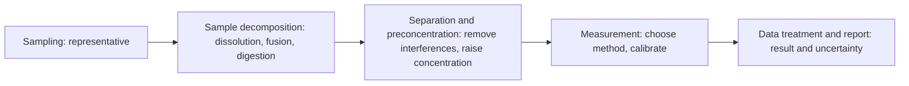

Analytical chemistry answers four questions about a material: what it contains, how much of each component is present, where the components are, and in what structure or form they occur. The other central activity of chemistry is synthesis, but the products of synthesis, the quality of foods and drugs, and environmental and clinical testing all depend on analysis for identification and quantification. Every measurement carries error, so the value of an analytical result depends on whether we can state how reliable it is. This chapter first outlines the tasks and methods of analytical chemistry (Section 1.1) and then develops the means of evaluating and treating analytical data: the concept and classification of errors (Sections 1.2–1.3), the statistics of random error and confidence intervals (1.4), significance tests and suspect values (1.5), propagation of error (1.6), and significant figures (1.7). The last section covers the calibration and performance characteristics common to the whole course (1.8): the titrations of the following chapters ([6.4.2](/6.4.2)–[6.4.5](/6.4.5)) and the instrumental methods ([6.4.6](/6.4.6)–[6.4.15](/6.4.15)) all use the calibration curve, detection limit, standard addition and internal standard introduced here, and add only what is specific to each. The mathematics of the statistical methods is given in the statistics courses ([probability theory](/3.1), [statistical inference](/3.2), [linear regression](/3.3)); here we treat their use and decision criteria in analytical chemistry, linking each concept back.

## 1.1. Tasks and Methods of Analytical Chemistry

Analytical chemistry is the science of obtaining chemical information about matter and of studying its composition, content, structure, and form. It develops the principles, methods, and instruments of measurement and evaluates how reliable the results are.

**Definition 1.1.1** Analysis that identifies which elements, ions, functional groups, or compounds make up a sample is called **qualitative analysis**; analysis that determines the amount of each component is called **quantitative analysis**; and analysis that establishes the molecular structure, crystal structure, or form of occurrence of a substance is called structure analysis.

By the principle of measurement, methods fall into two broad classes.

**Definition 1.1.2** Methods based on chemical reactions and their stoichiometry, chiefly gravimetric analysis and titrimetric analysis, are called **chemical analysis** (classical or wet-chemical analysis); methods that rest on a physical or physicochemical property of matter (interaction with electromagnetic radiation, electric or magnetic fields, distribution between two phases, and so on) and require special instruments are called **instrumental analysis**.

| Class | Main methods | In this course |
|---|---|---|
| Classical analysis | Gravimetry; acid–base, complexometric, precipitation, and redox titrations | [6.4.2](/6.4.2)–[6.4.5](/6.4.5) |
| Electroanalysis | Conductometry, potentiometry, electrolysis and coulometry, voltammetry | [6.4.6](/6.4.6) |
| Spectroscopic analysis | Atomic emission, atomic absorption and fluorescence, X-ray; ultraviolet–visible, molecular luminescence, infrared and Raman; nuclear magnetic resonance | [6.4.7](/6.4.7)–[6.4.12](/6.4.12) |
| Separation methods | Gas chromatography, liquid chromatography, electrophoresis | [6.4.13](/6.4.13), [6.4.14](/6.4.14) |
| Mass spectrometry | Organic and biological MS, inductively coupled plasma MS | [6.4.15](/6.4.15) |

Classical analysis rests on the four families of solution equilibria (acid–base, complexation, precipitation, and redox; [6.1.9](/6.1.9)–[6.1.11](/6.1.11)). It needs only simple equipment and is accurate (relative error of a few parts per thousand), but it requires samples of milligrams to grams and suits major components. Instrumental methods are sensitive and fast, can determine minor and trace components, and give information on speciation and structure, but most are relative methods: the signal an instrument gives must be calibrated with standards of known content (Section 1.8). The two kinds of method complement each other, and the assignment of values to reference materials and the calibration of instruments often trace back to classical analysis in the end.

Methods are commonly divided by sample size and by the content of the analyte as follows (the boundaries are not uniform, and textbooks differ slightly):

| By sample size | Solid sample | Liquid sample |
|---|---|---|
| Macro analysis | $> 0.1\,\mathrm{g}$ | $> 10\,\mathrm{mL}$ |
| Semimicro analysis | $0.01$–$0.1\,\mathrm{g}$ | $1$–$10\,\mathrm{mL}$ |
| Micro analysis | $0.1$–$10\,\mathrm{mg}$ | $0.01$–$1\,\mathrm{mL}$ |
| Ultramicro analysis | $< 0.1\,\mathrm{mg}$ | $< 0.01\,\mathrm{mL}$ |

By the mass fraction $w$ of the analyte, components are major ($w > 1\%$), minor ($0.01\%$–$1\%$), trace ($w < 0.01\%$, that is, below $100\,\mu\mathrm{g\,g^{-1}}$), or ultratrace (below about $1\,\mu\mathrm{g\,g^{-1}}$). In this course contents are given as mass fractions, in $\mu\mathrm{g\,g^{-1}}$, $\mathrm{ng\,mL^{-1}}$, or as mole fractions. The ppm, ppb, and ppt ($10^{-6}$, $10^{-9}$, $10^{-12}$) common in the literature are not SI notation and do not say whether a mass ratio or a volume ratio is meant, so we do not use them. A few examples of orders of magnitude: the mole fraction of $\ce{CO2}$ in the atmosphere was about $424\,\mu\mathrm{mol\,mol^{-1}}$ in 2024 (annual mean at Mauna Loa); seawater contains about $3\,\mu\mathrm{g\,L^{-1}}$ of U; and the limits for dioxin-type contaminants in food are set in picograms (pg) of toxic equivalents per gram of fat, which must be determined by chromatography coupled to mass spectrometry ([6.4.15](/6.4.15#sec-15.5.1)).

The concentration ranges and precision of the main kinds of method are roughly as follows (orders of magnitude only):

| Method | Concentration range / ($\mathrm{mol\,L^{-1}}$) | Relative standard deviation / % | Selectivity | Analytes |
|---|---|---|---|---|
| Gravimetry | $10^{-1}$–$10^{-2}$ | 0.1 | Poor to moderate | Inorganic |
| Titrimetry | $10^{-1}$–$10^{-4}$ | 0.1–1 | Poor to moderate | Inorganic, organic |
| Potentiometry | $10^{-1}$–$10^{-6}$ | 2 | Good | Inorganic |
| Voltammetry | $10^{-3}$–$10^{-10}$ | 2–5 | Good | Inorganic, organic |
| Spectrophotometry | $10^{-3}$–$10^{-6}$ | 2 | Moderate to good | Inorganic, organic |
| Fluorometry | $10^{-6}$–$10^{-9}$ | 2–5 | Moderate | Organic |
| Atomic spectrometry | $10^{-3}$–$10^{-9}$ | 2–10 | Good | Inorganic, multielement |
| Chromatography | $10^{-3}$–$10^{-9}$ | 2–5 | Good | Organic, multicomponent |

A complete analysis consists of the following steps:



Every step can introduce error, and the final report should state how reliable the result is. Analytical chemistry is moving from classical to instrumental methods, from macro quantities to trace amounts and single molecules, from bulk averages to surfaces, microregions, and single cells, and from static to real-time dynamic measurement. The life sciences are the main driving force: DNA sequencing ([6.4.14](/6.4.14#sec-14.5.4)), mass-spectrometry-based proteomics ([6.4.15](/6.4.15#sec-15.5.3)), and fluorescence imaging beyond the diffraction limit ([6.4.10](/6.4.10#sec-10.4.3)) can now follow many kinds of molecules simultaneously inside a single cell, and it is exactly the differences between cells that population-averaged measurements hide.

## 1.2. Basic Concepts of Error

### 1.2.1. True Value, Accuracy, and Error

**Definition 1.2.1 (True Value)** The value that a measured quantity objectively possesses is called its **true value**, denoted $\mu$.

The true value is generally unknown, and may be regarded as known only in the following cases: the theoretical true value (the theoretical composition of a pure substance, such as the mass fraction of Cl in $\ce{NaCl}$); a conventional true value (a value defined by the International System of Units, or the certified value of a certified reference material); and a relative true value (a value obtained by a method of higher accuracy and used to check a method of lower accuracy).

**Definition 1.2.2 (Accuracy)** The degree of agreement between a measured value and the true value is called **accuracy**, and is expressed by the error. For a single measured value $x$, the **absolute error** and **relative error** are

$$
e = x - \mu, \qquad e_{\mathrm{r}} = \frac{e}{\mu}\times 100\%.
$$

Errors carry a sign; a positive error means the result is too high. (Chinese textbooks often write the absolute error as $E_{\mathrm{a}}$; since $E_{\mathrm{a}}$ denotes the activation energy on this site, we write $e$.) The relative error better reflects how accurate a measurement is: with a balance reading to $0.1\,\mathrm{mg}$ the absolute error is about $\pm0.0001\,\mathrm{g}$, so the relative error is $\pm0.01\%$ when weighing $1\,\mathrm{g}$ and $\pm1\%$ when weighing $0.01\,\mathrm{g}$.

### 1.2.2. Precision and Deviation

When the true value is unknown, we can only compare how close replicate results are to one another. Let $n$ replicate determinations give $x_1, \dots, x_n$. Their **sample mean** $\bar x = \frac1n\sum x_i$ estimates the population mean.

**Definition 1.2.3 (Precision)** The degree of agreement among the results of repeated determinations under specified conditions is called **precision**, and is expressed by the deviation.

**Definition 1.2.4 (Deviation)** The difference between a single result and the mean, $d_i = x_i - \bar x$, is called the **deviation**; the mean of the absolute deviations, $\bar d = \frac1n\sum\lvert d_i\rvert$, is called the **average deviation**, and $\bar d/\bar x$ is the relative average deviation.

The deviations always sum to zero, so one takes absolute values or squares. The more common measure is the **sample standard deviation**

$$
s = \sqrt{\frac{\sum_{i=1}^n (x_i - \bar x)^2}{n-1}},
$$
where the denominator $n - 1$ is the number of degrees of freedom: the $n$ deviations are subject to the constraint $\sum d_i = 0$, so only $n-1$ of them are independent, and with this denominator $s^2$ is an unbiased estimator of the population variance $\sigma^2$ ([3.2.1](/3.2.1#sec-1.4.2)). Because the standard deviation squares the deviations before summing, large deviations carry more weight, and it reflects the spread of the data more sensitively than the average deviation does; for a finite number of measurements the two approximately satisfy $\bar d \approx 0.8s$.

**Definition 1.2.5 (Relative Standard Deviation)** The ratio of the standard deviation to the mean, $\mathrm{RSD} = s/\bar x$ (often expressed as a percentage), is called the **relative standard deviation**.

It is the **sample coefficient of variation** of statistics. Another simple measure of spread is the **sample range** $R = x_{\max} - x_{\min}$, used when very few measurements are available (the Q test of Section 1.5 is based on the range).

Precision depends on the conditions of measurement.

**Definition 1.2.6** The agreement among results obtained on the same sample under the same conditions (same method, same operator, same instrument, same laboratory, within a short time) is called **repeatability**; the agreement among results obtained on the same sample with the same method under different conditions (different laboratories, operators, instruments, and times) is called **reproducibility**.

The standard deviation of reproducibility is always larger than that of repeatability, and the difference reflects the systematic differences between laboratories. In a collaborative study of a method (ISO 5725), several laboratories analyze the same sample, and **analysis of variance** splits the total variation into within-laboratory and between-laboratory parts.

### 1.2.3. Relation Between Accuracy and Precision

**Example 1.2.1** Four analysts each determine iron four times in the same iron reference material ($w(\ce{Fe}) = 37.40\%$); the results are shown in the figure. Compare their accuracy and precision.


**Solution** The results of A are tightly clustered and their mean is close to the true value: both accuracy and precision are high. B is precise, but the mean is systematically low, so there is a systematic error. C is poor in both accuracy and precision. The mean of D happens to be close to the true value, but the individual results scatter widely, so this "accuracy" is accidental and unreliable. $\square$

Two conclusions follow: precision is a prerequisite for accuracy, and results of poor precision cannot be called accurate; but high precision does not guarantee high accuracy, because a systematic error does not affect precision.

## 1.3. Systematic and Random Errors

### 1.3.1. Classification of Errors

**Definition 1.3.1 (Systematic Error)** An error that arises from definite causes, recurs on repeated determinations under the same conditions, and makes the result consistently too high or too low is called a **systematic error** (determinate error).

By origin, systematic errors are classified as method errors (incomplete reaction, interference by foreign ions, difference between the end point of an indicator and the equivalence point, loss by dissolution of a precipitate), reagent errors (impure reagents or water), instrument errors (inaccurate graduations of volumetric glassware, uncalibrated weights, instrument drift), and operator errors (a habitual tendency to judge the end-point color too dark or too light). Its characteristics are unidirectionality and reproducibility: its size and sign are essentially fixed, and in principle it can be determined and corrected.

**Definition 1.3.2 (Random Error)** An error that is caused jointly by many small, uncontrollable random factors (fluctuations of temperature, humidity, and line voltage, variation in the estimated last digit of a reading, instrument noise) and whose size and sign are not fixed is called a **random error** (indeterminate error).

A single random error cannot be predicted, but over many determinations it obeys statistical laws (Section 1.4): positive and negative errors are equally probable, and small errors are more frequent than large ones. Increasing the number of replicate determinations reduces its effect on the mean.

**Definition 1.3.3 (Gross Error)** A conspicuous deviation caused by a mistake in procedure (spilled solution, wrong reagent added, misread or miswritten data, a calculation error) is called a **gross error**.

Strictly speaking a gross error is a blunder rather than an error, and obeys no statistical law. Data known to be affected by a blunder should be discarded; data that are doubtful for unknown reasons must be judged by the tests of Section 1.5.

| Item | Systematic error | Random error |
|---|---|---|
| Source | Fixed causes; may be absent | Indeterminate factors; always present |
| Nature | Unidirectional, reproducible, measurable | Obeys statistical laws, unpredictable |
| Affects | Accuracy | Precision |
| Remedy | Find the cause and correct | Increase the number of determinations and take the mean |

### 1.3.2. Detection and Elimination of Systematic Errors

**Definition 1.3.4** A test carried out by exactly the same procedure and under the same conditions as the determination of the sample, except that no sample is added, is called a **blank determination**, and its result is the blank value; a comparison of the method used with a standard sample of known content or with a recognized standard method is called a **control determination**.

The blank determination detects and subtracts analyte or interferent introduced by reagents, water, vessels, and the environment; the control test checks the method and procedure for systematic error and, where necessary, yields a correction factor. In trace analysis the blank is often the factor that limits the detection limit (Section 1.8.3).

**Definition 1.3.5 (Recovery)** A known amount $x_2$ of analyte is added to a sample whose content $x_1$ has been determined, and the total $x_3$ is determined again. The ratio

$$
R = \frac{x_3 - x_1}{x_2}\times100\%
$$
is called the **recovery** (spike recovery).

A recovery that departs from 100% indicates a systematic error (loss, interference, or matrix effect). Generally the recovery of a major component should exceed 99%, and that of a minor component should lie between 90% and 110%. A spike recovery can detect only errors that are proportional to the amount added or that the added material can "see"; it cannot detect incomplete extraction of analyte that is bound in the sample in a different form from the spike. The most reliable check is therefore to analyze a reference material with a matrix similar to the sample.

**Definition 1.3.6 (Reference Material)** A material whose property values are sufficiently homogeneous and stable and have been established accurately, and which is used to calibrate a measuring system, to assess a measurement method, or to assign values to materials, is called a **reference material**; one that is accompanied by a certificate, with values assigned by a metrologically valid procedure and traceable, is called a certified reference material (CRM).

The general ways to improve analytical accuracy are as follows: choose the method according to the content of the analyte and the accuracy required (classical analysis for major components, instrumental analysis for minor ones); control the relative error of each measurement step (Section 1.6 gives lower limits for sample mass and titration volume); make 3–6 replicate determinations to reduce random error; and detect and eliminate systematic error by control tests, blank determinations, recovery tests, and reference materials.

## 1.4. Distribution of Random Errors and Confidence Intervals

### 1.4.1. The Normal Distribution

If the results of a large number of repeated determinations are plotted as a histogram of frequency density, the histogram approaches a symmetric bell-shaped curve as the number of determinations grows. When systematic errors have been eliminated, the measured value $x$ follows the **normal distribution** $\mathcal{N}(\mu, \sigma^2)$ ([3.1.4](/3.1.4#sec-4.2.4)): $\mu$ is the population mean (the true value, if there is no systematic error), $\sigma$ is the population standard deviation, and $x - \mu$ is the random error. There is a reason for random errors to be normally distributed: each is the sum of many small independent random contributions, and by the **central limit theorem** ([3.1.13](/3.1.13)) such a sum is approximately normal.

After standardization, $u = (x - \mu)/\sigma$, all normal distributions reduce to one curve, the **standard normal distribution**. The probabilities that a random error falls within $\pm\sigma$, $\pm2\sigma$, and $\pm3\sigma$ are 68.3%, 95.4%, and 99.7% respectively (the exact value is 95.45%, often written 95.5%); conversely, $\mathbb{P}(\lvert u\rvert \le 1.96) = 95\%$ and $\mathbb{P}(\lvert u\rvert \le 2.58) = 99\%$. This gives the statistical regularities of random error: positive and negative errors are equally probable (symmetry), small errors are likely and large ones unlikely (a single peak), and an error larger than $3\sigma$ in absolute value occurs with probability of only 0.3%. Textbooks often call this "boundedness"; strictly the normal distribution is unbounded, large errors simply occur very rarely. The mean of the errors of $n$ determinations tends to zero as $n$ increases (the law of large numbers), which is called "compensation".

The mean is more reliable than a single measurement: the standard deviation of the mean $\bar x$ of $n$ independent measurements is

$$
\sigma_{\bar x} = \frac{\sigma}{\sqrt n},
$$
so the number of replicates must be increased fourfold to halve the standard deviation of the mean. Beyond $n = 5$–$10$ more determinations bring little gain, and in analysis 3–6 replicates are usual.

### 1.4.2. The t Distribution and Confidence Intervals

In practice only a finite number of determinations are made and $\sigma$ is unknown, so $s$ must be used in its place. The statistic

$$
t = \frac{\bar x - \mu}{s/\sqrt n}
$$
then no longer follows the standard normal distribution but the **t-distribution** with $f = n - 1$ degrees of freedom (Gosset, 1908; [3.1.4](/3.1.4#sec-4.3.3)). It is lower and wider than the normal distribution, with heavier tails, reflecting the additional uncertainty that comes from estimating $\sigma$ by $s$; as $f \to \infty$ it approaches the standard normal distribution, and for $f > 20$ the two are already close.

This gives the **confidence interval** ([3.2.4](/3.2.4#sec-4.2.2)) for the population mean $\mu$ at confidence level $1 - \alpha$:

$$
\mu = \bar x \pm t_{n-1,\alpha/2}\,\frac{s}{\sqrt n}, \tag{1.1}
$$
where $t_{n-1,\alpha/2}$ is the upper $\alpha/2$ quantile of the $t_{n-1}$ distribution. In analytical chemistry the **confidence level** is usually 95%, sometimes 90%. Equation (1.1) is the standard form for reporting an analytical result.


The meaning of a confidence interval must be understood precisely ([3.2.4](/3.2.4#sec-4.1.2)): $\mu$ is a fixed value that exists objectively and has no randomness, so one cannot say that "the probability that $\mu$ lies in a certain interval is 95%"; it is the interval itself that is random. The correct statement is that, over repeated sampling, 95% of the intervals constructed by Eq. (1.1) contain $\mu$. The width of the interval increases with the confidence level and decreases with better precision (smaller $s$) and with more determinations. For very small $n$ the $t$ value is large and the interval very wide (right panel).

**Example 1.4.1** The mass fraction (%) of $\ce{SiO2}$ in a sample is determined, giving 28.62, 28.59, 28.51, 28.48, 28.52, 28.63. Find the mean, the standard deviation, and the confidence intervals of the mean at confidence levels of 90% and 95%.

**Solution** $\bar x = 28.56\%$, $s = 0.063\%$, $n = 6$. From tables or by `scipy.stats.t.ppf` ([4.4.4](/4.4.4#sec-4.5.1)): $t_{5,0.05} = 2.015$ and $t_{5,0.025} = 2.571$.

$$
90\%:\ \mu = 28.56 \pm \frac{2.015\times0.063}{\sqrt6} = (28.56 \pm 0.05)\%; \qquad 95\%:\ \mu = (28.56 \pm 0.07)\%.
$$
The higher the confidence level, the wider the interval. $\square$

**Example 1.4.2** The mass fraction of Cr in steel is determined, first twice, giving 1.12% and 1.15%, and then three more times, giving 1.11%, 1.16%, and 1.12%. Find the 95% confidence interval of the mean for the two and for the five determinations.

**Solution** For $n = 2$: $\bar x = 1.135\%$, $s = 0.021\%$, $t_{1,0.025} = 12.71$, so $\mu = (1.14 \pm 0.19)\%$. For $n = 5$: $\bar x = 1.132\%$, $s = 0.022\%$, $t_{4,0.025} = 2.776$, so $\mu = (1.13 \pm 0.03)\%$. With only two determinations the interval is so wide as to be almost meaningless; within a certain range, more determinations narrow it markedly. $\square$

## 1.5. Significance Tests and the Rejection of Suspect Values

In analysis we often need to decide whether the difference between a measured mean and a standard value, or between the results of two methods or two laboratories, is due to random error or indicates a systematic error. This is the task of **hypothesis testing** ([3.2.5](/3.2.5)): assume first that the difference arises from random error alone (the null hypothesis), compute the probability of obtaining the observed or a larger difference under this assumption, and if it is smaller than the **significance level** $\alpha$ (usually 0.05), regard the difference as "significant", that is, as evidence of a systematic error.

### 1.5.1. Comparing a Mean with a Standard Value

When a new method is applied to a reference material (certified value $\mu_0$), the one-sample **t-test** ([3.2.5](/3.2.5#sec-5.2.1)) uses

$$
t = \frac{\lvert\bar x - \mu_0\rvert}{s/\sqrt n}.
$$
If $t > t_{n-1,\alpha/2}$, then $\bar x$ differs significantly from $\mu_0$ and the method has a systematic error; otherwise the difference can be explained by random error. Equivalently, one checks whether $\mu_0$ lies within the confidence interval (1.1).

**Example 1.5.1** A new method is used to determine copper in a reference material containing $11.7\,\mathrm{mg\,kg^{-1}}$; five results are 10.9, 11.8, 10.9, 10.3, and $10.0\,\mathrm{mg\,kg^{-1}}$. Does the method have a systematic error?

**Solution** $\bar x = 10.78$, $s = 0.69$, and $t = \frac{\lvert10.78 - 11.7\rvert}{0.69/\sqrt5} = 2.98 > t_{4,0.025} = 2.776$ (**p-value** 0.041). The difference is significant: the method has a systematic error and the result is low. Note that the precision of this method is also poor (RSD 6.4%); one more high result could change the conclusion. One should look for the cause of the low result rather than rely on the test alone. $\square$

### 1.5.2. Comparing Two Data Sets

When two methods (or two analysts, or two laboratories) determine the same sample and the two means are to be compared, one first compares the precision of the two data sets and then the means.

1. The **F-test** ([3.2.5](/3.2.5#sec-5.2.5)): $F = s_{\text{larger}}^2/s_{\text{smaller}}^2$ is compared with the critical value for the numerator and denominator degrees of freedom. If $F$ is not significant, the two precisions do not differ significantly and the variances may be pooled.
2. The two-sample $t$ test with pooled variance ([3.2.5](/3.2.5#sec-5.2.4)):

$$
s_{\mathrm{p}} = \sqrt{\frac{(n_1 - 1)s_1^2 + (n_2 - 1)s_2^2}{n_1 + n_2 - 2}}, \qquad t = \frac{\lvert\bar x_1 - \bar x_2\rvert}{s_{\mathrm{p}}}\sqrt{\frac{n_1n_2}{n_1 + n_2}},
$$
with $f = n_1 + n_2 - 2$ degrees of freedom. If $t > t_{f,\alpha/2}$, the two means differ significantly and at least one method has a systematic error.

The $F$ test compares variances, that is, the size of random error, and has nothing to do with systematic error. The frequently seen statement "if $F > F_{\text{table}}$, the method under test has a large systematic error" is wrong: a significant $F$ shows only that the two methods differ in precision. The variances then cannot be pooled, and the Welch test, which does not require equal variances (an approximate solution of the Behrens–Fisher problem, [3.2.4](/3.2.4#sec-4.3.3)), should be used instead. Putting the larger variance in the numerator amounts to a two-sided test, so when a one-sided $F$ table for $\alpha = 0.05$ is used, the actual significance level is 0.10.

**Example 1.5.2** Two analysts, A and B, determine the same sample by different methods. A obtains 1.26, 1.25, 1.22; B obtains 1.35, 1.31, 1.33, 1.34. Do the two methods differ significantly?

**Solution** $\bar x_{\mathrm{A}} = 1.243$, $s_{\mathrm{A}} = 0.021$; $\bar x_{\mathrm{B}} = 1.333$, $s_{\mathrm{B}} = 0.017$. Then $F = 0.021^2/0.017^2 = 1.49$, which is less than $F_{2,3,0.05} = 9.55$ (the two-sided critical value $F_{2,3,0.025} = 16.04$ for $\alpha = 0.05$ is even larger), so the precisions do not differ significantly. The pooled standard deviation is $s_{\mathrm{p}} = 0.0187$, and

$$
t = \frac{1.333 - 1.243}{0.0187}\sqrt{\frac{3\times4}{3+4}} = 6.26 > t_{5,0.025} = 2.571,
$$
so the difference is significant ($p = 0.0015$) and there is a systematic error between the two methods. The 95% confidence interval for the difference of the means is $0.089 \pm t_{5,0.025}s_{\mathrm{p}}\sqrt{1/3 + 1/4} = 0.089 \pm 0.037$, so the systematic difference between the methods lies between 0.05 and 0.13. Which method is correct can be decided only by control tests on a reference material or with a standard method. $\square$

In Python these tests take only a line or two ([4.4.4](/4.4.4#sec-4.5.2)):

```python
from scipy import stats

a = [1.26, 1.25, 1.22]
b = [1.35, 1.31, 1.33, 1.34]
print(stats.ttest_ind(b, a))                    # pooled variance: t = 6.26, p = 0.0015
print(stats.ttest_ind(b, a, equal_var=False))   # Welch test: t = 6.05, p = 0.0042
print(stats.ttest_1samp([10.9, 11.8, 10.9, 10.3, 10.0], 11.7))   # Example 1.5.1
```

### 1.5.3. Rejection of Suspect Values

Whether to keep or discard a value that deviates strongly from the rest of a set of replicates has a large effect on the mean. A value known to result from a blunder should be discarded; when the cause is unknown, a statistical test decides whether it belongs to the same population as the other data. A suspect value can only be the largest or the smallest value.

**Definition 1.5.1 (Grubbs Test)** Arrange the $n$ data in order of size, so that the suspect value is $x_1$ or $x_n$. Compute $\bar x$ and $s$ including the suspect value, and the statistic

$$
G = \frac{\lvert x_{\text{suspect}} - \bar x\rvert}{s};
$$
if $G > G_{n,\alpha}$ the suspect value is rejected, otherwise it is retained. This test is called the **Grubbs test**.

The critical value follows from the t distribution: $G_{n,\alpha} = \dfrac{n-1}{\sqrt n}\sqrt{\dfrac{t^2}{n - 2 + t^2}}$ with $t = t_{n-2,\alpha/n}$ (for testing one end specified in advance; if the end is not specified, replace $\alpha/n$ by $\alpha/(2n)$). Common values are:

| $n$ | 3 | 4 | 5 | 6 | 7 | 8 | 9 | 10 |
|---|---|---|---|---|---|---|---|---|
| $G_{n,0.05}$ | 1.15 | 1.46 | 1.67 | 1.82 | 1.94 | 2.03 | 2.11 | 2.18 |
| $G_{n,0.01}$ | 1.15 | 1.49 | 1.75 | 1.94 | 2.10 | 2.22 | 2.32 | 2.41 |

**Definition 1.5.2 (Q Test)** Arrange $n$ (3–10) data in order and compute the ratio of the gap between the suspect value and its nearest neighbor to the range,

$$
Q = \frac{\lvert x_{\text{suspect}} - x_{\text{neighbor}}\rvert}{x_n - x_1};
$$
if $Q > Q_{n,\alpha}$ the suspect value is rejected, otherwise it is retained. This test is Dixon's **Q test**.

| $n$ | 3 | 4 | 5 | 6 | 7 | 8 | 9 | 10 |
|---|---|---|---|---|---|---|---|---|
| $Q_{0.90}$ | 0.941 | 0.765 | 0.642 | 0.560 | 0.507 | 0.468 | 0.437 | 0.412 |
| $Q_{0.95}$ | 0.970 | 0.829 | 0.710 | 0.625 | 0.568 | 0.526 | 0.493 | 0.466 |

(There is no simple closed form for the critical values of $Q$; the values in the table are taken from Rorabacher, Anal. Chem. 1991, 63, 139.)

**Example 1.5.3** The Co content of a drug (in units of $10^{-4}$) is determined, giving 1.25, 1.27, 1.31, 1.40. Use both tests to decide whether 1.40 should be retained.

**Solution** Grubbs test: $\bar x = 1.31$, $s = 0.067$, and $G = (1.40 - 1.31)/0.067 = 1.39 < G_{4,0.05} = 1.46$, so the value is retained. Q test: $Q = (1.40 - 1.31)/(1.40 - 1.25) = 0.60 < Q_{0.90} = 0.765$, so it is retained. $\square$

**Example 1.5.4** The total alkali of a soda ash (as $w(\ce{Na2O})$, %) is determined six times, giving 40.02, 40.12, 40.16, 40.18, 40.18, 40.20. Should 40.02 be rejected?

**Solution** The mean is 40.14 if 40.02 is retained and 40.17 if it is rejected. Grubbs test: $\bar x = 40.143$, $s = 0.066$, and $G = (40.143 - 40.02)/0.066 = 1.86 > G_{6,0.05} = 1.82$, so the value is rejected. Q test: $Q = (40.12 - 40.02)/(40.20 - 40.02) = 0.56$, which just fails to exceed $Q_{0.90} = 0.560$, so it is retained. $\square$

It is not unusual for the two tests to disagree. The Q test uses only three data and is easy to compute, but its statistical efficiency is low and it tends to retain values lying far from the rest; the Grubbs test uses $s$ from all the data, is more reliable, and should be preferred. Note also that rejecting data changes the conclusion, and data must not be discarded at will to improve the precision: the 95% confidence interval for the values 40.12, 40.16, 40.18 is 40.08–40.23, but if 40.12 is rejected the interval from the remaining two data widens to 40.04–40.30, because the $t$ value for $n = 2$ is much larger. For a general discussion of outliers see regression diagnostics ([3.3.6](/3.3.6#sec-6.1.3)): an outlying datum should first be investigated for its cause, rather than deleted on the strength of a test alone.

## 1.6. Propagation of Error

An analytical result is usually calculated from several measured values, and the error of each measured value is propagated into the result.

**Definition 1.6.1 (Propagation of Error)** The rule by which the errors of directly measured values are transmitted through the formula to the result of an indirect determination is called **propagation of error**.

Let the result be $R = f(x_1, \dots, x_k)$. A systematic error has a definite size and sign and is propagated directly through the total differential; when only upper limits $\Delta x_i$ of the errors are known, the limiting error of the result in the worst case is $\Delta R_{\max} = \sum\lvert\partial f/\partial x_i\rvert\Delta x_i$. Random errors are propagated through the variances.

**Theorem 1.6.1** Suppose the random errors of the measured values are mutually independent and their standard deviations $s_i$ are small relative to $x_i$. Then the standard deviation of the result is

$$
s_R^2 \approx \sum_{i=1}^k\left(\frac{\partial f}{\partial x_i}\right)^2 s_i^2. \tag{1.2}
$$
In particular:

| Formula | Systematic error (limiting) | Random error |
|---|---|---|
| $R = a x_1 + b x_2 - c x_3$ | $\Delta R = \lvert a\rvert\Delta x_1 + \lvert b\rvert\Delta x_2 + \lvert c\rvert\Delta x_3$ | $s_R^2 = a^2s_1^2 + b^2s_2^2 + c^2s_3^2$ |
| $R = m\,x_1x_2/x_3$ | $\dfrac{\Delta R}{R} = \dfrac{\Delta x_1}{x_1} + \dfrac{\Delta x_2}{x_2} + \dfrac{\Delta x_3}{x_3}$ | $\left(\dfrac{s_R}{R}\right)^2 = \left(\dfrac{s_1}{x_1}\right)^2 + \left(\dfrac{s_2}{x_2}\right)^2 + \left(\dfrac{s_3}{x_3}\right)^2$ |
| $R = x^p$ | $\dfrac{\Delta R}{R} = \lvert p\rvert\dfrac{\Delta x}{x}$ | $\dfrac{s_R}{R} = \lvert p\rvert\dfrac{s_x}{x}$ |
| $R = \lg x$ | $\Delta R = 0.434\dfrac{\Delta x}{x}$ | $s_R = 0.434\dfrac{s_x}{x}$ |

**Proof** Expand $f$ to first order in a Taylor series about the expected values of the quantities, $R - f(\boldsymbol{\mu}) \approx \sum(\partial f/\partial x_i)(x_i - \mu_i)$. The right-hand side is a linear combination of independent random variables, whose variance is the sum of the variances of the terms; this is Eq. (1.2). It is precisely the **delta method** of probability theory ([Theorem 14.4.3](/3.1.14#thm-14.4.3)). The formulas of the table are special cases of Eq. (1.2); for products and quotients it is most convenient to take logarithms before differentiating, $\mathrm{d}\ln R = \sum\pm\,\mathrm{d}\ln x_i$. $\square$

The two kinds of result differ as follows: the limiting error assumes that all errors add in the same direction and is an upper bound; in reality the random errors partly cancel, and the error combined by Eq. (1.2) is smaller. The last row shows the error of a logarithmic quantity: an error of $\pm0.01$ in $\mathrm{pH}$ corresponds to a relative error of $\pm2.3\%$ in $[\ce{H+}]$.

**Example 1.6.1** The measurement errors of the buret and the balance determine the minimum quantities used in titrimetric analysis.

**Solution** A buret can be read to $\pm0.01\,\mathrm{mL}$, and a titration requires two readings, so the limiting error of the volume is $\pm0.02\,\mathrm{mL}$. For the relative error of the volume not to exceed $\pm0.1\%$, the titration volume must be at least $0.02/0.001 = 20\,\mathrm{mL}$, and in practice it is kept at 20–30 mL. An analytical balance reading to $0.1\,\mathrm{mg}$ has an error of $\pm0.1\,\mathrm{mg}$ per weighing; weighing by difference requires two weighings, so the limiting error is $\pm0.2\,\mathrm{mg}$, and for the relative error not to exceed $\pm0.1\%$ the sample mass must be at least $0.2\,\mathrm{g}$. If the random errors are combined, the standard deviation of two readings is $\sqrt2$ times that of one, and the conclusion is the same. Since the mass fraction $w = c_{\mathrm{B}}V_{\mathrm{B}}M_{\mathrm{A}}/m$ is a product and quotient, the relative errors of the individual steps (standard solution concentration, volume, weighing) combine as a sum of squares, and each step must be good to about one part per thousand. $\square$

Current metrological practice no longer speaks only of error but evaluates measurement results by their uncertainty.

**Definition 1.6.2 (Measurement Uncertainty)** A non-negative parameter that characterizes the dispersion of the values reasonably attributed to the measurand, on the basis of the information used, is called the **measurement uncertainty**.

According to the *Guide to the Expression of Uncertainty in Measurement* (GUM, ISO/IEC Guide 98-3), an uncertainty expressed as a standard deviation is called a standard uncertainty $u$, and there are two types of evaluation. Type A evaluation uses statistical methods on repeated determinations (for example, the standard uncertainty of a mean, $s/\sqrt n$); Type B evaluation estimates from other information, for example, a stated tolerance $\pm a$ of a volumetric flask is taken as a rectangular distribution with $u = a/\sqrt3$, or the uncertainty is taken from a balance calibration certificate. The components are combined by the same rule as Eq. (1.2) into the combined standard uncertainty $u_{\mathrm{c}}$, and multiplying by a coverage factor $k$ (usually 2, corresponding to a coverage probability of about 95%) gives the expanded uncertainty $U = ku_{\mathrm{c}}$; the result is reported as $x \pm U$. An error is the difference between the measured value and the true value; since the true value is unknown, the error cannot be known exactly. Uncertainty depends only on the information available, and can therefore be evaluated and compared.

## 1.7. Significant Figures and the Rules of Calculation

### 1.7.1. Significant Figures

**Definition 1.7.1 (Significant Figures)** The digits that can actually be measured, comprising all the certain digits and the last uncertain (estimated) digit, are called **significant figures**.

Significant figures express both the magnitude and the precision of a measurement. In a buret reading of $12.34\,\mathrm{mL}$ the first three digits are certain and the last digit, 4, is an estimate with an error of $\pm1$ unit; a mass of $0.1053\,\mathrm{g}$ found on a balance reading to $0.1\,\mathrm{mg}$ has four significant figures. The numbers $0.51800$, $0.5180$, and $0.518$ are numerically equal, but they indicate precisions of $\pm0.00001$, $\pm0.0001$, and $\pm0.001$, with 5, 4, and 3 significant figures. In recording data only one uncertain digit is kept.

In counting digits, note the following:

- Zeros between digits or after them (1.0008, 0.1000) are significant; zeros before the first nonzero digit (0.0382) serve only to locate the decimal point and are not significant. Scientific notation avoids ambiguity: $0.0518 = 5.18\times10^{-2}$ has three.
- The number of trailing zeros of an integer is unclear: a measured "1000" should be written $1.0\times10^3$ or $1.000\times10^3$ to show its number of figures. It is wrong to treat every "1000" as having infinitely many significant figures; that holds only for integers in stoichiometric relations.
- Quantities that are not measured, such as the number of determinations, coefficients of stoichiometric relations, multiples and fractions, and constants such as $\pi$, are exact and may be regarded as having infinitely many significant figures.
- For logarithmic quantities (pH, pM, $\lg K$) the number of significant figures depends only on the number of digits of the fractional part (the mantissa); the integer part only gives the power of 10. $\mathrm{pH} = 12.00$ has two, corresponding to $[\ce{H+}] = 1.0\times10^{-12}\,\mathrm{mol\,L^{-1}}$; $\mathrm{pH} = 8.72$ corresponds to $[\ce{H+}] = 1.9\times10^{-9}\,\mathrm{mol\,L^{-1}}$.

For some common measurements: analytical-balance weighings are recorded to $0.0001\,\mathrm{g}$; volumes of burets, pipets, and volumetric flasks are recorded to $0.01\,\mathrm{mL}$ (four figures); concentrations of standard solutions are given to four significant figures ($0.1000\,\mathrm{mol\,L^{-1}}$); potentials are recorded to $0.0001\,\mathrm{V}$, pH to 0.01, and absorbance to 0.001.

### 1.7.2. Rounding and Calculation

**Definition 1.7.2 (Rounding of Numbers)** The process of discarding surplus digits to leave a prescribed number of significant figures is called **rounding of numbers**. The rule is "round half to even": if the first digit to be discarded is 4 or less, it is dropped; if it is 6 or more, the last retained digit is increased by one; if it is 5 followed by nonzero digits, round up; if it is 5 followed by nothing or only zeros, round up when the digit before the 5 is odd and drop when it is even, so that the last digit becomes even.

For example, rounded to four significant figures: $14.2442 \to 14.24$, $26.4863 \to 26.49$, $15.0250 \to 15.02$, $15.0150 \to 15.02$, $15.0251 \to 15.03$. Rounding half to even makes rounding up and down equally probable, so the accumulated error of rounding many data does not lean to one side; it is the same as the default rounding mode of the **IEEE 754 standard** for floating-point arithmetic (round half to even; the **rounding error** of [3.5.1](/3.5.1#sec-1.3.1)). Rounding must be done in one step and not in stages: $2.5491$ rounded to two figures gives $2.5$, and rounding first to $2.55$ and then to $2.6$ is wrong. When rounding by computer, note also that decimal fractions generally cannot be represented exactly in binary (in Python `round(2.675, 2)` gives 2.67); for strict decimal rounding use the `decimal` module.

The rules of calculation follow from the propagation of error of Section 1.6:

- Addition and subtraction: the absolute error of the result is determined by the number with the largest absolute error (the fewest decimal places), and the result is kept to that place: $23.64 + 4.402 + 0.3164 = 28.36$.
- Multiplication and division: the relative error of the result is determined by the number with the largest relative error (usually the one with the fewest significant figures): $\frac{0.0325\times5.103\times60.06}{139.8} = 0.0713$. The relative errors of the four numbers are about $\pm0.3\%$, $\pm0.02\%$, $\pm0.02\%$, $\pm0.07\%$; that of 0.0325 is the largest, so the result is kept to three figures. Numbers whose first digit is 8 or 9 have smaller relative error and may be counted with one more significant figure (for example, 9.37 is treated as having four).
- In the course of a calculation one may keep one extra digit (a guard digit) and round to the proper number of figures only at the end, to avoid accumulating rounding errors.
- Accuracy and precision are generally expressed with one or two significant figures; results for major components are generally reported to four figures, and for minor components to two or three.

## 1.8. Calibration and Performance Characteristics of a Method

### 1.8.1. The Calibration Curve

Instrumental analysis is a relative method: the relation between the signal $y$ given by the instrument (absorbance, current, peak area, and so on) and the analyte concentration $c$ must be established with a series of standard solutions of known concentration.

**Definition 1.8.1 (Calibration Curve)** The curve obtained by measuring the signal of a series of standard solutions of known concentration and plotting (or fitting) the signal against concentration is called the **calibration curve** (working curve, standard curve).

For most methods the signal is linear in concentration over a certain range, $y = a + bc$, and is fitted by **least squares** ([3.3.2](/3.3.2)), which gives the intercept $a$, the slope $b$, and the residual standard deviation $s_{y/x} = \sqrt{\sum(y_i - \hat y_i)^2/(n-2)}$. Finding the concentration of an unknown from its signal is **inverse prediction** ([3.3.6](/3.3.6#sec-6.3.2)): if the unknown is measured $m$ times with mean signal $\bar y_0$, then

$$
\hat c = \frac{\bar y_0 - a}{b}, \qquad s_{\hat c} \approx \frac{s_{y/x}}{b}\sqrt{\frac1m + \frac1n + \frac{(\bar y_0 - \bar y)^2}{b^2\sum(c_i - \bar c)^2}}, \tag{1.3}
$$
where $\bar y$ and $\bar c$ are the mean signal and mean concentration of the standards, and the confidence interval is $\hat c \pm t_{n-2,\alpha/2}\,s_{\hat c}$. Equation (1.3) shows that the error is smallest when the signal of the unknown falls in the middle of the calibration range ($\bar y_0 \approx \bar y$); increasing the number $m$ of determinations of the unknown reduces only the first term, while increasing the number $n$ of standards and widening the concentration range also contribute. It is not sufficient to cite a correlation coefficient close to 1 (such as $r = 0.999$) as evidence of linearity; the residual plot should be examined ([3.3.5](/3.3.5)). When the variance of the signal grows with concentration (common in spectroscopy and chromatography), **weighted least squares** ([3.3.6](/3.3.6#sec-6.2.2)) should be used.

**Example 1.8.1** Spectrophotometric determination of iron. The concentrations $c/(\mu\mathrm{g\,mL^{-1}})$ of the standard solutions and the absorbances $A$ are: 0, 0.003; 0.5, 0.104; 1.0, 0.201; 2.0, 0.402; 3.0, 0.596; 4.0, 0.801; 5.0, 0.994. The unknown is measured three times, giving $A$ = 0.512, 0.508, 0.515. The reagent blank is measured 10 times, with mean $A$ of 0.0024 and standard deviation of 0.0015. Find the concentration of the unknown with its 95% confidence interval, and the detection limit and the quantification limit of the method.

**Solution** Least squares gives $A = 0.0037 + 0.1984\,c$ and $s_{y/x} = 0.0025$. For the unknown, $\bar y_0 = 0.5117$ and $\hat c = (0.5117 - 0.0037)/0.1984 = 2.560\,\mu\mathrm{g\,mL^{-1}}$; by Eq. (1.3), $s_{\hat c} = 0.0086$ and $t_{5,0.025} = 2.571$, so $c = (2.560 \pm 0.022)\,\mu\mathrm{g\,mL^{-1}}$. The sensitivity is the slope, $0.1984\,\mathrm{mL\,\mu g^{-1}}$; by Section 1.8.3, the detection limit is $c_{\mathrm{L}} = 3\times0.0015/0.1984 = 0.023\,\mu\mathrm{g\,mL^{-1}}$ and the quantification limit is $0.076\,\mu\mathrm{g\,mL^{-1}}$. $\square$

```python
import numpy as np
from scipy import stats

c = np.array([0, 0.5, 1, 2, 3, 4, 5.0])
A = np.array([0.003, 0.104, 0.201, 0.402, 0.596, 0.801, 0.994])
fit = stats.linregress(c, A)
n = len(c)
s_yx = np.sqrt(np.sum((A - fit.intercept - fit.slope * c) ** 2) / (n - 2))

y0 = np.array([0.512, 0.508, 0.515])
c0 = (y0.mean() - fit.intercept) / fit.slope
s_c0 = s_yx / fit.slope * np.sqrt(1 / len(y0) + 1 / n
                                  + (y0.mean() - A.mean()) ** 2 / (fit.slope ** 2 * np.sum((c - c.mean()) ** 2)))
half = stats.t.ppf(0.975, n - 2) * s_c0
print(f"c0 = {c0:.3f} +- {half:.3f} ug/mL")      # 2.560 +- 0.022
```


The two bands in the figure are the **confidence band** for the mean response and the **prediction interval** for a single new observation ([3.3.4](/3.3.4#sec-4.3)).

### 1.8.2. Sensitivity, Linear Range, and Selectivity

**Definition 1.8.2 (Sensitivity)** The change of signal caused by a unit change in the concentration (or amount) of the analyte, that is, the slope of the calibration curve $S = \mathrm{d}y/\mathrm{d}c$, is called the **sensitivity** of the method.

A sensitive method can distinguish small differences in concentration, but a large slope alone does not suffice for determining low contents: whether a determination is possible also depends on the noise, which is the detection limit of Section 1.8.3. The "characteristic concentration" commonly used in atomic absorption ([6.4.8](/6.4.8#def-8.3.5)) and the molar absorptivity in spectrophotometry ([6.4.9](/6.4.9#sec-9.3.1)) are specific forms of sensitivity.

**Definition 1.8.3 (Linear Range)** The range of concentration over which the calibration curve remains linear (with deviation from the straight line not exceeding a specified limit, such as 5%) is called the **linear range**; its lower limit is usually taken as the quantification limit.

The linear ranges of different methods differ greatly: about 1–2 orders of magnitude in spectrophotometry (limited by deviations from the absorption law), and 5–7 orders of magnitude for the inductively coupled plasma source in atomic emission spectrometry and the flame ionization detector in chromatography. Samples beyond the linear range must be diluted and measured again; one must not extrapolate.

**Definition 1.8.4 (Selectivity)** The ability of a method to determine the analyte without interference from other components present is called **selectivity**.

A method that responds to only one substance is called specific, but truly specific methods are extremely rare, and IUPAC recommends using "selectivity" throughout and expressing it quantitatively. Each class of method has its own measure of selectivity: the potentiometric selectivity coefficient of ion-selective electrodes ([6.4.6](/6.4.6#def-6.3.3)), and the separation factor of two components in chromatography ([6.4.13](/6.4.13#def-13.1.7)). Selectivity can be improved by controlling the reaction conditions (for example, the acidity), by adding masking agents ([6.4.3](/6.4.3#sec-3.5.2)), and by prior separation.

### 1.8.3. Detection Limit and Quantification Limit

**Definition 1.8.5 (Limit of Detection)** The lowest concentration (or amount) that can be distinguished from the blank at a suitable confidence level, so that the presence of the analyte can be asserted, is called the **limit of detection**. By the usual IUPAC convention, the signal detection limit is $y_{\mathrm{L}} = \bar y_{\mathrm{b}} + 3s_{\mathrm{b}}$, and the concentration detection limit is

$$
c_{\mathrm{L}} = \frac{3s_{\mathrm{b}}}{S},
$$
where $\bar y_{\mathrm{b}}$ and $s_{\mathrm{b}}$ are the mean and standard deviation of many blank determinations (generally at least 10) and $S$ is the sensitivity. The lowest concentration that can be determined quantitatively with acceptable precision (RSD about 10%), $c_{\mathrm{Q}} = 10s_{\mathrm{b}}/S$, is called the **limit of quantification**.

The detection limit is often described simply as "the concentration at which the signal equals three times the standard deviation of the noise". The signal and concentration statements should be distinguished; moreover, the detection limit says only that the analyte can be detected, not that it can be quantified: at a concentration near $c_{\mathrm{L}}$ the relative standard deviation of the result is about 33%, and reporting a numerical value is meaningless, which is why a quantification limit is also needed. The statistical meaning of the factor 3 ([3.2.5](/3.2.5#sec-5.1.3)) is as follows: if the blank signal is normally distributed, the probability that a signal exceeds $\bar y_{\mathrm{b}} + 3s_{\mathrm{b}}$ and is wrongly judged as "detected" (a **type I error**) is about 0.13%; but for a sample whose true concentration is exactly $c_{\mathrm{L}}$, half the measured signals fall below the decision level, so the probability of a missed detection is as high as 50%. Currie (1968; IUPAC 1995) therefore distinguishes the critical level $L_{\mathrm{C}} = 1.645s_{\mathrm{b}}$ (controlling false positives) from the detection limit $L_{\mathrm{D}} = 3.29s_{\mathrm{b}}$ (making the probabilities of false positives and false negatives both 5%); the latter corresponds to the $3s_{\mathrm{b}}$ above. In pharmaceutical analysis and similar fields (the ICH guideline) the residual standard deviation of the calibration curve is often used in place of $s_{\mathrm{b}}$, giving $c_{\mathrm{L}} = 3.3s_{y/x}/S$; different definitions can give detection limits that differ severalfold, so when comparing literature data one must check which definition was used.

The detection limit represents the ability of a method to determine low contents better than the sensitivity does, because it contains both the signal (the slope) and the noise. The detection limit can be lowered by raising the sensitivity, by lowering the noise and the blank (high-purity reagents, a clean environment), or by separation and preconcentration before the measurement.

### 1.8.4. Matrix Effects and Methods of Quantification

**Definition 1.8.6 (Matrix Effect)** The phenomenon in which the other components of a sample (the matrix) enhance or suppress the signal of the analyte, so that a sample and a standard solution of the same concentration differ in sensitivity, is called the **matrix effect**.

In atomic spectrometry, for example, the matrix changes the efficiency of nebulization, evaporation, and excitation ([6.4.7](/6.4.7#rem-7.3.1), [6.4.8](/6.4.8#sec-8.3)); in electrospray mass spectrometry, coeluting species suppress the ionization of the analyte ([6.4.15](/6.4.15#sec-15.2.4)); and in biological samples proteins and salts affect the response of electrodes. In the presence of a matrix effect, a calibration curve prepared in pure solvent gives a systematic error. Remedies are to prepare standards with a matrix similar in composition to the sample (matrix matching), to separate the matrix, to dilute to reduce its influence, and to use the standard addition and internal standard methods described below.

**Definition 1.8.7 (External Standard Method)** The method in which a calibration curve is established with standard solutions prepared and measured separately from the sample, and the concentration is found from the signal of the sample, is called the **external standard method**.

The external standard method is just the procedure of Section 1.8.1. It is simple and general, provided that the standards and the sample have the same sensitivity and that the conditions of each measurement (injection volume, instrument response) are the same.

**Definition 1.8.8 (Standard Addition Method)** The method in which equal portions of the sample are taken, different amounts of a standard of the analyte are added to them, and all are diluted to the same volume and measured; the signal is plotted against the added concentration, the line is extrapolated to zero signal, and the concentration of the analyte in the sample is found from the absolute value of the intercept on the concentration axis, is called the **standard addition method**.

If the signal is $y = b(c_x + c_{\mathrm{add}})$ for an added concentration $c_{\mathrm{add}}$, we fit $y = a + bc_{\mathrm{add}}$ and obtain $c_x = a/b$. Because the standard is added to the sample itself, it undergoes the same matrix effect as the analyte, and the slope $b$ already includes the effect of the matrix on the sensitivity. The standard deviation is

$$
s_{c_x} = \frac{s_{y/x}}{b}\sqrt{\frac1n + \frac{\bar y^2}{b^2\sum(c_{\mathrm{add},i} - \bar c_{\mathrm{add}})^2}}.
$$
With a single addition, $c_x = c_{\mathrm{s}}\,y_x/(y_{x+\mathrm{s}} - y_x)$, where $c_{\mathrm{s}}$ is the added concentration (when the change in volume can be neglected). The standard addition method assumes that the signal is linear in concentration over the whole range, that the blank and background signals have been subtracted (otherwise the extrapolated intercept contains the background), and that the matrix effect changes only the slope and produces no additive interference independent of concentration. It requires a separate curve for every sample and is laborious, so it suits samples with a complex matrix when the number of samples is small.


**Example 1.8.2** The data of the five solutions in the figure are: added 0, 2, 4, 6, $8\,\mathrm{ng\,mL^{-1}}$, signal 0.156, 0.230, 0.312, 0.385, 0.463. Find the concentration in the solution analyzed.

**Solution** The fit gives $a = 0.1554$ and $b = 0.03845\,\mathrm{mL\,ng^{-1}}$, so $c_x = a/b = 4.04\,\mathrm{ng\,mL^{-1}}$; $s_{c_x} = 0.078$ and $t_{3,0.025} = 3.18$, so $c_x = (4.04 \pm 0.25)\,\mathrm{ng\,mL^{-1}}$. The extrapolated point lies outside the range of measurement, so the precision of standard addition is generally poorer than that of the external standard method. $\square$

**Definition 1.8.9 (Internal Standard Method)** The method in which an equal amount of another substance (the internal standard) is added to all standard solutions and to the sample, and a calibration curve of the ratio of the signals of the analyte and of the internal standard against concentration (or concentration ratio) is used for quantification, is called the **internal standard method**.

The signal ratio $y_{\mathrm{A}}/y_{\mathrm{IS}}$ cancels the factors that affect both equally: fluctuations of the injection volume (chromatography), drift of the source and detector (atomic emission spectrometry, [6.4.7](/6.4.7#sec-7.6.4)), and losses in sample preparation. The internal standard should be a substance that is absent from the sample, has properties close to those of the analyte, and has a signal that can be measured separately from that of the analyte. The ideal internal standard is a stable-isotope-labeled analog of the analyte ($^{13}\mathrm{C}$, $^{15}\mathrm{N}$, $^2\mathrm{H}$): its chemical behavior is almost identical to that of the analyte and it can be distinguished only in mass spectrometry. This is isotope dilution ([6.4.15](/6.4.15#def-15.5.1)), and it is one of the most accurate quantification methods available.

| Method | Factors corrected | Factors not corrected | Typical use |
|---|---|---|---|
| External standard | None | Matrix effects, fluctuations of injection and instrument | Routine analysis with a simple matrix and stable conditions |
| Standard addition | Multiplicative matrix effects | Additive interference, background, nonlinearity | Samples with a complex matrix in atomic spectrometry, potentiometry, and voltammetry |
| Internal standard | Injection volume, instrument drift, losses in sample preparation | Different effects on the internal standard and the analyte | Chromatography, ICP spectrometry, and mass spectrometry |

## Summary

| Question | Method | Statistic and criterion |
|---|---|---|
| Report a result and its range of reliability | Confidence interval of the mean | $\bar x \pm t_{n-1,\alpha/2}\,s/\sqrt n$ |
| A suspect value among replicates | Grubbs test (preferred); Q test ($n \le 10$) | $G = \lvert x_{\text{suspect}} - \bar x\rvert/s$; $Q = $ gap / range |
| Does the method have a systematic error (a certified value is available) | One-sample t test | $t = \lvert\bar x - \mu_0\rvert\sqrt n/s$, $n-1$ degrees of freedom |
| Do two data sets have the same precision | F test | $F = s_{\text{larger}}^2/s_{\text{smaller}}^2$ |
| Do two data sets have the same mean | Two-sample t test (pooled variance if $F$ is not significant, otherwise the Welch test) | $t = \lvert\bar x_1 - \bar x_2\rvert/(s_{\mathrm{p}}\sqrt{1/n_1 + 1/n_2})$ |
| Which step determines the error of a result | Propagation of error | For sums and differences, absolute errors; for products and quotients, relative errors; random errors add as variances |
| Concentration from signal | Calibration curve (external standard, standard addition, internal standard) | $\hat c = (\bar y_0 - a)/b$ and Eq. (1.3) |
| How low can we measure | Detection limit, quantification limit | $3s_{\mathrm{b}}/S$, $10s_{\mathrm{b}}/S$ |
