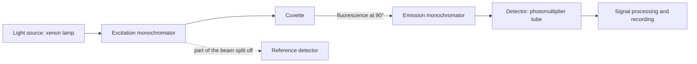

[6.3.17](/6.3.17#sec-17.2) treated the fate of an excited molecule from the point of view of photochemistry: the **Jablonski diagram** with its **vibrational relaxation**, **internal conversion** and **intersystem crossing**, the emissive processes **fluorescence** and **phosphorescence**, and **quenching** with the **Stern–Volmer equation**. This chapter treats molecular luminescence from the point of view of analysis and imaging: how emitted light is used to determine concentrations (10.1–10.2), the instruments and the techniques derived from fluorescence (10.3), how molecules are made visible in cells by fluorescence microscopy, fluorescent probes and fluorescent proteins (10.4–10.5), and chemiluminescence and bioluminescence, which need no optical excitation (10.6). Because luminescence is detected as a signal on a dark background, its detection limits are two to three orders of magnitude lower than those of the absorption photometry of the previous chapter ([6.4.9](/6.4.9#sec-9.3.3)), down to single molecules. Fluorescence can also be applied in living cells, where it reports the position, distance and motion of molecules; it is therefore one of the most widely used analytical tools in the life sciences today.

## 10.1. Principles of Photoluminescence

### 10.1.1. Photoluminescence and Deactivation of Excited States

**Definition 10.1.1** The phenomenon in which a molecule (or atom) absorbs a photon, is promoted to an electronically excited state, and returns to the ground state by emitting a photon is called **photoluminescence**. Emission from the **singlet state** $\mathrm{S}_1$ to the ground state $\mathrm{S}_0$ (no change of multiplicity) is fluorescence; emission from the **triplet state** $\mathrm{T}_1$ to $\mathrm{S}_0$ is phosphorescence.

Luminescence is unrelated to thermal radiation and is therefore a form of "cold light". According to the source of the excitation energy, molecular luminescence is divided into photoluminescence (fluorescence and phosphorescence), chemiluminescence (a chemical reaction supplies the energy), bioluminescence (enzyme-catalyzed chemiluminescence in organisms), electrochemiluminescence, and so on.

After a molecule has been excited to the vibrational levels of $\mathrm{S}_2$ or $\mathrm{S}_1$, vibrational relaxation and internal conversion bring it to the lowest vibrational level of $\mathrm{S}_1$ within about $10^{-12}\,\mathrm{s}$ (**Kasha's rule**). It then returns to the ground state by one of the following pathways (with the rate constants indicated):

| Pathway | Process | Rate constant / $\mathrm{s^{-1}}$ |
|---|---|---|
| Fluorescence | $\mathrm{S}_1 \to \mathrm{S}_0 + h\nu_{\mathrm{f}}$ | $k_{\mathrm{r}} \sim 10^7$–$10^9$ |
| Internal conversion | $\mathrm{S}_1 \rightsquigarrow \mathrm{S}_0$ (heat) | $k_{\mathrm{ic}}$ |
| Intersystem crossing | $\mathrm{S}_1 \rightsquigarrow \mathrm{T}_1$ | $k_{\mathrm{isc}} \sim 10^6$–$10^{10}$ (increased by heavy atoms) |
| External conversion (quenching) | $\mathrm{S}_1 + \mathrm{Q} \to \mathrm{S}_0 + \mathrm{Q}$ | $k_{\mathrm{q}}[\mathrm{Q}]$ |
| Phosphorescence | $\mathrm{T}_1 \to \mathrm{S}_0 + h\nu_{\mathrm{p}}$ | $10^{-2}$–$10^{4}$ (spin forbidden) |

For a molecule to fluoresce, two conditions must be met simultaneously: it must absorb the excitation light strongly (a suitable absorption band and a large **molar absorption coefficient**), and a substantial fraction of the absorbed energy must be released as light, that is, the rate of fluorescence must be able to compete with the various radiationless pathways.

### 10.1.2. Excitation and Emission Spectra

A fluorescence instrument has two monochromators (10.3.1) and can therefore record two kinds of spectra:

**Definition 10.1.2** The spectrum recorded by fixing the emission (observation) wavelength and scanning the excitation wavelength, so that the fluorescence intensity is plotted against the excitation wavelength, is called the **excitation spectrum**. The spectrum recorded by fixing the excitation wavelength and scanning the emission wavelength is called the **emission spectrum** (**fluorescence spectrum**).

The fluorescence intensity is proportional to the number of photons absorbed, so in dilute solution the excitation spectrum has the same shape as the absorption spectrum (after correction for the lamp intensity and the monochromator efficiency); this can be used to confirm which species is responsible for the emission. By Kasha's rule, emission always starts from the lowest vibrational level of $\mathrm{S}_1$, so the shape of the emission spectrum is independent of the excitation wavelength: changing the wavelength changes only the intensity, not the shape. In an analysis the highest sensitivity is obtained by exciting at the maximum of the excitation spectrum and observing at the maximum of the emission spectrum. The two scannable monochromators also give fluorescence an extra dimension of selectivity relative to absorption: two substances with overlapping absorption spectra can be determined separately as long as their emission spectra differ (scanning excitation and emission together gives the three-dimensional fluorescence spectrum known as the excitation–emission matrix).

**Definition 10.1.3** The difference between the wavelength of the emission maximum and that of the absorption (excitation) maximum of the same substance is called the **Stokes shift** (often expressed as a difference in wavenumber).

Vibrational relaxation within $\mathrm{S}_1$ after excitation and the reorientation of solvent molecules around the more polar excited state (solvent relaxation) both dissipate part of the energy, and emission terminates on the various vibrational levels of $\mathrm{S}_0$. The fluorescence wavelength is therefore always longer than that of the excitation light. The Stokes shift separates fluorescence from the excitation light and from Rayleigh-scattered light in wavelength, which is one reason fluorescence measurements can achieve a low background; dyes with large Stokes shifts (such as certain coumarin and BODIPY derivatives) suffer little self-absorption.

**Definition 10.1.4 (Mirror-Image Rule)** The emission spectra of many rigid molecules have approximately the shape of a mirror image of their $\mathrm{S}_0 \to \mathrm{S}_1$ absorption band, reflected about the 0–0 band. This empirical regularity is called the **mirror-image rule**.

The reason is that absorption and emission involve the same pair of electronic states: absorption proceeds from $v = 0$ of $\mathrm{S}_0$ to the vibrational levels of $\mathrm{S}_1$, and emission from $v = 0$ of $\mathrm{S}_1$ to the vibrational levels of $\mathrm{S}_0$. If the vibrational spacings and nuclear geometries of the two states are similar, the Franck–Condon principle gives the same intensity distribution for the two sets of vibrational bands, one arranged toward higher energy and the other toward lower energy. Anthracene in ethanol and quinine sulfate in dilute sulfuric acid are typical examples. Deviations from the mirror-image rule indicate that the geometry of the excited state differs considerably from that of the ground state, or that the excited state undergoes reactions such as proton transfer or excimer formation. A fluorescence spectrum is generally simpler than the corresponding absorption spectrum because it originates from a single excited state, $\mathrm{S}_1$.


```smiles
c1ccc2cc3ccccc3cc2c1 1
COc1ccc2nccc([C@@H](O)[C@@H]3C[C@@H]4CC[N@]3C[C@@H]4C=C)c2c1 2
```

### 10.1.3. Fluorescence Lifetime and Quantum Yield

**Definition 10.1.5** After the excitation is switched off, the number of excited molecules (the fluorescence intensity) decays exponentially, $I(t) = I_0\mathrm{e}^{-t/\tau_{\mathrm{f}}}$. The time $\tau_{\mathrm{f}}$ required for the intensity to fall to $1/\mathrm{e}$ of its initial value is called the **fluorescence lifetime** (excited-state lifetime).

All the decay pathways of $\mathrm{S}_1$ are first-order processes, and the sum of their rate constants determines the lifetime:

$$
\tau_{\mathrm{f}} = \frac{1}{k_{\mathrm{r}} + k_{\mathrm{nr}}}, \qquad k_{\mathrm{nr}} = k_{\mathrm{ic}} + k_{\mathrm{isc}} + k_{\mathrm{q}}[\mathrm{Q}].
$$
The fluorescence **quantum yield** ([6.3.17](/6.3.17#sec-17.2.3); also called the fluorescence efficiency) is the ratio of the number of photons emitted to the number absorbed, and equals the fraction of molecules that decay by the fluorescence pathway:

$$
\Phi_{\mathrm{f}} = \frac{\text{photons emitted}}{\text{photons absorbed}} = \frac{k_{\mathrm{r}}}{k_{\mathrm{r}} + k_{\mathrm{nr}}} = k_{\mathrm{r}}\tau_{\mathrm{f}}. \tag{10.1}
$$
The quantity $1/k_{\mathrm{r}}$ is called the natural (radiative) lifetime, the lifetime in the absence of any radiationless pathway. The stronger a transition is in absorption, the faster is its reverse process (spontaneous emission): $k_{\mathrm{r}}$ is approximately proportional to the integrated intensity of the absorption band (the Strickler–Berg relation, analogous to the relation between the Einstein coefficients of an atom, [5.5.5](/5.5.5#sec-5.2.2)), and for an allowed transition with $\varepsilon_{\max} \approx 10^5$ the value of $1/k_{\mathrm{r}}$ is a few nanoseconds. Typical fluorescence lifetimes are: fluorescein about $4\,\mathrm{ns}$, rhodamine B about $1.7\,\mathrm{ns}$ (in ethanol), quinine sulfate about $19\,\mathrm{ns}$, tryptophan about $3\,\mathrm{ns}$ (multiexponential), and lanthanide complexes ($\ce{Eu^3+}$, $\ce{Tb^3+}$) up to the millisecond range (10.3.3).

Once $\Phi_{\mathrm{f}}$ and $\tau_{\mathrm{f}}$ have been measured, Eq. (10.1) gives $k_{\mathrm{r}}$ and $k_{\mathrm{nr}}$ separately, which is the basic method for studying excited-state dynamics. Unlike the intensity, the lifetime does not depend on the concentration, the source intensity or the detection efficiency, but only on the molecule and its environment. Fluorescence lifetime imaging (FLIM) can therefore measure pH, ion concentration, viscosity or FRET in cells (10.3.4) without being affected by an uneven distribution of the probe.

### 10.1.4. Molecular Structure and Fluorescence

Strongly fluorescent molecules mostly contain a rigid, planar π-conjugated system: the π→π\* transition has a large $\varepsilon$ and hence a large $k_{\mathrm{r}}$, and the rigidity of the molecule limits vibrations and torsions, so that radiationless decay is slow. Any structural change that increases the extent of conjugation raises the quantum yield and shifts the fluorescence to longer wavelengths.

| Compound | Structure | $\Phi_{\mathrm{f}}$ | Fluorescence wavelength / nm |
|---|---|---|---|
| Benzene | single ring | $0.07$ | $283$ |
| Naphthalene | two fused rings | $0.23$ | $334$ |
| Anthracene | three fused rings | $0.36$ | $402$ |
| Biphenyl | two rings joined by a single bond | $0.18$ | $316$ |
| *p*-Terphenyl | three rings joined by single bonds | $0.93$ | $342$ |
| Toluene | benzene + methyl | $0.17$ | $285$ |

(Cyclohexane solutions; the quantum yields and mean fluorescence wavelengths are taken from Berlman's handbook of fluorescence spectra of aromatic molecules. The values of a given compound differ between solvents, so the solvent must be stated in any comparison.)

```smiles
c1ccc(cc1)-c1ccccc1 1
c1ccc(cc1)-c1ccc(cc1)-c1ccccc1 2
```

The structural regularities are as follows.

- Rigidity: fluorescein and phenolphthalein have similar structures, but in fluorescein the two benzene rings are held in one plane by an oxygen bridge, and $\Phi_{\mathrm{f}} = 0.92$ in basic solution, whereas the rings of phenolphthalein can rotate freely and it hardly fluoresces at all. Fluorene (in which a methylene group holds biphenyl planar) fluoresces much more strongly than biphenyl. Chelation of a metal ion by an organic ligand also increases the rigidity of the molecule and often enhances fluorescence (the metal complexes of 8-hydroxyquinoline), which is one of the bases of fluorimetric determination of metal ions.
- Substituents: electron-donating groups ($\ce{-OH}$, $\ce{-NH2}$, $\ce{-OCH3}$) generally enhance fluorescence and shift it to longer wavelengths; electron-withdrawing groups ($\ce{-NO2}$, $\ce{-COOH}$, carbonyl) often weaken it. Nitroaromatics hardly fluoresce because the participation of n→π\* states accelerates intersystem crossing.
- Heavy-atom effect: heavy atoms such as Br and I enhance **spin–orbit coupling** and speed up intersystem crossing, so fluorescence is weakened and phosphorescence strengthened ($\Phi_{\mathrm{f}}$: fluorobenzene > chlorobenzene > bromobenzene > iodobenzene); heavy atoms within the molecule and in the solvent (iodoethane, $\ce{I-}$) both have this effect. Bromides, iodides, nitro, diazo and carbonyl compounds are often said to cross readily into the triplet state and thus lose fluorescence; of these, bromine and iodine act through the heavy-atom effect, whereas nitro, diazo and carbonyl groups act through the acceleration of intersystem crossing by n→π\* states (previous item).

Quantum yields of some commonly used fluorescent substances:

| Substance | Solvent | $\Phi_{\mathrm{f}}$ |
|---|---|---|
| Fluorescein | $0.1\,\mathrm{mol\,L^{-1}}$ $\ce{NaOH}$ | $0.92$ |
| Eosin Y | $0.1\,\mathrm{mol\,L^{-1}}$ $\ce{NaOH}$ | $0.19$ |
| Rhodamine B | ethanol | $0.70$ |
| Rhodamine 6G | ethanol | $0.95$ |
| Quinine sulfate | $0.5\,\mathrm{mol\,L^{-1}}$ $\ce{H2SO4}$ | $0.546$ |
| Riboflavin | water (pH 7) | $0.26$ |
| Chlorophyll a | diethyl ether | about $0.3$ |
| Tryptophan | water (pH 7) | $0.13$ |

```smiles
[O-]C(=O)c1ccccc1-c1c2ccc(=O)cc-2oc2cc([O-])ccc12 1
CCN(CC)c1ccc2c(-c3ccccc3C(=O)O)c3ccc(=[N+](CC)CC)cc3oc2c1 2
```

### 10.1.5. Environmental Effects

- Solvent: polar solvents stabilize a more polar excited state and shift the fluorescence to longer wavelengths. For molecules whose excited state has intramolecular charge-transfer character ("push–pull" dyes), the fluorescence wavelength and intensity are extremely sensitive to solvent polarity. Such solvent-sensitive dyes (for example ANS, Nile red and Prodan) fluoresce weakly in water but become much brighter and blue-shifted when bound in a hydrophobic pocket of a protein or in a membrane, and are used to probe the hydrophobic surfaces of proteins and the polarity of membranes. Increasing solvent viscosity suppresses intramolecular torsion and enhances the fluorescence of "molecular rotor" dyes, which can be used to measure the microviscosity inside cells.
- pH: for fluorescent substances with acidic or basic groups, the acid and base forms fluoresce differently. Aniline fluoresces blue at pH 7–12 but does not emit in strong acid, where it becomes the anilinium ion; the fluorescence of fluorescein depends strongly on pH between pH 5 and 9 ($\mathrm{p}K_{\mathrm{a}} \approx 6.4$). The pH must therefore be controlled in a measurement, and this is also the principle of fluorescent pH probes (10.4.4). Note that the acidity of the excited state can differ greatly from that of the ground state (naphthols are much stronger acids in the excited state), and excited-state proton transfer gives rise to a second emission band.
- Temperature: a higher temperature increases collisions between the molecule and the solvent and accelerates radiationless decay and dynamic quenching, so the fluorescence usually weakens (by about 1% to a few percent per kelvin). Fluorescence measurements must be thermostated; at low temperatures both fluorescence and phosphorescence become stronger.
- Dissolved oxygen and other quenchers: see 10.2.3.

## 10.2. Quantitative Fluorescence Analysis and Quenching

### 10.2.1. Fluorescence Intensity and Concentration

The fluorescence intensity $I_{\mathrm{f}}$ is proportional to the absorbed light intensity $I_{\mathrm{a}}$ and to the quantum yield: $I_{\mathrm{f}} = \Phi_{\mathrm{f}}I_{\mathrm{a}} = \Phi_{\mathrm{f}}(I_0 - I)$. With the **Beer–Lambert law** $I = I_0\cdot 10^{-\varepsilon bc}$,

$$
I_{\mathrm{f}} = \Phi_{\mathrm{f}}I_0\left(1 - 10^{-\varepsilon bc}\right) = \Phi_{\mathrm{f}}I_0\left(1 - \mathrm{e}^{-2.303\varepsilon bc}\right).
$$
Expanding the exponential gives

$$
I_{\mathrm{f}} = \Phi_{\mathrm{f}}I_0\left[2.303\varepsilon bc - \frac{(2.303\varepsilon bc)^2}{2!} + \frac{(2.303\varepsilon bc)^3}{3!} - \cdots\right].
$$
When the **absorbance** $A = \varepsilon bc \le 0.05$, the ratio of the second to the first term in the brackets does not exceed about $6\%$, and the higher-order terms can be neglected:

$$
I_{\mathrm{f}} = 2.303\,\Phi_{\mathrm{f}}I_0\varepsilon bc = Kc. \tag{10.2}
$$
When the experimental conditions (instrument, excitation and emission wavelengths, slit widths, temperature) are fixed, the fluorescence intensity is proportional to the concentration. This is the basis of quantitative fluorescence analysis, which is carried out with a **calibration curve** or by the **standard addition method** ([6.4.1](/6.4.1#sec-1.8.4)). The instrument measures relative intensities, so readings from different instruments or different times must be corrected with a stable standard (such as quinine sulfate).

Eq. (10.2) also explains the high sensitivity of fluorimetry: $I_{\mathrm{f}}$ is proportional to $I_0$, so the signal can be raised by increasing the excitation intensity (xenon lamps, lasers), and because fluorescence is measured against a dark background, the detector (a photomultiplier tube or single-photon counting) can register extremely weak light. Absorption photometry measures $\lg(I_0/I)$, which does not increase with $I_0$; its signal is limited by the ability to resolve the difference between two large light intensities ([6.4.9](/6.4.9#sec-9.3.3)). The detection limit of fluorimetry is therefore generally two to three orders of magnitude lower than that of absorption photometry, reaching $10^{-10}$–$10^{-12}\,\mathrm{mol\,L^{-1}}$, and under optimized conditions single molecules can be detected.

### 10.2.2. Inner Filter Effect and Concentration Quenching

As the concentration increases, the $I_{\mathrm{f}}$–$c$ curve first departs from linearity, then passes through a maximum and finally falls: a concentrated solution fluoresces more weakly. There are three causes.

**Definition 10.2.1** The phenomenon in which light-absorbing species in the solution (the analyte itself or coexisting substances) absorb the excitation light or the emitted fluorescence, so that the fluorescence reaching the detector is reduced and the linear relation to concentration is lost, is called the **inner filter effect**. Absorption of the excitation light is called the primary inner filter effect, and absorption of the emitted light (self-absorption) the secondary inner filter effect.

- Primary inner filter effect: common instruments observe only a small section of the optical path at the center of the cuvette in the $90^\circ$ direction. At high concentration, most of the excitation light is absorbed by the front part of the solution before it reaches the center, so fewer molecules in the central region are excited.
- Secondary inner filter effect: for substances whose emission spectrum overlaps their absorption spectrum (small Stokes shift), the emitted fluorescence is reabsorbed by ground-state molecules on its way out of the solution.
- Concentration quenching (self-quenching): at high concentration, excited molecules are deactivated by collisions with ground-state molecules, or the molecules aggregate into nonemissive dimers and excimers. This is why an antibody labeled with too many fluorescein molecules fluoresces more weakly.

The inner filter effect is not a change in the properties of the molecules but a consequence of the optical geometry, and it can therefore be corrected from the measured absorbances: $I_{\mathrm{f,corr}} \approx I_{\mathrm{f}}\cdot 10^{(A_{\mathrm{ex}} + A_{\mathrm{em}})/2}$ (valid for observation at the center of the cell and moderate $A$). A simpler remedy is to dilute to $A < 0.05$ or to use front-face observation (collecting the fluorescence from the illuminated face), which suits turbid and strongly absorbing samples.


### 10.2.3. Dynamic and Static Quenching

**Quenching** is the radiationless deactivation of excited molecules through interaction with a quencher Q. By mechanism it is divided into two types; the methods of distinguishing them were given in [6.3.17](/6.3.17#sec-17.2.5), and here we summarize the points to note in analytical work.

| | Dynamic (collisional) quenching | Static quenching |
|---|---|---|
| Mechanism | the excited species $\ce{M^*}$ collides with Q during its lifetime: $\ce{M^* + Q -> M + Q}$ | ground-state M forms a nonemissive complex with Q: $\ce{M + Q <=> MQ}$ |
| Intensity | $F_0/F = 1 + K_{\mathrm{SV}}[\ce{Q}]$, $K_{\mathrm{SV}} = k_{\mathrm{q}}\tau_0$ | $F_0/F = 1 + K_{\mathrm{s}}[\ce{Q}]$, $K_{\mathrm{s}}$ is the binding constant |
| Lifetime | shortened: $\tau_0/\tau = F_0/F$ | unchanged (the remaining free M emits as usual) |
| Higher temperature | faster diffusion, stronger quenching | complex dissociates, weaker quenching |
| Absorption spectrum | unchanged | often changed (a new species has formed) |

Common quenchers are dissolved oxygen (its ground state is a triplet; it quenches almost all fluorophores at close to the diffusion-controlled rate, most strongly for long-lived fluorescence and phosphorescence, so in precise measurements the solution is deoxygenated with nitrogen), heavy atoms and halide ions ($\ce{I-}$, $\ce{Br-}$; they promote intersystem crossing), paramagnetic transition-metal ions, amines (electron transfer), and nitro compounds.

Quenching is both an interference and a means of determination:

- Fluorescence quenching methods: when the analyte does not itself emit but quenches a particular fluorophore, it can be determined from the degree of quenching. Examples are the measurement of dissolved oxygen by the quenching of the phosphorescence of ruthenium complexes or platinum porphyrins by $\ce{O2}$ (optical oxygen sensors), and the determination of metal ions by the quenching of fluorescent probes by $\ce{Cu^2+}$ and $\ce{Hg^2+}$.
- Structural probing: the extent to which tryptophan in a protein is quenched by $\ce{I-}$ (charged, and unable to penetrate the hydrophobic interior) or acrylamide (neutral) shows whether the tryptophan residue is exposed to the solvent. Fluorescence quenching titrations give the binding constants of drugs to serum albumin (dynamic and static quenching must be distinguished and the inner filter effect corrected).

### 10.2.4. Determination of Quantum Yields

An absolute quantum yield requires an integrating sphere to collect all the emitted light and is complicated to measure. In analytical work the comparative method is common: under identical instrumental conditions, the integrated fluorescence intensity $F$ and the absorbance $A$ at the excitation wavelength are measured for dilute solutions ($A < 0.05$) of the sample x and of a standard s of known quantum yield:

$$
\Phi_x = \Phi_s\,\frac{F_x}{F_s}\cdot\frac{A_s}{A_x}\cdot\frac{n_x^2}{n_s^2}, \tag{10.3}
$$
where $n$ is the **refractive index** of the solvent (this factor must be included when the solvents differ, because the refractive index affects the solid angle into which the fluorescence leaves the solution). The standard should have excitation and emission wavelength ranges close to those of the sample. Commonly used standards are quinine sulfate ($\Phi = 0.546$ in $0.5\,\mathrm{mol\,L^{-1}}$ $\ce{H2SO4}$; the 2011 IUPAC technical report recommends $0.1\,\mathrm{mol\,L^{-1}}$ $\ce{HClO4}$ instead, with $\Phi = 0.60$, which is almost independent of temperature), fluorescein ($0.92$ in $0.1\,\mathrm{mol\,L^{-1}}$ $\ce{NaOH}$) and rhodamine 6G ($0.95$ in ethanol).

**Example 10.2.1** An ethanol solution of a compound has an absorbance of $0.040$ at $350\,\mathrm{nm}$ and an integrated fluorescence intensity of $3.2\times10^5$ (arbitrary units). A quinine sulfate standard solution ($0.5\,\mathrm{mol\,L^{-1}}$ $\ce{H2SO4}$, $n = 1.346$) has an absorbance of $0.035$ and an integrated intensity of $4.1\times10^5$ at the same wavelength. For ethanol $n = 1.361$. Then

$$
\Phi_x = 0.546\times\frac{3.2\times10^5}{4.1\times10^5}\times\frac{0.035}{0.040}\times\frac{1.361^2}{1.346^2} = 0.38.
$$

### 10.2.5. Interference from Scattered Light and Characteristics of Fluorescence Analysis

The background in fluorescence measurements is mainly scattered light.

- **Rayleigh scattering** ([5.4.3](/5.4.3#sec-3.4.2)) has the same wavelength as the excitation light and an intensity far greater than that of the fluorescence; second-order diffraction by the grating also produces a spurious peak at $2\lambda_{\mathrm{ex}}$.
- **Raman scattering** by the solvent ([6.4.11](/6.4.11#def-11.5.1)) differs from the excitation light by a constant wavenumber, so its wavelength moves with the excitation wavelength; this distinguishes a Raman peak from a fluorescence peak, whose position does not change with the excitation wavelength. The O–H stretching Raman shift of water is about $3400\,\mathrm{cm^{-1}}$: with $350\,\mathrm{nm}$ excitation the Raman peak appears at about $397\,\mathrm{nm}$, and with $488\,\mathrm{nm}$ excitation at about $585\,\mathrm{nm}$.

The excitation wavelength is chosen so that the scattering peaks avoid the fluorescence peak, cutoff filters are used on the emission side, and the spectrum of a solvent blank is subtracted. Turbid samples such as colloids and cell suspensions scatter more strongly, and time-resolved fluorescence (10.3.3) or front-face observation is then used.

The characteristics of fluorescence analysis are:

- Low detection limits: two to three orders of magnitude lower than absorption photometry.
- Good selectivity: the excitation and emission wavelengths, the fluorescence lifetime and the polarization can all be used to distinguish substances, and few substances fluoresce strongly in the first place.
- Rich information: fluorescence is sensitive to the microenvironment (polarity, viscosity, pH, ions, binding state, distance) and can be used in living cells and on single molecules.
- Limitations: few substances fluoresce on their own, so most analytes must be derivatized, labeled or made to interact with a fluorescent probe; fluorescence is strongly affected by temperature, solvent, quenchers and the inner filter effect, so the reproducibility of quantitation is poorer than in absorption methods; and fluorophores photobleach.

## 10.3. Fluorescence Instruments and Techniques

### 10.3.1. The Spectrofluorometer



A spectrofluorometer differs from a spectrophotometer in three respects.

- Light source: the fluorescence intensity is proportional to $I_0$, so an intense source is needed. Commonly used are the high-pressure xenon arc lamp (continuous spectrum from $200$ to $800\,\mathrm{nm}$, high intensity, standard equipment on most instruments) and the pulsed xenon lamp; mercury lamps give a line spectrum ($254$, $365\,\mathrm{nm}$, etc.) and are used with fixed-wavelength detectors; lasers (monochromatic, bright, focusable, pulsable) are used for laser-induced fluorescence, microscopy and time-resolved measurements; LEDs are used in portable and dedicated instruments.
- Two monochromators: the excitation monochromator selects the excitation wavelength and the emission monochromator the emission wavelength (simple fluorometers use filters).
- Direction of observation: detection is made at right angles ($90^\circ$) to the excitation beam to avoid the transmitted light, and the cuvette is transparent on all four sides. A reference detector monitors fluctuations of the source intensity and the instrument outputs a ratio signal.

### 10.3.2. Laser-Induced Fluorescence

Fluorescence detection with a **laser** as the excitation source is called laser-induced fluorescence (LIF). A laser can be focused into a volume of micrometer dimensions with high power density and excellent monochromaticity, and scattered background is easily removed with filters; detection limits reach $10^{-12}$–$10^{-13}\,\mathrm{mol\,L^{-1}}$, and single molecules in solution can be detected under optimized conditions. A typical application is as the detector for capillary electrophoresis and microfluidic chips (the detection volume is only nanoliters). In Sanger DNA sequencing, the four dideoxynucleotides are labeled with four fluorescent dyes of different emission wavelengths; the fragments are separated by length in **capillary electrophoresis**, excited by the laser, and the bases are read from the fluorescence color ([6.4.14](/6.4.14#sec-14.5.4)). Flow cytometry is also laser-induced fluorescence: cells flow one by one through the laser focus, the scattered light and the intensities of several fluorescent labels are measured simultaneously, and tens of thousands of cells can be analyzed per second.

### 10.3.3. Time-Resolved Fluorescence and Lifetime Measurement

The fluorescence lifetime $\tau_{\mathrm{f}}$ is obtained by exciting with nanosecond or picosecond pulses and recording the decay of the fluorescence intensity with time. The most sensitive method is time-correlated single-photon counting (TCSPC): after each excitation pulse at most one photon is detected, and its delay relative to the pulse is recorded; after millions of repetitions the histogram of delay times is the fluorescence decay curve. It is in essence a sampling of the probability distribution of single-photon arrival times; the counts follow a **Poisson distribution**, and the signal-to-noise ratio grows with the square root of the total counts. The measured curve is the convolution of the true decay with the instrument response function, and the lifetime is obtained by nonlinear least-squares fitting with iterative reconvolution. The frequency-domain method (sinusoidally modulated excitation, measuring the phase shift and modulation depth of the emission) is another common approach.

Time resolution can also eliminate background. Lanthanide complexes ($\ce{Eu^3+}$, $\ce{Tb^3+}$ with aromatic ligands that absorb and transfer the energy to the metal ion) have luminescence lifetimes of $0.1$–$1\,\mathrm{ms}$, large Stokes shifts and narrow emission peaks. If measurement begins about $50$–$100\,\mu\mathrm{s}$ after the pulsed excitation, the nanosecond scattered light and the autofluorescence of biological samples have vanished, and only the signal of the lanthanide label remains. Time-resolved fluorescence immunoassays based on this principle and homogeneous time-resolved fluorescence (TR-FRET, combined with 10.3.4) are common methods in clinical testing and high-throughput drug screening.

### 10.3.4. Förster Resonance Energy Transfer

[6.3.17](/6.3.17#sec-17.2.5) mentioned that an excited molecule (the donor D) can transfer its energy to another molecule (the acceptor A) and be quenched. When the emission spectrum of D overlaps the absorption spectrum of A and the two are a few nanometers apart, the energy is transferred without radiation through a dipole–dipole interaction; D does not first emit a photon that is then absorbed by A.

**Definition 10.3.1** The process in which an excited donor molecule transfers its excitation energy without radiation, through dipole–dipole coupling, to a ground-state acceptor molecule about $1$–$10\,\mathrm{nm}$ away is called **Förster resonance energy transfer** (FRET, also called fluorescence resonance energy transfer).

Förster (1948) gave the rate constant of the energy transfer

$$
k_{\mathrm{T}} = \frac{1}{\tau_{\mathrm{D}}}\left(\frac{R_0}{r}\right)^6, \tag{10.4}
$$
where $\tau_{\mathrm{D}}$ is the fluorescence lifetime of the donor in the absence of the acceptor, $r$ is the distance between D and A, and $R_0$ is called the Förster distance:

$$
R_0^6 = \frac{9\ln 10\,\kappa^2\Phi_{\mathrm{D}}J}{128\pi^5N_{\mathrm{A}}n^4}, \qquad J = \int F_{\mathrm{D}}(\lambda)\,\varepsilon_{\mathrm{A}}(\lambda)\,\lambda^4\,\mathrm{d}\lambda.
$$
Here $\Phi_{\mathrm{D}}$ is the quantum yield of the donor, $n$ is the refractive index of the medium (about $1.4$ for biological systems), $J$ is the spectral overlap integral of the normalized donor emission spectrum $F_{\mathrm{D}}$ and the molar absorption coefficient of the acceptor $\varepsilon_{\mathrm{A}}$, and $\kappa^2$ is a factor describing the relative orientation of the two transition dipoles (equal to $2/3$ when the molecules rotate rapidly and randomly). In the usual units ($J$ in $\mathrm{L\,mol^{-1}\,cm^{-1}\,nm^4}$) this reads $R_0 = 0.0211\,(\kappa^2\Phi_{\mathrm{D}}n^{-4}J)^{1/6}\,\mathrm{nm}$. The values of $R_0$ for common dye pairs lie between $2$ and $9\,\mathrm{nm}$: fluorescein–tetramethylrhodamine about $5.5\,\mathrm{nm}$, Cy3–Cy5 about $5.4\,\mathrm{nm}$, CFP–YFP about $4.9\,\mathrm{nm}$.

The transfer efficiency is the fraction of all donor decay pathways accounted for by transfer:

$$
E = \frac{k_{\mathrm{T}}}{k_{\mathrm{T}} + 1/\tau_{\mathrm{D}}} = \frac{1}{1 + (r/R_0)^6} = 1 - \frac{F_{\mathrm{DA}}}{F_{\mathrm{D}}} = 1 - \frac{\tau_{\mathrm{DA}}}{\tau_{\mathrm{D}}}, \tag{10.5}
$$
where $F_{\mathrm{DA}}$, $\tau_{\mathrm{DA}}$ and $F_{\mathrm{D}}$, $\tau_{\mathrm{D}}$ are the donor fluorescence intensity and lifetime in the presence and absence of the acceptor, respectively. At $r = R_0$, $E = 50\%$. Because of the sixth-power dependence, $E$ falls from $98\%$ to $8\%$ between $0.5R_0$ and $1.5R_0$; in this range the efficiency is extremely sensitive to distance, and it is just the scale of biological macromolecules. Stryer and Haugland (1967) verified the $r^{-6}$ dependence with polyproline oligopeptides (rigid, of known length) carrying a donor at one end and an acceptor at the other, and called FRET a "spectroscopic ruler".


Applications of FRET in bioanalysis:

- Molecular distances and conformations: D and A are attached at two sites of a protein or nucleic acid, and the distance is obtained from $E$. Single-molecule FRET can follow a single molecule as it switches between conformations (for example ribozyme folding or the stepping of motor proteins), unobscured by ensemble averaging.
- Molecular interactions: two proteins are fused to CFP and YFP, respectively (10.5); in a cell FRET occurs only when the two are bound (less than $10\,\mathrm{nm}$ apart), so protein–protein interactions can be detected in living cells.
- FRET biosensors: donor and acceptor are attached to the two ends of a recognition element whose conformation changes with the analyte. The calcium sensor cameleon (Miyawaki and Tsien, 1997) is a CFP–calmodulin–M13 peptide–YFP fusion protein: on binding $\ce{Ca^2+}$, calmodulin wraps around the M13 peptide, CFP and YFP approach each other and FRET increases. The ratio of the YFP and CFP emission intensities gives a ratiometric signal independent of the probe concentration. The same design is used to measure kinase activity, cAMP, membrane potential and mechanical tension.
- Homogeneous assays: molecular beacons (stem–loop oligonucleotides carrying a fluorophore and a quencher at their two ends; hybridization to the target sequence opens the stem and restores fluorescence) and TaqMan probes (fluorescence is restored when the probe is cut by the 5′ exonuclease activity of the polymerase during PCR) are the detection principles of real-time quantitative PCR; no separation of bound and free probe is needed.

### 10.3.5. Fluorescence Polarization and Anisotropy

When the excitation is **linearly polarized light**, the molecules whose transition dipole moments are parallel to the polarization direction are preferentially excited, so the emitted light is also partially polarized. The emission components parallel and perpendicular to the excitation polarization, $I_\parallel$ and $I_\perp$, are measured, and the fluorescence anisotropy is defined as

$$
r = \frac{I_\parallel - I_\perp}{I_\parallel + 2I_\perp}.
$$
The more a molecule rotates during the fluorescence lifetime, the more the polarization is destroyed and the smaller $r$ becomes. For spherical molecules the Perrin equation holds, $r_0/r = 1 + \tau_{\mathrm{f}}/\theta_{\mathrm{c}}$, where the rotational correlation time $\theta_{\mathrm{c}} = \eta V/(k_{\mathrm{B}}T)$ is proportional to the molecular volume. A small fluorescent label rotates quickly and has a small $r$; after it binds to a large protein or antibody it rotates more slowly and $r$ increases. Fluorescence polarization immunoassays and binding experiments exploit this: the bound fraction is determined directly in solution without separating free and bound label, a homogeneous method widely used in drug screening.

## 10.4. Fluorescence Imaging and Fluorescent Probes

### 10.4.1. The Fluorescence Microscope

A fluorescence microscope illuminates the specimen with short-wavelength light (ultraviolet, blue or laser) so that the fluorescent substances in it emit light, and filters allow only the fluorescence to reach the eyepiece or camera. In a modern epifluorescence microscope the excitation light is reflected by a dichroic mirror and directed onto the specimen through the objective; the fluorescence is collected by the same objective and passes through the dichroic mirror and the emission filter to form the image. A few cellular components are autofluorescent (NADH, flavins, chlorophyll), but most structures must be labeled with fluorescent dyes, fluorescently labeled antibodies (immunofluorescence) or fluorescent proteins (10.5) before observation. The technique shows the position, transport and distribution of specific molecules in the cell, and bright spots on a dark background are easier to see than absorption contrast in bright-field microscopy. The drawback of the wide-field fluorescence microscope is that fluorescence from outside the focal plane is also collected, so images of thick specimens are blurred.

### 10.4.2. The Laser Scanning Confocal Microscope

**Definition 10.4.1** A fluorescence microscope in which a focused laser spot scans the specimen point by point and a pinhole placed in front of the detector at a position conjugate to the focus passes only fluorescence from the focal plane and blocks fluorescence from outside it, thereby yielding optically sectioned images, is called a **confocal microscope** (laser scanning confocal microscope).

The illumination spot and the detection pinhole are focused on the same point of the sample at the same time ("confocal"); the fluorescence from above and below the focal plane is out of focus at the pinhole and is largely blocked. Point-by-point, line-by-line scanning gives an image of one plane; changing the depth of the focal plane gives a series of optical sections, from which a computer reconstructs the three-dimensional structure. The lateral resolution of a confocal microscope is slightly better than that of a wide-field microscope (about $0.2\,\mu\mathrm{m}$), and more importantly it has an axial resolving power of about $0.5$–$0.8\,\mu\mathrm{m}$, so that thick specimens and living cells can be imaged in three dimensions, in several colors and over long periods, and fluorescence intensities (ion concentrations, protein content) can be measured quantitatively inside cells. Spinning-disk confocal microscopes scan with thousands of pinholes simultaneously, image faster and cause less photodamage. Two-photon microscopes ([6.3.17](/6.3.17#sec-17.2.2)) use a pulsed near-infrared laser, and two-photon absorption occurs only at the focus, so optical sectioning needs no pinhole and the penetration depth is greater.

### 10.4.3. The Diffraction Limit and Super-Resolution Fluorescence Microscopy

The resolving power of an optical microscope is limited by diffraction: a point source is imaged by the objective as a diffraction spot of finite size (the **Airy disk**), and the minimum distance at which two points can be resolved is given by the **Rayleigh criterion** ([5.4.2](/5.4.2#sec-2.4.2)), $d = 0.61\lambda/\mathrm{NA}$; Abbe's expression is $d = \lambda/(2\,\mathrm{NA})$. Here $\mathrm{NA} = n\sin\alpha$ is the numerical aperture of the objective, at most about $1.4$–$1.5$, so the lateral resolution for visible light is about $200$–$250\,\mathrm{nm}$ and the axial resolution about $500$–$700\,\mathrm{nm}$, which is larger than many organelles, protein complexes and synaptic structures.

**Definition 10.4.2** The fluorescence microscopy methods that achieve a spatial resolution better than the diffraction limit by controllably switching fluorescent molecules between a bright (emitting) and a dark (nonemitting) state, so that neighboring molecules within a diffraction-limited region do not emit at the same time, are collectively called **super-resolution fluorescence microscopy**. There are two main families: stimulated emission depletion (STED) microscopy and single-molecule localization microscopy (PALM, STORM).

The key point is that diffraction limits the ability of an optical system to distinguish two points that emit simultaneously, not the precision with which the position of one emitting point can be determined. As long as neighboring molecules are made to emit in turn, in space or in time, they can be separated.

STED (proposed by Hell in 1994 and realized in 2000): a beam of excitation light excites the molecules in a diffraction-limited spot to $\mathrm{S}_1$, and immediately afterwards a longer-wavelength depletion beam, shaped as a ring ("doughnut") with zero intensity at its center, illuminates the same position. The wavelength of the depletion beam lies at the red end of the fluorescence emission band, and through **stimulated emission** it returns the excited molecules in the periphery of the spot to the ground state before they can fluoresce spontaneously (the photons of stimulated emission have the same wavelength and direction as the depletion light and are removed by filters). Only the molecules near the central zero are unaffected and fluoresce as usual. The probability that a molecule remains excited decreases with the depletion intensity $I$ as roughly $\exp(-I/I_{\mathrm{s}})$ ($I_{\mathrm{s}}$ is the saturation intensity), so the stronger the depletion beam, the smaller the region that can fluoresce:

$$
d \approx \frac{\lambda}{2\,\mathrm{NA}\sqrt{1 + I_{\max}/I_{\mathrm{s}}}}.
$$
In principle there is no lower limit to the resolution; in practice $20$–$50\,\mathrm{nm}$ is reached. The image is obtained by scanning. It is incorrect to describe this principle as quenching of the fluorescence of peripheral donor molecules by acceptors: STED involves no acceptor molecules, and what acts is the stimulated emission induced by the depletion light, which "switches off" the peripheral molecules.


Single-molecule localization (PALM: Betzig et al., 2006, using photoactivatable fluorescent proteins; STORM: Zhuang et al., 2006, using photoswitchable dyes): a very weak activating light ensures that at any instant only a very few molecules, farther apart than the diffraction limit, are randomly in the emitting state. The image of each molecule is an Airy disk, but the center of the disk can be determined precisely by fitting (least-squares or maximum-likelihood fitting of a two-dimensional Gaussian), and the localization precision is about $\sigma_{\mathrm{PSF}}/\sqrt{N}$ ($N$ is the number of photons collected, as for the standard error of a mean). With a few thousand photons collected, a precision of $10$–$20\,\mathrm{nm}$ can be reached. After emitting, a molecule is bleached or switched off and the next batch is activated; tens of thousands of frames are recorded, and superimposing the localizations of all the molecules reconstructs the super-resolved image.

In addition, structured illumination microscopy (SIM) uses striped illumination to shift high-frequency information into the measurable range, roughly doubling the resolution; it is fast and suitable for living cells. Newer methods such as MINFLUX push the localization precision to the nanometer scale. The 2014 Nobel Prize in Chemistry was awarded to Betzig, Hell and Moerner for the development of super-resolved fluorescence microscopy; Moerner first detected a single molecule in a solid spectroscopically in 1989 and in 1997 discovered the "blinking" and photoswitching of single molecules of a GFP mutant, which laid the foundation for PALM.

### 10.4.4. Small-Molecule Fluorescent Probes

Fluorescent probes are molecules that interact with specific molecules, ions or cellular structures and change (or localize) a fluorescence signal. Several common classes are the following.

- Labeling dyes: fluorescein (fluorescein isothiocyanate, FITC, reacts with amino groups of proteins and is used to label antibodies), rhodamines, cyanines (Cy3, Cy5, whose fluorescence extends into the red and near infrared where the autofluorescence and absorption of biological tissue are low), and photobleaching-resistant sulfonated dyes such as the Alexa Fluor series.
- Organelle and nucleic acid dyes: positively charged lipophilic dyes (rhodamine 123, TMRM) accumulate in mitochondria according to the mitochondrial membrane potential and can be used to measure it; DAPI and Hoechst bind to the minor groove of DNA, fluoresce blue, and are used to stain nuclei; ethidium bromide and SYBR Green are enhanced in fluorescence by about 20-fold and over a thousand-fold on intercalating into double-stranded DNA, and are used in gel electrophoresis and real-time quantitative PCR. Janus green B is also a vital stain for mitochondria, but it is a dye observed in bright field through its absorption color and is not a fluorescent probe.
- Ion probes: starting from EGTA, Tsien designed BAPTA, a chelator highly selective for $\ce{Ca^2+}$ and almost unaffected by pH, and attached fluorophores to its aromatic rings to obtain the calcium indicators quin-2, fura-2 (1985), indo-1 and Fluo-4 (for the coordination chemistry see [6.4.3](/6.4.3#sec-3.5.3)). On binding $\ce{Ca^2+}$ the excitation spectrum of fura-2 shifts to shorter wavelengths. With alternating excitation at $340\,\mathrm{nm}$ and $380\,\mathrm{nm}$ and emission measured at $510\,\mathrm{nm}$, the ratio $R$ of the two is independent of the probe concentration, the optical path and bleaching, and the free calcium concentration follows from the Grynkiewicz equation:

  $$
  [\ce{Ca^2+}] = K_{\mathrm{d}}\,\beta\,\frac{R - R_{\min}}{R_{\max} - R},
  $$
  where $R_{\min}$ and $R_{\max}$ are the ratios in the absence of calcium and at calcium saturation, $\beta$ is the ratio of the $380\,\mathrm{nm}$-excited intensities at zero calcium and at saturation, and $K_{\mathrm{d}}$ is about $0.14$–$0.22\,\mu\mathrm{mol\,L^{-1}}$ (it varies with temperature and ionic strength and must be calibrated under the experimental conditions), which covers the intracellular calcium signals of $0.1$–$1\,\mu\mathrm{mol\,L^{-1}}$. This ratiometric measurement follows the same idea as the determination of $\mathrm{p}K_{\mathrm{a}}$ from the absorbances of the two forms in 9.5.4. Fluo-4 is a single-wavelength probe (excited at $488\,\mathrm{nm}$, its fluorescence increases more than a hundredfold on binding calcium) and suits confocal microscopy. The same approach is used for pH (BCECF, SNARF), $\ce{Na+}$, $\ce{Zn^2+}$, membrane potential and so on.
- Switch-type probes: many "off–on" probes rely on photoinduced electron transfer (PET). The fluorophore is linked to an electron-rich recognition group (such as an amine); after excitation the recognition group transfers an electron to the fluorophore and quenches the fluorescence; when the recognition group binds the analyte ($\ce{H+}$, a metal ion) the electron transfer is blocked and the fluorescence is restored. Enzyme-activity probes release the fluorophore only after an enzyme has removed a protecting group (fluorescein diacetate is hydrolyzed by esterases in living cells and is a common indicator of cell viability).

### 10.4.5. Quantum Dots

**Definition 10.4.3** Semiconductor nanocrystals $2$–$10\,\mathrm{nm}$ in size, in which the motion of electrons and holes is confined in all three dimensions, are called **quantum dots**.

The electrons and holes of a bulk semiconductor are confined in a nanocrystal to a space smaller than their natural scale (the Bohr radius of the exciton, about $5\,\mathrm{nm}$ for CdSe); the energy levels become discrete and the band gap increases as the size decreases (the **quantum size effect**, [6.1.4](/6.1.4#sec-4.2.3)). In the approximation of a particle in a spherical potential well (the Brus equation),

$$
E_{\mathrm{g}}(R) \approx E_{\mathrm{g,bulk}} + \frac{\hbar^2\pi^2}{2R^2}\left(\frac{1}{m_{\mathrm{e}}^*} + \frac{1}{m_{\mathrm{h}}^*}\right) - \frac{1.8\,e^2}{4\pi\varepsilon_0\varepsilon_{\mathrm{r}}R},
$$
where $m^*$ is the effective mass and $\varepsilon_{\mathrm{r}}$ the relative permittivity. As the diameter of a CdSe quantum dot increases from about $2\,\mathrm{nm}$ to $6\,\mathrm{nm}$, the emission shifts from blue to red. As fluorescent labels, quantum dots (usually of CdSe/ZnS core–shell structure, with a hydrophilic coating and coupled to biomolecules) have several outstanding advantages:

- The absorption extends from the emission peak into the ultraviolet, with molar absorption coefficients of $10^5$–$10^6\,\mathrm{L\,mol^{-1}\,cm^{-1}}$, so that a single wavelength can excite quantum dots of many colors simultaneously.
- The emission peak is narrow and symmetric (full width at half maximum $25$–$35\,\mathrm{nm}$), without the long-wavelength tail of organic dyes, and the quantum yield is high.
- The photostability is much higher than that of organic dyes, which suits long-term imaging and the tracking of single molecules.

This solves a difficulty of multicolor fluorescence detection. Organic dyes have broad emission bands with red tails, so very few colors fit into the visible window (about $400$–$800\,\mathrm{nm}$) without interfering with one another; conventional fluorescence detection is limited by spectral overlap and can detect only a few labels at once (the exact number depends on the dyes and filters; there is no fixed upper limit). Quantum dots can distinguish many more colors under the same excitation and are used for multicolor labeling and for multiplexed detection by "spectral encoding". Their disadvantages are the large size (after coating $10$–$30\,\mathrm{nm}$, which may affect the function of the labeled molecule), the blinking of individual quantum dots, and the toxicity of cadmium. The 2023 Nobel Prize in Chemistry was awarded to Bawendi, Brus and Ekimov for the discovery and synthesis of quantum dots.

## 10.5. Green Fluorescent Protein

**Definition 10.5.1** The protein from the jellyfish *Aequorea victoria*, consisting of 238 amino acids, that forms its chromophore spontaneously in the cell without any added cofactor and fluoresces green is called **green fluorescent protein** (GFP). The proteins of various colors engineered from it and from homologous proteins of other organisms are collectively called fluorescent proteins.

Small-molecule fluorescent probes must be added to the cell from outside, whereas a fluorescent protein is genetically encoded: when its gene is fused to the gene of a target protein and introduced into a cell, the cell itself synthesizes the fluorescently tagged target protein. This has made molecular imaging in living cells and in living organisms routine.

### 10.5.1. History of the Discovery

- Shimomura and the jellyfish photoprotein (1955–1962): Shimomura studied the luminescence of the sea firefly *Cypridina* in the laboratory of Yoshimasa Hirata at Nagoya University and in 1956 first obtained crystals of *Cypridina* luciferin (the luciferin is a small molecule, not a protein; the protein that catalyzes its oxidation is a luciferase). In 1960 he went to the laboratory of Johnson at Princeton University, and from 1961 he collected large numbers of jellyfish at Friday Harbor on the northwest coast of the United States and extracted the luminescent material from the luminous tissue of the bell margin. In 1962 they reported the purification of the photoprotein aequorin and mentioned in the same paper a protein that fluoresces green under ultraviolet light, later named GFP.
- Mechanism of the luminescence (1962–1979): aequorin is a photoprotein; on binding $\ce{Ca^2+}$, the coelenterazine bound to it is oxidized and emits blue light (about $469\,\mathrm{nm}$); no luciferase or added substrate is needed. The blue light seen when the extracted luminescent material was added to seawater arose because the $\ce{Ca^2+}$ in seawater triggered the aequorin reaction. In the jellyfish, aequorin and GFP lie close together and the excitation energy is passed to GFP by radiationless energy transfer (a mechanism of the same kind as in 10.3.4), so the jellyfish emits the green light of GFP ($509\,\mathrm{nm}$). GFP was purified and crystallized in 1974, and in 1979 Shimomura deduced the structure of the chromophore from peptide fragments obtained by hydrolysis of GFP.
- Prasher clones the GFP gene (1992): Prasher envisioned GFP as a tracer tag, and in 1992 cloned and sequenced the GFP cDNA. This cDNA was correct, but he did not succeed in expressing fluorescence in other cells; funding then ran out, he left the field, and he gave the clone to the researchers who asked for it, among them Chalfie and Tsien. (The commonly told story that Prasher's gene was faulty and was corrected by Chalfie is contrary to the facts.)
- Chalfie's heterologous expression (1994): Chalfie expressed the coding sequence of GFP in *Escherichia coli* and in the nematode *Caenorhabditis elegans* and obtained green-fluorescent bacteria and sensory neurons of the worm, showing that the GFP chromophore forms without any other jellyfish enzyme or cofactor and that GFP can serve as a universal marker of gene expression. In the same year Inouye and Tsuji independently reported expression in *E. coli*.
- Tsien's engineering (from 1994): he elucidated the mechanism of chromophore formation and showed that molecular oxygen is required; in 1995 he found the S65T mutation (serine 65 replaced by threonine), which moves the excitation peak of GFP to $489\,\mathrm{nm}$, brightens the fluorescence and accelerates maturation. Blue, cyan, yellow and other variants followed, and he took part in the conversion of DsRed, a red fluorescent protein from coral, into the monomeric mCherry and other multicolor fluorescent proteins.

The 2008 Nobel Prize in Chemistry was awarded to Shimomura, Chalfie and Tsien for "the discovery and development of the green fluorescent protein". Prasher attended the award ceremony as a guest.

### 10.5.2. Structure and Chromophore Formation

The structure of GFP (about $27\,\mathrm{kDa}$; determined in 1996) is a cylinder ("β-barrel") of eleven β-strands, about $2.4\,\mathrm{nm}$ in diameter and $4.2\,\mathrm{nm}$ high, traversed along its axis by an α-helix; the chromophore sits in the middle of this helix, shielded by the barrel wall and the surrounding side chains from solvent, oxygen and quenchers. This is why GFP fluoresces strongly (for EGFP $\Phi_{\mathrm{f}} \approx 0.60$) and is relatively insensitive to its environment; denatured GFP does not fluoresce.

The chromophore forms spontaneously from the three residues Ser–Tyr–Gly at positions 65–67 after the protein has folded, in a post-translational modification that is an **autocatalytic reaction**:

1. Cyclization: folding brings the amide nitrogen of Gly67 close to the carbonyl carbon of Ser65, and nucleophilic addition forms a five-membered imidazolinone ring.
2. Dehydration.
3. Oxidation: molecular oxygen oxidizes the $\mathrm{C}_\alpha$–$\mathrm{C}_\beta$ single bond of Tyr66 to a double bond, which conjugates the phenol ring with the imidazolinone ring and generates $\ce{H2O2}$.

The product is the *p*-hydroxybenzylideneimidazolinone chromophore (the structure below is its small-molecule model compound HBDI; in the protein both ends are attached to the peptide chain). Oxidation is the slowest step (tens of minutes to hours for the wild type), so fluorescent proteins do not fluoresce under anaerobic conditions. Free HBDI in solution hardly fluoresces, because in the excited state torsion about the double bond between the rings causes very fast radiationless deactivation; in the β-barrel the torsion is restricted and the quantum yield is high, consistent with the rule of "rigidity" in 10.1.4.

```smiles
CC1=N/C(=C\c2ccc(O)cc2)C(=O)N1C
```

Wild-type GFP has two excitation peaks: $395\,\mathrm{nm}$ (neutral phenol form of the chromophore) and $475\,\mathrm{nm}$ (phenolate form); after excitation of the neutral form, excited-state proton transfer occurs, and both emit at $509\,\mathrm{nm}$. The S65T mutation makes the chromophore exist mainly as the anion, leaving a single excitation peak at $489\,\mathrm{nm}$, which matches the $488\,\mathrm{nm}$ line of the argon-ion laser. Together with the F64L mutation, which improves folding efficiency at $37\,^\circ\mathrm{C}$, it makes up the most commonly used enhanced GFP (EGFP; excitation $488\,\mathrm{nm}$, emission $507\,\mathrm{nm}$, $\varepsilon \approx 5.6\times10^4\,\mathrm{L\,mol^{-1}\,cm^{-1}}$).

### 10.5.3. The Fluorescent Protein Family

The color can be tuned by changing the chromophore itself or the residues around it:

| Fluorescent protein | Key change | Emission / nm |
|---|---|---|
| BFP (blue) | Tyr66 → His (chromophore becomes an imidazole) | about $450$ |
| CFP (cyan) | Tyr66 → Trp (indole) | about $475$ |
| EGFP (green) | F64L/S65T | $507$ |
| YFP (yellow) | T203Y (tyrosine π-stacks with the chromophore) | about $527$ |
| mCherry and others (red) | from the coral DsRed; the conjugation of the chromophore is extended further | $580$–$650$ |

There are also photoactivatable, photoconvertible (green to red on illumination) and photoswitchable fluorescent proteins (PA-GFP, Dronpa, mEos), which are the labels for PALM super-resolution imaging (10.4.3), and GCaMP, a single-fluorescent-protein calcium sensor obtained by fusing circularly permuted GFP to calmodulin, whose fluorescence increases on binding $\ce{Ca^2+}$ and which is the main tool for recording the activity of thousands of neurons in living animals.

### 10.5.4. Applications

- Localization and tracking: GFP is fused to a target protein to observe its localization (mitochondria, microtubules, nucleus, etc.), transport and dynamics in living cells. Fluorescence recovery after photobleaching (FRAP) measures the diffusion and exchange rates of proteins in membranes or in the cytoplasm.
- Reporter genes: when the GFP gene is placed behind the promoter of a gene of interest, the fluorescence intensity reports when and where that gene is expressed. In transgenic cells, plants, zebrafish and mice the fluorescence marks specific cell types, and it is also used to show tumor margins during surgery.
- Brainbow: Cre/lox recombination causes each neuron to express a random combination of three or four fluorescent proteins, giving about a hundred distinguishable colors; intertwined neurons and their processes can then be traced one by one by color, which is used to map neural circuits.
- Genetically encoded sensors: the FRET-based cameleon (10.3.4) and the single-fluorescent-protein sensors GCaMP and pHluorin (pH) convert intracellular ion concentrations, enzyme activities and membrane potential into fluorescence signals and can be expressed for long periods in specific cells and specific organelles.

## 10.6. Phosphorescence, Chemiluminescence and Bioluminescence

### 10.6.1. Phosphorescence Analysis

**Phosphorescence** arises from the spin-forbidden $\mathrm{T}_1 \to \mathrm{S}_0$ transition; its lifetime ranges from $10^{-4}\,\mathrm{s}$ to several seconds and its wavelength is longer than that of fluorescence. Because the triplet state is long-lived, in solution at room temperature it is very easily quenched by dissolved oxygen and by collisions, so phosphorescence analysis requires a rigid or protected environment.

- Low-temperature phosphorescence: the sample is dissolved in a solvent that forms a transparent rigid glass at liquid-nitrogen temperature ($77\,\mathrm{K}$), such as EPA (diethyl ether–isopentane–ethanol 5:5:2), so that collisions and diffusion are frozen out.
- Solid-surface room-temperature phosphorescence: the sample is adsorbed on a solid support such as filter paper or silica gel and dried, which immobilizes the molecules; a heavy-atom salt is often added to enhance intersystem crossing.
- Protected-fluid room-temperature phosphorescence: the phosphorescent molecule is enclosed in surfactant micelles or cyclodextrins, which isolate it from quenchers (micelle-stabilized room-temperature phosphorescence).
- Unprotected-fluid room-temperature phosphorescence: heavy atoms and an oxygen scavenger ($\ce{Na2SO3}$) are added to the solution so that certain molecules phosphoresce even in ordinary solution.

A phosphorimeter adds a phosphoroscope to the fluorometer: a rotating slotted cylinder or disk (the Becquerel phosphoroscope) alternately illuminates the sample and opens the detection path, so that detection takes place only after the excitation light is cut off, when the short-lived fluorescence and scattered light have already decayed and only the long-lived phosphorescence is measured. Modern instruments achieve the same with a pulsed source and gated detection. Phosphorimetry is used for the determination of polycyclic aromatic hydrocarbons, drugs and the like, but the instrumentation and sample treatment are more complicated, and its applications are less extensive than those of fluorescence.

### 10.6.2. Chemiluminescence Analysis

**Chemiluminescence** ([6.3.17](/6.3.17#sec-17.2.8)) requires no excitation source, so there is no scattered light and no source noise, the background is extremely low, and detection limits reach $10^{-15}$–$10^{-18}\,\mathrm{mol}$. The chemiluminescence intensity depends on the rate of the reaction and on the chemiluminescence quantum yield $\Phi_{\mathrm{CL}}$ (the number of photons emitted per molecule reacted, which is the product of the efficiency of producing the excited state and the fluorescence quantum yield of the excited species):

$$
I_{\mathrm{CL}}(t) = \Phi_{\mathrm{CL}}\frac{\mathrm{d}n_{\mathrm{P}}}{\mathrm{d}t},
$$
and under fixed conditions the peak height or the integrated intensity is proportional to the concentration of the analyte (a reactant, catalyst or inhibitor).

**Definition 10.6.1** Chemiluminescence in which the product of a chemical reaction is itself excited and emits ($\ce{A + B -> C^* + D}$, $\ce{C^* -> C + h\nu}$) is called **direct chemiluminescence**. Chemiluminescence in which the excited product does not emit, or emits only weakly, but transfers its energy to an added fluorescent substance F, which then emits ($\ce{C^* + F -> C + F^*}$, $\ce{F^* -> F + h\nu}$), is called **indirect chemiluminescence** (sensitized chemiluminescence).

- Luminol (3-aminophthalhydrazide) is oxidized in basic solution by oxidants such as $\ce{H2O2}$ to give the excited 3-aminophthalate, which emits blue light of about $425\,\mathrm{nm}$ (direct chemiluminescence; $\Phi_{\mathrm{CL}}$ about $0.01$ in aqueous solution). The reaction needs a catalyst: peroxidases, hemin and transition-metal ions such as $\ce{Cu^2+}$, $\ce{Co^2+}$ and $\ce{Fe^3+}$; determining these catalysts is a sensitive analytical method, and the forensic detection of bloodstains with luminol relies on the catalytic action of hemoglobin. Horseradish peroxidase (HRP)-labeled antibodies are visualized in Western blotting with enhanced luminol reagents, the most common biological application of chemiluminescence.

  ```smiles
  Nc1cccc2C(=O)NNC(=O)c12>>Nc1cccc(C(=O)[O-])c1C(=O)[O-]
  ```

- The peroxyoxalate system (glow sticks): a diaryl oxalate is oxidized by $\ce{H2O2}$ to the high-energy intermediate 1,2-dioxetanedione, which transfers energy to a fluorescent dye as it decomposes to $\ce{CO2}$; the dye determines the emission color (indirect chemiluminescence; for the mechanism see [6.3.17](/6.3.17#sec-17.2.8)). This system has a high $\Phi_{\mathrm{CL}}$ and is often used as a post-column detector in liquid chromatography for the determination of fluorescent derivatives.
- Chemiluminescence immunoassay: antibodies are labeled directly with acridinium esters (which emit rapidly with $\ce{H2O2}$ under basic conditions) or with alkaline phosphatase or HRP, with a 1,2-dioxetane substrate or luminol as the light-emitting reagent. This is now the mainstream method for the clinical determination of hormones, tumor markers and antigens and antibodies of infectious diseases. Electrochemiluminescence uses $\ce{[Ru(bpy)3]^2+}$ as the label, with emission triggered by oxidation at an electrode (combining with the electrochemistry of [6.4.6](/6.4.6)), and is likewise used in immunoassays.

Chemiluminescence instrumentation is simple: a reaction cell with a rapid mixing device (or a flow-injection system), a photomultiplier tube and a counting circuit; no light source or monochromator is needed. The emission is transient and its intensity changes as the reaction proceeds, so the timing of mixing and measurement must be strictly controlled.

### 10.6.3. Bioluminescence

**Definition 10.6.2** The phenomenon in which an enzyme (a luciferase) in an organism catalyzes the oxidation of a substrate (a luciferin) to give an electronically excited product that emits light is called **bioluminescence**.

Bioluminescence is a form of chemiluminescence and occurs widely in nature, in fireflies, luminous bacteria, dinoflagellates, luminous fungi and many deep-sea animals; most deep-water organisms in the ocean can emit light, which they use for predation, courtship, camouflage and defense. The forms commonly used in analysis are the following.

- Firefly luciferase: $\text{luciferin} + \text{ATP} + \ce{O2} \xrightarrow{\text{luciferase},\ \ce{Mg^2+}} \text{oxyluciferin}^* + \text{AMP} + \text{PPi} + \ce{CO2}$. The excited oxyluciferin emits yellow-green light of about $560\,\mathrm{nm}$, with $\Phi \approx 0.4$. When luciferin and luciferase are in excess, the emission intensity is proportional to the ATP concentration, and ATP can be measured down to the $10^{-15}\,\mathrm{mol}$ level. All living cells contain ATP, so ATP bioluminescence is used to measure cell viability and cell number and microbial contamination of food and medical-device surfaces (rapid hygiene testing). Luciferase is also one of the most widely used reporter genes (dual-luciferase reporter assays), and luciferase-expressing tumor cells can be imaged noninvasively in living animals.
- Aequorin: it emits blue light on binding $\ce{Ca^2+}$ (10.5.1), and its emission intensity rises steeply with the free calcium concentration; it was the earliest probe used to measure intracellular $\ce{Ca^2+}$ (before fura-2).
- Luminous bacteria: the luciferase of marine luminous bacteria uses reduced flavin mononucleotide and a long-chain fatty aldehyde as substrates, and the emission intensity is related to the metabolic activity of the bacteria. Toxic substances inhibit metabolism and weaken the emission, which is the basis of rapid acute-toxicity tests for water quality.
- Engineered small luciferases (such as NanoLuc) are brighter. When a luciferase is fused to a fluorescent protein and the energy is transferred to the fluorescent protein, which then emits (bioluminescence resonance energy transfer, BRET), protein–protein interactions can be detected without excitation light.

## Summary

| Topic | Key points |
|---|---|
| Photoluminescence | fluorescence $\mathrm{S}_1 \to \mathrm{S}_0$ (ns), phosphorescence $\mathrm{T}_1 \to \mathrm{S}_0$ (ms–s); Kasha's rule |
| Spectra | excitation spectrum ≈ absorption spectrum, emission spectrum independent of excitation wavelength; Stokes shift; mirror-image rule |
| Lifetime and quantum yield | $\tau_{\mathrm{f}} = 1/(k_{\mathrm{r}} + k_{\mathrm{nr}})$, $\Phi_{\mathrm{f}} = k_{\mathrm{r}}\tau_{\mathrm{f}}$ |
| Structure and environment | rigid planar conjugated systems fluoresce strongly; electron donors enhance, nitro groups and heavy atoms weaken; solvent, pH, temperature, oxygen |
| Quantitation | $I_{\mathrm{f}} = 2.303\Phi_{\mathrm{f}}I_0\varepsilon bc$ ($A \le 0.05$); inner filter effect and concentration quenching; detection limits 2–3 orders of magnitude lower than absorption |
| Quenching | dynamic: lifetime shortened, stronger on heating; static: lifetime unchanged, weaker on heating |
| Quantum yield | $\Phi_x = \Phi_s(F_x/F_s)(A_s/A_x)(n_x^2/n_s^2)$; quinine sulfate $0.546$ |
| Techniques | LIF, TCSPC and time resolution, FRET ($E = 1/(1 + (r/R_0)^6)$, $R_0 = 2$–$9\,\mathrm{nm}$), fluorescence anisotropy |
| Imaging | confocal (pinhole, optical sectioning); diffraction limit $\approx 200\,\mathrm{nm}$; STED (stimulated emission depletion) and PALM/STORM (single-molecule localization), 20–50 nm |
| Probes | labeling dyes, organelle and nucleic acid dyes, ratiometric calcium measurement with fura-2, PET switch probes; quantum dots (tunable size, narrow emission, photostable) |
| GFP | Ser65–Tyr66–Gly67 autocatalytic cyclization, dehydration and oxidation form the chromophore; S65T, EGFP, multicolor fluorescent proteins; 2008 Nobel Prize in Chemistry |
| Chemiluminescence and bioluminescence | no light source, extremely low background; luminol, peroxyoxalate, acridinium esters; firefly luciferase for ATP, aequorin for $\ce{Ca^2+}$ |

## Questions

1. Why is the detection limit of fluorescence analysis generally much lower than that of absorption photometry?

   **Answer** Fluorescence is measured against a dark background and the signal is proportional to the excitation intensity $I_0$, so increasing $I_0$ and the detector gain raises the signal. Absorption methods measure the ratio of $I_0$ to $I$; for weak absorption a small difference between two large light intensities must be resolved, which is limited by source fluctuations (10.2.1).
2. The fluorescence of a probe weakens on binding to a protein. How can one decide whether this is dynamic or static quenching?

   **Answer** Measure the Stern–Volmer constant at different temperatures (it increases with temperature for dynamic quenching and decreases for static quenching); measure the fluorescence lifetime (dynamic quenching shortens it, static quenching leaves it unchanged); compare the absorption spectra before and after binding (static quenching forms a ground-state complex, and the absorption spectrum is often changed).
3. Why is the ratio of two excitation wavelengths used with fura-2 to measure intracellular calcium, rather than the fluorescence intensity at a single wavelength?

   **Answer** The intensity at a single wavelength also depends on the probe loading, the cell thickness, photobleaching and source fluctuations. The ratio of the intensities at two wavelengths depends only on the proportion of bound to free probe, that is, on the free calcium concentration; the other factors cancel.
4. Why can the resolution of a STED microscope exceed the diffraction limit, and what determines it?

   **Answer** Diffraction limits whether two simultaneously emitting points can be distinguished. STED uses a ring-shaped depletion beam with zero intensity at the center to switch off the peripheral molecules by stimulated emission, so that only a very small central region fluoresces. The effective spot width is about $\lambda/(2\,\mathrm{NA}\sqrt{1 + I_{\max}/I_{\mathrm{s}}})$ and is determined by the ratio of the depletion intensity to the saturation intensity of the fluorophore.
5. Can wild-type GFP expressed in bacteria under anaerobic conditions fluoresce?

   **Answer** No. The last step of chromophore formation requires molecular oxygen to oxidize the $\mathrm{C}_\alpha$–$\mathrm{C}_\beta$ bond of Tyr66 to a double bond; fluorescence appears gradually only after air is admitted.
