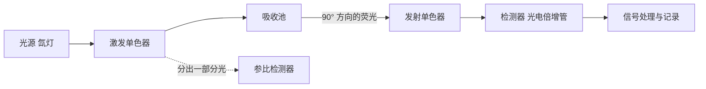

[6.3.17](/6.3.17#sec-17.2) 从光化学的角度讲了分子吸收光子后激发态的命运：**Jablonski 图**中的**振动弛豫**、**内转换**、**系间窜越**，发光的**荧光**与**磷光**，以及**猝灭**与 **Stern–Volmer 方程**。本章从分析与成像的角度讲分子发光：怎样用发射的光测定浓度（10.1–10.2），荧光仪器与由荧光派生的各种技术（10.3），怎样在细胞中看到分子——荧光显微术、荧光探针与荧光蛋白（10.4–10.5），以及不需要光激发的化学发光与生物发光（10.6）。发光测量在暗背景上检测信号，检出限比上一章的吸收光度法（[6.4.9](/6.4.9#sec-9.3.3)）低 2–3 个数量级，可以一直做到单个分子；荧光又能进入活细胞、给出分子的位置、距离与运动，所以它是今天生命科学中用得最多的分析手段。

## 10.1. 光致发光原理

### 10.1.1. 光致发光与激发态的去活化

**定义 10.1.1** 分子（或原子）吸收光子跃迁到电子激发态后，再以发射光子的形式回到基态的现象称为**光致发光**。由**单线态**激发态 $\mathrm{S}_1$ 回到基态 $\mathrm{S}_0$（多重度不变）的发光是荧光，由**三线态** $\mathrm{T}_1$ 回到 $\mathrm{S}_0$ 的发光是磷光。

发光与热辐射无关，是"冷光"。按激发能量的来源，分子发光分为光致发光（荧光、磷光）、化学发光（化学反应提供能量）、生物发光（生物体内的酶促化学发光）与电致化学发光等。

分子被激发到 $\mathrm{S}_2$、$\mathrm{S}_1$ 的各个振动能级后，在约 $10^{-12}\,\mathrm{s}$ 内经振动弛豫与内转换降到 $\mathrm{S}_1$ 的最低振动能级（**Kasha 规则**），再以下面几种途径之一回到基态（各途径的速率常数）：

| 途径 | 过程 | 速率常数 / $\mathrm{s^{-1}}$ |
|---|---|---|
| 荧光 | $\mathrm{S}_1 \to \mathrm{S}_0 + h\nu_{\mathrm{f}}$ | $k_{\mathrm{r}} \sim 10^7$–$10^9$ |
| 内转换 | $\mathrm{S}_1 \rightsquigarrow \mathrm{S}_0$（热） | $k_{\mathrm{ic}}$ |
| 系间窜越 | $\mathrm{S}_1 \rightsquigarrow \mathrm{T}_1$ | $k_{\mathrm{isc}} \sim 10^6$–$10^{10}$（重原子使之增大） |
| 外转换（猝灭） | $\mathrm{S}_1 + \mathrm{Q} \to \mathrm{S}_0 + \mathrm{Q}$ | $k_{\mathrm{q}}[\mathrm{Q}]$ |
| 磷光 | $\mathrm{T}_1 \to \mathrm{S}_0 + h\nu_{\mathrm{p}}$ | $10^{-2}$–$10^{4}$（自旋禁阻） |

一个分子要发荧光，必须同时满足两个条件：能强烈吸收激发光（有合适的吸收带与较大的**摩尔吸收系数**），以及吸收的能量有相当一部分以光的形式放出，即荧光的速率能与各种无辐射途径竞争。

### 10.1.2. 激发光谱与发射光谱

荧光仪器有两个单色器（10.3.1），可以记录两种光谱：

**定义 10.1.2** 固定发射（测量）波长，扫描激发波长，记录荧光强度随激发波长变化的光谱称为**激发光谱**；固定激发波长，扫描发射波长，记录荧光强度随发射波长变化的光谱称为**发射光谱**（荧光光谱）。

荧光强度正比于吸收的光子数，所以在稀溶液中激发光谱的形状与吸收光谱相同（经光源强度与单色器效率校正后）；这一点可以用来确认发光来自哪一种物质。由 Kasha 规则，发光总是从 $\mathrm{S}_1$ 的最低振动能级开始，所以发射光谱的形状与激发波长无关——只改变强度，不改变形状。分析时在激发光谱的峰值处激发、在发射光谱的峰值处测量，灵敏度最高；两个都可以扫描的单色器还使荧光比吸收多了一个选择性维度：吸收光谱重叠的两种物质，只要发射光谱不同，就能分别测定（同时扫描激发与发射得到的三维荧光光谱称为激发–发射矩阵）。

**定义 10.1.3** 同一物质的发射光谱的极大波长与吸收（激发）光谱的极大波长之差称为 **Stokes 位移**（常以波数差表示）。

激发后在 $\mathrm{S}_1$ 内的振动弛豫、溶剂分子围绕极性更大的激发态重新取向（溶剂弛豫），都消耗了部分能量；发射又终止于 $\mathrm{S}_0$ 的各个振动能级。所以荧光的波长总是比激发光长。Stokes 位移使荧光与激发光、与 Rayleigh 散射光在波长上分开，是荧光测量能做到低背景的原因之一；Stokes 位移大的染料（如某些香豆素与 BODIPY 衍生物）自吸收小。

**定义 10.1.4（镜像规则）** 许多刚性分子的荧光发射光谱与其 $\mathrm{S}_0 \to \mathrm{S}_1$ 吸收带的形状大致以 0–0 带为中心呈镜像对称，这一经验规律称为**镜像规则**。

原因是吸收与发射涉及同一对电子态：吸收从 $\mathrm{S}_0$ 的 $v = 0$ 跃迁到 $\mathrm{S}_1$ 的各振动能级，发射从 $\mathrm{S}_1$ 的 $v = 0$ 跃迁到 $\mathrm{S}_0$ 的各振动能级。若两个电子态的振动能级间隔与核构型相近，Franck–Condon 原理给出的两组振动带强度分布相同，只是一个向高能、一个向低能排列。蒽的乙醇溶液、硫酸奎宁的稀硫酸溶液都是典型的例子。偏离镜像规则说明激发态的几何构型与基态差别大，或激发态发生了质子转移、形成激基复合物等反应；荧光光谱一般比吸收光谱简单，因为它只对应 $\mathrm{S}_1$ 一个激发态。


```smiles
c1ccc2cc3ccccc3cc2c1 1
COc1ccc2nccc([C@@H](O)[C@@H]3C[C@@H]4CC[N@]3C[C@@H]4C=C)c2c1 2
```

### 10.1.3. 荧光寿命与量子产率

**定义 10.1.5** 停止激发后，激发态分子数（荧光强度）按指数规律 $I(t) = I_0\mathrm{e}^{-t/\tau_{\mathrm{f}}}$ 衰减，衰减到初值的 $1/\mathrm{e}$ 所需的时间 $\tau_{\mathrm{f}}$ 称为**荧光寿命**（激发态寿命）。

$\mathrm{S}_1$ 的各种衰减途径都是一级过程，它们的速率常数之和决定寿命：

$$
\tau_{\mathrm{f}} = \frac{1}{k_{\mathrm{r}} + k_{\mathrm{nr}}}, \qquad k_{\mathrm{nr}} = k_{\mathrm{ic}} + k_{\mathrm{isc}} + k_{\mathrm{q}}[\mathrm{Q}].
$$
荧光的**量子产率**（[6.3.17](/6.3.17#sec-17.2.3)；又称荧光效率）是发射的光子数与吸收的光子数之比，等于荧光途径所占的分数：

$$
\Phi_{\mathrm{f}} = \frac{\text{发射的光子数}}{\text{吸收的光子数}} = \frac{k_{\mathrm{r}}}{k_{\mathrm{r}} + k_{\mathrm{nr}}} = k_{\mathrm{r}}\tau_{\mathrm{f}}. \tag{10.1}
$$
$1/k_{\mathrm{r}}$ 称为本征（辐射）寿命，是没有任何无辐射途径时的寿命。吸收越强的跃迁，其逆过程（自发发射）也越快：$k_{\mathrm{r}}$ 近似正比于吸收带的积分强度（Strickler–Berg 关系，与原子的 Einstein 系数关系同理，[5.5.5](/5.5.5#sec-5.2.2)），$\varepsilon_{\max} \approx 10^5$ 的允许跃迁 $1/k_{\mathrm{r}}$ 约为几纳秒。典型的荧光寿命：荧光素约 $4\,\mathrm{ns}$，罗丹明 B 约 $1.7\,\mathrm{ns}$（乙醇），硫酸奎宁约 $19\,\mathrm{ns}$，色氨酸约 $3\,\mathrm{ns}$（多指数），镧系配合物（$\ce{Eu^3+}$、$\ce{Tb^3+}$）可达毫秒级（10.3.3）。

测出 $\Phi_{\mathrm{f}}$ 与 $\tau_{\mathrm{f}}$ 就能由式 (10.1) 分别求 $k_{\mathrm{r}}$ 与 $k_{\mathrm{nr}}$，这是研究激发态动力学的基本方法。寿命与强度不同：它不依赖浓度、光源强度与检测效率，只依赖分子及其环境，所以荧光寿命成像（FLIM）能在细胞中测量 pH、离子浓度、黏度或 FRET（10.3.4），而不受探针浓度不均的影响。

### 10.1.4. 分子结构与荧光

有强荧光的分子大多具有刚性的平面 π 共轭体系：π→π\* 跃迁的 $\varepsilon$ 大，$k_{\mathrm{r}}$ 大；分子刚性好，振动与扭转少，无辐射衰减慢。任何增大共轭程度的结构改变，都使量子产率提高、荧光波长红移。

| 化合物 | 结构 | $\Phi_{\mathrm{f}}$ | 荧光波长 / nm |
|---|---|---|---|
| 苯 | 单环 | $0.07$ | $283$ |
| 萘 | 两环稠合 | $0.23$ | $334$ |
| 蒽 | 三环稠合 | $0.36$ | $402$ |
| 联苯 | 两环单键相连 | $0.18$ | $316$ |
| 对三联苯 | 三环单键相连 | $0.93$ | $342$ |
| 甲苯 | 苯 + 甲基 | $0.17$ | $285$ |

（环己烷溶液，量子产率与平均荧光波长取自 Berlman 的芳香分子荧光数据手册；同一化合物在不同溶剂中的数值不同，比较时应注明溶剂。）

```smiles
c1ccc(cc1)-c1ccccc1 1
c1ccc(cc1)-c1ccc(cc1)-c1ccccc1 2
```

结构因素的规律：

- 刚性：荧光素与酚酞结构相近，荧光素的两个苯环由氧桥固定在同一平面上，在碱性溶液中 $\Phi_{\mathrm{f}} = 0.92$；酚酞的苯环可以自由转动，几乎不发荧光。芴（亚甲基把联苯固定成平面）的荧光比联苯强得多。金属离子与有机配体螯合后分子刚性增大，也常使荧光增强（8-羟基喹啉的金属配合物），这是荧光法测金属离子的基础之一。
- 取代基：给电子基（$\ce{-OH}$、$\ce{-NH2}$、$\ce{-OCH3}$）一般使荧光增强、红移；吸电子基（$\ce{-NO2}$、$\ce{-COOH}$、羰基）常使荧光减弱，硝基芳烃几乎不发荧光，因为 n→π\* 态参与使系间窜越加快。
- 重原子效应：Br、I 等重原子增强**自旋–轨道耦合**，加快系间窜越，使荧光减弱、磷光增强（$\Phi_{\mathrm{f}}$：氟苯 > 氯苯 > 溴苯 > 碘苯），分子内的重原子与溶剂中的重原子（碘乙烷、$\ce{I-}$）都有此效应。常说的"溴化物、碘化物、硝基、重氮与羰基化合物易转入三线态而使荧光减弱"中，溴、碘属于重原子效应，硝基、重氮与羰基则是 n→π\* 态加快系间窜越（上一条）。

一些常用荧光物质的量子产率：

| 物质 | 溶剂 | $\Phi_{\mathrm{f}}$ |
|---|---|---|
| 荧光素 | $0.1\,\mathrm{mol\,L^{-1}}$ $\ce{NaOH}$ | $0.92$ |
| 曙红 Y | $0.1\,\mathrm{mol\,L^{-1}}$ $\ce{NaOH}$ | $0.19$ |
| 罗丹明 B | 乙醇 | $0.70$ |
| 罗丹明 6G | 乙醇 | $0.95$ |
| 硫酸奎宁 | $0.5\,\mathrm{mol\,L^{-1}}$ $\ce{H2SO4}$ | $0.546$ |
| 核黄素 | 水（pH 7） | $0.26$ |
| 叶绿素 a | 乙醚 | 约 $0.3$ |
| 色氨酸 | 水（pH 7） | $0.13$ |

```smiles
[O-]C(=O)c1ccccc1-c1c2ccc(=O)cc-2oc2cc([O-])ccc12 1
CCN(CC)c1ccc2c(-c3ccccc3C(=O)O)c3ccc(=[N+](CC)CC)cc3oc2c1 2
```

### 10.1.5. 环境的影响

- 溶剂：极性溶剂稳定极性较大的激发态，使荧光红移；对激发态有分子内电荷转移的分子（"推–拉"型染料），荧光波长与强度对溶剂极性极敏感。这类溶剂敏感染料（如 ANS、Nile 红、Prodan）在水中荧光很弱，结合到蛋白质的疏水口袋或膜中后荧光大增并蓝移，用来探测蛋白质的疏水表面与膜的极性。溶剂黏度增大抑制分子内扭转，使"分子转子"型染料的荧光增强，可以测细胞内的微黏度。
- pH：带有酸性或碱性基团的荧光物质，其酸式与碱式的荧光不同。苯胺在 pH 7–12 发蓝色荧光，在强酸中成为苯胺离子而不发光；荧光素的荧光在 pH 5–9 之间强烈依赖 pH（$\mathrm{p}K_{\mathrm{a}} \approx 6.4$）。测定时必须控制 pH，这也正是荧光 pH 探针的原理（10.4.4）。注意激发态的酸碱性可以与基态差别很大（萘酚类的激发态是强得多的酸），激发态质子转移会给出第二个发射带。
- 温度：温度升高，分子与溶剂的碰撞加剧，无辐射衰减与动态猝灭加快，荧光通常减弱（每升高 1 K 约减少 1%–数 %）。荧光测量要恒温，低温下荧光与磷光都增强。
- 溶解氧与其他猝灭剂：见 10.2.3。

## 10.2. 荧光定量分析与猝灭

### 10.2.1. 荧光强度与浓度

荧光强度 $I_{\mathrm{f}}$ 正比于吸收的光强 $I_{\mathrm{a}}$ 与量子产率：$I_{\mathrm{f}} = \Phi_{\mathrm{f}}I_{\mathrm{a}} = \Phi_{\mathrm{f}}(I_0 - I)$。由 **Lambert–Beer 定律** $I = I_0\cdot 10^{-\varepsilon bc}$，

$$
I_{\mathrm{f}} = \Phi_{\mathrm{f}}I_0\left(1 - 10^{-\varepsilon bc}\right) = \Phi_{\mathrm{f}}I_0\left(1 - \mathrm{e}^{-2.303\varepsilon bc}\right).
$$
把指数展开，

$$
I_{\mathrm{f}} = \Phi_{\mathrm{f}}I_0\left[2.303\varepsilon bc - \frac{(2.303\varepsilon bc)^2}{2!} + \frac{(2.303\varepsilon bc)^3}{3!} - \cdots\right].
$$
当**吸光度** $A = \varepsilon bc \le 0.05$ 时，方括号中第二项与第一项之比不超过约 $6\%$，可以略去高次项：

$$
I_{\mathrm{f}} = 2.303\,\Phi_{\mathrm{f}}I_0\varepsilon bc = Kc. \tag{10.2}
$$
实验条件（仪器、激发与发射波长、狭缝、温度）固定时，荧光强度与浓度成正比，这是荧光定量分析的依据，具体用**校准曲线**或**标准加入法**（[6.4.1](/6.4.1#sec-1.8.4)）。仪器测得的是相对强度，不同仪器、不同时间的读数要用稳定的标准物质（如硫酸奎宁）校正。

式 (10.2) 还说明了荧光法灵敏度高的原因：$I_{\mathrm{f}}$ 正比于 $I_0$，增大激发光强（用氙灯、激光）就能提高信号；荧光在暗背景上测量，检测器（光电倍增管或单光子计数）能测极弱的光。吸收光度法测的是 $\lg(I_0/I)$，增大 $I_0$ 并不增大吸光度，信号受限于分辨两个大光强之差的能力（[6.4.9](/6.4.9#sec-9.3.3)）。所以荧光法的检出限一般比吸收光度法低 2–3 个数量级，可达 $10^{-10}$–$10^{-12}\,\mathrm{mol\,L^{-1}}$，在优化条件下可以检测单个分子。

### 10.2.2. 内滤效应与浓度猝灭

浓度增大时，$I_{\mathrm{f}}$–$c$ 曲线先偏离直线，再达到极大，然后下降——浓溶液的荧光反而弱。原因有三：

**定义 10.2.1** 溶液中的吸光物质（被测物本身或共存物）吸收激发光或发射的荧光，使到达检测器的荧光强度降低、偏离与浓度的线性关系的现象称为**内滤效应**。吸收激发光的称为初级内滤效应，吸收发射光的称为次级内滤效应（自吸收）。

- 初级内滤：常用仪器在 $90^\circ$ 方向只观测吸收池中央的一小段光程，浓度大时激发光在到达中央之前就被溶液前部吸收了大半，中央区被激发的分子反而减少。
- 次级内滤：发射光谱与吸收光谱重叠（Stokes 位移小）的物质，发射的荧光在射出溶液途中被基态分子重新吸收。
- 浓度猝灭（自猝灭）：浓度高时激发态分子与基态分子碰撞而失活，或分子聚集形成不发光的二聚体与激基缔合物；荧光素标记的抗体标记过多时荧光反而减弱，就是这个原因。

内滤效应不是分子性质的改变，而是光学几何的结果，所以可以按测得的吸光度校正：$I_{\mathrm{f,corr}} \approx I_{\mathrm{f}}\cdot 10^{(A_{\mathrm{ex}} + A_{\mathrm{em}})/2}$（适用于中央观测、$A$ 不太大时）。更简单的办法是稀释到 $A < 0.05$，或改用前表面观测（从照射面一侧收集荧光，适合浑浊与高吸收试样）。


### 10.2.3. 动态猝灭与静态猝灭

**猝灭**是激发态分子与猝灭剂 Q 作用而无辐射失活。按机理分为两类，它们的区分方法在 [6.3.17](/6.3.17#sec-17.2.5) 中已给出，这里归纳分析中要注意的几点：

| | 动态（碰撞）猝灭 | 静态猝灭 |
|---|---|---|
| 机理 | 激发态 $\ce{M^*}$ 在寿命内与 Q 碰撞：$\ce{M^* + Q -> M + Q}$ | 基态 M 与 Q 形成不发光的配合物：$\ce{M + Q <=> MQ}$ |
| 强度 | $F_0/F = 1 + K_{\mathrm{SV}}[\ce{Q}]$，$K_{\mathrm{SV}} = k_{\mathrm{q}}\tau_0$ | $F_0/F = 1 + K_{\mathrm{s}}[\ce{Q}]$，$K_{\mathrm{s}}$ 为结合常数 |
| 寿命 | 缩短：$\tau_0/\tau = F_0/F$ | 不变（剩下的自由 M 照常发光） |
| 温度升高 | 扩散加快，猝灭增强 | 配合物解离，猝灭减弱 |
| 吸收光谱 | 不变 | 常有变化（形成了新物种） |

常见猝灭剂：溶解氧（三线态基态，以接近扩散控制的速率猝灭几乎所有荧光，对长寿命的荧光与磷光尤其明显；精确测量时通氮除氧）、重原子与卤素离子（$\ce{I-}$、$\ce{Br-}$；促进系间窜越）、过渡金属顺磁离子、胺类（电子转移）、硝基化合物。

猝灭既是干扰，也是测定方法：

- 荧光猝灭法：被测物本身不发光、却能猝灭某种荧光物质时，由猝灭程度定量，如用 $\ce{O2}$ 猝灭钌配合物或铂卟啉的磷光测溶解氧（光学氧传感器），用 $\ce{Cu^2+}$、$\ce{Hg^2+}$ 猝灭荧光探针测金属离子。
- 结构探测：蛋白质中色氨酸被 $\ce{I-}$（带电，不进入疏水内部）或丙烯酰胺（中性）猝灭的程度，反映色氨酸残基是否暴露在溶剂中；荧光猝灭滴定求药物与血清白蛋白的结合常数（注意区分动态与静态，并校正内滤效应）。

### 10.2.4. 量子产率的测定

绝对量子产率要用积分球收集全部发射光，测定复杂。分析中常用参比法：在相同仪器条件下测定待测物 x 与已知量子产率的标准物 s 的稀溶液（$A < 0.05$）的积分荧光强度 $F$ 与激发波长的吸光度 $A$：

$$
\Phi_x = \Phi_s\,\frac{F_x}{F_s}\cdot\frac{A_s}{A_x}\cdot\frac{n_x^2}{n_s^2}, \tag{10.3}
$$
$n$ 为溶剂的**折射率**（溶剂不同时必须加上这一项，因为折射率影响荧光从溶液中射出的立体角）。标准物应与待测物的激发、发射波长范围相近，常用的有：硫酸奎宁（$0.5\,\mathrm{mol\,L^{-1}}$ $\ce{H2SO4}$ 中 $\Phi = 0.546$；IUPAC 2011 年的技术报告推荐改用 $0.1\,\mathrm{mol\,L^{-1}}$ $\ce{HClO4}$ 溶液，$\Phi = 0.60$，它几乎不随温度变化）、荧光素（$0.1\,\mathrm{mol\,L^{-1}}$ $\ce{NaOH}$，$0.92$）、罗丹明 6G（乙醇，$0.95$）。

**例 10.2.1** 某化合物的乙醇溶液在 $350\,\mathrm{nm}$ 的吸光度为 $0.040$，积分荧光强度为 $3.2\times10^5$（任意单位）；硫酸奎宁标准溶液（$0.5\,\mathrm{mol\,L^{-1}}$ $\ce{H2SO4}$，$n = 1.346$）在同一波长的吸光度为 $0.035$，积分强度为 $4.1\times10^5$。乙醇的 $n = 1.361$。则

$$
\Phi_x = 0.546\times\frac{3.2\times10^5}{4.1\times10^5}\times\frac{0.035}{0.040}\times\frac{1.361^2}{1.346^2} = 0.38.
$$

### 10.2.5. 散射光的干扰与荧光分析的特点

荧光测量的背景主要是散射光：

- **Rayleigh 散射**光（[5.4.3](/5.4.3#sec-3.4.2)）波长与激发光相同，强度远大于荧光；光栅的二级衍射还会在 $2\lambda_{\mathrm{ex}}$ 处出现假峰。
- 溶剂的 **Raman 散射**光（[6.4.11](/6.4.11#def-11.5.1)）与激发光的波数差恒定，所以其波长随激发波长移动——这是区别 Raman 峰与荧光峰的方法（荧光峰的位置不随激发波长变）。水的 O–H 伸缩振动 Raman 位移约 $3400\,\mathrm{cm^{-1}}$：$350\,\mathrm{nm}$ 激发时 Raman 峰在约 $397\,\mathrm{nm}$，$488\,\mathrm{nm}$ 激发时在约 $585\,\mathrm{nm}$。

选择激发波长使散射峰避开荧光峰，用发射侧的截止滤光片，并扣除溶剂空白的光谱。胶体、细胞悬液等浑浊试样的散射更强，要用时间分辨荧光（10.3.3）或前表面观测。

荧光分析的特点：

- 检出限低：比吸收光度法低 2–3 个数量级；
- 选择性好：激发与发射两个波长、荧光寿命、偏振都可以用来区分物质，而能发强荧光的物质本来就少；
- 信息多：荧光对微环境（极性、黏度、pH、离子、结合状态、距离）敏感，可以用于活细胞和单分子；
- 局限：本身发荧光的物质不多，多数被测物要经荧光衍生化、标记或与荧光探针作用；荧光受温度、溶剂、猝灭剂、内滤效应影响大，定量的重现性不如吸收法；荧光物质会光漂白。

## 10.3. 荧光仪器与技术

### 10.3.1. 荧光分光光度计



与分光光度计相比，荧光分光光度计有三个不同：

- 光源：荧光强度正比于 $I_0$，需要强光源。常用高压氙弧灯（$200$–$800\,\mathrm{nm}$ 的连续光谱，强度高，多数仪器的标准配置）与脉冲氙灯；汞灯给出线状光谱（$254$、$365\,\mathrm{nm}$ 等），用于固定波长的检测器；激光（单色、高亮度、可聚焦、可脉冲）用于激光诱导荧光、显微成像与时间分辨测量；LED 用于便携与专用仪器。
- 两个单色器：激发单色器选择激发波长，发射单色器选择发射波长（简单的荧光计用滤光片）。
- 观测方向：在与激发光垂直（$90^\circ$）的方向检测，避开透射光；吸收池四面透光。参比检测器监测光源强度的波动，输出比值信号。

### 10.3.2. 激光诱导荧光

用**激光**作激发光源的荧光检测称为激光诱导荧光（LIF）。激光能聚焦到微米级的小体积中，功率密度高、单色性好，散射背景容易用滤光片除去，检出限可达 $10^{-12}$–$10^{-13}\,\mathrm{mol\,L^{-1}}$，在优化条件下能检测溶液中的单个分子。它的典型应用是毛细管电泳与微流控芯片的检测器（检测区的体积只有纳升）：Sanger 法 DNA 测序中，四种双脱氧核苷酸分别用四种发射波长不同的荧光染料标记，片段在**毛细管电泳**中按长度分离后由激光激发，按荧光颜色读出碱基（[6.4.14](/6.4.14#sec-14.5.4)）。流式细胞术也是激光诱导荧光：细胞逐个流过激光焦点，同时测量散射光与多种荧光标记的强度，每秒可分析上万个细胞。

### 10.3.3. 时间分辨荧光与荧光寿命测量

用纳秒或皮秒脉冲激发，记录荧光强度随时间的衰减，可以得到荧光寿命 $\tau_{\mathrm{f}}$。最灵敏的方法是时间相关单光子计数（TCSPC）：每个激发脉冲后最多检测到一个光子，记录它相对于激发脉冲的延迟时间，重复数百万次后，延迟时间的直方图就是荧光衰减曲线；它本质上是对单光子到达时间的概率分布抽样，计数服从 **Poisson 分布**，信噪比随总计数的平方根增长。实测曲线是真实衰减与仪器响应函数的卷积，用迭代重卷积的非线性最小二乘拟合求寿命。频域法（正弦调制激发，测发射光的相移与调制度）是另一种常用方法。

时间分辨还能消除背景。镧系元素配合物（$\ce{Eu^3+}$、$\ce{Tb^3+}$ 与芳香配体，配体吸收后把能量传给金属离子）的发光寿命长达 $0.1$–$1\,\mathrm{ms}$，Stokes 位移大、发射峰窄。脉冲激发后延迟约 $50$–$100\,\mu\mathrm{s}$ 再开始测量，纳秒级的散射光与生物样品的自发荧光都已消失，只剩镧系标记物的信号。基于这一原理的时间分辨荧光免疫分析与均相时间分辨荧光（TR-FRET，与 10.3.4 结合）是临床检验与药物高通量筛选的常用方法。

### 10.3.4. Förster 共振能量转移

[6.3.17](/6.3.17#sec-17.2.5) 提到，激发态分子（供体 D）可以把能量转移给另一个分子（受体 A）而被猝灭。当 D 的发射光谱与 A 的吸收光谱重叠、两者相距几纳米时，能量通过偶极–偶极相互作用无辐射地传递，D 并不先发出光子再被 A 吸收。

**定义 10.3.1** 激发态供体分子通过偶极–偶极耦合，把激发能无辐射地转移给相距约 $1$–$10\,\mathrm{nm}$ 的基态受体分子的过程称为 **Förster 共振能量转移**（FRET，又称荧光共振能量转移）。

Förster（1948）给出能量转移的速率常数

$$
k_{\mathrm{T}} = \frac{1}{\tau_{\mathrm{D}}}\left(\frac{R_0}{r}\right)^6, \tag{10.4}
$$
其中 $\tau_{\mathrm{D}}$ 是无受体时供体的荧光寿命，$r$ 是 D 与 A 的距离，$R_0$ 称为 Förster 距离：

$$
R_0^6 = \frac{9\ln 10\,\kappa^2\Phi_{\mathrm{D}}J}{128\pi^5N_{\mathrm{A}}n^4}, \qquad J = \int F_{\mathrm{D}}(\lambda)\,\varepsilon_{\mathrm{A}}(\lambda)\,\lambda^4\,\mathrm{d}\lambda.
$$
$\Phi_{\mathrm{D}}$ 是供体的量子产率，$n$ 是介质的折射率（生物体系约 $1.4$），$J$ 是供体的归一化发射光谱 $F_{\mathrm{D}}$ 与受体摩尔吸收系数 $\varepsilon_{\mathrm{A}}$ 的光谱重叠积分，$\kappa^2$ 是两个跃迁偶极矩相对取向的因子（分子快速随机转动时取 $2/3$）。以常用单位（$J$ 以 $\mathrm{L\,mol^{-1}\,cm^{-1}\,nm^4}$ 计）写成 $R_0 = 0.0211\,(\kappa^2\Phi_{\mathrm{D}}n^{-4}J)^{1/6}\,\mathrm{nm}$。常用染料对的 $R_0$ 为 $2$–$9\,\mathrm{nm}$：荧光素–四甲基罗丹明约 $5.5\,\mathrm{nm}$，Cy3–Cy5 约 $5.4\,\mathrm{nm}$，CFP–YFP 约 $4.9\,\mathrm{nm}$。

能量转移效率是转移途径占供体全部衰减途径的分数：

$$
E = \frac{k_{\mathrm{T}}}{k_{\mathrm{T}} + 1/\tau_{\mathrm{D}}} = \frac{1}{1 + (r/R_0)^6} = 1 - \frac{F_{\mathrm{DA}}}{F_{\mathrm{D}}} = 1 - \frac{\tau_{\mathrm{DA}}}{\tau_{\mathrm{D}}}, \tag{10.5}
$$
$F_{\mathrm{DA}}$、$\tau_{\mathrm{DA}}$ 与 $F_{\mathrm{D}}$、$\tau_{\mathrm{D}}$ 分别是有、无受体时供体的荧光强度与寿命。$r = R_0$ 时 $E = 50\%$；由于六次方的依赖，$E$ 在 $0.5R_0$ 到 $1.5R_0$ 之间从 $98\%$ 降到 $8\%$，在这一范围内对距离极为敏感，而这正是生物大分子的尺度。Stryer 与 Haugland（1967）用两端连着供体与受体的多聚脯氨酸寡肽（刚性的已知长度）验证了 $r^{-6}$ 关系，称 FRET 为"光谱尺"。


FRET 的生物分析应用：

- 分子距离与构象：在蛋白质或核酸的两个位点分别标记 D、A，由 $E$ 求距离；单分子 FRET 可以观察单个分子在不同构象之间的转换（如核酶折叠、马达蛋白的步进），不被群体平均掩盖。
- 分子相互作用：两种蛋白分别与 CFP、YFP 融合（10.5），在细胞中只有两者结合（相距小于 $10\,\mathrm{nm}$）时才有 FRET，用以在活细胞中检测蛋白质–蛋白质相互作用。
- FRET 生物传感器：把供体与受体连在一个能随被测物改变构象的识别元件两端。钙传感器 cameleon（Miyawaki 与钱永健，1997）是 CFP–钙调蛋白–M13 肽–YFP 的融合蛋白：结合 $\ce{Ca^2+}$ 后钙调蛋白包裹 M13 肽，CFP 与 YFP 靠近，FRET 增强；测 YFP 与 CFP 的发射强度比，就得到与探针浓度无关的比率信号。同样的设计用于激酶活性、cAMP、膜电位与机械张力的测量。
- 均相分析：分子信标（两端分别连荧光团与猝灭剂的茎环寡核苷酸，与目标序列杂交后茎打开、荧光恢复）与 TaqMan 探针（PCR 中被聚合酶的 5′ 外切活性切断后荧光恢复）是实时定量 PCR 的检测原理，不需要分离结合与游离的探针。

### 10.3.5. 荧光偏振与各向异性

用**线偏振光**激发时，优先被激发的是跃迁偶极矩平行于偏振方向的分子，所以发射光也是部分偏振的。分别测量平行与垂直于激发偏振方向的发射分量 $I_\parallel$、$I_\perp$，定义荧光各向异性

$$
r = \frac{I_\parallel - I_\perp}{I_\parallel + 2I_\perp}.
$$
分子在荧光寿命内转动越多，偏振越被破坏，$r$ 越小。对球形分子有 Perrin 方程 $r_0/r = 1 + \tau_{\mathrm{f}}/\theta_{\mathrm{c}}$，转动相关时间 $\theta_{\mathrm{c}} = \eta V/(k_{\mathrm{B}}T)$ 正比于分子体积。小的荧光标记分子转动快、$r$ 小，结合到大的蛋白质或抗体上后转动变慢、$r$ 增大。荧光偏振免疫分析与结合实验就利用这一点：不需要分离游离与结合的标记物，直接在溶液中测定结合分数，是药物筛选中常用的均相方法。

## 10.4. 荧光成像与荧光探针

### 10.4.1. 荧光显微镜

荧光显微镜用短波长的光（紫外、蓝光或激光）照明标本，使其中的荧光物质发光，通过滤光片只让荧光到达目镜或相机。现代的落射荧光显微镜中，激发光经二向色镜反射后由物镜照到标本上，荧光由同一物镜收集，透过二向色镜与发射滤光片成像。少数细胞成分有自发荧光（NADH、黄素、叶绿素），多数结构要用荧光染料、荧光标记的抗体（免疫荧光）或荧光蛋白（10.5）标记后观察。它能看到特定分子在细胞中的位置、运输与分布，在暗背景上的亮点也比明场中的吸收对比更容易看到。宽场荧光显微镜的缺点是焦平面以外的荧光也被收集，厚标本的图像模糊。

### 10.4.2. 激光扫描共聚焦显微镜

**定义 10.4.1** 用聚焦的激光点逐点扫描标本，并在检测器前与焦点共轭的位置放置针孔，只让来自焦平面的荧光通过、挡住焦平面以外的荧光，从而得到光学切片图像的荧光显微镜称为**共聚焦显微镜**（激光扫描共聚焦显微镜）。

照明点与检测针孔同时聚焦在样品的同一点上（"共焦"），焦平面上下的荧光在针孔处是离焦的，大部分被挡住。逐点、逐行扫描得到一个平面的图像；改变焦平面的深度得到一系列光学切片，由计算机重建三维结构。共聚焦显微镜的横向分辨率比宽场显微镜略好（约 $0.2\,\mu\mathrm{m}$），更重要的是有约 $0.5$–$0.8\,\mu\mathrm{m}$ 的轴向分辨能力，可以对厚标本与活细胞做三维、多色与长时间成像，并能在细胞内定量地测量荧光强度（离子浓度、蛋白质含量）。转盘共聚焦用成千个针孔同时扫描，成像更快、光损伤更小；双光子显微镜（[6.3.17](/6.3.17#sec-17.2.2)）用近红外脉冲激光，只在焦点处发生双光子吸收，不需要针孔就能光学切片，而且穿透更深。

### 10.4.3. 衍射极限与超分辨荧光显微术

光学显微镜的分辨能力受衍射限制：点光源经物镜成像为有限大小的衍射斑（**Airy 斑**），两点能被分辨的最小距离由 **Rayleigh 判据**（[5.4.2](/5.4.2#sec-2.4.2)）给出，$d = 0.61\lambda/\mathrm{NA}$；Abbe 的表达式为 $d = \lambda/(2\,\mathrm{NA})$。$\mathrm{NA} = n\sin\alpha$ 是物镜的数值孔径，最大约 $1.4$–$1.5$，所以可见光的横向分辨率约 $200$–$250\,\mathrm{nm}$，轴向约 $500$–$700\,\mathrm{nm}$——比许多细胞器、蛋白质复合物与突触结构都大。

**定义 10.4.2** 利用荧光分子在亮（发光）与暗（不发光）两种状态之间的可控切换，使衍射极限范围内的相邻分子不同时发光，从而获得优于衍射极限的空间分辨率的荧光显微方法统称为**超分辨荧光显微术**。主要有受激辐射损耗（STED）显微术与单分子定位显微术（PALM、STORM）两类。

关键在于：衍射限制的是光学系统区分两个同时发光的点的能力，而不是确定一个发光点位置的精度。只要让相邻的分子在空间或时间上依次发光，就能把它们分开。

STED（Hell，1994 年提出，2000 年实现）：用一束激发光把衍射极限大小光斑内的分子激发到 $\mathrm{S}_1$，紧接着用一束波长较长、中心强度为零的环形（"甜甜圈"形）损耗光照射同一位置。损耗光的波长落在荧光发射带的红端，通过**受激辐射**使光斑外围的激发态分子在自发发荧光之前就回到基态（受激发射的光子与损耗光同波长、同方向，被滤光片除去）；只有中心零点附近的分子不受影响，照常发荧光。分子保持激发态的概率随损耗光强 $I$ 按 $\exp(-I/I_{\mathrm{s}})$ 量级减小（$I_{\mathrm{s}}$ 为饱和光强），所以损耗光越强，能发荧光的区域越小：

$$
d \approx \frac{\lambda}{2\,\mathrm{NA}\sqrt{1 + I_{\max}/I_{\mathrm{s}}}}.
$$
原则上分辨率没有下限，实际可达 $20$–$50\,\mathrm{nm}$。用扫描得到图像。把这一原理说成"外围供体分子的荧光被受体猝灭"是不准确的：STED 不涉及受体分子，起作用的是损耗光引起的受激辐射，它把外围分子"关闭"。


单分子定位（PALM：Betzig 等，2006，用光活化荧光蛋白；STORM：庄小威等，2006，用光开关染料）：用很弱的活化光使每一时刻只有极少数、彼此相距大于衍射极限的分子随机地处于发光态。每个分子的像是一个 Airy 斑，但斑的中心可以通过拟合（二维高斯函数的最小二乘或极大似然拟合）精确确定，定位精度约为 $\sigma_{\mathrm{PSF}}/\sqrt{N}$（$N$ 为收集到的光子数，与求均值的标准误同理）。收集几千个光子时精度可达 $10$–$20\,\mathrm{nm}$。分子发光后被漂白或关闭，再激活下一批；记录上万帧，把所有分子的定位叠加，就重建出超分辨图像。

此外，结构光照明显微术（SIM）用条纹照明把高频信息移入可测范围，分辨率提高约一倍，速度快、适合活细胞；MINFLUX 等新方法把定位精度推进到纳米级。2014 年诺贝尔化学奖授予 Betzig、Hell 与 Moerner，表彰超分辨荧光显微术的发展；Moerner 1989 年首次在固体中用光谱检测到单个分子，1997 年发现 GFP 突变体单分子的"闪烁"与光开关，为 PALM 奠定了基础。

### 10.4.4. 小分子荧光探针

荧光探针是能与特定分子、离子或细胞结构作用并改变（或定位）荧光信号的分子。常用的几类：

- 标记染料：荧光素（异硫氰酸荧光素 FITC 与蛋白质的氨基反应，用于标记抗体）、罗丹明类、花菁类（Cy3、Cy5，荧光延伸到红区与近红外，生物组织的自发荧光与吸收小）、Alexa Fluor 等耐光漂白的磺化染料。
- 细胞器与核酸染料：带正电荷的亲脂性染料（罗丹明 123、TMRM）按线粒体膜电位富集在线粒体中，可测膜电位；DAPI 与 Hoechst 结合 DNA 小沟，发蓝色荧光，用于染细胞核；溴化乙锭与 SYBR Green 嵌入双链 DNA 后荧光增强约 20 倍与上千倍，用于凝胶电泳与实时定量 PCR。詹纳斯绿 B 也是线粒体的活体染料，但它是靠吸收显色、在明场中观察的染料，不是荧光探针。
- 离子探针：钱永健在 EGTA 的基础上设计了对 $\ce{Ca^2+}$ 高选择性、几乎不受 pH 影响的螯合剂 BAPTA，再在其芳环上连接荧光团，得到 quin-2、fura-2（1985）、indo-1 与 Fluo-4 等钙指示剂（配位化学见 [6.4.3](/6.4.3#sec-3.5.3)）。fura-2 结合 $\ce{Ca^2+}$ 后激发光谱蓝移：以 $340\,\mathrm{nm}$ 与 $380\,\mathrm{nm}$ 交替激发、在 $510\,\mathrm{nm}$ 测发射，两者之比 $R$ 与探针浓度、光程、漂白无关，由 Grynkiewicz 方程求游离钙浓度：

  $$
  [\ce{Ca^2+}] = K_{\mathrm{d}}\,\beta\,\frac{R - R_{\min}}{R_{\max} - R},
  $$
  $R_{\min}$、$R_{\max}$ 是无钙与钙饱和时的比值，$\beta$ 是无钙与饱和时 $380\,\mathrm{nm}$ 激发的强度比，$K_{\mathrm{d}}$ 约 $0.14$–$0.22\,\mu\mathrm{mol\,L^{-1}}$（随温度与离子强度变化，要在实验条件下标定），正好覆盖细胞内 $0.1$–$1\,\mu\mathrm{mol\,L^{-1}}$ 的钙信号。这一比率测量与 9.5.4 中用两种形式的吸光度求 $\mathrm{p}K_{\mathrm{a}}$ 是同一个思路。Fluo-4 是单波长探针（$488\,\mathrm{nm}$ 激发，结合钙后荧光增强上百倍），适合共聚焦显微镜。同样的方法用于 pH（BCECF、SNARF）、$\ce{Na+}$、$\ce{Zn^2+}$、膜电位等。
- 开关型探针：许多"关–开"探针利用光诱导电子转移（PET）：荧光团与一个富电子的识别基团（如胺）相连，激发后识别基团把电子转移给荧光团而猝灭荧光；识别基团与被测离子（$\ce{H+}$、金属离子）结合后电子转移被阻断，荧光恢复。酶活性探针在被酶切去保护基后才释放出荧光团（荧光素二乙酸酯被活细胞的酯酶水解，是常用的细胞活力指示）。

### 10.4.5. 量子点

**定义 10.4.3** 尺寸为 $2$–$10\,\mathrm{nm}$、在三个维度上都使电子与空穴的运动受到限制的半导体纳米晶称为**量子点**。

体相半导体中的电子与空穴在纳米晶中被限制在比其自然尺度（激子的 Bohr 半径，CdSe 约 $5\,\mathrm{nm}$）还小的空间里，能级分立、禁带宽度随尺寸减小而增大（**量子尺寸效应**，[6.1.4](/6.1.4#sec-4.2.3)）。按球形势阱中的粒子近似（Brus 方程），

$$
E_{\mathrm{g}}(R) \approx E_{\mathrm{g,bulk}} + \frac{\hbar^2\pi^2}{2R^2}\left(\frac{1}{m_{\mathrm{e}}^*} + \frac{1}{m_{\mathrm{h}}^*}\right) - \frac{1.8\,e^2}{4\pi\varepsilon_0\varepsilon_{\mathrm{r}}R},
$$
$m^*$ 为有效质量，$\varepsilon_{\mathrm{r}}$ 为相对电容率。CdSe 量子点直径由约 $2\,\mathrm{nm}$ 增大到 $6\,\mathrm{nm}$，发射由蓝变到红。作为荧光标记，量子点（通常是 CdSe/ZnS 核壳结构，外加亲水包覆层与生物分子偶联）有几个突出优点：

- 吸收从发射峰一直延伸到紫外，摩尔吸收系数达 $10^5$–$10^6\,\mathrm{L\,mol^{-1}\,cm^{-1}}$，一个波长就能同时激发多种颜色的量子点；
- 发射峰窄而对称（半高宽 $25$–$35\,\mathrm{nm}$），没有有机染料那样的长波拖尾，量子产率高；
- 光稳定性比有机染料高得多，适合长时间成像与追踪单个分子。

这解决了多色荧光检测的一个难题：有机染料的发射带宽、带红端拖尾，可见光窗口（约 $400$–$800\,\mathrm{nm}$）里能同时容纳而不相互干扰的颜色很少，常规荧光检测受光谱重叠的限制，只能同时检测少数几种标记（具体数目取决于染料与滤光片，并没有固定的上限）；量子点可以在同一激发下区分更多种颜色，用于多色标记与"光谱编码"的多元检测。缺点是尺寸较大（包覆后 $10$–$30\,\mathrm{nm}$，可能影响被标记分子的功能）、单个量子点会闪烁，以及镉的毒性。2023 年诺贝尔化学奖授予 Bawendi、Brus 与 Ekimov，表彰量子点的发现与合成。

## 10.5. 绿色荧光蛋白

**定义 10.5.1** 来自维多利亚多管发光水母（*Aequorea victoria*）、由 238 个氨基酸组成、无需任何外加辅因子即可在细胞内自发形成发色团并发出绿色荧光的蛋白质称为**绿色荧光蛋白**（GFP）；由它及其他生物的同源蛋白改造得到的各种颜色的蛋白统称荧光蛋白。

小分子荧光探针要从外部加入细胞，而荧光蛋白由基因编码：把它的基因与目标蛋白的基因相连导入细胞，细胞自己就能合成带荧光标记的目标蛋白。这使活细胞、活体中的分子成像成为常规手段。

### 10.5.1. 发现史

- 下村修与水母发光蛋白（1955–1962）：下村修在名古屋大学平田义正的研究室研究海萤的发光，1956 年首次得到海萤荧光素的结晶（海萤荧光素是小分子而不是蛋白质，催化它氧化的蛋白质是荧光素酶）。1960 年他到普林斯顿大学 Johnson 的实验室，1961 年起在美国西北海岸的 Friday Harbor 采集了大量水母，从伞缘的发光组织中提取发光物质。1962 年他们报道了水母发光蛋白（aequorin）的纯化，并在文中提到一种在紫外光下发绿色荧光的蛋白质，后来命名为 GFP。
- 发光机理（1962–1979）：水母发光蛋白是一种光蛋白，与 $\ce{Ca^2+}$ 结合后，其结合的腔肠素被氧化而发出蓝光（约 $469\,\mathrm{nm}$）；它不需要荧光素酶与外加底物。把提取的发光物质加入海水后出现蓝光，原因是海水中的 $\ce{Ca^2+}$ 触发了水母发光蛋白的反应。在水母体内，水母发光蛋白与 GFP 靠得很近，激发能通过无辐射的能量转移交给 GFP（与 10.3.4 的机理同类），所以水母发的是 GFP 的绿光（$509\,\mathrm{nm}$）。1974 年 GFP 被纯化并结晶，1979 年下村修由 GFP 水解得到的肽段推出了发色团的结构。
- Prasher 克隆 GFP 的基因（1992）：Prasher 设想把 GFP 作为示踪标记，1992 年克隆并测定了 GFP 的 cDNA 序列。这一 cDNA 是正确的，但他没有能在其他细胞中成功表达出荧光；随后经费中断，他离开了这一研究，把克隆送给了索取的研究者，其中包括 Chalfie 与钱永健。（常见的"Prasher 的基因有误、由 Chalfie 修正"的说法与事实不符。）
- Chalfie 的异源表达（1994）：Chalfie 把 GFP 的编码序列在大肠杆菌与秀丽隐杆线虫中表达，得到了发绿色荧光的细菌与线虫的感觉神经元，证明 GFP 的发色团不需要水母的其他酶或辅因子就能形成，GFP 可以作为通用的基因表达标记。同年 Inouye 与 Tsuji 也独立报道了在大肠杆菌中的表达。
- 钱永健的改造（1994 年起）：阐明了发色团形成的机理并证明需要分子氧；1995 年发现 S65T 突变（第 65 位丝氨酸换成苏氨酸）使 GFP 的激发峰移到 $489\,\mathrm{nm}$、荧光增强并加快成熟；随后得到蓝色、青色、黄色等变体，并参与把珊瑚来源的红色荧光蛋白 DsRed 改造为单体的 mCherry 等多色荧光蛋白。

2008 年诺贝尔化学奖授予下村修、Chalfie 与钱永健，表彰"绿色荧光蛋白的发现与发展"。Prasher 作为嘉宾受邀出席了颁奖典礼。

### 10.5.2. 结构与发色团的形成

GFP（约 $27\,\mathrm{kDa}$）的结构（1996 年测定）是由 11 条 β 链围成的圆筒（"β 桶"），直径约 $2.4\,\mathrm{nm}$、高约 $4.2\,\mathrm{nm}$，一条 α 螺旋从桶的中轴穿过，发色团就位于这条螺旋的中央，被桶壁与周围侧链保护起来，与溶剂、氧气和猝灭剂隔开——这是 GFP 荧光强（EGFP 的 $\Phi_{\mathrm{f}} \approx 0.60$）而且对环境不太敏感的原因，变性后的 GFP 不发荧光。

发色团由第 65–67 位的 Ser–Tyr–Gly 三个残基在蛋白质折叠后自发形成，是一个**自催化**的翻译后修饰：

1. 环化：蛋白质折叠使 Gly67 的酰胺氮靠近 Ser65 的羰基碳，发生亲核加成，形成五元咪唑啉酮环；
2. 脱水；
3. 氧化：分子氧把 Tyr66 的 $\mathrm{C}_\alpha$–$\mathrm{C}_\beta$ 单键氧化为双键，使酚环与咪唑啉酮环共轭，同时生成 $\ce{H2O2}$。

最终得到对羟基亚苄基咪唑啉酮发色团（下图是它的小分子模型化合物 HBDI；在蛋白质中两端连着肽链）。氧化是最慢的一步（野生型需要数十分钟到数小时），所以荧光蛋白在无氧条件下不发光。游离的 HBDI 在溶液中几乎不发荧光——激发态时环间的双键扭转很快地无辐射失活；在 β 桶中扭转被限制，量子产率才高，这与 10.1.4 中"刚性"的规律一致。

```smiles
CC1=N/C(=C\c2ccc(O)cc2)C(=O)N1C
```

野生型 GFP 有两个激发峰：$395\,\mathrm{nm}$（中性的酚式发色团）与 $475\,\mathrm{nm}$（酚氧负离子式）；从中性形式激发后发生激发态质子转移，两者都在 $509\,\mathrm{nm}$ 发射。S65T 突变使发色团主要以阴离子形式存在，只剩 $489\,\mathrm{nm}$ 一个激发峰，正好匹配氩离子激光的 $488\,\mathrm{nm}$ 线；再加上提高 $37\,^\circ\mathrm{C}$ 下折叠效率的 F64L 突变，就是最常用的增强型 EGFP（激发 $488\,\mathrm{nm}$、发射 $507\,\mathrm{nm}$，$\varepsilon \approx 5.6\times10^4\,\mathrm{L\,mol^{-1}\,cm^{-1}}$）。

### 10.5.3. 荧光蛋白家族

改变发色团本身或其周围的残基，就能调节颜色：

| 荧光蛋白 | 关键改变 | 发射 / nm |
|---|---|---|
| BFP（蓝） | Tyr66 → His（发色团变为咪唑） | 约 $450$ |
| CFP（青） | Tyr66 → Trp（吲哚） | 约 $475$ |
| EGFP（绿） | F64L/S65T | $507$ |
| YFP（黄） | T203Y（酪氨酸与发色团 π 堆积） | 约 $527$ |
| mCherry 等（红） | 来自珊瑚的 DsRed，发色团的共轭进一步延长 | $580$–$650$ |

此外还有光活化、光转换（照光后由绿变红）与光开关的荧光蛋白（PA-GFP、Dronpa、mEos），它们是 PALM 超分辨成像（10.4.3）的标记；以及由环状重排的 GFP 与钙调蛋白融合得到的单荧光蛋白钙传感器 GCaMP，它结合 $\ce{Ca^2+}$ 后荧光增强，是在活体动物中记录成千上万个神经元活动的主要工具。

### 10.5.4. 应用

- 定位与示踪：把 GFP 与目标蛋白融合，观察它在活细胞中的定位（线粒体、微管、细胞核等）、运输与动态；荧光漂白后恢复（FRAP）测量蛋白质在膜或细胞质中的扩散与交换速率。
- 报告基因：把 GFP 的基因放在目标启动子之后，荧光强度就报告了该基因何时、在何处表达；转基因的细胞、植物、斑马鱼与小鼠中，荧光标出了特定的细胞类型，也用于手术中显示肿瘤边界。
- 脑彩虹（Brainbow）：用 Cre/lox 重组使每个神经元随机表达三四种荧光蛋白的不同组合，得到约上百种可区分的颜色，相互交织的神经元及其突起可以按颜色逐个追踪，用于绘制神经回路。
- 基因编码的传感器：基于 FRET 的 cameleon（10.3.4）与基于单个荧光蛋白的 GCaMP、pHluorin（pH）等，把细胞内的离子浓度、酶活性、膜电位转化为荧光信号，可以在特定细胞、特定细胞器中长期表达。

## 10.6. 磷光、化学发光与生物发光

### 10.6.1. 磷光分析

**磷光**来自 $\mathrm{T}_1 \to \mathrm{S}_0$ 的自旋禁阻跃迁，寿命从 $10^{-4}\,\mathrm{s}$ 到数秒，波长比荧光更长。三线态寿命长，在室温溶液中极易被溶解氧和碰撞猝灭，所以磷光分析需要创造刚性或保护的环境：

- 低温磷光：把试样溶于在液氮温度（$77\,\mathrm{K}$）下形成透明刚性玻璃体的溶剂（如乙醚–异戊烷–乙醇 5:5:2 的 EPA），碰撞与扩散被冻结。
- 固体基质室温磷光：把试样吸附在滤纸、硅胶等固体载体上并干燥，分子被固定，常加重原子盐增强系间窜越。
- 保护流体室温磷光：用表面活性剂胶束或环糊精包合磷光分子，隔开猝灭剂（胶束增稳室温磷光）。
- 无保护流体室温磷光：在溶液中加入重原子与除氧剂（$\ce{Na2SO3}$），使某些分子在普通溶液中也能发磷光。

磷光仪在荧光仪的基础上增加了磷光镜：旋转的带缝圆筒或圆盘（Becquerel 磷光镜）交替地照射试样与打开检测光路，检测在激发光切断之后才进行，寿命短的荧光与散射光此时已经衰减，只有长寿命的磷光被测到；现代仪器用脉冲光源与门控检测实现同样的目的。磷光法用于多环芳烃、药物等的测定，但仪器与样品处理较复杂，应用不如荧光广泛。

### 10.6.2. 化学发光分析

**化学发光**（[6.3.17](/6.3.17#sec-17.2.8)）不需要激发光源，因此没有散射光与光源噪声，背景极低，检出限可达 $10^{-15}$–$10^{-18}\,\mathrm{mol}$。化学发光的强度取决于反应的速率与化学发光量子产率 $\Phi_{\mathrm{CL}}$（每反应一个分子发出的光子数，它是生成激发态的效率与激发态的荧光量子产率之积）：

$$
I_{\mathrm{CL}}(t) = \Phi_{\mathrm{CL}}\frac{\mathrm{d}n_{\mathrm{P}}}{\mathrm{d}t},
$$
在一定条件下峰高或积分光强与被测物（反应物、催化剂或抑制剂）的浓度成正比。

**定义 10.6.1** 化学反应的产物本身被激发并发光（$\ce{A + B -> C^* + D}$，$\ce{C^* -> C + h\nu}$）的称为**直接化学发光**；激发态产物本身不发光或发光很弱，而把能量转移给加入的荧光物质 F、由 F 发光（$\ce{C^* + F -> C + F^*}$，$\ce{F^* -> F + h\nu}$）的称为**间接化学发光**（敏化化学发光）。

- 鲁米诺（3-氨基邻苯二甲酰肼）在碱性溶液中被 $\ce{H2O2}$ 等氧化剂氧化，生成激发态的 3-氨基邻苯二甲酸根，发出约 $425\,\mathrm{nm}$ 的蓝光（直接化学发光，水溶液中 $\Phi_{\mathrm{CL}}$ 约 $0.01$）。反应需要催化剂：过氧化物酶、血红素与 $\ce{Cu^2+}$、$\ce{Co^2+}$、$\ce{Fe^3+}$ 等过渡金属离子，测定这些催化剂就是灵敏的分析方法；法医用鲁米诺显示血迹即依靠血红蛋白的催化作用。辣根过氧化物酶（HRP）标记的抗体在 Western 印迹中用增强型鲁米诺试剂显色，是化学发光最常见的生物应用。

  ```smiles
  Nc1cccc2C(=O)NNC(=O)c12>>Nc1cccc(C(=O)[O-])c1C(=O)[O-]
  ```

- 过氧草酸酯体系（荧光棒）：草酸二芳基酯被 $\ce{H2O2}$ 氧化生成高能中间体 1,2-二氧杂环丁二酮，后者分解为 $\ce{CO2}$ 时把能量交给荧光染料，染料决定发光颜色（间接化学发光；机理见 [6.3.17](/6.3.17#sec-17.2.8)）。该体系的 $\Phi_{\mathrm{CL}}$ 高，常作为液相色谱的柱后检测，用于荧光衍生物的测定。
- 化学发光免疫分析：用吖啶酯直接标记抗体（与 $\ce{H2O2}$ 在碱性条件下迅速发光），或用碱性磷酸酶、HRP 标记、以 1,2-二氧杂环丁烷类底物或鲁米诺发光，是目前临床检验中激素、肿瘤标志物与传染病抗原抗体测定的主流方法。电致化学发光以 $\ce{[Ru(bpy)3]^2+}$ 为标记物、在电极上氧化引发发光（与 [6.4.6](/6.4.6) 的电化学结合），同样用于免疫分析。

化学发光仪器很简单：反应池与快速混合装置（或流动注射系统）、光电倍增管与计数电路，不需要光源和单色器。发光是瞬时的，强度随反应进行而变化，测量要严格控制混合与测量的时间。

### 10.6.3. 生物发光

**定义 10.6.2** 生物体内由酶（荧光素酶）催化底物（荧光素）氧化、生成电子激发态产物而发光的现象称为**生物发光**。

生物发光是化学发光的一种，自然界中广泛存在于萤火虫、发光细菌、甲藻（腰鞭毛虫）、发光真菌以及许多深海动物中——海洋中大部分深水生物能发光，用于捕食、求偶、伪装与防御。在分析中常用的有：

- 萤火虫荧光素酶：$\text{荧光素} + \text{ATP} + \ce{O2} \xrightarrow{\text{荧光素酶},\ \ce{Mg^2+}} \text{氧化荧光素}^* + \text{AMP} + \text{PPi} + \ce{CO2}$，激发态的氧化荧光素发出约 $560\,\mathrm{nm}$ 的黄绿光，$\Phi \approx 0.4$。在荧光素与荧光素酶过量时，发光强度正比于 ATP 浓度，可测低至 $10^{-15}\,\mathrm{mol}$ 级的 ATP。所有活细胞都含 ATP，所以 ATP 生物发光法被用于测细胞活力与数目、食品与医疗器械表面的微生物污染（卫生快速检测）；荧光素酶也是最常用的报告基因之一（双荧光素酶报告实验），在活体动物中可以无创地对表达荧光素酶的肿瘤细胞成像。
- 水母发光蛋白：与 $\ce{Ca^2+}$ 结合后发出蓝光（10.5.1），发光强度随游离钙浓度急剧增大，是最早用于测细胞内 $\ce{Ca^2+}$ 的探针（早于 fura-2）。
- 发光细菌：海洋发光细菌的荧光素酶以还原型黄素单核苷酸与长链脂肪醛为底物，发光强度与细菌的代谢活性有关；有毒物质抑制代谢而使发光减弱，据此建立了快速的水质急性毒性测试。
- 改造的小型荧光素酶（如 NanoLuc）亮度更高；把荧光素酶与荧光蛋白融合，能量转移到荧光蛋白后发光（生物发光共振能量转移 BRET），用于不需要激发光的蛋白质相互作用检测。

## 小结

| 内容 | 要点 |
|---|---|
| 光致发光 | 荧光 $\mathrm{S}_1 \to \mathrm{S}_0$（ns），磷光 $\mathrm{T}_1 \to \mathrm{S}_0$（ms–s）；Kasha 规则 |
| 光谱 | 激发光谱 ≈ 吸收光谱，发射光谱与激发波长无关；Stokes 位移；镜像规则 |
| 寿命与量子产率 | $\tau_{\mathrm{f}} = 1/(k_{\mathrm{r}} + k_{\mathrm{nr}})$，$\Phi_{\mathrm{f}} = k_{\mathrm{r}}\tau_{\mathrm{f}}$ |
| 结构与环境 | 刚性平面共轭体系荧光强；给电子基增强，硝基与重原子减弱；溶剂、pH、温度、氧 |
| 定量 | $I_{\mathrm{f}} = 2.303\Phi_{\mathrm{f}}I_0\varepsilon bc$（$A \le 0.05$）；内滤效应与浓度猝灭；检出限比吸收法低 2–3 个数量级 |
| 猝灭 | 动态：寿命缩短、升温增强；静态：寿命不变、升温减弱 |
| 量子产率 | $\Phi_x = \Phi_s(F_x/F_s)(A_s/A_x)(n_x^2/n_s^2)$；硫酸奎宁 $0.546$ |
| 技术 | LIF、TCSPC 与时间分辨、FRET（$E = 1/(1 + (r/R_0)^6)$，$R_0 = 2$–$9\,\mathrm{nm}$）、荧光各向异性 |
| 成像 | 共聚焦（针孔、光学切片）；衍射极限 $\approx 200\,\mathrm{nm}$；STED（受激辐射损耗）与 PALM/STORM（单分子定位），20–50 nm |
| 探针 | 标记染料、细胞器与核酸染料、fura-2 比率测钙、PET 开关探针；量子点（尺寸可调、窄发射、耐漂白） |
| GFP | Ser65–Tyr66–Gly67 自催化环化、脱水、氧化形成发色团；S65T、EGFP、多色荧光蛋白；2008 年诺贝尔化学奖 |
| 化学发光与生物发光 | 无光源、背景极低；鲁米诺、过氧草酸酯、吖啶酯；萤火虫荧光素酶测 ATP、水母发光蛋白测 $\ce{Ca^2+}$ |

## 思考题

1. 为什么荧光分析的检出限一般比吸收光度法低得多？

   **答** 荧光在暗背景上测量，信号正比于激发光强 $I_0$，增大 $I_0$ 与检测器增益就能提高信号；吸收法测的是 $I_0$ 与 $I$ 的比值，弱吸收时要从两个大光强中分辨微小的差，受光源波动限制（10.2.1）。
2. 一种荧光探针与蛋白质结合后荧光减弱。如何判断这是动态猝灭还是静态猝灭？

   **答** 测量不同温度下的 Stern–Volmer 常数（动态猝灭随温度升高而增大，静态猝灭减小）；测荧光寿命（动态猝灭使寿命缩短，静态猝灭不改变寿命）；比较结合前后的吸收光谱（静态猝灭形成基态复合物，吸收光谱常改变）。
3. 用 fura-2 测细胞内钙时为什么要用两个激发波长的比值，而不直接用一个波长的荧光强度？

   **答** 单波长强度还取决于探针的负载量、细胞厚度、光漂白与光源波动；两个波长的强度比只取决于结合与游离探针的比例，即游离钙浓度，这些因素被消去。
4. STED 显微镜的分辨率为什么能突破衍射极限？分辨率由什么决定？

   **答** 衍射限制的是两个同时发光的点能否被区分。STED 用中心为零的环形损耗光通过受激辐射关闭外围分子，只让中心很小的区域发荧光；有效光斑宽度约为 $\lambda/(2\,\mathrm{NA}\sqrt{1 + I_{\max}/I_{\mathrm{s}}})$，由损耗光强与荧光团的饱和光强之比决定。
5. 野生型 GFP 在无氧的细菌中表达，能否发出荧光？

   **答** 不能。发色团形成的最后一步需要分子氧把 Tyr66 的 $\mathrm{C}_\alpha$–$\mathrm{C}_\beta$ 氧化成双键；通入空气后荧光才逐渐出现。
