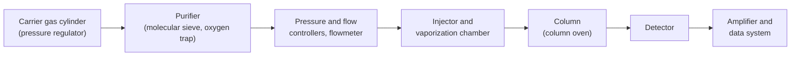

Real samples are almost always mixtures: blood contains thousands of metabolites, gasoline hundreds of hydrocarbons, and a drop of essential oil dozens of terpenes and esters. For such samples the signals of spectroscopy and mass spectrometry overlap, so the components must be separated before they are measured. **Chromatography** exploits the differences in how the components distribute between two phases: as the sample moves along, the components gradually drift apart and reach the detector one after another, so that separation and measurement are carried out continuously in a single instrument. It is the most widely used method of modern analytical chemistry and also the basic tool for purifying products in organic synthesis ([6.5](/6.5)). This chapter first defines the parameters that describe a chromatogram (Section 13.1), and then uses two theories to explain why components separate and why chromatographic peaks broaden: plate theory treats the column as a series of partition equilibria (Section 13.2), and rate theory starts from diffusion and mass transfer to relate plate height to flow rate and, from this, to derive the resolution equation (Section 13.3). Gas chromatography then serves as the example for instrumentation (Section 13.4), detectors (Section 13.5), and qualitative and quantitative methods (Section 13.6). The thermodynamics of distribution between two phases is that of the **partition coefficient** ([6.3.6](/6.3.6#sec-6.5)), and the statistical basis of peak broadening is the **central limit theorem** and the random walk ([6.3.21](/6.3.21#sec-21.3.1)). Liquid chromatography and electrophoresis follow in the next chapter ([6.4.14](/6.4.14)), and the coupling of chromatography with mass spectrometry is in [6.4.15](/6.4.15).

## 13.1. Overview of Chromatography and Basic Parameters

### 13.1.1. Chromatography and Its Classification

**Definition 13.1.1 (Chromatography)** A separation and analysis method in which the components of a sample are repeatedly distributed between two immiscible phases (by adsorption, dissolution, ion exchange or other interactions), move at different speeds as one phase flows past the other because they interact with the two phases to different extents, and are thereby separated and detected one after another is called **chromatography**.

**Definition 13.1.2** In a chromatographic system, the phase that stays fixed (a solid packed in the column or a liquid coated on a support) is called the **stationary phase**; the phase that carries the sample through the stationary phase (a gas, a liquid or a supercritical fluid) is called the **mobile phase**. In column chromatography, washing the components out of the column with the mobile phase is called elution, and the mobile phase is also called the eluent.

The history of chromatography is one of continual improvement in separation efficiency and speed:

- In 1903–1906 the Russian botanist Tswett separated a petroleum ether extract of plant leaves on a calcium carbonate column; the pigments formed bands of different colors on the column, and he named the method chromatography (from the Greek words for "color" and "writing"). The essence of the method has nothing to do with color, but the name has stuck.
- In 1941 Martin and Synge introduced liquid–liquid partition chromatography (separating acetylated amino acids on silica gel holding water as the stationary phase), brought in the concept of the plate, and predicted that a gas could serve as the mobile phase; they shared the 1952 Nobel Prize in Chemistry. They also developed paper chromatography, which Sanger used to separate peptide fragments when determining the sequence of insulin.
- In 1952 James and Martin published gas–liquid chromatography, separating fatty acids; in 1956 van Deemter and coworkers proposed the rate theory; in 1958 Golay proposed the open tubular (capillary) column; and the fused-silica capillary column of 1979 brought gas chromatography to its modern form.
- In the late 1960s small-particle packings and high-pressure pumps gave rise to high-performance liquid chromatography (Horváth, Kirkland, Huber and others); capillary electrophoresis and capillary electrokinetic chromatography appeared in the 1980s, and ultra-high-performance liquid chromatography with sub-2 μm particles in the 2000s ([6.4.14](/6.4.14#def-14.1.3)).

Chromatography can be classified in three ways:

| Basis of classification | Categories |
|---|---|
| State of the mobile phase | Gas chromatography (GC; divided by stationary phase into gas–solid and gas–liquid chromatography), liquid chromatography (LC), supercritical fluid chromatography (SFC) |
| Separation mechanism | Adsorption, partition, ion-exchange, size-exclusion and affinity chromatography ([6.4.14](/6.4.14#sec-14.2)) |
| Form of the stationary phase | Column chromatography (packed and open tubular columns), planar chromatography (paper and thin-layer chromatography) |

By separation efficiency, one can further distinguish classical liquid chromatography (atmospheric pressure, packing particles of about 100 μm, as in column chromatography in the organic laboratory) from high-performance liquid chromatography.

### 13.1.2. Chromatograms and Retention Parameters

**Definition 13.1.3 (Chromatogram)** The curve of the detector response as a function of time (or of the volume of mobile phase eluted) after the sample is injected into the column is called a **chromatogram**, also called the elution curve.

The signal recorded when only mobile phase passes through the detector is called the baseline; its short-term fluctuations are the noise and its slow variations the baseline drift. An ideal chromatographic peak is a Gaussian curve, that is, it has the shape of the density of a **normal distribution**, and its width is described by the standard deviation $\sigma$: the peak width at the inflection points (0.607 of the peak height) is $2\sigma$, the width at half height is

$$
W_{1/2} = 2\sqrt{2\ln 2}\,\sigma = 2.355\sigma,
$$
and the base width, cut off on the baseline by tangents drawn through the inflection points, is $W_{\mathrm{b}} = 4\sigma$. The peak area $A = \sqrt{2\pi}\,\sigma h \approx 1.065\,W_{1/2}h$ ($h$ is the peak height) is the basis of quantitative analysis (Section 13.6).

**Definition 13.1.4 (Retention Time)** The time from injection to the maximum of the chromatographic peak of a component is called the **retention time** $t_{\mathrm{R}}$ of that component. The retention time minus the hold-up time $t_{\mathrm{M}}$ is called the **adjusted retention time** $t'_{\mathrm{R}} = t_{\mathrm{R}} - t_{\mathrm{M}}$; it is the total time the component spends in the stationary phase. The volume of mobile phase that flows through the column during the retention time is called the **retention volume** $V_{\mathrm{R}} = t_{\mathrm{R}}F_{\mathrm{c}}$, where $F_{\mathrm{c}}$ is the volumetric flow rate of the mobile phase (in gas chromatography it is corrected to the column temperature and the mean pressure in the column).

**Definition 13.1.5 (Hold-Up Time)** The time from injection to the peak of a component that does not interact with the stationary phase (such as air or methane in gas chromatography, or uracil in reversed-phase liquid chromatography) is called the **hold-up time** $t_{\mathrm{M}}$ (often written $t_0$ and called the dead time in textbooks); the corresponding volume of mobile phase $V_{\mathrm{M}} = t_{\mathrm{M}}F_{\mathrm{c}}$ is called the **hold-up volume**, the volume occupied by the mobile phase in the column plus that of the tubing between the injector and the detector.

If the column length is $L$, the mean linear velocity of the mobile phase is $u = L/t_{\mathrm{M}}$. For fixed chromatographic conditions (stationary phase, column temperature, mobile phase composition) the retention values depend only on the properties of the component and are the basis of qualitative identification; but they also depend on the column length and the flow rate, so the literature more often uses the relative quantities below, which are independent of column dimensions.

### 13.1.3. Partition Coefficient and Retention Factor

When component A has reached partition equilibrium between the stationary and mobile phases, the ratio of its concentrations in the two phases is the **partition coefficient** ([6.3.6](/6.3.6#sec-6.5.1)):

$$
K = \frac{c_{\mathrm{S}}}{c_{\mathrm{M}}}.
$$
$K$ is determined by the thermodynamic properties of the component and the two phases and by the temperature: $\ln K = -\Delta_{\operatorname{tr}}G^\circ/(RT)$, where $\Delta_{\operatorname{tr}}G^\circ$ is the standard Gibbs energy change for transferring the component from the mobile to the stationary phase. That the $K$ values of different components differ is the prerequisite of chromatographic separation.

**Definition 13.1.6 (Retention Factor)** The ratio of the amount of a component in the stationary phase to that in the mobile phase at equilibrium is called the **retention factor** (formerly the **capacity factor**):

$$
k = \frac{n_{\mathrm{S}}}{n_{\mathrm{M}}} = \frac{c_{\mathrm{S}}V_{\mathrm{S}}}{c_{\mathrm{M}}V_{\mathrm{M}}} = K\frac{V_{\mathrm{S}}}{V_{\mathrm{M}}} = K\beta^{-1},
$$
where $V_{\mathrm{S}}$ and $V_{\mathrm{M}}$ are the volumes of stationary and mobile phase in the column and $\beta = V_{\mathrm{M}}/V_{\mathrm{S}}$ is called the phase ratio.

The factor $k$ depends both on the component (through $K$) and on the construction of the column (through the phase ratio): the film of stationary liquid in an open tubular column is very thin, with $\beta$ of 100–500, whereas for packed columns $\beta$ is 5–35. The distribution ratio $D$ in extraction ([6.3.6](/6.3.6#sec-6.5.2)) is a ratio of total concentrations and should not be confused with $k$ here.

**Theorem 13.1.1 (Fundamental Retention Equation)** If partition equilibrium is established instantaneously, then

$$
t_{\mathrm{R}} = t_{\mathrm{M}}(1 + k), \qquad k = \frac{t_{\mathrm{R}} - t_{\mathrm{M}}}{t_{\mathrm{M}}} = \frac{t'_{\mathrm{R}}}{t_{\mathrm{M}}}, \qquad V_{\mathrm{R}} = V_{\mathrm{M}} + KV_{\mathrm{S}}. \tag{13.1}
$$

**Proof** A molecule of the component moves with the mobile phase only while it is in the mobile phase. At any instant the fraction of molecules in the mobile phase is $n_{\mathrm{M}}/(n_{\mathrm{M}} + n_{\mathrm{S}}) = 1/(1 + k)$; by the ergodic argument this is also the fraction of time a molecule spends in the mobile phase. The mean velocity of the band center is therefore $u_{\mathrm{A}} = u/(1 + k)$, and the time needed to traverse the column length $L$ is $t_{\mathrm{R}} = L/u_{\mathrm{A}} = t_{\mathrm{M}}(1 + k)$. Multiplying by $F_{\mathrm{c}}$ and using $kV_{\mathrm{M}} = KV_{\mathrm{S}}$ gives the expression for the retention volume. $\square$

Thus $k$ can be read directly from the chromatogram: it is the ratio of the time a component spends in the stationary phase to the time it spends in the mobile phase. A component with $k = 0$ elutes at the hold-up time, and a component with a very large $k$ elutes too late and gives a peak that is too broad.

### 13.1.4. Separation Factor and Resolution

**Definition 13.1.7 (Separation Factor)** The ratio of the retention factors of two components (the later-eluting one being 2),

$$
\alpha = \frac{k_2}{k_1} = \frac{t'_{\mathrm{R2}}}{t'_{\mathrm{R1}}} = \frac{K_2}{K_1} \ge 1,
$$
is called the **separation factor**, also called the **relative retention**.

The factor $\alpha$ is determined solely by the thermodynamic properties of the two components in the two phases and is independent of column length, column diameter and flow rate; it measures the selectivity of the stationary phase (and, in liquid chromatography, of the mobile phase) for the pair of components. If $\alpha = 1$, the pair cannot be separated however long the column is. It is the specific form in chromatography of the **selectivity** of a method (Definition 1.8.4).

Whether two peaks can be separated depends not only on the distance between them (thermodynamics) but also on their widths (kinetics):

**Definition 13.1.8 (Resolution)** The ratio of the difference between the retention times of adjacent peaks to the mean of their base widths,

$$
R_{\mathrm{s}} = \frac{t_{\mathrm{R2}} - t_{\mathrm{R1}}}{(W_{\mathrm{b1}} + W_{\mathrm{b2}})/2} = \frac{2(t_{\mathrm{R2}} - t_{\mathrm{R1}})}{W_{\mathrm{b1}} + W_{\mathrm{b2}}}
$$
is called the **chromatographic resolution** (some textbooks write $R$; a subscript is added here to avoid confusion with the molar gas constant).

For two peaks of equal height and width, $R_{\mathrm{s}} = 1$ means that the peak maxima are $4\sigma$ apart. If the eluate is cut at the midpoint between the peaks, the part of each peak that crosses the midpoint is a tail probability $\Phi(-2R_{\mathrm{s}})$ of the **normal distribution**: about 2.3% for $R_{\mathrm{s}} = 1$ (the familiar "97.7% separation") and about 0.13% for $R_{\mathrm{s}} = 1.5$. Usually $R_{\mathrm{s}} \ge 1.5$ is taken as the criterion for complete (baseline) separation. When the two peak heights differ greatly or the peaks tail, a larger $R_{\mathrm{s}}$ is needed.


**Example 13.1.1** On a chromatographic column the hold-up time is $t_{\mathrm{M}} = 1.20\,\mathrm{min}$, the retention times of two components are $10.20$ and $10.80\,\mathrm{min}$, and their base widths are $0.60$ and $0.64\,\mathrm{min}$. Find $k_1$, $k_2$, $\alpha$ and $R_{\mathrm{s}}$.

**Solution** $k_1 = (10.20 - 1.20)/1.20 = 7.50$, $k_2 = 8.00$, $\alpha = 8.00/7.50 = 1.067$; $R_{\mathrm{s}} = 2 \times 0.60/(0.60 + 0.64) = 0.97$, so the two peaks are not completely separated. Example 13.3.2 will find the column length required to reach $R_{\mathrm{s}} = 1.5$. $\square$

## 13.2. Plate Theory

### 13.2.1. The Craig Model

**Definition 13.2.1 (Plate Theory)** The theory that regards the column as a series of consecutive small segments (plates) of equal height, and assumes that on each plate the component reaches partition equilibrium between the two phases rapidly, that the mobile phase passes from one plate to the next intermittently, that longitudinal diffusion is negligible and that the partition coefficient is independent of concentration, and from these assumptions calculates the distribution of the component along the column and the elution curve, is called **plate theory**.

The ideas of plate and equilibrium are borrowed from distillation ([6.3.9](/6.3.9)), and the most intuitive model is Craig's countercurrent distribution apparatus: a row of separatory tubes (plates $r = 0, 1, 2, \dots$) each holds an equal volume of stationary phase; initially the whole of the component is placed in tube 0 together with mobile phase; after equilibration the mobile phase in each tube is transferred to the next tube, fresh mobile phase is added to tube 0, and the process is repeated. After each equilibration the fraction of the component in the mobile phase is $p = 1/(1 + k)$ and that in the stationary phase is $q = k/(1 + k)$.

**Theorem 13.2.1** After $n$ transfers, the fraction of the component on plate $r$ is

$$
f_{n,r} = \binom{n}{r}p^rq^{n-r}, \qquad r = 0, 1, \dots, n,
$$
that is, the distribution of the component over the plates follows the **binomial distribution** $\mathrm{Bin}(n, p)$ ([3.1.4](/3.1.4)).

**Proof** We use induction on $n$. For $n = 0$ the whole component is in tube 0, so the claim holds. Suppose it holds after the $n$th transfer. After the $(n + 1)$th transfer, the component in tube $r$ comes from two sources: the amount $qf_{n,r}$ that was in tube $r$ and stayed in the stationary phase, and the amount $pf_{n,r-1}$ that was in tube $r - 1$ and was carried in with the mobile phase. By Pascal's identity $\binom{n}{r} + \binom{n}{r-1} = \binom{n+1}{r}$, we get $qf_{n,r} + pf_{n,r-1} = \binom{n+1}{r}p^rq^{n+1-r}$. In probabilistic terms the argument is simpler: at each transfer a molecule independently advances one plate with probability $p$, so the number of plates it has advanced after $n$ transfers is the number of successes in $n$ independent Bernoulli trials. $\square$

The band center is therefore at $r = np$, that is, the band advances at $1/(1 + k)$ of the velocity of the mobile phase, in agreement with Theorem 13.1.1; and the variance $npq$ of the band is proportional to the number of transfers. For large $n$, by the **central limit theorem** ([3.1.13](/3.1.13)) the binomial distribution tends to the normal distribution $\mathcal{N}(np, npq)$: plate theory explains why chromatographic peaks are Gaussian and why components with different $k$ separate (the distance between centers is $\propto n$, whereas the peak width is only $\propto \sqrt n$).


### 13.2.2. The Elution Curve Equation and the Plate Number

The effluent from the last plate (plate $N$) of the column enters the detector, and the plot of its concentration against the volume of mobile phase eluted is the elution curve. For a large number of transfers $n$, using the normal approximation and replacing the number of transfers by the eluted volume $V$, we obtain the elution curve equation

$$
c = \frac{m}{\sigma_V\sqrt{2\pi}}\exp\left[-\frac{(V - V_{\mathrm{R}})^2}{2\sigma_V^2}\right], \qquad \sigma_V = \frac{V_{\mathrm{R}}}{\sqrt N},
$$
where $m$ is the amount of the component and $N$ is the number of plates of the column. The concentration maximum occurs at $V = V_{\mathrm{R}}$, and the relative width of the peak $\sigma_V/V_{\mathrm{R}} = 1/\sqrt N$ is determined by the plate number alone.

This result can be obtained from two models. In Craig's intermittent model, the number of transfers needed for the component to reach plate $N$ is the number of Bernoulli trials needed to obtain $N$ "advances", with mean $N/p = N(1 + k)$ and variance $Nq/p^2$, so the relative standard deviation is $\sqrt{q/N} = \sqrt{k/(1 + k)}/\sqrt N$; in the Martin–Synge model, in which the mobile phase flows continuously, the elution curve is of Poisson type and the relative standard deviation is exactly $1/\sqrt N$. The two agree for $k \gg 1$, and for large $N$ both elution curves tend to the normal form. In practice one does not rely on either model but defines $N$ directly from the chromatographic peak:

**Definition 13.2.2 (Plate Number)** The quantity calculated from the retention time and the width of a chromatographic peak by

$$
N = \left(\frac{t_{\mathrm{R}}}{\sigma}\right)^2 = 16\left(\frac{t_{\mathrm{R}}}{W_{\mathrm{b}}}\right)^2 = 5.54\left(\frac{t_{\mathrm{R}}}{W_{1/2}}\right)^2 \tag{13.2}
$$
is called the (theoretical) **plate number**; the column length $L$ divided by $N$ is called the **plate height** (height equivalent to a theoretical plate, HETP):

$$
H = \frac{L}{N} = \frac{\sigma_L^2}{L},
$$
where $\sigma_L$ is the standard deviation of the band at the column outlet expressed as a length. The quantity $N_{\mathrm{eff}} = 16(t'_{\mathrm{R}}/W_{\mathrm{b}})^2$ calculated from the adjusted retention time is called the **effective plate number**.

$N$ and $H$ are measures of the column efficiency: the larger $N$ and the smaller $H$, the narrower the peaks. The meaning of $H = \sigma_L^2/L$ is "the band variance generated per unit column length"; it does not depend on the imaginary picture of plates, and the rate theory of the next section starts from it. From $t_{\mathrm{R}} = t_{\mathrm{M}}(1 + k)$ one obtains

$$
N_{\mathrm{eff}} = N\left(\frac{k}{1 + k}\right)^2:
$$
for a component with very small $k$ (eluting near the hold-up time), $N_{\mathrm{eff}}$ is small even if $N$ is large, which shows that the column does not perform a separation for that component. When comparing column efficiencies, therefore, one must state the component and the $k$ used. Typical values: a 2 m packed column has $N$ of about $10^3$–$10^4$ ($H$ about 0.5–1 mm); a 30 m capillary column of 0.25 mm inner diameter has $N$ of about $10^5$ ($H$ about 0.2–0.3 mm, comparable to the column diameter); a 15 cm liquid chromatography column packed with 5 μm particles has $N$ of about $10^4$ ($H$ about 10 μm).

### 13.2.3. Achievements and Limitations of Plate Theory

Using the binomial distribution and the central limit theorem, plate theory explains the Gaussian shape of chromatographic peaks and the relation between retention time and partition coefficient, and provides the measures $N$ and $H$ for evaluating column efficiency. Its two phases are not restricted to solid and liquid: for gaseous components they may be gas–solid or gas–liquid, and for liquid components liquid–liquid or liquid–solid, so the same theory applies to all kinds of chromatography.

Its limitation lies in the assumptions themselves: in a real column the mobile phase flows continuously, equilibrium between the two phases cannot be reached in every segment, and the component also diffuses longitudinally in the mobile phase. Plate theory therefore cannot say what determines the plate height, cannot explain the experimental fact that the efficiency of the same column differs at different flow rates, and cannot guide how to prepare and operate a column to improve its efficiency. The rate theory answers these questions.

## 13.3. Rate Theory and the Resolution Equation

### 13.3.1. Band Broadening as a Random Walk

A band broadens continually as it moves along the column because the molecules do not all move in the same way: some take shorter channels, some diffuse a certain distance forward or backward, and some stay a little longer in the stationary phase. The position of each molecule is the sum of many independent random displacements, so by the **central limit theorem** the band tends to a normal distribution; and, in the spirit of the **Einstein–Smoluchowski relation** ([6.3.21](/6.3.21#thm-21.3.1)), the variances of independent broadening processes add:

$$
\sigma_L^2 = \sum_i\sigma_i^2, \qquad H = \frac{\sigma_L^2}{L} = \sum_i H_i.
$$
It is therefore enough to calculate the variance contributed by each process separately and divide by the column length to obtain the individual plate-height terms. In 1956 van Deemter, Zuiderweg and Klinkenberg carried out such an analysis for packed-column gas chromatography.

### 13.3.2. The van Deemter Equation

**Definition 13.3.1 (van Deemter Equation)** The equation

$$
H = A + \frac{B}{u} + Cu \tag{13.3}
$$
describing the relation between the plate height and the linear velocity $u$ of the mobile phase is called the **van Deemter equation** (the rate equation). Its three terms are:

1. The **eddy diffusion** term $A = 2\lambda d_{\mathrm{p}}$: the broadening caused by the mobile phase carrying molecules of the component through tortuous channels of different lengths between the packing particles, so that some molecules arrive earlier and others later. Here $d_{\mathrm{p}}$ is the mean particle diameter of the packing and $\lambda$ is the packing irregularity factor (the more uniform the packing, the smaller $\lambda$, about 0.5–1).
2. The **longitudinal diffusion** term $B/u$ with $B = 2\gamma D_{\mathrm{m}}$: the broadening caused by molecules of the component diffusing along the column axis from regions of high to regions of low concentration in the mobile phase. Here $D_{\mathrm{m}}$ is the diffusion coefficient of the component in the mobile phase and $\gamma$ is the obstruction factor describing how the packing makes the diffusion path tortuous ($\gamma$ is about 0.6–0.8 for packed columns and $\gamma = 1$ for open tubular columns).
3. The **mass-transfer resistance** term $Cu$ with $C = C_{\mathrm{s}} + C_{\mathrm{m}}$: mass transfer of the component between the two phases takes time, so equilibrium between the phases is not reached; molecules in the mobile phase are carried ahead and those in the stationary phase lag behind, which causes broadening. The coefficients of mass-transfer resistance in the stationary and the mobile phase are, respectively,

$$
C_{\mathrm{s}} = \frac{qk}{(1 + k)^2}\cdot\frac{d_{\mathrm{f}}^2}{D_{\mathrm{s}}}, \qquad C_{\mathrm{m}} = \frac{\omega d_{\mathrm{p}}^2}{D_{\mathrm{m}}},
$$
where $d_{\mathrm{f}}$ is the thickness of the film of stationary liquid, $D_{\mathrm{s}}$ is the diffusion coefficient of the component in the stationary phase, $q$ is a constant depending on the geometry of the stationary phase ($8/\pi^2$ for a uniform liquid film), and $\omega$ is a constant depending on the packing and on $k$.

The origin of each term can be estimated roughly by a random walk:

- Longitudinal diffusion: the time the component spends in the mobile phase is $t_{\mathrm{M}} = L/u$, during which the Einstein–Smoluchowski relation gives a variance $\sigma^2 = 2\gamma D_{\mathrm{m}}L/u$; dividing by $L$ gives $H_B = 2\gamma D_{\mathrm{m}}/u$. The slower the flow, the longer the molecules stay in the column and the more serious the diffusion. (The component also diffuses in the stationary phase, but $D_{\mathrm{s}}$ is very small and this is generally neglected.)
- Eddy diffusion: a molecule randomly changes channel after about every particle diameter traveled; over the column length $L$ there are about $L/d_{\mathrm{p}}$ steps, each causing a displacement deviation of the order of $d_{\mathrm{p}}$, so the variance is $\propto (L/d_{\mathrm{p}})d_{\mathrm{p}}^2 = Ld_{\mathrm{p}}$ and $H_A \propto d_{\mathrm{p}}$, independent of flow rate.
- Mass-transfer resistance: the time for a molecule to diffuse across the liquid film (or the stagnant mobile phase inside a particle) is about $d^2/D$; during this time the mobile phase advances a distance $\propto u\,d^2/D$, which plays the role of the step length of the random walk, so $H_C \propto u\,d^2/D$, proportional to the flow rate. The factor $k/(1 + k)^2$ in $C_{\mathrm{s}}$ is largest at $k = 1$: when $k$ is very large the component is almost always in the stationary phase, and when $k$ is very small it hardly enters the stationary phase, so in both cases exchange between the phases is not the main source of broadening.

Equation (13.3) indicates the ways to improve column efficiency: use small and uniform packing particles and pack uniformly (reducing $A$ and $C_{\mathrm{m}}$); use a thin and uniform film of stationary liquid (reducing $C_{\mathrm{s}}$); and choose a suitable mobile phase and flow rate. In gas chromatography, the thinner the liquid film and the higher the column temperature ($D_{\mathrm{s}}$ increases), the faster the mass transfer; but if the film is too thin the column capacity is small.

### 13.3.3. The Optimum Flow Rate

**Theorem 13.3.1** In the van Deemter equation the plate height has its minimum $H_{\min} = A + 2\sqrt{BC}$ at

$$
u_{\mathrm{opt}} = \sqrt{\frac{B}{C}}.
$$

**Proof** Setting $\mathrm{d}H/\mathrm{d}u = -B/u^2 + C = 0$ gives $u_{\mathrm{opt}} = \sqrt{B/C}$; since $\mathrm{d}^2H/\mathrm{d}u^2 = 2B/u^3 > 0$ this is a minimum. Substitution gives $H_{\min} = A + B\sqrt{C/B} + C\sqrt{B/C} = A + 2\sqrt{BC}$. $\square$

Below $u_{\mathrm{opt}}$ longitudinal diffusion dominates, and above it mass-transfer resistance dominates. In practice a flow rate slightly above $u_{\mathrm{opt}}$ is often used: the $H$–$u$ curve is fairly flat to the right of the minimum, so little column efficiency is lost while the analysis time is shortened considerably.

An open tubular column has no packing, so $A = 0$, and the mobile-phase mass-transfer term is determined by the column inner diameter $d_{\mathrm{c}}$; Golay (1958) gave

$$
H = \frac{2D_{\mathrm{m}}}{u} + \frac{1 + 6k + 11k^2}{96(1 + k)^2}\cdot\frac{d_{\mathrm{c}}^2}{D_{\mathrm{m}}}u + \frac{2k}{3(1 + k)^2}\cdot\frac{d_{\mathrm{f}}^2}{D_{\mathrm{s}}}u.
$$
There is no eddy diffusion, and the column can be made very long (tens of meters without a large pressure drop), so the total plate number of a capillary column is far higher than that of a packed column. The influence of the carrier gas can also be seen from this: the diffusion coefficients of components in $\ce{H2}$ and $\ce{He}$ are larger than in $\ce{N2}$ (the diffusion coefficient of a gas increases as the molecular mass decreases, [5.2.2](/5.2.2)), and the larger $D_{\mathrm{m}}$ increases $B$ and decreases $C_{\mathrm{m}}$, shifting $u_{\mathrm{opt}}$ to higher flow rates and flattening the right-hand side of the curve. With $\ce{N2}$ as carrier gas $H_{\min}$ is slightly smaller, but one can only operate at low velocity; with $\ce{H2}$ or $\ce{He}$ the column efficiency is maintained at high flow rates and the analysis is much faster.


**Example 13.3.1** Using the values of the left panel: $u_{\mathrm{opt}} = \sqrt{6.0/0.030}\,\mathrm{cm\,s^{-1}} = 14.1\,\mathrm{cm\,s^{-1}}$ and $H_{\min} = 0.30 + 2\sqrt{6.0 \times 0.030} = 1.15\,\mathrm{mm}$. A 2 m column at the optimum flow rate has $N = 2000/1.15 \approx 1700$. If the flow rate is raised to $28\,\mathrm{cm\,s^{-1}}$, then $H = 0.30 + 0.21 + 0.84 = 1.35\,\mathrm{mm}$, the column efficiency drops by about 15%, and the analysis time is halved. $\square$

In liquid chromatography $D_{\mathrm{m}}$ is about $10^{-4}$–$10^{-5}$ times that in the gas phase, so the longitudinal diffusion term can be neglected and the mass-transfer term dominates; the key to higher column efficiency is a smaller particle size ([6.4.14](/6.4.14#sec-14.1.3)).

### 13.3.4. Extracolumn Effects

**Definition 13.3.2 (Extracolumn Band Broadening)** The broadening of a band caused by factors outside the column, namely the width of the injection plug, the dead volumes of the injector, the connecting tubing and the detector cell, and the response times of the detector and the data system, is called **extracolumn band broadening** (the extracolumn effect).

The extracolumn variance adds to the variance in the column: $\sigma_{\mathrm{obs}}^2 = \sigma_{\mathrm{col}}^2 + \sigma_{\mathrm{inj}}^2 + \sigma_{\mathrm{tube}}^2 + \sigma_{\mathrm{det}}^2$. A rectangular injection plug of width $\tau$ contributes $\tau^2/12$; laminar flow in a connecting tube of length $l$ and inner diameter $d$ contributes a volume variance of about $\pi d^4 lF_{\mathrm{c}}/(384D_{\mathrm{m}})$, proportional to the fourth power of the inner diameter. The higher the column efficiency and the smaller the column volume (narrow-bore and short columns, early-eluting components), the greater the influence of extracolumn effects. Capillary gas chromatography therefore uses split injection or very small sample sizes, and ultra-high-performance liquid chromatography uses connecting tubes of very small inner diameter and detector cells of sub-microliter volume.

### 13.3.5. The Resolution Equation and the Choice of Separation Conditions

Resolution combines thermodynamics ($\alpha$) and kinetics ($N$); below it is written as a product of three factors that can be adjusted separately.

**Theorem 13.3.2 (Resolution Equation)** If two adjacent peaks have the same plate number and approximately equal widths, then

$$
R_{\mathrm{s}} = \frac{\sqrt N}{4}\cdot\frac{\alpha - 1}{\alpha}\cdot\frac{k_2}{1 + k_2}, \tag{13.4}
$$
where $k_2$ is the retention factor of the later-eluting component.

**Proof** For peaks of similar widths, $R_{\mathrm{s}} \approx (t_{\mathrm{R2}} - t_{\mathrm{R1}})/W_{\mathrm{b2}}$. By Eq. (13.2), $W_{\mathrm{b2}} = 4t_{\mathrm{R2}}/\sqrt N$; by Eq. (13.1), $t_{\mathrm{R2}} - t_{\mathrm{R1}} = t_{\mathrm{M}}(k_2 - k_1)$ and $t_{\mathrm{R2}} = t_{\mathrm{M}}(1 + k_2)$. Hence

$$
R_{\mathrm{s}} = \frac{\sqrt N}{4}\cdot\frac{k_2 - k_1}{1 + k_2} = \frac{\sqrt N}{4}\cdot\frac{k_2 - k_1}{k_2}\cdot\frac{k_2}{1 + k_2},
$$
and $(k_2 - k_1)/k_2 = 1 - 1/\alpha = (\alpha - 1)/\alpha$. $\square$

The three factors in Eq. (13.4) are called the efficiency term, the selectivity term and the retention term. Solving for $N$ gives the plate number required for a specified resolution,

$$
N_{\mathrm{req}} = 16R_{\mathrm{s}}^2\left(\frac{\alpha}{\alpha - 1}\right)^2\left(\frac{1 + k_2}{k_2}\right)^2.
$$
Then from $t_{\mathrm{R}} = N_{\mathrm{req}}H(1 + k_2)/u$ the analysis time is

$$
t_{\mathrm{R}} = \frac{16R_{\mathrm{s}}^2H}{u}\left(\frac{\alpha}{\alpha - 1}\right)^2\frac{(1 + k_2)^3}{k_2^2}.
$$


The figure and the two equations above lead to the following principles for choosing separation conditions:

- Efficiency term: $R_{\mathrm{s}} \propto \sqrt N$. Doubling the column length doubles $N$ but raises $R_{\mathrm{s}}$ only by a factor of $\sqrt 2$ while the analysis time doubles; a better way to raise $N$ is to reduce $H$ (small particles, a thin liquid film, a suitable flow rate; Section 13.3.2).
- Selectivity term: the most effective means. Increasing $\alpha$ from 1.05 to 1.10 almost doubles $(\alpha - 1)/\alpha$ and reduces the required plate number to about $1/4$. In gas chromatography $\alpha$ is changed mainly by changing the stationary liquid and the column temperature; in liquid chromatography the composition of the mobile phase can also be changed ([6.4.14](/6.4.14#sec-14.2.3)). For a difficult pair with $\alpha = 1.01$, even for very large $k$ (the retention term tends to 1) at least about $3.7 \times 10^5$ plates are needed, which only a long capillary column can supply.
- Retention term: as $k$ increases from 0, $k/(1 + k)$ rises rapidly and hardly changes beyond $k > 10$, whereas the analysis time and the peak width increase with $1 + k$; the time formula above has its minimum at $k_2 = 2$. In general $k$ is therefore kept between 1 and 10 (preferably 2–5), by adjusting the column temperature in gas chromatography and the strength of the mobile phase in liquid chromatography.

**Example 13.3.2** For the two components of Example 13.1.1, the second peak gives $N = 16 \times (10.80/0.64)^2 = 4.56 \times 10^3$, and Eq. (13.4) gives $R_{\mathrm{s}} = 0.94$ (the difference from the directly calculated 0.97 comes from the approximation of equal peak widths). To reach $R_{\mathrm{s}} = 1.5$ with all other conditions unchanged, $N$ must increase by a factor of $(1.5/0.97)^2 = 2.40$, that is, to about $1.1 \times 10^4$ plates: the column length is increased by a factor of 2.4, and so is the analysis time (to about 26 min). If instead a stationary liquid with $\alpha = 1.10$ is used and $k_2$ is unchanged, the original column gives $R_{\mathrm{s}} = \frac{\sqrt{4560}}{4}\cdot\frac{0.10}{1.10}\cdot\frac{8}{9} = 1.36$, close to complete separation. $\square$

## 13.4. The Gas Chromatograph

### 13.4.1. Components of the Instrument and the Carrier Gas

**Definition 13.4.1 (Gas Chromatography)** Chromatography with a gas as the mobile phase (the carrier gas) is called **gas chromatography**. It is called gas–solid chromatography when the stationary phase is a solid adsorbent, and gas–liquid chromatography when it is a high-boiling liquid coated on a support or on the column wall.

Gas chromatography is suitable for substances that can be vaporized at the column temperature without decomposition: permanent gases, low-molecular-mass hydrocarbons and volatile organic compounds (solvents, fragrances, pesticides, fatty acid methyl esters). It is estimated that about 20% of known organic compounds can be analyzed directly by gas chromatography; substances of low volatility or high polarity (sugars, amino acids, organic acids) can first be derivatized (silylation, methylation) and then analyzed, while thermally unstable and nonvolatile substances (proteins, inorganic salts) call for liquid chromatography.



A gas chromatograph consists of a carrier gas system, a sample introduction system, a separation system (the column and the column oven), a detection system and a data processing system. The requirements on the carrier gas are:

1. Purity: water, oxygen and hydrocarbons are removed with **molecular sieves**, activated carbon and oxygen scavengers; otherwise they oxidize the stationary liquid, increase the baseline noise and lower the sensitivity of the electron capture detector.
2. Stability: fluctuations of the flow rate change the retention times and cause baseline drift in concentration-sensitive detectors (Section 13.5.1), so pressure regulators, flow controllers or electronic pressure control are used. In temperature programming the viscosity of the gas in the column increases, so constant-pressure operation would lower the flow rate; modern instruments mostly use constant-flow operation.
3. Kind: $\ce{N2}$, $\ce{He}$ and $\ce{H2}$ are commonly used (Section 13.3.3). $\ce{N2}$ is cheap, but its optimum flow rate is low; $\ce{He}$ is inert and safe and is the standard carrier gas for gas chromatography–mass spectrometry, but it is expensive and its supply is limited; $\ce{H2}$ gives the fastest analyses and the slowest loss of efficiency with increasing flow rate, but it is flammable and may react with unsaturated components. The carrier gas must also match the detector: the thermal conductivity detector requires $\ce{He}$ or $\ce{H2}$, which have high thermal conductivity (Section 13.5.2).

### 13.4.2. Sample Introduction

A liquid sample is injected with a microsyringe through a silicone rubber septum into the vaporization chamber, where it vaporizes instantly at $200$–$300\,{}^\circ\mathrm{C}$ and is carried into the column by the carrier gas; a gas sample is introduced in a defined volume with a six-port valve. The vaporization chamber should have a small volume (to reduce extracolumn broadening), a large heat capacity (to ensure instantaneous vaporization) and an inert inner wall (so that the sample does not decompose catalytically; a deactivated glass liner is often fitted).

The capacity of a capillary column is very small (nanograms per component), and special injection modes are used:

- Split injection: only a small part of the vaporized sample (split ratio 1:10–1:500) enters the column and the rest is vented, which guarantees a narrow injection without overloading; it is used for fairly concentrated samples.
- Splitless injection: the split valve is closed for about 30–60 s during injection so that almost the entire sample enters the column, and the band is refocused at the column head by condensation of the solvent at a low column temperature, after which the temperature is raised for the separation; it is used for trace analysis.
- Headspace sampling and solid-phase microextraction: only the vapor above the sample is taken, or a fiber coated with a stationary phase adsorbs the volatile components from the sample and they are then thermally desorbed in the vaporization chamber, which keeps nonvolatile matrix out of the column; these techniques are often used for ethanol in blood, volatile organic compounds in water and aroma components of food.

**Definition 13.4.2 (Pyrolysis Gas Chromatography)** The method in which a nonvolatile polymer sample is heated instantaneously to $500$–$1000\,{}^\circ\mathrm{C}$ in an inert atmosphere so that it cracks into volatile small fragments, which are then separated by gas chromatography, and the characteristic chromatogram obtained (the pyrogram) is used to identify and study the polymer, is called **pyrolysis gas chromatography**.

Pyrolyzers include tube furnaces, heated filaments and Curie-point pyrolyzers (a ferromagnetic wire heated rapidly in a high-frequency magnetic field stops heating at its Curie temperature, so the temperature is accurate and reproducible). The pyrolysis fragments reflect the structural units of the polymer: for example, nylon 6 pyrolyzes mainly to ε-caprolactam, and nylon 66 gives products derived from the adipic acid unit such as cyclopentanone, so in the pyrogram of a nylon 6/66 copolymer the ratio of the areas of the two groups of peaks allows the composition in terms of the two units to be estimated. Pyrolysis gas chromatography is also used to identify microorganisms, paints, cultural relics and forensic evidence.

### 13.4.3. Columns and Stationary Phases

| Column type | Inner diameter | Length | Stationary phase | Plate number |
|---|---|---|---|---|
| Packed column | 2–6 mm | 1–6 m | Adsorbent particles, or support particles coated with stationary liquid | $10^3$–$10^4$ |
| Open tubular (capillary) column | 0.10–0.53 mm | 10–100 m | Film of stationary liquid (0.1–5 μm) or layer of adsorbent on the inner wall | about $10^5$ |

Modern open tubular columns are drawn from fused silica and coated outside with a polyimide protective layer, which makes them flexible with an inert inner wall. Columns in which the stationary liquid is coated directly on the inner wall are called wall-coated open tubular (WCOT) columns and are the most common; columns with a porous adsorbent layer attached to the inner wall are called porous-layer open tubular (PLOT) columns and are used for permanent gases and low-molecular-mass hydrocarbons. Capillary columns have replaced packed columns as the mainstay of analysis, while packed columns are still used for gas analysis and for preparative work.

There are two kinds of stationary phase:

1. Solid stationary phases: **adsorbents** such as activated carbon, silica gel, alumina, molecular sieves and porous polymer beads (for example styrene–divinylbenzene copolymer), which separate permanent gases and low-boiling substances such as $\ce{H2}$, $\ce{O2}$, $\ce{N2}$, $\ce{CO}$, $\ce{CO2}$ and $\mathrm{C}_1$–$\mathrm{C}_4$ hydrocarbons through differences in **physisorption**. The adsorption isotherm deviates from linearity already at somewhat higher concentrations ([6.3.20](/6.3.20#sec-20.3)), so peaks tail easily, and these phases are therefore used only for components of very low solubility in liquids.
2. Liquid stationary phases: the stationary liquid is coated on a support (packed columns) or on the column wall (open tubular columns).

**Definition 13.4.3 (Stationary Liquid)** The high-boiling organic substance serving as the stationary phase in gas–liquid chromatography is called the **stationary liquid**; the porous inert solid particles that support the stationary liquid and let it spread as a thin film are called the support.

A stationary liquid should have a low vapor pressure at the column temperature (otherwise it bleeds, raising the baseline and contaminating the detector), good thermal stability and chemical inertness, a low viscosity (fast mass transfer), and selectivity for the components to be separated. The support is mostly diatomaceous earth that has been acid-washed and silanized, and is required to have a moderate specific surface area, an inert surface and uniform particles.

### 13.4.4. Choice of Stationary Liquid and Relative Polarity

The solubility of a component in a stationary liquid depends on the intermolecular forces between them: **London dispersion forces**, dipole interactions, induction interactions and **hydrogen bonds** ([6.1.4](/6.1.4)). This leads to the "like dissolves like" principle of selection:

| Components to be separated | Stationary liquid | Elution order |
|---|---|---|
| Nonpolar (hydrocarbons) | Nonpolar | Mainly by boiling point (vapor pressure); low-boiling components elute first |
| Moderately polar | Moderately polar | Determined jointly by boiling point and intermolecular forces |
| Strongly polar | Strongly polar | By polarity; less polar components elute first |
| Able to form hydrogen bonds | Polar or hydrogen-bonding | By ability to form hydrogen bonds; those with the weaker ability elute first |
| Mixture of polar and nonpolar | Polar | Nonpolar components elute first |

On a nonpolar stationary liquid the retention of a component depends mainly on its **saturated vapor pressure**: by an extension of Raoult's law, $K \propto 1/(\gamma_{\infty}p^*)$ ($\gamma_\infty$ is the **activity coefficient** of the component in the stationary liquid at infinite dilution, [6.3.6](/6.3.6)), and $p^*$ decreases as the boiling point increases. Benzene (boiling point $80.1\,{}^\circ\mathrm{C}$) and cyclohexane ($80.7\,{}^\circ\mathrm{C}$) have almost the same boiling point and cannot be separated on a nonpolar stationary liquid; but the π electrons of benzene are easily polarized, so in a polar stationary liquid benzene experiences stronger induction interactions and is retained longer. The ratio of the retention times $t_{\mathrm{R}}(\text{benzene})/t_{\mathrm{R}}(\text{cyclohexane})$ is about 1.5 on weakly polar dioctyl phthalate, about 3.9 on polar polyethylene glycol 400, and about 6.3 on strongly polar β,β′-oxydipropionitrile.

How can the polarities of stationary liquids be compared quantitatively? Rohrschneider (1959) assigned a relative polarity of 100 to the strongly polar β,β′-oxydipropionitrile (1) and 0 to the nonpolar squalane (2, 2,6,10,15,19,23-hexamethyltetracosane):

```smiles
N#CCCOCCC#N 1
CC(C)CCCC(C)CCCC(C)CCCCC(C)CCCC(C)CCCC(C)C 2
```

For the pair butadiene and n-butane, $q = \lg[t'_{\mathrm{R}}(\text{butadiene})/t'_{\mathrm{R}}(\text{n-butane})]$ is measured on the three columns, and the relative polarity of the stationary liquid $x$ under test is

$$
P_x = 100 - 100\,\frac{q_1 - q_x}{q_1 - q_2},
$$
where subscripts 1 and 2 refer to β,β′-oxydipropionitrile and squalane. Every 20 units of $P_x$ make one grade, and the range 0 to 100 is divided into nonpolar and grades +1 to +5. A single pair of probes reflects only one kind of interaction, and the approach was later developed into the McReynolds constants: five probes, benzene, 1-butanol, 2-pentanone, nitropropane and pyridine, are used, and the difference $\Delta I$ between their retention indices on the stationary liquid under test and on squalane is measured (Section 13.6.1); the five values reflect dispersion and π interactions, proton donation, dipole interactions, proton acceptance and so on, and their sum expresses the overall polarity.

Only a few stationary liquids are commonly used for modern capillary columns:

| Stationary liquid | Polarity | Maximum operating temperature (approx.) | Applications |
|---|---|---|---|
| Polydimethylsiloxane | Nonpolar | $325\,{}^\circ\mathrm{C}$ | Hydrocarbons, general purpose, separation by boiling point |
| 5% Diphenyl–95% dimethylpolysiloxane | Weakly polar | $325\,{}^\circ\mathrm{C}$ | The most widely used general-purpose column; GC-MS, pesticides, environmental samples |
| 50% Phenyl polysiloxane | Moderately polar | $300\,{}^\circ\mathrm{C}$ | Drugs, steroids |
| Cyanopropylphenyl polysiloxane | Moderately to strongly polar | $250\,{}^\circ\mathrm{C}$ | cis/trans isomers of fatty acid methyl esters, pesticides |
| Polyethylene glycol | Strongly polar | $250\,{}^\circ\mathrm{C}$ | Alcohols, aldehydes, esters, fragrances, residual solvents |
| Chiral cyclodextrin derivatives | — | $230\,{}^\circ\mathrm{C}$ | Enantiomers (fragrances, drug intermediates) |

Polysiloxanes withstand high temperatures and bleed little, and their polarity can be tuned continuously by changing the proportion of phenyl or cyanopropyl groups; they can also be cross-linked and bonded to the column wall, which makes them resistant to solvent rinsing.

### 13.4.5. Column Temperature and Temperature Programming

The column temperature is the most important operating condition in gas chromatography. From $\ln K = -\Delta_{\operatorname{tr}}H^\circ/(RT) + \Delta_{\operatorname{tr}}S^\circ/R$, dissolution of a component from the gas phase into the stationary liquid is exothermic, and $K$ and $k$ decrease exponentially with increasing column temperature: under ordinary conditions, a rise of about $20\,{}^\circ\mathrm{C}$ roughly halves $k$. A higher column temperature speeds up the analysis and increases $D_{\mathrm{s}}$, which speeds up mass transfer, but generally decreases $\alpha$ and worsens the separation; the column temperature must not exceed the maximum operating temperature of the stationary liquid.

For a homologous series, $\lg k$ increases linearly with the number of carbon atoms (each additional $\ce{CH2}$ increases $k$ by a factor of about 2), so a sample with a wide boiling range cannot be handled satisfactorily isothermally: at a low column temperature the early-eluting components are well separated, but the high-boiling components elute very slowly, as low and broad peaks; at a high column temperature the high-boiling components elute quickly, but the low-boiling ones are crowded near the hold-up time and not resolved. This is the so-called general elution problem.

**Definition 13.4.4 (Temperature Programming)** The mode of operation in which the column temperature is raised during a single analysis according to a predetermined program (usually linear) as a function of time is called **temperature programming**.

In temperature programming, each component stays almost motionless near the column head at the lower temperatures until the column temperature has risen enough for its $k$ to become small, and then it moves and elutes quickly. Each component is thus eluted at roughly its own "suitable" temperature; members of a homologous series elute at nearly equal intervals with similar peak widths, the analysis time is shortened, and the detection limits of the late-eluting components are also lowered. The counterpart in liquid chromatography is gradient elution ([6.4.14](/6.4.14#def-14.1.2)).


The programmed-temperature chromatogram in the figure was obtained by numerical integration: the position $z$ of a component in the column satisfies $\mathrm{d}z/\mathrm{d}t = u/[1 + k(T(t))]$, and integrating up to $z = L$ gives the retention time (for the numerical method see [4.4.4](/4.4.4)).

## 13.5. Detectors

### 13.5.1. Performance Characteristics and Types of Detectors

A detector converts the amount of the eluting component into an electrical signal. The criteria for evaluating it are the same as the performance characteristics of a method ([6.4.1](/6.4.1#sec-1.8)), applied to the detector:

- **Sensitivity** (Definition 1.8.2): the signal produced when a unit amount of the component passes through the detector, $S = \Delta R/\Delta Q$, where $R$ is the signal (peak height in mV or peak area in mV·s) and $Q$ is the concentration of the component in the carrier gas ($\mathrm{mg\,mL^{-1}}$) or the mass entering the detector per unit time ($\mathrm{g\,s^{-1}}$).
- **Limit of detection** (Definition 1.8.5): by the convention of three times the noise, the amount of component whose signal equals three times the baseline noise (standard deviation) $N_{\mathrm{d}}$, $D = 3N_{\mathrm{d}}/S$. A detector with high sensitivity but also high noise does not necessarily have a low limit of detection.
- **Linear range** (Definition 1.8.3): the range over which the signal is proportional to the amount of the component, expressed as the ratio of the largest to the smallest amount injected.
- In addition, a fast response (peaks in capillary columns are only a few tenths of a second to a few seconds wide), stability, a small dead volume, and, as required, universality or selectivity are demanded.

By the principle of response, detectors fall into two types:

**Definition 13.5.1** A detector whose response signal is proportional to the concentration of the component in the carrier gas is called a **concentration-sensitive detector** (for example the thermal conductivity and electron capture detectors); a detector whose response signal is proportional to the mass of the component entering the detector per unit time is called a **mass-flow-sensitive detector** (for example the flame ionization and flame photometric detectors and the mass spectrometer).

The difference lies in the effect of the carrier gas flow rate: for a concentration-sensitive detector, for the same amount of component the higher the flow rate the narrower the peak, the peak height stays the same, and the peak area is inversely proportional to the flow rate, so the flow rate must be kept constant when peak areas are used for quantitation; for a mass-flow-sensitive detector the peak area is independent of the flow rate and the peak height increases with the flow rate.

### 13.5.2. Thermal Conductivity Detector

**Definition 13.5.2 (Thermal Conductivity Detector)** A detector in which the difference between the thermal conductivities of the analyte and the carrier gas changes the temperature and resistance of an electrically heated sensing element, and a Wheatstone bridge converts the change into a voltage signal, is called a **thermal conductivity detector** (TCD, also called the katharometer).

The metal block of the detector contains a reference cell and a measurement cell, each fitted with a tungsten–rhenium alloy filament, forming two arms of a bridge; only pure carrier gas passes through the reference cell, whereas the carrier gas and components leaving the column pass through the measurement cell. The filaments are heated by a constant current, and the heat produced is conducted by the surrounding gas to the cell wall. With carrier gas alone the heat loss of the two cells is the same and the bridge is balanced; when a component enters the measurement cell, the **thermal conductivity** of the gas mixture decreases, the filament temperature rises and its **electrical resistance** increases, the bridge goes out of balance, and a signal proportional to the concentration of the component is output.

Thermal conductivities $\kappa/(\mathrm{mW\,m^{-1}\,K^{-1}})$ of common gases at $300\,\mathrm{K}$ (CRC Handbook):

| Gas | $\ce{H2}$ | $\ce{He}$ | $\ce{CH4}$ | $\ce{N2}$ | Air | $\ce{O2}$ | $\ce{C2H6}$ | $\ce{C3H8}$ | $\ce{Ar}$ | $\ce{CO2}$ | $n$-$\ce{C4H10}$ |
|---|---|---|---|---|---|---|---|---|---|---|---|
| $\kappa$ | 187 | 156 | 34 | 26 | 26 | 26 | 21 | 18 | 18 | 17 | 16 |

The thermal conductivities of $\ce{H2}$ and $\ce{He}$ are an order of magnitude higher than those of the other gases (small molecular mass and high mean speed, [5.2.1](/5.2.1)), so with them as carrier gas the signal is large and all components give peaks in the same direction; with $\ce{N2}$ as carrier gas the sensitivity is low, and negative peaks appear when $\ce{H2}$ is measured.

The thermal conductivity detector is simple and stable, responds to both inorganic and organic substances, and does not destroy the sample (other detectors can be connected in series, or fractions collected); it is the universal detector for permanent gases, water and organic elemental analysis (Section 13.6.4). Its drawback is its fairly low sensitivity, with a limit of detection of about $10^{-9}\,\mathrm{g\,mL^{-1}}$. The larger the filament current the higher the sensitivity (roughly proportional to the cube of the current), but the noise increases and the filament life is shortened; carrier gas must also be flowing before the current is switched on, otherwise the filament burns out or oxidizes.

### 13.5.3. Flame Ionization Detector

**Definition 13.5.3 (Flame Ionization Detector)** A detector that uses the flame of burning hydrogen and air as the energy source to cause chemical ionization of organic compounds in the flame, and detects them by collecting the resulting ion current in an applied electric field, is called a **flame ionization detector** (FID).

The carrier gas from the column is mixed with $\ce{H2}$ and emerges from a jet and burns in air; a voltage of $200$–$300\,\mathrm{V}$ is applied between the jet and the collector electrode above it. Pure carrier gas burning with hydrogen produces almost no ions, and the background current is only about $10^{-14}\,\mathrm{A}$. An organic compound is pyrolyzed in the reducing zone of the flame to fragments such as $\cdot\mathrm{CH}$, which then undergo chemical ionization by reaction with oxygen:

$$
\ce{CH + O -> CHO+ + e-},
$$
$\ce{CHO+}$ reacts with water to give $\ce{H3O+}$, and the ions are collected to give a current of $10^{-12}$–$10^{-8}\,\mathrm{A}$. The ionization efficiency is very low (about one ion for $10^5$ carbon atoms), but the background is extremely low, so the sensitivity is high.

The response of the FID is approximately proportional to the number of carbon atoms bonded to hydrogen entering the flame (the "effective carbon number"), and the relative response factors of hydrocarbons are all close to 1; carbon atoms that are already oxidized (carbon in carbonyl and carboxyl groups) give very little response, and halogens and nitrogen reduce the response. It gives almost no response to permanent gases, $\ce{H2O}$, $\ce{CO}$, $\ce{CO2}$, $\ce{CS2}$, $\ce{NH3}$, nitrogen oxides, $\ce{SO2}$, $\ce{H2S}$ and the like, so organic compounds in aqueous solution can be determined directly. The FID is a mass-flow-sensitive detector with a limit of detection of about $10^{-12}\,\mathrm{g\,s^{-1}}$ (as carbon) and a linear range of $10^7$, and is the most commonly used detector for organic analysis; its drawbacks are that it destroys the sample and needs two auxiliary gas supplies, $\ce{H2}$ and air.

### 13.5.4. Electron Capture and Flame Photometric Detectors

**Definition 13.5.4 (Electron Capture Detector)** A detector in which β radiation from a radioactive source ionizes the carrier gas to produce low-energy electrons that form a steady standing current in an electric field, and electronegative components that capture electrons reduce this current, so that components are detected through the decrease in the standing current, is called an **electron capture detector** (ECD).

The inner wall of the detector cell is plated with $^{63}\mathrm{Ni}$ (a β source with a half-life of about 100 a). The carrier gas ($\ce{N2}$ or $\ce{Ar}$–$\ce{CH4}$) is ionized, $\ce{N2 ->[\beta] N2+ + e-}$, and the large number of thermal electrons produced form a standing current of about $10^{-8}\,\mathrm{A}$ in the electric field. A component AB containing strongly electronegative groups captures electrons to form negative ions, which migrate much more slowly than electrons and readily recombine with positive ions:

$$
\ce{AB + e- -> AB-}, \qquad \ce{AB- + N2+ -> AB + N2},
$$
so the standing current decreases and negative peaks are recorded (usually inverted for display as positive peaks).

The ECD is one of the most selective and most sensitive detectors in gas chromatography, with a limit of detection down to $10^{-14}\,\mathrm{g\,s^{-1}}$. Its response depends on the electron affinity of the component: it responds strongly to polyhalogenated compounds (especially polychlorinated and polybrominated compounds), nitro compounds, conjugated carbonyl compounds and organometallic compounds, and only weakly to hydrocarbons, alcohols, amines and ordinary oxygen- and nitrogen-containing compounds. It is the classical detector for trace environmental analysis of organochlorine pesticides (DDT, hexachlorocyclohexane), polychlorinated biphenyls and halogenated disinfection by-products. Its drawbacks are a fairly narrow linear range (about $10^4$), the need for high-purity carrier gas, and the licensing required for a radioactive source.

**Definition 13.5.5 (Flame Photometric Detector)** A detector in which sulfur- and phosphorus-containing compounds are burned in a hydrogen-rich flame to give excited $\ce{S2^*}$ and $\ce{HPO^*}$, the characteristic light they emit is selected with an optical filter, and it is detected with a photomultiplier tube, is called a **flame photometric detector** (FPD).

In the hydrogen-rich reducing flame, sulfur compounds decompose to sulfur atoms, two sulfur atoms combine to give excited $\ce{S2^*}$, and on deactivation it emits a band spectrum at $320$–$460\,\mathrm{nm}$ (maximum at about $394\,\mathrm{nm}$); phosphorus compounds give $\ce{HPO^*}$, which emits light at about $526\,\mathrm{nm}$:

$$
\ce{S + S -> S2^*}, \quad \ce{S2^*} \to \ce{S2} + h\nu; \qquad \ce{HPO^*} \to \ce{HPO} + h\nu.
$$
Because $\ce{S2^*}$ is formed from two sulfur atoms, the response to sulfur is approximately proportional to the square of the mass flow of sulfur (the exponent lies between 1.5 and 2), so the calibration curve for quantitation is made on a logarithmic scale; the response to phosphorus is linear. The FPD is used for organophosphorus pesticides, thiols and sulfides, and sulfur compounds in natural gas and petroleum, and its selectivity for sulfur and phosphorus over carbon is $10^4$–$10^6$. The principle of the emission is the same as in atomic emission spectrometry, and the **photomultiplier tube** used is described in [6.4.7](/6.4.7#sec-7.5.2).

### 13.5.5. Other Detectors

- Nitrogen–phosphorus detector (NPD): a heated rubidium salt bead is placed in the flame, and nitrogen- and phosphorus-containing compounds form negative ions on the bead surface; it detects nitrogen-containing drugs and organophosphorus pesticides selectively, with a limit of detection about an order of magnitude lower than that of the FID.
- Mass spectrometric detector (GC-MS): it both quantifies and gives the mass spectrum of every peak, and is the most powerful means of identification; see [6.4.15](/6.4.15#sec-15.5.1).
- Infrared detector (GC-FTIR): it gives the infrared spectrum of each component and can distinguish isomers that are hard to distinguish by mass spectrometry ([6.4.11](/6.4.11#sec-11.3.2)).
- Atomic emission detector: a microwave plasma excites the elements in the effluent, which are detected selectively by element ([6.4.7](/6.4.7#sec-7.3.4)).

| Detector | Type | Selectivity | Limit of detection (order of magnitude) | Linear range | Carrier gas |
|---|---|---|---|---|---|
| TCD | Concentration-sensitive | Universal | $10^{-9}\,\mathrm{g\,mL^{-1}}$ | $10^5$ | $\ce{He}$, $\ce{H2}$ |
| FID | Mass-flow-sensitive | Organic compounds containing C–H | $10^{-12}\,\mathrm{g\,s^{-1}}$ | $10^7$ | $\ce{N2}$, $\ce{He}$, $\ce{H2}$ |
| ECD | Concentration-sensitive | Electronegative compounds | $10^{-14}\,\mathrm{g\,s^{-1}}$ | $10^4$ | High-purity $\ce{N2}$, $\ce{Ar}$–$\ce{CH4}$ |
| FPD | Mass-flow-sensitive | Compounds containing S, P | $10^{-11}$ (S), $10^{-12}$ (P) $\mathrm{g\,s^{-1}}$ | $10^3$ (S), $10^4$ (P) | $\ce{N2}$, $\ce{He}$ |
| NPD | Mass-flow-sensitive | Compounds containing N, P | $10^{-13}\,\mathrm{g\,s^{-1}}$ | $10^4$ | $\ce{N2}$, $\ce{He}$ |
| MS | Mass-flow-sensitive | Universal or selective (selected ions) | $10^{-9}$ g full scan, $10^{-12}$ g selected ions | $10^5$ | $\ce{He}$, $\ce{H2}$ |

## 13.6. Qualitative and Quantitative Analysis

### 13.6.1. Identification by Retention Values and the Retention Index

Under strictly identical chromatographic conditions the same substance has the same retention time, which is the basis of qualitative identification in chromatography:

1. Comparison with a known substance: if an unknown peak has the same retention time as a standard, the two can be provisionally regarded as the same substance; if the standard is added to the sample and that peak grows without a new peak appearing, the conclusion is more reliable. Equal retention times are only a necessary condition: different substances may happen to elute together on one column.
2. Identification on two columns: if the retention values agree with those of the standard on two columns of different polarity, the chance of coincidental coelution is much smaller.
3. Retention values change with temperature and flow rate and are hard to compare between laboratories, so relative, standardized retention values are used.

**Definition 13.6.1 (Retention Index)** With the n-alkanes as reference, the retention index of the n-alkane with $z$ carbon atoms is defined as $100z$, and the retention behavior of a component $x$ on a given stationary liquid at a given temperature is interpolated logarithmically in the adjusted retention times between the two n-alkanes adjacent to it (with $z$ and $z + 1$ carbon atoms, $t'_{\mathrm{R}}(z) < t'_{\mathrm{R}}(x) < t'_{\mathrm{R}}(z+1)$). The quantity

$$
I_x = 100\left[z + \frac{\lg t'_{\mathrm{R}}(x) - \lg t'_{\mathrm{R}}(z)}{\lg t'_{\mathrm{R}}(z+1) - \lg t'_{\mathrm{R}}(z)}\right], \tag{13.5}
$$
is called the **retention index** (Kováts index, Kováts 1958).

The basis of logarithmic interpolation is that, at constant temperature, $\lg t'_{\mathrm{R}}$ of a homologous series is a linear function of the carbon number. In temperature programming, the retention time of a homologous series (rather than its logarithm) is approximately linear in the carbon number (the figure in Section 13.4.5), and the retention index is then calculated by linear interpolation (the van den Dool–Kratz formula) $I_x = 100[z + (t_{\mathrm{R}}(x) - t_{\mathrm{R}}(z))/(t_{\mathrm{R}}(z+1) - t_{\mathrm{R}}(z))]$. The retention index depends only on the stationary liquid and the temperature and is reproducible to $\pm 1$ unit; the literature and spectral libraries (such as the NIST library) list the retention indices of a large number of compounds on commonly used stationary liquids, and combined with mass spectrometry they greatly raise the reliability of identification.

**Example 13.6.1** On a moderately polar column the adjusted retention times of n-heptane, benzene and n-octane are $174.0$, $230.0$ and $373.4\,\mathrm{s}$, respectively. Find the retention index of benzene.

**Solution** $I = 100\left[7 + \frac{\lg 230.0 - \lg 174.0}{\lg 373.4 - \lg 174.0}\right] = 100\left[7 + \frac{0.1212}{0.3316}\right] = 737$. The retention of benzene on this column corresponds to that of an "n-alkane" with 7.37 carbon atoms. The retention index of benzene on nonpolar squalane is about 650 (lower than the carbon number corresponding to its boiling point), and the difference $\Delta I \approx 87$ is the McReynolds constant of this stationary liquid for benzene, reflecting its interaction with the π-electron system. $\square$

The most reliable methods of identification couple chromatography with instruments capable of structure determination: mass spectrometry ([6.4.15](/6.4.15)), infrared spectroscopy ([6.4.11](/6.4.11)), nuclear magnetic resonance ([6.4.12](/6.4.12)), or atomic spectrometry as an element-selective detector.

### 13.6.2. Response Factors

The basis of chromatographic quantitation is that, within the **linear range** of the detector, the amount $m_i$ of a component is proportional to its peak area $A_i$ (or peak height), $m_i = f_iA_i$.

**Definition 13.6.2 (Response Factor)** The amount of a component corresponding to unit peak area, $f_i = m_i/A_i$, is called the absolute response factor of component $i$; its ratio to the absolute response factor of a standard substance s,

$$
f'_i = \frac{f_i}{f_{\mathrm{s}}} = \frac{m_iA_{\mathrm{s}}}{m_{\mathrm{s}}A_i}
$$
is called the **relative response factor**; the two are together called the **response factors**. When $m$ is expressed as mass this is called the mass response factor, and when expressed as amount of substance, the molar response factor.

The response factor is the reciprocal of the **sensitivity**. The same detector has different sensitivities for different substances (for the thermal conductivity detector it depends on the difference between the thermal conductivities of the component and the carrier gas, for the FID on the effective carbon number), so peak areas cannot be compared directly and must be multiplied by the response factors. The absolute response factor depends on the amount injected, the operating conditions of the detector and the carrier gas flow rate, and must be determined under exactly the same conditions as the sample. The relative response factor is obtained from two peaks in the same injection, so most of these influences cancel and it depends less on the chromatographic conditions, and literature values can be borrowed approximately; but it is not independent of conditions: the relative response factor of the thermal conductivity detector depends on the kind of carrier gas, and that of the FID on the flow ratio of hydrogen to air and on the detector temperature, so for accurate quantitation it should still be determined with standards under the conditions of the experiment. Commonly used standard substances are benzene (thermal conductivity detector) and n-heptane (FID).

### 13.6.3. Normalization, External Standard and Internal Standard Methods

**Definition 13.6.3 (Normalization Method)** When all components of a sample elute from the column and give signals, the method of multiplying the peak area of each component by its relative response factor and calculating the mass fraction of each component by

$$
w_i = \frac{f'_iA_i}{\sum_j f'_jA_j} \times 100\%
$$
is called the **normalization method**.

The advantage of the normalization method is that an accurate injection volume is not needed, and fluctuations of injection volume and operating conditions have little effect on the result; the prerequisite is that all components elute and are detected and that all response factors are known. It cannot be used when the sample contains nonvolatile components or when some components give no response on the detector used (for example, the FID does not respond to water). When the response factors of the components are close (for example for structural isomers), the area percentages can be used directly.

**Example 13.6.2** A mixture of $\mathrm{C}_8$ aromatic hydrocarbons is analyzed with an FID. The peak areas of ethylbenzene, p-xylene, m-xylene and o-xylene are 120, 75, 140 and 105 (arbitrary units), and their relative mass response factors with p-xylene as the standard are 0.97, 1.00, 0.96 and 0.98. Find the mass fraction of each component.

**Solution** $\sum f'_jA_j = 116.4 + 75.0 + 134.4 + 102.9 = 428.7$. Ethylbenzene has $w = 116.4/428.7 = 27.2\%$, p-xylene $17.5\%$, m-xylene $31.4\%$ and o-xylene $24.0\%$. The boiling points of p-xylene and m-xylene differ by less than $1\,{}^\circ\mathrm{C}$ and they are hard to separate on a nonpolar column; a strongly polar or liquid-crystal stationary liquid is needed. $\square$

The **external standard method** ([6.4.1](/6.4.1#sec-1.8.4)) in chromatography means using standard solutions to construct a **calibration curve**, or comparing peak areas with a single standard of known concentration under the same conditions. It is simple and suited to large batches of routine analyses, but requires an accurate injection volume and stable chromatographic conditions every time, which an autosampler makes easy to achieve.

The **internal standard method** ([6.4.1](/6.4.1#sec-1.8.4)) is the most accurate quantitation method in chromatography: a sample of mass $m$ is weighed, an internal standard of mass $m_{\mathrm{s}}$ is added, and the peak areas $A_i$ and $A_{\mathrm{s}}$ of the analyte and the internal standard are measured, so that

$$
w_i = \frac{f'_iA_im_{\mathrm{s}}}{A_{\mathrm{s}}m} \times 100\%,
$$
where $f'_i$ is the relative response factor with respect to the internal standard. The result depends only on the ratio of the two peak areas; fluctuations of the injection volume and instrument parameters and partial losses during sample preparation affect the two peaks equally and cancel. In chromatography the internal standard must also satisfy these requirements: it is not present in the sample; it is chemically stable and does not react with the sample; it is of high purity; it elutes near the analyte and is baseline-separated from all peaks; it is added in an amount close to that of the analyte; and its response factor is known or can be determined.

**Example 13.6.3** The residual solvent ethyl acetate in a drug is to be determined. A sample of $1.500\,\mathrm{g}$ is weighed and $0.1200\,\mathrm{g}$ of n-propanol is added as internal standard; after dissolving, the solution is injected and the peak areas of ethyl acetate and n-propanol are 86.4 and 112.0. With n-propanol as the standard, the relative mass response factor of ethyl acetate is 1.08. Find the mass fraction of ethyl acetate.

**Solution** $w = \frac{1.08 \times 86.4 \times 0.1200}{112.0 \times 1.500} \times 100\% = 6.67\%$. $\square$

### 13.6.4. Applications and Organic Elemental Analysis

| Field | Examples of analytes |
|---|---|
| Environment | Benzene homologs, polycyclic aromatic hydrocarbons, organochlorine and organophosphorus pesticides, polychlorinated biphenyls and dioxins (high-resolution GC-MS) in water and soil |
| Petrochemicals | Composition of natural gas, detailed hydrocarbon composition of gasoline, refinery gas |
| Food and fragrances | Fatty acid composition (after methylation), terpenes and esters in essential oils, pesticide residues, nitrosamines |
| Biology and clinical analysis | Metabolomics (GC-MS after derivatization), fatty acid profiles of microorganisms, volatile markers in breath |
| Pharmaceuticals | Residual solvents (headspace GC), volatile oils, chiral intermediates |
| Forensic science | Ethanol in blood (headspace GC), drugs of abuse and doping agents, gasoline in arson debris |

Gas chromatography is also at the core of modern organic elemental analysis. To determine the molecular formula of a new compound one must first know the mass fractions of C, H, N, S and O in it. In the 1830s Liebig established the combustion method: the organic compound is burned completely over copper oxide, the water formed is absorbed in a calcium chloride tube and the carbon dioxide in potassium hydroxide solution (Liebig's "potash bulbs"), and the C and H contents are calculated from the mass gains of the absorption tubes; Dumas (1831) determined nitrogen by measuring the volume of $\ce{N2}$, and Pregl scaled the combustion method down to the micro level (Nobel Prize in Chemistry 1923).

Present CHNS/O elemental analyzers are automated combustion–gas chromatographs:

1. The sample (1–3 mg) is wrapped in a tin capsule and dropped into a combustion tube at about $1000\,{}^\circ\mathrm{C}$ while a pulse of pure oxygen is admitted; the tin oxidizes violently and releases heat, raising the local temperature briefly to about $1800\,{}^\circ\mathrm{C}$ (dynamic flash combustion), which ensures complete combustion. Oxidation catalysts in the combustion tube ($\ce{WO3}$, $\ce{CuO}$) complete the combustion, and silver wool removes halogens.
2. The combustion gases are swept by helium carrier gas over reduced copper at about $650\,{}^\circ\mathrm{C}$, where nitrogen oxides are reduced to $\ce{N2}$ and excess oxygen is removed; C, H and S have been converted to $\ce{CO2}$, $\ce{H2O}$ and $\ce{SO2}$, respectively.
3. $\ce{N2}$, $\ce{CO2}$, $\ce{H2O}$ and $\ce{SO2}$ are separated on a chromatographic column (or by adsorption followed by successive desorption) and detected by a thermal conductivity detector; after calibration with standard substances (such as acetanilide and sulfanilamide) the content of each element is calculated.
4. For oxygen, the sample is pyrolyzed at about $1100\,{}^\circ\mathrm{C}$ in helium, and the pyrolysis products pass through a layer of activated carbon, which converts all the oxygen to $\ce{CO}$; after separation it is determined with a thermal conductivity detector.

A determination takes only a few minutes, and the absolute error is generally within $0.3\%$; organic chemistry journals usually require that the difference between the found and calculated values for a new compound not exceed $0.4\%$, as evidence of purity. Once the molecular formula has been obtained from elemental analysis and mass spectrometry ([6.4.15](/6.4.15#sec-15.4.2)), the degree of unsaturation can be calculated ([6.4.11](/6.4.11#def-11.2.3)) and spectral interpretation can begin.

In addition, portable and miniature gas chromatographs (with micromachined columns and detectors) are used for on-site environmental monitoring and emergency testing.

## Summary

| Topic | Key points |
|---|---|
| Retention | $t_{\mathrm{R}} = t_{\mathrm{M}}(1 + k)$, $k = KV_{\mathrm{S}}/V_{\mathrm{M}} = t'_{\mathrm{R}}/t_{\mathrm{M}}$, $V_{\mathrm{R}} = V_{\mathrm{M}} + KV_{\mathrm{S}}$ |
| Measures of separation | $\alpha = k_2/k_1$ (thermodynamics); $R_{\mathrm{s}} = 2\Delta t_{\mathrm{R}}/(W_{\mathrm{b1}} + W_{\mathrm{b2}})$, with $R_{\mathrm{s}} \ge 1.5$ for baseline separation |
| Plate theory | Craig model → binomial distribution → Gaussian peak; $N = 16(t_{\mathrm{R}}/W_{\mathrm{b}})^2 = 5.54(t_{\mathrm{R}}/W_{1/2})^2$, $H = L/N = \sigma_L^2/L$, $N_{\mathrm{eff}} = N[k/(1+k)]^2$ |
| Rate theory | $H = A + B/u + Cu$; $A = 2\lambda d_{\mathrm{p}}$, $B = 2\gamma D_{\mathrm{m}}$, $C = C_{\mathrm{s}} + C_{\mathrm{m}}$; $u_{\mathrm{opt}} = \sqrt{B/C}$, $H_{\min} = A + 2\sqrt{BC}$; $A = 0$ for open tubular columns |
| Resolution equation | $R_{\mathrm{s}} = \frac{\sqrt N}{4}\cdot\frac{\alpha-1}{\alpha}\cdot\frac{k}{1+k}$; changing $\alpha$ is the most effective, and $k$ should be 1–10 |
| Gas chromatograph | Carrier gas ($\ce{N2}$, $\ce{He}$, $\ce{H2}$), sample introduction (split, splitless, headspace, pyrolysis), columns (packed, open tubular), stationary liquids (like dissolves like; Rohrschneider and McReynolds polarity), temperature programming |
| Detectors | TCD (universal, concentration-sensitive), FID (organic compounds, mass-flow-sensitive, linear range $10^7$), ECD (electronegative compounds, most sensitive), FPD (S, P), NPD, MS |
| Identification | Comparison of retention times, two columns, retention index $I = 100[z + \Delta\lg t'_{\mathrm{R}}/\Delta_{z}\lg t'_{\mathrm{R}}]$, hyphenated techniques |
| Quantitation | Response factor $f'_i = f_i/f_{\mathrm{s}}$; normalization, external standard and internal standard methods $w_i = f'_iA_im_{\mathrm{s}}/(A_{\mathrm{s}}m)$ |

## Questions

1. How can the plate number of a column be increased?

   **Answer** By the van Deemter equation, use small and uniform packing particles and pack them uniformly (reducing $A$ and $C_{\mathrm{m}}$), reduce the thickness of the liquid film (reducing $C_{\mathrm{s}}$), and operate near the optimum flow rate; for an open tubular column, reduce the inner diameter; for a given $H$, increase the column length. Extracolumn broadening must be reduced at the same time, otherwise the high efficiency in the column does not show.
2. How should a column be packed to raise its efficiency? Can an empty tube without packing be used for chromatographic separation?

   **Answer** The packing particles should be small and uniform and packed tightly and evenly, to reduce the eddy diffusion term and the mobile-phase mass-transfer term. An open tubular column carries the stationary liquid on the column wall and has no eddy diffusion term; its flow resistance is low and it can be made very long, so its efficiency is far higher than that of a packed column, which is precisely the principle of capillary gas chromatography; but the inner diameter must be very small (the mobile-phase mass-transfer term is proportional to $d_{\mathrm{c}}^2$), and the column capacity is correspondingly small.
3. How is the optimum flow rate found experimentally?

   **Answer** Measure $N$ of the same component at several flow rates, calculate $H = L/N$, plot $H$ against $u$, fit $H = A + B/u + Cu$ by least squares ([4.4.4](/4.4.4)), and obtain $u_{\mathrm{opt}} = \sqrt{B/C}$; in practice a flow rate slightly above $u_{\mathrm{opt}}$ is chosen.
4. How can the polarity of a stationary liquid be judged?

   **Answer** By the Rohrschneider method, the relative retention of butadiene to n-butane is compared with that on β,β′-oxydipropionitrile (100) and squalane (0) to obtain the relative polarity; or the differences between the retention indices of five probes on the stationary liquid and on squalane (McReynolds constants) are measured, whose sum expresses the overall polarity and whose individual values reflect different intermolecular interactions.
5. Why must carrier gas flow through a thermal conductivity detector before the current is switched on, and why are $\ce{He}$ or $\ce{H2}$ used as carrier gas?

   **Answer** Without carrier gas the filament loses heat poorly, and switching on the current would overheat and burn out or oxidize it. The thermal conductivities of $\ce{He}$ and $\ce{H2}$ are much larger than those of ordinary components, so the thermal conductivity changes strongly when a component enters, the sensitivity is high, and all components give positive peaks.
