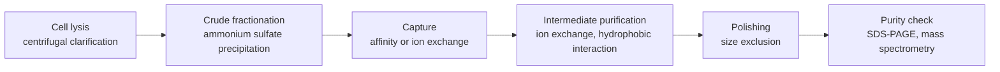

Gas chromatography is suitable only for substances that can be vaporized without decomposition, whereas the great majority of biomolecules (amino acids, sugars, nucleotides, peptides, proteins and nucleic acids), as well as most drugs, natural products and ions, are nonvolatile or decompose on heating. Analyzing them requires liquid chromatography, with a liquid as the mobile phase, or electrophoresis, in which an electric field drives charged molecules. This chapter first treats the instrumentation and detectors of high-performance liquid chromatography (Section 14.1), then the various modes of liquid chromatography according to separation mechanism (Section 14.2), then the chromatographic separation of proteins, peptides and nucleic acids (Section 14.3) and supercritical fluid chromatography, supercritical fluid extraction and preparative chromatography (Section 14.4), and finally electrophoresis: capillary electrophoresis, gel electrophoresis, DNA sequencing and two-dimensional electrophoresis of proteins (Section 14.5). The retention factor, plate height, van Deemter equation and resolution equation of the previous chapter ([6.4.13](/6.4.13)) apply here directly; the physical chemistry of electrophoresis (**electrophoresis**, **electroosmosis** and the **zeta potential**) was treated in [6.3.21](/6.3.21#sec-21.5), and only its results are used here. Coupling the separation methods of this chapter with mass spectrometry is the basis of proteomics in [6.4.15](/6.4.15#sec-15.5.3).

## 14.1. HPLC Instrumentation and Detectors

### 14.1.1. Characteristics of High-Performance Liquid Chromatography

**Definition 14.1.1 (High-Performance Liquid Chromatography)** Liquid chromatography in which a liquid mobile phase is delivered by a high-pressure pump through a column packed with fine particles smaller than $10\,\mu\mathrm{m}$ in diameter, so that efficient and rapid separation and on-line detection are achieved, is called **high-performance liquid chromatography** (HPLC).

Classical column chromatography uses a mobile phase at atmospheric or low pressure and a packing of about $100\,\mu\mathrm{m}$; a separation takes hours and the column efficiency is low. By the van Deemter equation ([6.4.13](/6.4.13#sec-13.3.2)), diffusion coefficients in liquids are small ($D_{\mathrm{m}} \approx 10^{-9}\,\mathrm{m^2\,s^{-1}}$, about $10^{-4}$ of that in a gas) and the mass-transfer term dominates, so the column efficiency can be raised only by reducing the particle size; but by Darcy's law the pressure drop of the column,

$$
\Delta p = \frac{\phi\eta Lu}{d_{\mathrm{p}}^2},
$$
increases inversely with the square of the particle size ($\phi$, about 500–1000, is the flow resistance factor of the column and $\eta$ is the **viscosity** of the mobile phase). In the late 1960s Horváth, Kirkland, Huber and others achieved rapid, efficient liquid separations with small particles below $10\,\mu\mathrm{m}$ and high-pressure pumps able to withstand tens of megapascals; this was the joint work of several research groups of the period.

Compared with gas chromatography, the characteristics of HPLC are as follows:

| Aspect | Gas chromatography | High-performance liquid chromatography |
|---|---|---|
| Applicable analytes | Volatile and thermally stable (about 20% of organic compounds) | Anything soluble in the mobile phase: polar, ionic, thermally unstable, polymers and biomacromolecules |
| Mobile phase | Inert carrier gas, serving only for transport | Liquid, interacting with both the components and the stationary phase and the main means of tuning selectivity |
| Operating temperature | Often high | Room temperature to about $60\,{}^\circ\mathrm{C}$ |
| Column efficiency | Capillary column $N \sim 10^5$ | 15 cm column $N \sim 10^4$–$3 \times 10^4$ |
| Recovery of fractions | Difficult | Easy; preparative work is possible (Section 14.4.4) |

### 14.1.2. The Solvent Delivery System and Gradient Elution

The high-pressure pump is the core component of an HPLC instrument. It must deliver a stable, pulse-free flow over the range $0.01$–$10\,\mathrm{mL\,min^{-1}}$ (dual-piston reciprocating pumps are common) and withstand $40\,\mathrm{MPa}$ ($100$–$130\,\mathrm{MPa}$ for ultra-high-performance liquid chromatography). Fluctuations in flow rate directly affect the repeatability of retention times and the baseline of concentration-sensitive detectors. The mobile phase must be filtered and degassed (by on-line vacuum degassing, ultrasonication or helium sparging); otherwise dissolved gas comes out of solution in the detector cell as bubbles and causes baseline noise and drift.

**Definition 14.1.2 (Gradient Elution)** The mode of elution in which, during one analysis, the proportions of two or more solvents in the mobile phase are changed continuously (or stepwise) according to a predetermined program, thereby changing the elution strength of the mobile phase, is called **gradient elution**; elution with a mobile phase of constant composition is called **isocratic elution**.

Gradient elution plays the same role as temperature programming in gas chromatography ([6.4.13](/6.4.13#sec-13.4.5)): one starts with a weak mobile phase so that strongly retained components stay at the column head while weakly retained ones separate first, and the strength is then increased gradually so that the strongly retained components elute in turn at suitable values of $k$. It solves the "general elution problem" of samples with a very wide range of retention factors, makes the peak widths uniform and the peaks sharper, and lowers the detection limits of late-eluting components; for peptides and proteins it is almost the only feasible mode of elution (Section 14.2.3). Gradients are produced in two ways: a high-pressure gradient uses two pumps that deliver the two solvents separately before mixing, and a low-pressure gradient uses one pump with a proportioning valve. After a gradient the column must be re-equilibrated with the initial mobile phase.

### 14.1.3. Injection and Columns

Injection generally uses a six-port valve: in the loading position the sample is loaded into a calibrated loop with a syringe while the column is connected directly to the pump; when the valve is turned to the injection position the mobile phase flushes the sample from the loop into the column. An autosampler works on the same principle and has a repeatability better than 0.5% (the reason why the external standard method can be used directly in HPLC).

HPLC columns are usually stainless steel tubes, and the packing is mostly porous silica or polymer microspheres:

| Column type | Inner diameter | Usual particle size | Flow rate | Use |
|---|---|---|---|---|
| Conventional analytical column | 4.6 mm (50–250 mm long) | 5 μm, 3 μm | $1\,\mathrm{mL\,min^{-1}}$ | Routine analysis |
| Narrow-bore column | 2.1–3 mm | 1.7–3 μm | $0.2$–$0.6\,\mathrm{mL\,min^{-1}}$ | Ultra-high-performance liquid chromatography, LC-MS |
| Microbore column | about 1 mm | 1.7–5 μm | $50\,\mu\mathrm{L\,min^{-1}}$ | Small sample amounts |
| Capillary and nanoflow columns | 75–300 μm | 1.7–3 μm | $0.2$–$5\,\mu\mathrm{L\,min^{-1}}$ | Nanoflow LC-MS in proteomics |

Reducing the inner diameter does not change the column efficiency, but the flow rate and solvent consumption decrease with the square of the inner diameter, the components are diluted less, and the signal is stronger in concentration-sensitive detectors and electrospray mass spectrometry.


As the figure shows, when the particle size decreases $H_{\min} \approx 2d_{\mathrm{p}}$ decreases in proportion and $u_{\mathrm{opt}} \propto D_{\mathrm{m}}/d_{\mathrm{p}}$ increases, and the right-hand side of the curve becomes flatter: small particles both raise the column efficiency and allow fast separations at high flow rates. The price is that the pressure drop increases as $u/d_{\mathrm{p}}^2$.

**Definition 14.1.3 (Ultra-High-Performance Liquid Chromatography)** Liquid chromatography that uses packings with particle sizes below $2\,\mu\mathrm{m}$, a solvent delivery system withstanding pressures above about $100\,\mathrm{MPa}$, and injectors and detector cells of small volume, so as to obtain higher column efficiency and faster separation at higher flow rates, is called **ultra-high-performance liquid chromatography** (UHPLC, commercialized in 2004).

Compared with a conventional 5 μm column, the same separation can be 5–10 times faster on a short 1.7 μm column, with a solvent saving of more than 80%. Another route is the core–shell (superficially porous) packing: a 0.5 μm porous shell is formed around a solid silica core of 1.7 μm, so that the components diffuse only within the thin shell; mass transfer is fast and the packing is uniform, and the efficiency of a column of 2.7 μm core–shell particles approaches that of sub-2 μm fully porous particles with a much lower pressure drop. Monolithic columns (continuous porous materials formed in situ in the column tube by polymerization or the sol–gel process) have similar advantages.

### 14.1.4. Detectors

An HPLC detector must detect trace components against the background of the mobile phase and cannot use a flame or thermal conductivity as in gas chromatography. The commonly used ones are:

1. Ultraviolet–visible detector: it measures the absorbance of the components in a flow cell, obeying the **Beer–Lambert law** ([6.4.9](/6.4.9#sec-9.3)); it is sensitive to substances with chromophores, has a wide linear range, and is the most commonly used detector. Peptides and proteins are detected at 214 nm (the peptide bond) and 280 nm (tryptophan and tyrosine), and nucleic acids at 260 nm. The diode array detector (DAD, [6.4.9](/6.4.9#sec-9.4.2)) records the whole absorption spectrum while a peak elutes, so that the spectrum can assist identification and peak purity can be checked. The mobile phase must be transparent at the detection wavelength (acetonitrile absorbs below 190 nm and methanol below 205 nm).
2. Fluorescence detector: its sensitivity is 2–3 orders of magnitude higher than that of UV detection and it is highly selective ([6.4.10](/6.4.10#sec-10.2.5)); it is suited to substances that fluoresce themselves (polycyclic aromatic hydrocarbons, vitamin $\mathrm{B}_2$, some drugs), and nonfluorescent substances (amino acids, amines, sugars) can be derivatized with fluorescent reagents before or after the column and then detected (Section 14.3.5).
3. Refractive index detector: it measures the difference in refractive index between the effluent and the reference mobile phase and is a universal detector (any solute changes the refractive index), used for sugars, polymers and lipids; but its sensitivity is low (limit of detection about $1\,\mu\mathrm{g}$), it is extremely sensitive to temperature, and it cannot be used with gradient elution.
4. Evaporative light-scattering detector (see Definition 14.1.4).
5. Electrochemical detector: it measures the current of oxidation or reduction of the component at a working electrode (amperometric detection, [6.4.6](/6.4.6#sec-6.7.1)); it is sensitive and selective for electroactive substances such as catecholamines, phenols and thiols and is the classical method for neurotransmitter analysis; sugars can be detected by pulsed amperometry on a gold electrode in a strongly alkaline mobile phase.
6. Conductivity detector: the universal detector of ion chromatography (Section 14.2.5).
7. Mass spectrometric detector: an electrospray or atmospheric pressure chemical ionization interface converts the effluent to gas-phase ions; it both quantifies and gives molecular mass and structural information and is the most important detector in modern bioanalysis and pharmaceutical analysis, see [6.4.15](/6.4.15#sec-15.5.1).

**Definition 14.1.4** A detector in which the column effluent is nebulized, the mobile phase is evaporated in a heated drift tube so that the nonvolatile solute forms fine particles, and the intensity of light scattered by the particles from a light beam is then measured is called an **evaporative light-scattering detector** (ELSD).

The evaporative light-scattering detector responds to every solute that is less volatile than the mobile phase, irrespective of its optical properties, is suited to sugars, lipids, surfactants, polymers and some drugs that have no UV absorption, and can be used with gradient elution (the mobile phase is entirely evaporated). The mobile phase and buffer salts must be volatile (ammonium acetate or formate, not phosphate); the relation between response and mass is nonlinear (approximately a power function), so a logarithmic calibration curve is used for quantitation. The charged aerosol detector (CAD) works on a similar principle, with charge instead of light scattering, and gives a more uniform response.

| Detector | Selectivity | Limit of detection (order of magnitude) | Gradient elution | Typical applications |
|---|---|---|---|---|
| UV–visible / DAD | Substances with chromophores | ng | Yes | General use, drugs, peptides and proteins |
| Fluorescence | Fluorescent substances (or after derivatization) | pg | Yes | Amino acids, polycyclic aromatic hydrocarbons, vitamins |
| Refractive index | Universal | μg | No | Sugars, polymers |
| Evaporative light scattering | Nonvolatile solutes | 10 ng | Yes | Sugars, lipids, surfactants |
| Electrochemical | Electroactive substances | pg | Difficult | Neurotransmitters, phenols |
| Conductivity | Ions | ng | Yes, after suppression | Ion chromatography |
| Mass spectrometry | Universal or selective | pg–fg | Yes | Bioanalysis, metabolites, drugs |

## 14.2. Modes of Liquid Chromatography

In liquid chromatography the components interact with both the stationary and the mobile phase, and the modes are classified by retention mechanism below. Actual retention is often the joint result of several interactions, but each mode has a dominant mechanism and typical analytes (the table in Section 14.2.8).

### 14.2.1. Adsorption Chromatography

**Definition 14.2.1 (Adsorption Chromatography)** Liquid chromatography with a solid adsorbent as the stationary phase, in which components are separated by differences in their adsorption on the adsorbent surface, is called **adsorption chromatography** (liquid–solid adsorption chromatography).

The most commonly used **adsorbent** is silica gel; others are alumina, activated carbon and polyamide. The silanol groups $\ce{Si-OH}$ on the silica surface adsorb polar molecules through **hydrogen bonds** and dipole interactions; molecules of the mobile phase compete with the component molecules for the adsorption sites on the surface, so the more polar the mobile phase, the stronger its eluting power. Commonly used mobile phases are mixtures of nonpolar solvents such as n-hexane and heptane with polar solvents such as dichloromethane, ethyl acetate and isopropanol.

Adsorption chromatography is sensitive to the kind and position of functional groups and is the most effective method for separating structural isomers (such as positional isomers of pesticides and cis/trans isomers of vitamin A) and for group-type separations (alkanes, alkenes and aromatics in petroleum); it is also the principle of silica gel column chromatography and thin-layer chromatography in the organic laboratory. Its drawback is that peaks tail easily: adsorption obeys the **Langmuir adsorption isotherm** ([6.3.20](/6.3.20#sec-20.3)), and at higher concentrations the surface approaches saturation and the partition coefficient decreases with increasing concentration, so that the concentrated center of the band moves faster than its dilute tail, giving a peak with a steep front and a tailing rear; there are also a few especially strongly adsorbing active sites on the surface (isolated, strongly acidic silanol groups) that make basic components tail badly. Tailing can be reduced by decreasing the amount injected so that adsorption remains in the linear region of the isotherm, or by adding a little polar modifier (water, an amine) to the mobile phase to block the strongly adsorbing sites.

### 14.2.2. Partition Chromatography and Chemically Bonded Phases

**Definition 14.2.2 (Partition Chromatography)** Liquid chromatography in which components are separated by differences in their partition coefficients between two immiscible liquids, the stationary liquid and the mobile phase, is called **partition chromatography**.

The retention of a component is determined by the **partition coefficient** (Theorem 13.1.1). The original partition chromatography of Martin and Synge used water adsorbed on silica gel as the stationary phase ([6.4.13](/6.4.13#sec-13.1.1)). But a coated stationary liquid gradually dissolves in the mobile phase and is lost, giving poor reproducibility, and gradient elution cannot be used. The modern approach is to attach the functional groups of the stationary phase to the support by chemical bonds.

**Definition 14.2.3 (Bonded Phase)** A stationary phase obtained by attaching organic functional groups through covalent bonds to the surface of a support (usually silica gel) by a chemical reaction is called a **bonded phase** (chemically bonded phase).

The most common reaction is silanization: the silanol groups on the silica surface react with a chlorosilane (or alkoxysilane) to form $\ce{Si-O-Si-C}$ bonds, for example with octadecyltrichlorosilane (1) or octadecyldimethylchlorosilane:

$$
{\equiv}\ce{Si-OH} + \ce{Cl3Si-C18H37} \to {\equiv}\ce{Si-O-SiCl2-C18H37} + \ce{HCl}
$$

```smiles
CCCCCCCCCCCCCCCCCC[Si](Cl)(Cl)Cl 1
```

The resulting octadecyl-bonded silica is called ODS (octadecylsilyl silica) or C18 packing and is the most widely used HPLC stationary phase; ODS refers to the bonded silica and should not be confused with the reagent octadecyltrichlorosilane used for bonding. Because of steric hindrance only about half of the silanol groups can be bonded with the long chain, and the residual silanol groups adsorb basic components and make them tail, so after bonding the surface is treated with a small silanizing reagent such as trimethylchlorosilane, a step called end-capping.

Bonded phases are classified by the polarity of the functional group:

- Nonpolar bonded phases: octadecyl (C18), octyl (C8), butyl (C4), phenyl and so on, used in reversed-phase chromatography;
- Polar bonded phases: cyano, amino, diol and so on, used in normal-phase chromatography and hydrophilic interaction chromatography;
- Ion-exchange bonded phases: sulfonic acid, quaternary ammonium groups and so on (Section 14.2.5).

The drawback of silica-based bonded phases is the narrow pH range: at pH < 2 the $\ce{Si-O-Si}$ bonds hydrolyze and the bonded groups are lost, and at pH > 8 the silica itself dissolves. At high pH hybrid particles (organic–inorganic hybrid silica) or polymer packings must be used.

### 14.2.3. Normal-Phase and Reversed-Phase Chromatography

**Definition 14.2.4 (Normal-Phase Chromatography)** Liquid chromatography in which the stationary phase is more polar than the mobile phase is called **normal-phase chromatography**; typical stationary phases are silica gel and cyano and amino bonded phases, and the mobile phase is a mixture of n-hexane with a little polar solvent. Adsorption chromatography is also normal-phase chromatography.

**Definition 14.2.5 (Reversed-Phase Chromatography)** Liquid chromatography in which the stationary phase is nonpolar (C18, C8 and other bonded phases) and the mobile phase is polar (water mixed with methanol, acetonitrile or tetrahydrofuran) is called **reversed-phase chromatography**.

The elution orders of the two are opposite: in normal-phase chromatography the less polar components elute first and increasing the polarity of the mobile phase reduces retention; in reversed-phase chromatography the more polar components elute first and increasing the proportion of organic solvent in the mobile phase reduces retention. The mobile phases of reversed-phase chromatography are cheap, compatible with aqueous samples, and the bonded phases are stable, equilibrate quickly and give good reproducibility; the range of application is very wide (neutral organic compounds, drugs, peptides and proteins, and, with ion-pairing reagents or pH adjustment, also ionic substances), and about 80% of HPLC analyses now use the reversed-phase mode.

Retention in reversed-phase chromatography comes mainly from the hydrophobic effect: the nonpolar part of a component molecule forces the surrounding water molecules in water into an ordered arrangement, and when the molecule transfers to the nonpolar bonded phase these water molecules are released, so the entropy increases and the Gibbs energy decreases. The larger the nonpolar surface area of a component, therefore, the stronger its retention: for each additional $\ce{CH2}$ in a homologous series, $\lg k$ increases by about 0.2–0.3. There is an approximately linear relation between the retention factor and the volume fraction $\varphi$ of organic solvent in the mobile phase (the linear solvent strength model, Snyder):

$$
\lg k = \lg k_{\mathrm{w}} - S\varphi, \tag{14.1}
$$
where $k_{\mathrm{w}}$ is the retention factor extrapolated to a pure water mobile phase and $S$ is about 3–5 for small molecules and increases with molecular size.


The figure explains why peptides and proteins must be eluted with a gradient: their $S$ is very large, so under isocratic conditions they either do not elute or are washed out with the hold-up volume, and they elute in turn only in a gradient, as $\varphi$ sweeps through their respective very narrow elution windows.

In normal-phase and adsorption chromatography the elution strength of the mobile phase is often measured by Snyder's solvent polarity parameter $P'$. It is obtained from the solubility of a solvent for three probes (ethanol, dioxane and nitromethane, which reflect the solvent's action as a proton acceptor, a proton donor and a dipole, respectively): n-hexane 0.1, toluene 2.4, dichloromethane 3.1, tetrahydrofuran 4.0, ethanol 4.3, ethyl acetate 4.4, methanol 5.1, acetonitrile 5.8, water 10.2. The $P'$ of a solvent mixture is weighted by volume fraction: $P'_{\mathrm{AB}} = \varphi_{\mathrm{A}}P'_{\mathrm{A}} + \varphi_{\mathrm{B}}P'_{\mathrm{B}}$. Empirically a change of 2 units in $P'$ changes $k$ by about a factor of 10:

$$
\text{normal phase:}\ \frac{k_2}{k_1} = 10^{(P'_1 - P'_2)/2}, \qquad \text{reversed phase:}\ \frac{k_2}{k_1} = 10^{(P'_2 - P'_1)/2}.
$$

**Example 14.2.1** A component has $k = 12$ in acetonitrile–water (30:70), which is too strongly retained. What is $k$ approximately after changing to acetonitrile–water (50:50)?

**Solution** $P'_1 = 0.3 \times 5.8 + 0.7 \times 10.2 = 8.88$ and $P'_2 = 0.5 \times 5.8 + 0.5 \times 10.2 = 8.00$. In reversed phase $k_2 = 12 \times 10^{(8.00 - 8.88)/2} = 12 \times 0.36 = 4.4$, which lies within the suitable range. $\square$

The parameter $P'$ only adjusts the strength ($k$) and cannot improve the selectivity ($\alpha$). Snyder plotted the relative proportions $x_{\mathrm{e}}$, $x_{\mathrm{d}}$ and $x_{\mathrm{n}}$ (summing to 1) of the three interactions for 81 solvents in a triangular diagram; solvents of similar selectivity cluster together and fall into 8 groups, which is the solvent selectivity triangle. When one solvent does not give a satisfactory $\alpha$, replacing it with a solvent from another group (for example replacing methanol with acetonitrile or tetrahydrofuran and adjusting the proportion so that $P'$ is unchanged) often improves the separation markedly.

### 14.2.4. Hydrophilic Interaction Chromatography

**Definition 14.2.6 (Hydrophilic Interaction Chromatography)** Liquid chromatography that separates polar compounds with a polar stationary phase (silica gel, amide, diol or zwitterionic bonded phases) and a mobile phase containing a large proportion of organic solvent (usually 70%–95% acetonitrile) and a little water or buffer is called **hydrophilic interaction chromatography** (HILIC, Alpert 1990).

In HILIC, water forms a water-rich liquid layer on the surface of the polar stationary phase, and polar components partition between this layer and the acetonitrile-rich mobile phase (with hydrogen bonding and electrostatic interactions also involved); the more polar the component the stronger its retention, and increasing the proportion of water reduces retention, so that the elution order is roughly the reverse of that in reversed-phase chromatography. It remedies the weak retention of strongly polar small molecules in reversed-phase chromatography and is suited to sugars and glycopeptides, amino acids, nucleotides, polar metabolites and polar drugs, and is widely used in metabolomics and glycomics. The high proportion of acetonitrile also makes desolvation in electrospray easier, giving high sensitivity when coupled with mass spectrometry.

### 14.2.5. Ion-Exchange Chromatography and Ion Chromatography

**Definition 14.2.7 (Ion-Exchange Chromatography)** Liquid chromatography with an ion exchanger carrying dissociable ion-exchange groups on its surface as the stationary phase, in which components are separated by differences in the strength of the electrostatic interaction between the component ions and the exchange groups, is called **ion-exchange chromatography**.

Negatively charged exchange groups exchange cations and positively charged ones exchange anions:

| Type | Exchange group | Name commonly used in biochemistry |
|---|---|---|
| Strongly acidic cation exchanger | Sulfonic acid $\ce{-SO3-}$ | SP (sulfopropyl), S |
| Weakly acidic cation exchanger | Carboxyl $\ce{-COO-}$ | CM (carboxymethyl) |
| Strongly basic anion exchanger | Quaternary ammonium $\ce{-N(CH3)3+}$ | Q (quaternary ammonium) |
| Weakly basic anion exchanger | Tertiary and secondary amino | DEAE (diethylaminoethyl) |

An example of an exchange reaction is $\ce{R-SO3H + M+ <=> R-SO3M + H+}$ (R denotes the resin backbone). "Strong" and "weak" refer to the acidity or basicity of the exchange group: a strong exchanger is charged over a wide pH range, a weak exchanger only within a certain pH range. The binding of an ion to the exchanger increases with its charge, and for ions of the same charge with decreasing hydrated radius: $\ce{Li+} < \ce{Na+} < \ce{K+} < \ce{Rb+} < \ce{Cs+}$, $\ce{Mg^2+} < \ce{Ca^2+} < \ce{Sr^2+} < \ce{Ba^2+}$, $\ce{F-} < \ce{OH-} < \ce{Cl-} < \ce{Br-} < \ce{NO3-} < \ce{I-}$. For elution one increases the concentration of the competing ion in the mobile phase (a salt gradient) or changes the pH (changing the charge of the component).

Ion-exchange chromatography is the mainstay of protein and nucleic acid separation: a protein carries a net negative charge above its **isoelectric point** ([6.4.2](/6.4.2#sec-2.8.3)) and binds to an anion exchanger, and below its isoelectric point carries a net positive charge and binds to a cation exchanger; it is then eluted in order of charge with an NaCl gradient (Section 14.3). Ion-exchange resins are also used for water softening and deionization, separation of the rare earth elements and amino acid analysis.

**Definition 14.2.8 (Ion Chromatography)** Liquid chromatography in which inorganic and organic ions are separated on an ion-exchange column of low exchange capacity and detected with a conductivity detector, with a **suppressor** between the separation column and the detector to lower the background conductivity of the mobile phase, is called **ion chromatography** (suppressed ion chromatography, Small, Stevens and Bauman 1975).

The difficulty of ion chromatography is that the mobile phase required to elute the ions is itself an electrolyte solution with a large background conductivity, in which the small conductivity change due to the analyte ions is swamped. The suppressor converts the mobile phase into a species of very low conductivity and at the same time converts the analyte ions into a more conductive form. Take the determination of $\ce{Cl-}$ with an $\ce{NaOH}$ mobile phase as an example:

- In the analytical column (a quaternary ammonium anion exchanger in the $\ce{OH-}$ form), $\ce{Cl-}$ competes with $\ce{OH-}$ for the exchange sites and is separated: $\ce{R-OH + Cl- <=> R-Cl + OH-}$ (R denotes a resin with quaternary ammonium groups).
- In the suppressor (a cation exchanger or cation-exchange membrane in the $\ce{H+}$ form), $\ce{Na+}$ of the mobile phase is replaced by $\ce{H+}$:
$$
\ce{R-SO3H + NaOH -> R-SO3Na + H2O}, \qquad \ce{R-SO3H + NaCl -> R-SO3Na + HCl}.
$$

The background changes from $\ce{NaOH}$ to practically nonconducting water, and the analyte ion changes from $\ce{NaCl}$ to $\ce{HCl}$: the limiting molar conductivity of $\ce{H+}$ ($349.65\,\mathrm{S\,cm^2\,mol^{-1}}$) is about 7 times that of $\ce{Na+}$ (50.08) ([6.3.12](/6.3.12#sec-12.4.2)), so the signal increases about threefold. For the determination of cations the reverse holds: $\ce{HCl}$ or methanesulfonic acid is the mobile phase and the suppressor is an anion exchanger in the $\ce{OH-}$ form, which converts $\ce{HCl}$ to $\ce{H2O}$ and $\ce{MCl}$ to $\ce{MOH}$. Modern instruments use self-regenerating membrane suppressors in which $\ce{H+}$ or $\ce{OH-}$ is generated electrolytically, and eluent generators that produce high-purity $\ce{KOH}$ mobile phase on-line by electrolysis. Ion chromatography is the standard method for determining anions such as $\ce{F-}$, $\ce{Cl-}$, $\ce{NO3-}$ and $\ce{SO4^2-}$, and the alkali metal, alkaline earth metal and ammonium ions in water.

### 14.2.6. Size-Exclusion Chromatography

**Definition 14.2.9 (Size-Exclusion Chromatography)** Liquid chromatography with a porous gel or porous particles of a defined pore size distribution as the stationary phase, in which component molecules enter the pores to different extents according to their size in solution (hydrodynamic volume) and are separated by the larger molecules eluting first and the smaller later, is called **size-exclusion chromatography** (gel chromatography). When it is used with an aqueous mobile phase to separate biomacromolecules it is called **gel filtration chromatography**, and when it is used with an organic solvent as mobile phase to determine the molar mass distribution of synthetic polymers it is called **gel permeation chromatography**.

Let the volume of mobile phase between the packing particles (the interstitial or void volume) be $V_0$ and the volume of mobile phase inside the pores be $V_{\mathrm{i}}$. The elution volume of a component is

$$
V_{\mathrm{R}} = V_0 + K_{\mathrm{SEC}}V_{\mathrm{i}}, \qquad 0 \le K_{\mathrm{SEC}} \le 1, \tag{14.2}
$$
where $K_{\mathrm{SEC}}$ is the fraction of the pore volume accessible to the molecule (some textbooks write $V_{\mathrm{i}}$ as $V_{\mathrm{S}}$): a molecule larger than the largest pores is completely excluded, $K_{\mathrm{SEC}} = 0$, and elutes at $V_0$ (the exclusion limit); a molecule smaller than the smallest pores can enter all the pores, $K_{\mathrm{SEC}} = 1$, and elutes at $V_0 + V_{\mathrm{i}}$ (the total permeation volume); molecules of intermediate size elute in order of size. In the ideal case the separation in size-exclusion chromatography is determined solely by entropy (the conformational restriction of the molecule entering a pore), with no enthalpic interaction between the components and the stationary phase, so all components elute between $V_0$ and $V_0 + V_{\mathrm{i}}$ and the peak capacity is limited (generally only about 10 peaks can be resolved); but the conditions are mild, proteins are not denatured, and the molecular size is obtained directly.

Within the fractionation range $\lg M$ is approximately linear in $V_{\mathrm{R}}$, and a calibration curve made with standards of known molar mass allows the molar mass of an unknown to be obtained from its elution volume (this is **inverse prediction** of concentration from a calibration curve, [6.4.1](/6.4.1#sec-1.8.1)).


What is measured in this way is the molar mass of a standard "of the same size": a nonspherical protein (such as a fibrous, heavily glycosylated or partly disordered protein) has a larger hydrodynamic radius and an apparent molar mass that is too high; oligomers elute according to their overall size, so gel filtration is also used to judge the oligomeric state of a protein. In the gel permeation chromatography of synthetic polymers, a series of polystyrene standards of narrow distribution are used for calibration, $M_i$ and its mass fraction are obtained for each slice of the chromatogram, and the **number-average molar mass**, the **mass-average molar mass** and the dispersity are calculated ([6.3.21](/6.3.21#sec-21.9.2)); when the polymer differs in structure from the standards, Benoit's universal calibration is used (taking the product $[\eta]M$ of the intrinsic viscosity and the molar mass as the measure of the hydrodynamic volume), or a multi-angle light scattering detector is connected after the column to determine the molar mass directly.

Another use of gel filtration is desalting and buffer exchange: the protein elutes at $V_0$ and the small salt molecules are retarded, with the same effect as **dialysis** ([6.3.21](/6.3.21#def-21.2.1)) but much faster. Commonly used packings are cross-linked dextran (Sephadex), cross-linked agarose (Superdex, Superose), cross-linked polyacrylamide, and styrene–divinylbenzene copolymer for organic solvents.

### 14.2.7. Affinity Chromatography and Chiral Chromatography

**Definition 14.2.10 (Affinity Chromatography)** The chromatographic method in which a ligand that binds the biomacromolecule to be separated specifically and reversibly (such as a substrate analog or inhibitor of an enzyme, an antigen or an antibody, or a metal chelate) is immobilized covalently on a support as the stationary phase, so that the target molecule is selectively retained and the impurities pass straight through, and the target is then eluted by changing the conditions (adding a competing ligand, changing the pH or the ionic strength), is called **affinity chromatography**.

The selectivity of affinity chromatography is much higher than that of the other modes, and a single step can purify a target protein by a factor of hundreds to thousands. It is essentially an "on–off" adsorption–desorption rather than a gradual differential migration. Commonly used systems are described in Section 14.3.2.

**Definition 14.2.11 (Chiral Chromatography)** The chromatographic method in which an optically pure chiral selector is used as the stationary phase (chiral stationary phase) or added to the mobile phase, so that a pair of enantiomers form transient diastereomeric complexes of different stability with the selector and are thereby separated, is called **chiral chromatography**.

**Enantiomers** have identical physical properties in an achiral environment and can be distinguished only in a chiral environment (**chirality**, [6.1.5](/6.1.5); for stereochemistry in organic chemistry see [6.5](/6.5)). Chiral recognition generally requires at least three points of interaction between the selector and the enantiomer, at least one of which depends on the stereochemical configuration (Dalgliesh's three-point interaction model). Commonly used chiral stationary phases are polysaccharide derivatives (phenylcarbamates of cellulose and amylose coated or bonded on silica gel, with the widest range of applicability), cyclodextrins (inclusion in the hydrophobic cavity), macrocyclic antibiotics (vancomycin and others), proteins (α₁-acid glycoprotein) and Pirkle-type phases (π-acid–π-base interaction). The two enantiomers of a drug often differ in pharmacological effect and toxicity; chiral chromatography is used to determine the enantiomeric excess, to monitor asymmetric synthesis and also to prepare optically pure drugs (Section 14.4).

### 14.2.8. Choice of Separation Mode

| Mode | Main mechanism | Stationary phase | Mobile phase | Main analytes |
|---|---|---|---|---|
| Adsorption (normal phase) | Adsorption, hydrogen bonding | Silica gel, alumina | Nonpolar organic solvents | Isomers, group-type separations, preparative work |
| Reversed phase | Hydrophobic partition | C18, C8, phenyl | Water–methanol or acetonitrile | The great majority of organic compounds, drugs, peptides |
| Hydrophilic interaction | Partition in a water-rich layer | Silica gel, amide, zwitterionic | High proportion of acetonitrile–water | Sugars, polar metabolites |
| Ion exchange / ion chromatography | Electrostatic interaction | Ion exchanger | Buffer, salt gradient | Inorganic ions, amino acids, proteins, nucleic acids |
| Size exclusion | Molecular size | Porous gel | Aqueous solution or organic solvent | Proteins, polymers and molar mass distributions |
| Affinity | Biospecific binding | Immobilized ligand | Buffer, competitive elution | Proteins, enzymes, antibodies |
| Chiral | Stereoselectivity | Chiral stationary phase | Depends on the stationary phase | Enantiomers |

The rough line of thought for the choice: whether the sample dissolves in water or in organic solvent, whether it is charged, and how large its molecular mass is. Neutral or weakly polar substances with a molecular mass below about 2000 are first treated by reversed phase; strongly polar ones by HILIC; ions by ion exchange or ion chromatography (or reversed phase with an ion-pairing reagent); polymers and fractionation by size by size exclusion; and the purification of biomacromolecules combines ion exchange, affinity and size exclusion.

## 14.3. Chromatographic Separation of Biomacromolecules

### 14.3.1. The General Scheme of Protein Purification

To obtain a pure and active protein from cells or tissue, it must be separated from thousands of other proteins without being denatured at any point. Several methods based on different separation principles are generally combined in the order "capture–intermediate purification–polishing", each step exploiting one property of the target protein:



1. Crude fractionation: ammonium sulfate precipitation (salting out). A high salt concentration competes with the protein for water molecules and lowers its solubility; different proteins precipitate at different degrees of saturation, and the sample is at the same time concentrated and partly freed of impurities.
2. Capture: affinity chromatography (when there is a tag or a specific ligand) or ion-exchange chromatography, which processes a large volume of crude extract, rapidly concentrates the target protein and removes most of the impurities.
3. Intermediate purification: impurities of different charge are removed by ion exchange; those of different surface hydrophobicity by hydrophobic interaction chromatography (the protein binds at high salt to weakly hydrophobic butyl or phenyl media and is eluted by lowering the salt concentration, under conditions milder than reversed phase and without denaturation).
4. Polishing: size-exclusion chromatography removes aggregates and residual small impurities and at the same time changes the buffer to the one required.
5. At each step the purity is checked by SDS-PAGE (Section 14.5.5) and the specific activity and recovery are calculated from activity assays.

Biochemistry laboratories often use fast protein liquid chromatography (FPLC) systems: medium to low pressure ($< 5\,\mathrm{MPa}$), a fully biocompatible inert flow path, and column packings of larger particle size (10–90 μm) for easy scale-up; the principle is the same as in HPLC, with emphasis on sample load and preservation of activity.

### 14.3.2. Affinity Tags and Examples of Affinity Chromatography

Genetic engineering has made affinity chromatography a general method: a tag that is specifically bound by an immobilized ligand is fused to a terminus of the target protein.

- His tag and immobilized metal affinity chromatography (IMAC): 6–10 histidines are added at a terminus of the protein. The stationary phase is a **chelate** ([6.1.5](/6.1.5)) of nitrilotriacetic acid (NTA, shown below) bonded to agarose with $\ce{Ni^2+}$: the tetradentate NTA occupies four coordination positions of the octahedral $\ce{Ni^2+}$, and the remaining two positions coordinate to the nitrogen atoms of the imidazole rings of adjacent histidine side chains and so retain the protein. The protein is eluted by competitive coordination with $250$–$500\,\mathrm{mmol\,L^{-1}}$ imidazole, or by lowering the pH so that imidazole is protonated. The chelating agent **EDTA** ([6.4.3](/6.4.3#sec-3.1.4)) and reducing agents strip or reduce $\ce{Ni^2+}$ and must be avoided in the buffers.

```smiles
OC(=O)CN(CC(=O)O)CC(=O)O NTA
```

- Glutathione S-transferase (GST) tag: immobilized glutathione binds GST fusion proteins, which are eluted with reduced glutathione.
- Protein A and protein G: proteins of bacterial origin that bind specifically to the Fc region of IgG antibodies and are eluted with a buffer of pH about 3; they are the first step in the industrial purification of therapeutic monoclonal antibodies.
- Others: lectins (which bind the sugar chains of glycoproteins), heparin (which binds many growth factors and coagulation factors), biotin–streptavidin (dissociation constant about $10^{-14}\,\mathrm{mol\,L^{-1}}$, practically irreversible) and immobilized antibodies (immunoaffinity chromatography).

The strength of binding in affinity chromatography can be described in the form of the **Langmuir adsorption isotherm**: the immobilized ligands are uniform binding sites, and the larger the binding constant and the higher the ligand density, the larger the dynamic capacity of the column.

### 14.3.3. Reversed-Phase Chromatography of Peptides and Proteins

Reversed-phase HPLC is the standard method for the analysis and purification of peptides, and also the means of purifying peptides made by solid-phase synthesis:

- Stationary phase: C18 for small peptides; C4 or C8 with a pore size of 30 nm (300 Å) or more for larger polypeptides and proteins, so that the macromolecules can enter the pores.
- Mobile phase: a water–acetonitrile gradient (for example 5% to 60% acetonitrile over 30–60 min), with 0.1% trifluoroacetic acid (TFA) in both phases. TFA brings the pH to about 2, so that carboxyl groups are not dissociated and silanol groups are not ionized, and it forms ion pairs with basic residues, which sharpens the peaks. TFA strongly suppresses electrospray ionization, so 0.1% formic acid is used instead in LC-MS.
- Retention: it depends on the content of hydrophobic amino acids (Trp, Phe, Leu, Ile and so on) and can be roughly predicted from the sum of the retention coefficients of the residues. Because $S$ is very large (Section 14.2.3), the elution position of a peptide in a gradient is very sensitive to composition, and peptides differing by one amino acid can often be separated.
- Limitation: organic solvent and acidic conditions denature most proteins, so reversed-phase chromatography is used to analyze and prepare peptides and to determine the purity and modifications of proteins, whereas ion exchange, hydrophobic interaction or size exclusion is used when activity must be preserved.

The separation step in the standard workflow of proteomics (protein digestion to peptides → nanoflow reversed-phase chromatography → electrospray tandem mass spectrometry) is the reversed-phase chromatography described here ([6.4.15](/6.4.15#sec-15.5.3)).

### 14.3.4. Chromatographic Separation of Nucleic Acids

The phosphate backbone of a nucleic acid carries one negative charge per nucleotide, and chromatographic separation relies mainly on charge and hydrophobicity:

- Anion-exchange chromatography: DEAE or quaternary ammonium exchangers with salt-gradient elution; longer chains bind more strongly. It is used for the purification of oligonucleotides, plasmid DNA and RNA (the columns in plasmid extraction kits are anion-exchange or silica adsorption columns).
- Ion-pair reversed-phase chromatography: triethylammonium acetate (TEAA) or hexafluoroisopropanol–triethylamine is added to the mobile phase, and the positively charged triethylammonium binds to the phosphate groups so that the nucleic acid is retained on C18 and separated by length and base composition; it is used for the analysis of synthetic oligonucleotides, antisense nucleic acids and mRNA drugs, and can be coupled with mass spectrometry.
- Size-exclusion chromatography: removes free nucleotides and primers by size.

### 14.3.5. Amino Acid Analysis

To determine the amino acid composition of a protein, it is first hydrolyzed in $6\,\mathrm{mol\,L^{-1}}$ $\ce{HCl}$ at $110\,{}^\circ\mathrm{C}$ for 24 h, and the amino acids are then separated and measured. The classical method is the automatic amino acid analyzer of Moore and Stein (Nobel Prize in Chemistry 1972): separation on a cation-exchange column, followed by postcolumn reaction with ninhydrin to give Ruhemann's purple ($570\,\mathrm{nm}$; proline gives a yellow product, $440\,\mathrm{nm}$) and spectrophotometric detection. Modern methods mostly use precolumn derivatization and reversed-phase HPLC: o-phthalaldehyde (OPA) reacts with primary amino groups and thiols within tens of seconds to give strongly fluorescent isoindole derivatives, and 9-fluorenylmethyl chloroformate (FMOC-Cl) derivatizes secondary amines (proline), after which detection is by a fluorescence detector ([6.4.10](/6.4.10#sec-10.2.1)) with detection limits at the femtomole level. In the hydrolysis tryptophan is destroyed and asparagine and glutamine become aspartic acid and glutamic acid, and these need separate treatment.

## 14.4. Supercritical Fluid Chromatography, Supercritical Fluid Extraction and Preparative Chromatography

### 14.4.1. Properties of Supercritical Fluids

A **supercritical fluid** ([6.3.8](/6.3.8#sec-8.5.4)), with temperature and pressure both above the critical values, combines properties of gases and liquids:

| Property | Gas | Supercritical fluid | Liquid |
|---|---|---|---|
| Density / ($\mathrm{g\,cm^{-3}}$) | $(0.6$–$2) \times 10^{-3}$ | $0.2$–$0.9$ | $0.8$–$1.6$ |
| Diffusion coefficient / ($\mathrm{m^2\,s^{-1}}$) | $10^{-5}$ | $10^{-8}$–$10^{-7}$ | $10^{-9}$ |
| Viscosity / ($\mathrm{Pa\,s}$) | $10^{-5}$ | $10^{-5}$–$10^{-4}$ | $10^{-3}$ |

Critical parameters of several supercritical fluids (CRC Handbook):

| Fluid | $t_{\mathrm{c}}/{}^\circ\mathrm{C}$ | $p_{\mathrm{c}}/\mathrm{MPa}$ | $\rho_{\mathrm{c}}/(\mathrm{g\,cm^{-3}})$ |
|---|---|---|---|
| $\ce{CO2}$ | 31.0 | 7.38 | 0.47 |
| $\ce{N2O}$ | 36.4 | 7.24 | 0.45 |
| $\ce{NH3}$ | 132.4 | 11.36 | 0.24 |
| $n$-$\ce{C4H10}$ | 152.0 | 3.80 | 0.23 |

The density of a supercritical fluid is close to that of a liquid and its dissolving power is high; its diffusion coefficient is 1–2 orders of magnitude larger than that of a liquid and its viscosity close to that of a gas, so mass transfer is fast and the pressure drop small; near the critical point the density and dissolving power change sensitively with pressure and temperature. The critical temperature of $\ce{CO2}$ is close to room temperature, and it is nontoxic, nonflammable and cheap and evaporates completely on depressurization without leaving residue; it is the most commonly used supercritical fluid. It is nonpolar, and polar modifiers such as methanol, from a few percent to several tens of percent, are often added to widen its range of application.

### 14.4.2. Supercritical Fluid Chromatography

**Definition 14.4.1 (Supercritical Fluid Chromatography)** Chromatography with a supercritical fluid (mainly $\ce{CO2}$ and its mixtures with polar modifiers) as the mobile phase is called **supercritical fluid chromatography** (SFC).

SFC lies between gas chromatography and liquid chromatography: the dissolving power of the mobile phase enables it to analyze nonvolatile and thermally unstable substances (which gas chromatography cannot), and the large diffusion coefficient and low viscosity enable it to maintain column efficiency at flow rates 3–5 times higher than in HPLC ($u_{\mathrm{opt}} \propto D_{\mathrm{m}}$, [6.4.13](/6.4.13#sec-13.3.3)). A back-pressure regulator after the column keeps the pressure above the critical pressure. Retention can be adjusted by changing the pressure (that is, the density of the mobile phase), the temperature or the proportion of modifier, and programmed pressure has an effect similar to temperature programming and gradient elution. As detector one can use the FID of gas chromatography (pure $\ce{CO2}$ gives no signal) as well as the UV detector and mass spectrometer of HPLC.

Modern SFC mostly uses packed columns (with the same stationary phases as HPLC) and is a "green" substitute for normal-phase separations, with $\ce{CO2}$ replacing large amounts of n-hexane. It is particularly important in chiral separations: polysaccharide chiral stationary phases with a $\ce{CO2}$–methanol mobile phase give fast separations and high efficiency, and the solvent is easily removed in preparative work, so that it has become the method of choice for resolving enantiomers in the pharmaceutical industry. Fat-soluble vitamins, carotenoids, triglycerides and lipidomics analyses also often use SFC.

### 14.4.3. Supercritical Fluid Extraction

**Definition 14.4.2 (Supercritical Fluid Extraction)** The method in which a supercritical fluid is used as the extractant to extract target components from a solid or liquid sample, and the extract is then separated by reducing the pressure or changing the temperature so that the dissolving power of the extractant falls, is called **supercritical fluid extraction** (SFE).

Compared with liquid–liquid **extraction** ([6.3.6](/6.3.6#sec-6.5.2)), SFE has fast penetration and complete extraction, components of different polarity can be extracted selectively one after another by adjusting the pressure, and after depressurization the extract separates from the $\ce{CO2}$ automatically without solvent residue, which suits heat-sensitive substances. In industry it is used for the decaffeination of coffee and tea and for the extraction of hop extracts, essential oils and natural pigments (for the conditions see [6.3.8](/6.3.8#sec-8.5.4)); in analysis it serves as sample preparation, extracting polycyclic aromatic hydrocarbons, pesticide residues and fat from soil and food, and can be coupled on-line with SFC or GC.

### 14.4.4. Preparative Chromatography

**Definition 14.4.3 (Preparative Chromatography)** The chromatographic method whose aim is to obtain a certain quantity of pure components (rather than to determine their contents), using a larger column and larger injection amounts to separate a mixture and collecting the fractions of the components, is called **preparative chromatography**.

Analytical chromatography seeks high resolution and sensitivity, whereas preparative chromatography seeks yield (the amount of pure substance obtained per unit time and per unit stationary phase) at a given purity and recovery. To raise the yield, preparative chromatography deliberately overloads the column: with a large injection volume (volume overload) or a high concentration (concentration overload). Under concentration overload the components are in the nonlinear region of the adsorption isotherm (Langmuir type), the peaks become right triangles with a steep front and a tailing rear, the retention time decreases with increasing amount injected, and adjacent peaks squeeze against each other, so a compromise between sample load and resolution must be made; in systems with large $\alpha$ a larger sample load can be used.

Common forms are:

- Flash chromatography (Still 1978): a silica gel column of particle size about 40–63 μm pressurized with compressed air or a pump, completing a purification in tens of minutes; it is the most commonly used method for purifying products in the organic synthesis laboratory ([6.5](/6.5)), and now mostly uses prepacked columns and automated instruments with UV detection.
- Preparative HPLC: columns of 20–50 mm inner diameter or more, high-flow pumps, and a fraction collector after the column that collects according to the detector signal (triggered by UV or mass spectrometry); it is used to purify natural products, drug impurity reference standards and synthetic peptides.
- Industrial scale: simulated moving bed chromatography (several columns in series with periodic switching of inlets and outlets, simulating countercurrent flow of stationary and mobile phases) is used for the continuous resolution of enantiomers and the separation of sugars; the industrial purification of protein drugs uses large affinity and ion-exchange columns.

## 14.5. Electrophoresis

### 14.5.1. Electrophoretic Mobility

A charged particle in an electric field of strength $E$ experiences the electric force $qE$, accelerates in solution until the electric force balances the frictional force, and then moves at a constant velocity $v$; this is **electrophoresis**. The velocity per unit field strength is the **electrophoretic mobility** ([6.3.21](/6.3.21#def-21.5.6), where it is written $u_{\mathrm{E}}$; this chapter writes $\mu_{\mathrm{ep}}$, in agreement with the capillary electrophoresis literature):

$$
v = \mu_{\mathrm{ep}}E, \qquad \mu_{\mathrm{ep}} = \frac{q}{6\pi\eta r},
$$
where the latter expression is the result of regarding the ion as a sphere of radius $r$ and taking the Stokes drag $6\pi\eta r$ as the friction coefficient (for colloidal particles it is expressed through the zeta potential as the Smoluchowski formula, see [6.3.21](/6.3.21#thm-21.5.2)). The mobility is proportional to the charge and inversely proportional to the size, so ions with different charge-to-size ratios move at different velocities and are separated; a neutral molecule has $\mu_{\mathrm{ep}} = 0$ and cannot be separated by electrophoresis.

Electrophoresis in free solution is disturbed by thermal convection and diffusion. The early moving-boundary electrophoresis of Tiselius (1937; Nobel Prize in Chemistry 1948) observed the moving boundaries of proteins in a U-tube; zone electrophoresis was later carried out in supporting media such as paper and gels, in which the medium suppresses convection; in the 1980s Jorgenson and Lukacs performed electrophoresis in narrow capillaries and obtained extremely high separation efficiency.

### 14.5.2. Capillary Electrophoresis and Electroosmotic Flow

**Definition 14.5.1 (Capillary Electrophoresis)** The liquid-phase separation technique that uses a capillary of $25$–$100\,\mu\mathrm{m}$ inner diameter as the separation channel and a high-voltage direct-current electric field ($10$–$30\,\mathrm{kV}$) as the driving force, separating the components of a sample according to differences in their mobilities (and partition behavior), is called **capillary electrophoresis** (CE); the mode in which the capillary is filled only with buffer solution and separation is by the electrophoretic mobility in free solution is called **capillary zone electrophoresis** (CZE).

A narrow capillary has a large specific surface area, and Joule heat is dissipated quickly, so it can withstand a high field strength of several hundred $\mathrm{V\,cm^{-1}}$ without severe temperature gradients and convection, giving fast migration and high efficiency. The capillary is 30–100 cm long, both ends dip into buffer vials connected to a high-voltage supply; injection is by pressure (hydrodynamic injection) or by applying a voltage briefly (electrokinetic injection, which is biased toward ions of high mobility); the detection window is made near the outlet of the capillary, where UV absorption or laser-induced fluorescence ([6.4.10](/6.4.10#sec-10.3.2)) is measured directly on the capillary, or an interface connects it to an electrospray mass spectrometer.

The silanol groups on the inner wall of a fused-silica capillary dissociate gradually above pH about 3, so that the wall is negatively charged and an electric double layer with an excess of positive charge forms on the solution side. When an electric field is applied, the cations in the diffuse layer move toward the cathode carrying solvent with them, so that all the solution in the tube flows toward the cathode; this is **electroosmosis** in the capillary.

**Definition 14.5.2 (Electroosmotic Flow)** In capillary electrophoresis, the flow of the solution in the tube as a whole relative to the wall, driven by the excess ions in the electric double layer at the wall under the applied field, is called the **electroosmotic flow** (EOF). The velocity of the electroosmotic flow is $v_{\mathrm{eo}} = \mu_{\mathrm{eo}}E$, and the electroosmotic mobility is determined by the zeta potential of the wall:

$$
\mu_{\mathrm{eo}} = -\frac{\varepsilon_{\mathrm{r}}\varepsilon_0\zeta}{\eta}.
$$

This is the Smoluchowski formula applied to a stationary wall and a moving solution ([6.3.21](/6.3.21#thm-21.5.2)): for the inner wall $\zeta < 0$ and $\mu_{\mathrm{eo}} > 0$, so the solution flows toward the cathode. The zeta potential of the wall becomes more negative with increasing pH (more silanol groups dissociate) and decreases in magnitude with increasing ionic strength (the double layer is compressed), so the electroosmotic flow can be adjusted through the pH and concentration of the buffer; coating the inner wall with a neutral polymer (linear polyacrylamide) suppresses the electroosmotic flow, and adding a cationic surfactant (cetyltrimethylammonium bromide), which forms an oppositely charged adsorbed layer on the wall, reverses it.

The electroosmotic flow has two important characteristics. First, its flow profile is flat, a "plug flow": the driving force acts in the very thin double layer next to the wall (the Debye length is about 1–10 nm, much smaller than the tube diameter), and apart from this thin layer the velocity is the same everywhere in the tube; pressure-driven flow (as in an open tubular column in HPLC), in contrast, is a Poiseuille flow with a parabolic velocity profile, fast in the center and slow at the edges, which causes additional broadening. Second, at the pH values commonly used the electroosmotic flow is faster than the electrophoretic velocity of most ions, so cations, neutral molecules and anions are all carried to the detector at the cathode end. The apparent mobility of a component is the sum of the two:

$$
\mu_{\mathrm{app}} = \mu_{\mathrm{ep}} + \mu_{\mathrm{eo}}, \qquad t_{\mathrm{m}} = \frac{L_{\mathrm{d}}}{\mu_{\mathrm{app}}E} = \frac{L_{\mathrm{d}}L_{\mathrm{t}}}{\mu_{\mathrm{app}}U}, \tag{14.3}
$$
where $L_{\mathrm{t}}$ is the total length of the capillary, $L_{\mathrm{d}}$ is the effective length from the injection end to the detection window, $U$ is the applied voltage and $t_{\mathrm{m}}$ is the migration time. The elution order is: cations (electrophoresis and electroosmosis in the same direction; those with larger charge-to-size ratio first), neutral molecules (all emerge together with the electroosmotic flow at $t_{\mathrm{eo}} = L_{\mathrm{d}}L_{\mathrm{t}}/(\mu_{\mathrm{eo}}U)$ and cannot be separated from one another), and anions (electrophoresis opposes electroosmosis; those with larger charge-to-size ratio later; an anion with $\lvert\mu_{\mathrm{ep}}\rvert > \mu_{\mathrm{eo}}$ cannot reach the detector). Measuring $t_{\mathrm{eo}}$ with a neutral marker (such as dimethyl sulfoxide or acetone) allows $\mu_{\mathrm{ep}}$ of each component to be obtained from $t_{\mathrm{m}}$.

**Theorem 14.5.1** If band broadening is due only to longitudinal diffusion, the plate number of capillary zone electrophoresis is

$$
N = \frac{\mu_{\mathrm{app}}UL_{\mathrm{d}}}{2DL_{\mathrm{t}}}, \tag{14.4}
$$
where $D$ is the diffusion coefficient of the component; for $L_{\mathrm{d}} \approx L_{\mathrm{t}}$, $N \approx \mu_{\mathrm{app}}U/(2D)$.

**Proof** The spatial variance produced by diffusion during the migration time $t_{\mathrm{m}}$ is $\sigma_L^2 = 2Dt_{\mathrm{m}}$ (the **Einstein–Smoluchowski relation**). From $N = L_{\mathrm{d}}^2/\sigma_L^2$ and Eq. (14.3), $N = L_{\mathrm{d}}^2\mu_{\mathrm{app}}U/(2DL_{\mathrm{d}}L_{\mathrm{t}}) = \mu_{\mathrm{app}}UL_{\mathrm{d}}/(2DL_{\mathrm{t}})$. $\square$

Unlike chromatography, there are no eddy diffusion and no mass-transfer resistance here (there is no stationary phase), and the plate number is independent of the length of the capillary and proportional to the voltage and inversely proportional to the diffusion coefficient. The higher the voltage the better (limited by Joule heating), and macromolecules, which diffuse slowly, even give higher efficiency: $N$ is about $10^5$–$10^6$ for small ions ($D \approx 10^{-9}\,\mathrm{m^2\,s^{-1}}$) and can exceed $10^6$ for proteins and DNA ($D \approx 10^{-11}$–$10^{-10}\,\mathrm{m^2\,s^{-1}}$), far higher than in HPLC. The actual efficiency is also affected by the length of the injection plug, Joule heating, adsorption on the wall (especially serious for proteins) and conductivity mismatch, and is often lower than the value of Eq. (14.4).


**Example 14.5.1** At 25 °C the wall of a fused-silica capillary has $\zeta = -60\,\mathrm{mV}$, and the buffer has $\varepsilon_{\mathrm{r}} = 78.4$ and $\eta = 0.890\,\mathrm{mPa\,s}$. Find $\mu_{\mathrm{eo}}$; for a total length of 60 cm, an effective length of 50 cm and $25\,\mathrm{kV}$, what is the migration time of a neutral marker? And that of an anion with $\mu_{\mathrm{ep}} = -3.0 \times 10^{-8}\,\mathrm{m^2\,V^{-1}\,s^{-1}}$?

**Solution** $\mu_{\mathrm{eo}} = 78.4 \times 8.854 \times 10^{-12} \times 0.060/(0.890 \times 10^{-3}) = 4.7 \times 10^{-8}\,\mathrm{m^2\,V^{-1}\,s^{-1}}$. $t_{\mathrm{eo}} = 0.50 \times 0.60/(4.7 \times 10^{-8} \times 2.5 \times 10^4)\,\mathrm{s} = 256\,\mathrm{s} = 4.3\,\mathrm{min}$. For the anion $\mu_{\mathrm{app}} = 1.7 \times 10^{-8}$ and $t_{\mathrm{m}} = 706\,\mathrm{s} = 11.8\,\mathrm{min}$; if $D = 1.0 \times 10^{-9}\,\mathrm{m^2\,s^{-1}}$, then $N = 1.7 \times 10^{-8} \times 2.5 \times 10^4 \times 0.50/(2 \times 1.0 \times 10^{-9} \times 0.60) = 1.8 \times 10^5$. $\square$

### 14.5.3. Micellar Electrokinetic Chromatography and Capillary Electrochromatography

Capillary zone electrophoresis cannot separate neutral molecules. Terabe (1984) solved this problem by adding the anionic surfactant sodium dodecyl sulfate (SDS, shown below; CMC about $8\,\mathrm{mmol\,L^{-1}}$) to the buffer at a concentration above the **critical micelle concentration**.

```smiles
CCCCCCCCCCCCOS(=O)(=O)[O-].[Na+] SDS
```

**Definition 14.5.3 (Micellar Electrokinetic Chromatography)** The method in which an ionic surfactant is added to the buffer of capillary electrophoresis at a concentration above the critical micelle concentration, the charged micelles it forms serve as a "pseudostationary phase" migrating in the electric field, and neutral components are separated by differences in their partition coefficients between the aqueous phase and the micelles, is called **micellar electrokinetic chromatography** (MEKC).

SDS **micelles** are negatively charged and their electrophoretic direction is toward the anode, but the electroosmotic flow is faster, so the micelles still flow toward the cathode at a lower velocity. A neutral component moves with the electroosmotic flow while it is in the aqueous phase and with the micelle while it is inside the micelle: a hydrophilic component hardly enters the micelles and elutes near $t_0$ (the electroosmotic time); a hydrophobic component dissolved entirely in the micelles elutes at $t_{\mathrm{mc}}$ (the migration time of the micelles); the others elute in turn, according to their partition coefficients, within the "elution window" between $t_0$ and $t_{\mathrm{mc}}$. The retention factor is obtained from the migration times:

$$
k = \frac{t_{\mathrm{m}} - t_0}{t_0(1 - t_{\mathrm{m}}/t_{\mathrm{mc}})},
$$
which reduces to the chromatographic $k = (t_{\mathrm{R}} - t_{\mathrm{M}})/t_{\mathrm{M}}$ as $t_{\mathrm{mc}} \to \infty$ (immobile micelles). MEKC combines the partition mechanism of chromatography with the flat flow profile of electrophoresis and is used for neutral drugs, chiral compounds (with bile salts or cyclodextrins added) and mixtures of ions and neutral species. Its pseudostationary phase is the micelles in solution, and it should not be confused with capillary electrochromatography below, in which the capillary is packed with a stationary phase.

**Definition 14.5.4 (Capillary Electrochromatography)** The method in which the capillary is packed with (or contains an in situ prepared monolith of) a chromatographic stationary phase, the electroosmotic flow replaces pressure for driving the mobile phase, and components are separated by partition between the stationary and mobile phases (charged components also by their electrophoretic mobilities), is called **capillary electrochromatography** (CEC).

CEC combines the selectivity of HPLC (reversed-phase and other stationary phases can be used) with the plug flow of electroosmosis, and since the electroosmotic flow is not limited by the back pressure caused by the particle size it can use very fine packings. But the preparation of packed capillaries, the formation of bubbles and the reproducibility are its difficulties, and its applications are less widespread than those of CE and HPLC.

### 14.5.4. Capillary Gel Electrophoresis and DNA Sequencing

Each nucleotide of DNA carries one negative charge, and both the charge and the friction coefficient are proportional to the chain length, so that the electrophoretic mobility of DNA of all lengths is almost the same in free solution ([6.3.21](/6.3.21#sec-21.5.4)). To separate by length one must perform electrophoresis in a sieving medium: in the meshes of a gel or an entangled polymer solution the movement of long chains is hindered more, and the mobility decreases with increasing length. Capillary gel electrophoresis uses replaceable solutions of linear polyacrylamide or polydimethylacrylamide as the sieving medium, and under denaturing conditions it can resolve single-stranded DNA differing by only one nucleotide, up to a length of about 1000 nucleotides.

This is precisely the readout method of Sanger sequencing. In Sanger's dideoxy chain-termination method (1977; Sanger received the 1980 Nobel Prize in Chemistry for sequencing, his second prize in chemistry), the DNA to be sequenced serves as template, and DNA polymerase extends a primer to synthesize the complementary strand; besides the four normal deoxynucleoside triphosphates, a small amount of a 2′,3′-dideoxynucleoside triphosphate (ddNTP) is included in the reaction; a ddNTP has no 3′-hydroxyl group, so once it is incorporated the chain cannot be extended further. This gives a set of fragments terminated at every position, with lengths differing in turn by one nucleotide, and the terminal base of a fragment is the base at that position. From 1986 the four ddNTPs were labeled with four fluorescent dyes, so the four reactions can be run in the same channel, and after separation by length the base sequence is read in turn from the color of the laser-induced fluorescence ([6.4.10](/6.4.10#sec-10.3.2)).

The 96-capillary array sequencers introduced around 1998 replaced slab gels and made automated, high-throughput sequencing possible, so that the Human Genome Project completed its draft in 2001 and announced completion in 2003 (an example, mentioned in [6.4.1](/6.4.1#sec-1.1), of the life sciences driving analytical chemistry). The "next-generation" sequencing that followed (sequencing by synthesis and nanopore sequencing, for the latter see [6.4.6](/6.4.6#sec-6.7.4)) replaced electrophoresis with massive parallelism, but capillary Sanger sequencing, with its long read length and high accuracy (a single-base error rate of about $10^{-4}$), is still the gold standard for verifying mutations and clones; capillary electrophoresis is also used for DNA fragment analysis and, in forensic science, for typing of short tandem repeats (STR) and paternity testing.

### 14.5.5. Slab Gel Electrophoresis and SDS-PAGE

Slab gel electrophoresis runs several samples simultaneously in one gel, needs only simple equipment, and is the most commonly used analytical method in biology laboratories:

- Agarose gel electrophoresis: agarose is a polysaccharide from seaweed which dissolves on heating and forms a large-pore gel (0.5%–2%) on cooling; it is used to separate double-stranded DNA and RNA from 100 bp to tens of kb. The migration distance of DNA is approximately linear in the logarithm of the number of base pairs, and a DNA standard of known lengths (a ladder) is used to judge fragment sizes; the DNA is stained with ethidium bromide or SYBR dyes ([6.4.10](/6.4.10#sec-10.4.4)) and observed under UV or blue light. Longer DNA (of chromosome size) is separated by pulsed-field gel electrophoresis, in which the direction of the electric field is changed periodically.
- Polyacrylamide gel: acrylamide and the cross-linker $N,N'$-methylenebisacrylamide polymerize by a free-radical mechanism initiated with ammonium persulfate and tetramethylethylenediamine (TEMED), forming a network whose pore size can be adjusted precisely through the concentration (4%–20%); its resolution is higher than that of agarose, and it is used for proteins and short nucleic acids. Without denaturant this is native electrophoresis, in which proteins are separated jointly by charge and size (and conformation) and activity and complexes are preserved.

**Definition 14.5.5 (SDS-Polyacrylamide Gel Electrophoresis)** The electrophoretic method in which the anionic surfactant sodium dodecyl sulfate (SDS) and a reducing agent denature proteins and give them a negative charge proportional to their mass, and the polypeptide chains are separated by size (molar mass) in a polyacrylamide gel, is called **SDS–polyacrylamide gel electrophoresis** (SDS-PAGE, Laemmli 1970).

The sample is heated together with a loading buffer containing SDS and a reducing agent (dithiothreitol or β-mercaptoethanol, which reduces disulfide bonds), and the protein is completely unfolded to polypeptide chains. SDS binds to the polypeptide chain in an approximately constant ratio (about 1.4 g of SDS per gram of protein, that is, about one SDS molecule per two amino acid residues), and the large amount of negative charge it carries masks the intrinsic charge of the protein, so that all polypeptides have approximately the same charge-to-mass ratio and form similar rodlike complexes. Their mobilities in free solution are then almost the same, and in the gel they are determined by sieving: the small move fast and the large slowly.

The Laemmli system uses a discontinuous buffer system: the upper layer is a stacking gel of low concentration (about 4%) at pH 6.8, and the lower layer is a resolving gel of high concentration at pH 8.8. In the stacking gel a steep electric field gradient forms between the fast-moving $\ce{Cl-}$ (the leading ion) and the slow-moving glycinate (the trailing ion, mostly a zwitterion at pH 6.8), and the proteins are compressed into a very thin zone between the two (the principle of isotachophoresis); on entering the resolving gel the pH rises, the glycinate speeds up and overtakes the proteins, and only then do the proteins begin to separate by size. This gives sharp bands even for fairly large sample volumes.

Taking the ratio of the migration distance to that of the dye front as the relative mobility $R_f$, within a certain range

$$
\lg M = a - bR_f,
$$
and a calibration curve made with standard proteins (markers) allows the molar mass of an unknown band to be estimated from its $R_f$, with an accuracy of about 5%–10%.


SDS-PAGE measures the molar mass of the subunit (a single polypeptide chain); comparing it with the molar mass of the native protein (the oligomer) measured by gel filtration allows the subunit composition to be inferred. Glycoproteins (whose sugar chains bind little SDS), membrane proteins and proteins rich in basic or acidic residues migrate anomalously, with deviations of more than 20%, and accurate molar masses require mass spectrometry ([6.4.15](/6.4.15#sec-15.2.4)). After electrophoresis the gel is stained with Coomassie brilliant blue (detection limit about 10–50 ng per band), silver (about 1 ng) or fluorescent dyes; the proteins can also be transferred to a membrane and one protein detected with a specific antibody (Western blot), which in cell biology is used to determine the expression level and modification of a specific protein.

### 14.5.6. Isoelectric Focusing and Two-Dimensional Electrophoresis

**Definition 14.5.6 (Isoelectric Focusing)** The electrophoretic method in which a stable pH gradient rising from the anode to the cathode is established in a gel or a capillary, and an amphoteric molecule migrating in the electric field has zero net charge and stops migrating when it reaches the position where the pH equals its isoelectric point, so that molecules are focused into narrow zones according to their isoelectric points, is called **isoelectric focusing** (IEF).

The pH gradient is established with carrier ampholytes (a large mixture of low-molecular-mass polyaminopolycarboxylic acids with different pI values, each of which migrates to its own pI under the field and forms a continuous buffering pH gradient) or with an immobilized pH gradient (acrylamide derivatives bearing different weak acid and weak base groups are copolymerized into the gel, so that the gradient does not drift with time). On the acidic side of its pI a protein is positively charged and is driven toward the cathode (the direction of increasing pH); on the basic side it is negatively charged and is driven toward the anode: from whichever side it starts it returns to its pI, and molecules that diffuse away are pushed back by the field. This focusing effect keeps the zone from broadening with time, and the separation is an equilibrium rather than a kinetic one. The zone width is determined by the balance between diffusion and electromigration, and the smallest difference in isoelectric point that can be resolved is

$$
\Delta\mathrm{pI} = 3\sqrt{\frac{D\,(\mathrm{d}\,\mathrm{pH}/\mathrm{d}x)}{E\,(-\mathrm{d}\mu_{\mathrm{ep}}/\mathrm{d}\,\mathrm{pH})}}
$$
(the Svensson–Rilbe formula): the shallower the pH gradient, the stronger the electric field and the more steeply the mobility of the protein changes with pH near its pI, the higher the resolution. An immobilized pH gradient can resolve proteins differing by 0.01 or even 0.001 pH unit, for example the same protein differing by a single charge (one phosphorylation site, one deamidation). The calculation of the **isoelectric point** itself and the titration of amino acids are treated in [6.4.2](/6.4.2#sec-2.8.3).

**Definition 14.5.7** The method in which isoelectric focusing is carried out in the first dimension according to isoelectric point, the strip is then transferred onto an SDS–polyacrylamide gel and SDS-PAGE is carried out in the second dimension, perpendicular to the first, according to molar mass, so that the proteins are spread into a two-dimensional pattern of spots by two independent properties, is called **two-dimensional gel electrophoresis** (O'Farrell 1975).

The two separation dimensions are independent (orthogonal) and the total peak capacity is about the product of the two, so a large two-dimensional gel can resolve several thousand protein spots. The two-dimensional patterns of cells in different states (health and disease, before and after treatment) are compared, the spots that change are excised and digested in the gel, and the proteins are identified by peptide mass fingerprinting with matrix-assisted laser desorption/ionization time-of-flight mass spectrometry or by tandem mass spectrometry ([6.4.15](/6.4.15#def-15.5.3)); this was the classical workflow of proteomics in the 1990s. Fluorescence difference gel electrophoresis (DIGE) labels two samples with different fluorescent dyes and runs them on the same gel, which eliminates gel-to-gel variation. Two-dimensional electrophoresis works poorly for hydrophobic membrane proteins, for very large and very small proteins, for very acidic and very basic proteins and for low-abundance proteins, and large-scale proteomics now mostly uses multidimensional liquid chromatography and tandem mass spectrometry instead, but two-dimensional electrophoresis still shows directly the modified isoforms of a protein (a series of spots of different pI for the same protein).

### 14.5.7. Microfluidic Chips

Etching the channels for injection, separation and detection onto a glass or polymer chip of a few square centimeters gives a microfluidic chip (lab-on-a-chip; Manz and coworkers proposed the concept of the micro total analysis system in 1990). The separation channel of a chip electrophoresis device is only a few centimeters long, DNA fragments or proteins can be separated in tens of seconds to a few minutes, and the reagent consumption is at the nanoliter level; commercial chip electrophoresis instruments are used for quality control of nucleic acid fragments and RNA and for the rapid analysis of proteins, and microfluidics is also used in single-cell analysis and point-of-care testing.

## Summary

| Topic | Key points |
|---|---|
| HPLC | Small-particle packing + high-pressure pump; $\Delta p \propto \eta Lu/d_{\mathrm{p}}^2$, $H_{\min} \approx 2d_{\mathrm{p}}$; UHPLC (sub-2 μm) and core–shell packings; gradient elution ↔ temperature programming |
| Detectors | UV and diode array, fluorescence, refractive index (no gradient), evaporative light scattering (nonvolatile solutes), electrochemical, conductivity, mass spectrometry |
| Adsorption and partition | Silica gel adsorption, nonlinear Langmuir isotherm → tailing; bonded phase ODS (C18), end-capping |
| Normal and reversed phase | Normal phase: polar stationary phase, less polar components first; reversed phase: C18, water–organic solvent, $\lg k = \lg k_{\mathrm{w}} - S\varphi$, large $S$ for peptides and proteins → gradient; Snyder $P'$, $k$ changes by a factor of 10 for $\Delta P' = 2$ |
| HILIC | Polar stationary phase + high acetonitrile, partition in a water-rich layer, more polar components retained more strongly |
| Ion exchange and ion chromatography | SP, CM, Q, DEAE; choose the exchanger according to the pI of the protein; suppressor: $\ce{NaOH -> H2O}$, $\ce{NaCl -> HCl}$ |
| Size exclusion | $V_{\mathrm{R}} = V_0 + K_{\mathrm{SEC}}V_{\mathrm{i}}$, $\lg M$–$V_{\mathrm{R}}$ calibration; molar mass distribution, oligomeric state, desalting |
| Affinity and chiral | His tag–Ni-NTA (imidazole elution), GST, protein A; polysaccharide chiral stationary phases, three-point interaction |
| Biological separations | Ammonium sulfate → affinity or ion exchange → hydrophobic interaction → size exclusion; reversed phase of peptides (TFA or formic acid); anion exchange and ion-pair reversed phase of nucleic acids; amino acid analysis (ninhydrin, OPA/FMOC) |
| SFC, SFE, preparative | $\ce{CO2}$ critical point $31.0\,{}^\circ\mathrm{C}$, $7.38\,\mathrm{MPa}$; SFC is fast, green and suited to chiral separation; SFE decaffeinates; overloading in preparative chromatography and flash chromatography |
| Capillary electrophoresis | $\mu_{\mathrm{eo}} = -\varepsilon_{\mathrm{r}}\varepsilon_0\zeta/\eta$, plug flow; $\mu_{\mathrm{app}} = \mu_{\mathrm{ep}} + \mu_{\mathrm{eo}}$; elution order cations, neutrals, anions; $N = \mu_{\mathrm{app}}U/(2D)$ |
| MEKC and CEC | SDS micelles as pseudostationary phase separate neutral species; CEC is a packed column driven by electroosmosis |
| Gel electrophoresis | Sieving medium separates DNA by length; Sanger sequencing and four-color fluorescence capillary arrays; agarose and polyacrylamide |
| SDS-PAGE and IEF | SDS about 1.4 g/g, $\lg M = a - bR_f$; discontinuous buffer system; IEF focuses at pI, $\Delta\mathrm{pI} \propto \sqrt{D(\mathrm{d\,pH}/\mathrm{d}x)/E}$; two-dimensional electrophoresis → identification by mass spectrometry |

## Questions

1. When alkali metal ions are separated on a cation-exchange column with $\ce{HCl}$ as the mobile phase, how does the conductivity detector eliminate the high background conductivity of the mobile phase?

   **Answer** An anion-exchange suppressor in the $\ce{OH-}$ form is connected after the separation column: $\ce{R-OH + HCl -> R-Cl + H2O}$, so the background becomes water; $\ce{R-OH + MCl -> R-Cl + MOH}$, so the analyte ion enters the detector as $\ce{MOH}$, and since the molar conductivity of $\ce{OH-}$ (198) is larger than that of $\ce{Cl-}$ (76.3), the signal is enhanced.
2. Experiment shows that neutral molecules also move in a capillary. Why? Can neutral molecules be separated by capillary electrophoresis?

   **Answer** The inner wall of fused silica is negatively charged, and the electroosmotic flow carries the whole solution toward the cathode, taking neutral molecules with it; but they all move at the electroosmotic velocity and cannot be separated from one another in zone electrophoresis. Adding SDS micelles as a pseudostationary phase (micellar electrokinetic chromatography), or packing the capillary with a stationary phase (capillary electrochromatography), allows neutral molecules to be separated according to their partition coefficients.
3. Why do reversed-phase separations of proteins and peptides almost always use gradient elution?

   **Answer** The slope $S$ of $\lg k$ against the proportion of organic solvent is very large for them (Eq. (14.1)), so under isocratic conditions $k$ is moderate only within a very narrow range of composition, and the composition required differs from peptide to peptide; a gradient is therefore the only way to let each component elute in its own elution window.
4. A protein is found to be about 150 kDa by gel filtration but gives only one band of about 50 kDa on SDS-PAGE. What are the possible reasons?

   **Answer** In its native state it may be a trimer of three identical subunits of about 50 kDa; it may also be a nonspherical (extended or heavily glycosylated) monomer, whose hydrodynamic radius is too large and whose apparent molar mass in gel filtration is therefore too high. Methods independent of shape, such as static light scattering or native mass spectrometry, are needed to tell the two apart.
5. Why is the plate number of macromolecules (proteins, DNA) in capillary electrophoresis higher than that of small molecules?

   **Answer** In capillary electrophoresis the band is broadened only by longitudinal diffusion, $N = \mu_{\mathrm{app}}U/(2D)$. The diffusion coefficient of a macromolecule is smaller by 1–2 orders of magnitude, whereas its mobility does not decrease proportionally, so $N$ is higher; in chromatography, in contrast, macromolecules have a large mass-transfer resistance and their column efficiency is lower.
