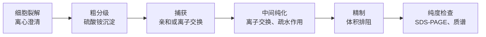

气相色谱只适用于能气化而不分解的物质，而绝大多数生物分子——氨基酸、糖、核苷酸、肽、蛋白质与核酸——以及多数药物、天然产物与离子都不挥发或受热分解。分析它们要用液体作流动相的液相色谱，或者用电场驱动带电分子移动的电泳。本章先讲高效液相色谱的仪器与检测器（14.1 节），再按分离机理讲液相色谱的各种模式（14.2 节），然后专门讨论蛋白质、肽与核酸的色谱分离（14.3 节），以及超临界流体色谱、超临界流体萃取与制备色谱（14.4 节），最后讲电泳：毛细管电泳、凝胶电泳、DNA 测序与蛋白质的二维电泳（14.5 节）。上一章的保留因子、塔板高度、van Deemter 方程与分离方程（[6.4.13](/6.4.13)）在这里直接适用；电泳的物理化学——**电泳**、**电渗**与 **ζ 电势**——在 [6.3.21](/6.3.21#sec-21.5) 中已经讲过，这里只用其结论。本章的分离方法与质谱联用，就是 [6.4.15](/6.4.15#sec-15.5.3) 中蛋白质组学的基础。

## 14.1. 高效液相色谱仪与检测器

### 14.1.1. 高效液相色谱的特点

**定义 14.1.1（高效液相色谱）** 以液体为流动相，用高压泵输送流动相通过装有粒径 $10\,\mu\mathrm{m}$ 以下的细颗粒填料的色谱柱，进行高效、快速分离并在线检测的液相色谱法称为**高效液相色谱**（HPLC）。

经典的柱层析用常压或低压流动相与粒径约 $100\,\mu\mathrm{m}$ 的填料，一次分离要几小时，柱效很低。由 van Deemter 方程（[6.4.13](/6.4.13#sec-13.3.2)），液相中扩散系数小（$D_{\mathrm{m}} \approx 10^{-9}\,\mathrm{m^2\,s^{-1}}$，约为气相的 $10^{-4}$），传质阻力项占主导，只有减小粒径才能提高柱效；而柱的压降按 Darcy 定律

$$
\Delta p = \frac{\phi\eta Lu}{d_{\mathrm{p}}^2}
$$
随粒径的平方反比增大（$\phi$ 约 500–1000 是柱的流动阻力因子，$\eta$ 是流动相的 **黏度**）。1960 年代末，Horváth、Kirkland、Huber 等用 $10\,\mu\mathrm{m}$ 以下的小颗粒填料与能耐几十兆帕的高压泵实现了快速高效的液相分离，这是这一时期多个研究组共同的工作。

与气相色谱相比，HPLC 的特点是：

| 方面 | 气相色谱 | 高效液相色谱 |
|---|---|---|
| 适用对象 | 挥发、热稳定（约 20% 的有机物） | 能溶于流动相即可：极性、离子型、热不稳定、高分子与生物大分子 |
| 流动相 | 惰性载气，只起输送作用 | 液体，与组分和固定相都有作用，是调节选择性的主要手段 |
| 操作温度 | 常需高温 | 室温至 $60\,{}^\circ\mathrm{C}$ 左右 |
| 柱效 | 毛细管柱 $N \sim 10^5$ | 15 cm 柱 $N \sim 10^4$–$3 \times 10^4$ |
| 馏分回收 | 困难 | 容易，可以制备（14.4.4 节） |

### 14.1.2. 输液系统与梯度洗脱

高压输液泵是 HPLC 的核心部件，要求在 $0.01$–$10\,\mathrm{mL\,min^{-1}}$ 的范围内提供稳定无脉动的流量（常用双柱塞往复泵），耐压 $40\,\mathrm{MPa}$（超高效液相色谱 $100$–$130\,\mathrm{MPa}$）。流量的波动直接影响保留时间的重复性与浓度型检测器的基线。流动相要先过滤并脱气（在线真空脱气、超声或通氦），否则溶解的气体在检测池中析出成气泡，造成基线噪声与漂移。

**定义 14.1.2（梯度洗脱）** 在一次分析中按预定的程序连续（或分段）改变流动相中两种或多种溶剂的比例，从而改变流动相的洗脱强度的洗脱方式称为**梯度洗脱**；流动相组成始终不变的洗脱称为**等度洗脱**。

梯度洗脱的作用与气相色谱的程序升温相同（[6.4.13](/6.4.13#sec-13.4.5)）：开始用弱流动相使强保留组分停在柱头、弱保留组分先分开，逐渐增大流动相强度使强保留组分依次以合适的 $k$ 流出。它解决了样品中保留因子范围很宽的"一般洗脱问题"，使峰宽一致、峰变尖，后出峰组分的检出限降低；对多肽与蛋白质几乎是唯一可行的洗脱方式（14.2.3 节）。梯度有两种实现方式：高压梯度用两台泵分别输送两种溶剂再混合，低压梯度用一台泵与比例阀。梯度结束后要用起始流动相重新平衡色谱柱。

### 14.1.3. 进样与色谱柱

进样一般用六通阀：取样位置时用注射器把试样注满定量环，柱与泵直接相连；转到进样位置时流动相把定量环中的试样冲入色谱柱。自动进样器使用同样的原理，重复性好于 0.5%（这是外标法在 HPLC 中可以直接使用的原因）。

色谱柱一般为不锈钢管，填料多是多孔硅胶或聚合物微球：

| 柱型 | 内径 | 常用填料粒径 | 流量 | 用途 |
|---|---|---|---|---|
| 常规分析柱 | 4.6 mm（长 50–250 mm） | 5 μm、3 μm | $1\,\mathrm{mL\,min^{-1}}$ | 常规分析 |
| 窄径柱 | 2.1–3 mm | 1.7–3 μm | $0.2$–$0.6\,\mathrm{mL\,min^{-1}}$ | 超高效液相色谱、LC-MS |
| 微径柱 | 约 1 mm | 1.7–5 μm | $50\,\mu\mathrm{L\,min^{-1}}$ | 试样量少 |
| 毛细管与纳升柱 | 75–300 μm | 1.7–3 μm | $0.2$–$5\,\mu\mathrm{L\,min^{-1}}$ | 蛋白质组学的纳升 LC-MS |

内径减小不改变柱效，但流量与溶剂消耗按内径的平方减小，组分被稀释得少，进入浓度型检测器与电喷雾质谱时信号更强。


由图可见，填料粒径减小时 $H_{\min} \approx 2d_{\mathrm{p}}$ 按比例减小，$u_{\mathrm{opt}} \propto D_{\mathrm{m}}/d_{\mathrm{p}}$ 增大，曲线右侧变平坦：小粒径既提高柱效，又能在高流速下快速分离。代价是压降按 $u/d_{\mathrm{p}}^2$ 增大。

**定义 14.1.3（超高效液相色谱）** 使用粒径小于 $2\,\mu\mathrm{m}$ 的填料与耐压约 $100\,\mathrm{MPa}$ 以上的输液系统、小体积的进样器与检测池，在更高流速下获得更高柱效与更快分离的液相色谱称为**超高效液相色谱**（UHPLC，2004 年商品化）。

与 5 μm 的常规柱相比，同样的分离在 1.7 μm 的短柱上可以快 5–10 倍，溶剂节省 80% 以上。另一条途径是核–壳（表面多孔）填料：在 1.7 μm 的实心硅胶核外包一层 0.5 μm 的多孔壳，组分只在薄壳中扩散，传质快、填充均匀，2.7 μm 的核–壳颗粒的柱效接近 sub-2 μm 的全多孔颗粒，压降却低得多。整体柱（在柱管内原位聚合或溶胶–凝胶形成的连续多孔材料）也有类似的优点。

### 14.1.4. 检测器

HPLC 的检测器要在流动相的背景上检测微量组分，不能像气相色谱那样借助火焰或热导。常用的有：

1. 紫外–可见检测器：测量流动池中组分的吸光度，遵守 **Lambert–Beer 定律**（[6.4.9](/6.4.9#sec-9.3)），对有生色团的物质灵敏、线性范围宽，是最常用的检测器。多肽与蛋白质在 214 nm（肽键）与 280 nm（色氨酸、酪氨酸）检测，核酸在 260 nm。二极管阵列检测器（DAD，[6.4.9](/6.4.9#sec-9.4.2)）在出峰的同时记录整个吸收光谱，可以用光谱辅助定性并检查峰纯度。流动相在检测波长处必须透明（乙腈在 190 nm、甲醇在 205 nm 以下吸收）。
2. 荧光检测器：灵敏度比紫外检测高 2–3 个数量级，选择性好（[6.4.10](/6.4.10#sec-10.2.5)），适用于本身发荧光的物质（多环芳烃、维生素 $\mathrm{B}_2$、某些药物）；不发荧光的物质（氨基酸、胺、糖）可以在柱前或柱后与荧光试剂反应衍生化后检测（14.3.5 节）。
3. 示差折光检测器：测量流出物与参比流动相的折射率之差，是通用检测器（任何溶质都改变折射率），用于糖、高分子与脂类；但灵敏度低（检出限约 $1\,\mu\mathrm{g}$），对温度极敏感，不能用于梯度洗脱。
4. 蒸发光散射检测器（见定义 14.1.4）。
5. 电化学检测器：在工作电极上测量组分氧化或还原的电流（安培检测，[6.4.6](/6.4.6#sec-6.7.1)），对儿茶酚胺、酚类、硫醇等电活性物质灵敏而有选择性，是神经递质分析的经典方法；糖类可以在强碱性流动相中用金电极脉冲安培检测。
6. 电导检测器：离子色谱的通用检测器（14.2.5 节）。
7. 质谱检测器：用电喷雾或大气压化学电离接口把流出物转变为气相离子，既定量又给出分子量与结构信息，是现代生物分析与药物分析最重要的检测器，见 [6.4.15](/6.4.15#sec-15.5.1)。

**定义 14.1.4** 将柱后流出物雾化、在加热的漂移管中蒸发除去流动相，使不挥发的溶质形成微小颗粒，再测量颗粒对光束的散射光强度的检测器称为**蒸发光散射检测器**（ELSD）。

蒸发光散射检测器对所有比流动相难挥发的溶质都有响应，与溶质的光学性质无关，适用于没有紫外吸收的糖、脂类、表面活性剂、聚合物与某些药物，且可以用于梯度洗脱（流动相都被蒸发了）。流动相与缓冲盐必须是挥发性的（乙酸铵、甲酸铵，不能用磷酸盐）；响应与质量的关系是非线性的（近似为幂函数），定量要用对数校准曲线。带电气溶胶检测器（CAD）原理类似，用电荷代替光散射，响应更均匀。

| 检测器 | 选择性 | 检出限（数量级） | 梯度洗脱 | 典型应用 |
|---|---|---|---|---|
| 紫外–可见 / DAD | 有生色团者 | ng | 可以 | 通用、药物、肽与蛋白质 |
| 荧光 | 发荧光者（或衍生化） | pg | 可以 | 氨基酸、多环芳烃、维生素 |
| 示差折光 | 通用 | μg | 不可以 | 糖、高分子 |
| 蒸发光散射 | 不挥发溶质 | 10 ng | 可以 | 糖、脂类、表面活性剂 |
| 电化学 | 电活性物质 | pg | 困难 | 神经递质、酚类 |
| 电导 | 离子 | ng | 抑制后可以 | 离子色谱 |
| 质谱 | 通用或选择性 | pg–fg | 可以 | 生物分析、代谢物、药物 |

## 14.2. 液相色谱的分离模式

液相色谱中组分与固定相、流动相都有作用，按保留的机理分为下面几种模式。实际的保留往往是几种作用共同的结果，但每种模式都有主导的机理和典型的适用对象（14.2.8 的表）。

### 14.2.1. 吸附色谱

**定义 14.2.1（吸附色谱）** 以固体吸附剂为固定相，利用组分在吸附剂表面吸附能力的差异进行分离的液相色谱称为**吸附色谱**（液固吸附色谱）。

最常用的 **吸附剂** 是硅胶，此外有氧化铝、活性炭、聚酰胺等。硅胶表面的硅羟基 $\ce{Si-OH}$ 通过 **氢键** 与偶极作用吸附极性分子；流动相分子与组分分子竞争表面的吸附位点，所以流动相的极性越大，洗脱能力越强。常用流动相是正己烷、庚烷等非极性溶剂与二氯甲烷、乙酸乙酯、异丙醇等极性溶剂的混合物。

吸附色谱对官能团的种类与位置敏感，是分离结构异构体（如农药的位置异构体、维生素 A 的顺反异构体）与按族分离（石油中的烷烃、烯烃、芳烃）最有效的方法，也是有机实验室硅胶柱层析与薄层色谱的原理。它的缺点是峰容易拖尾：吸附遵守 **Langmuir 吸附等温式**（[6.3.20](/6.3.20#sec-20.3)），浓度较高时表面趋于饱和，分配系数随浓度增大而减小，谱带中浓度高的中心部分比稀的尾部移动得快，于是形成前沿陡峭、后沿拖尾的峰；表面还存在少量吸附特别强的活性位点（孤立的、酸性强的硅羟基），使碱性组分严重拖尾。减小进样量使吸附处在等温线的线性区，或在流动相中加少量极性改性剂（水、胺）封闭强吸附位点，可以减轻拖尾。

### 14.2.2. 分配色谱与化学键合相

**定义 14.2.2（分配色谱）** 利用组分在固定液与流动相两种互不相溶的液体之间的分配系数不同进行分离的液相色谱称为**分配色谱**。

组分的保留由 **分配系数** 决定（定理 13.1.1）。Martin 与 Synge 最初的分配色谱就是把水吸附在硅胶上作固定相（[6.4.13](/6.4.13#sec-13.1.1)）。但涂渍的固定液会逐渐溶解到流动相中而流失，重现性差，也不能用梯度洗脱。现代的做法是用化学键把固定相的官能团连到载体上。

**定义 14.2.3（键合相）** 通过化学反应把有机官能团以共价键连接到载体（通常是硅胶）表面而得到的固定相称为**化学键合相**。

最常用的是硅烷化反应：硅胶表面的硅羟基与氯硅烷（或烷氧基硅烷）反应生成 $\ce{Si-O-Si-C}$ 键。例如与十八烷基三氯硅烷（1）或十八烷基二甲基氯硅烷反应：

$$
{\equiv}\ce{Si-OH} + \ce{Cl3Si-C18H37} \to {\equiv}\ce{Si-O-SiCl2-C18H37} + \ce{HCl}
$$

```smiles
CCCCCCCCCCCCCCCCCC[Si](Cl)(Cl)Cl 1
```

得到的十八烷基键合硅胶称为 ODS（octadecylsilyl silica）或 C18 填料，它是用量最大的 HPLC 固定相；ODS 指键合后的硅胶，不要与键合所用的试剂十八烷基三氯硅烷混淆。由于空间位阻，只有约一半的硅羟基能键合上长链，残余的硅羟基会吸附碱性组分而使其拖尾，所以键合后再用三甲基氯硅烷等小分子硅烷化试剂处理，称为封端。

键合相按官能团的极性分为：

- 非极性键合相：十八烷基（C18）、辛基（C8）、丁基（C4）、苯基等，用于反相色谱；
- 极性键合相：氰基、氨基、二醇基等，用于正相色谱与亲水作用色谱；
- 离子交换键合相：磺酸基、季铵基等（14.2.5 节）。

硅胶基键合相的缺点是 pH 范围较窄：pH < 2 时 $\ce{Si-O-Si}$ 键水解、键合基团脱落，pH > 8 时硅胶本身溶解。高 pH 下要用杂化颗粒（有机–无机杂化硅胶）或聚合物填料。

### 14.2.3. 正相与反相色谱

**定义 14.2.4（正相色谱）** 固定相的极性大于流动相极性的液相色谱称为**正相色谱**；典型的固定相是硅胶、氰基与氨基键合相，流动相是正己烷与少量极性溶剂的混合物。吸附色谱也属于正相色谱。

**定义 14.2.5（反相色谱）** 固定相是非极性的（C18、C8 等键合相）、流动相是极性的（水与甲醇、乙腈或四氢呋喃的混合物）液相色谱称为**反相色谱**。

两者的出峰顺序相反：正相色谱中极性小的组分先流出，增大流动相的极性使保留减小；反相色谱中极性大的组分先流出，增大流动相中有机溶剂的比例使保留减小。反相色谱的流动相便宜、对水溶液试样兼容、键合相稳定、平衡快、重现性好，适用范围极广（中性有机物、药物、肽与蛋白质；加入离子对试剂或调节 pH 后也适用于离子型物质），现在约 80% 的 HPLC 分析用反相模式。

反相色谱的保留主要来自疏水作用：组分分子的非极性部分在水中迫使周围的水分子有序排列，转移到非极性的键合相上时这些水分子被释放，熵增加，Gibbs 自由能降低。因此组分的非极性表面积越大，保留越强：同系物每增加一个 $\ce{CH2}$，$\lg k$ 增大约 0.2–0.3。保留因子与流动相中有机溶剂的体积分数 $\varphi$ 之间有近似的线性关系（线性溶剂强度模型，Snyder）：

$$
\lg k = \lg k_{\mathrm{w}} - S\varphi, \tag{14.1}
$$
$k_{\mathrm{w}}$ 是外推到纯水流动相时的保留因子，$S$ 对小分子约为 3–5，随分子增大而增大。


图说明了为什么肽与蛋白质必须用梯度洗脱：它们的 $S$ 很大，等度条件下要么不流出，要么随死体积冲出，只有在梯度中当 $\varphi$ 扫过它们各自很窄的洗脱窗口时才依次流出。

正相与吸附色谱中常用 Snyder 的溶剂极性参数 $P'$ 衡量流动相的洗脱强度。$P'$ 由溶剂对三种探针（乙醇、二氧六环、硝基甲烷，分别反映溶剂作为质子受体、质子给体与偶极的作用）的溶解能力求得：正己烷 0.1，甲苯 2.4，二氯甲烷 3.1，四氢呋喃 4.0，乙醇 4.3，乙酸乙酯 4.4，甲醇 5.1，乙腈 5.8，水 10.2。混合溶剂的 $P'$ 按体积分数加权：$P'_{\mathrm{AB}} = \varphi_{\mathrm{A}}P'_{\mathrm{A}} + \varphi_{\mathrm{B}}P'_{\mathrm{B}}$。经验上，$P'$ 改变 2 个单位，$k$ 约改变 10 倍：

$$
\text{正相：}\ \frac{k_2}{k_1} = 10^{(P'_1 - P'_2)/2}, \qquad \text{反相：}\ \frac{k_2}{k_1} = 10^{(P'_2 - P'_1)/2}.
$$

**例 14.2.1** 某组分在乙腈–水（30:70）中 $k = 12$，嫌保留太强。改用乙腈–水（50:50）后 $k$ 约为多少？

**解** $P'_1 = 0.3 \times 5.8 + 0.7 \times 10.2 = 8.88$，$P'_2 = 0.5 \times 5.8 + 0.5 \times 10.2 = 8.00$。反相中 $k_2 = 12 \times 10^{(8.00 - 8.88)/2} = 12 \times 0.36 = 4.4$，落在适宜范围内。$\square$

$P'$ 只调节强度（$k$），不能改善选择性（$\alpha$）。Snyder 把 81 种溶剂的三种作用的相对比例 $x_{\mathrm{e}}$、$x_{\mathrm{d}}$、$x_{\mathrm{n}}$（三者之和为 1）画在三角形坐标中，选择性相近的溶剂聚在一起，分为 8 组，这就是溶剂选择性三角形。某种溶剂不能给出满意的 $\alpha$ 时，用另一组中的溶剂代替（例如把甲醇换成乙腈或四氢呋喃，并调节比例使 $P'$ 不变），常能明显改善分离。

### 14.2.4. 亲水作用色谱

**定义 14.2.6（亲水作用色谱）** 以极性固定相（硅胶、酰胺、二醇或两性离子键合相）与含大量有机溶剂（通常 70%–95% 乙腈）和少量水或缓冲液的流动相分离极性化合物的液相色谱称为**亲水作用色谱**（HILIC，Alpert 1990）。

在 HILIC 中，水在极性固定相表面形成一层富水的液层，极性组分在这层水与富含乙腈的流动相之间分配（同时有氢键与静电作用），极性越大保留越强，增加水的比例使保留减小——出峰顺序大致与反相色谱相反。它弥补了反相色谱对强极性小分子保留太弱的缺点，适用于糖与糖肽、氨基酸、核苷酸、极性代谢物与极性药物，在代谢组学与糖组学中广泛使用。高比例的乙腈还使电喷雾的去溶剂化更容易，与质谱联用时灵敏度高。

### 14.2.5. 离子交换色谱与离子色谱

**定义 14.2.7（离子交换色谱）** 以表面带有可解离离子交换基团的离子交换剂为固定相，利用组分离子与交换基团之间静电作用的强弱不同进行分离的液相色谱称为**离子交换色谱**。

带负电荷的交换基团交换阳离子，带正电荷的交换阴离子：

| 类型 | 交换基团 | 生化中常用的名称 |
|---|---|---|
| 强酸性阳离子交换剂 | 磺酸基 $\ce{-SO3-}$ | SP（磺丙基）、S |
| 弱酸性阳离子交换剂 | 羧基 $\ce{-COO-}$ | CM（羧甲基） |
| 强碱性阴离子交换剂 | 季铵基 $\ce{-N(CH3)3+}$ | Q（季铵） |
| 弱碱性阴离子交换剂 | 叔胺、仲胺基 | DEAE（二乙氨基乙基） |

交换反应例如 $\ce{R-SO3H + M+ <=> R-SO3M + H+}$（R 表示树脂骨架）。"强""弱"指交换基团的酸碱性：强交换剂在很宽的 pH 范围内都带电，弱交换剂只在一定 pH 范围内带电。离子与交换剂的结合随离子电荷数增大而增强，同价离子随水合半径减小而增强：$\ce{Li+} < \ce{Na+} < \ce{K+} < \ce{Rb+} < \ce{Cs+}$，$\ce{Mg^2+} < \ce{Ca^2+} < \ce{Sr^2+} < \ce{Ba^2+}$，$\ce{F-} < \ce{OH-} < \ce{Cl-} < \ce{Br-} < \ce{NO3-} < \ce{I-}$。洗脱时增大流动相中竞争离子的浓度（盐梯度）或改变 pH（改变组分的电荷）。

离子交换色谱是蛋白质与核酸分离的主力：蛋白质在 pH 高于其 **等电点**（[6.4.2](/6.4.2#sec-2.8.3)）时带净负电荷，结合在阴离子交换剂上；低于等电点时带净正电荷，结合在阳离子交换剂上；然后用 NaCl 梯度按电荷多少依次洗脱（14.3 节）。离子交换树脂也用于水的软化与去离子、稀土元素的分离与氨基酸分析。

**定义 14.2.8（离子色谱）** 以低交换容量的离子交换柱分离无机与有机离子，以电导检测器检测，并在分离柱与检测器之间用**抑制器**降低流动相背景电导的液相色谱称为**离子色谱**（抑制型离子色谱，Small、Stevens 与 Bauman 1975）。

离子色谱的难题是：洗脱离子所需的流动相本身是电解质溶液，背景电导很大，被测离子的微小电导变化淹没在其中。抑制器的作用是把流动相转变为电导很小的物质，同时把被测离子转变为电导更大的形式。以 $\ce{NaOH}$ 为流动相测定 $\ce{Cl-}$ 为例：

- 分析柱（季铵型阴离子交换剂，$\ce{OH-}$ 型）中，$\ce{Cl-}$ 与 $\ce{OH-}$ 竞争交换位点而被分离：$\ce{R-OH + Cl- <=> R-Cl + OH-}$（R 表示带季铵基的树脂）。
- 抑制器（$\ce{H+}$ 型阳离子交换剂或阳离子交换膜）中，流动相的 $\ce{Na+}$ 被 $\ce{H+}$ 取代：
$$
\ce{R-SO3H + NaOH -> R-SO3Na + H2O}, \qquad \ce{R-SO3H + NaCl -> R-SO3Na + HCl}.
$$

背景由 $\ce{NaOH}$ 变成几乎不导电的水，被测离子由 $\ce{NaCl}$ 变成 $\ce{HCl}$：$\ce{H+}$ 的极限摩尔电导率（$349.65\,\mathrm{S\,cm^2\,mol^{-1}}$）约为 $\ce{Na+}$（50.08）的 7 倍（[6.3.12](/6.3.12#sec-12.4.2)），信号增大约 3 倍。测定阳离子时则相反：用 $\ce{HCl}$ 或甲磺酸作流动相，抑制器是 $\ce{OH-}$ 型阴离子交换剂，把 $\ce{HCl}$ 变为 $\ce{H2O}$，把 $\ce{MCl}$ 变为 $\ce{MOH}$。现代仪器用电解产生 $\ce{H+}$ 或 $\ce{OH-}$ 的自再生膜抑制器，并用电解淋洗液发生器在线产生高纯 $\ce{KOH}$ 流动相。离子色谱是测定水中 $\ce{F-}$、$\ce{Cl-}$、$\ce{NO3-}$、$\ce{SO4^2-}$ 等阴离子与碱金属、碱土金属、铵离子的标准方法。

### 14.2.6. 体积排阻色谱

**定义 14.2.9（体积排阻色谱）** 以孔径分布一定的多孔凝胶或多孔颗粒为固定相，组分分子按其在溶液中的大小（流体力学体积）不同程度地进入孔内，大分子先流出、小分子后流出而得到分离的液相色谱称为**体积排阻色谱**（凝胶色谱）。以水溶液为流动相分离生物大分子的称为**凝胶过滤色谱**，以有机溶剂为流动相测定合成高分子摩尔质量分布的称为**凝胶渗透色谱**。

设填料颗粒之间的流动相体积（外水体积、空隙体积）为 $V_0$，孔内的流动相体积为 $V_{\mathrm{i}}$。组分的洗脱体积

$$
V_{\mathrm{R}} = V_0 + K_{\mathrm{SEC}}V_{\mathrm{i}}, \qquad 0 \le K_{\mathrm{SEC}} \le 1, \tag{14.2}
$$
$K_{\mathrm{SEC}}$ 是孔内可以被该分子进入的体积分数（有些教材把 $V_{\mathrm{i}}$ 记作 $V_{\mathrm{S}}$）：比最大孔还大的分子完全被排阻，$K_{\mathrm{SEC}} = 0$，在 $V_0$ 处流出（排阻极限）；比最小孔还小的分子可以进入全部孔，$K_{\mathrm{SEC}} = 1$，在 $V_0 + V_{\mathrm{i}}$（总渗透体积）处流出；中间大小的分子按大小依次流出。体积排阻色谱的分离理想地只由熵（分子进入孔中的构象限制）决定，组分与固定相之间没有焓的作用，所以全部组分都在 $V_0$ 与 $V_0 + V_{\mathrm{i}}$ 之间流出，峰容量有限（一般只能分开 10 个左右的峰），但条件温和，蛋白质不变性，并能直接给出分子大小。

在分级范围内，$\lg M$ 与 $V_{\mathrm{R}}$ 近似成直线，用已知摩尔质量的标准物质作校准曲线，就可以由洗脱体积求未知物的摩尔质量（这就是由校准曲线求浓度的 **反向预测**，[6.4.1](/6.4.1#sec-1.8.1)）。


用这种方法测得的是与标准物质"同样大小"的摩尔质量：非球形的蛋白质（如纤维状、高度糖基化、或含无序区的蛋白质）的流体力学半径偏大，表观摩尔质量偏高；寡聚体按整体大小洗脱，所以凝胶过滤也用于判断蛋白质的寡聚状态。合成高分子的凝胶渗透色谱用一系列窄分布的聚苯乙烯标准校准，由色谱图的每一片段求出 $M_i$ 与其质量分数，算出 **数均摩尔质量**、**质均摩尔质量** 与分散度（[6.3.21](/6.3.21#sec-21.9.2)）；聚合物与标准物质结构不同时，用 Benoit 的普适校准（以特性黏度与摩尔质量之积 $[\eta]M$ 作为流体力学体积的量度），或在柱后接多角度光散射检测器直接测定摩尔质量。

凝胶过滤的另一个用途是除盐与换缓冲液：蛋白质在 $V_0$ 处流出，小分子的盐被阻滞，效果与 **渗析**（[6.3.21](/6.3.21#def-21.2.1)）相同而快得多。常用填料有交联葡聚糖（Sephadex）、交联琼脂糖（Superdex、Superose）、交联聚丙烯酰胺，以及用于有机溶剂的苯乙烯–二乙烯苯共聚物。

### 14.2.7. 亲和色谱与手性色谱

**定义 14.2.10（亲和色谱）** 把能与被分离的生物大分子发生特异性、可逆结合的配体（如酶的底物类似物或抑制剂、抗原或抗体、金属螯合物）共价固定在载体上作固定相，使目标分子被选择性地保留、杂质直接流出，再改变条件（加入竞争性配体、改变 pH 或离子强度）把它洗脱下来的色谱方法称为**亲和色谱**。

亲和色谱的选择性远高于其他模式，一步就可以把目标蛋白纯化几百到几千倍。它本质上是"开关式"的吸附–解吸，而不是逐渐的差速迁移。常用体系见 14.3.2。

**定义 14.2.11（手性色谱）** 用光学纯的手性选择剂作固定相（手性固定相）或加入流动相中，使一对对映体与手性选择剂形成稳定性不同的非对映的暂态复合物而得到分离的色谱方法称为**手性色谱**。

**对映体** 在非手性环境中的物理性质完全相同，只有在手性环境中才能区分（**手性**，[6.1.5](/6.1.5)；有机化学中的立体化学见 [6.5](/6.5)）。手性识别通常需要选择剂与对映体之间至少有三个作用点，其中至少一个与立体构型有关（Dalgliesh 的三点作用模型）。常用的手性固定相有多糖衍生物（纤维素与直链淀粉的苯基氨基甲酸酯，涂渍或键合在硅胶上，适用范围最广）、环糊精（疏水空腔包合）、大环抗生素（万古霉素等）、蛋白质（α₁-酸性糖蛋白）与 Pirkle 型（π 酸–π 碱作用）固定相。药物的两个对映体常有不同的药效与毒性，手性色谱用于测定对映体过量值、监测不对称合成，也用于制备光学纯药物（14.4 节）。

### 14.2.8. 分离模式的选择

| 模式 | 主要机理 | 固定相 | 流动相 | 主要对象 |
|---|---|---|---|---|
| 吸附（正相） | 吸附、氢键 | 硅胶、氧化铝 | 非极性有机溶剂 | 异构体、族分离、制备 |
| 反相 | 疏水分配 | C18、C8、苯基 | 水–甲醇或乙腈 | 绝大多数有机物、药物、肽 |
| 亲水作用 | 富水层中的分配 | 硅胶、酰胺、两性离子 | 高比例乙腈–水 | 糖、极性代谢物 |
| 离子交换 / 离子色谱 | 静电作用 | 离子交换剂 | 缓冲液、盐梯度 | 无机离子、氨基酸、蛋白质、核酸 |
| 体积排阻 | 分子大小 | 多孔凝胶 | 水溶液或有机溶剂 | 蛋白质、高分子与摩尔质量分布 |
| 亲和 | 生物特异性结合 | 固定化配体 | 缓冲液、竞争洗脱 | 蛋白质、酶、抗体 |
| 手性 | 立体选择性 | 手性固定相 | 依固定相而定 | 对映体 |

选择的大致思路：试样溶于水还是有机溶剂、是否带电、分子量多大。分子量小于约 2000 的中性或弱极性物质首选反相；强极性的选 HILIC；离子选离子交换或离子色谱（或加离子对试剂的反相）；高分子与按大小分级用体积排阻；生物大分子的纯化组合使用离子交换、亲和与体积排阻。

## 14.3. 生物大分子的色谱分离

### 14.3.1. 蛋白质纯化的一般流程

从细胞或组织中得到一种纯的、有活性的蛋白质，要把它与成千上万种其他蛋白质分开，并在整个过程中不使其变性。一般按"捕获–中间纯化–精制"的顺序组合几种分离原理不同的方法，每一步利用目标蛋白的一种性质：



1. 粗分级：硫酸铵沉淀（盐析）。高浓度的盐与蛋白质争夺水分子，降低其溶解度，不同蛋白质在不同的饱和度下沉淀；同时浓缩试样、除去部分杂质。
2. 捕获：亲和色谱（有标签或特异配体时）或离子交换色谱，处理大体积的粗提液，迅速浓缩目标蛋白并除去大部分杂质。
3. 中间纯化：电荷不同的杂质用离子交换除去；表面疏水性不同的用疏水作用色谱（高盐下结合在弱疏水的丁基、苯基介质上，降盐洗脱，条件比反相温和、不变性）。
4. 精制：体积排阻色谱除去聚集体与残余的小杂质，同时换成所需的缓冲液。
5. 每一步用 SDS-PAGE（14.5.5 节）检查纯度，用活性测定计算比活力与回收率。

生化实验室常用快速蛋白质液相色谱（FPLC）系统：中低压（$< 5\,\mathrm{MPa}$）、全部流路用生物相容的惰性材料，柱填料粒径较大（10–90 μm）以便放大，与 HPLC 的原理相同而侧重载样量与活性保持。

### 14.3.2. 亲和标签与亲和色谱的实例

基因工程使亲和色谱成为通用的方法：在目标蛋白的末端融合一段能被某种固定化配体特异结合的标签。

- His 标签与固定化金属亲和色谱（IMAC）：在蛋白质末端加上 6–10 个组氨酸。固定相是键合在琼脂糖上的次氮基三乙酸（NTA，下式）与 $\ce{Ni^2+}$ 的 **螯合物**（[6.1.5](/6.1.5)）：四齿的 NTA 占据 $\ce{Ni^2+}$ 八面体的四个配位位置，剩下的两个位置与相邻组氨酸侧链咪唑环的氮配位而保留蛋白质。用 $250$–$500\,\mathrm{mmol\,L^{-1}}$ 的咪唑竞争配位、或降低 pH 使咪唑质子化，就把蛋白质洗脱下来。螯合剂 **EDTA**（[6.4.3](/6.4.3#sec-3.1.4)）与还原剂会剥离或还原 $\ce{Ni^2+}$，缓冲液中要避免。

```smiles
OC(=O)CN(CC(=O)O)CC(=O)O NTA
```

- 谷胱甘肽 S-转移酶（GST）标签：固定化的谷胱甘肽结合 GST 融合蛋白，用还原型谷胱甘肽洗脱。
- 蛋白 A 与蛋白 G：细菌来源的蛋白质，特异地结合 IgG 抗体的 Fc 区，用 pH 约 3 的缓冲液洗脱，是治疗性单克隆抗体工业纯化的第一步。
- 其他：凝集素（结合糖蛋白的糖链）、肝素（结合多种生长因子与凝血因子）、生物素–链霉亲和素（解离常数约 $10^{-14}\,\mathrm{mol\,L^{-1}}$，几乎不可逆）、固定化抗体（免疫亲和色谱）。

亲和色谱的结合强弱可以用 **Langmuir 吸附等温式** 的形式描述：固定化配体是均一的结合位点，结合常数越大、配体密度越高，柱的动态载量越大。

### 14.3.3. 肽与蛋白质的反相色谱

反相 HPLC 是肽分析与纯化的标准方法，也是固相合成肽的纯化手段：

- 固定相：小肽用 C18；较大的多肽与蛋白质用 C4 或 C8，填料孔径 30 nm（300 Å）以上，使大分子能进入孔内。
- 流动相：水–乙腈梯度（如 5% 到 60% 乙腈，30–60 min），两相中都加 0.1% 三氟乙酸（TFA）。TFA 使 pH 约为 2，羧基不解离、硅羟基不电离，并与碱性残基形成离子对，使峰形尖锐。TFA 会强烈抑制电喷雾电离，所以 LC-MS 中改用 0.1% 甲酸。
- 保留：取决于疏水氨基酸（Trp、Phe、Leu、Ile 等）的组成，可以用各残基的保留系数之和粗略预测。由于 $S$ 很大（14.2.3 节），肽在梯度中的洗脱位置对组成很敏感，差一个氨基酸的肽常能分开。
- 局限：有机溶剂与酸性条件使大多数蛋白质变性，所以反相色谱用于分析与制备肽、测定蛋白质的纯度与修饰，而需要保持活性时用离子交换、疏水作用或体积排阻。

蛋白质组学的标准流程（蛋白质酶解为肽 → 纳升反相色谱 → 电喷雾串联质谱）中的分离步骤就是这里的反相色谱（[6.4.15](/6.4.15#sec-15.5.3)）。

### 14.3.4. 核酸的色谱分离

核酸的磷酸骨架每个核苷酸带一个负电荷，色谱分离主要靠电荷与疏水性：

- 阴离子交换色谱：DEAE 或季铵型交换剂，用盐梯度洗脱，长链结合更牢，用于寡核苷酸、质粒 DNA 与 RNA 的纯化（质粒提取试剂盒的柱就是阴离子交换或硅胶吸附柱）。
- 离子对反相色谱：在流动相中加入三乙基乙酸铵（TEAA）或六氟异丙醇–三乙胺，带正电的三乙基铵与磷酸根结合，使核酸能在 C18 上保留，按长度与碱基组成分离；用于合成寡核苷酸与反义核酸、mRNA 药物的分析，并能与质谱联用。
- 体积排阻色谱：按大小去除游离的核苷酸与引物。

### 14.3.5. 氨基酸分析

测定蛋白质的氨基酸组成，先在 $6\,\mathrm{mol\,L^{-1}}$ $\ce{HCl}$ 中于 $110\,{}^\circ\mathrm{C}$ 水解 24 h，再分离测定各种氨基酸。经典方法是 Moore 与 Stein（1972 年诺贝尔化学奖）的氨基酸自动分析仪：阳离子交换柱分离，柱后与茚三酮反应生成 Ruhemann 紫（$570\,\mathrm{nm}$，脯氨酸生成黄色产物，$440\,\mathrm{nm}$）后分光光度检测。现代方法多用柱前衍生化与反相 HPLC：邻苯二甲醛（OPA）与伯氨基和硫醇在几十秒内生成强荧光的异吲哚衍生物，芴甲氧羰酰氯（FMOC-Cl）衍生仲胺（脯氨酸），再用荧光检测器检测（[6.4.10](/6.4.10#sec-10.2.1)），检出限达飞摩尔级。水解时色氨酸被破坏、天冬酰胺与谷氨酰胺变为天冬氨酸与谷氨酸，需要另外处理。

## 14.4. 超临界流体色谱、超临界流体萃取与制备色谱

### 14.4.1. 超临界流体的性质

温度、压力都高于临界值的 **超临界流体**（[6.3.8](/6.3.8#sec-8.5.4)）兼有气体与液体的性质：

| 性质 | 气体 | 超临界流体 | 液体 |
|---|---|---|---|
| 密度 / ($\mathrm{g\,cm^{-3}}$) | $(0.6$–$2) \times 10^{-3}$ | $0.2$–$0.9$ | $0.8$–$1.6$ |
| 扩散系数 / ($\mathrm{m^2\,s^{-1}}$) | $10^{-5}$ | $10^{-8}$–$10^{-7}$ | $10^{-9}$ |
| 黏度 / ($\mathrm{Pa\,s}$) | $10^{-5}$ | $10^{-5}$–$10^{-4}$ | $10^{-3}$ |

几种超临界流体的临界参数（CRC Handbook）：

| 流体 | $t_{\mathrm{c}}/{}^\circ\mathrm{C}$ | $p_{\mathrm{c}}/\mathrm{MPa}$ | $\rho_{\mathrm{c}}/(\mathrm{g\,cm^{-3}})$ |
|---|---|---|---|
| $\ce{CO2}$ | 31.0 | 7.38 | 0.47 |
| $\ce{N2O}$ | 36.4 | 7.24 | 0.45 |
| $\ce{NH3}$ | 132.4 | 11.36 | 0.24 |
| $n$-$\ce{C4H10}$ | 152.0 | 3.80 | 0.23 |

超临界流体的密度接近液体，溶解能力强；扩散系数比液体大 1–2 个数量级、黏度接近气体，传质快、压降小；在临界点附近，密度与溶解能力随压力与温度灵敏地变化。$\ce{CO2}$ 的临界温度接近室温，无毒、不燃、便宜，减压后完全挥发不留残余，是最常用的超临界流体；它是非极性的，常加入几个百分点到几十个百分点的甲醇等极性改性剂扩大适用范围。

### 14.4.2. 超临界流体色谱

**定义 14.4.1（超临界流体色谱）** 以超临界流体（主要是 $\ce{CO2}$ 及其与极性改性剂的混合物）为流动相的色谱法称为**超临界流体色谱**（SFC）。

SFC 介于气相色谱与液相色谱之间：流动相的溶解能力使它能分析不挥发、热不稳定的物质（这是气相色谱做不到的），扩散系数大、黏度小又使它能在比 HPLC 高 3–5 倍的流速下保持柱效（$u_{\mathrm{opt}} \propto D_{\mathrm{m}}$，[6.4.13](/6.4.13#sec-13.3.3)）。柱后用背压调节器保持压力高于临界压力。改变压力（即流动相的密度）、温度或改性剂比例都能调节保留，程序升压的作用类似程序升温与梯度洗脱。检测器既可以用气相色谱的 FID（纯 $\ce{CO2}$ 不产生信号），也可以用 HPLC 的紫外检测器与质谱。

现代 SFC 多用填充柱（与 HPLC 相同的固定相），是正相分离的"绿色"替代：用 $\ce{CO2}$ 代替大量正己烷。它在手性分离中尤其重要：多糖类手性固定相配合 $\ce{CO2}$–甲醇流动相，分离快、柱效高，制备时溶剂易除去，已成为医药工业中拆分对映体的首选方法。脂溶性维生素、类胡萝卜素、甘油三酯与脂质组学分析也常用 SFC。

### 14.4.3. 超临界流体萃取

**定义 14.4.2（超临界流体萃取）** 用超临界流体作萃取剂，从固体或液体试样中提取目标组分，再通过减压或改变温度使萃取剂的溶解能力降低而把萃取物分离出来的方法称为**超临界流体萃取**（SFE）。

与液–液 **萃取**（[6.3.6](/6.3.6#sec-6.5.2)）相比，SFE 渗透快、萃取完全，通过调节压力可以选择性地依次萃取极性不同的组分，减压后萃取物与 $\ce{CO2}$ 自动分离，不留溶剂残余，适合热敏性物质。工业上用于咖啡与茶的脱咖啡因、啤酒花浸膏、香精油与天然色素的提取（具体条件见 [6.3.8](/6.3.8#sec-8.5.4)）；在分析中作为样品前处理，萃取土壤与食品中的多环芳烃、农药残留与脂肪，可以与 SFC 或 GC 在线联用。

### 14.4.4. 制备色谱

**定义 14.4.3（制备色谱）** 以获得一定数量的纯组分（而不是测定其含量）为目的，用较大的色谱柱与进样量分离混合物并收集各组分馏分的色谱方法称为**制备色谱**。

分析色谱追求高分离度与灵敏度，制备色谱追求在一定纯度与回收率下的产量（单位时间、单位固定相得到的纯物质的量）。为了提高产量，制备色谱有意让色谱柱超载：进样体积大（体积超载）或浓度高（浓度超载）。浓度超载时组分处在吸附等温线的非线性区（Langmuir 型），峰变为前沿陡峭、后沿拖尾的直角三角形，保留时间随进样量增大而减小，相邻的峰相互挤压，所以要在载样量与分离度之间权衡；在 $\alpha$ 大的体系中，可以用较大的载样量。

常见的形式有：

- 快速柱色谱（flash chromatography，Still 1978）：粒径约 40–63 μm 的硅胶柱，用压缩空气或泵加压，几十分钟完成一次纯化，是有机合成实验室纯化产物最常用的方法（[6.5](/6.5)）；现在多用预装柱与带紫外检测的自动化仪器。
- 制备 HPLC：内径 20–50 mm 以上的柱，大流量泵，柱后用馏分收集器按检测信号（紫外或质谱触发）收集；用于天然产物、药物杂质对照品与合成肽的纯化。
- 工业规模：模拟移动床色谱（多根柱串联、周期性切换进出口，模拟固定相与流动相的逆流）用于连续拆分对映体与分离糖类；蛋白质药物的工业纯化用大型亲和与离子交换柱。

## 14.5. 电泳

### 14.5.1. 电泳迁移率

带电粒子在电场强度为 $E$ 的电场中受到电场力 $qE$，在溶液中加速到电场力与摩擦力平衡时，以恒定速度 $v$ 移动，这就是 **电泳**。单位电场强度下的速度是 **电泳迁移率**（[6.3.21](/6.3.21#def-21.5.6)，那里记作 $u_{\mathrm{E}}$，本章与毛细管电泳文献一致记作 $\mu_{\mathrm{ep}}$）：

$$
v = \mu_{\mathrm{ep}}E, \qquad \mu_{\mathrm{ep}} = \frac{q}{6\pi\eta r},
$$
后一式是把离子看作半径为 $r$ 的球、摩擦系数取 Stokes 阻力 $6\pi\eta r$ 时的结果（对胶粒则由 ζ 电势表示为 Smoluchowski 公式，见 [6.3.21](/6.3.21#thm-21.5.2)）。迁移率与电荷成正比、与大小成反比，所以荷质比不同的离子以不同的速度移动而分开；中性分子 $\mu_{\mathrm{ep}} = 0$，不能被电泳分离。

自由溶液中的电泳会受热对流与扩散干扰。早期的 Tiselius（1937，1948 年诺贝尔化学奖）界面电泳在 U 形管中观察蛋白质的移动界面；后来在纸、凝胶等支持介质中进行区带电泳，介质抑制了对流；1980 年代 Jorgenson 与 Lukacs 在细毛细管中进行电泳，得到极高的分离效率。

### 14.5.2. 毛细管电泳与电渗流

**定义 14.5.1（毛细管电泳）** 以内径 $25$–$100\,\mu\mathrm{m}$ 的毛细管为分离通道、以高压直流电场（$10$–$30\,\mathrm{kV}$）为驱动力，依据试样中各组分迁移率（以及分配行为）的差异进行分离的液相分离技术称为**毛细管电泳**（CE）；毛细管中只充缓冲溶液、按自由溶液中的电泳迁移率分离的方式称为**毛细管区带电泳**（CZE）。

细毛细管的比表面积大，焦耳热能迅速散去，所以能承受几百 $\mathrm{V\,cm^{-1}}$ 的高电场强度而不产生严重的温度梯度与对流，迁移快、柱效高。毛细管长 30–100 cm，两端插入缓冲液瓶并接高压电源；进样用压力（流体动力学进样）或短时加电压（电动进样，会偏向迁移率大的离子）；检测窗口开在毛细管的出口附近，在柱上直接测紫外吸收、激光诱导荧光（[6.4.10](/6.4.10#sec-10.3.2)），或经接口接电喷雾质谱。

熔融石英毛细管内壁的硅羟基在 pH 约 3 以上逐渐解离，内壁带负电荷，溶液一侧形成正电荷过剩的双电层。外加电场时，扩散层中的阳离子带着溶剂向阴极移动，于是整个管内的溶液都向阴极流动，这就是毛细管中的 **电渗**。

**定义 14.5.2（电渗流）** 毛细管电泳中，由管壁双电层中的过剩离子在外电场作用下带动的、管内溶液整体相对于管壁的流动称为**电渗流**（EOF）。电渗流的速度 $v_{\mathrm{eo}} = \mu_{\mathrm{eo}}E$，电渗迁移率由管壁的 ζ 电势决定：

$$
\mu_{\mathrm{eo}} = -\frac{\varepsilon_{\mathrm{r}}\varepsilon_0\zeta}{\eta}.
$$

这是 Smoluchowski 公式用于静止的管壁、运动的溶液（[6.3.21](/6.3.21#thm-21.5.2)）：内壁 $\zeta < 0$，$\mu_{\mathrm{eo}} > 0$，溶液流向阴极。管壁的 ζ 电势随 pH 增大而负值增大（更多硅羟基解离）、随离子强度增大而减小（双电层被压缩），所以电渗流可以通过缓冲液的 pH 与浓度调节；在内壁涂覆中性聚合物（线性聚丙烯酰胺）可以抑制电渗流，加入阳离子表面活性剂（十六烷基三甲基溴化铵）在壁上形成反向吸附层可以使电渗流反向。

电渗流有两个重要特点。第一，它的流型是平坦的"塞流"：推动力作用在紧靠管壁的很薄的双电层中（Debye 长度约 1–10 nm，远小于管径），管内除这一薄层外流速处处相同；而压力驱动的流动（HPLC 的开管柱）是速度呈抛物线分布的 Poiseuille 流，中心快、边缘慢，造成额外的展宽。第二，在常用的 pH 下电渗流比大多数离子的电泳速度大，所以阳离子、中性分子与阴离子都被带向阴极端的检测器。组分的表观迁移率是两者之和：

$$
\mu_{\mathrm{app}} = \mu_{\mathrm{ep}} + \mu_{\mathrm{eo}}, \qquad t_{\mathrm{m}} = \frac{L_{\mathrm{d}}}{\mu_{\mathrm{app}}E} = \frac{L_{\mathrm{d}}L_{\mathrm{t}}}{\mu_{\mathrm{app}}U}, \tag{14.3}
$$
$L_{\mathrm{t}}$ 是毛细管总长，$L_{\mathrm{d}}$ 是进样端到检测窗口的有效长度，$U$ 是外加电压，$t_{\mathrm{m}}$ 是迁移时间。出峰顺序是：阳离子（电泳与电渗同向，荷质比大者先出），中性分子（都随电渗流在 $t_{\mathrm{eo}} = L_{\mathrm{d}}L_{\mathrm{t}}/(\mu_{\mathrm{eo}}U)$ 时一起流出，彼此不能分离），阴离子（电泳与电渗反向，荷质比大者后出；$\lvert\mu_{\mathrm{ep}}\rvert > \mu_{\mathrm{eo}}$ 的阴离子不能到达检测器）。用中性标记物（如二甲亚砜、丙酮）测 $t_{\mathrm{eo}}$，就可以由 $t_{\mathrm{m}}$ 求各组分的 $\mu_{\mathrm{ep}}$。

**定理 14.5.1** 若谱带只因纵向扩散而展宽，毛细管区带电泳的理论塔板数为

$$
N = \frac{\mu_{\mathrm{app}}UL_{\mathrm{d}}}{2DL_{\mathrm{t}}}, \tag{14.4}
$$
$D$ 是组分的扩散系数；$L_{\mathrm{d}} \approx L_{\mathrm{t}}$ 时 $N \approx \mu_{\mathrm{app}}U/(2D)$。

**证明** 迁移时间 $t_{\mathrm{m}}$ 内扩散产生的空间方差为 $\sigma_L^2 = 2Dt_{\mathrm{m}}$（**Einstein–Smoluchowski 关系**）。由 $N = L_{\mathrm{d}}^2/\sigma_L^2$ 与式 (14.3) 得 $N = L_{\mathrm{d}}^2\mu_{\mathrm{app}}U/(2DL_{\mathrm{d}}L_{\mathrm{t}}) = \mu_{\mathrm{app}}UL_{\mathrm{d}}/(2DL_{\mathrm{t}})$。$\square$

与色谱不同，这里没有涡流扩散与传质阻力（没有固定相），塔板数与毛细管长度无关，只与电压成正比，与扩散系数成反比。所以电压越高越好（受焦耳热限制），而且扩散慢的大分子柱效反而更高：小离子（$D \approx 10^{-9}\,\mathrm{m^2\,s^{-1}}$）的 $N$ 约为 $10^5$–$10^6$，蛋白质与 DNA（$D \approx 10^{-11}$–$10^{-10}\,\mathrm{m^2\,s^{-1}}$）可以达到 $10^6$ 以上，远高于 HPLC。实际的柱效还受进样塞长度、焦耳热、管壁吸附（蛋白质尤其严重）与电导不匹配等因素影响，往往低于式 (14.4) 的值。


**例 14.5.1** 25 °C 时某熔融石英毛细管的管壁 $\zeta = -60\,\mathrm{mV}$，缓冲液的 $\varepsilon_{\mathrm{r}} = 78.4$、$\eta = 0.890\,\mathrm{mPa\,s}$。求 $\mu_{\mathrm{eo}}$；在总长 60 cm、有效长度 50 cm、$25\,\mathrm{kV}$ 下，中性标记物的迁移时间是多少？$\mu_{\mathrm{ep}} = -3.0 \times 10^{-8}\,\mathrm{m^2\,V^{-1}\,s^{-1}}$ 的阴离子呢？

**解** $\mu_{\mathrm{eo}} = 78.4 \times 8.854 \times 10^{-12} \times 0.060/(0.890 \times 10^{-3}) = 4.7 \times 10^{-8}\,\mathrm{m^2\,V^{-1}\,s^{-1}}$。$t_{\mathrm{eo}} = 0.50 \times 0.60/(4.7 \times 10^{-8} \times 2.5 \times 10^4)\,\mathrm{s} = 256\,\mathrm{s} = 4.3\,\mathrm{min}$。阴离子 $\mu_{\mathrm{app}} = 1.7 \times 10^{-8}$，$t_{\mathrm{m}} = 706\,\mathrm{s} = 11.8\,\mathrm{min}$；若 $D = 1.0 \times 10^{-9}\,\mathrm{m^2\,s^{-1}}$，$N = 1.7 \times 10^{-8} \times 2.5 \times 10^4 \times 0.50/(2 \times 1.0 \times 10^{-9} \times 0.60) = 1.8 \times 10^5$。$\square$

### 14.5.3. 胶束电动色谱与毛细管电色谱

毛细管区带电泳不能分离中性分子。Terabe（1984）在缓冲液中加入浓度高于 **临界胶束浓度** 的阴离子表面活性剂十二烷基硫酸钠（SDS，下式；CMC 约 $8\,\mathrm{mmol\,L^{-1}}$），解决了这一问题。

```smiles
CCCCCCCCCCCCOS(=O)(=O)[O-].[Na+] SDS
```

**定义 14.5.3（胶束电动色谱）** 在毛细管电泳的缓冲液中加入浓度高于临界胶束浓度的离子型表面活性剂，以其形成的带电胶束作为随电场移动的"准固定相"，利用中性组分在水相与胶束之间分配系数的差异进行分离的方法称为**胶束电动色谱**（MEKC）。

SDS **胶束** 带负电，电泳方向朝向阳极，但电渗流更快，胶束仍以较低的速度流向阴极。中性组分在水相中时随电渗流移动，进入胶束时随胶束移动：亲水的组分几乎不进入胶束，在 $t_0$（电渗时间）附近流出；完全溶入胶束的疏水组分在 $t_{\mathrm{mc}}$（胶束的迁移时间）流出；其余按分配系数在 $t_0$ 与 $t_{\mathrm{mc}}$ 之间的"洗脱窗口"中依次流出。保留因子由迁移时间求得：

$$
k = \frac{t_{\mathrm{m}} - t_0}{t_0(1 - t_{\mathrm{m}}/t_{\mathrm{mc}})},
$$
$t_{\mathrm{mc}} \to \infty$（胶束不动）时回到色谱的 $k = (t_{\mathrm{R}} - t_{\mathrm{M}})/t_{\mathrm{M}}$。MEKC 兼有色谱的分配机理与电泳的平坦流型，用于中性药物、手性化合物（加胆酸盐或环糊精）与离子和中性物的混合物。它的准固定相是溶液中的胶束，不要与下面填充了固定相的毛细管电色谱混淆。

**定义 14.5.4（毛细管电色谱）** 在毛细管中填充（或原位制备整体型的）色谱固定相，以电渗流代替压力驱动流动相，组分按在固定相与流动相之间的分配（带电组分同时按电泳迁移率）分离的方法称为**毛细管电色谱**（CEC）。

CEC 结合了 HPLC 的选择性（可以使用反相等各种固定相）与电渗流的塞流型，而且电渗流不受填料粒径造成的反压限制，可以用很细的填料。但填充毛细管的制备、气泡的产生与重现性是它的困难，应用不如 CE 与 HPLC 普遍。

### 14.5.4. 毛细管凝胶电泳与 DNA 测序

DNA 每个核苷酸带一个负电荷，电荷与摩擦系数都与链长成正比，在自由溶液中各种长度的 DNA 的电泳迁移率几乎相同（[6.3.21](/6.3.21#sec-21.5.4)）。要按长度分离，必须在筛分介质中电泳：在凝胶或缠结的高分子溶液的网孔中，长链移动受阻更多，迁移率随长度增大而减小。毛细管凝胶电泳用可以更换的线性聚丙烯酰胺或聚二甲基丙烯酰胺溶液作筛分介质，变性条件下能分辨只差一个核苷酸的单链 DNA，长度可达 1000 个核苷酸左右。

这正是 Sanger 测序的读出方式。Sanger 的双脱氧链终止法（1977；Sanger 因测序获得 1980 年诺贝尔化学奖，这是他的第二个化学奖）：以待测 DNA 为模板，DNA 聚合酶从引物延伸合成互补链，反应中除四种正常的脱氧核苷三磷酸外，还掺入少量的 2′,3′-双脱氧核苷三磷酸（ddNTP）；ddNTP 没有 3′-羟基，一旦掺入，链就不能再延伸。于是得到一组在每个位置终止、长度依次相差一个核苷酸的片段，片段的末端碱基就是该位置的碱基。1986 年以后，四种 ddNTP 分别用四种荧光染料标记，四个反应可以在同一个通道中进行，按长度分离后由激光诱导荧光（[6.4.10](/6.4.10#sec-10.3.2)）的颜色依次读出碱基序列。

1998 年前后推出的 96 道毛细管阵列测序仪取代了平板凝胶，实现了自动化、高通量的测序，使人类基因组计划提前于 2001 年完成草图、2003 年宣布完成（[6.4.1](/6.4.1#sec-1.1) 中提到的生命科学推动分析化学的例子）。此后的"下一代"测序（边合成边测序、纳米孔测序，后者见 [6.4.6](/6.4.6#sec-6.7.4)）以大规模并行取代了电泳，但毛细管 Sanger 测序读长长、准确度高（单碱基错误率约 $10^{-4}$），仍是验证突变与克隆的金标准；毛细管电泳也用于 DNA 片段分析、法医学中的短串联重复序列（STR）分型与亲子鉴定。

### 14.5.5. 平板凝胶电泳与 SDS-PAGE

平板凝胶电泳在一块凝胶中同时跑多个样品，设备简单，是生物实验室最常用的分析手段：

- 琼脂糖凝胶电泳：琼脂糖是海藻多糖，加热溶解后冷却形成大孔凝胶（0.5%–2%），用于分离 100 bp 到几十 kb 的双链 DNA 与 RNA。DNA 的迁移距离与其碱基对数的对数近似成线性关系，用已知长度的 DNA 标准（ladder）判断片段大小；用溴化乙锭或 SYBR 类染料（[6.4.10](/6.4.10#sec-10.4.4)）染色在紫外或蓝光下观察。更长的 DNA（染色体大小）用周期性改变电场方向的脉冲场凝胶电泳分离。
- 聚丙烯酰胺凝胶：丙烯酰胺与交联剂 $N,N'$-亚甲基双丙烯酰胺在过硫酸铵与四甲基乙二胺（TEMED）引发下发生自由基聚合，形成孔径可以由浓度（4%–20%）精确调节的网络，分辨率高于琼脂糖，用于蛋白质与短核酸。不加变性剂时为非变性电泳，蛋白质按电荷与大小（以及构象）共同分离，保持活性与复合物。

**定义 14.5.5（SDS-聚丙烯酰胺凝胶电泳）** 用阴离子表面活性剂十二烷基硫酸钠（SDS）与还原剂使蛋白质变性并带上与其质量成正比的负电荷，在聚丙烯酰胺凝胶中按多肽链的大小（摩尔质量）分离的电泳方法称为 **SDS-聚丙烯酰胺凝胶电泳**（SDS-PAGE，Laemmli 1970）。

试样与含 SDS 和还原剂（二硫苏糖醇或 β-巯基乙醇，还原二硫键）的上样缓冲液一起加热，蛋白质完全展开为多肽链。SDS 以大致恒定的比例结合在多肽链上（约每克蛋白质 1.4 g SDS，即每两个氨基酸残基约一个 SDS 分子），它带的大量负电荷掩盖了蛋白质本身的电荷，使各种多肽的荷质比近似相同、形状都成为类似的棒状复合物。这样，在自由溶液中它们的迁移率几乎相同，在凝胶中则由筛分作用决定：小的移动快、大的移动慢。

Laemmli 体系采用不连续缓冲系统：上层是低浓度（约 4%）、pH 6.8 的浓缩胶，下层是高浓度、pH 8.8 的分离胶。在浓缩胶中，迁移快的 $\ce{Cl-}$（先导离子）与迁移慢的甘氨酸根（尾随离子，pH 6.8 时大部分为两性离子）之间形成陡峭的电场梯度，蛋白质被压缩在两者之间的一条很薄的区带中（等速电泳的原理），进入分离胶后 pH 升高，甘氨酸根迁移加快超过蛋白质，蛋白质才开始按大小分离。这使得较大体积的试样也能得到尖锐的条带。

以迁移距离与染料前沿迁移距离之比为相对迁移率 $R_f$，在一定范围内

$$
\lg M = a - bR_f,
$$
用标准蛋白质（marker）作校准曲线，由未知条带的 $R_f$ 估计其摩尔质量，准确度约 5%–10%。


SDS-PAGE 测得的是亚基（单条多肽链）的摩尔质量，与凝胶过滤测得的天然蛋白质（寡聚体）的摩尔质量比较，就可以推断亚基组成。糖蛋白（糖链结合 SDS 少）、膜蛋白与富含碱性或酸性残基的蛋白质迁移反常，偏差可达 20% 以上，准确的摩尔质量要用质谱（[6.4.15](/6.4.15#sec-15.2.4)）。电泳后用考马斯亮蓝（检出限约 10–50 ng/条带）、银染（约 1 ng）或荧光染料染色；也可以把蛋白质转移到膜上，用特异抗体检测某一种蛋白质（Western 印迹），这在细胞生物学中用于测定特定蛋白质的表达水平与修饰。

### 14.5.6. 等电聚焦与二维电泳

**定义 14.5.6（等电聚焦）** 在凝胶或毛细管中建立稳定的、由阳极到阴极 pH 逐渐升高的 pH 梯度，两性分子在电场中迁移到 pH 等于其等电点的位置时净电荷为零而停止迁移，从而按等电点聚焦成狭窄区带的电泳方法称为**等电聚焦**（IEF）。

pH 梯度用载体两性电解质（一大批 pI 不同的低分子多氨基多羧酸混合物，通电后各自迁移到自己的 pI 处，形成连续的缓冲 pH 梯度）或固定化 pH 梯度（把带不同弱酸、弱碱基团的丙烯酰胺衍生物共聚进凝胶中，梯度不随时间漂移）建立。蛋白质在 pI 的酸性一侧带正电，被推向阴极（pH 升高的方向）；在碱性一侧带负电，被推向阳极：无论从哪一侧出发都回到 pI，扩散出去的分子也会被电场推回来。这种聚焦效应使区带不随时间变宽，是平衡而不是动力学的分离。区带宽度由扩散与电迁移的平衡决定，可以分辨的最小等电点差

$$
\Delta\mathrm{pI} = 3\sqrt{\frac{D\,(\mathrm{d}\,\mathrm{pH}/\mathrm{d}x)}{E\,(-\mathrm{d}\mu_{\mathrm{ep}}/\mathrm{d}\,\mathrm{pH})}}
$$
（Svensson–Rilbe 式）：pH 梯度越平缓、电场越强、蛋白质的迁移率在 pI 附近随 pH 变化越陡，分辨率越高。固定化 pH 梯度可以分辨相差 0.01 甚至 0.001 个 pH 单位的蛋白质，例如只差一个电荷（一个磷酸化位点、一个脱酰胺）的同一种蛋白质。**等电点** 本身的计算与氨基酸的滴定见 [6.4.2](/6.4.2#sec-2.8.3)。

**定义 14.5.7** 第一向按等电点进行等电聚焦，再把胶条转移到 SDS-聚丙烯酰胺凝胶上、在垂直方向按摩尔质量进行第二向 SDS-PAGE，使蛋白质按两个独立的性质展开成二维斑点图的方法称为**二维电泳**（O'Farrell 1975）。

两个分离维度相互独立（正交），总峰容量约为两者之积，一张大尺寸二维凝胶可以分辨几千个蛋白质斑点。比较不同状态（健康与疾病、处理前后）细胞的二维图谱，找出变化的斑点，挖下斑点进行胶内酶解，再用基质辅助激光解吸电离飞行时间质谱的肽质量指纹或串联质谱鉴定（[6.4.15](/6.4.15#def-15.5.3)），这是 1990 年代蛋白质组学的经典流程。荧光差异凝胶电泳（DIGE）把两个样品用不同的荧光染料标记后在同一块胶上电泳，消除了胶与胶之间的差异。二维电泳对疏水的膜蛋白、极大与极小、极酸与极碱的蛋白质以及低丰度蛋白质效果较差，现在大规模蛋白质组学多改用多维液相色谱与串联质谱，但二维电泳仍能直接显示蛋白质的修饰异构体（同一蛋白质的一串 pI 不同的斑点）。

### 14.5.7. 微流控芯片

把进样、分离与检测的通道刻蚀在几平方厘米的玻璃或高分子芯片上，就是微流控芯片（芯片实验室，Manz 等 1990 年提出微全分析系统的概念）。芯片电泳的分离通道只有几厘米，几十秒到几分钟就能完成 DNA 片段或蛋白质的分离，试剂消耗为纳升级；商品化的芯片电泳仪已用于核酸片段与 RNA 质量检测、蛋白质的快速分析，微流控也用于单细胞分析与即时检验。

## 小结

| 内容 | 要点 |
|---|---|
| HPLC | 小粒径填料 + 高压泵；$\Delta p \propto \eta Lu/d_{\mathrm{p}}^2$，$H_{\min} \approx 2d_{\mathrm{p}}$；UHPLC（sub-2 μm）与核–壳填料；梯度洗脱 ↔ 程序升温 |
| 检测器 | 紫外与二极管阵列、荧光、示差折光（不能梯度）、蒸发光散射（不挥发溶质）、电化学、电导、质谱 |
| 吸附与分配 | 硅胶吸附，Langmuir 非线性 → 拖尾；键合相 ODS（C18），封端 |
| 正相与反相 | 正相：极性固定相、极性小者先出；反相：C18、水–有机溶剂，$\lg k = \lg k_{\mathrm{w}} - S\varphi$，肽与蛋白质 $S$ 大 → 梯度；Snyder $P'$，$\Delta P' = 2$ 时 $k$ 变 10 倍 |
| HILIC | 极性固定相 + 高乙腈，富水层分配，极性大者保留强 |
| 离子交换与离子色谱 | SP、CM、Q、DEAE；蛋白质按 pI 选交换剂；抑制器：$\ce{NaOH -> H2O}$，$\ce{NaCl -> HCl}$ |
| 体积排阻 | $V_{\mathrm{R}} = V_0 + K_{\mathrm{SEC}}V_{\mathrm{i}}$，$\lg M$–$V_{\mathrm{R}}$ 校准；摩尔质量分布、寡聚状态、除盐 |
| 亲和与手性 | His 标签–Ni-NTA（咪唑洗脱）、GST、蛋白 A；多糖类手性固定相，三点作用 |
| 生物分离 | 硫酸铵 → 亲和或离子交换 → 疏水作用 → 体积排阻；肽的反相（TFA 或甲酸）；核酸的阴离子交换与离子对反相；氨基酸分析（茚三酮、OPA/FMOC） |
| SFC、SFE、制备 | $\ce{CO2}$ 临界点 $31.0\,{}^\circ\mathrm{C}$、$7.38\,\mathrm{MPa}$；SFC 快、绿色、手性分离；SFE 脱咖啡因；制备色谱的超载与快速柱色谱 |
| 毛细管电泳 | $\mu_{\mathrm{eo}} = -\varepsilon_{\mathrm{r}}\varepsilon_0\zeta/\eta$，塞流；$\mu_{\mathrm{app}} = \mu_{\mathrm{ep}} + \mu_{\mathrm{eo}}$；出峰：阳离子、中性、阴离子；$N = \mu_{\mathrm{app}}U/(2D)$ |
| MEKC 与 CEC | SDS 胶束作准固定相分离中性物；CEC 为电渗驱动的填充柱 |
| 凝胶电泳 | 筛分介质按长度分离 DNA；Sanger 测序与四色荧光毛细管阵列；琼脂糖与聚丙烯酰胺 |
| SDS-PAGE 与 IEF | SDS 约 1.4 g/g，$\lg M = a - bR_f$；不连续缓冲系统；IEF 聚焦到 pI，$\Delta\mathrm{pI} \propto \sqrt{D(\mathrm{d\,pH}/\mathrm{d}x)/E}$；二维电泳 → 质谱鉴定 |

## 思考题

1. 用阳离子交换柱分离碱金属离子、以 $\ce{HCl}$ 为流动相时，电导检测器怎样消除流动相的高背景电导？

   **答** 在分离柱后接 $\ce{OH-}$ 型阴离子交换抑制器：$\ce{R-OH + HCl -> R-Cl + H2O}$，背景变为水；$\ce{R-OH + MCl -> R-Cl + MOH}$，被测离子以 $\ce{MOH}$ 的形式进入检测器，$\ce{OH-}$ 的摩尔电导率（198）比 $\ce{Cl-}$（76.3）大，信号增强。
2. 实验发现中性分子在毛细管中也会移动，为什么？能否用毛细管电泳分离中性分子？

   **答** 熔融石英内壁带负电，电渗流带动整个溶液流向阴极，中性分子随之移动；但它们都以电渗速度移动，在区带电泳中不能彼此分离。加入 SDS 胶束作准固定相（胶束电动色谱），或在毛细管中填充固定相（毛细管电色谱），就能按分配系数分离中性分子。
3. 为什么蛋白质与肽的反相色谱几乎总用梯度洗脱？

   **答** 它们的 $\lg k$ 随有机溶剂比例变化的斜率 $S$ 很大（式 (14.1)），等度条件下 $k$ 只有在极窄的组成范围内适中，不同的肽所需的组成又各不相同，所以只能用梯度使每个组分在各自的洗脱窗口流出。
4. 一种蛋白质在凝胶过滤上测得约 150 kDa，在 SDS-PAGE 上只有一条约 50 kDa 的带。可能的原因是什么？

   **答** 天然状态下它可能是由三个约 50 kDa 的相同亚基组成的三聚体；也可能是非球形（伸展或高度糖基化）的单体，流体力学半径偏大而在凝胶过滤中表观摩尔质量偏高。需要用静态光散射或天然质谱等不依赖形状的方法区分。
5. 为什么毛细管电泳中大分子（蛋白质、DNA）的塔板数反而比小分子高？

   **答** 毛细管电泳中谱带只因纵向扩散而展宽，$N = \mu_{\mathrm{app}}U/(2D)$。大分子的扩散系数小 1–2 个数量级，而迁移率并不按比例减小，所以 $N$ 更高；色谱中大分子的传质阻力大，柱效反而低。
