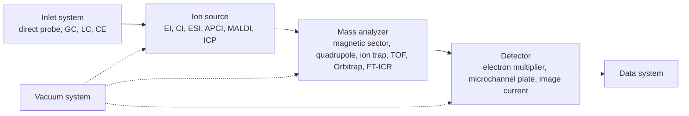
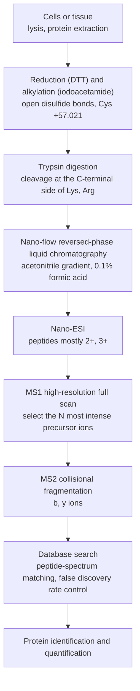

The methods of the preceding chapters measure how matter interacts with electromagnetic radiation or with an electrode. Mass spectrometry instead "weighs" molecules directly: it converts molecules into gas-phase ions, separates the ions by their mass-to-charge ratio and counts them. The result is more than a molecular mass. High-resolution spectra give the elemental composition, the way the ions fragment gives the structure, and the intensity of the ion current gives the amount. Since the introduction of electrospray ionization and matrix-assisted laser desorption/ionization, proteins, nucleic acids, carbohydrates and even whole virus particles can be brought intact into the gas phase, and mass spectrometry has become a central tool of proteomics, metabolomics and clinical testing. This chapter treats in turn the basic quantities (mass-to-charge ratio, exact mass, resolving power), the ion sources, the mass analyzers and tandem mass spectrometry, the interpretation of organic mass spectra, and finally the coupling to chromatography and biological mass spectrometry. The motion of ions in electric and magnetic fields comes from physics ([5.3.7](/5.3.7)), and the concept of an **isotope** is found in [6.1.2](/6.1.2); the principles of chromatography and electrophoresis are in [6.4.13](/6.4.13) and [6.4.14](/6.4.14), and the **calibration curve**, the **internal standard method** and the **limit of detection** in [6.4.1](/6.4.1#sec-1.8). The interpretation of spectra of the large variety of organic compounds is left to the spectroscopy chapter of [organic chemistry](/6.5); here we only make clear the principles on which the interpretation rests.

## 15.1. Overview

### 15.1.1. Mass Spectrometry and the Mass-to-Charge Ratio

**Definition 15.1.1 (Mass Spectrometry)** The method in which sample molecules (or atoms) are ionized to gas-phase ions, the ions are separated by their mass-to-charge ratio through their motion in electric or magnetic fields, and the relative intensities of the different ions are recorded for qualitative, quantitative and structural analysis is called **mass spectrometry** (MS). A plot with the mass-to-charge ratio as abscissa and the relative ion intensity as ordinate is called a mass spectrum.

**Definition 15.1.2 (Mass-to-Charge Ratio)** The quotient of the mass of an ion, expressed as a number $m$ in the **unified atomic mass unit** $\mathrm{u}$ (the dalton $\mathrm{Da}$, $1\,\mathrm{u} = m(^{12}\mathrm{C})/12$), and the number $z$ of charges it carries (without sign) is called the **mass-to-charge ratio**, written $m/z$.

By IUPAC convention $m/z$ is a dimensionless quantity and carries no unit (the unit Th occasionally seen in the literature is not recognized by the SI). The $m/z$ of a singly charged ion is just the numerical value of its mass; an ion carrying $z$ charges appears at $1/z$ of its mass, which is why electrospray ionization can deliver proteins of several hundred thousand daltons to an analyzer whose $m/z$ range is only a few thousand (Section 15.2.4).

A mass spectrometer consists of five parts: the inlet system delivers the sample to the ion source; the ion source ionizes the sample; the mass analyzer separates the ions by $m/z$; the detector converts the ion current into an electrical signal; and the vacuum system keeps the ions from colliding with gas molecules in flight. The **mass spectrometer** of physics ([5.3.7](/5.3.7#sec-7.1.2)) uses only magnetic deflection to distinguish isotopes, whereas the ion sources and analyzers of modern instruments are of many kinds:



The two basic functions of mass spectrometry are the accurate determination of molecular mass (and of the elemental composition derived from the exact mass) and the inference of structure from fragment ions. In addition, the very high selectivity of ion detection makes it the method of choice for quantifying trace components in complex matrices.

### 15.1.2. Masses of Ions

A mass spectrometer measures the mass of individual ions, not molar masses. According to CODATA 2022, $m_{\mathrm{p}} = 1.672\,621\,926\times10^{-27}\,\mathrm{kg} = 1.007\,276\,47\,\mathrm{u}$ and $m_{\mathrm{n}} = 1.674\,927\,501\times10^{-27}\,\mathrm{kg} = 1.008\,664\,92\,\mathrm{u}$; the proton is about $1836.15$ times as heavy as the electron. By definition the mass of a $^{12}\mathrm{C}$ atom is exactly $12\,\mathrm{u} = 1.992\,646\,88\times10^{-26}\,\mathrm{kg}$ ($1\,\mathrm{u} = 1.660\,539\,069\times10^{-27}\,\mathrm{kg}$). Apart from $^{12}\mathrm{C}$, no nuclide has an integer mass; for example $^1\mathrm{H}$ is $1.007\,825$, $^{14}\mathrm{N}$ is $14.003\,074$, $^{16}\mathrm{O}$ is $15.994\,915$ and $^{35}\mathrm{Cl}$ is $34.968\,853$. It is these fractional parts that allow high-resolution mass spectrometry to distinguish ions of the same nominal mass.

**Definition 15.1.3 (Exact Mass)** The mass of an ion (or molecule) calculated from the integer mass numbers of the most abundant isotope of each element is called the **nominal mass**; the mass calculated from the exact nuclide masses of the most abundant isotope of each element is called the **monoisotopic mass**; and the mass of an ion calculated from the exact nuclide masses for a specified isotopic composition is called the (calculated) **exact mass**. A mass calculated from the standard atomic weights is the average mass.

For example, $\ce{CO+}$ and $\ce{N2+}$ both have nominal mass 28; their exact masses (after subtracting the electron mass $0.000\,549\,\mathrm{u}$) are $27.994\,37$ and $28.005\,60$, respectively. The difference between the measured and the calculated exact mass is usually expressed as a relative deviation:

$$
\delta_m = \frac{m_{\text{meas}} - m_{\text{calc}}}{m_{\text{calc}}}\times10^6\ (\mathrm{ppm}).
\tag{15.1}
$$

**Example 15.1.1** The molecular ion of a compound is measured at $m/z\ 150.0679$ with a mass accuracy of $\pm 3\,\mathrm{ppm}$. The candidate molecular formulas of nominal mass 150 are $\ce{C9H10O2}$ ($150.068\,08$), $\ce{C8H10N2O}$ ($150.079\,31$), $\ce{C10H14O}$ ($150.104\,47$), $\ce{C9H14N2}$ ($150.115\,70$) and $\ce{C8H6O3}$ ($150.031\,69$) (all monoisotopic masses of the neutral molecules; for the molecular ion subtract a further $0.000\,55$). Which one fits?

**Solution** The calculated value for the molecular ion $\ce{C9H10O2+}$ is $150.067\,53$, a deviation of $(150.0679 - 150.06753)/150.06753\times10^6 = +2.5\,\mathrm{ppm}$, within the error limits; the deviations of all the other candidates exceed $70\,\mathrm{ppm}$. The molecular formula is therefore $\ce{C9H10O2}$. At $m/z$ 150, $3\,\mathrm{ppm}$ corresponds to only $0.000\,45$, and modern high-resolution mass spectrometry (Section 15.3.5) can often narrow the candidates to one for $m/z < 500$; for larger molecules the number of candidates grows rapidly and the isotope peaks (Section 15.4.2) must be used as well. $\square$

For large molecules the monoisotopic peak is no longer the most intense: a protein of about $17\,\mathrm{kDa}$ contains roughly 750 carbon atoms and thus on average eight $^{13}\mathrm{C}$ atoms, and the intensity of its monoisotopic peak is less than one thousandth of that of the most intense isotope peak. For biological macromolecules one therefore usually reports the average mass or the mass of the most intense peak, and only high-resolution spectra are fitted with a calculated isotope envelope to determine the monoisotopic mass.

### 15.1.3. Mass Resolving Power

**Definition 15.1.4 (Mass Resolving Power)** The ability of a mass spectrometer to separate two adjacent masses is called the **mass resolving power** (or **mass resolution**), written

$$
R = \frac{m}{\Delta m},
\tag{15.2}
$$
where $m$ is the mass of the peak considered. There are two ways to take $\Delta m$: the full-width-at-half-maximum definition takes the full width at half maximum (FWHM) of a single peak; the 10% valley definition takes the mass difference between two peaks of equal height whose valley is 10% of the peak height.

For a Gaussian peak shape, each peak has a height of 5% at the midpoint in the 10% valley case, and the separation of the two peaks equals the full width of a single peak at 5% height, about 2.08 times the FWHM; the resolving power of the same instrument by the 10% valley definition is therefore about half of that by the FWHM definition. Magnetic-sector instruments traditionally use the 10% valley definition, whereas TOF, Orbitrap and FT-ICR instruments generally use the FWHM definition; when reporting a resolving power one must state both the definition and the $m/z$ at which it applies.

Separating $\ce{CO+}$ from $\ce{N2+}$ requires $R = 28.0/0.0112 \approx 2500$; separating $^{75}\mathrm{As}^+$ ($74.9210$) in groundwater from the plasma-generated $^{40}\mathrm{Ar}^{35}\mathrm{Cl}^+$ ($74.9307$) requires $R \approx 7800$. A quadrupole usually operates at unit resolution ($\Delta m \approx 0.7$ over the whole mass range, so $R \approx 40$ at $m/z$ 28), which separates only ions differing by one nominal mass unit and cannot separate $\ce{CO+}$ from $\ce{N2+}$; this requires a high-resolution instrument such as a magnetic-sector or TOF analyzer.


### 15.1.4. A Brief History

Mass spectrometry grew out of the study of gas discharges. In 1897 J. J. Thomson deflected cathode rays with electric and magnetic fields, measured their charge-to-mass ratio and discovered the electron; he then turned to the positively charged "canal rays", passing the ions through parallel electric and magnetic fields so that ions of different charge-to-mass ratio traced different parabolas on a photographic plate. In 1912 he saw two parabolas of masses 20 and 22 in the neon discharge, the first evidence that stable elements have **isotopes**. His assistant Aston partially separated the two neons by diffusion, built a velocity-focusing mass spectrometer in 1919 with an accuracy of one part in a thousand, discovered isotopes in many elements with it and formulated the whole-number rule, for which he received the 1922 Nobel Prize in Chemistry.

Most later progress is associated with new analyzers or ion sources: Dempster's magnetic sector and electron ionization source (1918), Nier's double-focusing instruments (1950s), Paul's quadrupole and ion trap (1953; Paul and Dehmelt shared half of the 1989 Nobel Prize in Physics for ion-trap technology), time-of-flight mass spectrometry (proposed in 1946, with the two-field design of Wiley and McLaren in 1955), Fourier-transform ion cyclotron resonance by Comisarow and Marshall (1974), chemical ionization by Munson and Field (1966), and, in the late 1980s, electrospray ionization (Fenn) and soft laser desorption (Tanaka; matrix-assisted laser desorption/ionization by Karas and Hillenkamp). Fenn and Tanaka shared half of the 2002 Nobel Prize in Chemistry "for the development of methods for identification and structure analysis of biological macromolecules" (the other half went to Wüthrich for determining the structures of biological macromolecules in solution by nuclear magnetic resonance, see [6.4.12](/6.4.12#sec-12.5.4)). Makarov's Orbitrap, commercialized in 2005, is today the most widely used high-resolution analyzer in proteomics.

### 15.1.5. Classification and Applications

By mass analyzer, mass spectrometers are divided into magnetic-sector, quadrupole, ion-trap, time-of-flight, Orbitrap and FT-ICR instruments (Section 15.3); by purpose, into organic, biological and inorganic (ICP-MS and others) mass spectrometry and isotope-ratio mass spectrometry; by coupling, into gas chromatography–mass spectrometry (GC-MS), liquid chromatography–mass spectrometry (LC-MS), capillary electrophoresis–mass spectrometry and tandem mass spectrometry (MS/MS). Applications range over the life sciences, clinical testing, drug discovery, the environment, food safety, petrochemistry, materials and the earth sciences. Three general examples:

1. Isotope-ratio mass spectrometry and doping control. Testosterone synthesized by the body and pharmaceutical synthetic testosterone are chemically identical and cannot be told apart by amount alone. In screening one first measures the concentration ratio of testosterone to epitestosterone in urine; a ratio $\mathrm{T/E} > 4$ is suspicious, but this ratio depends strongly on individual genetic differences (for instance deletion of the UGT2B17 gene), and confirmation relies on the carbon isotope composition. The isotope composition is expressed as a per-mille deviation from an international standard (VPDB):
   $$
   \delta^{13}\mathrm{C} = \left(\frac{R_{\text{sample}}}{R_{\text{std}}} - 1\right)\times1000,\qquad R = \frac{n(^{13}\mathrm{C})}{n(^{12}\mathrm{C})},
   $$
   in units of ‰.
   Synthetic testosterone is made from the sterols of C₃ plants such as soybean and yam, with $\delta^{13}\mathrm{C}$ of about $-28$‰ to $-32$‰; endogenous testosterone reflects the diet and generally lies between $-20$‰ and $-25$‰. Gas chromatography–combustion–isotope-ratio mass spectrometry separates the steroids, burns each to $\ce{CO2}$ and measures the ratio of the ion currents at $m/z$ 44, 45 and 46; when the difference between the $\delta^{13}\mathrm{C}$ of a testosterone metabolite and that of an endogenous reference compound in the same urine sample that does not take part in testosterone metabolism (such as pregnanediol) exceeds about $3$‰ (the exact threshold is set by the technical documents of the World Anti-Doping Agency), the testosterone is judged exogenous. The criterion is the difference of the two $\delta^{13}\mathrm{C}$ values, not their ratio.
2. Single-particle aerosol mass spectrometry. Atmospheric particles are laser-desorbed and ionized one by one, and a bipolar TOF analyzer records positive and negative ion spectra at the same time; characteristic peaks of elements and organic matter assign each particle to a source such as vehicle exhaust, coal combustion, dust or biomass burning, for pollution source apportionment.
3. Discovery of disease markers. The protein and metabolite profiles of serum or tissue of patients and healthy persons are compared (Section 15.5) to find molecules with markedly different abundances as diagnostic or prognostic markers; newborn screening for inherited metabolic disorders uses tandem mass spectrometry to determine dozens of amino acids and acylcarnitines in a dried blood spot in a single run and is now routine in many countries.

## 15.2. Sample Introduction and Ion Sources

### 15.2.1. Inlet Systems

The inlet system delivers the sample to the ion source without breaking the vacuum. Gases and volatile liquids are leaked in through a heated reservoir and a needle valve, or introduced directly from the column of a gas chromatograph, as in **gas chromatography** (Section 15.5.1); solids and low-volatility liquids are placed on the tip of a direct insertion probe and moved through a vacuum lock to the vicinity of the ion source, where they are heated and vaporized; solutions are delivered by liquid chromatography or a syringe pump to an atmospheric-pressure ion source (ESI, APCI).

Electron ionization and chemical ionization require the sample to be vaporized first. Compounds of low vapor pressure and low thermal stability (sugars, amino acids, steroids, organic acids) must be derivatized before vaporization: the active hydrogen of $-\mathrm{OH}$, $-\mathrm{COOH}$ and $-\mathrm{NH_2}$ groups is replaced by a trimethylsilyl group (silylation), an acyl group or an alkyl group, which removes intermolecular hydrogen bonding and increases volatility and thermal stability. For example, glucose reacts with hexamethyldisilazane–trimethylchlorosilane (or BSTFA) in pyridine, all five hydroxyl groups being converted to trimethylsilyl ethers and the molecular mass rising from 180 to 540 (72 for each TMS group):

```smiles
OC[C@H]1OC(O)[C@H](O)[C@@H](O)[C@@H]1O>>C[Si](C)(C)OC[C@H]1OC(O[Si](C)(C)C)[C@H](O[Si](C)(C)C)[C@@H](O[Si](C)(C)C)[C@@H]1O[Si](C)(C)C
```

GC-MS analysis in metabolomics usually first converts carbonyl groups to oximes with methoxyamine (which prevents ring opening and tautomerization of sugars from giving several peaks) and then silylates.

### 15.2.2. Ion Sources and Electron Ionization

**Definition 15.2.1 (Ion Source)** The part of a mass spectrometer that ionizes the atoms or molecules of the sample and focuses and accelerates the resulting ions into an ion beam for the mass analyzer is called the **ion source**.

The ion source determines which ions are obtained: intact molecular ions or fragments, one charge or many, positive or negative ions. The choice of ion source depends mainly on the volatility, thermal stability, polarity and molecular mass of the sample.

**Definition 15.2.2 (Electron Ionization)** The ionization method in which a beam of electrons emitted from a filament and accelerated by an electric field to a defined energy (usually $70\,\mathrm{eV}$) bombards gaseous sample molecules in vacuum, each molecule losing one electron to form a positive ion, is called **electron ionization** (EI, formerly electron impact ionization):

$$
\mathrm{M} + \mathrm{e}^- \longrightarrow \mathrm{M}^{+\bullet} + 2\mathrm{e}^-.
$$

The $\mathrm{M}^{+\bullet}$ formed is an odd-electron radical cation (Section 15.4.1). Electrons emitted by the filament (tungsten or rhenium) cross the ionization chamber to the opposite anode (electron collector); a weak magnetic field along the electron beam makes the electrons follow helical paths, which lengthens their path and increases the chance of collisions. The ions formed are pushed out of the chamber by a repeller and focused by lenses and accelerated into the analyzer. The pressure in the ionization chamber is about $10^{-3}$–$10^{-4}\,\mathrm{Pa}$.

Why $70\,\mathrm{eV}$? The **ionization energies** of most organic molecules lie between $7$ and $13\,\mathrm{eV}$ (benzene $9.24$, ethanol $10.48$, methane $12.61\,\mathrm{eV}$). The ionization efficiency first rises with electron energy and reaches a plateau at $50$–$100\,\mathrm{eV}$: the **de Broglie wavelength** of a $70\,\mathrm{eV}$ electron, $h/\sqrt{2m_{\mathrm{e}}E} \approx 0.15\,\mathrm{nm}$, is comparable to the length of a chemical bond, and the electromagnetic interaction between electron and molecule is strongest. On the plateau small fluctuations of the electron energy hardly change the spectrum, so spectra recorded at $70\,\mathrm{eV}$ in different laboratories and on different instrument models can be compared with each other; this makes standard spectral libraries possible (the NIST library contains several hundred thousand EI spectra), and unknowns can be identified by library search. The molecular ion usually acquires only a few electronvolts of excess internal energy, but this is enough to break chemical bonds, so EI spectra are rich in fragments and in structural information.

The limitations of EI: the sample must be vaporizable, and nonvolatile, thermally labile and high-mass substances (above about $1000$) cannot be analyzed directly; for some compounds (alcohols, branched alkanes, certain esters) the molecular ion is unstable and no molecular ion peak is seen, and a soft ionization method must then be used to determine the molecular mass.

### 15.2.3. Chemical Ionization and Proton-Transfer-Reaction Ionization

**Definition 15.2.3 (Chemical Ionization)** The ionization method in which a reagent gas (methane, isobutane, ammonia, etc.) is introduced into the ion source in large excess over the sample, is first ionized by electron ionization and converted by ion–molecule reactions into reagent ions, and these then ionize the sample molecules by proton transfer, charge exchange or adduct formation is called **chemical ionization** (CI).

With methane as the reagent gas (pressure about $100\,\mathrm{Pa}$, far higher than in EI) the main reactions are

$$
\begin{aligned}
&\ce{CH4 + e- -> CH4^{+.} + 2e-},\\
&\ce{CH4^{+.} + CH4 -> CH5+ + CH3^{.}},\qquad \ce{CH3+ + CH4 -> C2H5+ + H2},\\
&\ce{CH5+ + M -> [M + H]+ + CH4},\qquad \ce{C2H5+ + M -> [M + C2H5]+}.
\end{aligned}
$$

**Definition 15.2.4 (Quasi-Molecular Ion)** An ion that indicates the molecular mass and is formed by addition or loss of an ion (mostly a proton) by a molecule M, such as $[\mathrm{M}+\mathrm{H}]^+$, $[\mathrm{M}-\mathrm{H}]^-$, $[\mathrm{M}+\mathrm{Na}]^+$ and $[\mathrm{M}+\mathrm{NH_4}]^+$, is called a **quasi-molecular ion** (also protonated or deprotonated molecule).

Quasi-molecular ions are even-electron ions, more stable than $\mathrm{M}^{+\bullet}$ and less prone to fragmentation, so CI spectra are simple; they often show a strong peak at $m/z = M+1$ and peaks at $M+29$ ($[\mathrm{M}+\ce{C2H5}]^+$) and $M-1$ (hydride abstraction, $[\mathrm{M}-\mathrm{H}]^+$), which are used to determine the molecular mass. The energy released by proton transfer $\ce{BH+ + M -> MH+ + B}$ equals the difference of the proton affinities, $\mathrm{PA}(\mathrm{M}) - \mathrm{PA}(\mathrm{B})$: the proton affinity of methane is only $543.5\,\mathrm{kJ\,mol^{-1}}$, $\ce{CH5+}$ is a very strong proton donor, and a larger excess energy is passed on to $\mathrm{MH^+}$; with isobutane (the tert-butyl cation, corresponding to $\mathrm{PA} = 802\,\mathrm{kJ\,mol^{-1}}$ for isobutene) or ammonia ($853.6\,\mathrm{kJ\,mol^{-1}}$), ionization is gentler and more selective (only molecules with a higher proton affinity are protonated). Negative-ion chemical ionization is extremely sensitive to compounds containing electronegative groups such as halogens and nitro groups (thermal-electron capture) and is used to determine organochlorine pesticides and dioxins in the environment.

Proton-transfer-reaction (PTR) ionization is a variant of CI: $\ce{H3O+}$ is produced from water vapor in a discharge and reacts with the air sample in a drift tube, $\ce{H3O+ + M -> MH+ + H2O}$. The proton affinity of water, $691\,\mathrm{kJ\,mol^{-1}}$, is higher than those of $\ce{N2}$ ($494$), $\ce{O2}$ ($421$) and $\ce{CO2}$ ($541\,\mathrm{kJ\,mol^{-1}}$), so the main constituents of air are not ionized, whereas most volatile organic compounds (with higher proton affinities) are protonated to $[\mathrm{M}+\mathrm{H}]^+$. From the known rate constant and reaction time the concentration can be computed without calibration, with detection limits as low as the $10^{-12}$ (volume fraction) range; the method is used for real-time monitoring in atmospheric chemistry, breath analysis and food aroma.

### 15.2.4. Electrospray Ionization

**Definition 15.2.5 (Electrospray Ionization)** The atmospheric-pressure ionization method in which a solution flows from the tip of a capillary held at a high voltage of several kilovolts, forms charged droplets in the strong electric field, and transfers the ions of the solution to the gas phase through solvent evaporation and repeated droplet fission is called **electrospray ionization** (ESI).

The process has three steps. (1) Formation of charged droplets: a voltage of $2$–$5\,\mathrm{kV}$ is applied to the capillary (stainless steel or fused silica, inner diameter about $0.1\,\mathrm{mm}$) relative to the counter electrode; in positive-ion mode the positive ions of the solution accumulate at the liquid surface at the tip, the electric force balances the surface tension, and the liquid is drawn into a cone (the Taylor cone) from whose tip fine droplets rich in positive charge are emitted; a coaxial nebulizing gas assists the spray. (2) Shrinkage and fission of droplets: in a heated drying gas ($\ce{N2}$) the droplets evaporate solvent, the radius decreases at constant charge, and the charge density rises; when the charge reaches the Rayleigh limit $q_{\mathrm{R}} = 8\pi(\varepsilon_0\gamma r^3)^{1/2}$ ($\gamma$ is the surface tension), electrostatic repulsion exceeds the surface tension and the droplet splits into many smaller offspring droplets ("Coulomb explosion", each carrying away about 2% of the mass and about 15% of the charge). (3) Formation of gas-phase ions: small ions are, according to the ion evaporation model, emitted directly from the surface once the electric field at the surface of a nanometer-sized droplet is strong enough; folded proteins and other large molecules follow the charged residue model, in which the charge left after the droplet has evaporated to dryness stays on the molecule; unfolded long-chain proteins follow the chain ejection model, in which the chain is pulled out of the droplet segment by segment. The ions enter an interface pumped down in stages through a heated capillary or a sampling cone, are desolvated and are passed on to the analyzer.

Characteristics of ESI:

1. It is a soft ionization: hardly any fragments are produced, polar, thermally labile molecules (peptides, proteins, nucleic acids, carbohydrates, drugs and metabolites) enter the gas phase intact and appear as $[\mathrm{M}+\mathrm{H}]^+$, $[\mathrm{M}+\mathrm{Na}]^+$ or $[\mathrm{M}-\mathrm{H}]^-$; even noncovalent complexes can be preserved.
2. It produces multiply charged ions: when a molecule has several protonation sites (Lys, Arg, His and the N-terminus of a protein), a series of ions $[\mathrm{M}+z\mathrm{H}]^{z+}$ is formed with $m/z$ between $500$ and $3000$, so that an ordinary quadrupole or TOF analyzer can measure proteins of very high molecular mass.
3. It operates at atmospheric pressure, with flow rates from $\mathrm{nL\,min^{-1}}$ (nanoelectrospray) to $\mathrm{mL\,min^{-1}}$, and is naturally suited to coupling with **high-performance liquid chromatography** and **capillary electrophoresis** (Section 15.5.1).
4. The signal is approximately proportional to concentration but susceptible to the **matrix effect**: coeluting salts, surfactants and matrix components compete for the charge at the droplet surface and suppress the ionization of the analyte, a phenomenon called *ion suppression*, so isotope-labeled internal standards are often used for quantification (Section 15.5.2).

The charge number and the molecular mass of a multiply charged ion can be obtained from two adjacent peaks. Let two adjacent peaks $m_1 > m_2$ correspond to charges $z$ and $z+1$, and let the proton mass be $m_{\mathrm{H}} = 1.007\,28$; then

$$
m_1 = \frac{M + z m_{\mathrm{H}}}{z},\qquad m_2 = \frac{M + (z+1)m_{\mathrm{H}}}{z+1}.
$$
Eliminating $M$ gives

$$
z = \frac{m_2 - m_{\mathrm{H}}}{m_1 - m_2},\qquad M = z(m_1 - m_{\mathrm{H}}).
\tag{15.3}
$$

**Example 15.2.1** In the ESI spectrum of horse heart myoglobin (apomyoglobin, without heme) in acidic water–methanol there is a pair of adjacent peaks at $m/z\ 998.15$ and $942.76$. Find the charge number and the molecular mass.

**Solution** $z = (942.76 - 1.007)/(998.15 - 942.76) = 941.75/55.39 = 17.0$, so $z = 17$; $M = 17\times(998.15 - 1.007) = 16\,951.4\,\mathrm{Da}$, in agreement with the average mass $16\,951.5\,\mathrm{Da}$ calculated from the amino acid sequence. In practice one averages over the whole charge-state series or uses software to transform all peaks onto the mass axis (deconvolution), with an accuracy of up to $0.01\%$. $\square$


The charge-state distribution itself carries conformational information: an unfolded peptide chain exposes more basic sites and has a larger surface area, so it carries more charges; a folded protein, following the charged residue model, carries only a charge close to the Rayleigh limit, which is small. The method of spraying from a volatile buffer such as ammonium acetate under neutral conditions so that the folded structure and noncovalent interactions of the protein are preserved is called *native mass spectrometry*; it allows the subunit composition of protein complexes and ligand binding to be determined (for example, native myoglobin retains its heme and is measured at $17.57\,\mathrm{kDa}$).

### 15.2.5. Atmospheric Pressure Chemical Ionization

**Definition 15.2.6 (Atmospheric Pressure Chemical Ionization)** The ionization method in which a solution is completely vaporized in a heated nebulizer (about $350$–$500\,^\circ\mathrm{C}$), solvent and air molecules are ionized at atmospheric pressure by a corona discharge needle to form reagent ions, and these then ionize the sample molecules by ion–molecule reactions such as proton transfer is called **atmospheric pressure chemical ionization** (APCI).

The discharge first produces $\ce{N2^{+.}}$ and $\ce{O2^{+.}}$, which through a series of reactions give hydrated protons $\ce{H3O+(H2O)_n}$; these pass protons to sample molecules of higher proton affinity; in negative-ion mode $[\mathrm{M}-\mathrm{H}]^-$ or $\mathrm{M}^{-\bullet}$ is formed by proton abstraction or electron capture. The APCI reactions take place in the gas phase, so the method complements ESI: it suits compounds of moderate and low polarity that are thermally stable and have molecular masses below about $1500$ (steroids, carotenoids, fat-soluble vitamins, pesticides), produces almost only singly charged ions, tolerates salts and matrix better than ESI and can handle ordinary liquid chromatography flow rates of $0.2$–$2\,\mathrm{mL\,min^{-1}}$. Atmospheric pressure photoionization (APPI), in which a UV lamp replaces the discharge needle, can ionize nonpolar substances such as polycyclic aromatic hydrocarbons.

### 15.2.6. Matrix-Assisted Laser Desorption/Ionization

**Definition 15.2.7 (Matrix-Assisted Laser Desorption/Ionization)** The ionization method in which the sample is cocrystallized with a large excess of a small organic acid (the matrix) that absorbs the laser light strongly, and a pulsed laser vaporizes the matrix rapidly on absorbing the energy, carrying the entrained sample molecules into the gas phase and ionizing them by proton transfer, is called **matrix-assisted laser desorption/ionization** (MALDI).

The amount-of-substance ratio of sample to matrix is about $1:10^3$–$1:10^5$, and the mixture is spotted on a metal target plate and dried. The laser is usually a $337\,\mathrm{nm}$ nitrogen laser or a frequency-tripled $355\,\mathrm{nm}$ Nd:YAG laser, with nanosecond pulses. The matrix absorbs the laser energy (all matrices are aromatic compounds with strong absorption in the near ultraviolet), keeps the sample molecules apart so that they do not aggregate, and acts as proton donor or acceptor in the vaporized plume to ionize the sample; the sample molecules themselves do not absorb the laser light directly and are therefore not destroyed. Common matrices are α-cyano-4-hydroxycinnamic acid (CHCA, for peptides and molecules below about $5\,\mathrm{kDa}$), sinapinic acid (for proteins) and 2,5-dihydroxybenzoic acid (DHB, for peptides, carbohydrates and glycopeptides):

```smiles
N#C/C(=C\c1ccc(O)cc1)C(=O)O
COc1cc(/C=C/C(=O)O)cc(OC)c1O
OC(=O)c1cc(O)ccc1O
```

Characteristics of MALDI:

1. It mainly produces singly charged ions $[\mathrm{M}+\mathrm{H}]^+$ (large proteins also give a little $[\mathrm{M}+2\mathrm{H}]^{2+}$ and dimers); the spectra are simple, which suits the analysis of mixtures;
2. The mass range is very wide, and proteins of several hundred thousand daltons and synthetic polymers can be measured;
3. The ions are produced in pulses, which matches the likewise pulsed time-of-flight analyzer (MALDI-TOF, Section 15.3.4);
4. It tolerates salts and buffers better than ESI and is fast (a few seconds per spot), suitable for high throughput; however, the low-mass region ($m/z < 500$) is disturbed by numerous matrix ions, small molecules are difficult to analyze, and online coupling to chromatography is inconvenient.

One of the most important applications of MALDI-TOF is microbial identification: a colony is spotted directly on the target, and the peaks at $2$–$20\,\mathrm{kDa}$, which come mainly from abundant ribosomal proteins, are compared with reference spectra in a database; bacteria and fungi can be identified to the species level within minutes, and the method has replaced most biochemical identification methods in clinical microbiology laboratories. It is also used for **peptide mass fingerprinting** (Section 15.5.3) and **mass spectrometry imaging** (Section 15.5.5).

### 15.2.7. Soft Ionization and the Choice of Ion Source

**Definition 15.2.8 (Soft Ionization)** An ionization method that imparts little excess internal energy to the molecule and mainly yields molecular or quasi-molecular ions with few fragments is called **soft ionization** (CI, ESI, APCI, MALDI and others); an ionization method that imparts much energy to the molecule and produces many fragments is called **hard ionization** (EI).

Soft and hard are complementary: hard ionization gives structural information but may lose the molecular mass, whereas soft ionization gives the molecular mass but little structural information; if ions formed by soft ionization are fragmented in a controlled way by collision-induced dissociation in tandem mass spectrometry (Section 15.3.7), both kinds of information can be obtained.

| Ion source | Main ions formed | Suitable samples | Mass range (approx.) | Usual analyzers and couplings |
|---|---|---|---|---|
| EI | $\mathrm{M}^{+\bullet}$ and many fragments | Vaporizable, thermally stable small molecules | $< 1000$ | Quadrupole, magnetic sector; GC-MS |
| CI | $[\mathrm{M}+\mathrm{H}]^+$, adduct ions | As EI, for determining molecular mass | $< 1000$ | As EI |
| ESI | $[\mathrm{M}+z\mathrm{H}]^{z+}$, $[\mathrm{M}-z\mathrm{H}]^{z-}$ | Polar and ionic molecules and biological macromolecules | Up to $10^6$ and above | Triple quadrupole, Q-TOF, Orbitrap; LC-MS, CE-MS |
| APCI | $[\mathrm{M}+\mathrm{H}]^+$, $[\mathrm{M}-\mathrm{H}]^-$ | Small molecules of moderate and low polarity, thermally stable | $< 1500$ | As ESI |
| MALDI | $[\mathrm{M}+\mathrm{H}]^+$ (mainly singly charged) | Peptides, proteins, nucleic acids, polymers, microorganisms | Up to $5\times10^5$ | TOF, TOF/TOF; imaging |
| ICP | Monatomic positive ions of the elements | Elements and isotopes in solution | $m/z < 260$ | Quadrupole, magnetic sector; Section 15.5.6 |

In addition, desorption electrospray ionization (DESI) sprays charged solvent droplets onto the surface of a sample in the open atmosphere, paper spray applies a voltage to a sample spotted on a triangular piece of filter paper and sprays directly, and direct analysis in real time (DART) ionizes surface molecules with excited helium atoms. These open (ambient) ion sources need no sample preparation and, combined with miniaturized ion-trap mass spectrometers, allow rapid detection in the field, in the operating room or at customs.

## 15.3. Mass Analyzers and Tandem Mass Spectrometry

### 15.3.1. Mass Analyzers and the Magnetic Sector

**Definition 15.3.1 (Mass Analyzer)** The part of a mass spectrometer that separates ions in space, time or frequency according to their mass-to-charge ratio by means of electric or magnetic fields is called a **mass analyzer**.

The figures of merit of an analyzer are the mass range, the resolving power (Section 15.1.3), the mass accuracy, the scan speed, the ion transmission efficiency and the dynamic range. The earliest analyzer was the magnetic sector, whose principle is the circular motion under the **Lorentz force** ([5.3.7](/5.3.7#sec-7.1.1)). An ion of charge $ze$ in the ion source is accelerated through a voltage $U$:

$$
zeU = \frac{1}{2}mv^2.
$$
It enters a uniform magnetic field of flux density $B$ perpendicularly, the Lorentz force provides the centripetal force, $zevB = mv^2/r$, and the orbit radius is $r = mv/(zeB)$. Eliminating $v$ gives

$$
r = \frac{1}{B}\sqrt{\frac{2mU}{ze}},\qquad \frac{m}{ze} = \frac{B^2r^2}{2U}.
\tag{15.4}
$$

For fixed $B$ and $U$, ions of larger $m/z$ have larger orbit radii. The exit slit and the detector of the instrument are at fixed positions (fixed $r$); when $B$ is varied continuously (magnetic scan) or $U$ is varied (voltage scan), ions of different $m/z$ pass the slit in turn and reach the detector, and recording the ion current against $m/z$ gives the mass spectrum. For example, with $U = 8\,\mathrm{kV}$ and $B = 1\,\mathrm{T}$ the orbit radius of a singly charged ion of $m/z$ 500 is about $0.29\,\mathrm{m}$.

A magnetic sector ($180^\circ$, $90^\circ$, $60^\circ$, etc.) focuses ions of the same mass that enter from one point at different angles (direction focusing); such an analyzer is called single-focusing. However, the initial kinetic energies of ions leaving the source differ (thermal motion and the energy spread of the ionization process), and after acceleration the kinetic energies still differ; by Eq. (15.4) the radii then differ and the peaks are broadened, so single-focusing instruments have a resolving power of only a few thousand. A double-focusing analyzer places an electrostatic analyzer before the magnet: an ion moves on a circle in the cylindrical electric field $E$, $zeE = mv^2/r_{\mathrm{e}}$, so that $r_{\mathrm{e}} = 2U/E$; the orbit radius depends only on the kinetic energy and not on the mass, and the electrostatic analyzer is therefore an energy filter. By suitably combining the electric and magnetic fields (as in the Nier–Johnson geometry), so that the energy dispersion caused by the electric field cancels that caused by the magnetic field, direction focusing and energy focusing are achieved simultaneously and the resolving power can reach $10^5$ (10% valley). Double-focusing instruments are large, slow in scanning and expensive, and are now used mainly for high-resolution quantification of dioxins, isotope-ratio measurements and high-resolution ICP-MS.

### 15.3.2. The Quadrupole Mass Analyzer

**Definition 15.3.2 (Quadrupole Mass Analyzer)** A mass analyzer composed of four parallel, symmetrically arranged hyperbolic (or cylindrical) electrodes, with opposite electrodes connected together and a superposition of a direct-current voltage and a radio-frequency voltage applied between the two pairs, which lets only ions of a particular $m/z$ pass through stably, is called a **quadrupole mass analyzer** (quadrupole mass filter).

Let the potentials $\pm\Phi_0$ be applied to the two pairs of electrodes, with $\Phi_0 = U + V\cos\Omega t$ ($U$ is the direct-current voltage, $V$ the amplitude of the radio-frequency voltage and $\Omega$ the angular frequency of the radio frequency, usually $\Omega/2\pi \approx 1\,\mathrm{MHz}$), and let the inscribed radius of the electrodes be $r_0$. The quadrupole potential between the electrodes is

$$
\Phi(x, y, t) = \Phi_0\,\frac{x^2 - y^2}{r_0^2},
$$
there is no field along the axis ($z$ direction), so ions advance at constant velocity as injected; in the $x$ direction the force is $F_x = -ze\,\partial\Phi/\partial x = -2ze\Phi_0 x/r_0^2$, so that

$$
m\ddot x + \frac{2ze}{r_0^2}(U + V\cos\Omega t)\,x = 0,
$$
and the equation in the $y$ direction differs only in sign. With $\xi = \Omega t/2$ both equations become the Mathieu equation

$$
\frac{\mathrm{d}^2u}{\mathrm{d}\xi^2} + (a_u - 2q_u\cos 2\xi)\,u = 0,\qquad
a_x = -a_y = \frac{8zeU}{mr_0^2\Omega^2},\quad q_x = -q_y = -\frac{4zeV}{mr_0^2\Omega^2}.
\tag{15.5}
$$

Whether the solutions of the Mathieu equation are bounded depends only on $(a, q)$ and not on the initial position and velocity of the ion. In the $a$–$q$ plane the region in which the motion is stable in both $x$ and $y$ is approximately a triangle in the first quadrant with its apex at $q = 0.706$, $a = 0.237$; ions inside the stability region have bounded amplitudes and pass through the quadrupole, whereas ions outside have exponentially growing amplitudes and strike the electrodes, where they are neutralized.

Both $a$ and $q$ are inversely proportional to $m/z$, whereas the ratio $a/q = 2U/V$ is independent of the mass: for given $U$ and $V$ all ions lie on one scan line through the origin with slope $2U/V$, and the larger the $m/z$, the closer to the origin. If $U/V$ is chosen slightly below $0.237/(2\times0.706) = 0.168$, the scan line passes only near the apex of the stability region and only ions in a very narrow $m/z$ range pass stably; keeping $U/V$ constant while increasing $U$ and $V$ linearly brings the various ions into the apex in turn, and a mass scan is completed. The closer $U/V$ is to $0.168$, the narrower the transmitted mass window and the higher the resolving power, but the lower the ion transmission efficiency; the ratio is usually adjusted to maintain unit resolution over the whole mass range. With radio-frequency voltage only ($U = 0$) all ions with $q < 0.908$ pass, and the quadrupole becomes an ion guide or a collision cell (Section 15.3.7).


The advantages of the quadrupole are its small size, low price, fast scanning (several thousand $m/z$ units per second), insensitivity to the initial kinetic energy of the ions and the ability to operate at relatively high pressure; it is the workhorse of GC-MS and of triple-quadrupole LC-MS/MS quantification. Its disadvantages are the unit resolution only and a mass range generally below $m/z$ $2000$–$4000$.

### 15.3.3. Ion Traps

**Definition 15.3.3 (Ion Trap)** A mass analyzer in which ions are confined in a finite volume by a radio-frequency electric field (or radio-frequency and direct-current fields) and ions of different $m/z$ are then successively destabilized and ejected for detection by changing the field is called an **ion trap** (quadrupole ion trap, Paul trap).

A three-dimensional ion trap consists of a ring electrode and two end-cap electrodes above and below it, all with hyperbolic inner surfaces. The motion of ions in the trap also obeys the Mathieu equation, with the parameters

$$
a_z = -\frac{16zeU}{m(r_0^2 + 2z_0^2)\Omega^2},\qquad q_z = \frac{8zeV}{m(r_0^2 + 2z_0^2)\Omega^2},
$$
where $r_0$ is the inner radius of the ring electrode and $z_0$ is the distance from the trap center to the end caps. An ion trap usually applies radio-frequency voltage to the ring electrode only ($U = 0$), so all ions lie on the axis $a_z = 0$; $q_z$ is inversely proportional to $m/z$, and ions of small $m/z$ have large $q_z$ and lie far from the origin. The stability region meets the axis $a_z = 0$ at $q_z = 0.908$: ions with $q_z < 0.908$ are trapped. The trap is filled with helium at about $0.1\,\mathrm{Pa}$, and ions lose kinetic energy in collisions with helium atoms and collect at the center of the trap (collisional cooling).

In the mass-selective instability scan, the radio-frequency amplitude $V$ is increased linearly, the $q_z$ of all ions increases proportionally and each ion in turn reaches the boundary $q_z = 0.908$, becomes unstable in the $z$ direction, its amplitude grows sharply, and it is ejected through a small hole in an end-cap electrode and detected by an electron multiplier outside the trap; ions are ejected in order of increasing $m/z$, which gives the mass spectrum. An auxiliary alternating voltage on the end caps in resonance with the axial frequency of the ions can eject particular ions early (resonance ejection), in order to extend the mass range or to isolate selected ions.

The advantages of the ion trap are a simple construction, small size, high sensitivity (ions are first accumulated and then detected in the full scan) and suitability for miniaturized and field instruments; most importantly, the steps "select the precursor ion, fragment it by collision, scan the product ions" can be carried out in sequence in the same trap and repeated several times, giving multistage tandem mass spectrometry $\mathrm{MS}^n$ (Section 15.3.7). The disadvantage is that too many ions in the trap cause space charge, which broadens the peaks and shifts the masses, so the number of injected ions must be controlled automatically; the ion capacity of a three-dimensional trap is limited, and linear ion traps, which confine the ions between four rods and have a much larger capacity, are now more common.

### 15.3.4. Time-of-Flight Mass Spectrometry

**Definition 15.3.4 (Time-of-Flight Mass Spectrometry)** The mass spectrometric method in which ions that have acquired the same kinetic energy in an accelerating field enter a field-free drift tube and are separated by the differences in the time that ions of different $m/z$ need to cover the same distance is called **time-of-flight mass spectrometry** (TOF).

An ion accelerated through a voltage $U$ has $zeU = \frac{1}{2}mv^2$ and velocity $v = \sqrt{2zeU/m}$; the time needed to traverse a drift tube of length $L$ is

$$
t = \frac{L}{v} = L\sqrt{\frac{m}{2zeU}} \propto \sqrt{\frac{m}{z}}.
\tag{15.6}
$$
The flight time is proportional to the square root of the mass-to-charge ratio. For example, with $L = 1\,\mathrm{m}$ and $U = 20\,\mathrm{kV}$, a singly charged ion of $m/z$ 1000 flies for $16.1\,\mu\mathrm{s}$, and an ion of $m/z$ 1001 arrives only $8\,\mathrm{ns}$ later. From $m \propto t^2$ we obtain $\Delta m/m = 2\Delta t/t$, so $R = t/(2\Delta t)$: the longer the drift tube and the narrower the temporal width of the peak, the higher the resolving power, and the detector and data acquisition must resolve time differences of nanoseconds.

TOF must be operated in a pulsed mode: the ions start flying at the same moment, and all ions of one pulse arrive within a few tens to a few hundred microseconds, so that a complete mass spectrum is recorded. This gives its advantages:

1. In principle there is no upper limit to the mass range (in linear mode protein ions with $m/z > 10^5$ can be measured; the limitation is that heavy ions are slow and the detection efficiency falls);
2. Tens of thousands of spectra per second can be recorded and summed, the whole spectrum is acquired without the ion loss caused by scanning, and the sensitivity is high, which suits fast chromatography and imaging;
3. The construction is simple and the ion transmission efficiency is high.

The resolving power of early TOF instruments was only a few hundred, because ions of the same mass leave the ion source with different initial positions and initial kinetic energies and hence have a distribution of arrival times. Two techniques solved this problem, and low resolving power is no longer a drawback of TOF:

- The **reflectron** (reflectron time-of-flight analyzer): a retarding field of increasing strength (the ion mirror) is placed at the end of the drift tube, and the ions are decelerated and turned back. Ions of higher kinetic energy penetrate deeper into the mirror and travel an extra distance that just compensates the time they saved in the drift region, so ions of the same mass reach the detector at the same time, and the flight path is also doubled.
- Delayed extraction: in MALDI the ions stay in a field-free region for a few hundred nanoseconds after formation before the extraction pulse is applied; ions with higher initial velocity are already ahead and lie at a lower potential, so they gain less energy and are overtaken by the ions behind them on arrival.

The resolving power of modern reflectron TOF instruments reaches $10^4$–$6\times10^4$ (FWHM) with a mass accuracy better than $5\,\mathrm{ppm}$. A continuous ESI ion beam is introduced by orthogonal acceleration: the beam crosses the acceleration region perpendicular to the drift tube, and every $100\,\mu\mathrm{s}$ or so a pulse pushes a packet of ions into the drift tube. The Q-TOF, in which a quadrupole is placed in series with an orthogonal TOF analyzer, is a widely used high-resolution instrument in metabolomics and proteomics.

### 15.3.5. The Orbitrap and Fourier-Transform Ion Cyclotron Resonance

These two analyzers do not count ions striking a detector but measure the frequency of the periodic motion of the ions: the frequency is determined by $m/z$, and frequencies can be measured extremely accurately, so these analyzers have the highest resolving power and mass accuracy.

**Definition 15.3.5 (Orbitrap)** A mass analyzer consisting of a spindle-shaped central electrode and a barrel-shaped outer electrode surrounding it, in which ions orbit the central electrode in the electrostatic field between the two while oscillating harmonically along the axis, and $m/z$ is determined by measuring the frequency of the image current induced by the axial oscillation on the two halves of the outer electrode, is called an **Orbitrap**.

The electrostatic potential between the central and the outer electrode is a quadro-logarithmic potential, the axial field is proportional to $z$, and ions experience a linear restoring force along the axis and perform **simple harmonic motion** ([5.1.6](/5.1.6)) with angular frequency

$$
\omega_z = \sqrt{\frac{kze}{m}},
\tag{15.7}
$$
where $k$ is the field curvature, determined by the shape of the electrodes and the voltages. $\omega_z$ is independent of the energy and the initial position of the ion and depends only on $m/z$. Ions are accumulated and cooled in a curved linear ion trap (the C-trap) and injected into the Orbitrap in a short pulse; ions of the same $m/z$ oscillate in phase and induce on a pair of outer electrodes an image current that varies sinusoidally in time, and the signals of all ions superpose to a time-domain transient. Its **Fourier transform** ([2.5.6](/2.5.6)) gives the frequency spectrum, which is converted to a mass spectrum by Eq. (15.7). The longer the acquisition time, the better the frequency resolution: the resolving power at $m/z$ 200 can reach $10^5$–$10^6$, and the mass accuracy is better than $1$–$3\,\mathrm{ppm}$. Since $\omega_z \propto (m/z)^{-1/2}$, the resolving power falls as the square root of $m/z$ for the same acquisition time.

**Definition 15.3.6 (Fourier-Transform Ion Cyclotron Resonance Mass Spectrometry)** The mass spectrometric method in which ions are confined in an analyzer cell in a strong magnetic field, a radio-frequency pulse excites the ions to coherent cyclotron motion, the image current induced by the ions on detection plates is recorded, and the cyclotron frequencies obtained by Fourier transformation are converted to $m/z$ is called **Fourier-transform ion cyclotron resonance mass spectrometry** (FT-ICR MS).

In a uniform magnetic field the angular frequency of the cyclotron motion of an ion is the **cyclotron frequency** ([5.3.7](/5.3.7#sec-7.1.1)):

$$
\omega_{\mathrm{c}} = \frac{zeB}{m},\qquad \frac{m}{z} = \frac{eB}{\omega_{\mathrm{c}}}.
\tag{15.8}
$$
It is independent of the velocity of the ion and is determined only by $m/z$ and $B$. For example, in a $7\,\mathrm{T}$ superconducting magnet the cyclotron frequency $\omega_{\mathrm{c}}/2\pi$ of an ion of $m/z$ 1000 is $107.5\,\mathrm{kHz}$. The analyzer cell is a cube or cylinder at the center of the magnet, with one pair of plates for excitation, one pair for detection and one pair of trapping plates with a small direct-current voltage to confine the ions axially. The procedure is:

1. After entering the cell the ions have a very small thermal cyclotron radius and random phases, and produce no detectable signal;
2. A fast-swept (or broadband) radio-frequency pulse is applied to the excitation plates; when the frequency equals the cyclotron frequency of an ion species, that species absorbs energy resonantly, its cyclotron radius grows to nearly the size of the cell (but must not hit the plates: overexcited ions strike the plates and are lost), and ions of the same species move in phase and form a coherent packet;
3. The coherent ion packet passes back and forth between the detection plates and induces on them an image current of frequency $\omega_{\mathrm{c}}$ (the ions do not strike the plates; detection is nondestructive, and the same ions can be measured repeatedly);
4. The sinusoidal signals of all ion species superpose to a time-domain transient, and the **fast Fourier transform** ([4.4.4](/4.4.4)) gives the frequency spectrum, which is converted to a mass spectrum by Eq. (15.8).

FT-ICR gives the highest resolving power and mass accuracy of any mass spectrometer: the resolving power is proportional to the magnetic field and to the acquisition time, instruments of $7$–$21\,\mathrm{T}$ reach more than $10^6$ at $m/z$ 400 with a mass accuracy better than $1\,\mathrm{ppm}$, and can separate the tens of thousands of molecules in petroleum or natural organic matter one by one and determine their molecular formulas; they can also resolve the isotope peaks of large proteins. The disadvantages are the need for a superconducting magnet, the very high cost of purchase and of liquid helium, and a slow acquisition speed.

### 15.3.6. Comparison of Mass Analyzers

| Analyzer | Upper $m/z$ limit (approx.) | Resolving power (approx.) | Mass accuracy | Acquisition speed | Features |
|---|---|---|---|---|---|
| Quadrupole | $2000$–$4000$ | Unit resolution | $\sim 0.1\,\mathrm{u}$ | Fast | Inexpensive, robust; workhorse of quantification (SIM, SRM) |
| Ion trap | $2000$–$6000$ | Unit resolution to $10^4$ | $50$–$200\,\mathrm{ppm}$ | Fast | Compact, sensitive; multistage $\mathrm{MS}^n$ |
| Double-focusing magnetic sector | $10^4$ | $10^4$–$10^5$ (10% valley) | $< 5\,\mathrm{ppm}$ | Slow | High-resolution quantification, isotope ratios |
| Time-of-flight (reflectron) | No upper limit in principle | $10^4$–$6\times10^4$ | $1$–$5\,\mathrm{ppm}$ | Very fast | Full-spectrum acquisition; with MALDI and fast chromatography |
| Orbitrap | $6000$ (higher in native mass spectrometry) | $10^5$–$10^6$ ($m/z$ 200) | $< 3\,\mathrm{ppm}$ | Medium | Workhorse of proteomics and metabolomics |
| FT-ICR | $10^4$ | $10^5$–$10^7$ | $< 1\,\mathrm{ppm}$ | Slow | Highest resolving power, highest price |

### 15.3.7. Tandem Mass Spectrometry and Scan Modes

**Definition 15.3.7 (Tandem Mass Spectrometry)** The method in which a first mass analyzer selects ions of a particular $m/z$ (the precursor ions, also called parent ions), these are fragmented in a collision cell, and a second mass analyzer analyzes the resulting product ions (daughter ions) is called **tandem mass spectrometry** (MS/MS); repeating the sequence of selection, fragmentation and analysis several times is called multistage mass spectrometry, $\mathrm{MS}^n$.

Tandem mass spectrometry can be realized in space (different analyzers in series: triple quadrupole QqQ, quadrupole–time-of-flight Q-TOF, quadrupole–Orbitrap, TOF/TOF) or in time (the steps are carried out one after the other in the same ion trap or FT-ICR cell). A triple quadrupole consists of two mass-analyzing quadrupoles (Q1, Q3) and a collision cell between them (q2) to which only radio-frequency voltage is applied.

**Definition 15.3.8 (Collision-Induced Dissociation)** The process in which selected ions are accelerated and collide with molecules of an inert gas (He, $\ce{N2}$, Ar), part of the kinetic energy is converted to internal energy of the ion, and the ion then fragments in the ensuing vibrational excitation is called **collision-induced dissociation** (CID, also collisionally activated dissociation).

In a triple quadrupole the ions enter a collision cell filled with Ar or $\ce{N2}$ with a kinetic energy of $10$–$50\,\mathrm{eV}$ and are heated stepwise by many collisions; the internal energy is distributed over all vibrational degrees of freedom of the molecule and the weakest bonds break first ("slow heating"). Higher-energy collisional dissociation (HCD) in Orbitrap instruments is carried out in a separate multipole cell and has no low-mass cutoff, unlike CID in an ion trap. Besides collisions, electron-transfer dissociation (ETD) and electron-capture dissociation (ECD) let multiply charged positive ions acquire an electron, and the radical-induced cleavage preferentially breaks the $\mathrm{N}$–$\mathrm{C}_\alpha$ bond of the peptide chain while retaining modifications such as phosphorylation and glycosylation; ultraviolet photodissociation (UVPD) fragments ions with a laser.

**Example 15.3.1** A protonated precursor ion of $m/z$ 170 gives product ions of $m/z$ 93, 77 and 65 after CID. The ion at $m/z$ 77 is the phenyl cation $\ce{C6H5+}$, and 93 and 65 differ by 28; this series suggests that the precursor contains a phenoxy or an anilino group ($\ce{C6H5O+}$ and $\ce{C6H7N+}$ are both 93). A product-ion scan assigns every product ion to the same precursor, which makes it easier to interpret than the fragments in a single-stage mass spectrum; to establish the identity of 93 further, one can perform another $\mathrm{MS}^3$ experiment on 93, or use the exact mass to distinguish $\ce{C6H5O+}$ ($93.034$) from $\ce{C6H7N+}$ ($93.057$). $\square$

Tandem mass spectrometry has several scan modes; taking the triple quadrupole as an example:

| Mode | Q1 | Q3 | Use |
|---|---|---|---|
| Product-ion scan | Fixed at the $m/z$ of the precursor | Scans | Structure elucidation, peptide sequencing |
| Precursor-ion scan | Scans | Fixed at a characteristic product ion | Finds a class of compounds that give the same characteristic fragment (such as $m/z$ 184 of phospholipids) |
| Neutral-loss scan | Scans | Scans synchronously with Q1, offset by a fixed mass | Finds compounds that lose the same neutral molecule (such as the loss of $\ce{H3PO4}$, 98, by phosphopeptides) |
| Selected reaction monitoring | Fixed at the precursor ion | Fixed at the product ion | Quantification of target analytes in complex matrices |

Single-stage mass spectrometry also has two acquisition modes. A full scan records the complete spectrum over a set range (for example $m/z$ $50$–$500$) and is used for identifying unknowns and determining molecular masses; when a known compound is to be quantified, however, only one or a few of its characteristic ions need to be monitored.

**Definition 15.3.9 (Selected Ion Monitoring)** The acquisition mode in which the mass analyzer does not scan the full range but dwells in turn on only a few preselected $m/z$ values and records the ion current is called **selected ion monitoring** (SIM).

**Definition 15.3.10 (Selected Reaction Monitoring)** The acquisition mode in which the first stage of tandem mass spectrometry passes only the precursor ion of the target compound, the second stage passes only one of its characteristic product ions after collisional fragmentation, and the intensity of this "precursor ion → product ion" pair (reaction channel) is recorded is called **selected reaction monitoring** (SRM); when many ion pairs are monitored simultaneously in one analysis by switching in time, the mode is called **multiple reaction monitoring** (MRM).

SIM concentrates the detection time on the target ions and improves the signal-to-noise ratio by two to three orders of magnitude over the full scan, but it still detects other substances of the same $m/z$. SRM selects twice: only an interference that has the same precursor $m/z$ and happens to give the same product ion is detected, background and chemical noise are greatly reduced and detection limits below $\mathrm{pg}$ can be reached; it is the standard method for quantifying trace analytes in complex matrices (plasma, urine, food, environmental water). Parallel reaction monitoring (PRM) on high-resolution instruments records all product ions at high resolution after the precursor has been selected, and extracts the required ions afterwards.

### 15.3.8. Detectors, Vacuum Systems and Performance Characteristics

Detectors. The ion currents are very weak ($10^{-9}$–$10^{-17}\,\mathrm{A}$) and are usually amplified by an electron multiplier: an ion strikes a conversion dynode and produces secondary electrons, which are multiplied stage by stage in a series of dynodes (discrete-dynode type) or in a curved horn whose inner wall is coated with a high-resistance semiconductor layer (continuous-dynode type), with a gain of $10^6$–$10^8$; the principle is the same as that of the **photomultiplier tube** ([6.4.7](/6.4.7#sec-7.5.2)), except that the first step is initiated by an ion instead of a photon. TOF instruments use microchannel plates, which respond quickly and have a large area (thin plates composed of many parallel micrometer-scale electron-multiplier channels). Isotope-ratio measurements require extremely high precision, and the ion current is measured directly with Faraday cups, with several isotopes measured at the same time by multiple collectors. Orbitrap and FT-ICR instruments detect image currents (Section 15.3.5).

Vacuum systems. Ions in the analyzer must not collide with gas molecules, otherwise they deviate from their orbits, fragment or undergo ion–molecule reactions. The **mean free path** of gas molecules is $\bar\lambda = k_{\mathrm{B}}T/(\sqrt{2}\pi d^2p)$ ([5.2.2](/5.2.2#sec-2.3)): with an effective molecular diameter $d \approx 0.37\,\mathrm{nm}$ and $T = 300\,\mathrm{K}$, $\bar\lambda \approx 7\,\mathrm{m}$ at $p = 10^{-3}\,\mathrm{Pa}$ and about $700\,\mathrm{m}$ at $p = 10^{-5}\,\mathrm{Pa}$, far more than the flight path of $1$–$2\,\mathrm{m}$ in the analyzer. Hence the pressure of an EI source must be $10^{-3}$–$10^{-5}\,\mathrm{Pa}$, that of a quadrupole is about $10^{-3}\,\mathrm{Pa}$, that of TOF and Orbitrap instruments $10^{-5}$–$10^{-8}\,\mathrm{Pa}$, and that of FT-ICR better than $10^{-7}\,\mathrm{Pa}$ (the ions move in the cell for several seconds and fly several kilometers). The vacuum is produced by mechanical pumps (the backing stage, down to about $1\,\mathrm{Pa}$) and turbomolecular pumps (down to $10^{-6}$–$10^{-8}\,\mathrm{Pa}$); early instruments used oil diffusion pumps. Between an atmospheric-pressure ion source and the high vacuum the pressure is reduced stage by stage by several small apertures and ion guides, which at the same time focus the ions and pass them on to the next stage.

Performance characteristics of the instrument as a whole:

1. Mass range: the range of $m/z$ that can be measured (see the table in Section 15.3.6).
2. Resolving power: Eq. (15.2); state the definition and the $m/z$ at which it applies.
3. Mass accuracy: the relative deviation of the measured mass from the theoretical value, Eq. (15.1).
4. Scan speed or acquisition rate: the time needed to scan a given mass range, or the number of spectra acquired per second. The peak width in fast chromatography is only 1–3 s, and each peak needs at least 10 data points for accurate integration, so the quadrupole in GC-MS must reach a scan speed of about $10^4\,\mathrm{u\,s^{-1}}$.
5. Sensitivity: the signal-to-noise ratio when a standard is measured under given conditions. In GC-MS it is often expressed as the signal-to-noise ratio of the mass chromatogram of $1\,\mathrm{pg}$ octafluoronaphthalene at $m/z$ 272; in LC-MS reserpine ($[\mathrm{M}+\mathrm{H}]^+$ at $m/z$ 609) is commonly used. The noise baseline of modern instruments is often suppressed to zero by the electronics, so that the signal-to-noise ratio loses its meaning, and it is more sensible to obtain the **limit of detection** (instrument detection limit) from the standard deviation of repeated measurements of a low-concentration standard, as in [6.4.1](/6.4.1#sec-1.8.3).

## 15.4. Interpretation of Organic Mass Spectra

This section takes electron ionization spectra as the example. The ions in an EI spectrum are classified by origin as molecular ions, isotope ions, fragment ions and rearrangement ions; the interpretation proceeds by first finding the molecular ion to establish the molecular mass, then determining the molecular formula from the isotope peaks and the exact mass, and finally inferring the structure from the fragments.

### 15.4.1. The Molecular Ion and the Molecular Mass

**Definition 15.4.1 (Molecular Ion)** The positive ion $\mathrm{M}^{+\bullet}$ formed when a molecule loses one electron (or the negative ion $\mathrm{M}^{-\bullet}$ formed when it gains one) is called the **molecular ion**, and the peak it produces in the mass spectrum is called the molecular ion peak.

The $m/z$ of the molecular ion equals the molecular mass of the compound (more precisely, the monoisotopic mass minus the mass of one electron). It is an odd-electron radical cation: IUPAC writes it $\mathrm{M}^{+\bullet}$, and when the positive charge and the unpaired electron are delocalized, they are written outside the brackets ($[\ce{C6H6}]^{+\bullet}$). In ionization the electron of highest energy and weakest binding is lost first, in the order nonbonding electrons (lone pairs on O, N, S, halogens) > $\pi$ electrons > $\sigma$ electrons. In explaining fragmentation, one therefore often locates the charge and the radical on a heteroatom or a double bond.

The intensity of the molecular ion peak depends on its stability. The approximate order is:

aromatic compounds > conjugated alkenes > alkenes > alicyclic compounds > straight-chain alkanes > ketones > amines > esters > ethers > carboxylic acids > branched alkanes > alcohols.

Aromatic rings and conjugated systems delocalize the positive charge, so the molecular ion is stable and is often the most intense peak (the base peak); branched alkanes break easily at the branch, alcohols readily lose water and undergo $\alpha$ cleavage, and the molecular ion peaks of tertiary alcohols, long-chain alcohols and branched alkanes are often not seen.

Rules for recognizing the molecular ion peak:

1. It is usually the peak of highest $m/z$ in the spectrum (isotope peaks excepted); but when the molecular ion is unstable the highest peak may be a fragment, and in CI or ESI spectra the highest peak may be an adduct ion.
2. The mass difference to neighboring fragment peaks must be reasonable: the smallest groups a molecular ion loses are $\mathrm{H}$ ($M-1$), $\ce{H2}$ ($M-2$) and $\ce{CH3}$ ($M-15$); an organic molecule cannot lose 4–14 hydrogen atoms in succession without cleaving the skeleton, so a peak between $M-4$ and $M-14$ does not come from this molecular ion (it is either a fragment, the real molecular ion being absent, or it comes from an impurity). Likewise $M-21$ to $M-25$ is unreasonable ($\ce{H2O}$ is 18, $\ce{HF}$ is 20, $\ce{C2H2}$ is 26); the loss of HF at $M-20$ is a common reasonable loss from fluorine compounds.
3. Its mass obeys the nitrogen rule.
4. When the electron energy is lowered (for example to $15$–$20\,\mathrm{eV}$) the fragment peaks weaken and the molecular ion peak becomes relatively stronger; if it still cannot be found, a soft ionization method such as CI or ESI is used.

**Definition 15.4.2 (Nitrogen Rule)** In organic molecules containing only C, H, O, N, S, P and halogens, the molecular mass (nominal mass) is even if the molecule contains no nitrogen atom or an even number of nitrogen atoms, and odd if it contains an odd number of nitrogen atoms. This rule is called the **nitrogen rule**.

Derivation. Let the number of atoms of each element in the molecule be $n_i$, the valence $v_i$ and the nominal mass $A_i$. In a closed-shell molecule the sum of the bonding valence electrons of all atoms is twice the number of bonds, so $\sum n_iv_i$ is even. Compare the parity of the valence and of the mass number of the common elements:

| Element | Valence | Nominal mass | Parity of valence and mass |
|---|---|---|---|
| C | 4 | 12 | even, even |
| O, S | 2 (S can also be 4, 6) | 16, 32 | even, even |
| H, F, Cl, Br, I | 1 | 1, 19, 35, 79, 127 | odd, odd |
| P | 3, 5 | 31 | odd, odd |
| N | 3 (or 5) | 14 | odd, even |

For elements whose valence and mass have the same parity, the contributions to the parity of $\sum n_iv_i$ and to that of the molecular mass $\sum n_iA_i$ are the same; nitrogen is the only common element with an odd valence and an even mass. Hence the parity of the molecular mass $\equiv \sum n_iv_i - n_{\mathrm{N}} \equiv n_{\mathrm{N}} \pmod 2$. For example $\ce{CH4}$ (16), $\ce{CH3OH}$ (32) and aminopyridine $\ce{C5H6N2}$ (94) are even, while $\ce{NH3}$ (17), ethylamine $\ce{C2H5NH2}$ (45) and quinoline $\ce{C9H7N}$ (129) are odd.

The same reasoning holds for ions: an even-electron ion containing no nitrogen (or an even number of nitrogen atoms), such as the fragment cation $\ce{CH3CO+}$ at $m/z$ 43, has an odd $m/z$, and an odd-electron ion (such as $\mathrm{M}^{+\bullet}$ and rearrangement ions) has an even $m/z$; with an odd number of nitrogen atoms the reverse holds. This is a useful tool for judging the origin of fragments (Section 15.4.3). After the molecular formula has been determined, the **degree of unsaturation** ([6.4.11](/6.4.11#sec-11.2.4)), the total number of rings and $\pi$ bonds, is calculated from it.

### 15.4.2. Isotope Peaks and the Molecular Formula

**Definition 15.4.3 (Isotope Peak)** A peak formed by ions that contain a heavier isotope of an element ($^{13}\mathrm{C}$, $^{2}\mathrm{H}$, $^{15}\mathrm{N}$, $^{18}\mathrm{O}$, $^{34}\mathrm{S}$, $^{37}\mathrm{Cl}$, $^{81}\mathrm{Br}$, etc.) and appearing at $M+1$, $M+2$ and so on is called an **isotope peak**; the relative intensities of a group of isotope peaks constitute the isotope pattern of the ion.

Natural isotope abundances (IUPAC, representative values): $^{13}\mathrm{C}$ 1.07%, $^{2}\mathrm{H}$ 0.0115%, $^{15}\mathrm{N}$ 0.364%, $^{17}\mathrm{O}$ 0.038%, $^{18}\mathrm{O}$ 0.205%, $^{33}\mathrm{S}$ 0.75%, $^{34}\mathrm{S}$ 4.25%, $^{37}\mathrm{Cl}$ 24.24%, $^{81}\mathrm{Br}$ 49.31%; F, P and I are monoisotopic elements. The number of $^{13}\mathrm{C}$ atoms among the $n$ carbon atoms of a molecule follows the **binomial distribution** ([3.1.4](/3.1.4)) $\mathrm{Bin}(n, p)$ with $p = 0.0107$, so that

$$
\frac{I_{M+1}}{I_M} \approx \frac{np}{1-p} \approx 1.08\%\times n_{\mathrm{C}} + 0.37\%\times n_{\mathrm{N}} + 0.012\%\times n_{\mathrm{H}},
\tag{15.9}
$$
and the number of carbon atoms can be estimated from the relative intensity of the $M+1$ peak. The $M+2$ peak comes mainly from $^{18}\mathrm{O}$, $^{34}\mathrm{S}$, $^{37}\mathrm{Cl}$, $^{81}\mathrm{Br}$ and from two $^{13}\mathrm{C}$ atoms: $I_{M+2}/I_M \approx (1.08 n_{\mathrm{C}})^2/200 + 0.20\,n_{\mathrm{O}}$ (in %). Compounds containing S, Cl or Br have a very strong $M+2$ peak: about 4.4% for one S, about 32% for one Cl ($M:M+2 \approx 3:1$) and about 97% for one Br ($\approx 1:1$). For several Cl or Br atoms the peak intensities follow the expansion of $(a+b)^n$; for example $\ce{Cl2}$ gives $(3+1)^2$, $M:M+2:M+4 = 9:6:1$.


Beynon's tables of isotope abundances were formerly used; today software calculates by polynomial expansion the isotope pattern of each candidate molecular formula and scores it against the measured one; high-resolution spectra can also separate the contributions of $^{13}\mathrm{C}$, $^{15}\mathrm{N}$ and $^{2}\mathrm{H}$ in the $M+1$ peak ("isotopic fine structure").

**Example 15.4.1** The molecular ion of a compound is at $m/z$ 150 with $M:M+1:M+2 = 100:9.9:0.9$. Suggest the molecular formula.

**Solution** The molecular mass is even, so by the nitrogen rule the molecule contains no nitrogen or two nitrogen atoms. The $M+2$ peak is only 0.9%, which excludes S, Cl and Br. From Eq. (15.9), $n_{\mathrm{C}} \approx 9.9/1.08 \approx 9$. Among the $\ce{C9}$ formulas of nominal mass 150, the calculated pattern of $\ce{C9H10O2}$ is $100:9.9:0.85$, in agreement with the measurement; for $\ce{C9H14N2}$ ($100:10.8:0.5$) the $M+2$ peak is too low. The molecular formula is therefore $\ce{C9H10O2}$, with a degree of unsaturation of 5 (it may contain a benzene ring and one carbonyl group, as in ethyl benzoate or phenylpropanoic acid). If high-resolution data are available, the exact mass of Example 15.1.1 confirms the formula directly. $\square$

### 15.4.3. Fragment Ions and Types of Cleavage

**Definition 15.4.4 (Fragment Ion)** An ion of smaller mass formed by the cleavage of chemical bonds in a molecular ion (or another ion) because of excess internal energy is called a **fragment ion**.

The fragmentation of a molecular ion is a unimolecular reaction: in the high vacuum of the mass spectrometer there are no collisions between ions, the excess internal energy is redistributed within a few microseconds over the vibrational degrees of freedom, and the ion finally cleaves along the energetically most favorable channel. The intensity of a fragment in the spectrum depends on its rate of formation and on its own stability: cleavages that give stable cations (resonance-stabilized allyl, benzyl and acylium cations, iminium and oxonium ions stabilized by heteroatoms, tertiary carbocations) and stable neutral fragments ($\ce{H2O}$, $\ce{CO}$, $\ce{C2H4}$, stable **radicals**) are preferred.

Odd-electron molecular ions fragment in two ways:

- Simple cleavage: one bond breaks, a radical is lost and an even-electron cation is formed, $\mathrm{M}^{+\bullet} \to \mathrm{A}^+ + \mathrm{B}^\bullet$. Without nitrogen the $m/z$ of the fragment is odd and the lost mass is odd ($\ce{CH3}$ 15, $\ce{C2H5}$ 29).
- Rearrangement: two bonds break at the same time and new bonds form (often with hydrogen-atom transfer), a neutral molecule is lost and an odd-electron ion is formed, $\mathrm{M}^{+\bullet} \to \mathrm{C}^{+\bullet} + \mathrm{D}$. Without nitrogen the $m/z$ of the fragment is even and the lost mass is even ($\ce{H2O}$ 18, $\ce{C2H4}$ 28, $\ce{CO}$ 28, propene 42).

Even-electron ions generally lose only neutral molecules and form even-electron ions (the even-electron rule), which is the basic rule for the fragmentation of the protonated molecules in CI and ESI spectra. The parity thus tells whether a fragment is the product of simple cleavage or of rearrangement.

By the fate of the electrons, simple cleavage is further divided into three types.

$\sigma$ cleavage: in the ionization of alkanes a $\sigma$ electron is lost, the single electron stays on one $\sigma$ bond, and this bond then breaks. The spectrum of an unbranched alkane has a series of $\ce{C_nH_{2n+1}+}$ peaks differing by 14 ($\ce{CH2}$) ($m/z$ 29, 43, 57, 71, 85, ...), the $\ce{C3}$ and $\ce{C4}$ peaks (43, 57) being strongest, followed by a smoothly decreasing intensity, and the molecular ion peak is weak; small $\ce{C_nH_{2n-1}+}$ peaks from loss of $\ce{H2}$ accompany them. Branched alkanes cleave preferentially at the branch, giving the more stable secondary or tertiary carbocations, and lose the larger alkyl group preferentially: 5-methylpentadecane $\ce{C10H21-CH(CH3)-C4H9}$ ($M = 226$) cleaves at the branch to give two characteristic strong peaks at $m/z$ 169 (loss of $\ce{C4H9}$) and 85 (loss of $\ce{C10H21}$), which determine the position of the branch.

**Definition 15.4.5 (Alpha Cleavage)** In a radical cation, the cleavage in which, starting from a heteroatom (or double bond) carrying the charge or the unpaired electron, the unpaired electron pairs with one electron of another bond on the adjacent $\alpha$ carbon atom to form a new $\pi$ bond, so that the bond between the $\alpha$ carbon and the $\beta$ atom breaks homolytically and a radical is lost, is called **alpha cleavage** ($\alpha$-cleavage, radical-site-initiated cleavage).

Alpha cleavage is the most important mode of fragmentation of compounds containing heteroatoms, and the products are even-electron cations stabilized by the lone pair of the heteroatom:

$$
\begin{aligned}
&\ce{R-CH2-\overset{+.}{N}H2 -> R^{.} + CH2=\overset{+}{N}H2}\quad(m/z\ 30),\\
&\ce{R-CH2-\overset{+.}{O}H -> R^{.} + CH2=\overset{+}{O}H}\quad(m/z\ 31),\\
&\ce{R-C(=\overset{+.}{O})-R' -> R^{.} + R'-C#O+}\quad(\text{acylium ion}).
\end{aligned}
$$
Nitrogen gives up an electron more readily than oxygen, so alpha cleavage is strongest in amines: for a primary amine with no branching on the $\alpha$ carbon, $m/z$ 30 ($\ce{CH2=NH2+}$) is often the base peak (as for decylamine $\ce{CH3(CH2)8CH2NH2}$); alcohols, ethers and ketones do not show this peak, which is the diagnostic ion of primary amines. When several substituents can leave, the largest alkyl group is lost preferentially.

Inductive cleavage ($i$ cleavage): the positive charge attracts a pair of electrons, so that the bond to the charged heteroatom breaks heterolytically and the charge moves to the alkyl group, $\ce{R-\overset{+.}{O}-R' -> R+ + R'O^{.}}$. In ethers and alkyl halides it competes with $\alpha$ cleavage and gives alkyl cations.

### 15.4.4. Characteristic Fragmentation of Compound Classes

Besides the features of alkanes, alkenes readily undergo allylic cleavage: after ionization of the $\pi$ electrons of the double bond, the $\mathrm{C}$–$\mathrm{C}$ bond at the allylic position breaks and gives the resonance-stabilized allyl cation $\ce{CH2=CH-CH2+}$ ($m/z$ 41) and its homologs (55, 69, ...). Ionization allows the double bond to migrate within the ion, so an EI spectrum generally cannot determine the position of a double bond (derivatization is needed first).

The molecular ions of arenes are very stable. Alkylbenzenes readily undergo benzylic cleavage to give $\ce{C7H7+}$ ($m/z$ 91), often the base peak; it is not the benzyl cation itself but exists mainly as the more stable tropylium ion (the cycloheptatrienyl cation, six $\pi$ electrons in a planar seven-membered ring, in accordance with the Hückel rule). The tropylium ion loses acetylene (26) in succession to give $m/z$ 65 ($\ce{C5H5+}$) and 39 ($\ce{C3H3+}$). The benzene ring itself gives ions at $m/z$ 77 ($\ce{C6H5+}$), 51 and so on; alkylbenzenes with a $\gamma$ hydrogen (such as butylbenzene) also show $m/z$ 92 from the McLafferty rearrangement.

```smiles
[CH2+]c1ccccc1>>c1cc[cH+]ccc1
```

Alcohols: the molecular ion peak is weak or absent; $\alpha$ cleavage gives oxonium ions (primary alcohols $m/z$ 31, $\ce{CH2=OH+}$; secondary alcohols 45, 59, ...), an $M-1$ peak (loss of an $\alpha$-H) and an $M-18$ peak from loss of water (often by 1,4-elimination). For example, for 2-pentanol $\ce{C3H7CH(OH)CH3}$ ($M = 88$): $\alpha$ cleavage with loss of propyl gives the base peak $m/z$ 45 ($\ce{CH3CH=OH+}$), loss of methyl gives 73, loss of water gives 70, and $M-1$ is 87. The main fragments of ethanol (46) are 45 ($\ce{CH3CH=OH+}$) and 31 ($\ce{CH2=OH+}$, the base peak).

Phenols: the molecular ion peak is very strong (the base peak); the characteristic features are the loss of $\ce{CO}$ ($M-28$, phenol 94 → 66) and of $\ce{HCO}$ ($M-29$, 65). Loss of water ($M-18$) is not a feature of phenol itself but is found for phenols with a hydrogen-containing substituent in the ortho position (such as o-cresol, where $\ce{H2O}$ is eliminated between the two ortho groups, the "ortho effect").

Aldehydes and ketones: $\alpha$ cleavage gives an acylium ion, which loses $\ce{CO}$ to give an alkyl cation. For 4-octanone $\ce{CH3CH2CH2C(=O)CH2CH2CH2CH3}$ ($M = 128$), $\alpha$ cleavage on either side with loss of propyl or butyl gives $\ce{C4H9CO+}$ ($m/z$ 85) and $\ce{C3H7CO+}$ (71), which lose CO to give $\ce{C4H9+}$ (57) and $\ce{C3H7+}$ (43). For methyl ketones $m/z$ 43 ($\ce{CH3CO+}$) is characteristic; aldehydes show $M-1$ (loss of the aldehyde hydrogen) and $m/z$ 29 ($\ce{HCO+}$).

Ethers: mainly $\alpha$ cleavage (loss of the largest alkyl group on the $\alpha$ carbon, giving $\ce{R-CH=\overset{+}{O}-R'}$) and inductive cleavage. For example, for 2-ethoxybutane $\ce{CH3CH2CH(CH3)-O-CH2CH3}$ (ethyl sec-butyl ether, $M = 102$): $\alpha$ cleavage with loss of ethyl gives $m/z$ 73 ($\ce{CH3CH=\overset{+}{O}C2H5}$, the base peak) and loss of methyl gives 87; inductive cleavage gives $\ce{C4H9+}$ (57).

Amines: the nitrogen rule (odd molecular ion) plus strong $\alpha$-cleavage peaks (primary amines $m/z$ 30, secondary and tertiary amines 44, 58, 72, ...).

Alkyl halides: recognized at a glance from the isotope patterns of Cl and Br (Section 15.4.2); iodine and fluorine are monoisotopic elements, and iodides show $m/z$ 127 ($\ce{I+}$) and a large mass difference of $M-127$.

### 15.4.5. Rearrangements: The McLafferty Rearrangement and the Retro-Diels–Alder Reaction

**Definition 15.4.6 (McLafferty Rearrangement)** The rearrangement in which a molecular ion containing an unsaturated group ($\ce{C=O}$, $\ce{C=N}$, $\ce{C=C}$, aromatic ring) with a hydrogen atom on the carbon at the $\gamma$ position of this group transfers the $\gamma$ hydrogen through a six-membered cyclic transition state to the terminal atom of the unsaturated group, while the bond between the $\alpha$ and $\beta$ carbon atoms breaks, a neutral alkene molecule is lost and an odd-electron ion is formed is called the **McLafferty rearrangement**.

The conditions for a McLafferty rearrangement are: (1) a double bond (carbonyl, imine, alkene or benzene ring); (2) a hydrogen at the $\gamma$ position of the double bond, with the molecule able to adopt a six-membered-ring conformation. Aldehydes, ketones, carboxylic acids, esters, amides, nitriles, alkenes and alkylbenzenes can all undergo it. The product is an odd-electron ion of even mass (without nitrogen), which is easily distinguished in the spectrum from the odd peaks of simple cleavage.

In the spectrum of 4-octanone there are, besides the $\alpha$-cleavage peaks at 43, 57, 71 and 85, a strong peak at $m/z$ 58 and two peaks at $m/z$ 86 and 100, all from McLafferty rearrangements: transfer of a $\gamma$ hydrogen from the butyl side with loss of propene (42) gives the enol radical cation of $m/z$ 86; transfer from the propyl side with loss of ethene (28) gives $m/z$ 100. The other side of each of these ions still has a $\gamma$ hydrogen, and a second McLafferty rearrangement (with loss of ethene and propene, respectively) gives in both cases $\ce{CH2=C(OH)CH3^{+.}}$ ($m/z$ 58). The McLafferty ion of methyl ketones is $m/z$ 58, that of aldehydes 44, of methyl esters 74 and of carboxylic acids 60; these are diagnostic peaks of the functional groups.


Retro-Diels–Alder reaction: molecular ions containing a cyclohexene unit can undergo the reverse of the Diels–Alder reaction, opening the ring to a diene and an alkene, with the charge mostly remaining on the diene side. Cyclohexene (82) gives the butadiene radical cation ($m/z$ 54) and loses ethene:

```smiles
C1=CCCCC1>>C=CC=C.C=C
```

This fragmentation is useful in the structure elucidation of terpenoids, steroids and flavonoid natural products: from the masses of the two fragments one can infer on which side of the ring the substituents are located.

### 15.4.6. A Worked Example of Combined Interpretation

**Example 15.4.2** A compound has only one weak absorption band in its ultraviolet spectrum in 95% ethanol (about $280\,\mathrm{nm}$, $\varepsilon \approx 20\,\mathrm{L\,mol^{-1}\,cm^{-1}}$). EI mass spectrum: $m/z$ 72 ($\mathrm{M}^{+\bullet}$, medium intensity), 57, 43 (base peak), 29. Infrared spectrum (liquid film): $2800$–$3000$, $1715$ (strong), $1460$, $1375\,\mathrm{cm^{-1}}$. $^1\mathrm{H}$ NMR: $\delta$ 2.44 (2H, quartet), 2.14 (3H, singlet), 1.06 (3H, triplet). Deduce the structure.

**Solution** The molecular mass is 72, even, so there is no nitrogen. $m/z$ 43 and 57 differ by 14, and $43 + 29 = 72$ and $57 + 15 = 72$: $\alpha$ cleavage on either side of the molecular ion with loss of $\ce{C2H5}$ (29) and $\ce{CH3}$ (15) gives $\ce{CH3CO+}$ (43) and $\ce{C2H5CO+}$ (57), which suggests $\ce{CH3-CO-C2H5}$. Infrared spectrum: $2800$–$3000\,\mathrm{cm^{-1}}$ is the C–H stretching of methyl and methylene groups; $1715\,\mathrm{cm^{-1}}$ is the $\ce{C=O}$ stretching of a saturated ketone; $1460\,\mathrm{cm^{-1}}$ is the scissoring of $\ce{CH2}$ and the asymmetric deformation of $\ce{CH3}$, and $1375\,\mathrm{cm^{-1}}$ the symmetric deformation of $\ce{CH3}$; both are bending vibrations, not stretching vibrations ([6.4.11](/6.4.11#sec-11.2.2)). The weak ultraviolet band is the $n\to\pi^*$ transition of the carbonyl group ([6.4.9](/6.4.9#sec-9.2.1)). NMR ([6.4.12](/6.4.12)): the triplet at $\delta$ 1.06 and the quartet at 2.44 form an ethyl group, the methylene group lying downfield because it is deshielded by the carbonyl group; the singlet at $\delta$ 2.14 is the methyl group attached to the carbonyl group. The molecular formula is $\ce{C4H8O}$ with one degree of unsaturation, a carbonyl group. The structure is butanone:

```smiles
CCC(C)=O
```

Butanone has no hydrogen at the $\gamma$ position and therefore shows no McLafferty rearrangement peak. $\square$

## 15.5. Hyphenated Techniques and Biological Mass Spectrometry

Mass spectrometry is a highly selective detector, but when mixtures are analyzed by mass spectrometry alone, the spectra of the components overlap and isomers cannot be distinguished; chromatography and electrophoresis separate mixtures but can identify components only by retention time. Coupling the two, with chromatography doing the separation and mass spectrometry giving the mass and structure of each chromatographic peak, is the most powerful means of analyzing complex mixtures.

### 15.5.1. GC-MS and LC-MS

GC-MS. The carrier-gas flow of the capillary column of **gas chromatography** ([6.4.13](/6.4.13#sec-13.4.3)) is only about $1\,\mathrm{mL\,min^{-1}}$ and can be pumped away directly by modern turbomolecular pumps, so the column outlet is inserted through a heated transfer line directly into the EI (or CI) source and no special molecular separator is needed (early packed columns had large flows and required a jet separator to remove the carrier gas). The mass spectrometer repeatedly performs full scans several times per second, and the total ion current plotted against time gives the total ion chromatogram; extracting the ion current at one $m/z$ gives the extracted ion chromatogram (mass chromatogram), which is used to find a target analyte among overlapping peaks. The EI spectrum of each chromatographic peak can be compared with a standard library by library search and identified in combination with the retention index. GC-MS is the standard method for volatile organic compounds, pesticide residues, flavors and fragrances, doping agents and toxicants, petroleum geochemistry and (after derivatization) metabolomics.

LC-MS. Liquid chromatography ([6.4.14](/6.4.14#sec-14.1)) delivers $0.1$–$1\,\mathrm{mL}$ of liquid per minute, which after vaporization is a vapor flow of hundreds of milliliters per minute, and the interface must first remove the solvent: this is precisely the function of ESI and APCI, which carry out nebulization, desolvation and ionization at atmospheric pressure and then pass the ions into the vacuum. ESI suits polar compounds and macromolecules, APCI small molecules of low polarity (Section 15.2.7). The mobile phase must contain volatile additives (formic acid, acetic acid, ammonium acetate, ammonium formate, ammonia); nonvolatile buffer salts such as phosphates cannot be used (they crystallize at the sampling cone and clog the interface), and the ion-pairing reagent trifluoroacetic acid strongly suppresses the positive-ion signal in ESI and should be used sparingly. **Reversed-phase chromatography** works best with ESI; nano-flow ($0.2$–$0.5\,\mu\mathrm{L\,min^{-1}}$) liquid chromatography with nanoelectrospray gives small droplets and a high ionization efficiency, and is the standard configuration in proteomics. **Capillary electrophoresis** can also be coupled to ESI through a sheath-flow or sheathless interface and suits polar metabolites and intact proteins.

LC-MS/MS quantification. A triple quadrupole operating in multiple reaction monitoring mode monitors one or two ion pairs per compound (one for quantification and one for qualitative confirmation, the intensity ratio of the two also serving as a confirmation criterion), and in one chromatographic run of ten-odd minutes hundreds of target analytes can be determined. For example, melamine in dairy products ($[\mathrm{M}+\mathrm{H}]^+$ at $m/z$ 127, which after CID loses $\ce{NH2CN}$ to give $m/z$ 85) is separated by hydrophilic-interaction chromatography and detected by SRM, with detection limits down to the $\mu\mathrm{g\,kg^{-1}}$ level (compare the limitations of the Kjeldahl method in [6.4.2](/6.4.2#sec-2.8.2)). Clinical laboratories use the same approach to determine vitamin D metabolites, steroid hormones and therapeutic drug concentrations, and newborn screening to determine amino acids and acylcarnitines.

### 15.5.2. Isotope Dilution

The greatest difficulty in LC-MS quantification is the **matrix effect** ([6.4.1](/6.4.1#sec-1.8.4)): coeluting matrix components change the ionization efficiency of the analyte (ion suppression or enhancement), and the effect differs from sample to sample, so results of the external-standard method are unreliable. The remedy is an **internal standard** that behaves chemically exactly like the analyte and differs from it only in a mass that can be distinguished.

**Definition 15.5.1 (Isotope Dilution)** The method in which a known amount of a stable-isotope-labeled form of the analyte (or of the same element with an isotopic composition that is known and differs from the natural one) is added to the sample and mixed thoroughly with the analyte until equilibrium is reached, the signal ratio (isotope ratio) of the two in the mixture is measured by mass spectrometry, and the amount of analyte is calculated from it is called **isotope dilution** (IDMS).

It is the limiting case of the **internal standard method**: the labeled compound (usually labeled with $^{13}\mathrm{C}$ or $^{15}\mathrm{N}$, with a mass increase of 3 or more so that the isotope peaks of the two do not overlap; $^2\mathrm{H}$ labeling is cheaper but may give a slightly different retention time from the analyte) coelutes with the analyte and undergoes exactly the same extraction loss, fluctuation in derivatization yield and ion suppression, all of which cancel in the signal ratio. Any loss after the addition of the internal standard does not affect the result, so quantitative recovery is unnecessary. For organic compounds, if the purity of the labeled compound is sufficient and the response factors of the two are the same,

$$
n_x = n_{\mathrm{IS}}\,\frac{A_x}{A_{\mathrm{IS}}},
$$
in practice one still uses a series of standard solutions containing a fixed amount of internal standard as a calibration curve of the signal ratio. For isotope dilution of an element, let the atom fractions of the reference isotope a and the spike isotope b in the sample be $x_{\mathrm{a}}$ and $x_{\mathrm{b}}$, those in the added enriched isotope spike (amount of substance $n_y$) $y_{\mathrm{a}}$ and $y_{\mathrm{b}}$, and the measured ratio in the mixture $R_{\mathrm{B}} = n(\mathrm{b})/n(\mathrm{a})$; then from

$$
R_{\mathrm{B}} = \frac{n_xx_{\mathrm{b}} + n_yy_{\mathrm{b}}}{n_xx_{\mathrm{a}} + n_yy_{\mathrm{a}}}
\quad\Longrightarrow\quad
n_x = n_y\,\frac{y_{\mathrm{b}} - R_{\mathrm{B}}y_{\mathrm{a}}}{R_{\mathrm{B}}x_{\mathrm{a}} - x_{\mathrm{b}}}.
\tag{15.10}
$$
The result depends only on isotope ratios and weighings and can be traced directly to SI units, so isotope dilution mass spectrometry is one of the primary methods of chemical measurement, used for the certification of reference materials and in clinical reference methods (serum creatinine, cholesterol, vitamin D).

### 15.5.3. Proteomics

**Definition 15.5.2 (Proteomics)** The discipline that systematically identifies and quantifies, at the global level, all proteins expressed in a cell, tissue or organism (the proteome) and studies their posttranslational modifications, interactions, localization and dynamic changes is called **proteomics**.

The proteome is far more complex than the genome: one gene can give rise to many protein forms through alternative splicing and posttranslational modification, protein abundances span seven to ten orders of magnitude, and there is no amplification method analogous to PCR. Modern proteomics is built almost entirely on mass spectrometry, and the dominant strategy is "bottom-up": proteins are first digested into peptides, the peptides are measured by LC-MS/MS and the proteins are then inferred from the peptides.



Why trypsin? It cleaves the peptide bond specifically on the carboxyl side of lysine and arginine (not when proline follows), giving peptides of on average $10$–$15$ residues and a convenient $m/z$; every peptide has a basic residue at its C-terminus, and together with the N-terminal amino group it usually carries two positive charges in acidic ESI, one at the N-terminus and one at the C-terminus, so that both kinds of fragments can carry the charge after CID and the spectra are regular. The peptide mixture of a proteome is extremely complex (a digest of a human cell line contains several hundred thousand peptides), so the peptides are first separated by nano-flow **reversed-phase chromatography** with a gradient of $1$–$2\,\mathrm{h}$ and, where necessary, prefractionated beforehand by **isoelectric focusing**, strong cation exchange or high-pH reversed-phase chromatography; in earlier work the proteins were also separated first by **two-dimensional gel electrophoresis** or **SDS–polyacrylamide gel electrophoresis** ([6.4.14](/6.4.14#sec-14.5.5)), and the gel bands were then cut out and digested.

Data-dependent acquisition: the mass spectrometer performs a high-resolution MS1 full scan once per second, selects the $N$ most intense precursor ions (for example 20) from it for MS2 in turn, and excludes ions already measured for some time to avoid repetition. Data-independent acquisition (DIA) divides the whole $m/z$ range into many wide windows, fragments all ions of each window in turn and deconvolves the result with a spectral library or spectra predicted by deep learning, which gives better reproducibility of quantification.

Peptide fragment ions. In the nomenclature of Roepstorff, Fohlman and Biemann, each residue in the backbone of a peptide chain has three bonds that can break ($\mathrm{C}_\alpha$–$\mathrm{C}$, the peptide bond $\mathrm{C}$–$\mathrm{N}$, and $\mathrm{N}$–$\mathrm{C}_\alpha$); fragments that keep the charge at the N-terminus are denoted a, b, c and those that keep it at the C-terminus x, y, z, the subscript being the number of residues in the fragment. CID and HCD mainly cleave the amide bond (peptide bond), which has the lowest energy, and give b and y ions; ETD and ECD cleave the $\mathrm{N}$–$\mathrm{C}_\alpha$ bond and give c and z ions. The masses of the singly charged ions are

$$
m(\mathrm{b}_i) = \sum_{k=1}^{i} m_{\mathrm{res},k} + m_{\mathrm{H^+}},\qquad
m(\mathrm{y}_j) = \sum_{k=n-j+1}^{n} m_{\mathrm{res},k} + m(\ce{H2O}) + m_{\mathrm{H^+}},
\tag{15.11}
$$
where $m_{\mathrm{res}}$ is the residue mass (the mass of the amino acid minus one water), $m_{\mathrm{H^+}} = 1.007\,28$ and $m(\ce{H2O}) = 18.010\,56$; a pair of ions from the same cleavage site satisfies $m(\mathrm{b}_i) + m(\mathrm{y}_{n-i}) = M + 2m_{\mathrm{H^+}}$. The mass difference between two adjacent b (or y) ions is the mass of one residue, so a complete b or y ladder is the sequence of the peptide, which is the principle of peptide sequencing by tandem mass spectrometry. The structure of a b ion is a protonated oxazolone, not a simple acylium ion.

![b/y ions of the tryptic peptide LVNELTEFAK (bovine serum albumin, [M+2H]²⁺ m/z 582.32): top, the singly charged monoisotopic m/z of the b ions (N-terminal, blue) and y ions (C-terminal, red) from cleavage of each peptide bond; bottom, a schematic CID spectrum (intensities are illustrative); the difference between adjacent y ions is a residue mass, for example y₅ − y₄ = 101.05 for Thr](./plots/peptide-fragments.py)

A few points to note: leucine and isoleucine have exactly the same residue mass ($113.084$) and cannot be distinguished by CID; glutamine ($128.059$) and lysine ($128.095$) differ by only $0.036$ and require high resolution. The basic C-terminal residue of tryptic peptides keeps the charge at the C-terminus, and y ions are usually stronger than b ions. Posttranslational modifications appear as changes in residue mass: phosphorylation $+79.966$ (phosphorylated Ser and Thr readily lose $\ce{H3PO4}$, 98, in CID), acetylation $+42.011$, methylation $+14.016$, oxidized methionine $+15.995$; ETD fragmentation preserves these labile modifications and makes it possible to localize the modification site.

Database search. Starting from protein sequences predicted from the genome, software digests every protein in silico, calculates the precursor mass and the theoretical b/y ions of every peptide, compares and scores them against each measured MS2 spectrum and finds the best-matching peptide (peptide-spectrum matching). A data set contains thousands of matches, and the proportion of false positives must be controlled: the common target–decoy strategy searches also a decoy database of the same size generated by reversing or shuffling the sequences, estimates the number of false positives from the number of decoy matches, and chooses the threshold so that the **false discovery rate** ([3.4.12](/3.4.12)) at the peptide and protein levels does not exceed 1%. When proteins are inferred from peptides, a peptide shared by several proteins must be grouped according to the principle of parsimony. Sequences absent from the database (such as antibody variable regions) must be sequenced de novo directly from the spectra.

**Definition 15.5.3 (Peptide Mass Fingerprinting)** The method in which a purified protein is digested with a specific protease (usually trypsin), the masses of the resulting peptide mixture are measured (usually by MALDI-TOF) and the protein is identified by comparison with the theoretical digest peptide masses of the proteins in a database is called **peptide mass fingerprinting**.

The set of peptide masses of a protein is like its fingerprint: if enough measured peptides (for example 5–10 matches within $\pm 20\,\mathrm{ppm}$) agree with the theoretical values of one protein, it can be uniquely identified in the database. Peptide mass fingerprinting is simple and fast and suits a single protein spot cut out of a gel, but it cannot analyze complex mixtures or determine unknown modifications; it has now largely been replaced by peptide sequencing by LC-MS/MS.

Top-down proteomics measures the mass of the intact protein directly and then fragments it as a whole in a high-resolution instrument (Orbitrap, FT-ICR); it can distinguish different combinations of modifications of the same protein (proteoforms), which is difficult after digestion. Native mass spectrometry (Section 15.2.4) determines the mass and composition of protein complexes, antibody–antigen complexes and even virus capsids under conditions that preserve noncovalent interactions.

### 15.5.4. Quantitative Proteomics

The mass spectrometric signal intensity is related to the amount of the peptide, but the ionization efficiencies of different peptides differ widely, so one can only compare the amount of the same peptide in different samples or use isotope-labeled standards for absolute quantification. The main strategies are:

| Strategy | Principle | Features |
|---|---|---|
| Label-free quantification | Compare the MS1 peak areas (or spectral counts) of the same peptide in different LC-MS runs | Not limited by the number of samples, low cost; demanding in chromatographic reproducibility and normalization |
| Metabolic labeling (SILAC) | Cells are grown in media containing ordinary or heavy-isotope lysine and arginine ($^{13}\mathrm{C}_6{}^{15}\mathrm{N}_2$-Lys $+8.014$, $^{13}\mathrm{C}_6{}^{15}\mathrm{N}_4$-Arg $+10.008$), then mixed and processed and measured together | Samples are mixed at the earliest step, giving the smallest error; every tryptic peptide contains exactly one labeled residue; limited to culturable cells |
| Isobaric tags (TMT, iTRAQ) | Peptides of different samples are labeled with chemical tags of identical total mass, which coincide in one peak in MS1; fragmentation releases reporter ions of different masses ($m/z$ $126$–$135$), and quantification is by the ratio of the reporter-ion intensities | 6–18 samples can be compared at once; coisolated interfering ions compress the ratios |
| Targeted quantification (SRM, PRM) | Characteristic peptides of the target proteins are selected, synthetic isotope-labeled peptides are added as internal standards, and measurement is by SRM or PRM | Isotope dilution, absolute quantification, sensitive and reproducible; only tens to hundreds of proteins at a time |

Targeted quantification is the application of isotope dilution (Section 15.5.2) to peptides and is used in clinical testing for serum proteins (such as thyroglobulin).

### 15.5.5. Mass Spectrometry Imaging

**Definition 15.5.4 (Mass Spectrometry Imaging)** The method in which mass spectra are acquired point by point (pixel by pixel) over the surface of a sample such as a tissue section and images of the spatial distribution of molecules are reconstructed from the intensities of the various ions in each pixel is called **mass spectrometry imaging**.

The most common is MALDI imaging: a frozen tissue section (about $10\,\mu\mathrm{m}$ thick) is mounted on a conductive glass slide, matrix is sprayed on evenly, the laser scans in a grid point by point, and a complete mass spectrum is recorded at each point; plotting any $m/z$ gives the distribution map of that ion, so that one experiment gives images of hundreds or thousands of molecules (lipids, metabolites, drugs and their metabolites, peptides and proteins), without prior labeling and without knowing what to look for. The spatial resolution is determined by the laser spot and is conventionally $10$–$50\,\mu\mathrm{m}$, and up to $1$–$5\,\mu\mathrm{m}$ with advanced instruments, approaching single cells; secondary ion mass spectrometry (SIMS) bombards the surface with a focused ion beam and can reach submicrometer resolution, but detects mainly small molecules and elements; DESI works at atmospheric pressure with a resolution of about $50$–$200\,\mu\mathrm{m}$ and can be used during surgery to judge quickly whether the tissue at a resection margin contains tumor. Mass spectrometry imaging complements tissue staining and fluorescence imaging ([6.4.10](/6.4.10#sec-10.4)): the latter has high resolution but looks at only a few labeled molecules at a time, whereas the former has high specificity and covers many molecular species. It is used to study the distribution of drugs in tissue, tumor boundaries and subtyping, and the distribution of neurotransmitters and lipids in the brain.

### 15.5.6. Inductively Coupled Plasma Mass Spectrometry

**Definition 15.5.5 (Inductively Coupled Plasma Mass Spectrometry)** The method of elemental and isotopic analysis in which an **inductively coupled plasma** ([6.4.7](/6.4.7#sec-7.3.3)) serves as the ion source, atomizes the elements in the sample and ionizes them to singly charged positive ions, which are introduced through an interface into a mass analyzer and measured by $m/z$ is called **inductively coupled plasma mass spectrometry** (ICP-MS).

The temperature of an ICP is $6000$–$10\,000\,\mathrm{K}$, and almost all elements whose first ionization energy is below that of argon ($15.76\,\mathrm{eV}$) are ionized, with a degree of ionization above 90% for most metals, so the ICP is an excellent ion source for elements. The plasma is at atmospheric pressure and the mass analyzer in high vacuum: the interface consists of two water-cooled nickel cones with a small central orifice (about $1\,\mathrm{mm}$), the sampler cone and the skimmer cone; ions from the central channel of the plasma pass through the two orifices into vacuum chambers of stepwise decreasing pressure, and are then delivered through ion lenses (often with a deflection design that removes photons and neutral particles) to the quadrupole. Characteristics of ICP-MS:

1. Very low detection limits: $0.1$–$10\,\mathrm{ng\,L^{-1}}$ for most elements, two to three orders of magnitude lower than ICP atomic emission spectrometry;
2. A linear range as wide as 8–9 orders of magnitude, and more than 70 elements can be determined in a few minutes in one injection;
3. Isotope ratios can be measured, which allows isotope dilution (Eq. (15.10)), isotope tracing and geochronology;
4. Simple spectra, each element having only a few isotope peaks.

The main problem of ICP-MS is spectral interference: isobaric interferences ($^{40}\mathrm{Ar}^+$ and $^{40}\mathrm{Ca}^+$, $^{58}\mathrm{Fe}$ and $^{58}\mathrm{Ni}$), polyatomic ions formed from argon, solvent and matrix ($^{40}\mathrm{Ar}^{35}\mathrm{Cl}^+$ interferes with $^{75}\mathrm{As}^+$, $^{40}\mathrm{Ar}^{16}\mathrm{O}^+$ with $^{56}\mathrm{Fe}^+$, $^{40}\mathrm{Ar}^{12}\mathrm{C}^+$ with $^{52}\mathrm{Cr}^+$, $^{40}\mathrm{Ar}_2^+$ with $^{80}\mathrm{Se}^+$), and doubly charged ions ($^{138}\mathrm{Ba}^{2+}$ appears at $m/z$ 69). Methods of elimination are:

- Collision/reaction cells: gas is introduced into a multipole cell before the quadrupole. With helium, the larger polyatomic ions undergo more collisions than monatomic ions of the same mass and lose more kinetic energy, and a potential barrier then rejects the low-energy ions (kinetic energy discrimination). With a reactive gas the selectivity of chemical reactions is exploited: for example, $\ce{As+}$ reacts with $\ce{O2}$ to form $\ce{AsO+}$ ($m/z$ 91), whereas $\ce{ArCl+}$ does not react, so arsenic is measured at $m/z$ 91 without interference; $\ce{O2}$ or $\ce{NH3}$ can also reduce the interference of $\ce{ArC+}$ with $^{52}\mathrm{Cr}^+$. If the sample contains zirconium, $^{91}\mathrm{Zr}^+$ in turn interferes with $\ce{AsO+}$; with an additional quadrupole before the cell (tandem ICP-MS/MS), the first stage passes only $m/z$ 75, which eliminates this interference.
- High-resolution magnetic-sector ICP-MS: it separates $\ce{ArCl+}$ and $\ce{As+}$ directly with a resolving power of $R \approx 7800$ or more (Section 15.1.3).
- Mathematical correction and matrix separation.

Applications related to biology: determination of toxic elements such as Pb, Cd, As and Hg and of essential elements such as Se, Zn and Cu in blood and urine; coupling with liquid chromatography (LC-ICP-MS) for speciation analysis, for example to distinguish highly toxic inorganic arsenic from almost nontoxic arsenobetaine (the main species in seafood); single-particle ICP-MS to determine the size and number of nanoparticles. Mass cytometry labels antibodies with stable isotopes of lanthanide elements and measures dozens of protein markers cell by cell with ICP-TOF, free from the spectral overlap that limits fluorescence, so that many more parameters can be measured simultaneously than in fluorescence flow cytometry.

## Summary

- Mass spectrometry converts molecules to gas-phase ions and separates and counts them by $m/z$; the exact mass and the isotope pattern give the elemental composition, and the required resolving power $R = m/\Delta m$ is determined by the mass difference of the ions to be separated.
- The ion source determines the kind of ions: EI ($70\,\mathrm{eV}$) is a hard ionization, rich in fragments and suitable for library search; CI and APCI give quasi-molecular ions through ion–molecule reactions; ESI produces multiply charged ions from solution, and the charge and the molecular mass are obtained from adjacent peaks by Eq. (15.3); MALDI produces singly charged ions and is combined with TOF.
- Mass analyzers: for the magnetic sector $m/(ze) = B^2r^2/(2U)$, and double focusing raises the resolving power; the quadrupole filters masses according to the Mathieu stability diagram, with $U/V$ determining the resolving power; the ion trap uses the mass-selective instability scan and can perform $\mathrm{MS}^n$; for TOF $t \propto \sqrt{m/z}$, and the reflectron and delayed extraction raise the resolving power; the Orbitrap and FT-ICR measure oscillation or cyclotron frequencies and have the highest resolving power.
- Tandem mass spectrometry fragments selected precursor ions by CID and similar methods; the product-ion scan is used for structure elucidation, and SRM/MRM for trace quantification in complex matrices.
- Interpretation of organic mass spectra: the molecular ion and reasonable losses, the nitrogen rule and isotope peaks; simple cleavage gives even-electron ions (odd $m/z$), and rearrangement gives odd-electron ions (even $m/z$); $\alpha$ cleavage, allylic and benzylic cleavage, the McLafferty rearrangement and the retro-Diels–Alder reaction are the most important fragmentations.
- Hyphenation and biological mass spectrometry: GC-MS with spectral libraries, and LC-MS/MS with isotope dilution for quantification; proteomics is centered on tryptic digestion, nano-flow LC-MS/MS, b/y ions and database search, and quantification uses label-free, SILAC, isobaric-tag and targeted strategies; mass spectrometry imaging gives the spatial distribution of molecules; ICP-MS is the method of choice for trace elements and isotopes, with polyatomic-ion interferences eliminated by collision/reaction cells or high resolution.

## Questions

1. Calculate the resolving power (FWHM definition) needed to separate $^{12}\mathrm{C}^{16}\mathrm{O}_2^+$ ($\ce{CO2+}$) from $\ce{N2O+}$. Can a quadrupole separate them?

   **Answer** The monoisotopic mass of $\ce{CO2}$ is $43.989\,83$ and that of $\ce{N2O}$ is $44.001\,06$, a difference of $0.011\,23$, so $R = 44.0/0.0112 \approx 3900$. A quadrupole has unit resolution and cannot separate them.

2. In the ESI spectrum of a protein there is a pair of adjacent peaks at $m/z$ 1413.6 and 1305.0. Find the charge number and the molecular mass.

   **Answer** $z = (1305.0 - 1.007)/(1413.6 - 1305.0) = 1304.0/108.6 = 12.0$, $M = 12\times(1413.6 - 1.007) = 16\,951\,\mathrm{Da}$.

3. In a linear TOF with $L = 1.5\,\mathrm{m}$ and $U = 20\,\mathrm{kV}$, how long does a singly charged ion of $m/z$ 2000 take to fly? To separate $m/z$ 2000 from 2001, what is the maximum allowed width of the peak in arrival time?

   **Answer** $t = 1.5\times\sqrt{2000\times1.6605\times10^{-27}/(2\times1.602\times10^{-19}\times2\times10^4)} = 34.1\,\mu\mathrm{s}$; $\Delta t = t\,\Delta m/(2m) = 8.5\,\mathrm{ns}$.

4. In the EI spectrum of a compound the molecular ion peaks at $m/z$ 156 and 158 have an intensity ratio of about 1:1, and $m/z$ 77 is strong. What element and structural unit does it contain?

   **Answer** $M:M+2 \approx 1:1$ indicates one Br; $m/z$ 77 is the phenyl cation. $156 - 79 = 77$, so the compound is bromobenzene $\ce{C6H5Br}$.

5. The EI spectra of 2-hexanone and 3-hexanone have strong peaks at $m/z$ 58 and 72, respectively. Explain this with the McLafferty rearrangement and say why it distinguishes the two.

   **Answer** In 2-hexanone $\ce{CH3COCH2CH2CH2CH3}$ the butyl side has $\gamma$ hydrogens, and rearrangement with loss of propene gives $\ce{CH2=C(OH)CH3^{+.}}$ (58); in 3-hexanone $\ce{C2H5COCH2CH2CH3}$ the propyl side has $\gamma$ hydrogens, and loss of ethene gives $\ce{CH2=C(OH)C2H5^{+.}}$ (72). The mass of the rearrangement ion reflects the alkyl group on the other side of the carbonyl group, so the position of the carbonyl group can be established.

6. Write the singly charged monoisotopic $m/z$ of the $\mathrm{b}_2$ and $\mathrm{y}_2$ ions of the peptide GASPK (residue masses: G 57.021, A 71.037, S 87.032, P 97.053, K 128.095). Explain why cleavage on the N-terminal side of Pro is particularly strong in CID spectra.

   **Answer** $\mathrm{b}_2 = 57.021 + 71.037 + 1.007 = 129.066$; $\mathrm{y}_2 = 97.053 + 128.095 + 18.011 + 1.007 = 244.166$. The cyclic imino group of proline is rather basic, so the proton readily localizes on its amide nitrogen and promotes cleavage of the peptide bond before Pro (the "proline effect"), giving a very strong y ion at Pro (here $\mathrm{y}_2$).

7. What interference is met when arsenic is determined by ICP-MS in seawater of high chloride concentration? Give two ways to eliminate it.

   **Answer** $^{40}\mathrm{Ar}^{35}\mathrm{Cl}^+$ ($m/z$ 75) overlaps the monoisotopic $^{75}\mathrm{As}^+$. Methods: (1) introduce $\ce{O2}$ in the reaction cell to convert $\ce{As+}$ to $\ce{AsO+}$ ($m/z$ 91) and measure that, using tandem ICP-MS/MS to exclude $^{91}\mathrm{Zr}^+$; (2) use high-resolution magnetic-sector ICP-MS ($R > 7800$) to separate them; kinetic energy discrimination in a helium collision cell, or dilution or matrix separation, can also be used.

8. Why is an isotope-labeled internal standard better than a structural analog internal standard in LC-MS/MS quantification of a drug in plasma?

   **Answer** The isotope-labeled compound has almost exactly the same extraction recovery, chromatographic retention and ionization behavior as the drug and coelutes with it, suffering the same ion suppression, so the signal ratio cancels the matrix effect and handling losses; a structural analog has a different retention time and ionization efficiency, the coeluting matrix components suppress the two to different extents, and the effect cannot be fully compensated.
