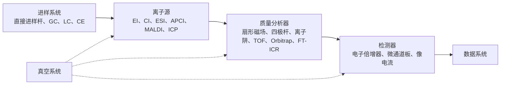
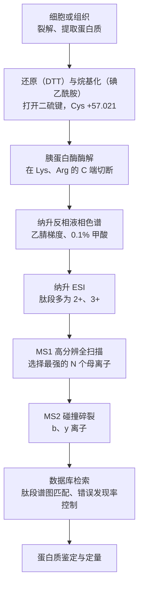

前面各章的方法测量物质与电磁辐射或电极的相互作用；质谱法则直接"称量"分子：把分子变成气相离子，按质量与电荷之比把离子分开并计数。由此得到的不只是分子量——高分辨质谱给出元素组成，离子的碎裂方式给出结构，离子流的强度给出含量。电喷雾电离与基质辅助激光解吸电离出现以后，蛋白质、核酸、糖与整个病毒颗粒都能完整地进入气相，质谱成为蛋白质组学、代谢组学与临床检验的核心工具。本章依次讲质谱的基本量（质荷比、精确质量、分辨率）、离子源、质量分析器与串联质谱、有机质谱的解析规律，最后是与色谱的联用和生物质谱。离子在电场与磁场中的运动来自物理学（[5.3.7](/5.3.7)），**同位素**的概念见 [6.1.2](/6.1.2)；色谱与电泳一侧的原理见 [6.4.13](/6.4.13) 与 [6.4.14](/6.4.14)，**校准曲线**、**内标法**与**检出限**见 [6.4.1](/6.4.1#sec-1.8)。大量有机化合物的谱图解析留给[有机化学](/6.5)的波谱一章，这里只把解析所依据的原理讲清。

## 15.1. 概述

### 15.1.1. 质谱法与质荷比

**定义 15.1.1（质谱法）** 使试样分子（或原子）电离成气相离子，利用离子在电场或磁场中的运动性质按质荷比把它们分离，记录各种离子的相对强度，据此进行定性、定量与结构分析的方法称为**质谱法**（MS）。以质荷比为横坐标、离子的相对强度为纵坐标的图称为质谱图。

**定义 15.1.2（质荷比）** 离子的质量以**统一原子质量单位** $\mathrm{u}$（即道尔顿 $\mathrm{Da}$，$1\,\mathrm{u} = m(^{12}\mathrm{C})/12$）计的数值 $m$ 除以它所带电荷数 $z$（不计正负号）的商称为**质荷比**，记作 $m/z$。

按 IUPAC 的规定，$m/z$ 是量纲一的量，不带单位（文献中偶见的单位 Th 不是 SI 认可的单位）。单电荷离子的 $m/z$ 就是它的质量数值；带 $z$ 个电荷的离子出现在 $1/z$ 处，这正是电喷雾电离能把几十万道尔顿的蛋白质送进 $m/z$ 只有几千的分析器的原因（15.2.4）。

一台质谱仪由五部分组成：进样系统把试样送入离子源；离子源使试样电离；质量分析器按 $m/z$ 分离离子；检测器把离子流变成电信号；真空系统使离子在飞行中不与气体分子碰撞。物理学中的**质谱仪**（[5.3.7](/5.3.7#sec-7.1.2)）只用磁偏转区分同位素，现代质谱仪的离子源与分析器则多种多样：



质谱法的两项基本功能是：准确测定分子量（以及由精确质量求出的元素组成），根据碎片离子推断结构。在此之上，选择性极高的离子检测使它成为复杂基体中痕量组分定量的首选方法。

### 15.1.2. 离子的质量

质谱测量的是单个离子的质量，而不是摩尔质量。按 CODATA 2022，$m_{\mathrm{p}} = 1.672\,621\,926\times10^{-27}\,\mathrm{kg} = 1.007\,276\,47\,\mathrm{u}$，$m_{\mathrm{n}} = 1.674\,927\,501\times10^{-27}\,\mathrm{kg} = 1.008\,664\,92\,\mathrm{u}$，质子质量约为电子质量的 $1836.15$ 倍；$^{12}\mathrm{C}$ 原子的质量按定义恰为 $12\,\mathrm{u} = 1.992\,646\,88\times10^{-26}\,\mathrm{kg}$（$1\,\mathrm{u} = 1.660\,539\,069\times10^{-27}\,\mathrm{kg}$）。除 $^{12}\mathrm{C}$ 外，各核素的质量都不是整数，例如 $^1\mathrm{H}$ $1.007\,825$、$^{14}\mathrm{N}$ $14.003\,074$、$^{16}\mathrm{O}$ $15.994\,915$、$^{35}\mathrm{Cl}$ $34.968\,853$。正是这些小数部分让高分辨质谱能区分名义质量相同的离子。

**定义 15.1.3（精确质量）** 按各元素最高丰度同位素的整数质量数计算的离子（或分子）质量称为**名义质量**；按各元素最高丰度同位素的精确核素质量计算的质量称为**单同位素质量**；按指定同位素组成、由精确核素质量计算的离子质量称为**精确质量**（计算值）。用标准原子量计算的则是平均质量。

例如 $\ce{CO+}$ 与 $\ce{N2+}$ 的名义质量都是 28，精确质量（已扣除一个电子的质量 $0.000\,549\,\mathrm{u}$）分别为 $27.994\,37$ 与 $28.005\,60$。实测质量与计算的精确质量之差通常用相对偏差表示：

$$
\delta_m = \frac{m_{\text{测}} - m_{\text{计}}}{m_{\text{计}}}\times10^6\ (\mathrm{ppm}).
\tag{15.1}
$$

**例 15.1.1** 某化合物的分子离子测得 $m/z\ 150.0679$，质量精度为 $\pm 3\,\mathrm{ppm}$。名义质量 150 的候选分子式有 $\ce{C9H10O2}$（$150.068\,08$）、$\ce{C8H10N2O}$（$150.079\,31$）、$\ce{C10H14O}$（$150.104\,47$）、$\ce{C9H14N2}$（$150.115\,70$）、$\ce{C8H6O3}$（$150.031\,69$）（均为中性分子的单同位素质量，分子离子再减去 $0.000\,55$）。哪一个符合？

**解** 分子离子 $\ce{C9H10O2+}$ 的计算值为 $150.067\,53$，偏差 $(150.0679 - 150.06753)/150.06753\times10^6 = +2.5\,\mathrm{ppm}$，在误差范围内；其余候选的偏差都在 $70\,\mathrm{ppm}$ 以上。所以分子式是 $\ce{C9H10O2}$。在 $m/z$ 150 处，$3\,\mathrm{ppm}$ 只相当于 $0.000\,45$，现代高分辨质谱（15.3.5）在 $m/z < 500$ 时常能把候选分子式缩小到一个；分子更大时候选数急剧增加，还要结合同位素峰（15.4.2）。$\square$

对于大分子，单同位素峰不再是最强的峰：一个分子量约 $17\,\mathrm{kDa}$ 的蛋白质含约 750 个碳原子，平均含 8 个 $^{13}\mathrm{C}$，单同位素峰的强度不到最强同位素峰的千分之一。所以生物大分子通常报告平均质量或最高峰的质量，高分辨谱图才用拟合的同位素峰型确定单同位素质量。

### 15.1.3. 质量分辨率

**定义 15.1.4（质量分辨率）** 质谱仪分开相邻两个质量的能力称为**质量分辨率**，记作

$$
R = \frac{m}{\Delta m},
\tag{15.2}
$$
其中 $m$ 是所考察的峰的质量。$\Delta m$ 有两种取法：半峰宽定义取单峰的半峰全宽（FWHM）；10% 谷定义取两个等高峰之间的谷高为峰高 10% 时两峰的质量差。

对 Gauss 峰形，10% 谷时每个峰在中点的高度为 5%，两峰间距等于单峰在 5% 高度处的全宽，约为 FWHM 的 2.08 倍，所以同一台仪器按 10% 谷定义的分辨率约为半峰宽定义的一半。扇形磁场仪器传统上用 10% 谷定义，TOF、Orbitrap 与 FT-ICR 一般用半峰宽定义；报告分辨率时要同时说明定义和所在的 $m/z$。

分开 $\ce{CO+}$ 与 $\ce{N2+}$ 需要 $R = 28.0/0.0112 \approx 2500$；分开地下水中 $^{75}\mathrm{As}^+$（$74.9210$）与等离子体产生的 $^{40}\mathrm{Ar}^{35}\mathrm{Cl}^+$（$74.9307$）需要 $R \approx 7800$。四极杆通常工作在单位分辨（在整个质量范围内 $\Delta m \approx 0.7$，$m/z$ 28 处 $R \approx 40$），只能分开名义质量相差 1 的离子，分不开 $\ce{CO+}$ 与 $\ce{N2+}$；这需要扇形磁场或 TOF 一类的高分辨仪器。


### 15.1.4. 发展简史

质谱起源于对气体放电的研究。1897 年 J. J. Thomson 用电场与磁场使阴极射线偏转，测出它的荷质比，发现了电子；随后他转而研究带正电的"阳极射线"，让离子穿过平行的电场与磁场，不同荷质比的离子在照相底片上画出不同的抛物线。1912 年，他在氖的谱线中看到质量为 20 与 22 的两条抛物线，这是稳定元素存在**同位素**的第一个证据。他的助手 Aston 用扩散法部分分离了这两种氖，又在 1919 年制成速度聚焦的质谱仪，精度达到千分之一，用它在多种元素中发现了同位素并提出整数规则，因此获得 1922 年诺贝尔化学奖。

此后的进展大多与新的分析器或离子源相联系：Dempster 的扇形磁场与电子电离源（1918），Nier 的双聚焦仪器（1950 年代），Paul 的四极杆与离子阱（1953；Paul 与 Dehmelt 因离子阱技术分享 1989 年诺贝尔物理学奖的一半），飞行时间质谱（1946 年提出，1955 年 Wiley 与 McLaren 的双场设计），Comisarow 与 Marshall 的 Fourier 变换离子回旋共振（1974），Munson 与 Field 的化学电离（1966），以及 1980 年代末的电喷雾电离（Fenn）与软激光解吸（田中耕一；Karas 与 Hillenkamp 的基质辅助激光解吸电离）。Fenn 与田中耕一因"发展了生物大分子的质谱分析法"分享 2002 年诺贝尔化学奖的一半（另一半授予用核磁共振测定溶液中生物大分子结构的 Wüthrich，见 [6.4.12](/6.4.12#sec-12.5.4)）。Makarov 的 Orbitrap 在 2005 年商品化，是目前蛋白质组学最常用的高分辨分析器。

### 15.1.5. 分类与应用

质谱仪按质量分析器分为扇形磁场、四极杆、离子阱、飞行时间、Orbitrap 与 FT-ICR 质谱（15.3）；按用途分为有机质谱、生物质谱、无机质谱（ICP-MS 等）与同位素比质谱；按联用方式分为气相色谱–质谱（GC-MS）、液相色谱–质谱（LC-MS）、毛细管电泳–质谱与串联质谱（MS/MS）。它的应用遍及生命科学、医学检验、药物研发、环境、食品安全、石油化工、材料与地球科学。三个一般化的例子：

1. 同位素比质谱与兴奋剂检测。人体自身合成的睾酮与药用合成睾酮化学上完全相同，单凭含量无法区分。筛查时先测尿中睾酮与表睾酮的浓度比，比值 $\mathrm{T/E} > 4$ 提示可疑；但这一比值受个体遗传差异（如 UGT2B17 基因缺失）影响很大，确证要靠碳同位素组成。同位素组成用相对国际标准（VPDB）的千分偏差表示：
   $$
   \delta^{13}\mathrm{C} = \left(\frac{R_{\text{样}}}{R_{\text{标}}} - 1\right)\times1000,\qquad R = \frac{n(^{13}\mathrm{C})}{n(^{12}\mathrm{C})},
   $$
   单位为 ‰。
   合成睾酮以大豆、薯蓣等 C₃ 植物的甾醇为原料，$\delta^{13}\mathrm{C}$ 约为 $-28$‰ 到 $-32$‰；内源睾酮反映饮食，一般在 $-20$‰ 到 $-25$‰。气相色谱–燃烧–同位素比质谱把各甾体分离后燃烧为 $\ce{CO2}$，测 $m/z$ 44、45、46 的离子流之比；当睾酮代谢物与同一尿样中不参与睾酮代谢的内源参照化合物（如孕二醇）的 $\delta^{13}\mathrm{C}$ 之差超过约 $3$‰（具体阈值由世界反兴奋剂机构的技术文件规定）时，判为外源。判据是两个 $\delta^{13}\mathrm{C}$ 之差，而不是它们的比值。
2. 单颗粒气溶胶质谱。大气颗粒物逐个经激光解吸电离后用双极 TOF 同时测正、负离子谱，由元素与有机物的特征峰把颗粒归类到机动车尾气、燃煤、扬尘、生物质燃烧等来源，用于污染源解析。
3. 疾病标志物发现。比较病人与健康人血清或组织中的蛋白质、代谢物谱（15.5），寻找含量差异显著的分子作为诊断或预后标志物；新生儿遗传代谢病筛查用串联质谱一次测定干血斑中数十种氨基酸与酰基肉碱，已是许多国家的常规检测。

## 15.2. 进样与离子源

### 15.2.1. 进样系统

进样系统在不破坏真空的条件下把试样送入离子源。气体与易挥发液体经加热储罐和针阀漏入，或者由**气相色谱**的色谱柱直接导入（15.5.1）；固体与难挥发液体放在直接进样杆顶端，经真空闭锁送到离子源附近加热汽化；溶液试样经液相色谱或注射泵送入大气压离子源（ESI、APCI）。

电子电离与化学电离要求试样先汽化。蒸气压低、热不稳定的化合物（糖、氨基酸、甾体、有机酸）在汽化前要衍生化：把 $-\mathrm{OH}$、$-\mathrm{COOH}$、$-\mathrm{NH_2}$ 中的活泼氢换成三甲基硅基（硅烷化）、酰基或烷基，消除分子间氢键，提高挥发性与热稳定性。例如葡萄糖与六甲基二硅氮烷–三甲基氯硅烷（或 BSTFA）在吡啶中反应，五个羟基全部转化为三甲基硅醚，分子量由 180 增至 540（每个 TMS 基增加 72）：

```smiles
OC[C@H]1OC(O)[C@H](O)[C@@H](O)[C@@H]1O>>C[Si](C)(C)OC[C@H]1OC(O[Si](C)(C)C)[C@H](O[Si](C)(C)C)[C@@H](O[Si](C)(C)C)[C@@H]1O[Si](C)(C)C
```

代谢组学中的 GC-MS 分析通常先用甲氧胺把羰基肟化（防止糖的开环与互变产生多个峰），再硅烷化。

### 15.2.2. 离子源与电子电离

**定义 15.2.1（离子源）** 质谱仪中使试样的原子或分子电离，并把生成的离子聚焦、加速成离子束送入质量分析器的部件称为**离子源**。

离子源决定了得到哪些离子：是完整分子的离子还是碎片，带一个电荷还是许多个，正离子还是负离子。选择离子源主要看试样的挥发性、热稳定性、极性与分子量。

**定义 15.2.2（电子电离）** 在真空中用灯丝发射、经电场加速到一定能量（通常 $70\,\mathrm{eV}$）的电子束轰击气态试样分子，使分子失去一个电子生成正离子的电离方式称为**电子电离**（EI，旧称电子轰击电离）：

$$
\mathrm{M} + \mathrm{e}^- \longrightarrow \mathrm{M}^{+\bullet} + 2\mathrm{e}^-.
$$

生成的 $\mathrm{M}^{+\bullet}$ 是奇电子的自由基正离子（15.4.1）。灯丝（钨或铼）发射的电子穿过电离室到达对面的阳极（电子收集极）；沿电子束方向加一个弱磁场，使电子沿螺旋线运动，延长路径、增加碰撞机会。生成的离子由推斥极推出电离室，经透镜聚焦、加速进入分析器。电离室压力约 $10^{-3}$–$10^{-4}\,\mathrm{Pa}$。

为什么用 $70\,\mathrm{eV}$？有机分子的**电离能**大多在 $7$–$13\,\mathrm{eV}$（苯 $9.24$、乙醇 $10.48$、甲烷 $12.61\,\mathrm{eV}$）。电离效率随电子能量先增大，在 $50$–$100\,\mathrm{eV}$ 达到平台：$70\,\mathrm{eV}$ 电子的 **de Broglie 波长**为 $h/\sqrt{2m_{\mathrm{e}}E} \approx 0.15\,\mathrm{nm}$，与分子中化学键的长度相当，电子与分子的电磁相互作用最强。在平台区，电子能量的小波动几乎不改变谱图，所以各实验室、各型号仪器在 $70\,\mathrm{eV}$ 下得到的谱图可以互相比较；这使建立标准谱库成为可能（NIST 谱库已收录数十万张 EI 谱图），未知物可以靠谱库检索鉴定。分子离子通常只获得几个电子伏的过剩内能，但这已足以断裂化学键，所以 EI 谱的碎片丰富、结构信息多。

EI 的局限：试样必须能汽化，不能直接分析难挥发、热不稳定和分子量大（大于约 $1000$）的物质；有些化合物（醇、支链烷烃、某些酯）的分子离子不稳定，谱图中看不到分子离子峰，这时要改用软电离方法确定分子量。

### 15.2.3. 化学电离与质子转移反应电离

**定义 15.2.3（化学电离）** 在离子源中通入远多于试样的反应气（甲烷、异丁烷、氨等），先用电子电离使反应气电离并经离子–分子反应生成反应离子，再由反应离子与试样分子发生质子转移、电荷交换、加合等反应使试样电离的方式称为**化学电离**（CI）。

以甲烷为反应气（压力约 $100\,\mathrm{Pa}$，远高于 EI），主要反应为

$$
\begin{aligned}
&\ce{CH4 + e- -> CH4^{+.} + 2e-},\\
&\ce{CH4^{+.} + CH4 -> CH5+ + CH3^{.}},\qquad \ce{CH3+ + CH4 -> C2H5+ + H2},\\
&\ce{CH5+ + M -> [M + H]+ + CH4},\qquad \ce{C2H5+ + M -> [M + C2H5]+}.
\end{aligned}
$$

**定义 15.2.4（准分子离子）** 由分子 M 加合或失去一个离子（多为质子）形成的、能指示分子量的离子，如 $[\mathrm{M}+\mathrm{H}]^+$、$[\mathrm{M}-\mathrm{H}]^-$、$[\mathrm{M}+\mathrm{Na}]^+$、$[\mathrm{M}+\mathrm{NH_4}]^+$，称为**准分子离子**（或质子化分子、去质子化分子）。

准分子离子是偶电子离子，比 $\mathrm{M}^{+\bullet}$ 稳定，碎裂少，所以 CI 谱图简单，常出现 $m/z = M+1$ 的强峰，以及 $M+29$（$[\mathrm{M}+\ce{C2H5}]^+$）、$M-1$（负氢离子被夺取，$[\mathrm{M}-\mathrm{H}]^+$）等峰，用来确定分子量。质子转移 $\ce{BH+ + M -> MH+ + B}$ 释放的能量等于两者质子亲和能之差 $\mathrm{PA}(\mathrm{M}) - \mathrm{PA}(\mathrm{B})$：甲烷的质子亲和能只有 $543.5\,\mathrm{kJ\,mol^{-1}}$，$\ce{CH5+}$ 是很强的质子给体，传给 $\mathrm{MH^+}$ 的过剩能量较多；换用异丁烷（叔丁基正离子，对应异丁烯的 $\mathrm{PA} = 802\,\mathrm{kJ\,mol^{-1}}$）或氨（$853.6\,\mathrm{kJ\,mol^{-1}}$），电离更温和，选择性更高（只有质子亲和能更高的分子被质子化）。负离子化学电离对含卤素、硝基等电负性基团的化合物极为灵敏（捕获热电子），用于环境中有机氯农药与二噁英的测定。

质子转移反应电离（PTR）是 CI 的一个变体：用放电由水蒸气产生 $\ce{H3O+}$，在漂移管中与空气样品反应，$\ce{H3O+ + M -> MH+ + H2O}$。水的质子亲和能为 $691\,\mathrm{kJ\,mol^{-1}}$，高于 $\ce{N2}$（$494$）、$\ce{O2}$（$421$）、$\ce{CO2}$（$541\,\mathrm{kJ\,mol^{-1}}$），所以空气的主要成分不被电离，而大多数挥发性有机物（质子亲和能更高）被质子化为 $[\mathrm{M}+\mathrm{H}]^+$。由已知的速率常数与反应时间可以不经校准直接计算浓度，检出限低至 $10^{-12}$（体积分数）量级，用于大气化学、呼气分析与食品香气的实时监测。

### 15.2.4. 电喷雾电离

**定义 15.2.5（电喷雾电离）** 使溶液从施加了数千伏高电压的毛细管尖端流出，在强电场作用下形成带电雾滴，雾滴在溶剂蒸发与反复分裂中把溶液中的离子转移到气相的大气压电离方式称为**电喷雾电离**（ESI）。

过程分三步。(1) 形成带电雾滴：毛细管（不锈钢或熔融石英，内径约 $0.1\,\mathrm{mm}$）相对对电极加 $2$–$5\,\mathrm{kV}$ 电压，正离子模式下溶液中的正离子在尖端液面富集，电场力与表面张力平衡，液面被拉成圆锥（Taylor 锥），锥尖喷出富含正电荷的细小雾滴，同轴的雾化气帮助喷雾。(2) 雾滴收缩与分裂：雾滴在加热的干燥气（$\ce{N2}$）中蒸发溶剂，半径减小而电荷不变，电荷密度增大；当电荷达到 Rayleigh 极限 $q_{\mathrm{R}} = 8\pi(\varepsilon_0\gamma r^3)^{1/2}$（$\gamma$ 为表面张力）时，静电斥力超过表面张力，雾滴分裂成许多更小的子雾滴（"库仑爆炸"，每次带走约 2% 的质量和约 15% 的电荷）。(3) 生成气相离子：小分子离子按离子蒸发模型，在纳米尺度的雾滴表面电场足够强时直接从液面蒸发出来；折叠的蛋白质等大分子按带电残基模型，雾滴蒸干后剩下的电荷留在分子上；去折叠的长链蛋白质则按链射出模型，从雾滴中逐段被拉出。离子经加热的毛细管或锥孔进入逐级抽真空的接口，去溶剂化后送入分析器。

ESI 的特点：

1. 软电离：几乎不产生碎片，极性、热不稳定的分子（肽、蛋白质、核酸、糖、药物与代谢物）完整进入气相，以 $[\mathrm{M}+\mathrm{H}]^+$、$[\mathrm{M}+\mathrm{Na}]^+$ 或 $[\mathrm{M}-\mathrm{H}]^-$ 出现；甚至非共价复合物也能保留。
2. 多电荷：分子上有多个可质子化的位点（蛋白质的 Lys、Arg、His 与 N 端）时，生成一系列 $[\mathrm{M}+z\mathrm{H}]^{z+}$ 离子，$m/z$ 落在 $500$–$3000$ 之间，普通的四极杆或 TOF 就能测量分子量很大的蛋白质。
3. 在大气压下工作，流速从 $\mathrm{nL\,min^{-1}}$（纳升电喷雾）到 $\mathrm{mL\,min^{-1}}$，天然适合与 **高效液相色谱**和**毛细管电泳**联用（15.5.1）。
4. 信号近似与浓度成正比，但易受**基体效应**影响：共流出的盐、表面活性剂与基体组分争夺雾滴表面的电荷，抑制被测物的电离，称为离子抑制（ion suppression），所以定量常用同位素标记的内标（15.5.2）。

多电荷离子的电荷数与分子量可以由相邻两个峰求出。设相邻两峰 $m_1 > m_2$ 分别对应电荷 $z$ 与 $z+1$，质子质量 $m_{\mathrm{H}} = 1.007\,28$，则

$$
m_1 = \frac{M + z m_{\mathrm{H}}}{z},\qquad m_2 = \frac{M + (z+1)m_{\mathrm{H}}}{z+1}.
$$
两式消去 $M$ 得

$$
z = \frac{m_2 - m_{\mathrm{H}}}{m_1 - m_2},\qquad M = z(m_1 - m_{\mathrm{H}}).
\tag{15.3}
$$

**例 15.2.1** 马心肌红蛋白（去血红素，脱辅基肌红蛋白）在酸性水–甲醇溶液中的 ESI 谱中有一对相邻峰 $m/z\ 998.15$ 与 $942.76$。求电荷数与分子量。

**解** $z = (942.76 - 1.007)/(998.15 - 942.76) = 941.75/55.39 = 17.0$，取 $z = 17$；$M = 17\times(998.15 - 1.007) = 16\,951.4\,\mathrm{Da}$，与由氨基酸序列计算的平均质量 $16\,951.5\,\mathrm{Da}$ 一致。实际处理时对整个电荷态系列求平均，或用软件把所有峰变换到质量轴上（去卷积），精度可达 $0.01\%$。$\square$


电荷态分布本身携带构象信息：伸展的肽链暴露更多碱性位点、表面积更大，电荷多；折叠的蛋白质按带电残基模型只带接近 Rayleigh 极限的电荷，电荷少。用醋酸铵等挥发性缓冲液在中性条件下喷雾、保留蛋白质的折叠与非共价相互作用的方法称为天然质谱（native mass spectrometry），可以测定蛋白质复合物的亚基组成与配体结合（例如天然肌红蛋白保留血红素，测得 $17.57\,\mathrm{kDa}$）。

### 15.2.5. 大气压化学电离

**定义 15.2.6（大气压化学电离）** 溶液经加热的雾化器（约 $350$–$500\,^\circ\mathrm{C}$）完全汽化后，在大气压下用电晕放电针电离溶剂与空气分子形成反应离子，再由反应离子与试样分子发生质子转移等离子–分子反应使试样电离的方式称为**大气压化学电离**（APCI）。

放电先产生 $\ce{N2^{+.}}$、$\ce{O2^{+.}}$，经一系列反应生成水合质子 $\ce{H3O+(H2O)_n}$，后者把质子交给质子亲和能更高的试样分子；负离子模式下则通过质子提取或电子捕获生成 $[\mathrm{M}-\mathrm{H}]^-$ 或 $\mathrm{M}^{-\bullet}$。APCI 的反应在气相进行，所以与 ESI 互补：它适合中等极性和弱极性、热稳定、分子量小于约 $1500$ 的化合物（甾体、类胡萝卜素、脂溶性维生素、农药），几乎只产生单电荷离子，对盐与基体的耐受性比 ESI 好，可承受 $0.2$–$2\,\mathrm{mL\,min^{-1}}$ 的常规液相流速。用紫外灯代替放电针的大气压光电离（APPI）可以电离多环芳烃等非极性物质。

### 15.2.6. 基质辅助激光解吸电离

**定义 15.2.7（基质辅助激光解吸电离）** 把试样与大量能强烈吸收激光的小分子有机酸（基质）共结晶，用脉冲激光照射，基质吸收能量迅速汽化，把夹带的试样分子带入气相并通过质子转移使其电离的方式称为**基质辅助激光解吸电离**（MALDI）。

试样与基质的物质的量之比约为 $1:10^3$–$1:10^5$，点在金属靶板上晾干。激光通常是 $337\,\mathrm{nm}$ 的氮分子激光或 $355\,\mathrm{nm}$ 的 Nd:YAG 三倍频激光，脉冲宽度为纳秒级。基质的作用是：吸收激光能量（它们都是在近紫外有强吸收的芳香化合物），把试样分子彼此隔开以免聚集，在汽化的羽流中作为质子给体或受体使试样电离；试样分子本身不直接吸收激光，所以不被破坏。常用的基质有：α-氰基-4-羟基肉桂酸（CHCA，用于肽与小于约 $5\,\mathrm{kDa}$ 的分子）、芥子酸（用于蛋白质）、2,5-二羟基苯甲酸（DHB，用于肽、糖与糖肽）：

```smiles
N#C/C(=C\c1ccc(O)cc1)C(=O)O
COc1cc(/C=C/C(=O)O)cc(OC)c1O
OC(=O)c1cc(O)ccc1O
```

MALDI 的特点：

1. 主要生成单电荷离子 $[\mathrm{M}+\mathrm{H}]^+$（大蛋白质也有少量 $[\mathrm{M}+2\mathrm{H}]^{2+}$ 与二聚体），谱图简单，适合分析混合物；
2. 质量范围很宽，可以测几十万道尔顿的蛋白质与合成聚合物；
3. 离子以脉冲形式产生，与同样按脉冲工作的飞行时间分析器天然匹配（MALDI-TOF，15.3.4）；
4. 对盐和缓冲液的耐受性比 ESI 好，测量快（每个样点几秒），适合高通量；但低质量区（$m/z < 500$）有大量基质离子的干扰，难以分析小分子，与色谱在线联用也不方便。

MALDI-TOF 最重要的应用之一是微生物鉴定：把一个菌落直接点在靶上，得到的 $2$–$20\,\mathrm{kDa}$ 的峰主要来自含量高的核糖体蛋白，与数据库中的参考谱比对，几分钟内就能鉴定细菌与真菌的种，已在临床微生物实验室中取代了大部分生化鉴定方法。它还用于**肽质量指纹**（15.5.3）与**质谱成像**（15.5.5）。

### 15.2.7. 软电离与离子源的选择

**定义 15.2.8（软电离）** 传给分子的过剩内能很少、主要生成分子离子或准分子离子而碎片很少的电离方式称为**软电离**（CI、ESI、APCI、MALDI 等）；传给分子的能量多、产生大量碎片的电离方式称为**硬电离**（EI）。

软与硬是互补的：硬电离给出结构信息但可能丢失分子量，软电离给出分子量但缺少结构信息；软电离生成的离子再经串联质谱的碰撞诱导解离（15.3.7）有控制地碎裂，两种信息就能同时得到。

| 离子源 | 生成的主要离子 | 适用的试样 | 质量范围（约） | 常配的分析器与联用 |
|---|---|---|---|---|
| EI | $\mathrm{M}^{+\bullet}$ 与大量碎片 | 可汽化、热稳定的小分子 | $< 1000$ | 四极杆、扇形磁场；GC-MS |
| CI | $[\mathrm{M}+\mathrm{H}]^+$、加合离子 | 同 EI，用于确定分子量 | $< 1000$ | 同 EI |
| ESI | $[\mathrm{M}+z\mathrm{H}]^{z+}$、$[\mathrm{M}-z\mathrm{H}]^{z-}$ | 极性、离子型分子与生物大分子 | 可达 $10^6$ 以上 | 三重四极杆、Q-TOF、Orbitrap；LC-MS、CE-MS |
| APCI | $[\mathrm{M}+\mathrm{H}]^+$、$[\mathrm{M}-\mathrm{H}]^-$ | 中等与弱极性、热稳定的小分子 | $< 1500$ | 同 ESI |
| MALDI | $[\mathrm{M}+\mathrm{H}]^+$（单电荷为主） | 肽、蛋白质、核酸、聚合物、微生物 | 可达 $5\times10^5$ | TOF、TOF/TOF；成像 |
| ICP | 元素的单原子正离子 | 溶液中的元素与同位素 | $m/z < 260$ | 四极杆、扇形磁场；15.5.6 |

此外，解吸电喷雾电离（DESI）把带电溶剂雾滴喷到大气中的试样表面，纸喷雾把试样点在三角形滤纸上加电压直接喷雾，实时直接分析（DART）用激发态的氦原子电离表面分子。这些敞开式（常压）离子源不需要样品前处理，与小型化的离子阱质谱结合，可以在现场、手术室或海关快速检测。

## 15.3. 质量分析器与串联质谱

### 15.3.1. 质量分析器与扇形磁场

**定义 15.3.1（质量分析器）** 质谱仪中利用电场或磁场按质荷比把离子在空间、时间或频率上分开的部件称为**质量分析器**。

衡量分析器的指标是质量范围、分辨率（15.1.3）、质量精度、扫描速度、离子传输效率与动态范围。最早的分析器是扇形磁场，它的原理就是**Lorentz 力**作用下的回旋运动（[5.3.7](/5.3.7#sec-7.1.1)）。离子源中电荷为 $ze$ 的离子经电压 $U$ 加速：

$$
zeU = \frac{1}{2}mv^2.
$$
它垂直进入磁感应强度为 $B$ 的均匀磁场，Lorentz 力提供向心力，$zevB = mv^2/r$，轨道半径 $r = mv/(zeB)$。两式消去 $v$：

$$
r = \frac{1}{B}\sqrt{\frac{2mU}{ze}},\qquad \frac{m}{ze} = \frac{B^2r^2}{2U}.
\tag{15.4}
$$

在 $B$、$U$ 一定时，$m/z$ 越大的离子轨道半径越大。仪器的出口狭缝与检测器位置固定（$r$ 一定），连续改变 $B$（磁场扫描）或 $U$（电压扫描），不同 $m/z$ 的离子依次通过狭缝到达检测器，记录离子流随 $m/z$ 的变化就得到质谱。例如 $U = 8\,\mathrm{kV}$、$B = 1\,\mathrm{T}$ 时，$m/z$ 500 的单电荷离子的轨道半径约 $0.29\,\mathrm{m}$。

扇形磁场（$180^\circ$、$90^\circ$、$60^\circ$ 等）对从同一点以不同角度射入的同质量离子有方向聚焦作用，这称为单聚焦分析器。但离子离开离子源时的初始动能不同（热运动与电离过程的能量分散），加速后动能仍有差异，按式 (15.4) 半径不同，峰被展宽，单聚焦仪器的分辨率只有几千。双聚焦分析器在磁场前加一个静电分析器：离子在圆柱形电场 $E$ 中做圆周运动，$zeE = mv^2/r_{\mathrm{e}}$，得 $r_{\mathrm{e}} = 2U/E$——轨道半径只与动能有关、与质量无关，所以静电分析器是一个能量过滤器。适当地组合电场与磁场（如 Nier–Johnson 几何），使电场造成的能量色散与磁场造成的能量色散相互抵消，就同时实现了方向聚焦与能量聚焦，分辨率可达 $10^5$（10% 谷）。双聚焦仪器体积大、扫描慢、价格高，目前主要用于二噁英的高分辨定量、同位素比测定与高分辨 ICP-MS。

### 15.3.2. 四极杆质量分析器

**定义 15.3.2（四极杆质量分析器）** 由四根平行对称排列的双曲面（或圆柱形）电极组成、相对的两根电极相连，两组电极之间施加直流电压与射频电压的叠加，只让特定 $m/z$ 的离子稳定穿过的质量分析器称为**四极杆质量分析器**（四极滤质器）。

设两组电极上分别加电势 $\pm\Phi_0$，$\Phi_0 = U + V\cos\Omega t$（$U$ 为直流电压，$V$ 为射频电压的幅值，$\Omega$ 为射频角频率，通常 $\Omega/2\pi \approx 1\,\mathrm{MHz}$），电极内切圆半径为 $r_0$。电极间的四极场电势为

$$
\Phi(x, y, t) = \Phi_0\,\frac{x^2 - y^2}{r_0^2},
$$
沿轴线（$z$ 方向）没有电场，离子以入射时的速度匀速前进；在 $x$ 方向受力 $F_x = -ze\,\partial\Phi/\partial x = -2ze\Phi_0 x/r_0^2$，所以

$$
m\ddot x + \frac{2ze}{r_0^2}(U + V\cos\Omega t)\,x = 0,
$$
$y$ 方向的方程只差一个负号。令 $\xi = \Omega t/2$，两个方程都化为 Mathieu 方程

$$
\frac{\mathrm{d}^2u}{\mathrm{d}\xi^2} + (a_u - 2q_u\cos 2\xi)\,u = 0,\qquad
a_x = -a_y = \frac{8zeU}{mr_0^2\Omega^2},\quad q_x = -q_y = -\frac{4zeV}{mr_0^2\Omega^2}.
\tag{15.5}
$$

Mathieu 方程的解是否有界只取决于 $(a, q)$，与离子的初始位置和速度无关。在 $a$–$q$ 平面上，$x$ 与 $y$ 方向同时稳定的区域在第一象限近似为三角形，顶点在 $q = 0.706$、$a = 0.237$；落在稳定区内的离子振幅有界、能穿过四极杆，落在区外的离子振幅指数增长，打到电极上被中和。

$a$ 与 $q$ 都与 $m/z$ 成反比，而比值 $a/q = 2U/V$ 与质量无关：在给定的 $U$、$V$ 下，所有离子都落在一条过原点、斜率为 $2U/V$ 的扫描线上，$m/z$ 越大越靠近原点。选择 $U/V$ 略小于 $0.237/(2\times0.706) = 0.168$，扫描线只从稳定区顶点附近穿过，只有 $m/z$ 在很窄范围内的离子能稳定通过；保持 $U/V$ 不变，同时线性增大 $U$ 和 $V$，各种离子依次进入顶点，就完成了质量扫描。$U/V$ 越接近 $0.168$，通过的质量窗越窄，分辨率越高，但离子的传输效率越低；通常调节到在整个质量范围内保持单位分辨。只加射频电压（$U = 0$）时，所有 $q < 0.908$ 的离子都能通过，四极杆就成了离子导引或碰撞池（15.3.7）。


四极杆的优点是体积小、价格低、扫描快（每秒数千 $m/z$ 单位）、对离子初始动能不敏感、可在较高压力下工作，是 GC-MS 与三重四极杆 LC-MS/MS 定量的主力；缺点是分辨率只有单位分辨，质量范围一般在 $m/z$ $2000$–$4000$ 以下。

### 15.3.3. 离子阱

**定义 15.3.3（离子阱）** 用射频电场（或射频电场与直流电场）把离子囚禁在有限空间内，再通过改变电场使不同 $m/z$ 的离子依次失去稳定而被逐出检测的质量分析器称为**离子阱**（四极离子阱，Paul 阱）。

三维离子阱由一个环电极和上下两个端盖电极组成，三者内表面都是双曲面。离子在阱内的运动同样服从 Mathieu 方程，参数为

$$
a_z = -\frac{16zeU}{m(r_0^2 + 2z_0^2)\Omega^2},\qquad q_z = \frac{8zeV}{m(r_0^2 + 2z_0^2)\Omega^2},
$$
其中 $r_0$ 是环电极的内半径，$z_0$ 是阱中心到端盖的距离。离子阱通常只在环电极上加射频电压（$U = 0$），离子都处在 $a_z = 0$ 的轴上，$q_z$ 与 $m/z$ 成反比，$m/z$ 小的离子 $q_z$ 大、离原点远。稳定区与 $a_z = 0$ 轴的交点是 $q_z = 0.908$：$q_z < 0.908$ 的离子被囚禁。阱中充有约 $0.1\,\mathrm{Pa}$ 的氦气，离子与氦原子碰撞失去动能，聚集到阱中心（碰撞冷却）。

质量选择不稳定扫描：线性增大射频幅值 $V$，各离子的 $q_z$ 按比例增大，依次到达 $q_z = 0.908$ 的边界，在 $z$ 方向失稳、振幅激增，从端盖电极的小孔射出，被阱外的电子倍增器检测；$m/z$ 由小到大依次被逐出，就得到质谱。在端盖上附加与离子轴向运动频率共振的辅助交流电压，可以提前逐出特定离子（共振逐出），以扩大质量范围或分离选定的离子。

离子阱的特点是结构简单、体积小、灵敏度高（全扫描时离子先累积再检测）、适合小型化与现场仪器；最重要的是能在同一个阱中依次完成"选择母离子—碰撞碎裂—扫描子离子"并重复多次，实现多级串联质谱 $\mathrm{MS}^n$（15.3.7）。缺点是阱中离子太多时空间电荷使峰变宽、质量偏移，所以要自动控制离子的注入量；三维阱的离子容量有限，现在多用把离子囚禁在四根杆之间、容量大得多的线性离子阱。

### 15.3.4. 飞行时间质谱

**定义 15.3.4（飞行时间质谱）** 离子在加速电场中获得相同的动能后进入无场的漂移管，根据不同 $m/z$ 的离子飞过同一距离所用时间的差异把它们分开的质谱法称为**飞行时间质谱**（TOF）。

离子经电压 $U$ 加速，$zeU = \frac{1}{2}mv^2$，速度 $v = \sqrt{2zeU/m}$；飞过长度为 $L$ 的漂移管所需时间

$$
t = \frac{L}{v} = L\sqrt{\frac{m}{2zeU}} \propto \sqrt{\frac{m}{z}}.
\tag{15.6}
$$
飞行时间与质荷比的平方根成正比。例如 $L = 1\,\mathrm{m}$、$U = 20\,\mathrm{kV}$ 时，$m/z$ 1000 的单电荷离子飞行 $16.1\,\mu\mathrm{s}$，$m/z$ 1001 只晚到 $8\,\mathrm{ns}$。由 $m \propto t^2$ 得 $\Delta m/m = 2\Delta t/t$，所以分辨率 $R = t/(2\Delta t)$：漂移管越长、峰的时间宽度越窄，分辨率越高，检测器与数据采集要能分辨纳秒级的时间差。

TOF 必须以脉冲方式工作：离子在同一时刻开始飞行，一个脉冲内的全部离子在几十到几百微秒内到达，记录完整的质谱。由此得到它的优点：

1. 质量范围原理上没有上限（线性模式可测 $m/z > 10^5$ 的蛋白质离子，限制在于重离子速度慢、检测效率降低）；
2. 每秒可以记录上万张谱图并累加，全谱采集而没有扫描造成的离子损失，灵敏度高，适合快速色谱与成像；
3. 结构简单，离子传输效率高。

早期 TOF 的分辨率只有几百，原因是同质量的离子离开离子源时的初始位置与初始动能不同，到达时间有一定分布。两项技术解决了这个问题，分辨率低已不再是 TOF 的缺点：

- **反射式飞行时间**：在漂移管末端加一个逐渐增强的减速电场（离子反射镜），离子进入后减速、折返。动能较大的离子进入反射镜更深、多走一段路，正好补偿它在漂移区节省的时间，同质量的离子同时到达检测器，飞行路程也增加了一倍。
- 延迟引出：MALDI 中离子形成后先在无场区停留几百纳秒再施加引出脉冲，初速度大的离子已经跑在前面、处于较低的电势，获得的能量较少，到达时被后面的离子追上。

现代反射式 TOF 的分辨率达到 $10^4$–$6\times10^4$（半峰宽），质量精度优于 $5\,\mathrm{ppm}$。连续的 ESI 离子束用正交加速引入：离子束垂直于漂移管方向穿过加速区，每隔约 $100\,\mu\mathrm{s}$ 用一个脉冲把一段离子推入漂移管。四极杆与正交 TOF 串联的 Q-TOF 是代谢组学与蛋白质组学中常用的高分辨仪器。

### 15.3.5. Orbitrap 与 Fourier 变换离子回旋共振

这两种分析器不靠离子撞击检测器计数，而是测量离子周期运动的频率：频率由 $m/z$ 决定，频率能测得极准，所以它们的分辨率与质量精度最高。

**定义 15.3.5（Orbitrap）** 由纺锤形中心电极与包围它的桶形外电极组成，离子在两者之间的静电场中一边绕中心电极旋转、一边沿轴向做简谐振荡，通过测量轴向振荡在外电极两半上感应的像电流的频率来测定 $m/z$ 的质量分析器称为 **Orbitrap**（轨道阱）。

中心电极与外电极之间的静电势是四极对数势，沿轴向的电场与 $z$ 成正比，离子在轴向受到线性恢复力，做**简谐振动**（[5.1.6](/5.1.6)），角频率

$$
\omega_z = \sqrt{\frac{kze}{m}},
\tag{15.7}
$$
其中 $k$ 是由电极形状与电压决定的场曲率。$\omega_z$ 与离子的能量、初始位置无关，只与 $m/z$ 有关。离子在弯曲的线性离子阱（C-trap）中累积、冷却后，以短脉冲注入 Orbitrap；同 $m/z$ 的离子同相振荡，在一对外电极上感应出随时间正弦变化的像电流，所有离子的信号叠加成时域瞬变信号。对它作**Fourier 变换**（[2.5.6](/2.5.6)）得到频率谱，再按式 (15.7) 换算成质谱。采集时间越长，频率分辨越好：$m/z$ 200 处的分辨率可达 $10^5$–$10^6$，质量精度优于 $1$–$3\,\mathrm{ppm}$。由于 $\omega_z \propto (m/z)^{-1/2}$，在相同采集时间下分辨率随 $m/z$ 的平方根下降。

**定义 15.3.6（Fourier 变换离子回旋共振质谱）** 把离子囚禁在强磁场中的分析池内，用射频脉冲激发离子做相干的回旋运动，检测离子在检测极板上感应的像电流，经 Fourier 变换得到回旋频率并换算成 $m/z$ 的质谱法称为 **Fourier 变换离子回旋共振质谱**（FT-ICR MS）。

在均匀磁场中，离子的回旋角频率就是**回旋频率**（[5.3.7](/5.3.7#sec-7.1.1)）：

$$
\omega_{\mathrm{c}} = \frac{zeB}{m},\qquad \frac{m}{z} = \frac{eB}{\omega_{\mathrm{c}}}.
\tag{15.8}
$$
它与离子速度无关，只由 $m/z$ 与 $B$ 决定。例如在 $7\,\mathrm{T}$ 的超导磁体中，$m/z$ 1000 的离子回旋频率 $\omega_{\mathrm{c}}/2\pi = 107.5\,\mathrm{kHz}$。分析池是置于磁体中心的立方体或圆柱，一对极板用于激发，一对用于检测，一对端板加小的直流电压把离子限制在轴向。工作过程：

1. 离子进入池后热运动的回旋半径很小，各离子相位随机，不产生可检测的信号；
2. 在激发极板上加一个快速扫频（或宽带）射频脉冲，当频率与某种离子的回旋频率相等时，这种离子共振吸收能量，回旋半径增大到接近池的尺寸（但不能撞上极板：激发过度的离子会撞到极板而丢失），而且同种离子同相运动，成为一个相干的离子团；
3. 相干离子团在检测极板之间往返经过，在极板上感应出频率为 $\omega_{\mathrm{c}}$ 的像电流（离子不撞击极板，检测是非破坏性的，同一群离子可以反复测量）；
4. 各种离子的正弦信号叠加成时域瞬变信号，经**快速 Fourier 变换**（[4.4.4](/4.4.4)）得到频率谱，按式 (15.8) 换算成质谱。

FT-ICR 是分辨率与质量精度最高的质谱：分辨率与磁场成正比、与采集时间成正比，$7$–$21\,\mathrm{T}$ 的仪器在 $m/z$ 400 处可达 $10^6$ 以上，质量精度优于 $1\,\mathrm{ppm}$，能把石油或天然有机质中成千上万种分子逐一分开并确定分子式，也能分辨大蛋白质的同位素峰。缺点是需要超导磁体，购置与液氦维持费用很高，采集速度较慢。

### 15.3.6. 质量分析器的比较

| 分析器 | $m/z$ 上限（约） | 分辨率（约） | 质量精度 | 采集速度 | 特点 |
|---|---|---|---|---|---|
| 四极杆 | $2000$–$4000$ | 单位分辨 | $\sim 0.1\,\mathrm{u}$ | 快 | 便宜、耐用，定量（SIM、SRM）的主力 |
| 离子阱 | $2000$–$6000$ | 单位分辨到 $10^4$ | $50$–$200\,\mathrm{ppm}$ | 快 | 小型、灵敏，多级 $\mathrm{MS}^n$ |
| 双聚焦扇形磁场 | $10^4$ | $10^4$–$10^5$（10% 谷） | $< 5\,\mathrm{ppm}$ | 慢 | 高分辨定量、同位素比 |
| 飞行时间（反射式） | 无原理上限 | $10^4$–$6\times10^4$ | $1$–$5\,\mathrm{ppm}$ | 极快 | 全谱采集，配 MALDI 与快速色谱 |
| Orbitrap | $6000$（天然质谱可更高） | $10^5$–$10^6$（$m/z$ 200） | $< 3\,\mathrm{ppm}$ | 中 | 蛋白质组学与代谢组学的主力 |
| FT-ICR | $10^4$ | $10^5$–$10^7$ | $< 1\,\mathrm{ppm}$ | 慢 | 分辨率最高，价格最高 |

### 15.3.7. 串联质谱与扫描方式

**定义 15.3.7（串联质谱）** 用第一级质量分析器选出特定 $m/z$ 的离子（母离子，又称前体离子），使其在碰撞池中碎裂，再用第二级质量分析器分析生成的子离子（产物离子）的方法称为**串联质谱**（MS/MS）；重复"选择—碎裂—分析"多次的称为多级质谱 $\mathrm{MS}^n$。

串联可以在空间上实现（不同的分析器依次排列：三重四极杆 QqQ、四极杆–飞行时间 Q-TOF、四极杆–Orbitrap、TOF/TOF），也可以在时间上实现（在同一个离子阱或 FT-ICR 池中按时间先后完成各步）。三重四极杆由两个质量分析四极杆（Q1、Q3）与中间只加射频电压的碰撞池（q2）组成。

**定义 15.3.8（碰撞诱导解离）** 把选定的离子加速后与惰性气体（He、$\ce{N2}$、Ar）分子碰撞，部分动能转化为离子的内能，使其在随后的振动激发中碎裂的过程称为**碰撞诱导解离**（CID，又称碰撞活化解离）。

在三重四极杆中，离子以 $10$–$50\,\mathrm{eV}$ 的动能进入充有 Ar 或 $\ce{N2}$ 的碰撞池，经多次碰撞逐步加热，内能分布到整个分子的振动自由度上，最弱的键优先断裂（"慢加热"）。Orbitrap 仪器中的高能碰撞解离（HCD）在单独的多极杆池中进行，没有离子阱 CID 的低质量截止。除碰撞以外，电子转移解离（ETD）与电子捕获解离（ECD）让多电荷正离子获得一个电子，自由基诱导的断裂优先切断肽链的 $\mathrm{N}$–$\mathrm{C}_\alpha$ 键而保留磷酸化、糖基化等修饰，紫外光解离（UVPD）则用激光使离子碎裂。

**例 15.3.1** 质子化的母离子 $m/z$ 170 在 CID 后产生 $m/z$ 93、77、65 的子离子。$m/z$ 77 是苯基正离子 $\ce{C6H5+}$，93 与 65 相差 28；这一系列提示母离子含有苯氧基或苯胺基（$\ce{C6H5O+}$ 或 $\ce{C6H7N+}$ 都是 93）。子离子扫描把每一个子离子都归属到同一个母离子，比单级质谱中的碎片更容易解释；若要进一步确定 93 的归属，可以对 93 再做一次 $\mathrm{MS}^3$，或用精确质量区分 $\ce{C6H5O+}$（$93.034$）与 $\ce{C6H7N+}$（$93.057$）。$\square$

串联质谱有几种扫描方式，以三重四极杆为例：

| 方式 | Q1 | Q3 | 用途 |
|---|---|---|---|
| 子离子扫描 | 固定在母离子的 $m/z$ | 扫描 | 结构解析、肽段测序 |
| 母离子扫描 | 扫描 | 固定在某个特征子离子 | 找出能产生同一特征碎片的一类化合物（如磷脂的 $m/z$ 184） |
| 中性丢失扫描 | 扫描 | 与 Q1 同步扫描、相差固定质量 | 找出丢失同一中性分子的化合物（如磷酸化肽丢失 $\ce{H3PO4}$，98） |
| 选择反应监测 | 固定在母离子 | 固定在子离子 | 复杂基体中目标物的定量 |

单级质谱也有两种采集方式。全扫描在设定的范围（例如 $m/z$ $50$–$500$）内记录完整的质谱，用于未知物鉴定和分子量测定；而定量已知化合物时，只需监测它的一个或几个特征离子。

**定义 15.3.9（选择离子监测）** 质量分析器不作全范围扫描，只在少数几个预先选定的 $m/z$ 上依次停留、记录离子流的采集方式称为**选择离子监测**（SIM）。

**定义 15.3.10（选择反应监测）** 串联质谱的第一级只选通目标化合物的母离子，碰撞碎裂后第二级只选通它的一个特征子离子，记录这一"母离子 → 子离子"离子对（反应通道）的强度的采集方式称为**选择反应监测**；在一次分析中按时间切换、同时监测许多个离子对的称为**多反应监测**。

SIM 把检测时间集中在目标离子上，信噪比比全扫描提高两到三个数量级；但它仍会检测到 $m/z$ 相同的其他物质。SRM 两次选择：只有母离子 $m/z$ 相同、又恰好产生相同子离子的干扰才会被检测到，背景与化学噪声大为降低，检出限可达 $\mathrm{pg}$ 以下，是复杂基体（血浆、尿、食品、环境水样）中痕量目标物定量的标准方法。高分辨仪器上的平行反应监测（PRM）在选择母离子后以高分辨记录全部子离子，事后再提取所需的离子。

### 15.3.8. 检测器、真空系统与性能指标

检测器。离子流很弱（$10^{-9}$–$10^{-17}\,\mathrm{A}$），通常用电子倍增器放大：离子打在转换打拿极上产生二次电子，二次电子在一系列打拿极（分立打拿极式）或内壁涂有高电阻半导体层的弯曲喇叭管（连续打拿极式）中逐级倍增，增益 $10^6$–$10^8$，工作原理与**光电倍增管**（[6.4.7](/6.4.7#sec-7.5.2)）相同，只是第一步由离子而不是光子引发。TOF 用响应快、面积大的微通道板（许多平行的微米级电子倍增通道组成的薄片）。同位素比测量要求极高的精密度，用法拉第杯直接测量离子电流，多接收器同时测量几种同位素。Orbitrap 与 FT-ICR 则检测像电流（15.3.5）。

真空系统。离子在分析器中必须不与气体分子碰撞，否则会偏离轨道、碎裂或发生离子–分子反应。气体分子的**平均自由程** $\bar\lambda = k_{\mathrm{B}}T/(\sqrt{2}\pi d^2p)$（[5.2.2](/5.2.2#sec-2.3)）：取分子有效直径 $d \approx 0.37\,\mathrm{nm}$、$T = 300\,\mathrm{K}$，$p = 10^{-3}\,\mathrm{Pa}$ 时 $\bar\lambda \approx 7\,\mathrm{m}$，$p = 10^{-5}\,\mathrm{Pa}$ 时约 $700\,\mathrm{m}$，远大于分析器中 $1$–$2\,\mathrm{m}$ 的飞行路程。所以 EI 源的压力要求 $10^{-3}$–$10^{-5}\,\mathrm{Pa}$，四极杆约 $10^{-3}\,\mathrm{Pa}$，TOF 与 Orbitrap 为 $10^{-5}$–$10^{-8}\,\mathrm{Pa}$，FT-ICR 优于 $10^{-7}\,\mathrm{Pa}$（离子要在池中运动数秒，飞行数千米）。真空由机械泵（前级，到约 $1\,\mathrm{Pa}$）与涡轮分子泵（到 $10^{-6}$–$10^{-8}\,\mathrm{Pa}$）组成，早期仪器用油扩散泵。大气压离子源与高真空之间靠几级小孔与离子导引逐级降压，同时把离子聚焦送入下一级。

整台质谱仪的性能指标：

1. 质量范围：能测量的 $m/z$ 范围（见 15.3.6 的表）。
2. 分辨率：式 (15.2)；同时说明定义与所在的 $m/z$。
3. 质量精度：实测质量与理论值的相对偏差，式 (15.1)。
4. 扫描速度或采集速率：扫描一定质量范围所需的时间，或每秒采集的谱图数。快速色谱的峰宽只有 1–3 s，每个峰至少要有 10 个数据点才能准确积分，GC-MS 的四极杆要达到约 $10^4\,\mathrm{u\,s^{-1}}$ 的扫描速度。
5. 灵敏度：给定条件下测定标准物质时的信噪比。GC-MS 常用 $1\,\mathrm{pg}$ 八氟萘在 $m/z$ 272 的质量色谱图的信噪比表示；LC-MS 常用利血平（$[\mathrm{M}+\mathrm{H}]^+$ $m/z$ 609）。现代仪器的噪声基线常被电子学抑制为零，信噪比失去意义，所以更合理的是按 [6.4.1](/6.4.1#sec-1.8.3) 由重复测定低浓度标准的标准偏差求**检出限**（仪器检出限）。

## 15.4. 有机质谱的解析

本节以电子电离谱为例。EI 谱中的离子按来源分为分子离子、同位素离子、碎片离子与重排离子；解析的步骤是：先找分子离子确定分子量，再由同位素峰与精确质量定分子式，最后由碎片推断结构。

### 15.4.1. 分子离子与分子量

**定义 15.4.1（分子离子）** 分子失去一个电子形成的正离子 $\mathrm{M}^{+\bullet}$（或得到一个电子形成的负离子 $\mathrm{M}^{-\bullet}$）称为**分子离子**，它在质谱中产生的峰称为分子离子峰。

分子离子的 $m/z$ 等于化合物的分子量（准确地说，是单同位素质量减去一个电子的质量）。它是含奇数个电子的自由基正离子：IUPAC 记作 $\mathrm{M}^{+\bullet}$，正电荷与未成对电子不定域时写在括号外（$[\ce{C6H6}]^{+\bullet}$）。电离时优先失去能量最高、束缚最弱的电子，顺序是：非键电子（O、N、S、卤素上的孤对电子）> $\pi$ 电子 > $\sigma$ 电子。所以在解释碎裂时，常把电荷与自由基定位在杂原子或双键上。

分子离子峰的强度取决于它的稳定性。大致顺序是：

芳香化合物 > 共轭烯烃 > 烯烃 > 脂环化合物 > 直链烷烃 > 酮 > 胺 > 酯 > 醚 > 羧酸 > 支链烷烃 > 醇。

芳环与共轭体系使正电荷离域，分子离子稳定，常是最强峰（基峰）；支链烷烃在分支处易断裂，醇易失水和 $\alpha$ 断裂，叔醇、长链醇和支链烷烃的分子离子峰往往看不到。

识别分子离子峰的规则：

1. 它通常是谱图中 $m/z$ 最大的峰（同位素峰除外）；但分子离子不稳定时最大的峰可能是碎片，CI 或 ESI 谱中最大的峰可能是加合离子。
2. 它与相邻碎片峰的质量差必须合理：分子离子丢失的最小基团是 $\mathrm{H}$（$M-1$）、$\ce{H2}$（$M-2$）和 $\ce{CH3}$（$M-15$）；有机分子不可能连续失去 4–14 个氢而不断链，所以在 $M-4$ 到 $M-14$ 处出现的峰不是来自这个分子离子（它要么是碎片，真正的分子离子没有出现，要么来自杂质）。同理 $M-21$ 到 $M-25$ 也不合理（$\ce{H2O}$ 是 18，$\ce{HF}$ 是 20，$\ce{C2H2}$ 是 26）；含氟化合物丢失 HF 的 $M-20$ 是常见的合理丢失。
3. 它的质量符合氮规则。
4. 降低电子能量（如 $15$–$20\,\mathrm{eV}$）时，碎片峰减弱而分子离子峰相对增强；仍找不到时，改用 CI、ESI 等软电离方法。

**定义 15.4.2（氮规则）** 只含 C、H、O、N、S、P 与卤素的有机分子中，不含氮原子或含偶数个氮原子时，分子量（名义质量）为偶数；含奇数个氮原子时，分子量为奇数。这一规则称为**氮规则**。

推导。设分子中各元素的原子数为 $n_i$，原子价为 $v_i$，名义质量为 $A_i$。一个闭壳层分子中，所有原子的价电子成键数之和是键数的两倍，所以 $\sum n_iv_i$ 是偶数。比较常见元素的价数与质量数的奇偶：

| 元素 | 价数 | 名义质量 | 价数与质量的奇偶 |
|---|---|---|---|
| C | 4 | 12 | 偶、偶 |
| O、S | 2（S 也可为 4、6） | 16、32 | 偶、偶 |
| H、F、Cl、Br、I | 1 | 1、19、35、79、127 | 奇、奇 |
| P | 3、5 | 31 | 奇、奇 |
| N | 3（或 5） | 14 | 奇、偶 |

对价数与质量奇偶相同的元素，它们对 $\sum n_iv_i$ 与对分子量 $\sum n_iA_i$ 的奇偶贡献相同；氮是唯一价数为奇、质量为偶的常见元素。因此分子量的奇偶 $\equiv \sum n_iv_i - n_{\mathrm{N}} \equiv n_{\mathrm{N}} \pmod 2$。例如 $\ce{CH4}$ 16、$\ce{CH3OH}$ 32、氨基吡啶 $\ce{C5H6N2}$ 94 为偶数，$\ce{NH3}$ 17、乙胺 $\ce{C2H5NH2}$ 45、喹啉 $\ce{C9H7N}$ 129 为奇数。

同样的推理对离子也成立：不含氮（或含偶数个氮）的偶电子离子（如碎片正离子 $\ce{CH3CO+}$，$m/z$ 43）的 $m/z$ 为奇数，奇电子离子（如 $\mathrm{M}^{+\bullet}$ 和重排离子）为偶数；含奇数个氮时反之。这是判断碎片来源的有用工具（15.4.3）。分子式确定后，还要由分子式计算**不饱和度**（[6.4.11](/6.4.11#sec-11.2.4)），即环与 $\pi$ 键的总数。

### 15.4.2. 同位素峰与分子式

**定义 15.4.3（同位素峰）** 由含有元素的较重同位素（$^{13}\mathrm{C}$、$^{2}\mathrm{H}$、$^{15}\mathrm{N}$、$^{18}\mathrm{O}$、$^{34}\mathrm{S}$、$^{37}\mathrm{Cl}$、$^{81}\mathrm{Br}$ 等）的离子形成、出现在 $M+1$、$M+2$ 等处的峰称为**同位素峰**；一组同位素峰的相对强度构成该离子的同位素峰型。

天然同位素丰度（IUPAC，取代表值）：$^{13}\mathrm{C}$ 1.07%，$^{2}\mathrm{H}$ 0.0115%，$^{15}\mathrm{N}$ 0.364%，$^{17}\mathrm{O}$ 0.038%，$^{18}\mathrm{O}$ 0.205%，$^{33}\mathrm{S}$ 0.75%，$^{34}\mathrm{S}$ 4.25%，$^{37}\mathrm{Cl}$ 24.24%，$^{81}\mathrm{Br}$ 49.31%；F、P、I 是单同位素元素。一个分子中 $n$ 个碳原子的 $^{13}\mathrm{C}$ 数服从**二项分布**（[3.1.4](/3.1.4)）$\mathrm{Bin}(n, p)$，$p = 0.0107$，所以

$$
\frac{I_{M+1}}{I_M} \approx \frac{np}{1-p} \approx 1.08\%\times n_{\mathrm{C}} + 0.37\%\times n_{\mathrm{N}} + 0.012\%\times n_{\mathrm{H}},
\tag{15.9}
$$
由 $M+1$ 峰的相对强度可以估计碳原子数。$M+2$ 峰主要来自 $^{18}\mathrm{O}$、$^{34}\mathrm{S}$、$^{37}\mathrm{Cl}$、$^{81}\mathrm{Br}$ 和两个 $^{13}\mathrm{C}$：$I_{M+2}/I_M \approx (1.08 n_{\mathrm{C}})^2/200 + 0.20\,n_{\mathrm{O}}$（单位 %）。含 S、Cl、Br 的化合物有很强的 $M+2$ 峰：一个 S 约 4.4%，一个 Cl 约 32%（$M:M+2 \approx 3:1$），一个 Br 约 97%（$\approx 1:1$）。含多个 Cl、Br 时，各峰强度按 $(a+b)^n$ 展开：例如 $\ce{Cl2}$ 为 $(3+1)^2$，$M:M+2:M+4 = 9:6:1$。


早期用 Beynon 同位素丰度表，现在由软件按多项式展开计算各候选分子式的同位素峰型，与实测比较打分；高分辨谱还能把 $M+1$ 峰中 $^{13}\mathrm{C}$、$^{15}\mathrm{N}$、$^{2}\mathrm{H}$ 的贡献分开（"同位素精细结构"）。

**例 15.4.1** 某化合物的分子离子 $m/z$ 150，$M:M+1:M+2 = 100:9.9:0.9$。推测分子式。

**解** 分子量为偶数，按氮规则不含氮或含两个氮。$M+2$ 只有 0.9%，排除 S、Cl、Br。由式 (15.9)，$n_{\mathrm{C}} \approx 9.9/1.08 \approx 9$。名义质量 150 的 $\ce{C9}$ 分子式中，$\ce{C9H10O2}$ 的计算峰型为 $100:9.9:0.85$，与实测符合；$\ce{C9H14N2}$（$100:10.8:0.5$）的 $M+2$ 偏低。所以分子式为 $\ce{C9H10O2}$，不饱和度为 5（可能含苯环与一个羰基，如苯甲酸乙酯、苯丙酸）。若有高分辨数据，例 15.1.1 的精确质量可以直接确认。$\square$

### 15.4.3. 碎片离子与断裂的类型

**定义 15.4.4（碎片离子）** 分子离子（或其他离子）因内能过剩而发生化学键断裂，生成的质量较小的离子称为**碎片离子**。

分子离子的碎裂是单分子反应：在质谱仪的高真空中离子之间没有碰撞，过剩内能在几微秒内重新分配到各振动自由度，最终从能量最有利的通道断裂。谱图中某个碎片的强度取决于它生成的速率与它自身的稳定性：生成稳定的正离子（共振稳定的烯丙基、苄基、酰基正离子，杂原子稳定的亚胺正离子、氧鎓离子，叔碳正离子）和稳定的中性碎片（$\ce{H2O}$、$\ce{CO}$、$\ce{C2H4}$、稳定的**自由基**）的断裂优先。

奇电子的分子离子有两类碎裂方式：

- 简单断裂：断一根键，失去一个自由基，生成偶电子正离子：$\mathrm{M}^{+\bullet} \to \mathrm{A}^+ + \mathrm{B}^\bullet$。不含氮时，碎片的 $m/z$ 为奇数，丢失的质量为奇数（$\ce{CH3}$ 15、$\ce{C2H5}$ 29）。
- 重排：同时断两根键并形成新键（常伴随氢原子转移），失去一个中性分子，生成奇电子离子：$\mathrm{M}^{+\bullet} \to \mathrm{C}^{+\bullet} + \mathrm{D}$。不含氮时，碎片的 $m/z$ 为偶数，丢失的质量为偶数（$\ce{H2O}$ 18、$\ce{C2H4}$ 28、$\ce{CO}$ 28、丙烯 42）。

偶电子离子一般只丢失中性分子而生成偶电子离子（偶电子规则），这是 CI、ESI 谱中质子化分子碎裂的基本规律。由奇偶性就能判断一个碎片是简单断裂还是重排的产物。

按电子的去向，简单断裂又分为三种。

$\sigma$ 断裂：电离时失去的是 $\sigma$ 电子（烷烃），单电子留在一根 $\sigma$ 键上，这根键随即断裂。正构烷烃的谱图中有一系列相差 14（$\ce{CH2}$）的 $\ce{C_nH_{2n+1}+}$ 峰（$m/z$ 29、43、57、71、85…），以 $\ce{C3}$、$\ce{C4}$（43、57）最强，其后强度平滑递减，分子离子峰较弱；伴随有失去 $\ce{H2}$ 的 $\ce{C_nH_{2n-1}+}$ 小峰。支链烷烃优先在分支处断裂，生成较稳定的仲、叔碳正离子，并优先失去较大的烷基：5-甲基十五烷 $\ce{C10H21-CH(CH3)-C4H9}$（$M = 226$）在分支处断裂得到 $m/z$ 169（失去 $\ce{C4H9}$）与 85（失去 $\ce{C10H21}$）两个特征强峰，由此就能确定分支的位置。

**定义 15.4.5（α 断裂）** 自由基正离子中，由带电荷或未成对电子的杂原子（或双键）出发，未成对电子与相邻的 $\alpha$ 碳原子上另一根键的一个电子配对形成新的 $\pi$ 键，使 $\alpha$ 碳与 $\beta$ 原子之间的键均裂、失去一个自由基的断裂称为 **α 断裂**（自由基中心引发的断裂）。

$\alpha$ 断裂是含杂原子化合物最重要的碎裂方式，产物是被杂原子孤对电子稳定的偶电子正离子：

$$
\begin{aligned}
&\ce{R-CH2-\overset{+.}{N}H2 -> R^{.} + CH2=\overset{+}{N}H2}\quad(m/z\ 30),\\
&\ce{R-CH2-\overset{+.}{O}H -> R^{.} + CH2=\overset{+}{O}H}\quad(m/z\ 31),\\
&\ce{R-C(=\overset{+.}{O})-R' -> R^{.} + R'-C#O+}\quad(\text{酰基正离子}).
\end{aligned}
$$
氮比氧更容易给出电子，所以胺的 $\alpha$ 断裂最强：$\alpha$ 碳上无支链的伯胺，$m/z$ 30（$\ce{CH2=NH2+}$）常是基峰（如癸胺 $\ce{CH3(CH2)8CH2NH2}$），醇、醚、酮没有这个峰，它是伯胺的诊断离子。多个取代基可以离去时，优先失去最大的烷基。

诱导断裂（$i$ 断裂）：正电荷吸引一对电子，使与带电杂原子相连的键异裂，电荷转移到烷基上：$\ce{R-\overset{+.}{O}-R' -> R+ + R'O^{.}}$。它在醚、卤代烃中与 $\alpha$ 断裂竞争，生成烷基正离子。

### 15.4.4. 各类化合物的特征碎裂

烯烃除烷烃的特征外，易发生烯丙基断裂：双键的 $\pi$ 电子电离后，烯丙位的 $\mathrm{C}$–$\mathrm{C}$ 键断裂，生成共振稳定的烯丙基正离子 $\ce{CH2=CH-CH2+}$（$m/z$ 41）及其同系物（55、69…）。电离使双键可以在离子中迁移，所以 EI 谱一般不能确定双键的位置（需要先衍生化）。

芳烃的分子离子很稳定。烷基苯易发生苄基断裂，生成 $\ce{C7H7+}$（$m/z$ 91），常是基峰；它不是苄基正离子本身，而主要以更稳定的䓬鎓离子（环庚三烯正离子，平面七元环上的 6 个 $\pi$ 电子，符合 Hückel 规则）的形式存在。䓬鎓离子依次失去乙炔（26），生成 $m/z$ 65（$\ce{C5H5+}$）与 39（$\ce{C3H3+}$）。苯环本身给出 $m/z$ 77（$\ce{C6H5+}$）、51 等离子；带 $\gamma$ 氢的烷基苯（如丁基苯）还有经 McLafferty 重排生成的 $m/z$ 92。

```smiles
[CH2+]c1ccccc1>>c1cc[cH+]ccc1
```

醇：分子离子峰弱或不出现；$\alpha$ 断裂生成氧鎓离子（伯醇 $m/z$ 31，$\ce{CH2=OH+}$；仲醇 45、59…），$M-1$ 峰（失去 $\alpha$-H），以及失水的 $M-18$ 峰（常经 1,4-消除）。例如 2-戊醇 $\ce{C3H7CH(OH)CH3}$（$M = 88$）：$\alpha$ 断裂失去丙基得基峰 $m/z$ 45（$\ce{CH3CH=OH+}$），失去甲基得 73，失水得 70，$M-1$ 为 87。乙醇（46）的主要碎片是 45（$\ce{CH3CH=OH+}$）与 31（$\ce{CH2=OH+}$，基峰）。

酚：分子离子峰很强（基峰）；特征是失去 $\ce{CO}$（$M-28$，苯酚 94 → 66）与 $\ce{HCO}$（$M-29$，65）。失水（$M-18$）不是苯酚本身的特征，而见于邻位有含氢取代基的酚（如邻甲酚，两个邻位基团之间消除 $\ce{H2O}$ 的"邻位效应"）。

醛、酮：$\alpha$ 断裂生成酰基正离子，酰基正离子再失去 $\ce{CO}$ 生成烷基正离子。4-辛酮 $\ce{CH3CH2CH2C(=O)CH2CH2CH2CH3}$（$M = 128$）两侧的 $\alpha$ 断裂分别失去丙基和丁基，生成 $\ce{C4H9CO+}$（$m/z$ 85）与 $\ce{C3H7CO+}$（71），它们再失去 CO 得 $\ce{C4H9+}$（57）与 $\ce{C3H7+}$（43）。甲基酮的 $m/z$ 43（$\ce{CH3CO+}$）是特征峰；醛有 $M-1$（失去醛基氢）与 $m/z$ 29（$\ce{HCO+}$）。

醚：主要是 $\alpha$ 断裂（失去 $\alpha$ 碳上最大的烷基，生成 $\ce{R-CH=\overset{+}{O}-R'}$）与诱导断裂。例如 2-乙氧基丁烷 $\ce{CH3CH2CH(CH3)-O-CH2CH3}$（乙基仲丁基醚，$M = 102$）：$\alpha$ 断裂失去乙基得 $m/z$ 73（$\ce{CH3CH=\overset{+}{O}C2H5}$，基峰），失去甲基得 87；诱导断裂得 $\ce{C4H9+}$（57）。

胺：氮规则（分子离子为奇数）加上强的 $\alpha$ 断裂峰（伯胺 $m/z$ 30，仲胺、叔胺为 44、58、72…）。

卤代烃：由 Cl、Br 的同位素峰型（15.4.2）一眼识别；碘与氟是单同位素元素，碘代物有 $m/z$ 127（$\ce{I+}$）与很大的 $M-127$ 质量差。

### 15.4.5. 重排：McLafferty 重排与逆 Diels–Alder 反应

**定义 15.4.6（McLafferty 重排）** 含不饱和基团（$\ce{C=O}$、$\ce{C=N}$、$\ce{C=C}$、芳环）且该基团的 $\gamma$ 位碳上有氢原子的分子离子，经六元环过渡态把 $\gamma$ 氢转移到不饱和基团的末端原子上，同时 $\alpha$、$\beta$ 碳原子之间的键断裂，失去一个中性烯烃分子、生成奇电子离子的重排称为 **McLafferty 重排**。

发生 McLafferty 重排的条件是：(1) 有双键（羰基、亚胺、烯烃或苯环）；(2) 双键的 $\gamma$ 位上有氢，而且分子能弯成六元环构象。醛、酮、羧酸、酯、酰胺、腈、烯烃与烷基苯都能发生。产物是偶数质量的奇电子离子（不含氮时），在谱图中很容易与简单断裂的奇数峰区别。

4-辛酮的谱图中除了 $\alpha$ 断裂的 43、57、71、85 外，还有一个很强的 $m/z$ 58 峰和两个 $m/z$ 86、100 峰，都来自 McLafferty 重排：丁基一侧的 $\gamma$ 氢转移、失去丙烯（42），得到 $m/z$ 86 的烯醇自由基正离子；丙基一侧的 $\gamma$ 氢转移、失去乙烯（28），得到 $m/z$ 100。这两个离子的另一侧仍有 $\gamma$ 氢，再发生一次 McLafferty 重排（分别失去乙烯与丙烯），都得到 $\ce{CH2=C(OH)CH3^{+.}}$（$m/z$ 58）。甲基酮的 McLafferty 离子是 $m/z$ 58，醛是 44，甲酯是 74，羧酸是 60，这些都是官能团的诊断峰。


逆 Diels–Alder 反应：含环己烯结构的分子离子可以发生 Diels–Alder 反应的逆过程，开环生成一个二烯与一个烯烃，电荷多留在二烯一侧。环己烯（82）给出丁二烯自由基正离子（$m/z$ 54）并失去乙烯：

```smiles
C1=CCCCC1>>C=CC=C.C=C
```

这一碎裂在萜类、甾体与黄酮类天然产物的结构解析中很有用：由两个碎片的质量可以推断环上取代基分布在哪一侧。

### 15.4.6. 综合解析示例

**例 15.4.2** 某化合物在 95% 乙醇中的紫外光谱只有一个弱吸收带（约 $280\,\mathrm{nm}$，$\varepsilon \approx 20\,\mathrm{L\,mol^{-1}\,cm^{-1}}$）。EI 质谱：$m/z$ 72（$\mathrm{M}^{+\bullet}$，中等强度）、57、43（基峰）、29。红外光谱（液膜）：$2800$–$3000$、$1715$（强）、$1460$、$1375\,\mathrm{cm^{-1}}$。$^1\mathrm{H}$ NMR：$\delta$ 2.44（2H，四重峰）、2.14（3H，单峰）、1.06（3H，三重峰）。推断结构。

**解** 分子量 72，偶数，不含氮。$m/z$ 43 与 57 相差 14、合起来 $43 + 29 = 72$、$57 + 15 = 72$：分子离子两侧的 $\alpha$ 断裂分别失去 $\ce{C2H5}$（29）与 $\ce{CH3}$（15），生成 $\ce{CH3CO+}$（43）与 $\ce{C2H5CO+}$（57），提示 $\ce{CH3-CO-C2H5}$。红外光谱：$2800$–$3000\,\mathrm{cm^{-1}}$ 为甲基、亚甲基的 C–H 伸缩振动；$1715\,\mathrm{cm^{-1}}$ 为饱和酮的 $\ce{C=O}$ 伸缩振动；$1460\,\mathrm{cm^{-1}}$ 为 $\ce{CH2}$ 的剪式振动与 $\ce{CH3}$ 的反对称变形振动，$1375\,\mathrm{cm^{-1}}$ 为 $\ce{CH3}$ 的对称变形振动——两者都是弯曲振动，不是伸缩振动（[6.4.11](/6.4.11#sec-11.2.2)）。紫外的弱带是羰基的 $n\to\pi^*$ 跃迁（[6.4.9](/6.4.9#sec-9.2.1)）。NMR（[6.4.12](/6.4.12)）：$\delta$ 1.06 的三重峰与 2.44 的四重峰组成乙基，亚甲基受羰基去屏蔽位于低场；$\delta$ 2.14 的单峰是与羰基相连的甲基。分子式 $\ce{C4H8O}$，不饱和度 1，即一个羰基。结构为丁酮：

```smiles
CCC(C)=O
```

丁酮的 $\gamma$ 位没有氢，所以没有 McLafferty 重排峰。$\square$

## 15.5. 联用技术与生物质谱

质谱是选择性极高的检测器，但只用质谱分析混合物时，各组分的谱图相互重叠，同分异构体也无法区分；色谱与电泳分离混合物，却只能凭保留时间定性。两者联用，色谱负责分离，质谱给出每个色谱峰的质量与结构，是复杂混合物分析最有力的手段。

### 15.5.1. GC-MS 与 LC-MS

GC-MS。**气相色谱**的毛细管柱（[6.4.13](/6.4.13#sec-13.4.3)）的载气流量只有 $1\,\mathrm{mL\,min^{-1}}$ 左右，现代涡轮分子泵能直接抽走，所以柱出口经加热的传输线直接插入 EI（或 CI）源，不需要专门的分子分离器（早期填充柱流量大，才要用喷射式分离器除去载气）。质谱以每秒数次的速度反复全扫描，记录的总离子流对时间作图得到总离子流色谱图；在某一 $m/z$ 上提取离子流得到提取离子色谱图（质量色谱图），用来在重叠峰中找出目标物。每个色谱峰的 EI 谱可以与标准谱库检索比对，再结合保留指数鉴定。GC-MS 是挥发性有机物、农药残留、香精香料、兴奋剂与毒物、石油地球化学和代谢组学（衍生化后）的标准方法。

LC-MS。液相色谱（[6.4.14](/6.4.14#sec-14.1)）每分钟流出 $0.1$–$1\,\mathrm{mL}$ 的液体，汽化后是每分钟上百毫升的蒸气，接口必须先去除溶剂：这正是 ESI 与 APCI 的功能——它们在大气压下完成雾化、去溶剂与电离，再把离子送入真空。ESI 适合极性与大分子，APCI 适合弱极性小分子（15.2.7）。流动相要使用挥发性的添加剂（甲酸、乙酸、醋酸铵、甲酸铵、氨水），不能用磷酸盐等不挥发的缓冲盐（会在锥孔析出、堵塞接口），离子对试剂三氟乙酸强烈抑制 ESI 的正离子信号，尽量少用。**反相色谱**与 ESI 配合最好；纳升流速（$0.2$–$0.5\,\mu\mathrm{L\,min^{-1}}$）的纳升液相与纳升电喷雾雾滴小、电离效率高，是蛋白质组学的标准配置。**毛细管电泳**也可以经鞘流或无鞘流接口与 ESI 联用，适合极性的代谢物与完整蛋白质。

LC-MS/MS 定量。三重四极杆以多反应监测方式工作，每个化合物监测一两个离子对（一个定量、一个定性确认，两者的强度比也作为确认条件），在一次十几分钟的色谱分析中可以测定上百种目标物。例如乳制品中的三聚氰胺（$[\mathrm{M}+\mathrm{H}]^+$ $m/z$ 127，CID 后失去 $\ce{NH2CN}$ 得到 $m/z$ 85），用亲水作用色谱分离、SRM 检测，检出限可达 $\mu\mathrm{g\,kg^{-1}}$ 级（参见 [6.4.2](/6.4.2#sec-2.8.2) 中 Kjeldahl 法的局限）。临床实验室用同样的方法测定维生素 D 代谢物、甾体激素与治疗药物浓度，新生儿筛查测定氨基酸与酰基肉碱。

### 15.5.2. 同位素稀释法

LC-MS 定量最大的困难是**基体效应**（[6.4.1](/6.4.1#sec-1.8.4)）：共流出的基体组分改变被测物的电离效率（离子抑制或增强），而且不同试样的影响不同，外标法的结果因此不可靠。解决办法是使用与被测物化学行为完全相同、只在质量上可以区分的内标。

**定义 15.5.1（同位素稀释法）** 向试样中加入已知量的、被测物的稳定同位素标记物（或同位素组成已知而与天然不同的同一元素），使其与被测物充分混合达到平衡，再用质谱测定混合物中两者的信号比（同位素比），由此计算被测物含量的方法称为**同位素稀释法**（IDMS）。

它是**内标法**的极限情形：标记物（常用 $^{13}\mathrm{C}$、$^{15}\mathrm{N}$ 标记，质量增加 3 以上，使两者的同位素峰不重叠；$^2\mathrm{H}$ 标记较便宜，但可能与被测物的保留时间略有差别）与被测物共流出，受到完全相同的提取损失、衍生化产率波动与离子抑制，这些因素在信号比中全部抵消。加入内标之后的任何损失都不影响结果，因此不必定量回收。对有机物，若标记物的纯度足够、两者的响应因子相同，

$$
n_x = n_{\mathrm{IS}}\,\frac{A_x}{A_{\mathrm{IS}}},
$$
实际工作中仍用一组含固定量内标的标准溶液作信号比的校准曲线。对元素的同位素稀释，设试样中参考同位素 a 与稀释同位素 b 的原子分数为 $x_{\mathrm{a}}$、$x_{\mathrm{b}}$，加入的浓缩同位素稀释剂（物质的量 $n_y$）中为 $y_{\mathrm{a}}$、$y_{\mathrm{b}}$，测得混合物中 $R_{\mathrm{B}} = n(\mathrm{b})/n(\mathrm{a})$，则由

$$
R_{\mathrm{B}} = \frac{n_xx_{\mathrm{b}} + n_yy_{\mathrm{b}}}{n_xx_{\mathrm{a}} + n_yy_{\mathrm{a}}}
\quad\Longrightarrow\quad
n_x = n_y\,\frac{y_{\mathrm{b}} - R_{\mathrm{B}}y_{\mathrm{a}}}{R_{\mathrm{B}}x_{\mathrm{a}} - x_{\mathrm{b}}}.
\tag{15.10}
$$
结果只依赖于同位素比与称量，可以直接溯源到 SI 单位，所以同位素稀释质谱法是化学测量的基准方法之一，用于标准物质定值与临床参考方法（血清肌酐、胆固醇、维生素 D）。

### 15.5.3. 蛋白质组学

**定义 15.5.2（蛋白质组学）** 在整体水平上系统地鉴定和定量一个细胞、组织或生物体中表达的全部蛋白质（蛋白质组），并研究它们的翻译后修饰、相互作用、定位与动态变化的学科称为**蛋白质组学**。

蛋白质组远比基因组复杂：一个基因经可变剪接与翻译后修饰可以产生许多种蛋白质形式，蛋白质的含量跨越七到十个数量级，而且没有类似 PCR 的扩增方法。现代蛋白质组学几乎完全建立在质谱上，主流策略是"自下而上"：先把蛋白质酶解成肽段，用 LC-MS/MS 测定肽段，再从肽段推断蛋白质。



为什么用胰蛋白酶？它专一地在赖氨酸、精氨酸的羧基一侧切断肽键（后面紧接脯氨酸时不切），产生平均 $10$–$15$ 个残基、$m/z$ 适中的肽段；每个肽段的 C 端都是碱性残基，加上 N 端氨基，在酸性 ESI 中通常带两个正电荷，一个在 N 端、一个在 C 端，CID 后两种碎片都能带电荷，谱图规整。蛋白质组的肽段混合物极其复杂（一个人细胞系的酶解物中有几十万种肽段），所以先用纳升**反相色谱**以 $1$–$2\,\mathrm{h}$ 的梯度分离，必要时预先用**等电聚焦**、强阳离子交换或高 pH 反相分级；早期也用**二维电泳**或 **SDS-聚丙烯酰胺凝胶电泳**（[6.4.14](/6.4.14#sec-14.5.5)）先分离蛋白质，再切胶酶解。

数据依赖采集：质谱每秒做一次高分辨的 MS1 全扫描，从中选出最强的 $N$ 个（如 20 个）母离子依次做 MS2，已测过的母离子在一段时间内排除，避免重复。数据非依赖采集（DIA）则把整个 $m/z$ 范围分成许多宽窗口，逐个窗口碎裂全部离子，再用谱图库或深度学习预测的谱图解卷积，定量的重现性更好。

肽段的碎片离子。按 Roepstorff–Fohlman–Biemann 命名，肽链主链上每个残基有三种键可断（$\mathrm{C}_\alpha$–$\mathrm{C}$、$\mathrm{C}$–$\mathrm{N}$ 肽键、$\mathrm{N}$–$\mathrm{C}_\alpha$），电荷留在 N 端的碎片记为 a、b、c，留在 C 端的记为 x、y、z，下标是碎片所含的残基数。CID 与 HCD 主要切断能量最低的酰胺键（肽键），产生 b 离子与 y 离子；ETD、ECD 切断 $\mathrm{N}$–$\mathrm{C}_\alpha$ 键，产生 c、z 离子。单电荷离子的质量为

$$
m(\mathrm{b}_i) = \sum_{k=1}^{i} m_{\mathrm{res},k} + m_{\mathrm{H^+}},\qquad
m(\mathrm{y}_j) = \sum_{k=n-j+1}^{n} m_{\mathrm{res},k} + m(\ce{H2O}) + m_{\mathrm{H^+}},
\tag{15.11}
$$
其中 $m_{\mathrm{res}}$ 是残基质量（氨基酸质量减去一个水），$m_{\mathrm{H^+}} = 1.007\,28$，$m(\ce{H2O}) = 18.010\,56$；同一断裂位置的一对离子满足 $m(\mathrm{b}_i) + m(\mathrm{y}_{n-i}) = M + 2m_{\mathrm{H^+}}$。相邻两个 b（或 y）离子的质量差就是一个残基的质量，所以一张完整的 b 或 y 离子梯子就是肽段的序列——这就是串联质谱肽段测序的原理。b 离子的结构是质子化的噁唑酮，不是简单的酰基正离子。

![胰蛋白酶肽段 LVNELTEFAK（牛血清白蛋白，[M+2H]²⁺ m/z 582.32）的 b/y 离子：上为各肽键断裂产生的 b 离子（N 端，蓝）与 y 离子（C 端，红）的单电荷单同位素 m/z，下为 CID 谱图示意（强度为示意值）；相邻 y 离子之差就是残基质量，如 y₅ − y₄ = 101.05 为 Thr](./plots/peptide-fragments.py)

几点注意：亮氨酸与异亮氨酸的残基质量完全相同（$113.084$），CID 不能区分；谷氨酰胺（$128.059$）与赖氨酸（$128.095$）只差 $0.036$，需要高分辨。胰蛋白酶肽段的 C 端碱性残基使电荷留在 C 端，y 离子通常比 b 离子强。翻译后修饰表现为残基质量的变化：磷酸化 $+79.966$（磷酸化的 Ser、Thr 在 CID 中易丢失 $\ce{H3PO4}$，98），乙酰化 $+42.011$，甲基化 $+14.016$，氧化的甲硫氨酸 $+15.995$；ETD 碎裂保留这些不稳定的修饰，便于确定修饰位点。

数据库检索。从基因组预测的蛋白质序列出发，软件对每个蛋白质作虚拟酶解，计算每条肽段的母离子质量与理论 b/y 离子，与实测的每张 MS2 谱图比较打分，找出最佳匹配的肽段（肽段谱图匹配）。数据集中有成千上万次匹配，必须控制假阳性的比例：常用目标–诱饵策略，把序列反转或打乱生成同样大小的诱饵数据库一起检索，以诱饵匹配数估计假阳性数，选取阈值使肽段与蛋白质水平的**错误发现率**（[3.4.12](/3.4.12)）不超过 1%。由肽段推断蛋白质时，若一条肽段为几个蛋白质共有，需按简约原则归组。数据库中没有的序列（如抗体可变区）则要从谱图直接从头测序。

**定义 15.5.3（肽质量指纹）** 把纯化的蛋白质用专一性的蛋白酶（通常是胰蛋白酶）酶解，测定所得肽段混合物的质量（通常用 MALDI-TOF），与数据库中各蛋白质的理论酶解肽段质量比较来鉴定蛋白质的方法称为**肽质量指纹**。

一种蛋白质的一组肽段质量就像它的指纹：只要有足够多的实测肽段（例如 $\pm 20\,\mathrm{ppm}$ 内匹配 5–10 个）与某个蛋白质的理论值吻合，就能在数据库中唯一确定它。肽质量指纹简单、快速，适用于从凝胶上切下的单一蛋白质点，但不能分析复杂混合物，也不能确定未知的修饰；现在多用 LC-MS/MS 的肽段测序代替。

自上而下蛋白质组学直接测定完整蛋白质的质量，再在高分辨仪器（Orbitrap、FT-ICR）中整体碎裂，能把同一蛋白质的不同修饰组合（蛋白质变体）区分开，这是酶解后难以做到的。天然质谱（15.2.4）则在保留非共价相互作用的条件下测定蛋白质复合物、抗体–抗原复合物乃至病毒衣壳的质量与组成。

### 15.5.4. 定量蛋白质组学

质谱信号强度与肽段的量有关，但不同肽段的电离效率相差很大，只能比较同一肽段在不同样品中的量，或者用同位素标记的标准作绝对定量。主要策略：

| 策略 | 原理 | 特点 |
|---|---|---|
| 无标记定量 | 比较同一肽段在各次 LC-MS 中的 MS1 峰面积（或谱图计数） | 不受样品数限制、成本低；对色谱重现性与归一化要求高 |
| 代谢标记（SILAC） | 细胞分别在含普通与重同位素赖氨酸、精氨酸（$^{13}\mathrm{C}_6{}^{15}\mathrm{N}_2$-Lys $+8.014$，$^{13}\mathrm{C}_6{}^{15}\mathrm{N}_4$-Arg $+10.008$）的培养基中培养，混合后一起处理与测定 | 样品在最早的步骤混合，误差最小；胰蛋白酶肽段都恰好含一个标记残基；限于可培养的细胞 |
| 等质量标签（TMT、iTRAQ） | 不同样品的肽段用化学标签标记，各标签总质量相同，在 MS1 中重合为一个峰；碎裂后释放质量不同的报告离子（$m/z$ $126$–$135$），由报告离子强度比定量 | 一次可比较 6–18 个样品；共选择的干扰离子使比值被压缩 |
| 靶向定量（SRM、PRM） | 选定目标蛋白质的特征肽段，加入合成的同位素标记肽段作内标，用 SRM 或 PRM 测定 | 同位素稀释法，绝对定量、灵敏、重现性好；一次只能测几十到几百个蛋白质 |

靶向定量就是同位素稀释法（15.5.2）在肽段上的应用，已用于临床检验中血清蛋白质（如甲状腺球蛋白）的测定。

### 15.5.5. 质谱成像

**定义 15.5.4（质谱成像）** 在组织切片等样品表面逐点（逐像素）采集质谱，由每个像素中各种离子的强度重建出这些分子在样品上的空间分布图像的方法称为**质谱成像**。

最常用的是 MALDI 成像：把冰冻组织切片（厚约 $10\,\mu\mathrm{m}$）贴在导电玻片上，均匀喷涂基质，激光按网格逐点扫描，每个点记录一张完整的质谱；对任一 $m/z$ 作图就得到该离子的分布图，一次实验同时得到成百上千种分子（脂质、代谢物、药物及其代谢物、多肽与蛋白质）的图像，而且不需要预先标记，也不需要知道要找什么。空间分辨率取决于激光光斑，常规为 $10$–$50\,\mu\mathrm{m}$，先进的仪器可达 $1$–$5\,\mu\mathrm{m}$，接近单细胞；二次离子质谱（SIMS）用聚焦的离子束轰击表面，可达亚微米，但主要检测小分子与元素；DESI 在大气压下工作，分辨率约 $50$–$200\,\mu\mathrm{m}$，可在手术中快速判断切缘组织是否含肿瘤。质谱成像与组织染色、荧光成像（[6.4.10](/6.4.10#sec-10.4)）互补：后者分辨率高但一次只看少数几种标记分子，前者特异性高、分子种类多。它用于药物在组织中的分布、肿瘤边界与分型、脑中神经递质与脂质的分布等研究。

### 15.5.6. 电感耦合等离子体质谱

**定义 15.5.5（电感耦合等离子体质谱）** 以**电感耦合等离子体**（[6.4.7](/6.4.7#sec-7.3.3)）为离子源，使试样中的元素原子化并电离为单电荷正离子，经接口引入质量分析器按 $m/z$ 测定的元素与同位素分析方法称为**电感耦合等离子体质谱**（ICP-MS）。

ICP 的温度达 $6000$–$10\,000\,\mathrm{K}$，第一电离能低于氩（$15.76\,\mathrm{eV}$）的元素几乎都被电离，大多数金属的电离度超过 90%，所以 ICP 是极好的元素离子源。等离子体在大气压下，质量分析器在高真空中：接口由两个中心有小孔（约 $1\,\mathrm{mm}$）的水冷镍锥（采样锥与截取锥）组成，等离子体中心通道的离子经两级小孔进入逐级降压的真空室，再经离子透镜（常带偏转结构，挡掉光子与中性粒子）送入四极杆。ICP-MS 的特点：

1. 检出限极低：大多数元素为 $0.1$–$10\,\mathrm{ng\,L^{-1}}$，比 ICP 原子发射光谱低两三个数量级；
2. 线性范围宽达 8–9 个数量级，一次进样可在几分钟内测定 70 多种元素；
3. 能测定同位素比，可用于同位素稀释法（式 (15.10)）、同位素示踪与地质年代测定；
4. 谱图简单，每种元素只有少数几个同位素峰。

ICP-MS 的主要问题是质谱干扰：同质异位素（$^{40}\mathrm{Ar}^+$ 与 $^{40}\mathrm{Ca}^+$，$^{58}\mathrm{Fe}$ 与 $^{58}\mathrm{Ni}$），由氩、溶剂与基体形成的多原子离子（$^{40}\mathrm{Ar}^{35}\mathrm{Cl}^+$ 干扰 $^{75}\mathrm{As}^+$，$^{40}\mathrm{Ar}^{16}\mathrm{O}^+$ 干扰 $^{56}\mathrm{Fe}^+$，$^{40}\mathrm{Ar}^{12}\mathrm{C}^+$ 干扰 $^{52}\mathrm{Cr}^+$，$^{40}\mathrm{Ar}_2^+$ 干扰 $^{80}\mathrm{Se}^+$），以及双电荷离子（$^{138}\mathrm{Ba}^{2+}$ 出现在 $m/z$ 69）。消除的方法有：

- 碰撞/反应池：在四极杆前的多极杆池中通入气体。通氦气时，体积较大的多原子离子比同质量的单原子离子碰撞更多、损失更多动能，再用一个电势势垒把低能离子挡掉（动能歧视）。通反应气时利用化学反应的选择性：例如 $\ce{As+}$ 与 $\ce{O2}$ 反应生成 $\ce{AsO+}$（$m/z$ 91），而 $\ce{ArCl+}$ 不反应，于是在 $m/z$ 91 处无干扰地测定砷；$\ce{O2}$ 或 $\ce{NH3}$ 也能减少 $\ce{ArC+}$ 对 $^{52}\mathrm{Cr}^+$ 的干扰。若试样中含锆，$^{91}\mathrm{Zr}^+$ 又会干扰 $\ce{AsO+}$；在池前再加一个四极杆（串联 ICP-MS/MS），第一级只放行 $m/z$ 75，就排除了这一干扰。
- 高分辨扇形磁场 ICP-MS：直接以 $R \approx 7800$ 以上的分辨率分开 $\ce{ArCl+}$ 与 $\ce{As+}$（15.1.3）。
- 数学校正与基体分离。

与生物有关的应用：血液、尿中的 Pb、Cd、As、Hg 等有害元素与 Se、Zn、Cu 等必需元素的测定；与液相色谱联用（LC-ICP-MS）做形态分析，例如区分毒性很强的无机砷与几乎无毒的砷甜菜碱（海产品中的主要形态）；单颗粒 ICP-MS 测定纳米颗粒的粒径与数量。质谱流式细胞术把镧系元素的稳定同位素标记在抗体上，用 ICP-TOF 逐个细胞测定数十种蛋白质标志物，不受荧光光谱重叠的限制，可以同时测定的参数远多于荧光流式细胞术。

## 小结

- 质谱法把分子变成气相离子，按 $m/z$ 分离计数；精确质量与同位素峰型给出元素组成，所需分辨率 $R = m/\Delta m$ 由要分开的离子的质量差决定。
- 离子源决定离子的种类：EI（$70\,\mathrm{eV}$）硬电离，碎片丰富、可谱库检索；CI、APCI 经离子–分子反应生成准分子离子；ESI 从溶液产生多电荷离子，由相邻峰按式 (15.3) 求电荷与分子量；MALDI 产生单电荷离子，配 TOF。
- 质量分析器：扇形磁场 $m/(ze) = B^2r^2/(2U)$，双聚焦提高分辨率；四极杆按 Mathieu 稳定图滤质，$U/V$ 决定分辨率；离子阱靠质量选择不稳定扫描，可做 $\mathrm{MS}^n$；TOF $t \propto \sqrt{m/z}$，反射式与延迟引出提高分辨率；Orbitrap 与 FT-ICR 测振荡或回旋频率，分辨率最高。
- 串联质谱用 CID 等方式使选定的母离子碎裂；子离子扫描用于结构解析，SRM/MRM 用于复杂基体中的痕量定量。
- 有机质谱解析：分子离子与合理丢失、氮规则、同位素峰；简单断裂给出偶电子离子（奇数 $m/z$），重排给出奇电子离子（偶数 $m/z$）；$\alpha$ 断裂、烯丙基与苄基断裂、McLafferty 重排、逆 Diels–Alder 反应是最重要的碎裂。
- 联用与生物质谱：GC-MS 与谱库、LC-MS/MS 与同位素稀释法定量；蛋白质组学以胰蛋白酶酶解、纳升 LC-MS/MS、b/y 离子与数据库检索为核心，定量有无标记、SILAC、等质量标签与靶向策略；质谱成像给出分子的空间分布；ICP-MS 是痕量元素与同位素分析的首选，靠碰撞/反应池或高分辨消除多原子离子干扰。

## 思考题

1. 计算分开 $^{12}\mathrm{C}^{16}\mathrm{O}_2^+$（$\ce{CO2+}$）与 $\ce{N2O+}$ 所需的分辨率（半峰宽定义）。四极杆能否分开？

   **答** $\ce{CO2}$ 的单同位素质量 $43.989\,83$，$\ce{N2O}$ $44.001\,06$，差 $0.011\,23$，$R = 44.0/0.0112 \approx 3900$。四极杆为单位分辨，不能分开。

2. 某蛋白质的 ESI 谱中有一对相邻峰 $m/z$ 1413.6 与 1305.0。求电荷数与分子量。

   **答** $z = (1305.0 - 1.007)/(1413.6 - 1305.0) = 1304.0/108.6 = 12.0$，$M = 12\times(1413.6 - 1.007) = 16\,951\,\mathrm{Da}$。

3. 在 $L = 1.5\,\mathrm{m}$、$U = 20\,\mathrm{kV}$ 的线性 TOF 中，$m/z$ 2000 的单电荷离子飞行多长时间？要分开 $m/z$ 2000 与 2001，到达时间的峰宽不得超过多少？

   **答** $t = 1.5\times\sqrt{2000\times1.6605\times10^{-27}/(2\times1.602\times10^{-19}\times2\times10^4)} = 34.1\,\mu\mathrm{s}$；$\Delta t = t\,\Delta m/(2m) = 8.5\,\mathrm{ns}$。

4. 某化合物的 EI 谱中分子离子 $m/z$ 156 与 158 的强度比约为 1:1，$m/z$ 77 很强。推测其含有什么元素与结构单元。

   **答** $M:M+2 \approx 1:1$ 提示含一个 Br；$m/z$ 77 为苯基正离子。$156 - 79 = 77$，化合物为溴苯 $\ce{C6H5Br}$。

5. 2-己酮与 3-己酮的 EI 谱分别在 $m/z$ 58 与 72 处有强峰。用 McLafferty 重排解释，并说明为什么能由此区分两者。

   **答** 2-己酮 $\ce{CH3COCH2CH2CH2CH3}$ 的丁基一侧有 $\gamma$ 氢，重排失去丙烯得 $\ce{CH2=C(OH)CH3^{+.}}$（58）；3-己酮 $\ce{C2H5COCH2CH2CH3}$ 的丙基一侧有 $\gamma$ 氢，失去乙烯得 $\ce{CH2=C(OH)C2H5^{+.}}$（72）。重排离子的质量反映了羰基另一侧的烷基，因此能确定羰基的位置。

6. 写出肽段 GASPK 的 $\mathrm{b}_2$ 与 $\mathrm{y}_2$ 离子的单电荷单同位素 $m/z$（残基质量：G 57.021，A 71.037，S 87.032，P 97.053，K 128.095）。说明为什么在 CID 谱中 Pro 的 N 端一侧的断裂特别强。

   **答** $\mathrm{b}_2 = 57.021 + 71.037 + 1.007 = 129.066$；$\mathrm{y}_2 = 97.053 + 128.095 + 18.011 + 1.007 = 244.166$。脯氨酸的环状亚氨基碱性较强，质子容易定位在它的酰胺氮上，促进 Pro 之前的肽键断裂（"脯氨酸效应"），所以 Pro 处产生很强的 y 离子（这里是 $\mathrm{y}_2$）。

7. 用 ICP-MS 测定含高浓度氯化物的海水中的砷时会遇到什么干扰？给出两种消除方法。

   **答** $^{40}\mathrm{Ar}^{35}\mathrm{Cl}^+$（$m/z$ 75）与单同位素的 $^{75}\mathrm{As}^+$ 重叠。方法：(1) 反应池中通 $\ce{O2}$，使 $\ce{As+}$ 转化为 $\ce{AsO+}$（$m/z$ 91）测定，配合串联 ICP-MS/MS 排除 $^{91}\mathrm{Zr}^+$；(2) 用高分辨扇形磁场 ICP-MS（$R > 7800$）分开；也可以用氦气碰撞池的动能歧视，或稀释、分离基体。

8. 为什么 LC-MS/MS 定量血浆中的药物时，同位素标记内标比结构类似物内标好？

   **答** 同位素标记物与药物的提取回收、色谱保留与电离行为几乎完全相同，与药物共流出而受到同样的离子抑制，信号比抵消了基体效应与操作损失；结构类似物的保留时间与电离效率不同，共流出的基体组分对两者的抑制程度不同，不能完全补偿。
