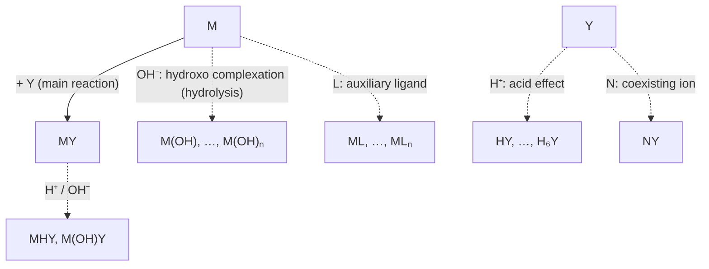

Complexometric titration rests on the reaction of metal ions with ligands to form stable complexes. It can determine almost every metal ion in the periodic table, and it is the routine method for the hardness of water, for metals in alloys and minerals, and for $\ce{Ca^2+}$, $\ce{Mg^2+}$, and $\ce{Zn^2+}$ in drugs and biological samples. Section [6.1.9](/6.1.9#sec-9.7) treated coordination equilibria and the **stability constant**, and [6.1.10](/6.1.10#sec-10.3) the qualitative effect of acid and complexation on solubility; but a real titration solution contains $\ce{H+}$, buffers, auxiliary ligands, and coexisting ions at the same time, and the stability constant alone cannot tell whether a titration will work. This chapter quantifies these influences with **side-reaction coefficients** and obtains **conditional stability constants**, which are constants only under the given conditions (3.2); from them it derives titration curves, the criterion for accurate titration, and the suitable acidity (3.3), and goes on to metallochromic indicators (3.4), selective titration of mixed ions (3.5), and the various modes of titration (3.6). The scheme "main reaction + side-reaction coefficients → conditional constant" is used for precipitation (the conditional solubility product) in [6.4.4](/6.4.4) and for redox reactions (the formal potential) in [6.4.5](/6.4.5); the treatment of the end-point error runs entirely parallel to the acid–base titration of [6.4.2](/6.4.2).

In the equilibrium-constant expressions of this chapter $[\mathrm{B}]$ is always a relative concentration, and the stability constants are the values at $25\,^\circ\mathrm{C}$ and ionic strength $I = 0.1\,\mathrm{mol\,L^{-1}}$ (the NIST critically selected stability constants database, Martell–Smith), since the ionic strength of a titration solution is usually about 0.1. For brevity the charges of the metal ion and of EDTA are often omitted, and we write M, Y, and MY.

## 3.1. EDTA and the Aminopolycarboxylic Acids

### 3.1.1. Requirements for Ligands in Complexometric Titration

**Definition 3.1.1 (Complexometric Titration)** A titrimetric method based on complexation reactions is called **complexometric titration**.

As in other titrimetric analyses, a complexometric titration requires that the reaction be quantitative and fast, have a definite stoichiometry, and have a suitable means of indicating the end point. Early complexometric titrations used inorganic ligands, for example the titration of $\ce{CN-}$ with $\ce{AgNO3}$ (the Liebig method): $\ce{Ag+ + 2CN- -> [Ag(CN)2]-}$, where a slight excess of $\ce{Ag+}$ after the stoichiometric point forms a white precipitate of $\ce{Ag[Ag(CN)2]}$ that marks the end point. Such examples are few, because most inorganic ligands are monodentate and coordinate to the metal ion step by step, with **stepwise stability constants** that differ little from one step to the next. For the $\ce{Cd^2+}$–$\ce{CN-}$ system, for example, $K_1, \dots, K_4$ are $3.5\times10^5$, $1.0\times10^5$, $5.0\times10^4$, and $3.5\times10^3$: the added ligand is distributed among several complex ions from $\ce{Cd(CN)+}$ to $\ce{[Cd(CN)4]^2-}$, no single step has a definite stoichiometric point, and the titration curve has no pronounced jump (compare polyprotic acids with similar $K_{\mathrm{a}}$, which cannot be titrated stepwise).

### 3.1.2. Aminopolycarboxylic Acids and EDTA

The solution is a polydentate ligand: one ligand molecule binds the metal ion through several donor atoms at once, forming a 1:1 **chelate** ([6.1.5](/6.1.5#sec-5.1.4)) in a single step, and because of the **chelate effect** the complex is very stable.

**Definition 3.1.2 (Aminopolycarboxylic Acids)** Organic ligands whose basic structure is the iminodiacetic acid group $\ce{-N(CH2COOH)2}$ and which have both amine nitrogen and carboxylate oxygen as donor atoms are called **aminopolycarboxylic acids** (complexones).

Amine nitrogen coordinates readily to transition metal ions, and carboxylate oxygen coordinates to almost all highly charged metal ions; having both, the aminopolycarboxylic acids form stable chelates with nearly all metal ions. The most important of them is ethylenediaminetetraacetic acid.

**Definition 3.1.3 (EDTA)** Ethylenediaminetetraacetic acid $\ce{(HOOCCH2)2NCH2CH2N(CH2COOH)2}$ is called **EDTA** and is denoted $\ce{H4Y}$; its anion $\ce{Y^4-}$ has six donor atoms, two amine nitrogens and four carboxylate oxygens.

```smiles
OC(=O)CN(CC(=O)O)CCN(CC(=O)O)CC(=O)O H4Y
OC(=O)CN(CC(=O)O)CCOCCOCCN(CC(=O)O)CC(=O)O EGTA
OCCN(CCO)CCO TEA
```

(EGTA is discussed in 3.5.3; triethanolamine, TEA, is a common masking agent and is discussed in 3.5.2.)

EDTA is a white powder of very low solubility in water (about $0.2\,\mathrm{g\,L^{-1}}$ at $22\,^\circ\mathrm{C}$), also insoluble in acids and common organic solvents, and it dissolves readily in ammonia and strong alkali, forming salts. In titrations its disodium salt $\ce{Na2H2Y*2H2O}$ (also often called EDTA) is used: its solubility is about $111\,\mathrm{g\,L^{-1}}$ (about $0.3\,\mathrm{mol\,L^{-1}}$), and the pH of its aqueous solution is about 4.5 ($\ce{H2Y^2-}$ is amphoteric, with $\mathrm{pH} \approx \frac12(\mathrm{p}K_{\mathrm{a}4} + \mathrm{p}K_{\mathrm{a}5}) = 4.4$).

### 3.1.3. Species of EDTA in Solution

In strongly acidic solution the two amine nitrogens of $\ce{H4Y}$ can accept further protons to give $\ce{H6Y^2+}$, so EDTA behaves as a hexaprotic acid with six dissociation steps ($25\,^\circ\mathrm{C}$, $I = 0.1$):

| Dissociation | $\ce{H6Y^2+ <=> H5Y+}$ | $\ce{H5Y+ <=> H4Y}$ | $\ce{H4Y <=> H3Y-}$ | $\ce{H3Y- <=> H2Y^2-}$ | $\ce{H2Y^2- <=> HY^3-}$ | $\ce{HY^3- <=> Y^4-}$ |
|---|---|---|---|---|---|---|
| $\mathrm{p}K_{\mathrm{a}}$ | 0.0 | 1.5 | 2.00 | 2.69 | 6.13 | 10.37 |

The first four steps are dissociation of carboxyl protons, and the last two are of the protonated amine nitrogens (large $\mathrm{p}K_{\mathrm{a}}$), as in the amino acids. The **distribution fractions** of the seven species are calculated by the method of [6.1.9](/6.1.9#sec-9.3.6) and depend only on pH:


The species that coordinates directly to metal ions is $\ce{Y^4-}$, which predominates only in basic solution; the stronger the acidity, the smaller the fraction of $\ce{Y^4-}$ and the weaker the complexing power of EDTA. This is the origin of the "acid effect" of the next section.

### 3.1.4. Characteristics of EDTA Complexes

1. Simple stoichiometry: EDTA generally forms 1:1 complexes with metal ions regardless of the charge of the ion ($\ce{Ca^2+ + Y^4- -> CaY^2-}$, $\ce{Fe^3+ + Y^4- -> FeY-}$), which makes calculation easy.
2. High stability: $\ce{Y^4-}$ wraps the metal ion with six donor atoms, forming five five-membered chelate rings (four $\ce{M-O-C-C-N}$ rings and one ethylenediamine ring), and for most metal ions $\lg K_{\mathrm{MY}} > 15$.
3. Fast reaction and water-soluble complexes: the complexes mostly carry a charge and dissolve well in water; complexation of most metal ions with EDTA is instantaneous at room temperature (inert ions such as $\ce{Al^3+}$ and $\ce{Cr^3+}$ are exceptions, see 3.6).
4. Color: the EDTA complexes of colorless metal ions are colorless, which helps in observing the end point with an indicator; the complexes of colored ions have deeper colors ($\ce{CuY^2-}$ deep blue, $\ce{NiY^2-}$ blue-green, $\ce{FeY-}$ yellow, $\ce{CrY-}$ deep violet), and the concentrations of these ions should not be too large in the titration.

The stability constant of the reaction $\mathrm{M} + \mathrm{Y} \ce{<=>} \mathrm{MY}$ of a metal ion with EDTA is written

$$
K_{\mathrm{MY}} = \frac{[\mathrm{MY}]}{[\mathrm{M}][\mathrm{Y}]}. \tag{3.1}
$$
It is the $\beta_1$ of [6.1.9](/6.1.9#sec-9.7.1); since there is only one step, there is no need to distinguish cumulative and stepwise constants. Values of $\lg K_{\mathrm{MY}}$ for common metal ions ($25\,^\circ\mathrm{C}$, $I = 0.1$):

| Ion | $\lg K_{\mathrm{MY}}$ | Ion | $\lg K_{\mathrm{MY}}$ | Ion | $\lg K_{\mathrm{MY}}$ |
|---|---|---|---|---|---|
| $\ce{Na+}$ | 1.86 | $\ce{Mn^2+}$ | 13.89 | $\ce{Ni^2+}$ | 18.4 |
| $\ce{Ag+}$ | 7.20 | $\ce{Fe^2+}$ | 14.30 | $\ce{Cu^2+}$ | 18.78 |
| $\ce{Ba^2+}$ | 7.88 | $\ce{Al^3+}$ | 16.4 | $\ce{Hg^2+}$ | 21.5 |
| $\ce{Mg^2+}$ | 8.79 | $\ce{Co^2+}$ | 16.45 | $\ce{Th^4+}$ | 23.2 |
| $\ce{Sr^2+}$ | 8.72 | $\ce{Zn^2+}$ | 16.50 | $\ce{Fe^3+}$ | 25.1 |
| $\ce{Ca^2+}$ | 10.65 | $\ce{Cd^2+}$ | 16.5 | $\ce{Bi^3+}$ | 27.8 |
| | | $\ce{Pb^2+}$ | 18.0 | | |

The general trend is that complexes of alkali metal ions are the least stable ($\lg K_{\mathrm{MY}} < 3$); alkaline-earth ions give 8–11; divalent transition metal ions, rare-earth ions, and $\ce{Al^3+}$ about 14–19; and trivalent and tetravalent ions and $\ce{Hg^2+}$ above 20. The complex of the higher oxidation state of the same element is more stable ($\ce{FeY-}$ 25.1, $\ce{FeY^2-}$ 14.3), which is used in the redox masking of 3.5.2. The order for divalent transition metal ions, $\ce{Mn} < \ce{Fe} < \ce{Co} < \ce{Ni} < \ce{Cu} > \ce{Zn}$, is the Irving–Williams series, which can be explained by crystal-field stabilization energies ([6.1.5](/6.1.5#sec-5.5.7)).

The $K_{\mathrm{MY}}$ in the table is the value in the absence of any side reaction; it reflects only the affinity of the metal ion for $\ce{Y^4-}$ itself and cannot by itself show how complete the reaction is under actual titration conditions.

## 3.2. Side-Reaction Coefficients and Conditional Stability Constants

### 3.2.1. Main Reaction and Side Reactions

**Definition 3.2.1** The reaction that is to be used or studied in a chemical system is called the **main reaction**; other reactions that occur simultaneously in the solution and affect the equilibrium concentrations of the reactants or products of the main reaction are collectively called **side reactions**.

In a system in which a metal ion M is titrated with EDTA the main reaction is $\mathrm{M} + \mathrm{Y} \ce{<=>} \mathrm{MY}$, and the side reactions fall into three classes:



Side reactions of the metal ion M (hydrolysis, and complexation with auxiliary ligands L such as buffers or masking agents) and of the titrant Y (protonation, complexation with coexisting ions N) all shift the main reaction to the left and are unfavorable to the titration. Side reactions of the product MY (formation of acid complexes MHY or basic complexes M(OH)Y when the acidity or basicity is high) shift the main reaction to the right, but these complexes are generally unstable and can usually be neglected.

The approach is not to follow every species but to regard all the forms of M that do not take part in the main reaction together as one entity M′, and all the forms of Y that do not take part as Y′, and then to describe by one coefficient what fraction of M′ is truly free M.

**Definition 3.2.2 (Side-Reaction Coefficient)** The ratio of the total concentration $[\mathrm{X}']$ of all forms in which a component X exists without taking part in the main reaction to the equilibrium concentration $[\mathrm{X}]$ of its free form,

$$
\alpha_{\mathrm{X}} = \frac{[\mathrm{X}']}{[\mathrm{X}]} \tag{3.2}
$$
is called the **side-reaction coefficient** of X.

Without side reactions $[\mathrm{X}'] = [\mathrm{X}]$ and $\alpha_{\mathrm{X}} = 1$; with side reactions $\alpha_{\mathrm{X}} > 1$, and the larger it is, the more serious the side reactions. Clearly $1/\alpha_{\mathrm{X}}$ is the fraction of free X in X′, a generalized **distribution fraction**.

### 3.2.2. Side-Reaction Coefficients of EDTA

**Definition 3.2.3 (Acid-Effect Coefficient)** The phenomenon in which the combination of $\ce{H+}$ with $\ce{Y^4-}$ lowers the ability of $\ce{Y^4-}$ to take part in the main reaction is called the acid effect of EDTA; its magnitude is measured by the **acid-effect coefficient**

$$
\alpha_{\mathrm{Y(H)}} = \frac{[\mathrm{Y}']}{[\mathrm{Y}]} = \frac{[\mathrm{Y}] + [\mathrm{HY}] + [\mathrm{H_2Y}] + \cdots + [\mathrm{H_6Y}]}{[\mathrm{Y}]} = \frac{1}{\delta_{\mathrm{Y}}} \tag{3.3}
$$
where $[\mathrm{Y}']$ is the total concentration of the seven species of EDTA that are not coordinated to M, and $\delta_{\mathrm{Y}}$ is the distribution fraction of $\ce{Y^4-}$.

(The "acid effect" here is the same phenomenon as the effect of acidity on the solubility of sparingly soluble salts of weak acids in [6.1.10](/6.1.10#sec-10.3.3): in both, the anion of a weak acid is protonated and its effective concentration falls.) Substituting the stepwise protonation constants,

$$
\alpha_{\mathrm{Y(H)}} = 1 + \frac{[\ce{H+}]}{K_{\mathrm{a}6}} + \frac{[\ce{H+}]^2}{K_{\mathrm{a}6}K_{\mathrm{a}5}} + \cdots + \frac{[\ce{H+}]^6}{K_{\mathrm{a}6}K_{\mathrm{a}5}\cdots K_{\mathrm{a}1}}.
$$
$\alpha_{\mathrm{Y(H)}}$ depends only on the dissociation constants of EDTA and the pH of the solution; the lower the pH, the larger it is. From the $\mathrm{p}K_{\mathrm{a}}$ above:

| pH | 1 | 2 | 3 | 4 | 5 | 6 | 7 | 8 | 9 | 10 | 11 | 12 |
|---|---|---|---|---|---|---|---|---|---|---|---|---|
| $\lg\alpha_{\mathrm{Y(H)}}$ | 17.85 | 13.59 | 10.69 | 8.52 | 6.53 | 4.74 | 3.43 | 2.38 | 1.39 | 0.52 | 0.09 | 0.01 |

At pH 5, $\alpha_{\mathrm{Y(H)}} \approx 10^{6.5}$: only one in more than three million uncoordinated EDTA molecules is present as $\ce{Y^4-}$. The tabulated values differ slightly between textbooks (for example, 6.45 or 6.6 at pH 5), owing to the different $\mathrm{p}K_{\mathrm{a}}$ and ionic strengths adopted; the same set of constants should be used throughout a calculation.

If the solution contains a coexisting ion N that can coordinate to EDTA, there is also the coexisting-ion effect:

$$
\alpha_{\mathrm{Y(N)}} = \frac{[\mathrm{Y}] + [\mathrm{NY}]}{[\mathrm{Y}]} = 1 + K_{\mathrm{NY}}[\mathrm{N}].
$$
When both side reactions are present, $[\mathrm{Y}'] = [\mathrm{Y}] + \sum_j[\mathrm{H}_j\mathrm{Y}] + [\mathrm{NY}]$, and dividing both sides by $[\mathrm{Y}]$ gives

$$
\alpha_{\mathrm{Y}} = \alpha_{\mathrm{Y(H)}} + \alpha_{\mathrm{Y(N)}} - 1. \tag{3.4}
$$
The 1 is subtracted because the free $[\mathrm{Y}]$ has been counted once in each coefficient. In practice the two often differ greatly, and the total coefficient is approximately equal to the larger one.

### 3.2.3. Side-Reaction Coefficients of Metal Ions

Side reactions of a metal ion are of two kinds: formation of hydroxo complexes with $\ce{OH-}$ (hydrolysis), and coordination to auxiliary ligands L such as buffers or masking agents (the **complexation effect**, [6.1.10](/6.1.10#sec-10.3.5)). From the definition of the **stability constants** $\beta_i$,

$$
\alpha_{\mathrm{M(L)}} = \frac{[\mathrm{M}] + [\mathrm{ML}] + \cdots + [\mathrm{ML}_n]}{[\mathrm{M}]} = 1 + \beta_1[\mathrm{L}] + \beta_2[\mathrm{L}]^2 + \cdots + \beta_n[\mathrm{L}]^n, \tag{3.5}
$$
and $\alpha_{\mathrm{M(OH)}}$ has the same form, with $[\mathrm{L}]$ replaced by $[\ce{OH-}]$ and $\beta_i$ by the cumulative stability constants of the hydroxo complexes. Note that the concentration in the equation is that of the free ligand: for example, in an $\ce{NH3}$–$\ce{NH4+}$ buffer, $[\ce{NH3}]$ must be obtained from the total concentration multiplied by the distribution fraction of $\ce{NH3}$.

When $n$ kinds of side reaction are present, by the same reasoning as for Eq. (3.4),

$$
\alpha_{\mathrm{M}} = \alpha_{\mathrm{M(L_1)}} + \alpha_{\mathrm{M(L_2)}} + \cdots + \alpha_{\mathrm{M(L}_n)} - (n - 1). \tag{3.6}
$$
Side-reaction coefficients combine additively, not multiplicatively, so their logarithms cannot be added: a common mistake is to subtract both $\lg\alpha_{\mathrm{M(NH_3)}}$ and $\lg\alpha_{\mathrm{M(OH)}}$ from $\lg K$.

### 3.2.4. Conditional Stability Constants

When side reactions are present, the equilibrium constant of the main reaction is rewritten in terms of total concentrations. From $[\mathrm{M}'] = \alpha_{\mathrm{M}}[\mathrm{M}]$, $[\mathrm{Y}'] = \alpha_{\mathrm{Y}}[\mathrm{Y}]$, and $[(\mathrm{MY})'] = \alpha_{\mathrm{MY}}[\mathrm{MY}]$,

$$
\frac{[(\mathrm{MY})']}{[\mathrm{M}'][\mathrm{Y}']} = K_{\mathrm{MY}}\frac{\alpha_{\mathrm{MY}}}{\alpha_{\mathrm{M}}\alpha_{\mathrm{Y}}}.
$$

**Definition 3.2.4 (Conditional Stability Constant)** Under given conditions (fixed pH and fixed concentrations of auxiliary ligands and coexisting ions), the stability constant expressed in terms of the total concentration $[\mathrm{M}']$ of metal ion not taking part in the main reaction, the total concentration $[\mathrm{Y}']$ of ligand, and the total concentration of complex,

$$
K'_{\mathrm{MY}} = \frac{[(\mathrm{MY})']}{[\mathrm{M}'][\mathrm{Y}']}, \qquad \lg K'_{\mathrm{MY}} = \lg K_{\mathrm{MY}} - \lg\alpha_{\mathrm{M}} - \lg\alpha_{\mathrm{Y}} + \lg\alpha_{\mathrm{MY}} \tag{3.7}
$$
is called the **conditional stability constant** (effective formation constant).

Usually the side reactions of MY are neglected ($\alpha_{\mathrm{MY}} = 1$), so that $\lg K'_{\mathrm{MY}} = \lg K_{\mathrm{MY}} - \lg\alpha_{\mathrm{M}} - \lg\alpha_{\mathrm{Y}}$, which is never larger than $\lg K_{\mathrm{MY}}$. $K_{\mathrm{MY}}$ depends only on the nature of the complex, the temperature, and the ionic strength, whereas $K'_{\mathrm{MY}}$ varies with the experimental conditions, and it is the basis for judging whether a titration is possible. The idea of the conditional stability constant agrees with what IUPAC calls a conditional constant: all known equilibria competing with the main reaction are absorbed into one apparent constant that is constant only under the given conditions, and thereafter the system is treated as if there were no side reactions.

**Example 3.2.1** Calculate $\lg K'_{\mathrm{ZnY}}$ at pH 2.0, 5.0, 9.0, and 11.0 (considering only the acid effect of EDTA and the hydrolysis of $\ce{Zn^2+}$). $\lg K_{\mathrm{ZnY}} = 16.50$, and for the hydroxo complexes of $\ce{Zn^2+}$ $\lg\beta_1, \dots, \lg\beta_4 = 4.4, 10.1, 14.2, 15.5$.

**Solution** Calculate $\lg\alpha_{\mathrm{Zn(OH)}}$ from Eq. (3.5) with $[\ce{OH-}]$, and substitute it into Eq. (3.7) together with $\lg\alpha_{\mathrm{Y(H)}}$ from the table above:

| pH | $\lg\alpha_{\mathrm{Y(H)}}$ | $\lg\alpha_{\mathrm{Zn(OH)}}$ | $\lg K'_{\mathrm{ZnY}}$ |
|---|---|---|---|
| 2.0 | 13.59 | 0 | 2.9 |
| 5.0 | 6.53 | 0 | 10.0 |
| 9.0 | 1.39 | 0.4 | 14.7 |
| 11.0 | 0.09 | 5.2 | 11.2 |

At pH 2 the conditional stability constant is only $10^{2.9}$ and the titration is impossible; at pH 5 it is already large enough. As the pH rises, the acid effect of EDTA weakens while the hydrolysis of $\ce{Zn^2+}$ gradually strengthens, so $K'_{\mathrm{ZnY}}$ first increases and then decreases, and is always smaller than $K_{\mathrm{ZnY}}$. Metal ions in general follow this pattern: there is an optimum range of pH.

**Example 3.2.2** $0.020\,\mathrm{mol\,L^{-1}}$ EDTA is used to titrate $\ce{Ca^2+}$ or $\ce{Zn^2+}$ of the same concentration (concentration at the stoichiometric point $c_{\mathrm{sp}} = 0.010\,\mathrm{mol\,L^{-1}}$). Decide whether accurate titration is possible (1) in an HAc–NaAc buffer of pH 5.0 ($[\ce{Ac-}] = 0.10\,\mathrm{mol\,L^{-1}}$) and (2) in an $\ce{NH3}$–$\ce{NH4Cl}$ buffer of pH 10.0 (free $[\ce{NH3}] = 0.10\,\mathrm{mol\,L^{-1}}$). The criterion for accurate titration is $\lg(c_{\mathrm{sp}}K') \ge 6$ (3.3.2). $\lg K_{\mathrm{CaY}} = 10.65$; for $\ce{Zn^2+}$–$\ce{NH3}$, $\lg\beta_1, \dots, \lg\beta_4 = 2.37, 4.81, 7.31, 9.46$.

**Solution** (1) At pH 5.0, $\lg\alpha_{\mathrm{Y(H)}} = 6.53$ and hydrolysis can be neglected. Acetate coordinates only weakly to $\ce{Ca^2+}$ and $\ce{Zn^2+}$, and from its stability constants $\lg\alpha_{\mathrm{Ca(Ac)}} \approx 0.1$ and $\lg\alpha_{\mathrm{Zn(Ac)}} \approx 0.5$.

$$
\lg K'_{\mathrm{CaY}} = 10.65 - 6.53 - 0.1 = 4.0, \qquad \lg K'_{\mathrm{ZnY}} = 16.50 - 6.53 - 0.5 = 9.5.
$$
$\lg(c_{\mathrm{sp}}K'_{\mathrm{CaY}}) = 2.0 < 6$, so $\ce{Ca^2+}$ cannot be titrated accurately; $\lg(c_{\mathrm{sp}}K'_{\mathrm{ZnY}}) = 7.5 > 6$, so $\ce{Zn^2+}$ can.

(2) At pH 10.0, $\lg\alpha_{\mathrm{Y(H)}} = 0.52$. $\ce{NH3}$ hardly coordinates to $\ce{Ca^2+}$, and $\ce{Ca^2+}$ does not hydrolyze: $\lg K'_{\mathrm{CaY}} = 10.65 - 0.52 = 10.1$ and $\lg(c_{\mathrm{sp}}K') = 8.1$. For $\ce{Zn^2+}$, by Eq. (3.5),

$$
\alpha_{\mathrm{Zn(NH_3)}} = 1 + 10^{2.37 - 1} + 10^{4.81 - 2} + 10^{7.31 - 3} + 10^{9.46 - 4} = 10^{5.49},
$$
the method of Example 3.2.1 gives $\alpha_{\mathrm{Zn(OH)}} = 10^{2.46}$, and by Eq. (3.6) $\alpha_{\mathrm{Zn}} = 10^{5.49} + 10^{2.46} - 1 \approx 10^{5.49}$ (complexation by ammonia far outweighs hydrolysis), so

$$
\lg K'_{\mathrm{ZnY}} = 16.50 - 0.52 - 5.49 = 10.5, \qquad \lg(c_{\mathrm{sp}}K'_{\mathrm{ZnY}}) = 8.5 > 6.
$$
Both ions can be titrated accurately at pH 10. Ammonia here plays two roles: it is the buffer that controls the pH, and it is also an auxiliary ligand that keeps $\ce{Zn^2+}$ from precipitating as $\ce{Zn(OH)2}$ in basic solution; the price is a lower $K'_{\mathrm{ZnY}}$, so the ammonia concentration should not be too high.


## 3.3. Titration Curves and the Condition for Accurate Titration

### 3.3.1. Titration Curves

In complexometric titration the quantity measured is the metal ion, whose concentration is very small near the stoichiometric point; corresponding to pH in acid–base titration, the **titration curve** is drawn as $\mathrm{pM}' = -\lg[\mathrm{M}']$ against the fraction titrated. Take the titration of a metal ion with EDTA of equal concentration ($c_{\mathrm{M}}$ is the **analytical concentration** of the metal ion at the stoichiometric point, denoted $c_{\mathrm{M,sp}}$):

1. Before the stoichiometric point: calculate from the remaining metal ion, $[\mathrm{M}'] \approx$ total remaining M / volume of solution.
2. At the stoichiometric point: $[\mathrm{M}'] = [\mathrm{Y}']$ and $[\mathrm{MY}] \approx c_{\mathrm{M,sp}}$; substituting in Eq. (3.7) gives $[\mathrm{M}']^2 = c_{\mathrm{M,sp}}/K'_{\mathrm{MY}}$, that is,

$$
\mathrm{pM}'_{\mathrm{sp}} = \frac{1}{2}\left(\lg K'_{\mathrm{MY}} + \mathrm{p}c_{\mathrm{M,sp}}\right). \tag{3.8}
$$
3. After the stoichiometric point: calculate from the excess EDTA, $[\mathrm{M}'] = [\mathrm{MY}]/(K'_{\mathrm{MY}}[\mathrm{Y}'])$; at 100% excess of EDTA, $[\mathrm{MY}] = [\mathrm{Y}']$ and $\mathrm{pM}' = \lg K'_{\mathrm{MY}}$.

These are approximate formulas; an exact calculation needs only the mass balances of M and Y together with Eq. (3.7), which gives a quadratic equation, and this is how the figure below was drawn.


Two factors affect the **titration jump**, entirely parallel to the titration of weak acids ($K'_{\mathrm{MY}}$ corresponds to $K_{\mathrm{a}}/K_{\mathrm{w}}$):

- Conditional stability constant: the larger $K'_{\mathrm{MY}}$, the higher the upper limit of the jump and the larger the jump. Every factor that increases a side-reaction coefficient (too high an acidity, an excess of auxiliary ligand, hydrolysis) reduces the jump.
- Concentration of the metal ion: the larger $c_{\mathrm{M}}$, the lower the lower limit of the jump and the larger the jump.

### 3.3.2. End-Point Error and the Criterion for Accurate Titration

The **titration error** (end-point error) $E_{\mathrm{t}}$ is the fraction of the analyte represented by the excess (or deficiency) of titrant at the end point. Let the difference between the pM′ at the end point and at the stoichiometric point be $\Delta\mathrm{pM}' = \mathrm{pM}'_{\mathrm{ep}} - \mathrm{pM}'_{\mathrm{sp}}$.

**Formula 3.3.1 (End-Point Error Formula for Complexometric Titration)**

$$
E_{\mathrm{t}} = \frac{[\mathrm{Y}']_{\mathrm{ep}} - [\mathrm{M}']_{\mathrm{ep}}}{c_{\mathrm{M,sp}}} = \frac{10^{\Delta\mathrm{pM}'} - 10^{-\Delta\mathrm{pM}'}}{\sqrt{c_{\mathrm{M,sp}}K'_{\mathrm{MY}}}}. \tag{3.9}
$$

**Proof** The end point is near the stoichiometric point, so $[\mathrm{MY}]_{\mathrm{ep}} \approx [\mathrm{MY}]_{\mathrm{sp}} \approx c_{\mathrm{M,sp}}$, and by Eq. (3.7) $[\mathrm{M}'][\mathrm{Y}']$ is approximately equal at the two points. At the stoichiometric point $[\mathrm{M}']_{\mathrm{sp}} = [\mathrm{Y}']_{\mathrm{sp}} = \sqrt{c_{\mathrm{M,sp}}/K'_{\mathrm{MY}}}$; at the end point $[\mathrm{M}']_{\mathrm{ep}} = [\mathrm{M}']_{\mathrm{sp}}10^{-\Delta\mathrm{pM}'}$, and hence $[\mathrm{Y}']_{\mathrm{ep}} = [\mathrm{Y}']_{\mathrm{sp}}10^{\Delta\mathrm{pM}'}$. Substitute into the first equality and divide by $c_{\mathrm{M,sp}}$. $\square$

This is the form, for complexometric titration, of the **end-point error formula** (Ringbom's formula) of Theorem 2.7.1, with $\Delta\mathrm{pH}$ replaced by $\Delta\mathrm{pM}'$ and the equilibrium constant of the titration reaction by $K'_{\mathrm{MY}}$. $\Delta\mathrm{pM}' > 0$ means that the end point is after the stoichiometric point (excess of EDTA), and the error is positive.

When the end point is located visually with an indicator, it generally differs from the stoichiometric point by at least $\pm 0.2$ pM unit (the uncertainty of the eye in judging a color change, and the imperfect coincidence of the indicator's transition point with the stoichiometric point). Taking $\Delta\mathrm{pM}' = \pm0.2$ and requiring $\lvert E_{\mathrm{t}}\rvert \le 0.1\%$, Eq. (3.9) gives $\sqrt{c_{\mathrm{M,sp}}K'_{\mathrm{MY}}} \ge (10^{0.2} - 10^{-0.2})/0.001 = 954$:

$$
\lg(c_{\mathrm{M,sp}}K'_{\mathrm{MY}}) \ge 6. \tag{3.10}
$$
This is the criterion for accurate titration of a single metal ion. If the permitted error is relaxed to $\pm0.3\%$, the criterion becomes $\lg(c_{\mathrm{M,sp}}K'_{\mathrm{MY}}) \ge 5$. For $c_{\mathrm{M,sp}} = 0.010\,\mathrm{mol\,L^{-1}}$, Eq. (3.10) requires $\lg K'_{\mathrm{MY}} \ge 8$.

Two kinds of error must be distinguished: the end-point error arises because the end point and the stoichiometric point do not coincide, has a definite size and sign for a given method and conditions, is a systematic error, and can be calculated by Eq. (3.9) and controlled; the observation error arises from the uncertainty of the eye in judging the color change (about $\pm0.2$–$0.5$ pM) and is a random error. Even if the transition point of the indicator coincided exactly with the stoichiometric point and the end-point error were zero, the observation error would remain; criterion (3.10) is set precisely so that the observation error too does not exceed the permitted range.

### 3.3.3. Choice of Acidity and the Acid-Effect Curve

When only the acid effect of EDTA is considered, $\lg K'_{\mathrm{MY}} = \lg K_{\mathrm{MY}} - \lg\alpha_{\mathrm{Y(H)}}$. For $c_{\mathrm{M,sp}} = 0.010\,\mathrm{mol\,L^{-1}}$, Eq. (3.10) requires

$$
\lg\alpha_{\mathrm{Y(H)}} \le \lg K_{\mathrm{MY}} - 8. \tag{3.11}
$$
For example, titration of $\ce{Zn^2+}$ requires $\lg\alpha_{\mathrm{Y(H)}} \le 16.50 - 8 = 8.5$, and from the table of $\lg\alpha_{\mathrm{Y(H)}}$ (or by solving) $\mathrm{pH} \ge 4.0$. The highest acidity (lowest pH) at which a metal ion can be titrated accurately is called the maximum permissible acidity for that ion.

**Definition 3.3.1 (Acid-Effect Curve)** The curve obtained by plotting $\lg\alpha_{\mathrm{Y(H)}}$ (or the corresponding $\lg K_{\mathrm{MY}}$ from Eq. (3.11)) against pH and marking on it the lowest pH permitted for the separate titration of each metal ion is called the **acid-effect curve** (Ringbom curve) of EDTA.


From the acid-effect curve one can read:

1. The lowest pH for each ion: about 0.6 for $\ce{Bi^3+}$, 1.2 for $\ce{Fe^3+}$, 3 for $\ce{Cu^2+}$ and $\ce{Pb^2+}$, 4 for $\ce{Zn^2+}$, 7.7 for $\ce{Ca^2+}$, and 9.7 for $\ce{Mg^2+}$. Ions with $\lg K_{\mathrm{MY}} < 8$ ($\ce{Ba^2+}$, $\ce{Ag+}$) cannot be titrated directly and accurately at any pH.
2. Which ions are titrated together (interfere) at a given pH: all ions whose lowest pH is below that pH react quantitatively with EDTA. At pH 5, for example, $\ce{Zn^2+}$, $\ce{Pb^2+}$, $\ce{Cu^2+}$, and $\ce{Fe^3+}$ are all titrated, whereas $\ce{Ca^2+}$ and $\ce{Mg^2+}$ do not interfere.
3. The possibility of separate titration by controlling the acidity (3.5.1).

The acidity must not be too low either: as the pH rises, metal ions hydrolyze, $\alpha_{\mathrm{M(OH)}}$ increases, and in severe cases hydroxides precipitate, affecting both the reaction rate and the stoichiometry. Without an auxiliary ligand the lowest permissible acidity (highest pH) can be estimated from the **solubility product** of the hydroxide, requiring that no precipitate form at the start of the titration. For $0.020\,\mathrm{mol\,L^{-1}}$ $\ce{Zn^2+}$, for example, with $K_{\mathrm{sp}}(\ce{Zn(OH)2}) = 3\times10^{-17}$, $[\ce{OH-}] \le \sqrt{3\times10^{-17}/0.020} = 3.9\times10^{-8}\,\mathrm{mol\,L^{-1}}$ and $\mathrm{pH} \le 6.6$. Without ammonia the suitable acidity range for $\ce{Zn^2+}$ is therefore pH 4.0–6.6, and in practice the titration is carried out in a hexamethylenetetramine buffer at pH 5–6; when the titration must be done at pH 10 (as when Eriochrome Black T indicates the end point), ammonia is added as an auxiliary ligand (Example 3.2.2).

Moreover, during the titration the coordination of EDTA to the metal ion releases protons ($\ce{M^2+ + H2Y^2- -> MY^2- + 2H+}$), which lowers the pH of the solution gradually, so complexometric titrations are generally carried out with a **buffer solution** to control the pH. Taken together, the suitable range of acidity is determined by four factors: the highest acidity (acid effect of EDTA), the lowest acidity (hydrolysis of the metal ion), the pH range in which the indicator works (3.4), and interference by coexisting ions (3.5).

## 3.4. Metallochromic Indicators

### 3.4.1. Principle of the Color Change

**Definition 3.4.1 (Metallochromic Indicator)** An organic ligand (mostly an organic dye) that forms a colored complex with the metal ion, the color of the complex being clearly different from that of the free indicator, and that thereby indicates the end point of a complexometric titration through the change in the concentration of free metal ion, is called a **metallochromic indicator** (metal ion indicator).

An **acid–base indicator** signals the end point through the change of $[\ce{H+}]$, whereas a metallochromic indicator does so through the change of $[\mathrm{M}]$. Take the titration of $\ce{Mg^2+}$ at pH 10 with Eriochrome Black T (EBT): before the titration a little indicator is added, forming wine-red MgIn with a little $\ce{Mg^2+}$ so that the solution is red; the EDTA added reacts first with free $\ce{Mg^2+}$; near the stoichiometric point the free $\ce{Mg^2+}$ is used up, and a slight excess of EDTA takes $\ce{Mg^2+}$ from MgIn, releasing the blue free indicator:

$$
\underset{\text{wine red}}{\ce{MgIn-}} + \ce{HY^3-} \ce{->} \ce{MgY^2-} + \underset{\text{blue}}{\ce{HIn^2-}}.
$$
The color change is in essence the displacement of the metal ion in the indicator complex by EDTA. Let the conditional stability constant of the complex of indicator and metal ion be $K'_{\mathrm{MIn}} = K_{\mathrm{MIn}}/\alpha_{\mathrm{In(H)}}$ (considering only the acid effect of the indicator); then when $[\mathrm{MIn}] = [\mathrm{In}']$,

$$
\mathrm{pM}_{\mathrm{t}} = \lg K'_{\mathrm{MIn}}, \tag{3.12}
$$
which is called the transition point of the indicator; it corresponds to $\mathrm{pH} = \mathrm{p}K_{\mathrm{a}}$ of an acid–base indicator, and the transition range is about $\mathrm{pM}_{\mathrm{t}} \pm 1$. A metallochromic indicator is itself a polyprotic weak acid, and $K'_{\mathrm{MIn}}$ varies with pH, so the transition point depends on pH; in choosing an indicator one requires $\mathrm{pM}_{\mathrm{t}}$ to fall within the titration jump and as close as possible to $\mathrm{pM}'_{\mathrm{sp}}$.

**Example 3.4.1** $0.020\,\mathrm{mol\,L^{-1}}$ EDTA is used at pH 10.0 to titrate $\ce{Mg^2+}$ of the same concentration with Eriochrome Black T as indicator; calculate the end-point error. For Eriochrome Black T, $\mathrm{p}K_{\mathrm{a}2} = 6.3$, $\mathrm{p}K_{\mathrm{a}3} = 11.6$, and $\lg K_{\mathrm{MgIn}} = 7.0$.

**Solution** The acid-effect coefficient of Eriochrome Black T at pH 10 is $\alpha_{\mathrm{In(H)}} = 1 + 10^{11.6 - 10} + 10^{11.6 + 6.3 - 20} = 10^{1.61}$, and the transition point is $\mathrm{pMg}_{\mathrm{t}} = 7.0 - 1.61 = 5.39$, which is $\mathrm{pMg}_{\mathrm{ep}}$. On the other hand $\lg K'_{\mathrm{MgY}} = 8.79 - 0.52 = 8.27$, and by Eq. (3.8) $\mathrm{pMg}_{\mathrm{sp}} = \frac12(8.27 + 2.00) = 5.13$. Then $\Delta\mathrm{pMg} = +0.26$, and by Eq. (3.9)

$$
E_{\mathrm{t}} = \frac{10^{0.26} - 10^{-0.26}}{\sqrt{10^{-2.00} \times 10^{8.27}}} = \frac{1.27}{10^{3.13}} = +0.09\%.
$$
The end point lies slightly after the stoichiometric point, with an error within 0.1%.

### 3.4.2. Requirements for a Metallochromic Indicator

1. In the pH range of the titration, the free indicator and its metal complex differ clearly in color.
2. The stability of the indicator complex is suitable: it must be stable enough for the color change to be sharp and for the indicator not to be released prematurely before the stoichiometric point (an early end point), yet much less stable than MY (generally $\lg K'_{\mathrm{MY}} - \lg K'_{\mathrm{MIn}} \ge 2$), so that EDTA can displace it near the stoichiometric point.
3. The color reaction is sensitive and rapid and reversible; the indicator complex is water-soluble.
4. The indicator is fairly stable and can be stored. Metallochromic indicators are mostly azo dyes with several double bonds, easily oxidized or polymerized, and their aqueous solutions should not be kept long; they are often prepared as solid mixtures (ground 1:100 with NaCl) or with added stabilizers.

**Definition 3.4.2 (Blocking of an Indicator)** The phenomenon in which an indicator forms an extremely stable complex with certain metal ions (or the complex dissociates extremely slowly), so that even the excess of EDTA after the stoichiometric point cannot displace the indicator and no color change is seen, is called **blocking of an indicator**.

For example, Eriochrome Black T is blocked by $\ce{Fe^3+}$, $\ce{Al^3+}$, $\ce{Cu^2+}$, $\ce{Co^2+}$, and $\ce{Ni^2+}$. The remedy is to add a masking agent to mask these ions (triethanolamine for $\ce{Fe^3+}$ and $\ce{Al^3+}$, KCN or $\ce{Na2S}$ for $\ce{Cu^2+}$, $\ce{Co^2+}$, and $\ce{Ni^2+}$), or to separate them first when present in large amount; when the ion being determined itself blocks the indicator (for example, $\ce{Al^3+}$ with xylenol orange), back titration is used instead (3.6). The distilled water used in complexometric titration must be freed of traces of heavy metal ions.

**Definition 3.4.3 (Ossification of an Indicator)** The phenomenon in which an indicator or its metal complex has low solubility in water or forms a colloid, so that the displacement of the indicator complex by EDTA is slow and the end point is drawn out, is called **indicator ossification**.

PAN and its metal complexes, for example, are poorly soluble in water and prone to ossification. The remedy is to add a little organic solvent such as ethanol to increase the solubility, or to warm moderately to speed up the displacement, and to titrate slowly with vigorous shaking near the end point.

### 3.4.3. Common Metallochromic Indicators

```smiles
Oc1ccc2ccccc2c1N=Nc1c(O)cc(S(=O)(=O)O)c2cc([N+](=O)[O-])ccc12 EBT
OC(=O)c1cc2ccccc2c(N=Nc2c(O)cc(S(=O)(=O)O)c3ccccc23)c1O NN
Oc1ccc2ccccc2c1N=Nc1ccccn1 PAN
```

| Indicator | Working pH | Color change (MIn → In) | Ions titrated directly | Remarks |
|---|---|---|---|---|
| Eriochrome Black T (EBT) | 8–11 (10 commonly) | Wine red → blue | $\ce{Mg^2+}$, $\ce{Zn^2+}$, $\ce{Cd^2+}$, $\ce{Pb^2+}$, total Ca + Mg | Blocked by $\ce{Fe^3+}$, $\ce{Al^3+}$, $\ce{Cu^2+}$, $\ce{Ni^2+}$; color change not sharp for $\ce{Ca^2+}$ alone |
| Calconcarboxylic acid (NN) | 12–13 | Wine red → blue | $\ce{Ca^2+}$ ($\ce{Mg^2+}$ already precipitated as $\ce{Mg(OH)2}$) | As above |
| Xylenol orange (XO) | < 6.3 | Violet-red → bright yellow | pH 1–2: $\ce{Bi^3+}$; pH 5–6: $\ce{Zn^2+}$, $\ce{Pb^2+}$, $\ce{Cd^2+}$, rare earths | Blocked by $\ce{Fe^3+}$, $\ce{Al^3+}$, $\ce{Ni^2+}$ |
| PAN | 2–12 | Red → yellow | $\ce{Cu^2+}$, $\ce{Ni^2+}$, $\ce{Zn^2+}$, etc. | Prone to ossification; add ethanol or heat |
| Sulfosalicylic acid (SSal) | 1.5–2.5 | Violet-red → bright yellow (the color of $\ce{FeY-}$) | $\ce{Fe^3+}$ | Colorless itself |

Eriochrome Black T is a triprotic acid: $\ce{H2In-}$ ($\mathrm{pH} < 6.3$) is red, $\ce{HIn^2-}$ (6.3–11.6) is blue, and $\ce{In^3-}$ ($> 11.6$) is orange, whereas its metal complexes are wine red. Only between pH about 8 and 11 do the free indicator (blue) and the complex (red) differ clearly in color, so the working range is pH 8–11, and in practice it is mostly used in an ammoniacal buffer at pH 10. The complex of Eriochrome Black T with $\ce{Ca^2+}$ is not stable enough ($\lg K_{\mathrm{CaIn}} \approx 5.4$, smaller than 7.0 for $\mathrm{MgIn}$), and in the titration of $\ce{Ca^2+}$ alone the end point is early and the color change not sharp. One remedy is to add a little MgY to the solution: $\ce{MgY + Ca^2+ -> CaY + Mg^2+}$; the displaced $\ce{Mg^2+}$ gives the red color with Eriochrome Black T, and at the end point EDTA takes the $\ce{Mg^2+}$ from MgIn, so the color change is sharp; the MgY added equals in amount of substance the $\ce{Mg^2+}$ displaced and does not affect the result.

The Cu–PAN indicator is a mixture of CuY and a little PAN and can be used over the wide range pH 2–12. It is added to the solution before titration; the ion M being determined displaces $\ce{Cu^2+}$ ($\ce{CuY + M -> MY + Cu}$), and $\ce{Cu^2+}$ gives a violet-red color with PAN; at the end point EDTA takes $\ce{Cu^2+}$ from Cu–PAN, and the solution turns green, the mixed color of CuY (blue) and PAN (yellow). It suits ions that have no suitable indicator of their own.

## 3.5. Selective Titration of Mixed Ions

Real samples often contain several metal ions together, and EDTA coordinates to almost all metal ions, so its selectivity is poor. There are three ways of improving selectivity: controlling the acidity, masking, and using other ligands. The idea is that if $K_{\mathrm{MY}} \gg K_{\mathrm{NY}}$, the ions are titrated stepwise by controlling the acidity; if the two differ little, or $K_{\mathrm{MY}} < K_{\mathrm{NY}}$, the interfering ion is masked or another titrant is chosen.

### 3.5.1. Separate Titration by Controlling the Acidity

Let the solution contain two ions M and N, with $K_{\mathrm{MY}} > K_{\mathrm{NY}}$. In the titration of M, N is a coexisting ion of EDTA, and $\alpha_{\mathrm{Y}} = \alpha_{\mathrm{Y(H)}} + \alpha_{\mathrm{Y(N)}} - 1$. If the acidity is controlled so that $\alpha_{\mathrm{Y(N)}} \gg \alpha_{\mathrm{Y(H)}}$ (the acid effect can be neglected and the interference comes only from N), then near the stoichiometric point for M, $[\mathrm{N}] \approx c_{\mathrm{N,sp}}$ and

$$
K'_{\mathrm{MY}} \approx \frac{K_{\mathrm{MY}}}{\alpha_{\mathrm{Y(N)}}} \approx \frac{K_{\mathrm{MY}}}{K_{\mathrm{NY}}c_{\mathrm{N,sp}}}, \qquad \lg(c_{\mathrm{M,sp}}K'_{\mathrm{MY}}) = \lg(c_{\mathrm{M,sp}}K_{\mathrm{MY}}) - \lg(c_{\mathrm{N,sp}}K_{\mathrm{NY}}) \equiv \Delta\lg(cK).
$$
Substituting in criterion (3.10) gives the condition for accurate titration of M in the presence of N:

$$
\Delta\lg(cK) \ge 6 \quad (\Delta\mathrm{pM} = \pm0.2,\ \lvert E_{\mathrm{t}}\rvert \le 0.1\%). \tag{3.13}
$$
For a permitted error of $\pm0.3\%$ the condition is $\Delta\lg(cK) \ge 5$. For two ions of equal concentration this is $\Delta\lg K \ge 6$ (or 5). Once this condition is met, the pH range for the titration of M is determined as for a single ion: the lower limit is the lowest pH of M (acid-effect curve), and the upper limit is the pH at which N begins to be titrated ($\alpha_{\mathrm{Y(H)}}$ falls to a value comparable with $\alpha_{\mathrm{Y(N)}}$) or at which M begins to hydrolyze; the range must also be compatible with the working range of the indicator.

**Example 3.5.1** The solution contains $\ce{Bi^3+}$ and $\ce{Pb^2+}$, each at $0.020\,\mathrm{mol\,L^{-1}}$. Can they be titrated separately with EDTA?

**Solution** $\Delta\lg K = 27.8 - 18.0 = 9.8 > 6$, so $\ce{Bi^3+}$ can be titrated in the presence of $\ce{Pb^2+}$. From the acid-effect curve the lowest pH for the titration of $\ce{Bi^3+}$ is about 0.6, while above pH about 2 $\ce{Bi^3+}$ begins to hydrolyze and deposit a basic salt. $\ce{Bi^3+}$ is therefore titrated at pH ≈ 1 with xylenol orange as indicator (at which $\ce{Pb^2+}$ gives no color with xylenol orange and hardly reacts with EDTA); hexamethylenetetramine is then added to adjust to pH 5–6 and the titration is continued for $\ce{Pb^2+}$. One portion of the solution thus gives both ions in succession.

**Example 3.5.2** Determine $\ce{Fe^3+}$ and $\ce{Al^3+}$ (both at about $0.01\,\mathrm{mol\,L^{-1}}$).

**Solution** $\Delta\lg K = 25.1 - 16.4 = 8.7 > 6$, so $\ce{Al^3+}$ does not interfere with the titration of $\ce{Fe^3+}$. The lowest pH for $\ce{Fe^3+}$ is about 1.2, and a slightly higher pH causes strong hydrolysis; in practice the titration is done at pH 1.5–2.2 with sulfosalicylic acid as indicator, heating to $60$–$70\,^\circ\mathrm{C}$, and the end point changes from violet-red to bright yellow; at this pH $\ce{Al^3+}$, $\ce{Ca^2+}$, and $\ce{Mg^2+}$ do not interfere. $\ce{Al^3+}$ reacts slowly with EDTA and cannot be titrated directly: in the solution after the titration of $\ce{Fe^3+}$ the pH is adjusted to 3, an excess of EDTA is added and the solution boiled so that $\ce{Al^3+}$ is completely complexed, the pH is then adjusted to 4–6 with hexamethylenetetramine, and the excess EDTA is determined by **back titration** with a standard $\ce{Cu^2+}$ solution using PAN as indicator.

### 3.5.2. Masking and Demasking

When $\Delta\lg(cK) < 5$, separate titration by controlling the acidity is impossible, and the free concentration of the interfering ion must be reduced in some other way.

**Definition 3.5.1 (Masking)** The method in which a reagent is added to convert an interfering ion into a form that does not react with the titrant (or reacts negligibly), thereby eliminating its interference without separation, is called **masking**, and the reagent added is called the masking agent.

The effect of masking can be measured directly by side-reaction coefficients: a masking agent L lowers the free concentration of the interfering ion N to $[\mathrm{N}] = c_{\mathrm{N}}/\alpha_{\mathrm{N(L)}}$, so that $\alpha_{\mathrm{Y(N)}}$ decreases and $K'_{\mathrm{MY}}$ increases. According to the type of reaction used, masking is of three kinds:

1. Complexation masking (the most common): the interfering ion forms a stable complex with the masking agent. For example, in the determination of $\ce{Ca^2+}$ and $\ce{Mg^2+}$ in water with EDTA, triethanolamine is added to mask $\ce{Fe^3+}$ and $\ce{Al^3+}$; when $\ce{Al^3+}$ and $\ce{Zn^2+}$ coexist ($\lg K$ of 16.4 and 16.50, almost equal), $\ce{NH4F}$ is added so that $\ce{Al^3+ + 6F- -> [AlF6]^3-}$, and $\ce{Zn^2+}$ is titrated at pH 5–6 with xylenol orange as indicator. A complexation masking agent should satisfy the following: its complex with the interfering ion should be far more stable than the EDTA complex of that ion, and be colorless or pale; it should not coordinate to the ion being determined, or its complex should be far less stable than the EDTA complex of that ion (so that EDTA can displace it in the titration); and the pH range in which it is used should agree with that required by the titration. In the determination of total Ca and Mg (pH 10), for example, fluoride cannot be used to mask $\ce{Al^3+}$, since $\ce{F-}$ precipitates $\ce{Ca^2+}$ as $\ce{CaF2}$.
2. Precipitation masking: the interfering ion forms a precipitate with the masking agent. For example, when $\ce{Ca^2+}$ and $\ce{Mg^2+}$ coexist, NaOH is added to make $\mathrm{pH} > 12$, $\ce{Mg^2+}$ precipitates as $\ce{Mg(OH)2}$, and $\ce{Ca^2+}$ is titrated with EDTA using calconcarboxylic acid as indicator. Precipitation masking requires a precipitate of low solubility that is colorless or pale and a dense crystalline precipitate, otherwise the precipitate adsorbs the ion being determined or the indicator and impairs observation of the end point; it is therefore less widely used than complexation masking.
3. Redox masking: the oxidation state of the interfering ion is changed. For example, in the titration of $\ce{Bi^3+}$, $\ce{Zr^4+}$, and $\ce{Th^4+}$ with EDTA, ascorbic acid or hydroxylamine hydrochloride is added to reduce $\ce{Fe^3+}$ ($\lg K_{\mathrm{FeY^-}} = 25.1$) to $\ce{Fe^2+}$ ($\lg K_{\mathrm{FeY^{2-}}} = 14.3$), and the interference disappears. Conversely, for some ions the complex of the higher oxidation state is less stable than that of the lower, and interference can be eliminated by oxidizing $\ce{Cr^3+}$ to $\ce{Cr2O7^2-}$ and $\ce{VO^2+}$ to $\ce{VO3-}$ beforehand.

In using masking agents the properties of the agent and the conditions of its addition must also be observed. KCN is highly toxic and must be used only in basic solution; added to an acidic solution it releases highly toxic HCN; cyanide-containing waste liquid is treated with a solution of $\ce{FeSO4}$ containing $\ce{Na2CO3}$, converting $\ce{CN-}$ into the stable $\ce{[Fe(CN)6]^4-}$. Triethanolamine must be added in acidic solution, and the solution made basic afterwards: if the solution is already basic, $\ce{Fe^3+}$ has already formed the hydroxide and is hard to mask. The amount of masking agent should be a slight excess, but not too large, or the ion being determined may also be partly masked.

**Definition 3.5.2 (Demasking)** The action in which, after some ions have been masked and another ion titrated, a suitable reagent is added to destroy the complex of the masked ion with the masking agent so that the ion is released again and can be titrated in turn is called **demasking**, and the reagent used is the demasking agent.

**Example 3.5.3** Determine $\ce{Zn^2+}$ and $\ce{Pb^2+}$ in a copper alloy. For $\ce{Zn^2+}$ and $\ce{Pb^2+}$, $\Delta\lg K = 18.0 - 16.50 = 1.5$, so they cannot be titrated separately by controlling the acidity; and $\ce{Cu^2+}$ would also be titrated.

**Solution** The solution is neutralized with ammonia, and KCN is added to the ammoniacal solution (tartrate prevents the hydrolysis of $\ce{Pb^2+}$); $\ce{Cu^2+}$ is reduced and forms $\ce{[Cu(CN)3]^2-}$, $\ce{Zn^2+}$ forms $\ce{[Zn(CN)4]^2-}$, and $\ce{Pb^2+}$ is not masked. $\ce{Pb^2+}$ is titrated with EDTA at pH 10 with Eriochrome Black T as indicator. Formaldehyde (or chloral) is then added to demask $\ce{Zn^2+}$:

$$
\ce{[Zn(CN)4]^2- + 4HCHO + 4H2O -> Zn^2+ + 4HOCH2CN + 4OH-},
$$
formaldehyde adds to $\ce{CN-}$ to give hydroxyacetonitrile, and the $\ce{Zn^2+}$ released is titrated with EDTA. $\ce{[Cu(CN)3]^2-}$ is rather stable and is not readily demasked by aldehydes; but formaldehyde should be added in small portions, since with too much, or at a higher temperature, $\ce{[Cu(CN)3]^2-}$ also decomposes in part and the result for zinc is too high.

### 3.5.3. Other Ligands

The complexes of other aminopolycarboxylic acids with metal ions have their own characteristic stabilities and can make up for the limited selectivity of EDTA.

- EGTA (ethylene glycol bis(2-aminoethyl ether)tetraacetic acid; for the structure see 3.1.2): between the two amino groups there is a long chain with two ether oxygens, whose cavity suits the larger $\ce{Ca^2+}$ but not $\ce{Mg^2+}$. $\lg K_{\mathrm{CaY}}$ is about 11.0 whereas $\lg K_{\mathrm{MgY}}$ is only about 5.2 (EDTA differs by only 1.9), so $\ce{Ca^2+}$ can be titrated directly in the presence of $\ce{Mg^2+}$.
- CyDTA (1,2-cyclohexanediaminetetraacetic acid): its complexes are more stable than those of EDTA, and it can be used to titrate $\ce{Al^3+}$ and others, but the reactions are slower.
- EDTP (ethylenediaminetetrapropionic acid): its complex with $\ce{Cu^2+}$ is much more stable than those with $\ce{Zn^2+}$, $\ce{Cd^2+}$, $\ce{Mn^2+}$, and $\ce{Mg^2+}$, and $\ce{Cu^2+}$ can be titrated directly in the presence of these ions.
- Triethylenetetramine (trien): a polyamine ligand that forms stable complexes only with the nitrogen-seeking $\ce{Cu^2+}$, $\ce{Ni^2+}$, $\ce{Zn^2+}$, $\ce{Cd^2+}$, and $\ce{Hg^2+}$, and not with the alkaline-earth metals.

The selectivity of EGTA for $\ce{Ca^2+}$ is of particular importance in biology: the intracellular concentration of $\ce{Mg^2+}$ is of the order of millimoles per liter, whereas free $\ce{Ca^2+}$ is only about $100\,\mathrm{nmol\,L^{-1}}$ and is an important second messenger. EGTA can selectively chelate $\ce{Ca^2+}$ in the presence of a large amount of $\ce{Mg^2+}$ and is therefore widely used to remove or control $\ce{Ca^2+}$ in experimental systems; mixing EGTA and CaEGTA in suitable proportions gives a "calcium buffer"—on the same principle as a pH buffer, $\mathrm{pCa} = \lg K'_{\mathrm{CaY}} + \lg([\mathrm{CaY}]/[\mathrm{Y}'])$—which is used to prepare solutions of known free $\ce{Ca^2+}$ concentration and to calibrate calcium measurements. The two amino groups of EGTA have high $\mathrm{p}K_{\mathrm{a}}$ (about 8.8 and 9.4), so the acid effect is strong in neutral solution and its conditional constant is very sensitive to pH; Tsien (1980) replaced the amino groups with aromatic amines and designed BAPTA, whose $\mathrm{p}K_{\mathrm{a}}$ fall below 6, so that at physiological pH it is almost free of the acid effect, and binding and release are much faster. Attaching fluorophores to the BAPTA skeleton gives fluorescent calcium indicators such as fura-2 and Fluo-4 ([6.4.10](/6.4.10#sec-10.4.4)), which turn a coordination equilibrium into a tool for observing intracellular calcium signals.

## 3.6. Modes of Titration and Applications

### 3.6.1. Direct Titration and the Hardness of Water

When the reaction of the ion with EDTA meets the requirement for accurate titration, is rapid, and has a suitable indicator, it is titrated directly with a **standard solution** of EDTA; this mode is simple and introduces few errors, and should be adopted whenever possible.

**Definition 3.6.1 (Water Hardness)** The total concentration of $\ce{Ca^2+}$ and $\ce{Mg^2+}$ in water is called the **water hardness** (total hardness); the parts contributed separately by $\ce{Ca^2+}$ and $\ce{Mg^2+}$ are called the calcium hardness and the magnesium hardness.

Hardness can be expressed directly in $\mathrm{mmol\,L^{-1}}$ and is often converted into a mass concentration of $\ce{CaCO3}$ ($\mathrm{mg\,L^{-1}}$; 1 mmol L⁻¹ corresponds to 100.09 mg L⁻¹ of $\ce{CaCO3}$); the German degree (°dH) takes 10 mg of CaO per liter as 1 degree. The Chinese standard for drinking water specifies a total hardness (as $\ce{CaCO3}$) of not more than $450\,\mathrm{mg\,L^{-1}}$. The methods of determination are:

1. Total hardness: to a water sample triethanolamine is added to mask $\ce{Fe^3+}$ and $\ce{Al^3+}$ (and, if necessary, $\ce{Na2S}$ to mask $\ce{Cu^2+}$ and other heavy metals), the pH is adjusted to 10 with an $\ce{NH3}$–$\ce{NH4Cl}$ buffer, and the sample is titrated with EDTA using Eriochrome Black T as indicator until the color changes from wine red to pure blue. The stabilities of $\ce{CaY}$ and $\ce{MgY}$ differ little, and what is determined is their sum.
2. Calcium hardness: to another portion of the sample NaOH is added to pH 12–13, $\ce{Mg^2+}$ precipitates as $\ce{Mg(OH)2}$, and $\ce{Ca^2+}$ is titrated with EDTA using calconcarboxylic acid as indicator.
3. Magnesium hardness = total hardness − calcium hardness.

The same methods are used to determine calcium and magnesium in serum, urine, and dairy products, and the contents of drugs such as calcium gluconate and magnesium sulfate.

### 3.6.2. Back, Displacement, and Indirect Titration

Direct titration is unsuitable in the following cases: the ion reacts very slowly with EDTA and hydrolyzes readily or blocks the indicator ($\ce{Al^3+}$, $\ce{Cr^3+}$); the ion reacts quantitatively with EDTA but no indicator with a sharp color change is available ($\ce{Ba^2+}$, $\ce{Sr^2+}$); or the ion does not coordinate to EDTA or the complex is unstable ($\ce{SO4^2-}$, $\ce{PO4^3-}$, $\ce{Na+}$, $\ce{Ag+}$). The other modes of titration of Definition 2.1.2 are then used.

- **Back titration**: a known excess of standard EDTA is added so that the ion is completely complexed, and the remaining EDTA is titrated with a standard solution of another metal ion. For $\ce{Al^3+}$, for example, an excess of EDTA is added at pH 3.5 and boiled, the pH is adjusted to 5–6, and the excess is back-titrated with standard $\ce{Zn^2+}$ using xylenol orange as indicator; for $\ce{Ba^2+}$, an excess of EDTA is added and the excess is back-titrated at pH 10 with standard $\ce{Mg^2+}$ using Eriochrome Black T. The complex of the back-titrant with EDTA must be stable enough but not more stable than the complex of the ion being determined, or the latter would be displaced.
- **Displacement titration**: a displacement reaction produces an equivalent amount of another titratable substance. In one kind, EDTA is displaced: to determine $\ce{Al^3+}$ in the presence of $\ce{Cu^2+}$ and $\ce{Zn^2+}$, an excess of EDTA is added and heated so that all three are complexed, the excess EDTA is back-titrated at pH 5–6 with standard $\ce{Cu^2+}$ using PAN as indicator, and $\ce{NH4F}$ is then added so that only $\ce{AlY-}$ is destroyed by $\ce{F-}$: $\ce{AlY- + 6F- -> [AlF6]^3- + Y^4-}$; the EDTA displaced equals $\ce{Al^3+}$ in amount of substance and is titrated with standard $\ce{Cu^2+}$, with very high selectivity. In the other kind, a metal ion is displaced; for example, $\lg K_{\mathrm{AgY}} = 7.2$, so $\ce{Ag+}$ cannot be titrated directly with EDTA, and an excess of $\ce{[Ni(CN)4]^2-}$ is added to the test solution:

$$
\ce{2Ag+ + [Ni(CN)4]^2- -> 2[Ag(CN)2]- + Ni^2+},
$$
the equilibrium constant of the reaction is $K = \beta_2^2(\ce{[Ag(CN)2]-})/\beta_4(\ce{[Ni(CN)4]^2-}) = 10^{2\times21.1 - 31.3} = 10^{10.9}$, so the reaction is very complete; the $\ce{Ni^2+}$ displaced is titrated with EDTA at pH 10 using murexide as indicator, and $n(\ce{Ag+}) = 2n(\ce{Ni^2+})$. This method is used for the determination of silver in silver coins.
- **Indirect titration**: when the analyte does not coordinate to EDTA, an excess of a metal ion that reacts quantitatively with EDTA is added to precipitate the analyte, and either the remaining metal ion is titrated, or the precipitate is separated, dissolved, and the metal ion in it is titrated. To determine $\ce{PO4^3-}$, for example, a measured excess of $\ce{Bi(NO3)3}$ is added to form a precipitate of $\ce{BiPO4}$, and the remaining $\ce{Bi^3+}$ is titrated with EDTA; to determine $\ce{Na+}$, it is precipitated with zinc uranyl acetate as $\ce{NaZn(UO2)3(Ac)9*6H2O}$, which is separated, washed, and dissolved, and the zinc in it is titrated with EDTA. Indirect titration is laborious and its errors are larger.

### 3.6.3. EDTA Standard Solutions

EDTA standard solutions are usually prepared from $\ce{Na2H2Y*2H2O}$ at an approximate concentration ($0.01$–$0.05\,\mathrm{mol\,L^{-1}}$) and then standardized. The commonly used **primary standards** are pure zinc (dissolved in HCl and titrated at pH 5–6 with xylenol orange, or at pH 10 with Eriochrome Black T, as indicator) and $\ce{CaCO3}$ (dissolved in HCl and titrated at pH 12–13 with calconcarboxylic acid as indicator). The conditions of standardization should agree as closely as possible with those of the determination (the same pH, indicator, and medium), so that the systematic error due to the indicator cancels between standardization and determination. EDTA solutions should be stored in polyethylene bottles: in glass bottles, long storage leaches $\ce{Ca^2+}$ and $\ce{Mg^2+}$ from the glass and lowers the concentration.

### 3.6.4. EDTA in Biology and Medicine

The strong complexation of metal ions by EDTA has many uses in biology and medicine, and the principle in each is the conditional stability constant of this chapter:

- Anticoagulant: several steps in the clotting of blood need $\ce{Ca^2+}$. The $\ce{K2H2Y}$ in blood-collection tubes chelates $\ce{Ca^2+}$ and keeps the blood sample liquid for blood counts; samples in which blood calcium is to be determined cannot be anticoagulated with EDTA.
- Enzyme inhibitor: metalloproteases (with $\ce{Zn^2+}$ at the active center) and nucleases (which require $\ce{Mg^2+}$) are both inhibited by EDTA. Protease-inhibitor cocktails used in protein purification often contain EDTA; in TE buffer (Tris–EDTA) for storing DNA, EDTA chelates $\ce{Mg^2+}$ to inhibit DNase. Conversely, residual EDTA makes reactions that need metal ions fail (for example, PCR, in which DNA polymerase needs $\ce{Mg^2+}$).
- Chelation therapy: lead poisoning is treated with $\ce{CaNa2Y}$. With $\lg K_{\mathrm{PbY}} - \lg K_{\mathrm{CaY}} \approx 7$, $\ce{Pb^2+}$ displaces $\ce{Ca^2+}$ and the $\ce{PbY^2-}$ formed is excreted by the kidneys; the calcium salt is used rather than the disodium salt to avoid chelating the $\ce{Ca^2+}$ of the blood and causing hypocalcemia.

## Summary

| Topic | Key points |
|---|---|
| EDTA | Hexaprotic acid $\ce{H6Y^2+}$, $\mathrm{p}K_{\mathrm{a}} = 0.0, 1.5, 2.00, 2.69, 6.13, 10.37$; generally 1:1 coordination with metal ions, five five-membered chelate rings, $\lg K_{\mathrm{MY}}$ mostly > 15 |
| Side-reaction coefficients | $\alpha_{\mathrm{X}} = [\mathrm{X}']/[\mathrm{X}] \ge 1$; $\alpha_{\mathrm{Y(H)}} = 1/\delta_{\mathrm{Y}}$; $\alpha_{\mathrm{M(L)}} = 1 + \sum\beta_i[\mathrm{L}]^i$; several side reactions: $\alpha = \sum\alpha_i - (n-1)$ (additive, not additive in the logarithms) |
| Conditional stability constant | $\lg K'_{\mathrm{MY}} = \lg K_{\mathrm{MY}} - \lg\alpha_{\mathrm{M}} - \lg\alpha_{\mathrm{Y}}$; first increases and then decreases with pH |
| Titration curve | $\mathrm{pM}'_{\mathrm{sp}} = \frac12(\lg K'_{\mathrm{MY}} + \mathrm{p}c_{\mathrm{M,sp}})$; the larger $K'$ and $c$, the larger the jump |
| End-point error and criterion | $E_{\mathrm{t}} = (10^{\Delta\mathrm{pM}'} - 10^{-\Delta\mathrm{pM}'})/\sqrt{c_{\mathrm{M,sp}}K'_{\mathrm{MY}}}$; $\lg(cK') \ge 6$ (±0.1%); separate titration $\Delta\lg(cK) \ge 6$ (or 5, ±0.3%) |
| Acidity | Highest acidity from $\lg\alpha_{\mathrm{Y(H)}} \le \lg K_{\mathrm{MY}} - 8$ (acid-effect curve), lowest acidity from hydrolysis (solubility product); control with buffers |
| Metallochromic indicators | $\mathrm{pM}_{\mathrm{t}} = \lg K'_{\mathrm{MIn}}$; Eriochrome Black T (pH 10), calconcarboxylic acid (pH 12–13), xylenol orange (pH < 6), PAN, sulfosalicylic acid; blocking and ossification |
| Improving selectivity | Controlling acidity; complexation, precipitation, and redox masking and demasking; other ligands such as EGTA (Ca/Mg) and EDTP (Cu) |
| Modes of titration | Direct (water hardness), back (Al, Ba), displacement (Al via $\ce{NH4F}$, Ag via $\ce{[Ni(CN)4]^2-}$), indirect ($\ce{PO4^3-}$, $\ce{Na+}$) |
