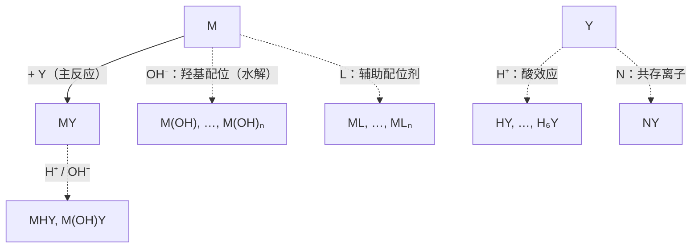

配位滴定以金属离子与配位剂生成稳定配合物的反应为基础，几乎可以测定周期表中所有的金属离子，是测定水的硬度、合金与矿物中的金属、药物与生物样品中的 $\ce{Ca^2+}$、$\ce{Mg^2+}$、$\ce{Zn^2+}$ 的常规方法。[6.1.9](/6.1.9#sec-9.7) 讲了配位平衡与**稳定常数**，[6.1.10](/6.1.10#sec-10.3) 讲了酸效应与配位效应对溶解度的定性影响；但实际滴定溶液里同时存在 $\ce{H+}$、缓冲剂、辅助配位剂与共存离子，单看稳定常数无法判断一个滴定能否进行。本章用**副反应系数**把这些影响定量化，得到只在给定条件下才是常数的**条件稳定常数**（3.2），再由它导出滴定曲线、准确滴定的判据与适宜的酸度（3.3），讨论金属指示剂（3.4）、混合离子的选择性滴定（3.5）和各种滴定方式（3.6）。"主反应 + 副反应系数 → 条件常数"这一套方法在 [6.4.4](/6.4.4) 中用于沉淀（条件溶度积），在 [6.4.5](/6.4.5) 中用于氧化还原（条件电极电势）；终点误差的处理与 [6.4.2](/6.4.2) 的酸碱滴定完全平行。

本章平衡常数表达式中的 $[\mathrm{B}]$ 均为相对浓度，稳定常数用 $25\,^\circ\mathrm{C}$、离子强度 $I = 0.1\,\mathrm{mol\,L^{-1}}$ 下的值（NIST 临界稳定常数数据库，Martell–Smith），因为滴定溶液的离子强度通常在 0.1 左右。为书写简便，金属离子与 EDTA 的电荷常常略去，写作 M、Y、MY。

## 3.1. EDTA 与氨羧配位剂

### 3.1.1. 配位滴定对配位剂的要求

**定义 3.1.1（配位滴定）** 以配位反应为基础的滴定分析方法称为**配位滴定**（络合滴定）。

与其他滴定分析一样，配位滴定要求反应定量、迅速、有确定的计量关系，并有合适的方法指示终点。早期的配位滴定用无机配位剂，例如以 $\ce{AgNO3}$ 滴定 $\ce{CN-}$（Liebig 法）：$\ce{Ag+ + 2CN- -> [Ag(CN)2]-}$，计量点后稍过量的 $\ce{Ag+}$ 生成白色的 $\ce{Ag[Ag(CN)2]}$ 沉淀指示终点。这种例子很少，因为大多数无机配体是单齿的，与金属离子逐级配位，而各级的**逐级稳定常数**相差不大。例如 $\ce{Cd^2+}$–$\ce{CN-}$ 体系的 $K_1, \dots, K_4$ 依次为 $3.5\times10^5$、$1.0\times10^5$、$5.0\times10^4$、$3.5\times10^3$：加入的配体被分配给 $\ce{Cd(CN)+}$ 到 $\ce{[Cd(CN)4]^2-}$ 好几种配离子，任何一步都没有确定的计量点，滴定曲线上也就没有明显的突跃（类比多元酸 $K_{\mathrm{a}}$ 相近时不能分步滴定）。

### 3.1.2. 氨羧配位剂与 EDTA

解决的办法是多齿配体：一个配体分子用多个配位原子同时与金属离子结合，形成 1:1 的**螯合物**（[6.1.5](/6.1.5#sec-5.1.4)），一步完成，而且由于**螯合效应**非常稳定。

**定义 3.1.2（氨羧配位剂）** 以氨基二乙酸基团 $\ce{-N(CH2COOH)2}$ 为基本结构、兼有氨氮与羧氧两种配位原子的有机配位剂称为**氨羧配位剂**（complexone）。

氨氮易与过渡金属离子配位，羧氧几乎能与所有高价金属离子配位，两者兼有，所以氨羧配位剂几乎能与所有金属离子形成稳定的螯合物。其中最重要的是乙二胺四乙酸。

**定义 3.1.3（EDTA）** 乙二胺四乙酸 $\ce{(HOOCCH2)2NCH2CH2N(CH2COOH)2}$ 称为 **EDTA**，记作 $\ce{H4Y}$；它的阴离子 $\ce{Y^4-}$ 有 2 个氨氮、4 个羧氧共 6 个配位原子。

```smiles
OC(=O)CN(CC(=O)O)CCN(CC(=O)O)CC(=O)O H4Y
OC(=O)CN(CC(=O)O)CCOCCOCCN(CC(=O)O)CC(=O)O EGTA
OCCN(CCO)CCO TEA
```

（EGTA 见 3.5.3，三乙醇胺 TEA 是常用的掩蔽剂，见 3.5.2。）

EDTA 是白色粉末，在水中溶解度很小（$22\,^\circ\mathrm{C}$ 约 $0.2\,\mathrm{g\,L^{-1}}$），也难溶于酸和一般有机溶剂，易溶于氨水和强碱溶液而生成盐。滴定中用它的二钠盐 $\ce{Na2H2Y*2H2O}$（也常称为 EDTA）：溶解度约 $111\,\mathrm{g\,L^{-1}}$（约 $0.3\,\mathrm{mol\,L^{-1}}$），水溶液的 pH 约为 4.5（$\ce{H2Y^2-}$ 是两性物质，$\mathrm{pH} \approx \frac12(\mathrm{p}K_{\mathrm{a}4} + \mathrm{p}K_{\mathrm{a}5}) = 4.4$）。

### 3.1.3. EDTA 在溶液中的型体

在强酸性溶液中，$\ce{H4Y}$ 的两个氨氮还能再接受质子，成为 $\ce{H6Y^2+}$，所以 EDTA 相当于六元酸，有六级解离（$25\,^\circ\mathrm{C}$，$I = 0.1$）：

| 解离 | $\ce{H6Y^2+ <=> H5Y+}$ | $\ce{H5Y+ <=> H4Y}$ | $\ce{H4Y <=> H3Y-}$ | $\ce{H3Y- <=> H2Y^2-}$ | $\ce{H2Y^2- <=> HY^3-}$ | $\ce{HY^3- <=> Y^4-}$ |
|---|---|---|---|---|---|---|
| $\mathrm{p}K_{\mathrm{a}}$ | 0.0 | 1.5 | 2.00 | 2.69 | 6.13 | 10.37 |

前四级解离的是羧基质子，后两级是质子化的氨氮（$\mathrm{p}K_{\mathrm{a}}$ 大），这与氨基酸的情形相同。七种型体的**分布系数**按 [6.1.9](/6.1.9#sec-9.3.6) 的方法计算，只是 pH 的函数：


直接与金属离子配位的是 $\ce{Y^4-}$，它只在碱性溶液中占优势；酸性越强，$\ce{Y^4-}$ 所占的分数越小，EDTA 的配位能力越弱。这是下一节"酸效应"的来源。

### 3.1.4. EDTA 配合物的特点

1. 配位比简单：EDTA 与金属离子一般形成 1:1 配合物，与金属离子的电荷无关（$\ce{Ca^2+ + Y^4- -> CaY^2-}$，$\ce{Fe^3+ + Y^4- -> FeY-}$），计算方便。
2. 稳定性高：$\ce{Y^4-}$ 以 6 个配位原子包住金属离子，形成 5 个五元螯合环（4 个 $\ce{M-O-C-C-N}$ 环与 1 个乙二胺环），多数金属离子的 $\lg K_{\mathrm{MY}} > 15$。
3. 反应快，配合物易溶于水：配合物大多带电荷，水溶性好；多数金属离子与 EDTA 的配位在室温下瞬间完成（$\ce{Al^3+}$、$\ce{Cr^3+}$ 等惰性离子例外，见 3.6）。
4. 颜色：无色金属离子的 EDTA 配合物无色，有利于用指示剂观察终点；有色离子的配合物颜色加深（$\ce{CuY^2-}$ 深蓝、$\ce{NiY^2-}$ 蓝绿、$\ce{FeY-}$ 黄、$\ce{CrY-}$ 深紫），滴定这些离子时浓度不宜太大。

金属离子与 EDTA 反应 $\mathrm{M} + \mathrm{Y} \ce{<=>} \mathrm{MY}$ 的稳定常数记作

$$
K_{\mathrm{MY}} = \frac{[\mathrm{MY}]}{[\mathrm{M}][\mathrm{Y}]}. \tag{3.1}
$$
它就是 [6.1.9](/6.1.9#sec-9.7.1) 的 $\beta_1$；由于只有一步，不必区分累积与逐级常数。常见金属离子的 $\lg K_{\mathrm{MY}}$（$25\,^\circ\mathrm{C}$，$I = 0.1$）：

| 离子 | $\lg K_{\mathrm{MY}}$ | 离子 | $\lg K_{\mathrm{MY}}$ | 离子 | $\lg K_{\mathrm{MY}}$ |
|---|---|---|---|---|---|
| $\ce{Na+}$ | 1.86 | $\ce{Mn^2+}$ | 13.89 | $\ce{Ni^2+}$ | 18.4 |
| $\ce{Ag+}$ | 7.20 | $\ce{Fe^2+}$ | 14.30 | $\ce{Cu^2+}$ | 18.78 |
| $\ce{Ba^2+}$ | 7.88 | $\ce{Al^3+}$ | 16.4 | $\ce{Hg^2+}$ | 21.5 |
| $\ce{Mg^2+}$ | 8.79 | $\ce{Co^2+}$ | 16.45 | $\ce{Th^4+}$ | 23.2 |
| $\ce{Sr^2+}$ | 8.72 | $\ce{Zn^2+}$ | 16.50 | $\ce{Fe^3+}$ | 25.1 |
| $\ce{Ca^2+}$ | 10.65 | $\ce{Cd^2+}$ | 16.5 | $\ce{Bi^3+}$ | 27.8 |
| | | $\ce{Pb^2+}$ | 18.0 | | |

大致规律：碱金属离子的配合物最不稳定（$\lg K_{\mathrm{MY}} < 3$）；碱土金属离子 8–11；二价过渡金属离子、稀土离子与 $\ce{Al^3+}$ 约 14–19；三价、四价离子与 $\ce{Hg^2+}$ 大于 20。同一元素高价态的配合物更稳定（$\ce{FeY-}$ 25.1，$\ce{FeY^2-}$ 14.3），这一点在 3.5.2 的氧化还原掩蔽中要用到。二价过渡金属离子的次序 $\ce{Mn} < \ce{Fe} < \ce{Co} < \ce{Ni} < \ce{Cu} > \ce{Zn}$ 正是 Irving–Williams 序列，可以由晶体场稳定化能解释（[6.1.5](/6.1.5#sec-5.5.7)）。

表中的 $K_{\mathrm{MY}}$ 是没有任何副反应时的数值，只反映金属离子与 $\ce{Y^4-}$ 本身的亲和力，不能直接说明实际滴定条件下反应的完全程度。

## 3.2. 副反应系数与条件稳定常数

### 3.2.1. 主反应与副反应

**定义 3.2.1** 化学反应中所要应用或考察的反应称为**主反应**；溶液中同时发生的、能影响主反应中反应物或产物平衡浓度的其他反应统称为**副反应**。

在 EDTA 滴定金属离子 M 的体系中，主反应是 $\mathrm{M} + \mathrm{Y} \ce{<=>} \mathrm{MY}$，副反应可以分为三类：



金属离子 M 的副反应（水解、与缓冲剂或掩蔽剂等辅助配位剂 L 配位）和滴定剂 Y 的副反应（质子化、与共存离子 N 配位）都使主反应向左移动，不利于滴定；产物 MY 的副反应（在酸性或碱性较强时生成酸式配合物 MHY 或碱式配合物 M(OH)Y）使主反应向右移动，但这类配合物一般不稳定，通常可以忽略。

处理的思路是：不再追踪每一个物种，而是把"没有参加主反应的 M 的各种形式"合起来看作一个整体 M′，把"没有参加主反应的 Y 的各种形式"合起来看作 Y′，再用一个系数描述 M′ 中真正游离的 M 占多少。

**定义 3.2.2（副反应系数）** 未参加主反应的组分 X 的各种存在形式的总浓度 $[\mathrm{X}']$ 与其游离形式的平衡浓度 $[\mathrm{X}]$ 之比

$$
\alpha_{\mathrm{X}} = \frac{[\mathrm{X}']}{[\mathrm{X}]} \tag{3.2}
$$
称为 X 的**副反应系数**。

没有副反应时 $[\mathrm{X}'] = [\mathrm{X}]$，$\alpha_{\mathrm{X}} = 1$；有副反应时 $\alpha_{\mathrm{X}} > 1$，越大说明副反应越严重。显然 $1/\alpha_{\mathrm{X}}$ 就是游离的 X 在 X′ 中所占的分数，即广义的**分布系数**。

### 3.2.2. EDTA 的副反应系数

**定义 3.2.3（酸效应系数）** 由于 $\ce{H+}$ 与 $\ce{Y^4-}$ 结合，使 $\ce{Y^4-}$ 参加主反应的能力降低的现象称为 EDTA 的**酸效应**；它的大小用**酸效应系数**

$$
\alpha_{\mathrm{Y(H)}} = \frac{[\mathrm{Y}']}{[\mathrm{Y}]} = \frac{[\mathrm{Y}] + [\mathrm{HY}] + [\mathrm{H_2Y}] + \cdots + [\mathrm{H_6Y}]}{[\mathrm{Y}]} = \frac{1}{\delta_{\mathrm{Y}}} \tag{3.3}
$$
衡量，其中 $[\mathrm{Y}']$ 是未与 M 配位的 EDTA 七种型体的总浓度，$\delta_{\mathrm{Y}}$ 是 $\ce{Y^4-}$ 的分布系数。

（这里的"酸效应"与 [6.1.10](/6.1.10#sec-10.3.3) 中酸度对难溶弱酸盐溶解度的影响是同一现象：都是弱酸根被质子化而有效浓度降低。）把逐级质子化常数代入，

$$
\alpha_{\mathrm{Y(H)}} = 1 + \frac{[\ce{H+}]}{K_{\mathrm{a}6}} + \frac{[\ce{H+}]^2}{K_{\mathrm{a}6}K_{\mathrm{a}5}} + \cdots + \frac{[\ce{H+}]^6}{K_{\mathrm{a}6}K_{\mathrm{a}5}\cdots K_{\mathrm{a}1}}.
$$
$\alpha_{\mathrm{Y(H)}}$ 只与 EDTA 的解离常数和溶液的 pH 有关；pH 越低，它越大。由上面的 $\mathrm{p}K_{\mathrm{a}}$ 算得：

| pH | 1 | 2 | 3 | 4 | 5 | 6 | 7 | 8 | 9 | 10 | 11 | 12 |
|---|---|---|---|---|---|---|---|---|---|---|---|---|
| $\lg\alpha_{\mathrm{Y(H)}}$ | 17.85 | 13.59 | 10.69 | 8.52 | 6.53 | 4.74 | 3.43 | 2.38 | 1.39 | 0.52 | 0.09 | 0.01 |

pH 5 时 $\alpha_{\mathrm{Y(H)}} \approx 10^{6.5}$：三百多万个未配位的 EDTA 分子中只有一个以 $\ce{Y^4-}$ 存在。不同教材的表值略有差别（例如 pH 5 时 6.45 或 6.6），来源是采用的 $\mathrm{p}K_{\mathrm{a}}$ 与离子强度不同；同一计算中应使用同一套常数。

溶液中若有能与 EDTA 配位的共存离子 N，还有共存离子效应：

$$
\alpha_{\mathrm{Y(N)}} = \frac{[\mathrm{Y}] + [\mathrm{NY}]}{[\mathrm{Y}]} = 1 + K_{\mathrm{NY}}[\mathrm{N}].
$$
两种副反应同时存在时，$[\mathrm{Y}'] = [\mathrm{Y}] + \sum_j[\mathrm{H}_j\mathrm{Y}] + [\mathrm{NY}]$，两边除以 $[\mathrm{Y}]$：

$$
\alpha_{\mathrm{Y}} = \alpha_{\mathrm{Y(H)}} + \alpha_{\mathrm{Y(N)}} - 1. \tag{3.4}
$$
减去 1 是因为游离的 $[\mathrm{Y}]$ 在两个系数里各算了一次。实际上两者往往相差悬殊，总系数近似等于其中较大的一个。

### 3.2.3. 金属离子的副反应系数

金属离子的副反应有两类：与 $\ce{OH-}$ 生成羟基配合物（水解），以及与缓冲剂、掩蔽剂等辅助配位剂 L 配位（**配位效应**，[6.1.10](/6.1.10#sec-10.3.5)）。由**稳定常数** $\beta_i$ 的定义，

$$
\alpha_{\mathrm{M(L)}} = \frac{[\mathrm{M}] + [\mathrm{ML}] + \cdots + [\mathrm{ML}_n]}{[\mathrm{M}]} = 1 + \beta_1[\mathrm{L}] + \beta_2[\mathrm{L}]^2 + \cdots + \beta_n[\mathrm{L}]^n, \tag{3.5}
$$
$\alpha_{\mathrm{M(OH)}}$ 的形式相同，只是把 $[\mathrm{L}]$ 换成 $[\ce{OH-}]$、$\beta_i$ 换成羟基配合物的累积稳定常数。注意式中是游离配体的浓度：例如 $\ce{NH3}$–$\ce{NH4+}$ 缓冲液中的 $[\ce{NH3}]$ 要由总浓度乘以 $\ce{NH3}$ 的分布系数求得。

同时存在 $n$ 种副反应时，与式 (3.4) 同理，

$$
\alpha_{\mathrm{M}} = \alpha_{\mathrm{M(L_1)}} + \alpha_{\mathrm{M(L_2)}} + \cdots + \alpha_{\mathrm{M(L}_n)} - (n - 1). \tag{3.6}
$$
副反应系数之间是相加关系，不是相乘关系，因而它们的对数也不能相加：一个常见的错误是把 $\lg\alpha_{\mathrm{M(NH_3)}}$ 与 $\lg\alpha_{\mathrm{M(OH)}}$ 一起从 $\lg K$ 中减去。

### 3.2.4. 条件稳定常数

有副反应时，用总浓度改写主反应的平衡常数。由 $[\mathrm{M}'] = \alpha_{\mathrm{M}}[\mathrm{M}]$、$[\mathrm{Y}'] = \alpha_{\mathrm{Y}}[\mathrm{Y}]$、$[(\mathrm{MY})'] = \alpha_{\mathrm{MY}}[\mathrm{MY}]$，

$$
\frac{[(\mathrm{MY})']}{[\mathrm{M}'][\mathrm{Y}']} = K_{\mathrm{MY}}\frac{\alpha_{\mathrm{MY}}}{\alpha_{\mathrm{M}}\alpha_{\mathrm{Y}}}.
$$

**定义 3.2.4（条件稳定常数）** 在一定条件（pH、辅助配位剂与共存离子的浓度一定）下，以未参加主反应的金属离子总浓度 $[\mathrm{M}']$、配位剂总浓度 $[\mathrm{Y}']$ 和配合物总浓度表示的稳定常数

$$
K'_{\mathrm{MY}} = \frac{[(\mathrm{MY})']}{[\mathrm{M}'][\mathrm{Y}']}, \qquad \lg K'_{\mathrm{MY}} = \lg K_{\mathrm{MY}} - \lg\alpha_{\mathrm{M}} - \lg\alpha_{\mathrm{Y}} + \lg\alpha_{\mathrm{MY}} \tag{3.7}
$$
称为**条件稳定常数**（表观稳定常数）。

通常忽略 MY 的副反应（$\alpha_{\mathrm{MY}} = 1$），于是 $\lg K'_{\mathrm{MY}} = \lg K_{\mathrm{MY}} - \lg\alpha_{\mathrm{M}} - \lg\alpha_{\mathrm{Y}}$，它总是不大于 $\lg K_{\mathrm{MY}}$。$K_{\mathrm{MY}}$ 只取决于配合物的本性、温度与离子强度；$K'_{\mathrm{MY}}$ 则随实验条件变化，它才是判断滴定能否进行的依据。条件稳定常数的思想与 IUPAC 所说的 conditional constant 一致：把所有已知的、与主反应竞争的平衡吸收进一个只在给定条件下才是常数的表观常数里，以后就像处理没有副反应的体系一样处理。

**例 3.2.1** 计算 pH 2.0、5.0、9.0、11.0 时的 $\lg K'_{\mathrm{ZnY}}$（只考虑 EDTA 的酸效应与 $\ce{Zn^2+}$ 的水解）。$\lg K_{\mathrm{ZnY}} = 16.50$，$\ce{Zn^2+}$ 羟基配合物的 $\lg\beta_1, \dots, \lg\beta_4 = 4.4, 10.1, 14.2, 15.5$。

**解** 由式 (3.5) 以 $[\ce{OH-}]$ 计算 $\lg\alpha_{\mathrm{Zn(OH)}}$，与上表的 $\lg\alpha_{\mathrm{Y(H)}}$ 一起代入式 (3.7)：

| pH | $\lg\alpha_{\mathrm{Y(H)}}$ | $\lg\alpha_{\mathrm{Zn(OH)}}$ | $\lg K'_{\mathrm{ZnY}}$ |
|---|---|---|---|
| 2.0 | 13.59 | 0 | 2.9 |
| 5.0 | 6.53 | 0 | 10.0 |
| 9.0 | 1.39 | 0.4 | 14.7 |
| 11.0 | 0.09 | 5.2 | 11.2 |

pH 2 时条件稳定常数只有 $10^{2.9}$，不能滴定；pH 5 时已足够大。随 pH 升高，EDTA 的酸效应减弱，而 $\ce{Zn^2+}$ 的水解逐渐增强，所以 $K'_{\mathrm{ZnY}}$ 先增大后减小，始终小于 $K_{\mathrm{ZnY}}$。一般金属离子都有这样的规律：存在一个最适宜的 pH 范围。

**例 3.2.2** 用 $0.020\,\mathrm{mol\,L^{-1}}$ EDTA 滴定同浓度的 $\ce{Ca^2+}$ 或 $\ce{Zn^2+}$（计量点浓度 $c_{\mathrm{sp}} = 0.010\,\mathrm{mol\,L^{-1}}$）。判断能否在 (1) pH 5.0 的 HAc–NaAc 缓冲液（$[\ce{Ac-}] = 0.10\,\mathrm{mol\,L^{-1}}$）中，(2) pH 10.0 的 $\ce{NH3}$–$\ce{NH4Cl}$ 缓冲液（游离 $[\ce{NH3}] = 0.10\,\mathrm{mol\,L^{-1}}$）中准确滴定。准确滴定的判据是 $\lg(c_{\mathrm{sp}}K') \ge 6$（3.3.2）。$\lg K_{\mathrm{CaY}} = 10.65$；$\ce{Zn^2+}$–$\ce{NH3}$ 的 $\lg\beta_1, \dots, \lg\beta_4 = 2.37, 4.81, 7.31, 9.46$。

**解** (1) pH 5.0 时 $\lg\alpha_{\mathrm{Y(H)}} = 6.53$，水解可以忽略。醋酸根与 $\ce{Ca^2+}$、$\ce{Zn^2+}$ 的配位很弱，由其稳定常数算得 $\lg\alpha_{\mathrm{Ca(Ac)}} \approx 0.1$、$\lg\alpha_{\mathrm{Zn(Ac)}} \approx 0.5$。

$$
\lg K'_{\mathrm{CaY}} = 10.65 - 6.53 - 0.1 = 4.0, \qquad \lg K'_{\mathrm{ZnY}} = 16.50 - 6.53 - 0.5 = 9.5.
$$
$\lg(c_{\mathrm{sp}}K'_{\mathrm{CaY}}) = 2.0 < 6$，不能准确滴定 $\ce{Ca^2+}$；$\lg(c_{\mathrm{sp}}K'_{\mathrm{ZnY}}) = 7.5 > 6$，可以准确滴定 $\ce{Zn^2+}$。

(2) pH 10.0 时 $\lg\alpha_{\mathrm{Y(H)}} = 0.52$。$\ce{NH3}$ 与 $\ce{Ca^2+}$ 几乎不配位，$\ce{Ca^2+}$ 也不水解：$\lg K'_{\mathrm{CaY}} = 10.65 - 0.52 = 10.1$，$\lg(c_{\mathrm{sp}}K') = 8.1$。对 $\ce{Zn^2+}$，由式 (3.5)

$$
\alpha_{\mathrm{Zn(NH_3)}} = 1 + 10^{2.37 - 1} + 10^{4.81 - 2} + 10^{7.31 - 3} + 10^{9.46 - 4} = 10^{5.49},
$$
例 3.2.1 的方法给出 $\alpha_{\mathrm{Zn(OH)}} = 10^{2.46}$，由式 (3.6) $\alpha_{\mathrm{Zn}} = 10^{5.49} + 10^{2.46} - 1 \approx 10^{5.49}$（氨的配位远远压过水解），

$$
\lg K'_{\mathrm{ZnY}} = 16.50 - 0.52 - 5.49 = 10.5, \qquad \lg(c_{\mathrm{sp}}K'_{\mathrm{ZnY}}) = 8.5 > 6.
$$
两种离子在 pH 10 都能准确滴定。这里氨起了两个作用：作缓冲剂控制 pH，同时作辅助配位剂，使 $\ce{Zn^2+}$ 在碱性溶液中不生成 $\ce{Zn(OH)2}$ 沉淀；代价是降低了 $K'_{\mathrm{ZnY}}$，所以氨的浓度不宜过大。


## 3.3. 滴定曲线与准确滴定的条件

### 3.3.1. 滴定曲线

配位滴定中被测的是金属离子，计量点附近其浓度很小，与酸碱滴定的 pH 相对应，用 $\mathrm{pM}' = -\lg[\mathrm{M}']$ 对滴定分数作**滴定曲线**。以等浓度的 EDTA 滴定金属离子为例（$c_{\mathrm{M}}$ 是计量点时金属离子的**分析浓度**，记作 $c_{\mathrm{M,sp}}$）：

1. 计量点前：按剩余的金属离子计算，$[\mathrm{M}'] \approx$ 剩余 M 的总量 / 溶液体积。
2. 计量点：$[\mathrm{M}'] = [\mathrm{Y}']$，$[\mathrm{MY}] \approx c_{\mathrm{M,sp}}$，代入式 (3.7) 得 $[\mathrm{M}']^2 = c_{\mathrm{M,sp}}/K'_{\mathrm{MY}}$，即

$$
\mathrm{pM}'_{\mathrm{sp}} = \frac{1}{2}\left(\lg K'_{\mathrm{MY}} + \mathrm{p}c_{\mathrm{M,sp}}\right). \tag{3.8}
$$
3. 计量点后：按过量的 EDTA 计算，$[\mathrm{M}'] = [\mathrm{MY}]/(K'_{\mathrm{MY}}[\mathrm{Y}'])$；EDTA 过量 100% 时 $[\mathrm{MY}] = [\mathrm{Y}']$，$\mathrm{pM}' = \lg K'_{\mathrm{MY}}$。

这些都是近似式；精确的计算只需联立 M、Y 的物料平衡与式 (3.7)，解一个二次方程，下图就是这样画出的。


影响**滴定突跃**的因素有两个，与弱酸的滴定完全平行（$K'_{\mathrm{MY}}$ 对应 $K_{\mathrm{a}}/K_{\mathrm{w}}$）：

- 条件稳定常数：$K'_{\mathrm{MY}}$ 越大，突跃的上限越高，突跃越大。凡是增大副反应系数的因素（酸度过高、辅助配位剂过量、水解）都使突跃减小。
- 金属离子的浓度：$c_{\mathrm{M}}$ 越大，突跃的下限越低，突跃越大。

### 3.3.2. 终点误差与准确滴定的判据

**滴定误差**（终点误差）$E_{\mathrm{t}}$ 是终点时过量（或不足）的滴定剂占被测物的分数。设终点与计量点的 pM′ 之差为 $\Delta\mathrm{pM}' = \mathrm{pM}'_{\mathrm{ep}} - \mathrm{pM}'_{\mathrm{sp}}$。

**公式 3.3.1（配位滴定的终点误差公式）**

$$
E_{\mathrm{t}} = \frac{[\mathrm{Y}']_{\mathrm{ep}} - [\mathrm{M}']_{\mathrm{ep}}}{c_{\mathrm{M,sp}}} = \frac{10^{\Delta\mathrm{pM}'} - 10^{-\Delta\mathrm{pM}'}}{\sqrt{c_{\mathrm{M,sp}}K'_{\mathrm{MY}}}}. \tag{3.9}
$$

**证明** 终点在计量点附近，$[\mathrm{MY}]_{\mathrm{ep}} \approx [\mathrm{MY}]_{\mathrm{sp}} \approx c_{\mathrm{M,sp}}$，由式 (3.7)，$[\mathrm{M}'][\mathrm{Y}']$ 在两点近似相等。计量点时 $[\mathrm{M}']_{\mathrm{sp}} = [\mathrm{Y}']_{\mathrm{sp}} = \sqrt{c_{\mathrm{M,sp}}/K'_{\mathrm{MY}}}$；终点时 $[\mathrm{M}']_{\mathrm{ep}} = [\mathrm{M}']_{\mathrm{sp}}10^{-\Delta\mathrm{pM}'}$，从而 $[\mathrm{Y}']_{\mathrm{ep}} = [\mathrm{Y}']_{\mathrm{sp}}10^{\Delta\mathrm{pM}'}$。代入第一个等号并除以 $c_{\mathrm{M,sp}}$ 即得。$\square$

这就是定理 2.7.1 的**终点误差公式**（Ringbom 公式）在配位滴定中的形式：把 $\Delta\mathrm{pH}$ 换成 $\Delta\mathrm{pM}'$，把滴定反应常数换成 $K'_{\mathrm{MY}}$。$\Delta\mathrm{pM}' > 0$ 表示终点在计量点之后（EDTA 过量），误差为正。

用指示剂目测终点，终点与计量点一般至少相差 $\pm 0.2$ 个 pM 单位（人眼判断颜色变化的不确定性，以及指示剂变色点与计量点不完全重合）。取 $\Delta\mathrm{pM}' = \pm0.2$，要求 $\lvert E_{\mathrm{t}}\rvert \le 0.1\%$，由式 (3.9) 得 $\sqrt{c_{\mathrm{M,sp}}K'_{\mathrm{MY}}} \ge (10^{0.2} - 10^{-0.2})/0.001 = 954$：

$$
\lg(c_{\mathrm{M,sp}}K'_{\mathrm{MY}}) \ge 6. \tag{3.10}
$$
这就是单一金属离子能被准确滴定的判据。允许误差放宽到 $\pm0.3\%$ 时，判据为 $\lg(c_{\mathrm{M,sp}}K'_{\mathrm{MY}}) \ge 5$。$c_{\mathrm{M,sp}} = 0.010\,\mathrm{mol\,L^{-1}}$ 时，式 (3.10) 要求 $\lg K'_{\mathrm{MY}} \ge 8$。

需要区分两种误差：终点误差是终点与计量点不一致引起的，对给定的方法与条件有确定的大小和符号，属于系统误差，可以由式 (3.9) 计算并加以控制；终点观测误差是人眼判断颜色变化的不确定性（约 $\pm0.2$–$0.5$ pM）引起的，属于随机误差。即使指示剂的变色点与计量点完全一致、终点误差为零，观测误差依然存在；判据 (3.10) 正是为了让观测误差也不超过允许范围而设的。

### 3.3.3. 酸度的选择与酸效应曲线

只考虑 EDTA 的酸效应时，$\lg K'_{\mathrm{MY}} = \lg K_{\mathrm{MY}} - \lg\alpha_{\mathrm{Y(H)}}$。$c_{\mathrm{M,sp}} = 0.010\,\mathrm{mol\,L^{-1}}$ 时，式 (3.10) 要求

$$
\lg\alpha_{\mathrm{Y(H)}} \le \lg K_{\mathrm{MY}} - 8. \tag{3.11}
$$
例如滴定 $\ce{Zn^2+}$ 要求 $\lg\alpha_{\mathrm{Y(H)}} \le 16.50 - 8 = 8.5$，由 $\lg\alpha_{\mathrm{Y(H)}}$ 表查得（或求根得）$\mathrm{pH} \ge 4.0$。能准确滴定某金属离子的最高酸度称为该离子的最高允许酸度（最低 pH）。

**定义 3.3.1（酸效应曲线）** 以 $\lg\alpha_{\mathrm{Y(H)}}$（或由式 (3.11) 对应的 $\lg K_{\mathrm{MY}}$）对 pH 作图，并在曲线上标出各金属离子单独滴定时允许的最低 pH，所得曲线称为 EDTA 的**酸效应曲线**（Ringbom 曲线）。


从酸效应曲线可以读出：

1. 各离子的最低 pH：$\ce{Bi^3+}$ 约 0.6，$\ce{Fe^3+}$ 约 1.2，$\ce{Cu^2+}$、$\ce{Pb^2+}$ 约 3，$\ce{Zn^2+}$ 约 4，$\ce{Ca^2+}$ 约 7.7，$\ce{Mg^2+}$ 约 9.7。$\lg K_{\mathrm{MY}} < 8$ 的离子（$\ce{Ba^2+}$、$\ce{Ag+}$）在任何 pH 下都不能直接准确滴定。
2. 在某一 pH 下哪些离子会被同时滴定（干扰）：最低 pH 低于该 pH 的离子都能与 EDTA 定量反应。例如 pH 5 时 $\ce{Zn^2+}$、$\ce{Pb^2+}$、$\ce{Cu^2+}$、$\ce{Fe^3+}$ 都被滴定，而 $\ce{Ca^2+}$、$\ce{Mg^2+}$ 不干扰。
3. 控制酸度进行分别滴定的可能性（3.5.1）。

酸度也不能太低：pH 升高时金属离子水解，$\alpha_{\mathrm{M(OH)}}$ 增大，严重时生成氢氧化物沉淀，反应速率与计量关系都受影响。不加辅助配位剂时，允许的最低酸度（最高 pH）可以由氢氧化物的**溶度积**估算：要求滴定开始时不生成沉淀。例如 $0.020\,\mathrm{mol\,L^{-1}}$ $\ce{Zn^2+}$，取 $K_{\mathrm{sp}}(\ce{Zn(OH)2}) = 3\times10^{-17}$，$[\ce{OH-}] \le \sqrt{3\times10^{-17}/0.020} = 3.9\times10^{-8}\,\mathrm{mol\,L^{-1}}$，$\mathrm{pH} \le 6.6$。所以不加氨时，$\ce{Zn^2+}$ 的适宜酸度范围是 pH 4.0–6.6，实际在 pH 5–6 的六亚甲基四胺缓冲液中滴定；需要在 pH 10 滴定时（如用铬黑 T 指示终点），要加氨作辅助配位剂（例 3.2.2）。

此外，滴定过程中 EDTA 与金属离子配位释放质子（$\ce{M^2+ + H2Y^2- -> MY^2- + 2H+}$），会使溶液的 pH 逐渐降低，所以配位滴定一般都要用**缓冲溶液**控制 pH。综合起来，适宜的酸度范围由四个因素决定：最高酸度（EDTA 的酸效应）、最低酸度（金属离子的水解）、指示剂的适用 pH 范围（3.4）、以及共存离子的干扰（3.5）。

## 3.4. 金属指示剂

### 3.4.1. 变色原理

**定义 3.4.1（金属指示剂）** 能与金属离子生成有色配合物、且配合物的颜色与指示剂自身的颜色明显不同，从而通过游离金属离子浓度的变化指示配位滴定终点的有机配位剂（多为有机染料），称为**金属指示剂**（金属离子指示剂）。

**酸碱指示剂**通过 $[\ce{H+}]$ 的变化指示终点，金属指示剂则通过 $[\mathrm{M}]$ 的变化指示终点。以铬黑 T（EBT）在 pH 10 滴定 $\ce{Mg^2+}$ 为例：滴定前加入少量指示剂，它与少量 $\ce{Mg^2+}$ 生成酒红色的 MgIn，溶液呈红色；滴入的 EDTA 先与游离的 $\ce{Mg^2+}$ 反应；计量点附近游离 $\ce{Mg^2+}$ 耗尽，稍过量的 EDTA 夺取 MgIn 中的 $\ce{Mg^2+}$，释放出蓝色的游离指示剂：

$$
\underset{\text{酒红}}{\ce{MgIn-}} + \ce{HY^3-} \ce{->} \ce{MgY^2-} + \underset{\text{蓝}}{\ce{HIn^2-}}.
$$
变色的实质是 EDTA 置换指示剂配合物中的金属离子。设指示剂与金属离子配合物的条件稳定常数为 $K'_{\mathrm{MIn}} = K_{\mathrm{MIn}}/\alpha_{\mathrm{In(H)}}$（只考虑指示剂的酸效应），则 $[\mathrm{MIn}] = [\mathrm{In}']$ 时，

$$
\mathrm{pM}_{\mathrm{t}} = \lg K'_{\mathrm{MIn}}, \tag{3.12}
$$
称为指示剂的变色点；与酸碱指示剂的 $\mathrm{pH} = \mathrm{p}K_{\mathrm{a}}$ 相对应，变色范围约为 $\mathrm{pM}_{\mathrm{t}} \pm 1$。金属指示剂本身也是多元弱酸，$K'_{\mathrm{MIn}}$ 随 pH 变化，所以变色点与 pH 有关；选择指示剂时，要求 $\mathrm{pM}_{\mathrm{t}}$ 落在滴定突跃内，并尽量接近 $\mathrm{pM}'_{\mathrm{sp}}$。

**例 3.4.1** 在 pH 10.0 用 $0.020\,\mathrm{mol\,L^{-1}}$ EDTA 滴定同浓度的 $\ce{Mg^2+}$，以铬黑 T 为指示剂，计算终点误差。铬黑 T 的 $\mathrm{p}K_{\mathrm{a}2} = 6.3$、$\mathrm{p}K_{\mathrm{a}3} = 11.6$，$\lg K_{\mathrm{MgIn}} = 7.0$。

**解** 铬黑 T 在 pH 10 的酸效应系数 $\alpha_{\mathrm{In(H)}} = 1 + 10^{11.6 - 10} + 10^{11.6 + 6.3 - 20} = 10^{1.61}$，变色点 $\mathrm{pMg}_{\mathrm{t}} = 7.0 - 1.61 = 5.39$，这就是 $\mathrm{pMg}_{\mathrm{ep}}$。另一方面 $\lg K'_{\mathrm{MgY}} = 8.79 - 0.52 = 8.27$，由式 (3.8) $\mathrm{pMg}_{\mathrm{sp}} = \frac12(8.27 + 2.00) = 5.13$。$\Delta\mathrm{pMg} = +0.26$，由式 (3.9)

$$
E_{\mathrm{t}} = \frac{10^{0.26} - 10^{-0.26}}{\sqrt{10^{-2.00} \times 10^{8.27}}} = \frac{1.27}{10^{3.13}} = +0.09\%.
$$
终点略在计量点之后，误差在 0.1% 以内。

### 3.4.2. 金属指示剂应具备的条件

1. 在滴定的 pH 范围内，游离指示剂与其金属配合物的颜色有明显差别。
2. 指示剂配合物的稳定性适当：既要足够稳定，使变色敏锐、不在计量点前过早游离出来（终点提前）；又要比 MY 稳定性小得多（一般要求 $\lg K'_{\mathrm{MY}} - \lg K'_{\mathrm{MIn}} \ge 2$），使 EDTA 能在计量点附近把它置换出来。
3. 显色反应灵敏、迅速，有良好的可逆性；指示剂配合物易溶于水。
4. 指示剂比较稳定，便于储存。金属指示剂多是含多个双键的偶氮染料，易被氧化或聚合，水溶液不宜久放，常配成固体混合物（与 NaCl 按 1:100 研磨）或加入稳定剂。

**定义 3.4.2（指示剂的封闭）** 指示剂与某些金属离子生成极稳定的配合物（或配合物解离极慢），在计量点后过量的 EDTA 也不能把指示剂置换出来，以致看不到颜色变化，这种现象称为**指示剂的封闭**。

例如铬黑 T 被 $\ce{Fe^3+}$、$\ce{Al^3+}$、$\ce{Cu^2+}$、$\ce{Co^2+}$、$\ce{Ni^2+}$ 封闭。消除的方法：加入掩蔽剂掩蔽这些离子（$\ce{Fe^3+}$、$\ce{Al^3+}$ 用三乙醇胺，$\ce{Cu^2+}$、$\ce{Co^2+}$、$\ce{Ni^2+}$ 用 KCN 或 $\ce{Na2S}$），含量多时先分离除去；对被测离子本身封闭指示剂的情况（如 $\ce{Al^3+}$ 与二甲酚橙），改用返滴定（3.6）。配位滴定用的蒸馏水必须除去微量重金属离子。

**定义 3.4.3（指示剂的僵化）** 指示剂或其金属配合物在水中溶解度小、或生成胶体，使 EDTA 与指示剂配合物的置换反应缓慢、终点拖长，这种现象称为**指示剂的僵化**。

例如 PAN 及其金属配合物水溶性差，易僵化。消除的方法是加入少量乙醇等有机溶剂增大溶解度，或适当加热加快置换，并在近终点时缓慢滴定、剧烈振摇。

### 3.4.3. 常用的金属指示剂

```smiles
Oc1ccc2ccccc2c1N=Nc1c(O)cc(S(=O)(=O)O)c2cc([N+](=O)[O-])ccc12 EBT
OC(=O)c1cc2ccccc2c(N=Nc2c(O)cc(S(=O)(=O)O)c3ccccc23)c1O NN
Oc1ccc2ccccc2c1N=Nc1ccccn1 PAN
```

| 指示剂 | 适用 pH | 颜色变化（MIn → In） | 直接滴定的离子 | 注意事项 |
|---|---|---|---|---|
| 铬黑 T（EBT） | 8–11（常用 10） | 酒红 → 蓝 | $\ce{Mg^2+}$、$\ce{Zn^2+}$、$\ce{Cd^2+}$、$\ce{Pb^2+}$、Ca+Mg 总量 | $\ce{Fe^3+}$、$\ce{Al^3+}$、$\ce{Cu^2+}$、$\ce{Ni^2+}$ 封闭；单独滴定 $\ce{Ca^2+}$ 时变色不敏锐 |
| 钙指示剂（NN，钙羧酸） | 12–13 | 酒红 → 蓝 | $\ce{Ca^2+}$（$\ce{Mg^2+}$ 已沉淀为 $\ce{Mg(OH)2}$） | 同上 |
| 二甲酚橙（XO） | < 6.3 | 紫红 → 亮黄 | pH 1–2：$\ce{Bi^3+}$；pH 5–6：$\ce{Zn^2+}$、$\ce{Pb^2+}$、$\ce{Cd^2+}$、稀土 | $\ce{Fe^3+}$、$\ce{Al^3+}$、$\ce{Ni^2+}$ 封闭 |
| PAN | 2–12 | 红 → 黄 | $\ce{Cu^2+}$、$\ce{Ni^2+}$、$\ce{Zn^2+}$ 等 | 易僵化，加乙醇或加热 |
| 磺基水杨酸（SSal） | 1.5–2.5 | 紫红 → 亮黄（$\ce{FeY-}$ 的颜色） | $\ce{Fe^3+}$ | 本身无色 |

铬黑 T 是三元酸，$\ce{H2In-}$（$\mathrm{pH} < 6.3$）红色、$\ce{HIn^2-}$（6.3–11.6）蓝色、$\ce{In^3-}$（$> 11.6$）橙色，而它的金属配合物是酒红色：只有在 pH 约 8–11 之间游离指示剂（蓝）与配合物（红）的颜色才有明显差别，故适用 pH 8–11，实际多在 pH 10 的氨性缓冲液中使用。铬黑 T 与 $\ce{Ca^2+}$ 的配合物不够稳定（$\lg K_{\mathrm{CaIn}} \approx 5.4$，比 $\mathrm{MgIn}$ 的 7.0 小），单独滴定 $\ce{Ca^2+}$ 时终点提前、变色不敏锐。解决的办法之一是在溶液中加入少量 MgY：$\ce{MgY + Ca^2+ -> CaY + Mg^2+}$，置换出的 $\ce{Mg^2+}$ 与铬黑 T 显红色，终点时 EDTA 夺取 MgIn 中的 $\ce{Mg^2+}$，变色敏锐；加入的 MgY 与置换出的 $\ce{Mg^2+}$ 物质的量相等，不影响结果。

Cu–PAN 指示剂是 CuY 与少量 PAN 的混合液，可在 pH 2–12 的宽范围内使用：滴定前加入被测溶液，被测离子 M 置换出 $\ce{Cu^2+}$（$\ce{CuY + M -> MY + Cu}$），$\ce{Cu^2+}$ 与 PAN 显紫红色；终点时 EDTA 夺取 Cu–PAN 中的 $\ce{Cu^2+}$，溶液变为 CuY（蓝）与 PAN（黄）的混合色绿色。它适用于本身没有合适指示剂的离子。

## 3.5. 混合离子的选择性滴定

实际试样中常有几种金属离子共存，而 EDTA 几乎与所有金属离子配位，选择性差。提高选择性的途径有三条：控制酸度、掩蔽、改用其他配位剂。思路是：若 $K_{\mathrm{MY}} \gg K_{\mathrm{NY}}$，控制酸度分步滴定；若相差不大或 $K_{\mathrm{MY}} < K_{\mathrm{NY}}$，掩蔽干扰离子或选择其他滴定剂。

### 3.5.1. 控制酸度进行分别滴定

设溶液中含 M 与 N 两种离子，$K_{\mathrm{MY}} > K_{\mathrm{NY}}$。滴定 M 时，N 是 EDTA 的共存离子，$\alpha_{\mathrm{Y}} = \alpha_{\mathrm{Y(H)}} + \alpha_{\mathrm{Y(N)}} - 1$。若酸度控制得使 $\alpha_{\mathrm{Y(N)}} \gg \alpha_{\mathrm{Y(H)}}$（酸效应可以忽略，干扰只来自 N），则在 M 的计量点附近 $[\mathrm{N}] \approx c_{\mathrm{N,sp}}$，

$$
K'_{\mathrm{MY}} \approx \frac{K_{\mathrm{MY}}}{\alpha_{\mathrm{Y(N)}}} \approx \frac{K_{\mathrm{MY}}}{K_{\mathrm{NY}}c_{\mathrm{N,sp}}}, \qquad \lg(c_{\mathrm{M,sp}}K'_{\mathrm{MY}}) = \lg(c_{\mathrm{M,sp}}K_{\mathrm{MY}}) - \lg(c_{\mathrm{N,sp}}K_{\mathrm{NY}}) \equiv \Delta\lg(cK).
$$
代入判据 (3.10)，得到在 N 存在下准确滴定 M 的条件：

$$
\Delta\lg(cK) \ge 6 \quad (\Delta\mathrm{pM} = \pm0.2,\ \lvert E_{\mathrm{t}}\rvert \le 0.1\%). \tag{3.13}
$$
允许误差为 $\pm0.3\%$ 时，条件为 $\Delta\lg(cK) \ge 5$。两种离子浓度相等时，即 $\Delta\lg K \ge 6$（或 5）。满足这个条件后，再按单一离子的方法确定滴定 M 的 pH 范围：下限是 M 的最低 pH（酸效应曲线），上限是使 N 开始被滴定（$\alpha_{\mathrm{Y(H)}}$ 降到与 $\alpha_{\mathrm{Y(N)}}$ 相当）或使 M 开始水解的 pH，还要与指示剂的适用范围相容。

**例 3.5.1** 溶液中 $\ce{Bi^3+}$、$\ce{Pb^2+}$ 的浓度均为 $0.020\,\mathrm{mol\,L^{-1}}$，能否用 EDTA 分别滴定？

**解** $\Delta\lg K = 27.8 - 18.0 = 9.8 > 6$，可以在 $\ce{Pb^2+}$ 存在下滴定 $\ce{Bi^3+}$。由酸效应曲线，滴定 $\ce{Bi^3+}$ 的最低 pH 约为 0.6；而 pH 约 2 以上 $\ce{Bi^3+}$ 开始水解析出碱式盐沉淀。所以在 pH ≈ 1 以二甲酚橙为指示剂滴定 $\ce{Bi^3+}$（此时 $\ce{Pb^2+}$ 与二甲酚橙不显色，也基本不与 EDTA 反应）；然后加六亚甲基四胺调至 pH 5–6，继续滴定 $\ce{Pb^2+}$。一份试液连续得到两种离子的含量。

**例 3.5.2** 测定 $\ce{Fe^3+}$ 与 $\ce{Al^3+}$（浓度均约 $0.01\,\mathrm{mol\,L^{-1}}$）。

**解** $\Delta\lg K = 25.1 - 16.4 = 8.7 > 6$，滴定 $\ce{Fe^3+}$ 时 $\ce{Al^3+}$ 不干扰。$\ce{Fe^3+}$ 的最低 pH 约 1.2，pH 稍高即强烈水解，实际在 pH 1.5–2.2 以磺基水杨酸为指示剂、加热至 $60$–$70\,^\circ\mathrm{C}$ 滴定，终点由紫红变为亮黄；此 pH 下 $\ce{Al^3+}$、$\ce{Ca^2+}$、$\ce{Mg^2+}$ 都不干扰。$\ce{Al^3+}$ 与 EDTA 反应慢，不能直接滴定：在滴定 $\ce{Fe^3+}$ 后的溶液中调至 pH 3，加入过量 EDTA 煮沸使 $\ce{Al^3+}$ 配位完全，再用六亚甲基四胺调至 pH 4–6，以 PAN 为指示剂用 $\ce{Cu^2+}$ 标准溶液**返滴定**过量的 EDTA。

### 3.5.2. 掩蔽与解蔽

$\Delta\lg(cK) < 5$ 时不能用控制酸度的方法分别滴定，需要设法降低干扰离子的游离浓度。

**定义 3.5.1（掩蔽）** 加入某种试剂，使干扰离子转变为不与滴定剂反应（或反应可以忽略）的形式，从而在不分离的情况下消除其干扰，这种方法称为**掩蔽**，所加的试剂称为掩蔽剂。

掩蔽的效果可以直接用副反应系数衡量：掩蔽剂 L 使干扰离子 N 的游离浓度降为 $[\mathrm{N}] = c_{\mathrm{N}}/\alpha_{\mathrm{N(L)}}$，从而 $\alpha_{\mathrm{Y(N)}}$ 减小，$K'_{\mathrm{MY}}$ 增大。按所用反应的类型，掩蔽分为三种：

1. 配位掩蔽（最常用）：干扰离子与掩蔽剂生成稳定的配合物。例如用 EDTA 测定水中的 $\ce{Ca^2+}$、$\ce{Mg^2+}$ 时，加三乙醇胺掩蔽 $\ce{Fe^3+}$、$\ce{Al^3+}$；$\ce{Al^3+}$ 与 $\ce{Zn^2+}$ 共存时（$\lg K$ 为 16.4 与 16.50，几乎相等），加 $\ce{NH4F}$ 使 $\ce{Al^3+ + 6F- -> [AlF6]^3-}$，在 pH 5–6 以二甲酚橙为指示剂滴定 $\ce{Zn^2+}$。配位掩蔽剂应满足：与干扰离子的配合物远比其 EDTA 配合物稳定，且无色或浅色；不与被测离子配位，或配合物的稳定性远小于被测离子的 EDTA 配合物（滴定时能被 EDTA 置换）；使用的 pH 范围与滴定要求的 pH 一致。例如测定 Ca、Mg 总量（pH 10）时就不能用氟化物掩蔽 $\ce{Al^3+}$，因为 $\ce{F-}$ 会与 $\ce{Ca^2+}$ 生成 $\ce{CaF2}$ 沉淀。
2. 沉淀掩蔽：干扰离子与掩蔽剂生成沉淀。例如 $\ce{Ca^2+}$、$\ce{Mg^2+}$ 共存时加 NaOH 使 $\mathrm{pH} > 12$，$\ce{Mg^2+}$ 生成 $\ce{Mg(OH)2}$ 沉淀，以钙指示剂用 EDTA 滴定 $\ce{Ca^2+}$。沉淀掩蔽要求沉淀的溶解度小，且为无色或浅色、致密的晶形沉淀，否则沉淀吸附被测离子或指示剂，影响终点观察；所以它的应用不如配位掩蔽广泛。
3. 氧化还原掩蔽：改变干扰离子的价态。例如用 EDTA 滴定 $\ce{Bi^3+}$、$\ce{Zr^4+}$、$\ce{Th^4+}$ 时，加入抗坏血酸或盐酸羟胺把 $\ce{Fe^3+}$（$\lg K_{\mathrm{FeY^-}} = 25.1$）还原为 $\ce{Fe^2+}$（$\lg K_{\mathrm{FeY^{2-}}} = 14.3$），干扰即可消除。反之，有些离子的高价态配合物反而不如低价态稳定，可以预先把 $\ce{Cr^3+}$ 氧化为 $\ce{Cr2O7^2-}$、把 $\ce{VO^2+}$ 氧化为 $\ce{VO3-}$ 来消除干扰。

使用掩蔽剂时，还要注意它的性质与加入的条件。KCN 剧毒，只能在碱性溶液中使用，加入酸性溶液会放出剧毒的 HCN；含氰废液要用含 $\ce{Na2CO3}$ 的 $\ce{FeSO4}$ 溶液处理，使 $\ce{CN-}$ 转变为稳定的 $\ce{[Fe(CN)6]^4-}$。三乙醇胺必须在酸性溶液中加入，然后再碱化：若溶液已呈碱性，$\ce{Fe^3+}$ 已经生成氢氧化物，就难以被掩蔽。掩蔽剂的用量要稍过量，又不能过量太多，否则被测离子也可能被部分掩蔽。

**定义 3.5.2（解蔽）** 在掩蔽某些离子、滴定另一种离子之后，加入适当的试剂破坏被掩蔽离子与掩蔽剂生成的配合物，使它重新释放出来以便继续滴定，这种作用称为**解蔽**，所用的试剂称为解蔽剂。

**例 3.5.3** 测定铜合金中的 $\ce{Zn^2+}$ 与 $\ce{Pb^2+}$。$\ce{Zn^2+}$ 与 $\ce{Pb^2+}$ 的 $\Delta\lg K = 18.0 - 16.50 = 1.5$，不能控制酸度分别滴定；$\ce{Cu^2+}$ 也会被一同滴定。

**解** 用氨水中和试液，在氨性（酒石酸防止 $\ce{Pb^2+}$ 水解）溶液中加 KCN，$\ce{Cu^2+}$ 被还原并生成 $\ce{[Cu(CN)3]^2-}$，$\ce{Zn^2+}$ 生成 $\ce{[Zn(CN)4]^2-}$，而 $\ce{Pb^2+}$ 不被掩蔽。在 pH 10 以铬黑 T 为指示剂用 EDTA 滴定 $\ce{Pb^2+}$。然后加入甲醛（或三氯乙醛）解蔽 $\ce{Zn^2+}$：

$$
\ce{[Zn(CN)4]^2- + 4HCHO + 4H2O -> Zn^2+ + 4HOCH2CN + 4OH-},
$$
甲醛与 $\ce{CN-}$ 加成生成羟基乙腈，释放出的 $\ce{Zn^2+}$ 再用 EDTA 滴定。$\ce{[Cu(CN)3]^2-}$ 较稳定，不易被醛类解蔽；但甲醛应分次少量加入，过多或温度较高时 $\ce{[Cu(CN)3]^2-}$ 也会部分分解，使锌的结果偏高。

### 3.5.3. 其他配位剂

其他氨羧配位剂与金属离子配合物的稳定性各有特点，可以弥补 EDTA 选择性的不足。

- EGTA（乙二醇双(2-氨基乙醚)四乙酸，结构式见 3.1.2）：两个氨基之间是含两个醚氧的长链，空腔适合半径较大的 $\ce{Ca^2+}$ 而不适合 $\ce{Mg^2+}$。$\lg K_{\mathrm{CaY}}$ 约 11.0，而 $\lg K_{\mathrm{MgY}}$ 只有约 5.2（EDTA 两者只差 1.9），所以可以在 $\ce{Mg^2+}$ 共存下直接滴定 $\ce{Ca^2+}$。
- CyDTA（1,2-环己二胺四乙酸）：配合物比 EDTA 的更稳定，可用于滴定 $\ce{Al^3+}$ 等，但反应较慢。
- EDTP（乙二胺四丙酸）：与 $\ce{Cu^2+}$ 的配合物比与 $\ce{Zn^2+}$、$\ce{Cd^2+}$、$\ce{Mn^2+}$、$\ce{Mg^2+}$ 的稳定得多，可在这些离子存在下直接滴定 $\ce{Cu^2+}$。
- 三乙烯四胺（trien）：多胺配体，只与亲氮的 $\ce{Cu^2+}$、$\ce{Ni^2+}$、$\ce{Zn^2+}$、$\ce{Cd^2+}$、$\ce{Hg^2+}$ 生成稳定的配合物，不与碱土金属配位。

EGTA 对 $\ce{Ca^2+}$ 的选择性在生物学中格外重要：细胞内 $\ce{Mg^2+}$ 的浓度约为毫摩尔级，而游离 $\ce{Ca^2+}$ 只有约 $100\,\mathrm{nmol\,L^{-1}}$，是重要的第二信使。EGTA 能在大量 $\ce{Mg^2+}$ 存在下选择性地螯合 $\ce{Ca^2+}$，因此被广泛用来除去或控制实验体系中的 $\ce{Ca^2+}$；把 EGTA 与 CaEGTA 按一定比例混合，就得到"钙缓冲液"——与 pH 缓冲液同理，$\mathrm{pCa} = \lg K'_{\mathrm{CaY}} + \lg([\mathrm{CaY}]/[\mathrm{Y}'])$，用来配制已知游离 $\ce{Ca^2+}$ 浓度的溶液，校准钙测量。由于 EGTA 的两个氨基 $\mathrm{p}K_{\mathrm{a}}$ 较高（约 8.8 与 9.4），中性溶液中酸效应很强，它的条件常数对 pH 很敏感；Tsien（1980）把氨基换成芳香胺，设计出 BAPTA，使 $\mathrm{p}K_{\mathrm{a}}$ 降到 6 以下，在生理 pH 下几乎不受酸效应影响，结合与解离也快得多。在 BAPTA 骨架上连接荧光团，就得到 fura-2、Fluo-4 等荧光钙指示剂（[6.4.10](/6.4.10#sec-10.4.4)），把配位平衡变成了观察细胞内钙信号的工具。

## 3.6. 滴定方式与应用

### 3.6.1. 直接滴定与水的硬度

被测离子与 EDTA 的反应满足准确滴定的要求、反应迅速、又有合适的指示剂时，用 EDTA **标准溶液**直接滴定，这种方式简便、引入误差少，应尽量采用。

**定义 3.6.1（水的硬度）** 水中 $\ce{Ca^2+}$、$\ce{Mg^2+}$ 的总浓度称为**水的硬度**（总硬度）；其中由 $\ce{Ca^2+}$、$\ce{Mg^2+}$ 分别贡献的部分称为钙硬度与镁硬度。

硬度可以直接用 $\mathrm{mmol\,L^{-1}}$ 表示，也常换算为 $\ce{CaCO3}$ 的质量浓度（$\mathrm{mg\,L^{-1}}$，1 mmol L⁻¹ 相当于 100.09 mg L⁻¹ $\ce{CaCO3}$），德国度（°dH）以每升含 10 mg CaO 为 1 度。我国生活饮用水标准规定总硬度（以 $\ce{CaCO3}$ 计）不超过 $450\,\mathrm{mg\,L^{-1}}$。测定方法：

1. 总硬度：取水样，加三乙醇胺掩蔽 $\ce{Fe^3+}$、$\ce{Al^3+}$（必要时加 $\ce{Na2S}$ 掩蔽 $\ce{Cu^2+}$ 等重金属），用 $\ce{NH3}$–$\ce{NH4Cl}$ 缓冲液调至 pH 10，以铬黑 T 为指示剂用 EDTA 滴定至由酒红变为纯蓝。$\ce{CaY}$ 与 $\ce{MgY}$ 的稳定性相差不大，测得的是两者的总量。
2. 钙硬度：另取一份水样，加 NaOH 至 pH 12–13，$\ce{Mg^2+}$ 沉淀为 $\ce{Mg(OH)2}$，以钙指示剂用 EDTA 滴定 $\ce{Ca^2+}$。
3. 镁硬度 = 总硬度 − 钙硬度。

同样的方法用于测定血清、尿液、乳品中的钙与镁，以及药物葡萄糖酸钙、硫酸镁的含量。

### 3.6.2. 返滴定、置换滴定与间接滴定

下列情况不宜直接滴定：被测离子与 EDTA 反应很慢，本身又易水解或封闭指示剂（$\ce{Al^3+}$、$\ce{Cr^3+}$）；被测离子与 EDTA 能定量反应，但缺少变色敏锐的指示剂（$\ce{Ba^2+}$、$\ce{Sr^2+}$）；被测离子不与 EDTA 配位，或配合物不稳定（$\ce{SO4^2-}$、$\ce{PO4^3-}$、$\ce{Na+}$、$\ce{Ag+}$）。这时采用定义 2.1.2 中的其他滴定方式。

- **返滴定**：先加入已知过量的 EDTA 标准溶液，使被测离子配位完全，再用另一种金属离子的标准溶液滴定剩余的 EDTA。例如 $\ce{Al^3+}$：在 pH 3.5 加过量 EDTA 煮沸，调 pH 5–6，以二甲酚橙为指示剂用 $\ce{Zn^2+}$ 标准溶液返滴定；$\ce{Ba^2+}$：加过量 EDTA，在 pH 10 以铬黑 T 为指示剂用 $\ce{Mg^2+}$ 标准溶液返滴定。返滴定剂与 EDTA 的配合物必须足够稳定，但又不能比被测离子的配合物更稳定，否则会把被测离子置换出来。
- **置换滴定**：利用置换反应生成等物质的量的另一种可滴定的物质。一种是置换出 EDTA，例如 $\ce{Cu^2+}$、$\ce{Zn^2+}$ 共存时测 $\ce{Al^3+}$：加过量 EDTA 加热使三者全部配位，在 pH 5–6 以 PAN 为指示剂用 $\ce{Cu^2+}$ 标准溶液返滴定过量的 EDTA，再加入 $\ce{NH4F}$，只有 $\ce{AlY-}$ 被 $\ce{F-}$ 破坏：$\ce{AlY- + 6F- -> [AlF6]^3- + Y^4-}$，置换出的 EDTA 与 $\ce{Al^3+}$ 等物质的量，再用 $\ce{Cu^2+}$ 标准溶液滴定，选择性很高。另一种是置换出金属离子，例如 $\lg K_{\mathrm{AgY}} = 7.2$，不能用 EDTA 直接滴定 $\ce{Ag+}$；在试液中加入过量的 $\ce{[Ni(CN)4]^2-}$：

$$
\ce{2Ag+ + [Ni(CN)4]^2- -> 2[Ag(CN)2]- + Ni^2+},
$$
反应的平衡常数 $K = \beta_2^2(\ce{[Ag(CN)2]-})/\beta_4(\ce{[Ni(CN)4]^2-}) = 10^{2\times21.1 - 31.3} = 10^{10.9}$，进行得很完全；在 pH 10 以紫脲酸铵为指示剂用 EDTA 滴定置换出的 $\ce{Ni^2+}$，$n(\ce{Ag+}) = 2n(\ce{Ni^2+})$。此法用于银币中银的测定。
- **间接滴定**：被测物不与 EDTA 配位时，加入过量的、能与 EDTA 定量反应的金属离子使被测物沉淀，再滴定剩余的金属离子，或把沉淀分离、溶解后滴定其中的金属离子。例如测 $\ce{PO4^3-}$：加入一定量过量的 $\ce{Bi(NO3)3}$ 生成 $\ce{BiPO4}$ 沉淀，再用 EDTA 滴定剩余的 $\ce{Bi^3+}$；测 $\ce{Na+}$：用醋酸铀酰锌沉淀为 $\ce{NaZn(UO2)3(Ac)9*6H2O}$，分离、洗净、溶解后用 EDTA 滴定其中的锌。间接滴定手续繁琐，误差较大。

### 3.6.3. EDTA 标准溶液

EDTA 标准溶液通常用 $\ce{Na2H2Y*2H2O}$ 配制成近似浓度（$0.01$–$0.05\,\mathrm{mol\,L^{-1}}$），再**标定**。常用的**基准物质**是纯锌（溶于 HCl 后在 pH 5–6 以二甲酚橙、或在 pH 10 以铬黑 T 为指示剂）和 $\ce{CaCO3}$（溶于 HCl 后在 pH 12–13 以钙指示剂为指示剂）。标定的条件应尽量与测定的条件一致（相同的 pH、指示剂与介质），使指示剂引起的系统误差在标定与测定中相互抵消。EDTA 溶液应储存在聚乙烯瓶中：长期存放在玻璃瓶中会溶出 $\ce{Ca^2+}$、$\ce{Mg^2+}$，使浓度降低。

### 3.6.4. 生物医学中的 EDTA

EDTA 与金属离子的强配位在生物与医学中有许多用途，其原理都是本章的条件稳定常数：

- 抗凝剂：血液凝固的若干步骤需要 $\ce{Ca^2+}$。采血管中的 $\ce{K2H2Y}$ 螯合 $\ce{Ca^2+}$，使血样保持液态，用于血常规检查；而需要测定血钙的样品就不能用 EDTA 抗凝。
- 酶抑制剂：金属蛋白酶（以 $\ce{Zn^2+}$ 为活性中心）与核酸酶（需要 $\ce{Mg^2+}$）都能被 EDTA 抑制。蛋白质纯化所用的蛋白酶抑制剂混合物中常含 EDTA；保存 DNA 的 TE 缓冲液（Tris–EDTA）中，EDTA 螯合 $\ce{Mg^2+}$ 以抑制 DNase。反过来，需要金属离子的反应（如 PCR 中 DNA 聚合酶需要 $\ce{Mg^2+}$）中残留的 EDTA 会使反应失败。
- 螯合治疗：铅中毒用 $\ce{CaNa2Y}$ 治疗。$\lg K_{\mathrm{PbY}} - \lg K_{\mathrm{CaY}} \approx 7$，$\ce{Pb^2+}$ 置换出 $\ce{Ca^2+}$，生成的 $\ce{PbY^2-}$ 由肾排出；用钙盐而不用二钠盐，是为了避免螯合血液中的 $\ce{Ca^2+}$ 引起低钙血症。

## 小结

| 内容 | 要点 |
|---|---|
| EDTA | 六元酸 $\ce{H6Y^2+}$，$\mathrm{p}K_{\mathrm{a}} = 0.0, 1.5, 2.00, 2.69, 6.13, 10.37$；与金属离子一般 1:1 配位，5 个五元螯合环，$\lg K_{\mathrm{MY}}$ 大多 > 15 |
| 副反应系数 | $\alpha_{\mathrm{X}} = [\mathrm{X}']/[\mathrm{X}] \ge 1$；$\alpha_{\mathrm{Y(H)}} = 1/\delta_{\mathrm{Y}}$；$\alpha_{\mathrm{M(L)}} = 1 + \sum\beta_i[\mathrm{L}]^i$；多种副反应：$\alpha = \sum\alpha_i - (n-1)$（相加，不是对数相加） |
| 条件稳定常数 | $\lg K'_{\mathrm{MY}} = \lg K_{\mathrm{MY}} - \lg\alpha_{\mathrm{M}} - \lg\alpha_{\mathrm{Y}}$；随 pH 先增后减 |
| 滴定曲线 | $\mathrm{pM}'_{\mathrm{sp}} = \frac12(\lg K'_{\mathrm{MY}} + \mathrm{p}c_{\mathrm{M,sp}})$；$K'$ 与 $c$ 越大，突跃越大 |
| 终点误差与判据 | $E_{\mathrm{t}} = (10^{\Delta\mathrm{pM}'} - 10^{-\Delta\mathrm{pM}'})/\sqrt{c_{\mathrm{M,sp}}K'_{\mathrm{MY}}}$；$\lg(cK') \ge 6$（±0.1%）；分别滴定 $\Delta\lg(cK) \ge 6$（或 5，±0.3%） |
| 酸度 | 最高酸度由 $\lg\alpha_{\mathrm{Y(H)}} \le \lg K_{\mathrm{MY}} - 8$（酸效应曲线），最低酸度由水解（溶度积）；用缓冲溶液控制 |
| 金属指示剂 | $\mathrm{pM}_{\mathrm{t}} = \lg K'_{\mathrm{MIn}}$；铬黑 T（pH 10）、钙指示剂（pH 12–13）、二甲酚橙（pH < 6）、PAN、磺基水杨酸；封闭与僵化 |
| 提高选择性 | 控制酸度；配位、沉淀、氧化还原掩蔽与解蔽；EGTA（Ca/Mg）、EDTP（Cu）等其他配位剂 |
| 滴定方式 | 直接（水的硬度）、返滴定（Al、Ba）、置换（Al 经 $\ce{NH4F}$、Ag 经 $\ce{[Ni(CN)4]^2-}$）、间接（$\ce{PO4^3-}$、$\ce{Na+}$） |
