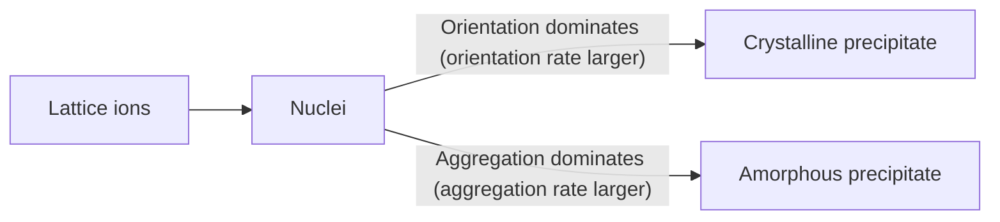

[6.1.10](/6.1.10) introduced the **solubility product** and the effects of the common ion, added salts, acidity, and complex formation on solubility. This chapter applies precipitation equilibria to two classical quantitative methods. The first is gravimetric analysis, in which the analyte is converted into a precipitate of definite composition and its content is found by weighing. It depends only on mass measurements and atomic masses, needs no standard solution, and is among the most accurate methods of chemical analysis. The second is precipitation titration, of which the only widely used form is argentometry, titration with $\ce{Ag+}$ for the determination of halides and $\ce{SCN-}$. Both methods require a precipitate that is sparingly soluble and pure. We therefore first use the side-reaction coefficients of [6.4.3](/6.4.3#sec-3.2) to quantify the factors that affect solubility, which leads to the conditional solubility product (Section 4.1). We then discuss how precipitates form and why they are contaminated (4.2), from which the conditions for obtaining a pure, easily filtered precipitate follow (4.3). Gravimetric analysis (4.4) and argentometry (4.5) conclude the chapter. The thermodynamics of nucleation and of the solubility of small particles is treated in [6.3.19](/6.3.19), and the structure and coagulation of colloids in [6.3.21](/6.3.21).

Solubility products and stability constants are taken from the CRC Handbook ($25\,^\circ\mathrm{C}$) and agree with the values used in [6.1.10](/6.1.10), where they are kept to two significant figures.

## 4.1. Solubility of Precipitates

### 4.1.1. Solubility, Intrinsic Solubility, and Activity Product

The dissolution of a sparingly soluble compound MA in water can be written in two steps. The solid first dissolves to give the undissociated molecule (or ion pair) MA(aq), which then dissociates into ions:

$$
\mathrm{MA(s)} \ce{<=>} \mathrm{MA(aq)} \ce{<=>} \ce{M+} + \ce{A-}.
$$

**Definition 4.1.1 (Intrinsic Solubility)** At a given temperature, the concentration of the undissociated molecule (or ion pair) MA(aq) in a solution in equilibrium with the solid is a constant. It is called the **intrinsic solubility** (molecular solubility) of the substance and is denoted $s^\circ$.

The solubility is therefore $s = s^\circ + [\ce{M+}] = s^\circ + [\ce{A-}]$. For most sparingly soluble salts $s^\circ$ is much smaller than the ion concentrations and can be neglected, so that $s = [\ce{M+}] = [\ce{A-}]$. For AgCl, for example, $s^\circ = [\ce{AgCl(aq)}] = K_{\mathrm{sp}}\beta_1 = 1.77\times10^{-10}\times10^{3.04} = 1.9\times10^{-7}\,\mathrm{mol\,L^{-1}}$, only 1.4% of the $[\ce{Ag+}] = 1.33\times10^{-5}\,\mathrm{mol\,L^{-1}}$ found in pure water. When the ion concentrations are suppressed by the common-ion effect, however, the intrinsic solubility becomes the main part of the solubility (Section 4.1.3). For strongly covalent compounds such as $\ce{HgCl2}$ the intrinsic solubility is itself large.

Strictly speaking, equilibria between ions must be expressed in terms of activities ([6.1.8](/6.1.8), [6.3.12](/6.3.12#sec-12.6)).

**Definition 4.1.2 (Activity Product)** The product of the powers of the ion **activities** in a saturated solution of a sparingly soluble electrolyte $\mathrm{M}_m\mathrm{A}_n$,

$$
K_{\mathrm{ap}} = a_{\mathrm{M}}^m a_{\mathrm{A}}^n \tag{4.1}
$$
is called the **activity product** (thermodynamic solubility product). It depends only on temperature.

The solubility product written in terms of concentrations, $K_{\mathrm{sp}} = [\mathrm{M}]^m[\mathrm{A}]^n$, is related to the activity product by

$$
K_{\mathrm{sp}} = \frac{K_{\mathrm{ap}}}{\gamma_{\mathrm{M}}^m\gamma_{\mathrm{A}}^n}, \tag{4.2}
$$
and depends on both temperature and **ionic strength**. Handbook values are extrapolated to $I \to 0$ and are therefore $K_{\mathrm{ap}}$. In pure water the ionic strength due to a sparingly soluble salt is very small, $\gamma \approx 1$, and $K_{\mathrm{sp}} \approx K_{\mathrm{ap}}$. Solutions used in gravimetric analysis contain large amounts of other electrolytes ($I \approx 0.1$), and a rigorous calculation should use $K_{\mathrm{sp}}$ at that ionic strength; for estimates the handbook value is normally used directly.

### 4.1.2. Salt Effect and Common-Ion Effect

The **salt effect** ([6.1.10](/6.1.10#sec-10.3.2)) follows immediately from Eq. (4.2): adding a strong electrolyte raises the ionic strength, which lowers the **activity coefficient**, so $K_{\mathrm{sp}}$ and the solubility increase. The higher the ionic charge, the faster the activity coefficient falls with ionic strength (the **Debye–Hückel limiting law**, [6.3.12](/6.3.12#sec-12.7.4)) and the larger the salt effect. In $0.01\,\mathrm{mol\,L^{-1}}$ $\ce{KNO3}$ the solubility of $\ce{BaSO4}$ is about 1.5 times that in pure water, whereas that of AgCl increases only about 1.1-fold. The increase in solubility due to the salt effect is generally modest and can be neglected when the precipitant is in only slight excess.

The **common-ion effect** ([6.1.10](/6.1.10#sec-10.3.1)) decreases the solubility greatly, which is why an excess of precipitant is added in gravimetric analysis.

**Example 4.1.1** $\ce{SO4^2-}$ is precipitated with $\ce{BaCl2}$, and the solution volume after precipitation is $200\,\mathrm{mL}$. Compare the loss of $\ce{BaSO4}$ by dissolution when (1) exactly the stoichiometric amount of precipitant is used and (2) the precipitant is in excess, with $[\ce{Ba^2+}] = 0.10\,\mathrm{mol\,L^{-1}}$. $K_{\mathrm{sp}}(\ce{BaSO4}) = 1.08\times10^{-10}$ and $M(\ce{BaSO4}) = 233.39\,\mathrm{g\,mol^{-1}}$.

**Solution** (1) $s = \sqrt{K_{\mathrm{sp}}} = 1.04\times10^{-5}\,\mathrm{mol\,L^{-1}}$, and the loss is $1.04\times10^{-5}\times0.200\times233.39\,\mathrm{g} = 0.49\,\mathrm{mg}$. This exceeds the $0.2\,\mathrm{mg}$ allowed in gravimetric analysis (the weighing error of an ordinary analytical balance).

(2) $s = [\ce{SO4^2-}] = K_{\mathrm{sp}}/[\ce{Ba^2+}] = 1.08\times10^{-9}\,\mathrm{mol\,L^{-1}}$, and the loss is only $5\times10^{-5}\,\mathrm{mg}$, which is negligible.

More precipitant is not always better. A large excess increases the salt effect, sometimes leads to complex formation (for example AgCl in excess $\ce{Cl-}$, Section 4.1.3), which raises the solubility, and increases coprecipitation of impurities. The usual rule is an excess of 50%–100% for a precipitant that is volatilized on ignition and 20%–30% for one that is not.

### 4.1.3. Side Reactions and the Conditional Solubility Product

As in complexometric titration, the ions that make up the precipitate may undergo side reactions: protonation of the anion of a weak acid (acid effect) and complexation or hydrolysis of the metal ion by ligands, including the excess precipitant itself (complexation effect). Following the treatment in [6.4.3](/6.4.3#sec-3.2.4), the equilibrium is expressed in terms of the total concentrations $[\mathrm{M}']$ and $[\mathrm{A}']$ of M and A that are not in the precipitate.

**Definition 4.1.3 (Conditional Solubility Product)** Under given conditions, the product of the powers of the total concentrations of all forms of the lattice ions in a saturated solution of a sparingly soluble electrolyte $\mathrm{M}_m\mathrm{A}_n$,

$$
K'_{\mathrm{sp}} = [\mathrm{M}']^m[\mathrm{A}']^n = K_{\mathrm{sp}}\alpha_{\mathrm{M}}^m\alpha_{\mathrm{A}}^n \tag{4.3}
$$
is called the **conditional solubility product**, where $\alpha_{\mathrm{M}}$ and $\alpha_{\mathrm{A}}$ are the **side-reaction coefficients** of the lattice ions.

Side-reaction coefficients are at least 1, so $K'_{\mathrm{sp}} \ge K_{\mathrm{sp}}$: side reactions always increase the solubility. For a precipitate of type MA, $s = \sqrt{K'_{\mathrm{sp}}}$ in the absence of a common ion, and $s = [\mathrm{M}'] = K'_{\mathrm{sp}}/c_{\mathrm{A}}$ when excess precipitant A is present (total concentration $c_{\mathrm{A}}$). The conditional solubility product combines the several effects discussed one by one in [6.1.10](/6.1.10#sec-10.3) into a single expression.

**Example 4.1.2** Calculate the solubility of $\ce{CaC2O4}$ (1) in pure water, (2) in a solution of pH 2.0, and (3) in a solution of pH 4.0 with a total oxalate concentration of $0.10\,\mathrm{mol\,L^{-1}}$. $K_{\mathrm{sp}}(\ce{CaC2O4}) = 2.32\times10^{-9}$, and $\ce{H2C2O4}$ has $\mathrm{p}K_{\mathrm{a}1} = 1.25$ and $\mathrm{p}K_{\mathrm{a}2} = 3.81$.

**Solution** The acid-effect coefficient of $\ce{C2O4^2-}$ is the reciprocal of its fraction of the total oxalate:

$$
\alpha_{\ce{C2O4}(\mathrm{H})} = 1 + \frac{[\ce{H+}]}{K_{\mathrm{a}2}} + \frac{[\ce{H+}]^2}{K_{\mathrm{a}1}K_{\mathrm{a}2}}.
$$
(1) In pure water (hydrolysis of $\ce{C2O4^2-}$ can be neglected), $s = \sqrt{K_{\mathrm{sp}}} = 4.8\times10^{-5}\,\mathrm{mol\,L^{-1}}$.

(2) At pH 2.0, $\alpha = 1 + 10^{1.81} + 10^{1.06} = 77.0$, $K'_{\mathrm{sp}} = 1.79\times10^{-7}$, and $s = \sqrt{K'_{\mathrm{sp}}} = 4.2\times10^{-4}\,\mathrm{mol\,L^{-1}}$, about 9 times the value in pure water. Precipitation of $\ce{CaC2O4}$ is incomplete in acidic solution.

(3) At pH 4.0, $\alpha = 1 + 10^{-0.19} + 10^{-2.94} = 1.65$, $K'_{\mathrm{sp}} = 3.8\times10^{-9}$, and $s = K'_{\mathrm{sp}}/c(\ce{H2C2O4}) = 3.8\times10^{-8}\,\mathrm{mol\,L^{-1}}$.

These are the conditions under which $\ce{CaC2O4}$ is precipitated in the indirect determination of $\ce{Ca^2+}$ by permanganometry ([6.4.5](/6.4.5#sec-5.5.1)): at pH above about 4 and with excess oxalate, $\ce{Ca^2+}$ is precipitated completely.

**Remark 4.1.1** Part (3) of Example 4.1.2 neglects the intrinsic solubility of $\ce{CaC2O4}$. The stability constant of the ion pair $\ce{CaC2O4(aq)}$ formed from $\ce{Ca^2+}$ and $\ce{C2O4^2-}$ is about $10^3$, so $s^\circ \approx K_{\mathrm{sp}}\times10^3 \approx 2\times10^{-6}\,\mathrm{mol\,L^{-1}}$, much larger than the calculated ion concentration. The common-ion effect can suppress the ion concentrations but not the intrinsic solubility. With this contribution included, the solubility is about $2\times10^{-6}\,\mathrm{mol\,L^{-1}}$, a loss of about $0.05\,\mathrm{mg}$ in $200\,\mathrm{mL}$, which still satisfies the requirement for quantitative precipitation.


When the precipitant is itself a ligand, the common-ion effect and the complexation effect compete. Consider AgCl in a $\ce{Cl-}$ solution. $\ce{Ag+}$ and $\ce{Cl-}$ form $\ce{AgCl(aq)}$, $\ce{AgCl2-}$, $\ce{AgCl3^2-}$, and $\ce{AgCl4^3-}$ stepwise ($\lg\beta_1, \dots, \lg\beta_4 = 3.04, 5.04, 5.04, 5.30$), and the total concentration of dissolved silver is

$$
s = [\ce{Ag+}]\left(1 + \sum_i\beta_i[\ce{Cl-}]^i\right) = K_{\mathrm{sp}}\left(\frac{1}{[\ce{Cl-}]} + \beta_1 + \beta_2[\ce{Cl-}] + \beta_3[\ce{Cl-}]^2 + \beta_4[\ce{Cl-}]^3\right).
$$
The first term decreases as $[\ce{Cl-}]$ increases (common-ion effect), the later terms increase (complexation effect), and the constant term $K_{\mathrm{sp}}\beta_1$ is exactly the intrinsic solubility. Setting $\mathrm{d}s/\mathrm{d}[\ce{Cl-}] = 0$ gives, approximately, $[\ce{Cl-}] \approx \beta_2^{-1/2}$, that is, a minimum solubility at pCl ≈ 2.5, with $s_{\min} \approx 3.1\times10^{-7}\,\mathrm{mol\,L^{-1}}$, of which about 60% is $\ce{AgCl(aq)}$. Above $[\ce{Cl-}] = 0.1\,\mathrm{mol\,L^{-1}}$ the solubility increases markedly, and AgCl dissolves in concentrated HCl.


### 4.1.4. Other Factors Affecting Solubility

- Temperature: the solubility of most precipitates increases with temperature, by an amount that depends on the enthalpy of dissolution. Precipitates whose solubility is strongly temperature dependent (for example $\ce{MgNH4PO4}$) should be cooled before filtration. Amorphous precipitates ($\ce{Fe2O3*xH2O}$) have very low solubility and are hard to filter when cold, so they are filtered hot.
- Solvent: inorganic precipitates are generally less soluble in organic solvents; for example, the solubility of $\ce{PbSO4}$ in water drops markedly on addition of ethanol.
- Particle size: small particles of a substance are more soluble than large ones (the **Ostwald–Freundlich equation**, [6.3.19](/6.3.19#sec-19.2.4)). This is why small crystals dissolve and large ones grow when a precipitate stands (digestion, Section 4.3.1).
- Colloid formation: a precipitate dispersed as a **colloid** can pass through filter paper and be lost. Heating and the addition of an electrolyte destroy the colloid and cause **coagulation** ([6.3.21](/6.3.21#sec-21.6.2)).
- Structure of the precipitate: some precipitates are initially formed in a metastable state and convert on standing to a more stable structure of lower solubility; freshly formed CoS, for example, is more soluble than aged CoS.

## 4.2. Formation and Purity of Precipitates

### 4.2.1. Types of Precipitates

According to particle size and structure, precipitates fall roughly into three classes:

| Type | Particle diameter | Examples | Characteristics |
|---|---|---|---|
| Crystalline precipitate | about 0.1–1 μm | $\ce{BaSO4}$, $\ce{CaC2O4}$, $\ce{MgNH4PO4}$ | Compact structure and small volume; easy to settle, filter, and wash; little adsorbed impurity |
| Curdy precipitate | about 0.02–0.1 μm | AgCl | Intermediate between the other two |
| Amorphous precipitate | < 0.02 μm | $\ce{Fe2O3*xH2O}$, $\ce{Al2O3*xH2O}$ | Loose and highly hydrated, bulky, hard to filter, much adsorbed impurity |

**Definition 4.2.1 (Crystalline Precipitate)** A precipitate composed of relatively large crystalline particles in which the ions are regularly arranged is called a **crystalline precipitate**. A precipitate formed by the loose aggregation of many fine particles with no regular internal structure is called an **amorphous precipitate** (also a gelatinous precipitate).

Which type forms depends first on the nature of the substance: hydroxides and sulfides of very low solubility usually give amorphous precipitates, whereas the more soluble $\ce{BaSO4}$ and $\ce{CaC2O4}$ readily give crystalline ones. The precipitation conditions, discussed in Section 4.3, also have a large influence.

### 4.2.2. Formation of Precipitates

Precipitate formation involves two processes, nucleation and growth.



There are two modes of nucleation ([6.3.19](/6.3.19#sec-19.2.5)). In **homogeneous nucleation**, lattice ions in a supersaturated solution aggregate spontaneously into nuclei through fluctuations. In **heterogeneous nucleation**, tiny particles already present in the solution (dust, scratches on the vessel wall, impurities in the reagents) act as seeds that induce crystallization. Solutions always contain many insoluble particles (up to $10^5$–$10^6$ per milliliter), so heterogeneous nucleation dominates at low supersaturation. Above a certain critical supersaturation, homogeneous nucleation increases sharply and the number of nuclei rises abruptly.

During nuclear growth, lattice ions diffuse to the surface of a nucleus and deposit on it. They may aggregate into disordered particles (the aggregation rate) or arrange themselves in the crystal lattice (the orientation rate). When the aggregation rate exceeds the orientation rate, an amorphous precipitate results; otherwise a crystalline one forms. The orientation rate is determined mainly by the nature of the substance (strongly polar salts such as $\ce{BaSO4}$ have a large orientation rate), whereas the aggregation rate is determined mainly by the relative supersaturation during precipitation.

**Definition 4.2.2 (Relative Supersaturation)** The ratio $(Q - s)/s$, where $Q$ is the total concentration of solute at the instant the precipitant is added and $s$ is its solubility, is called the **relative supersaturation**.

The empirical relation of von Weimarn states that the initial rate of precipitate formation (the degree of dispersion) is proportional to the relative supersaturation,

$$
v = K\,\frac{Q - s}{s}, \tag{4.4}
$$
where $K$ is a constant depending on the nature of the precipitate, the temperature, and the medium. The greater the relative supersaturation, the more nuclei form and the finer the particles, and the more likely an amorphous or colloidal precipitate is. Substances of very low solubility ($\ce{Fe(OH)3}$, sulfides) have a large relative supersaturation even in dilute solution and therefore always give amorphous precipitates.

### 4.2.3. Coprecipitation and Postprecipitation

Gravimetric analysis requires a pure precipitate, but when a precipitate separates from solution it always carries down some other components to a greater or lesser extent.

**Definition 4.2.3 (Coprecipitation)** The phenomenon in which components that are themselves soluble are carried down with a precipitate as it separates from solution is called **coprecipitation**.

There are three mechanisms of coprecipitation. The first is surface adsorption: ions at the surface of the precipitate are not fully coordinated and adsorb ions from the solution. According to the Fajans–Paneth adsorption rule, the ion adsorbed first is the excess lattice ion that is common to the precipitate (the primary adsorbed layer), which then attracts ions of opposite charge as counterions (the secondary layer, the **electric double layer** of colloid chemistry, [6.3.21](/6.3.21#sec-21.1.3)). Among the counterions, those that form a compound of low solubility with the lattice ion are adsorbed preferentially, followed by those of high charge and high concentration. The amount adsorbed is proportional to the specific surface area of the precipitate, so adsorption is the main cause of impurity in amorphous and colloidal precipitates. Impurities adsorbed on the surface can be removed by washing, using a volatile electrolyte solution (for example $\ce{NH4NO3}$) that both displaces the impurities and prevents peptization.

The second mechanism is mixed-crystal formation. When an impurity ion has a radius close to that of a lattice ion, the same charge, and the same crystal structure, it can replace the lattice ion in the crystal.

**Definition 4.2.4 (Mixed Crystal)** The simultaneous separation of an impurity with the precipitate, in which impurity ions replace lattice ions in the crystal and form a solid solution with the precipitate, is called a **mixed crystal** (isomorphous inclusion).

Examples are $\ce{BaSO4}$ with $\ce{PbSO4}$ or $\ce{SrSO4}$, and $\ce{MgNH4PO4*6H2O}$ with $\ce{MgKPO4*6H2O}$. Once a mixed crystal has formed, the impurity is hard to remove by washing or digestion, and the interfering ion must be separated beforehand.

The third mechanism is occlusion and entrapment.

**Definition 4.2.5 (Occlusion)** When a precipitate grows too fast, impurity ions adsorbed on the surface are covered by lattice ions that deposit subsequently, before they can leave, and become trapped inside the crystal. This is called **occlusion**; when mother liquor is mechanically enclosed between crystals, the phenomenon is called entrapment.

Occlusion and entrapment are the main causes of impurity in crystalline precipitates. They cannot be removed by washing but can be reduced by digestion or recrystallization.

**Definition 4.2.6 (Postprecipitation)** The phenomenon in which impurity ions that would not otherwise precipitate gradually deposit on the surface of the primary precipitate when it is left standing with the mother liquor is called **postprecipitation**.

For example, when $\ce{CaC2O4}$ is precipitated in the presence of $\ce{Mg^2+}$, a supersaturated solution of $\ce{MgC2O4}$ would normally be stable, but after $\ce{CaC2O4}$ adsorbs $\ce{C2O4^2-}$ the local concentration increases and $\ce{MgC2O4}$ gradually separates. The postprecipitation of $\ce{ZnS}$ on $\ce{CuS}$ or $\ce{HgS}$ is similar. Postprecipitation increases with standing time, so when it occurs the time the precipitate spends in contact with the mother liquor should be kept short and digestion should be avoided. The impurity introduced by postprecipitation is often greater than that due to coprecipitation.

The effect of the precipitation conditions on the four kinds of contamination is summarized below (+ improves purity, − lowers purity, 0 little effect):

| Condition | Surface adsorption | Mixed crystals | Occlusion and entrapment | Postprecipitation |
|---|---|---|---|---|
| Dilute solution | + | 0 | + | 0 |
| Slow addition of precipitant | + | varies | + | − |
| Stirring | + | 0 | + | 0 |
| Digestion | + | varies | + | − |
| Heating | + | varies | + | 0 |
| Washing | + | 0 | 0 | 0 |
| Recrystallization | + | varies | + | + |

## 4.3. Precipitation Conditions and Organic Precipitants

### 4.3.1. Conditions for Crystalline Precipitates

By Eq. (4.4), a pure crystalline precipitate with large particles requires a low relative supersaturation $(Q - s)/s$, obtained by reducing $Q$ or by suitably increasing $s$. The conditions can be summarized as "dilute, hot, slow, stirred, digested":

1. Dilute: carry out the precipitation in a fairly dilute solution so that $Q$ is small. The impurity concentration is also low, so adsorption is reduced. The solution must not be too dilute, however, or the dissolution loss increases.
2. Hot: precipitate from a hot solution, which increases $s$ and lowers the relative supersaturation; adsorption (an exothermic process) is also reduced at high temperature. After precipitation the mixture should be cooled to room temperature before filtration to reduce the dissolution loss.
3. Slow and stirred: add the precipitant slowly, dropwise, with constant stirring to avoid local excesses (a very high local $Q$ suddenly generates many nuclei).
4. Digested: after precipitation is complete, let the precipitate stand with the mother liquor for some time.

**Definition 4.3.1 (Digestion)** The process in which a freshly formed precipitate is left in contact with the mother liquor (often with heating) so that small crystals dissolve and large crystals grow, making the crystals more perfect and purer, is called **digestion**.

Digestion rests on **Ostwald ripening** ([6.3.21](/6.3.21#sec-21.2.3)). Small crystals are more soluble than large ones, so the solution is supersaturated with respect to the large crystals and unsaturated with respect to the small ones; the small crystals dissolve and the large ones grow. During digestion the crystals rearrange, releasing occluded and entrapped impurities, and the precipitate becomes easier to filter and wash. Heating and stirring shorten the digestion time ($\ce{BaSO4}$ must stand overnight at room temperature but needs only one to two hours on a heated water bath). Systems that show postprecipitation should not be digested. Finally, the precipitate is washed with cold dilute solution of the lattice ion (or with a volatile electrolyte solution that does not react with the precipitate) to reduce the dissolution loss.

### 4.3.2. Conditions for Amorphous Precipitates

Amorphous precipitates have extremely low solubility, so a crystalline precipitate cannot be obtained by lowering the relative supersaturation. The aim is instead to make the particles coagulate compactly, to reduce hydration and adsorption, and to prevent colloid formation:

1. Work in a fairly concentrated hot solution and add the precipitant fairly rapidly, so that the precipitate has a low water content and a compact structure.
2. Add a large amount of a volatile electrolyte (for example an ammonium salt) to neutralize the charge on the colloidal particles, promote coagulation, and prevent peptization.
3. Do not digest. Filter hot immediately after precipitation (an amorphous precipitate loses water and cakes on standing and becomes harder to wash), and wash with a dilute hot electrolyte solution.
4. Immediately after precipitation, add a large volume of hot water and stir, so that part of the adsorbed impurity passes into solution.

### 4.3.3. Homogeneous Precipitation

**Definition 4.3.2 (Homogeneous Precipitation)** A method in which the added reagent does not itself precipitate the analyte ion, but a chemical reaction proceeding slowly in the solution generates the precipitant uniformly and gradually throughout the solution, so that the precipitate separates slowly at very low relative supersaturation, is called **homogeneous precipitation** (precipitation from homogeneous solution).

Homogeneous precipitation avoids local excesses at the outset and gives precipitates with large particles, compact structure, and high purity; it can even make a normally amorphous precipitate separate in crystalline form. In the precipitation of $\ce{CaC2O4}$, for example, oxalic acid is added to an acidic solution of $\ce{Ca^2+}$, and no precipitate forms because of the acid effect (Example 4.1.2). Urea is then added and the solution is heated to about $90\,^\circ\mathrm{C}$, whereupon the urea slowly hydrolyzes:

$$
\ce{CO(NH2)2 + H2O -> CO2 + 2NH3}.
$$
The $\ce{NH3}$ produced neutralizes the acid uniformly throughout the solution, the pH rises gradually, $[\ce{C2O4^2-}]$ increases slowly with it, and coarse crystals of $\ce{CaC2O4}$ are obtained. Similarly, hydrolysis of dimethyl sulfate or sulfamic acid generates $\ce{SO4^2-}$, hydrolysis of trimethyl phosphate generates $\ce{PO4^3-}$, and condensation of biacetyl with hydroxylamine in solution generates dimethylglyoxime, which precipitates $\ce{Ni^2+}$.

### 4.3.4. Organic Precipitants

Organic precipitants have several advantages: they are relatively selective; their precipitates have low solubility, so precipitation is complete; the precipitates are of low polarity, adsorb little inorganic impurity, and are easy to filter and wash; the molar mass of the precipitate is large, so the analyte forms only a small fraction of the weighing form and weighing errors matter little; and some precipitates have a constant composition after drying and can be weighed directly. The drawbacks are that the reagent itself has low solubility and is easily carried down with the precipitate, and that some precipitates cling to the vessel wall or float.

1. Chelate-forming precipitants: these contain both an acidic group ($\ce{-OH}$, $\ce{-COOH}$, $\ce{=N-OH}$, which bonds to the metal ion after losing a proton) and a basic group ($\ce{-N=}$, $\ce{-NH2}$, which coordinates through a lone pair), and form uncharged chelates with metal ions that are hydrophobic and sparingly soluble in water.
   - 8-Hydroxyquinoline (HOx): forms precipitates such as $\ce{Mg(Ox)2}$ and $\ce{Al(Ox)3}$ with $\ce{Mg^2+}$, $\ce{Al^3+}$, $\ce{Zn^2+}$, and others. Selectivity is improved by controlling the pH and adding masking agents. The precipitate can also be dissolved in acid and determined indirectly by bromometry ([6.4.5](/6.4.5#sec-5.5.3)).
   - Dimethylglyoxime: in ammoniacal solution it forms a bright red precipitate of $\ce{Ni(C4H7N2O2)2}$ with $\ce{Ni^2+}$ (square planar, with intramolecular hydrogen bonds between the two ligands). It is extremely selective and is the standard method for nickel; in acidic solution it reacts only with $\ce{Pd^2+}$.
2. Ion-association precipitants: a large organic ion associates with an ion of opposite charge to form a bulky, hydrophobic salt. Examples are sodium tetraphenylborate, which precipitates $\ce{K+}$ ($\ce{K+ + B(C6H5)4- -> KB(C6H5)4 v}$; it also precipitates $\ce{NH4+}$, $\ce{Rb+}$, and $\ce{Cs+}$), and tetraphenylarsonium chloride, which precipitates large anions such as $\ce{MnO4-}$, $\ce{ReO4-}$, and $\ce{ClO4-}$.

```smiles
Oc1cccc2cccnc12 HOx
CC(=NO)C(C)=NO DMG
[B-](c1ccccc1)(c1ccccc1)(c1ccccc1)c1ccccc1 BPh4-
```

## 4.4. Gravimetric Analysis

### 4.4.1. Classification and Characteristics of the Methods

**Definition 4.4.1 (Gravimetric Analysis)** An analytical method in which the analyte is separated from the other components of the sample by a suitable method, converted into a definite weighable form, and determined by weighing is called **gravimetric analysis**.

According to the separation method, gravimetric analysis is divided into four types:

1. Precipitation methods: the analyte is precipitated as a sparingly soluble compound, filtered, washed, dried or ignited, and weighed; examples are $\ce{SO4^2-}$ precipitated as $\ce{BaSO4}$, Ni as nickel dimethylglyoximate, and P as ammonium phosphomolybdate. This is the most important type, and gravimetric analysis below generally means the precipitation method.
2. Volatilization methods: the analyte is volatilized by heating or by a reagent, and its content is calculated from the loss of mass of the sample or the gain in mass of an absorbent. For example, a sample dried to constant mass at $105\,^\circ\mathrm{C}$ loses its moisture (loss on drying), and the $\ce{CO2}$ evolved when a carbonate reacts with acid is absorbed in soda asbestos and weighed.
3. Electrolytic methods: the metal ion to be determined is reduced and deposited on an electrode, and its content is calculated from the gain in mass of the electrode, for example $\ce{Cu^2+}$ deposited as metallic copper on a platinum gauze cathode (**electrogravimetry**, [6.4.6](/6.4.6#sec-6.5.2)).
4. Extraction methods: the analyte is separated from the sample by solvent **extraction** and weighed after the solvent has been evaporated, as in the determination of fat in foods.

The advantage of gravimetric analysis is its accuracy. The sample is weighed directly on an analytical balance, so no primary standard, standard solution, or calibration is needed, and a relative error of 0.1%–0.2% can be achieved. The result depends only on mass measurements and atomic masses and can be traced directly to the SI unit of mass; for this reason metrology institutes recognize it as one of the primary methods of chemical measurement, used to assign values to reference materials and for referee analyses (referee analyses of silicon, sulfur, nickel, and others are still done gravimetrically). The drawbacks are that it is laborious and slow, and it is unsuitable for determining trace components.

### 4.4.2. Precipitation Form and Weighing Form

**Definition 4.4.2 (Precipitation Form)** In precipitation gravimetry, the compound that is formed by the reaction of the analyte with the precipitant and separates from the solution is called the **precipitation form**; the compound that is weighed after the precipitate has been filtered, washed, and dried or ignited is called the **weighing form**.

The two may be the same or different:

| Analyte | Precipitant | Precipitation form | Treatment | Weighing form |
|---|---|---|---|---|
| $\ce{SO4^2-}$ | $\ce{BaCl2}$ | $\ce{BaSO4}$ | Ignition (800 °C) | $\ce{BaSO4}$ |
| $\ce{Ni^2+}$ | Dimethylglyoxime | $\ce{Ni(C4H7N2O2)2}$ | Drying (120 °C) | $\ce{Ni(C4H7N2O2)2}$ |
| $\ce{Al^3+}$ | Ammonia | $\ce{Al(OH)3}$ ($\ce{Al2O3*xH2O}$) | Ignition (1200 °C) | $\ce{Al2O3}$ |
| $\ce{Mg^2+}$ | $\ce{(NH4)2HPO4}$ + ammonia | $\ce{MgNH4PO4*6H2O}$ | Ignition (1100 °C) | $\ce{Mg2P2O7}$ |
| $\ce{Ca^2+}$ | $\ce{(NH4)2C2O4}$ | $\ce{CaC2O4*H2O}$ | Ignition (> 900 °C) | CaO |

The precipitation form should have a low solubility, with a dissolution loss no greater than the weighing error (about 0.2 mg), so that precipitation is complete; it should be pure; it should be easy to filter and wash (preferably a crystalline precipitate); and it should be converted quantitatively and easily into the weighing form. The weighing form should have a constant composition that corresponds exactly to its chemical formula, which is the basis of the calculation; it should be stable, neither absorbing water or $\ce{CO2}$ from the air nor decomposing; and its molar mass should be large so that the analyte forms a small fraction of it and the relative error due to the weighing error is small. In the determination of Al, for example, $0.1000\,\mathrm{g}$ of $\ce{Al2O3}$ corresponds to $0.0529\,\mathrm{g}$ of Al, whereas the same mass of $\ce{Al(C9H6NO)3}$, obtained by precipitation with 8-hydroxyquinoline and drying, corresponds to only $0.00587\,\mathrm{g}$ of Al, so that the same 0.2 mg weighing error affects the result much less.

### 4.4.3. Gravimetric Factor and Calculations

**Definition 4.4.3 (Gravimetric Factor)** The ratio of the molar mass of the analyte to that of the weighing form (with numerator and denominator multiplied by coefficients that make the number of atoms of the analyte element equal),

$$
F = \frac{a\,M(\text{analyte})}{b\,M(\text{weighing form})}, \tag{4.5}
$$
is called the **gravimetric factor** (chemical factor).

The mass of the analyte is then $m = F\,m(\text{weighing form})$ and its mass fraction is $w = F\,m(\text{weighing form})/m_{\mathrm{s}}$, where $m_{\mathrm{s}}$ is the mass of the sample. For example, $F = 96.06/233.39 = 0.4116$ for $\ce{SO4^2-}$ from $\ce{BaSO4}$, $F = 32.06/233.39 = 0.1374$ for S from $\ce{BaSO4}$, $F = 2\times55.845/159.69 = 0.6994$ for Fe from $\ce{Fe2O3}$, and $F = 2\times24.305/222.55 = 0.2184$ for Mg from $\ce{Mg2P2O7}$.

**Example 4.4.1** A $0.5000\,\mathrm{g}$ steel sample is dissolved, and nickel is precipitated with dimethylglyoxime in ammoniacal solution, giving $0.1500\,\mathrm{g}$ of $\ce{Ni(C4H7N2O2)2}$. Find the mass fraction of nickel in the steel.

**Solution** $M(\ce{Ni(C4H7N2O2)2}) = 288.92\,\mathrm{g\,mol^{-1}}$, $F = 58.693/288.92 = 0.2031$, and

$$
w(\ce{Ni}) = \frac{0.2031\times0.1500}{0.5000} = 6.09\%.
$$

## 4.5. Precipitation Titration

### 4.5.1. Argentometry and Titration Curves

**Definition 4.5.1 (Precipitation Titration)** A titrimetric method based on a precipitation reaction is called a **precipitation titration**.

Many precipitation reactions exist, but few can be used for titration. The reaction must proceed rapidly and quantitatively with a definite stoichiometry, the precipitate must be sufficiently insoluble, coprecipitation must not disturb the stoichiometry, and a suitable means of detecting the end point must be available. Many precipitation reactions are slow, readily form supersaturated solutions, involve severe coprecipitation, or give precipitates of variable composition. The reactions in practical use today are mainly those that form sparingly soluble silver salts.

**Definition 4.5.2 (Argentometry)** A precipitation titration in which a standard $\ce{AgNO3}$ solution is the titrant (or the excess reagent in a back titration) for the determination of $\ce{Cl-}$, $\ce{Br-}$, $\ce{I-}$, $\ce{SCN-}$, $\ce{CN-}$, $\ce{Ag+}$, and so on is called **argentometry** (argentometric titration).

The titration reaction is $\ce{Ag+ + X- -> AgX v}$, with $K_{\mathrm{sp}} = [\ce{Ag+}][\ce{X-}]$, that is, $\mathrm{pAg} + \mathrm{pX} = \mathrm{p}K_{\mathrm{sp}}$. Consider the titration of $20.00\,\mathrm{mL}$ of NaCl with $0.1000\,\mathrm{mol\,L^{-1}}$ $\ce{AgNO3}$ of the same concentration ($K_{\mathrm{sp}}(\ce{AgCl}) = 1.77\times10^{-10}$, $\mathrm{p}K_{\mathrm{sp}} = 9.75$):

1. Before the titration: $[\ce{Cl-}] = 0.1000$, $\mathrm{pCl} = 1.00$.
2. Before the equivalence point: calculated from the remaining $\ce{Cl-}$. After $19.98\,\mathrm{mL}$ has been added (−0.1%), $[\ce{Cl-}] = 0.1000\times0.02/39.98 = 5.0\times10^{-5}$, $\mathrm{pCl} = 4.30$, and $\mathrm{pAg} = 9.75 - 4.30 = 5.45$.
3. At the equivalence point: $[\ce{Ag+}] = [\ce{Cl-}] = \sqrt{K_{\mathrm{sp}}}$, and $\mathrm{pAg} = \mathrm{pCl} = \frac12\mathrm{p}K_{\mathrm{sp}} = 4.88$.
4. After the equivalence point: calculated from the excess $\ce{Ag+}$. After $20.02\,\mathrm{mL}$ has been added (+0.1%), $[\ce{Ag+}] = 5.0\times10^{-5}$ and $\mathrm{pAg} = 4.30$.

The titration jump extends from pAg 5.45 to 4.30. Near the equivalence point the ions produced by dissolution of the precipitate cannot be neglected. At −0.1%, $[\ce{Cl-}] = 5.0\times10^{-5} + x$ and $[\ce{Ag+}] = x$, so $x(5.0\times10^{-5} + x) = K_{\mathrm{sp}}$ gives $x = 3.4\times10^{-6}$, $\mathrm{pCl} = 4.27$, and $\mathrm{pAg} = 5.48$, which differs from the approximate value by only 0.03. An exact curve is obtained by combining the charge balance $[\ce{Ag+}] - [\ce{X-}] = (n_{\ce{Ag}} - n_{\ce{X}})/V$ with the solubility product and solving a quadratic equation at each point.


As in other titrations, the size of the jump depends on the concentration and the equilibrium constant. A tenfold increase in concentration enlarges the jump by 2 units (1 at each end), and a decrease of $K_{\mathrm{sp}}$ to $1/10^n$ enlarges it by $n$ units (only on the side before the equivalence point). In a mixture of $\ce{Cl-}$, $\ce{Br-}$, and $\ce{I-}$, the ions are titrated in the order $\ce{I-}$, $\ce{Br-}$, $\ce{Cl-}$ according to **fractional precipitation** ([6.1.10](/6.1.10#sec-10.4.1)), and potentiometric titration ([6.4.6](/6.4.6#sec-6.4.5)) can give three jumps. Because of mixed-crystal formation and adsorption, however, the results for the individual halides deviate considerably.

Argentometric titrations are classified by the method of end-point detection into the Mohr, Volhard, and Fajans methods.

### 4.5.2. The Mohr Method

**Definition 4.5.3 (Mohr Method)** The method in which $\ce{Cl-}$ (or $\ce{Br-}$) is titrated directly with standard $\ce{AgNO3}$ solution in neutral or weakly basic solution, with $\ce{K2CrO4}$ as indicator, and the end point is signaled by the brick-red $\ce{Ag2CrO4}$ formed from the slight excess of $\ce{Ag+}$ and $\ce{CrO4^2-}$ after the equivalence point, is called the **Mohr method** (potassium chromate indicator method).

It exploits **fractional precipitation**: AgCl is less soluble than $\ce{Ag2CrO4}$, so $\ce{Cl-}$ precipitates first and $\ce{Ag2CrO4}$ forms only after precipitation of the chloride is complete.

Amount of indicator. For $\ce{Ag2CrO4}$ to form just at the equivalence point, $[\ce{CrO4^2-}] = K_{\mathrm{sp}}(\ce{Ag2CrO4})/[\ce{Ag+}]_{\mathrm{eq}}^2 = 1.12\times10^{-12}/1.77\times10^{-10} = 6.3\times10^{-3}\,\mathrm{mol\,L^{-1}}$. However, $\ce{CrO4^2-}$ is itself yellow, and at high concentration it obscures the brick-red color, so about $5\times10^{-3}\,\mathrm{mol\,L^{-1}}$ is used in practice. Too high an indicator concentration makes the end point appear too early; too low a concentration delays it.

**Example 4.5.1** $0.1000\,\mathrm{mol\,L^{-1}}$ KCl is titrated with $0.1000\,\mathrm{mol\,L^{-1}}$ $\ce{AgNO3}$, with $[\ce{CrO4^2-}] = 5.00\times10^{-3}\,\mathrm{mol\,L^{-1}}$ at the end point. Forming a visible amount of $\ce{Ag2CrO4}$ requires a further $2.0\times10^{-5}\,\mathrm{mol\,L^{-1}}$ of $\ce{Ag+}$. Calculate the end-point error. $K_{\mathrm{sp}}(\ce{Ag2CrO4}) = 1.12\times10^{-12}$.

**Solution** When $\ce{Ag2CrO4}$ begins to form, $[\ce{Ag+}] = \sqrt{1.12\times10^{-12}/5.00\times10^{-3}} = 1.50\times10^{-5}$, and then $[\ce{Cl-}] = K_{\mathrm{sp}}(\ce{AgCl})/[\ce{Ag+}] = 1.18\times10^{-5}$. The excess $\ce{Ag+}$ in solution is $[\ce{Ag+}] - [\ce{Cl-}] = 0.32\times10^{-5}$ (the remaining $\ce{Ag+}$ and $\ce{Cl-}$ come from the dissolution of AgCl in equal amounts). Adding the $2.0\times10^{-5}$ consumed in forming $\ce{Ag2CrO4}$ gives a total excess of $2.3\times10^{-5}\,\mathrm{mol\,L^{-1}}$. At the end point the solution volume is about twice the original volume, so

$$
E_{\mathrm{t}} = \frac{2.3\times10^{-5}\times 2V}{0.1000\,V} = +0.05\%.
$$
The error is small. For more dilute analyte solutions the relative error is larger and can be corrected by an indicator blank (titrating to the same color in a $\ce{Cl-}$-free solution containing an equal amount of suspended $\ce{CaCO3}$).

Acidity: pH 6.5–10.0.

- In strongly acidic solution, $\ce{CrO4^2-}$ is protonated to $\ce{HCrO4-}$ ($\mathrm{p}K_{\mathrm{a}} = 6.5$) and further forms $\ce{Cr2O7^2-}$ ($\ce{2CrO4^2- + 2H+ <=> Cr2O7^2- + H2O}$), which lowers $[\ce{CrO4^2-}]$ and delays or prevents the end point.
- In strongly basic solution, $\ce{Ag2O}$ precipitates.
- In the presence of $\ce{NH4+}$ the pH should be kept at 6.5–7.2: at higher pH, $\ce{NH4+}$ is converted to $\ce{NH3}$, which forms $\ce{[Ag(NH3)2]+}$ with $\ce{Ag+}$ and increases the solubility of AgCl and $\ce{Ag2CrO4}$.

The Mohr method is simple and accurate and is used for the determination of $\ce{Cl-}$ and $\ce{Br-}$ (for example chloride in physiological saline and drinking water). It has several limitations. AgI and AgSCN strongly adsorb $\ce{I-}$ and $\ce{SCN-}$, so the end point is indistinct and these two ions cannot be determined. $\ce{Ag+}$ cannot be titrated directly with NaCl, because $\ce{Ag2CrO4}$ converts very slowly to AgCl; $\ce{Ag+}$ can only be determined by adding excess NaCl and back-titrating. Anions that precipitate with $\ce{Ag+}$ ($\ce{PO4^3-}$, $\ce{AsO4^3-}$, $\ce{S^2-}$, $\ce{CO3^2-}$, $\ce{C2O4^2-}$), cations that precipitate with $\ce{CrO4^2-}$ ($\ce{Ba^2+}$, $\ce{Pb^2+}$), and ions that hydrolyze in neutral solution ($\ce{Fe^3+}$, $\ce{Al^3+}$) all interfere. The solution must be shaken vigorously during the titration to release the $\ce{Cl-}$ adsorbed on AgCl.

### 4.5.3. The Volhard Method

**Definition 4.5.4 (Volhard Method)** The method in which $\ce{Ag+}$ is titrated in acidic solution with standard $\ce{NH4SCN}$ (or KSCN) solution, with ferric ammonium sulfate $\ce{NH4Fe(SO4)2*12H2O}$ as indicator, and the end point is signaled by the red $\ce{FeSCN^2+}$ formed from the slight excess of $\ce{SCN-}$ and $\ce{Fe^3+}$ after the equivalence point, is called the **Volhard method** (ferric alum indicator method).

1. Direct titration of $\ce{Ag+}$: $\ce{Ag+ + SCN- -> AgSCN v}$ (white), and at the end point $\ce{Fe^3+ + SCN- -> FeSCN^2+}$ ($K = 138$). The red color becomes visible when $[\ce{FeSCN^2+}]$ reaches about $6\times10^{-6}\,\mathrm{mol\,L^{-1}}$. The titration is carried out in $0.1$–$1\,\mathrm{mol\,L^{-1}}$ $\ce{HNO3}$ to prevent hydrolysis of $\ce{Fe^3+}$. AgSCN adsorbs $\ce{Ag+}$, so the solution must be shaken vigorously before the equivalence point.
2. Determination of halides by **back titration**: a known excess of standard $\ce{AgNO3}$ solution is added to the acidic solution containing $\ce{X-}$, and the remaining $\ce{Ag+}$ is back-titrated with standard $\ce{NH4SCN}$ solution, with ferric alum as indicator.

The determination of $\ce{Cl-}$ by back titration presents a special problem. The solubility product of AgSCN ($1.03\times10^{-12}$) is smaller than that of AgCl, so a slight excess of $\ce{SCN-}$ after the equivalence point converts AgCl to AgSCN (precipitate conversion):

$$
\ce{AgCl(s) + SCN- <=> AgSCN(s) + Cl-}, \qquad K = \frac{K_{\mathrm{sp}}(\ce{AgCl})}{K_{\mathrm{sp}}(\ce{AgSCN})} = 172.
$$
On shaking, the red color gradually fades and more $\ce{NH4SCN}$ is consumed, so the result for $\ce{Cl-}$ is low. There are three remedies:

1. After adding excess $\ce{AgNO3}$, boil the mixture to coagulate the AgCl, filter off and wash the precipitate, and titrate the $\ce{Ag+}$ in the filtrate.
2. Add a water-immiscible organic solvent (classically nitrobenzene, which is very toxic; dibutyl phthalate or 1,2-dichloroethane is now more common) and shake vigorously, forming a protective film on the AgCl surface that prevents contact with $\ce{SCN-}$.
3. Raise the concentration of $\ce{Fe^3+}$ (to about $0.2\,\mathrm{mol\,L^{-1}}$) so that a lower $[\ce{SCN-}]$ is needed at the end point and the conversion is slower.

In the determination of $\ce{Br-}$ and $\ce{I-}$ there is no conversion problem, since the solubility products of AgBr and AgI are not larger than that of AgSCN. For $\ce{I-}$, however, excess $\ce{AgNO3}$ must be added first and the indicator only after precipitation of $\ce{I-}$ is complete, otherwise $\ce{Fe^3+}$ oxidizes $\ce{I-}$ to $\ce{I2}$.

The main advantage of the Volhard method is that it is carried out in strongly acidic solution, in which many weak-acid anions ($\ce{PO4^3-}$, $\ce{AsO4^3-}$, $\ce{CO3^2-}$, $\ce{C2O4^2-}$, and $\ce{S^2-}$, all protonated in acid) do not precipitate with $\ce{Ag+}$, so the method is selective and has few interferences. It can be used for $\ce{Ag+}$, $\ce{Cl-}$, $\ce{Br-}$, $\ce{I-}$, and $\ce{SCN-}$. Strong oxidants, lower oxides of nitrogen, and copper and mercury salts (which react with $\ce{SCN-}$) interfere.

### 4.5.4. The Fajans Method

**Definition 4.5.5 (Adsorption Indicator)** An **adsorption indicator** is an organic dye whose ion changes structure, and hence color, when adsorbed on the surface of a charged colloidal precipitate, thereby signaling the end point of a precipitation titration.

**Definition 4.5.6 (Fajans Method)** An argentometric titration in which the end point is indicated by an adsorption indicator is called the **Fajans method** (adsorption indicator method).

Principle of the color change. Take the titration of $\ce{Cl-}$ with $\ce{AgNO3}$ using fluorescein (HFI, a weak acid that is present in solution as the yellow-green anion $\ce{FI-}$) as indicator. The AgCl precipitate exists as colloidal particles whose surface preferentially adsorbs the excess lattice ion in solution ([6.3.21](/6.3.21#sec-21.1.3)):

- Before the equivalence point $\ce{Cl-}$ is in excess, AgCl adsorbs $\ce{Cl-}$ and becomes negatively charged ($\ce{AgCl*Cl-}$), repelling the likewise negative $\ce{FI-}$, and the solution is yellow-green.
- After the equivalence point $\ce{Ag+}$ is in slight excess, AgCl adsorbs $\ce{Ag+}$ and becomes positively charged ($\ce{AgCl*Ag+}$), attracting $\ce{FI-}$ as the counterion. The adsorbed fluorescein interacts with $\ce{Ag+}$ at the surface and changes structure, and the precipitate surface turns pink, signaling the end point.

This gives the charge rule for adsorption indicators: the charge of the indicator ion should be of the same sign as that of the analyte ion (and opposite to that of the titrant ion). Before the equivalence point the precipitate surface then adsorbs the analyte ion, which has the same sign as the indicator and repels it; after the equivalence point the surface adsorbs the excess titrant ion, its charge is reversed, and only then does it attract the indicator. Conversely, when $\ce{Ag+}$ is titrated with NaCl the analyte ion is a cation, and a cationic dye (such as methyl violet) must be used as indicator.

Conditions for the Fajans titration:

1. The precipitate must be kept in the colloidal state, with as large a surface area as possible. Dextrin or starch is added as a protective colloid to prevent coagulation of AgCl; the solution must not be too dilute ($0.01$–$0.1\,\mathrm{mol\,L^{-1}}$), and large amounts of neutral electrolytes, which coagulate the colloid, must be avoided.
2. The indicator should be adsorbed by the precipitate slightly less strongly than the analyte ion; otherwise the indicator displaces the analyte ion before the equivalence point and the end point appears too early. The order of adsorption on silver halides is

$$
\ce{I-} > \ce{SCN-} > \ce{Br-} > \text{eosin} > \ce{Cl-} > \text{fluorescein},
$$
   so fluorescein, not eosin, must be used for $\ce{Cl-}$, whereas eosin can be used for $\ce{Br-}$, $\ce{I-}$, and $\ce{SCN-}$.
3. The pH must be such that the indicator is present mainly as the anion, that is, above the $\mathrm{p}K_{\mathrm{a}}$ of the indicator, and below 10 (to avoid $\ce{Ag2O}$). Fluorescein is a weak acid and is used at pH 7–10; dichlorofluorescein and eosin are stronger acids and can be used in more acidic solutions.
4. Strong light must be avoided: silver halides decompose photochemically to deposit silver, so the precipitate turns gray-black and obscures the end point.

```smiles
O=C1OC2(c3ccccc13)c1ccc(O)cc1Oc1cc(O)ccc12 HFI
O=C1OC2(c3ccccc13)c1cc(Cl)c(O)cc1Oc1cc(O)c(Cl)cc12 H2FICl2
O=C1OC2(c3ccccc13)c1cc(Br)c(O)c(Br)c1Oc1c(Br)c(O)c(Br)cc12 eosin
```

(All three indicators are drawn as the neutral lactone form; the indicating species are their anions.)

| Indicator | Analyte ion | Titrant | Color change | Applicable pH |
|---|---|---|---|---|
| Fluorescein | $\ce{Cl-}$, $\ce{Br-}$, $\ce{I-}$ | $\ce{Ag+}$ | Yellow-green → pink | 7–10 |
| Dichlorofluorescein | $\ce{Cl-}$, $\ce{Br-}$, $\ce{I-}$ | $\ce{Ag+}$ | Yellow-green → red | 4–10 |
| Eosin | $\ce{Br-}$, $\ce{I-}$, $\ce{SCN-}$ | $\ce{Ag+}$ | Orange → deep red | 2–10 |
| Methyl violet | $\ce{Ag+}$ | $\ce{Cl-}$ | Red → violet | Acidic |

### 4.5.5. Standard Solutions and Comparison of the Three Methods

NaCl can serve as a **primary standard** (ignited to constant mass at $500$–$600\,^\circ\mathrm{C}$) for the direct preparation of a standard solution. $\ce{AgNO3}$ of primary-standard grade can be used to prepare a standard solution directly, but the solution is usually prepared at an approximate concentration and standardized against NaCl, preferably by the same method as is used for the determination. $\ce{AgNO3}$ solutions decompose in light and should be stored in brown bottles. $\ce{NH4SCN}$ is hygroscopic and is standardized against standard $\ce{AgNO3}$ solution by the Volhard method.

| | Mohr method | Volhard method | Fajans method |
|---|---|---|---|
| Indicator | $\ce{K2CrO4}$ | $\ce{NH4Fe(SO4)2}$ | Adsorption indicator |
| Titrant | $\ce{Ag+}$ | $\ce{SCN-}$ (excess $\ce{Ag+}$ added first in back titration) | $\ce{Ag+}$ or $\ce{Cl-}$ |
| Principle of detection | Fractional precipitation: $\ce{2Ag+ + CrO4^2- -> Ag2CrO4 v}$ | Complex formation: $\ce{Fe^3+ + SCN- -> FeSCN^2+}$ | Charge reversal of the colloid surface; the indicator is adsorbed and changes color |
| Acidity | pH 6.5–10.0 (6.5–7.2 with $\ce{NH4+}$) | $0.1$–$1\,\mathrm{mol\,L^{-1}}$ $\ce{HNO3}$ | pH above the $\mathrm{p}K_{\mathrm{a}}$ of the indicator and below 10 |
| Analytes | $\ce{Cl-}$, $\ce{Br-}$ ($\ce{Ag+}$ only by back titration) | $\ce{Ag+}$ (direct); $\ce{Cl-}$, $\ce{Br-}$, $\ce{I-}$, $\ce{SCN-}$ (back titration) | $\ce{Cl-}$, $\ce{Br-}$, $\ce{I-}$, $\ce{SCN-}$, $\ce{Ag+}$ |
| Main advantages and drawbacks | Simple; many interferences, cannot determine $\ce{I-}$ or $\ce{SCN-}$ | Selective; precipitate conversion in the determination of $\ce{Cl-}$ | Distinct end point; affected by colloidal state, light, and pH |

In clinical and biological analysis, $\ce{Cl-}$ in serum, sweat, and urine is today usually determined with an ion-selective electrode or by coulometric titration with electrogenerated $\ce{Ag+}$ as titrant (the chloride meter, [6.4.6](/6.4.6#sec-6.5.4)), but the underlying principle is still argentometric; the sweat chloride test for the diagnosis of cystic fibrosis is an example.

## Summary

| Topic | Key points |
|---|---|
| Solubility | $s = s^\circ + [\ce{M+}]$; $K_{\mathrm{ap}} = a_{\mathrm{M}}a_{\mathrm{A}}$ depends only on temperature, whereas $K_{\mathrm{sp}} = K_{\mathrm{ap}}/(\gamma_{\mathrm{M}}\gamma_{\mathrm{A}})$ increases with ionic strength |
| Conditional solubility product | $K'_{\mathrm{sp}} = K_{\mathrm{sp}}\alpha_{\mathrm{M}}\alpha_{\mathrm{A}}$; without a common ion $s = \sqrt{K'_{\mathrm{sp}}}$, with excess precipitant $s = K'_{\mathrm{sp}}/c_{\mathrm{A}}$; the common-ion effect cannot suppress the intrinsic solubility |
| Formation of precipitates | Nucleation (homogeneous, heterogeneous) and growth (aggregation and orientation); von Weimarn: $v = K(Q-s)/s$ |
| Contamination of precipitates | Coprecipitation (surface adsorption, mixed crystals, occlusion and entrapment) and postprecipitation |
| Precipitation conditions | Crystalline: dilute, hot, slow, stirred, digested; amorphous: concentrated, hot, add electrolyte, filter hot; homogeneous precipitation |
| Gravimetric analysis | Precipitation, volatilization, electrolytic, and extraction methods; precipitation form and weighing form; $w = F\,m(\text{weighing form})/m_{\mathrm{s}}$; a primary method traceable to the SI |
| Argentometry | $\mathrm{pAg} + \mathrm{pX} = \mathrm{p}K_{\mathrm{sp}}$; Mohr ($\ce{K2CrO4}$, pH 6.5–10), Volhard (ferric alum, $\ce{HNO3}$ medium, prevent conversion in the determination of $\ce{Cl-}$), Fajans (adsorption indicator of the same charge sign as the analyte ion, adsorbed less strongly than the analyte ion) |
