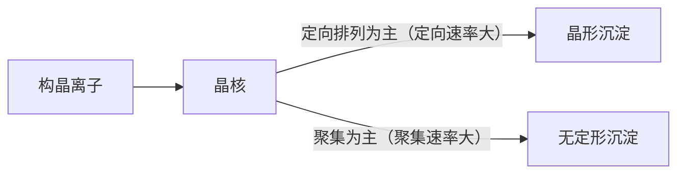

[6.1.10](/6.1.10) 讲了**溶度积**与同离子效应、盐效应、酸效应、配位效应对溶解度的影响。本章把沉淀溶解平衡用于两类经典的定量方法：一是重量分析，把被测组分转化为组成确定的沉淀，通过称量求含量，它只依赖质量测量与原子量，不需要标准溶液，是准确度最高的化学分析方法之一；二是沉淀滴定，其中实用的几乎只有以 $\ce{Ag+}$ 为滴定剂的银量法，用于测定卤素与 $\ce{SCN-}$。两类方法都要求沉淀溶解度小、纯度高，所以本章先用 [6.4.3](/6.4.3#sec-3.2) 的副反应系数把影响溶解度的因素定量化，得到条件溶度积（4.1）；再讨论沉淀怎样形成、为什么不纯（4.2），由此得出获得纯净、易过滤沉淀的条件（4.3）；然后是重量分析（4.4）与银量法（4.5）。成核与小颗粒溶解度的热力学见 [6.3.19](/6.3.19)，胶体的结构与聚沉见 [6.3.21](/6.3.21)。

溶度积与配合物稳定常数取自 CRC Handbook（$25\,^\circ\mathrm{C}$），与 [6.1.10](/6.1.10) 所用的数值一致（那里保留两位有效数字）。

## 4.1. 沉淀的溶解度

### 4.1.1. 溶解度、固有溶解度与活度积

难溶化合物 MA 在水中的溶解可以分两步写：固体先溶解为溶液中的未解离分子（或离子对）MA(aq)，再解离为离子：

$$
\mathrm{MA(s)} \ce{<=>} \mathrm{MA(aq)} \ce{<=>} \ce{M+} + \ce{A-}.
$$

**定义 4.1.1（固有溶解度）** 一定温度下，与固体平衡的溶液中未解离的分子（或离子对）MA(aq) 的浓度是常数，称为该物质的**固有溶解度**（分子溶解度），记作 $s^\circ$。

于是溶解度 $s = s^\circ + [\ce{M+}] = s^\circ + [\ce{A-}]$。对大多数难溶盐，$s^\circ$ 比离子浓度小得多，可以忽略，$s = [\ce{M+}] = [\ce{A-}]$。例如 AgCl 的 $s^\circ = [\ce{AgCl(aq)}] = K_{\mathrm{sp}}\beta_1 = 1.77\times10^{-10}\times10^{3.04} = 1.9\times10^{-7}\,\mathrm{mol\,L^{-1}}$，只是纯水中 $[\ce{Ag+}] = 1.33\times10^{-5}\,\mathrm{mol\,L^{-1}}$ 的 1.4%；但当离子浓度被同离子效应压低后，固有溶解度就会成为溶解度的主要部分（4.1.3）。$\ce{HgCl2}$ 等共价性强的化合物，固有溶解度本身就很大。

离子之间的平衡严格地说要用活度表示（[6.1.8](/6.1.8)、[6.3.12](/6.3.12#sec-12.6)）。

**定义 4.1.2（活度积）** 难溶电解质 $\mathrm{M}_m\mathrm{A}_n$ 的饱和溶液中各离子**活度**的幂的乘积

$$
K_{\mathrm{ap}} = a_{\mathrm{M}}^m a_{\mathrm{A}}^n \tag{4.1}
$$
称为**活度积**（热力学溶度积），它只与温度有关。

用浓度表示的溶度积 $K_{\mathrm{sp}} = [\mathrm{M}]^m[\mathrm{A}]^n$ 与活度积的关系是

$$
K_{\mathrm{sp}} = \frac{K_{\mathrm{ap}}}{\gamma_{\mathrm{M}}^m\gamma_{\mathrm{A}}^n}, \tag{4.2}
$$
它与温度和**离子强度**都有关。手册中的数据是外推到 $I \to 0$ 的值，即 $K_{\mathrm{ap}}$；纯水中难溶盐的离子强度很小，$\gamma \approx 1$，$K_{\mathrm{sp}} \approx K_{\mathrm{ap}}$。重量分析的溶液中有大量其他电解质（$I \approx 0.1$），严格的计算应当用该离子强度下的 $K_{\mathrm{sp}}$；作估算时一般直接用手册值。

### 4.1.2. 盐效应与同离子效应

**盐效应**（[6.1.10](/6.1.10#sec-10.3.2)）由式 (4.2) 立即可以看出：加入强电解质使离子强度增大，**活度因子**减小，$K_{\mathrm{sp}}$ 随之增大，溶解度增大。离子的电荷越高，活度因子随离子强度下降得越快（**Debye–Hückel 极限公式**，[6.3.12](/6.3.12#sec-12.7.4)），盐效应越显著：在 $0.01\,\mathrm{mol\,L^{-1}}$ $\ce{KNO3}$ 中，$\ce{BaSO4}$ 的溶解度约为纯水中的 1.5 倍，AgCl 只增大约 1.1 倍。盐效应使溶解度增大的程度一般不大，在沉淀剂只稍过量时可以忽略。

**同离子效应**（[6.1.10](/6.1.10#sec-10.3.1)）使溶解度大大减小，这是重量分析加入过量沉淀剂的依据。

**例 4.1.1** 用 $\ce{BaCl2}$ 沉淀 $\ce{SO4^2-}$，沉淀完成后溶液体积 $200\,\mathrm{mL}$。比较 (1) 沉淀剂恰好等量、(2) 过量至 $[\ce{Ba^2+}] = 0.10\,\mathrm{mol\,L^{-1}}$ 时 $\ce{BaSO4}$ 的溶解损失。$K_{\mathrm{sp}}(\ce{BaSO4}) = 1.08\times10^{-10}$，$M(\ce{BaSO4}) = 233.39\,\mathrm{g\,mol^{-1}}$。

**解** (1) $s = \sqrt{K_{\mathrm{sp}}} = 1.04\times10^{-5}\,\mathrm{mol\,L^{-1}}$，损失 $1.04\times10^{-5}\times0.200\times233.39\,\mathrm{g} = 0.49\,\mathrm{mg}$，超过了重量分析允许的 $0.2\,\mathrm{mg}$（一般分析天平的称量误差）。

(2) $s = [\ce{SO4^2-}] = K_{\mathrm{sp}}/[\ce{Ba^2+}] = 1.08\times10^{-9}\,\mathrm{mol\,L^{-1}}$，损失只有 $5\times10^{-5}\,\mathrm{mg}$，可以忽略。

沉淀剂并非越多越好：过量太多时盐效应增大，有时还生成配合物（如 AgCl 在过量 $\ce{Cl-}$ 中，见 4.1.3），溶解度反而增大，杂质的共沉淀也增多。一般规则：沉淀剂在灼烧时能挥发除去的过量 50%–100%，不能挥发的过量 20%–30%。

### 4.1.3. 副反应与条件溶度积

与配位滴定一样，构晶离子也可能发生副反应：弱酸根被质子化（酸效应），金属离子与配体（包括过量的沉淀剂本身）配位或水解（配位效应）。仿照 [6.4.3](/6.4.3#sec-3.2.4) 的处理，用未沉淀的 M、A 的总浓度 $[\mathrm{M}']$、$[\mathrm{A}']$ 表示平衡：

**定义 4.1.3（条件溶度积）** 在一定条件下，难溶电解质 $\mathrm{M}_m\mathrm{A}_n$ 的饱和溶液中构晶离子各种存在形式的总浓度的幂的乘积

$$
K'_{\mathrm{sp}} = [\mathrm{M}']^m[\mathrm{A}']^n = K_{\mathrm{sp}}\alpha_{\mathrm{M}}^m\alpha_{\mathrm{A}}^n \tag{4.3}
$$
称为**条件溶度积**，其中 $\alpha_{\mathrm{M}}$、$\alpha_{\mathrm{A}}$ 是构晶离子的**副反应系数**。

副反应系数不小于 1，所以 $K'_{\mathrm{sp}} \ge K_{\mathrm{sp}}$：副反应总是使溶解度增大。对 MA 型沉淀，没有同离子时 $s = \sqrt{K'_{\mathrm{sp}}}$；有过量沉淀剂 A（总浓度 $c_{\mathrm{A}}$）时 $s = [\mathrm{M}'] = K'_{\mathrm{sp}}/c_{\mathrm{A}}$。条件溶度积把 [6.1.10](/6.1.10#sec-10.3) 中逐一讨论的几种效应统一到了一个式子里。

**例 4.1.2** 计算 $\ce{CaC2O4}$ 在 (1) 纯水、(2) pH 2.0 的溶液、(3) pH 4.0 且草酸总浓度为 $0.10\,\mathrm{mol\,L^{-1}}$ 的溶液中的溶解度。$K_{\mathrm{sp}}(\ce{CaC2O4}) = 2.32\times10^{-9}$，$\ce{H2C2O4}$ 的 $\mathrm{p}K_{\mathrm{a}1} = 1.25$、$\mathrm{p}K_{\mathrm{a}2} = 3.81$。

**解** $\ce{C2O4^2-}$ 的酸效应系数是其分布系数的倒数：

$$
\alpha_{\ce{C2O4}(\mathrm{H})} = 1 + \frac{[\ce{H+}]}{K_{\mathrm{a}2}} + \frac{[\ce{H+}]^2}{K_{\mathrm{a}1}K_{\mathrm{a}2}}.
$$
(1) 纯水中（$\ce{C2O4^2-}$ 的水解可以忽略）$s = \sqrt{K_{\mathrm{sp}}} = 4.8\times10^{-5}\,\mathrm{mol\,L^{-1}}$。

(2) pH 2.0：$\alpha = 1 + 10^{1.81} + 10^{1.06} = 77.0$，$K'_{\mathrm{sp}} = 1.79\times10^{-7}$，$s = \sqrt{K'_{\mathrm{sp}}} = 4.2\times10^{-4}\,\mathrm{mol\,L^{-1}}$，约为纯水中的 9 倍：酸性溶液中 $\ce{CaC2O4}$ 沉淀不完全。

(3) pH 4.0：$\alpha = 1 + 10^{-0.19} + 10^{-2.94} = 1.65$，$K'_{\mathrm{sp}} = 3.8\times10^{-9}$，$s = K'_{\mathrm{sp}}/c(\ce{H2C2O4}) = 3.8\times10^{-8}\,\mathrm{mol\,L^{-1}}$。

这就是用 $\ce{KMnO4}$ 法间接测定 $\ce{Ca^2+}$（[6.4.5](/6.4.5#sec-5.5.1)）时沉淀 $\ce{CaC2O4}$ 的条件：pH 约 4 以上并有过量草酸盐，$\ce{Ca^2+}$ 可以沉淀完全。

**注 4.1.1** 例 4.1.2 (3) 忽略了 $\ce{CaC2O4}$ 的固有溶解度。$\ce{Ca^2+}$ 与 $\ce{C2O4^2-}$ 生成离子对 $\ce{CaC2O4(aq)}$ 的稳定常数约为 $10^3$，$s^\circ \approx K_{\mathrm{sp}}\times10^3 \approx 2\times10^{-6}\,\mathrm{mol\,L^{-1}}$，比算得的离子浓度大得多：同离子效应只能压低离子的浓度，压不低固有溶解度。计入后溶解度约 $2\times10^{-6}\,\mathrm{mol\,L^{-1}}$，$200\,\mathrm{mL}$ 中的损失约 $0.05\,\mathrm{mg}$，仍满足定量沉淀的要求。


沉淀剂本身就是配体时，同离子效应与配位效应相互竞争。以 AgCl 在 $\ce{Cl-}$ 溶液中为例，$\ce{Ag+}$ 与 $\ce{Cl-}$ 逐级生成 $\ce{AgCl(aq)}$、$\ce{AgCl2-}$、$\ce{AgCl3^2-}$、$\ce{AgCl4^3-}$（$\lg\beta_1, \dots, \lg\beta_4 = 3.04, 5.04, 5.04, 5.30$），溶解的银的总浓度为

$$
s = [\ce{Ag+}]\left(1 + \sum_i\beta_i[\ce{Cl-}]^i\right) = K_{\mathrm{sp}}\left(\frac{1}{[\ce{Cl-}]} + \beta_1 + \beta_2[\ce{Cl-}] + \beta_3[\ce{Cl-}]^2 + \beta_4[\ce{Cl-}]^3\right).
$$
第一项随 $[\ce{Cl-}]$ 增大而减小（同离子效应），后几项随之增大（配位效应），常数项 $K_{\mathrm{sp}}\beta_1$ 正是固有溶解度。令 $\mathrm{d}s/\mathrm{d}[\ce{Cl-}] = 0$，近似地 $[\ce{Cl-}] \approx \beta_2^{-1/2}$，即 pCl ≈ 2.5 时溶解度最小，$s_{\min} \approx 3.1\times10^{-7}\,\mathrm{mol\,L^{-1}}$，其中六成是 $\ce{AgCl(aq)}$。$[\ce{Cl-}] > 0.1\,\mathrm{mol\,L^{-1}}$ 后溶解度明显增大，在浓 HCl 中 AgCl 可以溶解。


### 4.1.4. 影响溶解度的其他因素

- 温度：大多数沉淀的溶解度随温度升高而增大，增大的程度取决于溶解焓。溶解度受温度影响大的沉淀（如 $\ce{MgNH4PO4}$）应冷却后过滤；无定形沉淀（$\ce{Fe2O3*xH2O}$）溶解度很小，冷却反而难以过滤，宜趁热过滤。
- 溶剂：无机物沉淀在有机溶剂中溶解度一般较小，如 $\ce{PbSO4}$ 在水中加入乙醇后溶解度显著降低。
- 颗粒大小：同一物质的小颗粒溶解度大于大颗粒（**Ostwald–Freundlich 方程**，[6.3.19](/6.3.19#sec-19.2.4)），这使沉淀放置时小晶体溶解、大晶体长大（4.3.1 的陈化）。
- 胶体的形成：沉淀以**胶体**分散时能穿过滤纸，造成损失；加热并加入电解质可以破坏胶体，使其聚沉（[6.3.21](/6.3.21#sec-21.6.2)）。
- 沉淀的结构：有些沉淀初生成时是亚稳态，放置后转化为更稳定的结构，溶解度降低，如初生的 CoS 比放置后易溶。

## 4.2. 沉淀的形成与纯度

### 4.2.1. 沉淀的类型

按颗粒大小与结构，沉淀大致分为三类：

| 类型 | 颗粒直径 | 例子 | 特点 |
|---|---|---|---|
| 晶形沉淀 | 约 0.1–1 μm | $\ce{BaSO4}$、$\ce{CaC2O4}$、$\ce{MgNH4PO4}$ | 结构紧密，体积小，易沉降、过滤与洗涤，吸附杂质少 |
| 凝乳状沉淀 | 约 0.02–0.1 μm | AgCl | 介于两者之间 |
| 无定形沉淀 | < 0.02 μm | $\ce{Fe2O3*xH2O}$、$\ce{Al2O3*xH2O}$ | 疏松，含大量水，体积大，难以过滤，吸附杂质多 |

**定义 4.2.1（晶形沉淀）** 由较大的、内部离子规则排列的晶体颗粒组成的沉淀称为**晶形沉淀**；由许多细小微粒疏松地聚集而成、内部无规则结构的沉淀称为**无定形沉淀**（非晶形沉淀、胶状沉淀）。

生成哪一类沉淀，首先取决于物质的本性：溶解度很小的氢氧化物与硫化物通常生成无定形沉淀，溶解度较大的 $\ce{BaSO4}$、$\ce{CaC2O4}$ 容易生成晶形沉淀。但沉淀条件的影响也很大，这正是 4.3 要讨论的。

### 4.2.2. 沉淀的形成过程

沉淀的形成包括成核与长大两个过程。



成核有两种方式（[6.3.19](/6.3.19#sec-19.2.5)）：**均相成核**是过饱和溶液中构晶离子由于涨落自发地聚集成晶核；**非均相成核**是溶液中原有的微小颗粒（尘埃、器壁上的划痕、试剂中的杂质）作为晶种诱导结晶。溶液中总有大量不溶性微粒（每毫升可达 $10^5$–$10^6$ 个），所以过饱和度不大时以非均相成核为主；过饱和度超过某一临界值后，均相成核急剧增加，晶核数目暴增。

晶核长大时，构晶离子向晶核表面扩散并沉积。它们可以聚集成无序的微粒（聚集速率），也可以按晶格排列（定向速率）。聚集速率大于定向速率时得到无定形沉淀；反之得到晶形沉淀。定向速率主要由物质的本性决定（极性强的盐如 $\ce{BaSO4}$ 定向速率大）；聚集速率则主要由沉淀时的相对过饱和度决定。

**定义 4.2.2（相对过饱和度）** 加入沉淀剂瞬间溶质的总浓度 $Q$ 超过其溶解度 $s$ 的部分与溶解度之比 $(Q - s)/s$ 称为**相对过饱和度**。

von Weimarn 总结出经验关系：沉淀生成的初始速率（分散度）与相对过饱和度成正比，

$$
v = K\,\frac{Q - s}{s}, \tag{4.4}
$$
$K$ 是与沉淀性质、温度、介质有关的常数。相对过饱和度越大，晶核越多，颗粒越细，越倾向于生成无定形或胶状沉淀。溶解度很小的物质（$\ce{Fe(OH)3}$、硫化物）即使在稀溶液中相对过饱和度也很大，所以总是生成无定形沉淀。

### 4.2.3. 共沉淀与后沉淀

重量分析要求沉淀纯净，但沉淀从溶液中析出时总会或多或少地带下其他组分。

**定义 4.2.3（共沉淀）** 沉淀从溶液中析出时，溶液中某些本身可溶的组分同时被沉淀带下来的现象称为**共沉淀**。

共沉淀有三种机理。第一种是表面吸附：沉淀表面的离子配位不饱和，吸附溶液中的离子。按 Fajans–Paneth 吸附规则，首先吸附的是与沉淀组成相同的过量构晶离子（第一吸附层），再吸引带相反电荷的离子作为反离子（第二吸附层，即胶体化学中的双电层，[6.3.21](/6.3.21#sec-21.1.3)）。反离子中，优先被吸附的是与构晶离子生成溶解度小的化合物的离子，其次是电荷高、浓度大的离子。表面吸附的量与沉淀的比表面积成正比，所以是无定形与胶体沉淀不纯的主要原因；吸附在表面的杂质可以洗涤除去，洗涤液用易挥发的电解质（如 $\ce{NH4NO3}$），既置换杂质又防止胶溶。

第二种机理是混晶。杂质离子与构晶离子的半径相近、电荷相同、晶体结构相同时，杂质可以取代构晶离子进入晶格。

**定义 4.2.4（混晶）** 杂质离子取代沉淀晶格中的构晶离子、与沉淀形成固溶体而一同析出，称为**混晶**（混晶共沉淀）。

例如 $\ce{BaSO4}$ 与 $\ce{PbSO4}$、$\ce{SrSO4}$，$\ce{MgNH4PO4*6H2O}$ 与 $\ce{MgKPO4*6H2O}$。混晶一旦形成，用洗涤或陈化都难以除去，只能预先分离杂质。

第三种机理是吸留与包夹。

**定义 4.2.5（吸留）** 沉淀生长过快时，表面吸附的杂质离子来不及离开就被随后沉积的构晶离子覆盖，陷入晶体内部，这种现象称为**吸留**；母液被机械地包在晶体之间，则称为包夹。

吸留与包夹是晶形沉淀不纯的主要原因，不能洗去，可以用陈化或重结晶减少。

**定义 4.2.6（后沉淀）** 沉淀析出后与母液一起放置时，溶液中本来难以析出沉淀的杂质离子逐渐沉积在主沉淀表面上的现象称为**后沉淀**（继沉淀）。

例如在 $\ce{Mg^2+}$ 存在下沉淀 $\ce{CaC2O4}$，$\ce{MgC2O4}$ 的过饱和溶液本来可以稳定存在，但 $\ce{CaC2O4}$ 表面吸附 $\ce{C2O4^2-}$ 后局部浓度增大，$\ce{MgC2O4}$ 便逐渐析出；$\ce{ZnS}$ 在 $\ce{CuS}$、$\ce{HgS}$ 表面上的后沉淀也是如此。后沉淀随放置时间延长而增加，所以有后沉淀时应缩短沉淀与母液共置的时间，不宜陈化。后沉淀引入的杂质常比共沉淀多。

沉淀条件对四种玷污的影响（+ 纯度提高，− 纯度降低，0 影响不大）：

| 沉淀条件 | 表面吸附 | 混晶 | 吸留与包夹 | 后沉淀 |
|---|---|---|---|---|
| 稀溶液 | + | 0 | + | 0 |
| 慢慢加入沉淀剂 | + | 不定 | + | − |
| 搅拌 | + | 0 | + | 0 |
| 陈化 | + | 不定 | + | − |
| 加热 | + | 不定 | + | 0 |
| 洗涤 | + | 0 | 0 | 0 |
| 重结晶 | + | 不定 | + | + |

## 4.3. 沉淀条件与有机沉淀剂

### 4.3.1. 晶形沉淀的条件

由式 (4.4)，要得到颗粒大、纯净的晶形沉淀，应设法降低相对过饱和度 $(Q - s)/s$：减小 $Q$，或适当增大 $s$。具体条件可以概括为"稀、热、慢、搅、陈"：

1. 稀：在较稀的溶液中进行，$Q$ 小；同时杂质浓度小，吸附减少。但不能过稀，否则溶解损失增大。
2. 热：在热溶液中沉淀，$s$ 增大，相对过饱和度降低；高温下吸附减少（吸附是放热过程）。沉淀完成后应冷却至室温再过滤，以减少溶解损失。
3. 慢、搅：在不断搅拌下慢慢滴加沉淀剂，避免局部过浓（局部 $Q$ 很大会突然生成大量晶核）。
4. 陈：沉淀完全后让沉淀与母液一起放置一段时间（陈化）。

**定义 4.3.1（陈化）** 沉淀完成后，让初生的沉淀与母液一起放置（常在加热下），使小晶体溶解、大晶体长大，晶体趋于完整、纯净的过程称为**陈化**。

陈化的原理是**Ostwald 熟化**（[6.3.21](/6.3.21#sec-21.2.3)）：小晶体的溶解度大于大晶体，溶液对大晶体是过饱和的，对小晶体是不饱和的，于是小晶体溶解、大晶体长大。陈化中晶体重新排列，吸留与包夹的杂质随之释放出来，沉淀变得易于过滤与洗涤。加热与搅拌可以缩短陈化时间（$\ce{BaSO4}$ 在室温需放置过夜，在水浴上加热只需一到两小时）。有后沉淀的体系不宜陈化。最后用构晶离子的稀溶液（或与沉淀不起反应、易挥发的电解质溶液）冷洗，减少溶解损失。

### 4.3.2. 无定形沉淀的条件

无定形沉淀的溶解度极小，无法通过降低相对过饱和度得到晶形沉淀，努力的方向是让微粒凝聚紧密、减少水合与吸附、防止形成胶体：

1. 在较浓的热溶液中进行，较快地加入沉淀剂：沉淀含水量少、结构较紧密；
2. 加入大量易挥发的电解质（如铵盐）：中和胶粒的电荷，促进凝聚，防止胶溶；
3. 不必陈化，沉淀完成后趁热过滤（无定形沉淀放置后会失水聚结，更难洗涤），用稀的热电解质溶液洗涤；
4. 沉淀完成后立即加入大量热水稀释并搅拌，使被吸附的杂质部分转入溶液。

### 4.3.3. 均匀沉淀

**定义 4.3.2（均匀沉淀）** 加入的试剂不直接与被测离子生成沉淀，而是通过溶液中缓慢进行的化学反应在整个溶液中均匀地、逐渐地产生沉淀剂，使沉淀在很低的相对过饱和度下缓慢析出的方法，称为**均匀沉淀**（均相沉淀）。

均匀沉淀从根本上避免了局部过浓，得到的沉淀颗粒大、结构紧密、纯净，甚至可以使通常为无定形的沉淀以晶形析出。例如沉淀 $\ce{CaC2O4}$：在 $\ce{Ca^2+}$ 的酸性溶液中加入草酸，因酸效应（例 4.1.2）不生成沉淀；再加入尿素，加热到约 $90\,^\circ\mathrm{C}$，尿素缓慢水解

$$
\ce{CO(NH2)2 + H2O -> CO2 + 2NH3},
$$
生成的 $\ce{NH3}$ 均匀地中和溶液中的酸，pH 逐渐升高，$[\ce{C2O4^2-}]$ 随之缓慢增大，得到粗大的 $\ce{CaC2O4}$ 晶体。类似地，硫酸二甲酯或氨基磺酸水解产生 $\ce{SO4^2-}$，磷酸三甲酯水解产生 $\ce{PO4^3-}$，丁二酮与羟胺在溶液中缩合生成丁二酮肟以沉淀 $\ce{Ni^2+}$。

### 4.3.4. 有机沉淀剂

有机沉淀剂的优点：选择性较高；沉淀溶解度小，沉淀完全；沉淀极性小，吸附无机杂质少，易过滤与洗涤；沉淀的摩尔质量大，被测组分在称量形中所占比例小，称量误差的影响小；有些沉淀烘干后组成恒定，可直接称量。缺点是试剂本身溶解度小，容易被沉淀带下；有些沉淀易黏附器壁或漂浮。

1. 生成螯合物的沉淀剂：同时含有酸性基团（$\ce{-OH}$、$\ce{-COOH}$、$\ce{=N-OH}$，失去质子后与金属离子成键）与碱性基团（$\ce{-N=}$、$\ce{-NH2}$，提供孤对电子配位），与金属离子生成不带电荷的螯合物，憎水而难溶于水。
   - 8-羟基喹啉（HOx）：与 $\ce{Mg^2+}$、$\ce{Al^3+}$、$\ce{Zn^2+}$ 等生成 $\ce{Mg(Ox)2}$、$\ce{Al(Ox)3}$ 沉淀，通过控制 pH 与加掩蔽剂提高选择性；沉淀也可溶于酸后用溴量法间接测定（[6.4.5](/6.4.5#sec-5.5.3)）。
   - 丁二酮肟：在氨性溶液中与 $\ce{Ni^2+}$ 生成鲜红色的 $\ce{Ni(C4H7N2O2)2}$ 沉淀（两个配体之间有分子内氢键，平面正方形），选择性极高，是测定镍的标准方法；在酸性溶液中只与 $\ce{Pd^2+}$ 反应。
2. 生成离子缔合物的沉淀剂：有机大离子与带相反电荷的离子缔合成体积大、憎水的盐。例如四苯硼酸钠沉淀 $\ce{K+}$（$\ce{K+ + B(C6H5)4- -> KB(C6H5)4 v}$，也沉淀 $\ce{NH4+}$、$\ce{Rb+}$、$\ce{Cs+}$），氯化四苯胂沉淀 $\ce{MnO4-}$、$\ce{ReO4-}$、$\ce{ClO4-}$ 等大阴离子。

```smiles
Oc1cccc2cccnc12 HOx
CC(=NO)C(C)=NO DMG
[B-](c1ccccc1)(c1ccccc1)(c1ccccc1)c1ccccc1 BPh4-
```

## 4.4. 重量分析法

### 4.4.1. 方法分类与特点

**定义 4.4.1（重量分析）** 用适当的方法使被测组分与试样中的其他组分分离，转化为一定的称量形式，然后用称量的方法测定其含量的分析方法称为**重量分析**（重量分析法）。

按分离的方法，重量分析分为：

1. 沉淀法：被测组分以难溶化合物的形式沉淀，过滤、洗涤、烘干或灼烧后称量，如 $\ce{SO4^2-}$ 沉淀为 $\ce{BaSO4}$、Ni 沉淀为丁二酮肟镍、P 沉淀为磷钼酸铵。这是最主要的一种，下文所说的重量分析一般指沉淀法。
2. 气化法（挥发法）：加热或用试剂使被测组分挥发，由试样减少的质量或吸收剂增加的质量求含量。例如试样在 $105\,^\circ\mathrm{C}$ 烘至恒重，减少的质量即为水分（干燥失重）；碳酸盐与酸反应放出的 $\ce{CO2}$ 用碱石棉吸收后称量。
3. 电解法：被测金属离子在电极上还原析出，由电极增加的质量求含量，如 $\ce{Cu^2+}$ 在铂网阴极上析出为金属铜（**电重量法**，[6.4.6](/6.4.6#sec-6.5.2)）。
4. 提取法：用溶剂把被测组分从试样中**萃取**出来，蒸干溶剂后称量，如测定食品中的脂肪。

重量分析的优点是准确：直接用分析天平称量，不需要基准物质与标准溶液，也不需要校准，相对误差可达 0.1%–0.2%；结果只依赖于质量测量与原子量，可以直接溯源到 SI 的质量单位，所以被国际计量机构认定为化学测量的基准方法之一，用于标准物质的定值与仲裁分析（硅、硫、镍等的仲裁分析至今用重量法）。缺点是操作繁琐、耗时长，不适合微量组分的测定。

### 4.4.2. 沉淀形与称量形

**定义 4.4.2（沉淀形）** 在沉淀重量法中，被测组分与沉淀剂反应生成、从溶液中析出的化合物称为**沉淀形**；沉淀经过滤、洗涤、烘干或灼烧后供称量的化合物称为**称量形**。

两者可以相同，也可以不同：

| 被测组分 | 沉淀剂 | 沉淀形 | 处理 | 称量形 |
|---|---|---|---|---|
| $\ce{SO4^2-}$ | $\ce{BaCl2}$ | $\ce{BaSO4}$ | 灼烧（800 °C） | $\ce{BaSO4}$ |
| $\ce{Ni^2+}$ | 丁二酮肟 | $\ce{Ni(C4H7N2O2)2}$ | 烘干（120 °C） | $\ce{Ni(C4H7N2O2)2}$ |
| $\ce{Al^3+}$ | 氨水 | $\ce{Al(OH)3}$（$\ce{Al2O3*xH2O}$） | 灼烧（1200 °C） | $\ce{Al2O3}$ |
| $\ce{Mg^2+}$ | $\ce{(NH4)2HPO4}$ + 氨 | $\ce{MgNH4PO4*6H2O}$ | 灼烧（1100 °C） | $\ce{Mg2P2O7}$ |
| $\ce{Ca^2+}$ | $\ce{(NH4)2C2O4}$ | $\ce{CaC2O4*H2O}$ | 灼烧（> 900 °C） | CaO |

对沉淀形的要求：溶解度小，溶解损失不超过称量误差（约 0.2 mg），使沉淀完全；纯度高；易于过滤与洗涤（最好是晶形沉淀）；易于定量地转化为称量形。对称量形的要求：组成恒定且与化学式完全相符，这是计算的基础；性质稳定，不吸收空气中的水和 $\ce{CO2}$，不分解；摩尔质量大，被测组分所占比例小，称量误差引起的相对误差小。例如测 Al 时，若称量形为 $\ce{Al2O3}$，$0.1000\,\mathrm{g}$ 称量形相当于 Al $0.0529\,\mathrm{g}$；若用 8-羟基喹啉沉淀并烘干为 $\ce{Al(C9H6NO)3}$，同样的称量形只相当于 Al $0.00587\,\mathrm{g}$，同样 0.2 mg 的称量误差对 Al 的影响小得多。

### 4.4.3. 换算因数与计算

**定义 4.4.3（换算因数）** 被测组分的摩尔质量与称量形的摩尔质量之比（分子、分母乘以使被测元素原子数相等的系数），

$$
F = \frac{a\,M(\text{被测组分})}{b\,M(\text{称量形})}, \tag{4.5}
$$
称为**换算因数**（化学因数）。

于是被测组分的质量 $m = F\,m(\text{称量形})$，质量分数 $w = F\,m(\text{称量形})/m_{\mathrm{s}}$，$m_{\mathrm{s}}$ 是试样质量。例如由 $\ce{BaSO4}$ 求 $\ce{SO4^2-}$，$F = 96.06/233.39 = 0.4116$；求 S，$F = 32.06/233.39 = 0.1374$；由 $\ce{Fe2O3}$ 求 Fe，$F = 2\times55.845/159.69 = 0.6994$；由 $\ce{Mg2P2O7}$ 求 Mg，$F = 2\times24.305/222.55 = 0.2184$。

**例 4.4.1** 称取钢样 $0.5000\,\mathrm{g}$，溶解后在氨性溶液中用丁二酮肟沉淀镍，得 $\ce{Ni(C4H7N2O2)2}$ $0.1500\,\mathrm{g}$。求钢中镍的质量分数。

**解** $M(\ce{Ni(C4H7N2O2)2}) = 288.92\,\mathrm{g\,mol^{-1}}$，$F = 58.693/288.92 = 0.2031$，

$$
w(\ce{Ni}) = \frac{0.2031\times0.1500}{0.5000} = 6.09\%.
$$

## 4.5. 沉淀滴定

### 4.5.1. 银量法与滴定曲线

**定义 4.5.1（沉淀滴定）** 以沉淀反应为基础的滴定分析方法称为**沉淀滴定**。

沉淀反应很多，但能用于滴定的很少：它必须按确定的计量关系迅速、定量地进行，沉淀的溶解度足够小，共沉淀不影响计量关系，还要有合适的指示终点的方法。许多沉淀反应速率慢、容易形成过饱和溶液、共沉淀严重或组成不定。目前实用的主要是生成难溶银盐的反应。

**定义 4.5.2（银量法）** 以 $\ce{AgNO3}$ 标准溶液为滴定剂（或返滴定中的过量试剂），测定 $\ce{Cl-}$、$\ce{Br-}$、$\ce{I-}$、$\ce{SCN-}$、$\ce{CN-}$ 与 $\ce{Ag+}$ 等的沉淀滴定法称为**银量法**。

滴定反应为 $\ce{Ag+ + X- -> AgX v}$，$K_{\mathrm{sp}} = [\ce{Ag+}][\ce{X-}]$，即 $\mathrm{pAg} + \mathrm{pX} = \mathrm{p}K_{\mathrm{sp}}$。以 $0.1000\,\mathrm{mol\,L^{-1}}$ $\ce{AgNO3}$ 滴定 $20.00\,\mathrm{mL}$ 同浓度的 NaCl 为例（$K_{\mathrm{sp}}(\ce{AgCl}) = 1.77\times10^{-10}$，$\mathrm{p}K_{\mathrm{sp}} = 9.75$）：

1. 滴定前：$[\ce{Cl-}] = 0.1000$，$\mathrm{pCl} = 1.00$。
2. 计量点前：按剩余的 $\ce{Cl-}$ 计算。加入 $19.98\,\mathrm{mL}$（−0.1%）时，$[\ce{Cl-}] = 0.1000\times0.02/39.98 = 5.0\times10^{-5}$，$\mathrm{pCl} = 4.30$，$\mathrm{pAg} = 9.75 - 4.30 = 5.45$。
3. 计量点：$[\ce{Ag+}] = [\ce{Cl-}] = \sqrt{K_{\mathrm{sp}}}$，$\mathrm{pAg} = \mathrm{pCl} = \frac12\mathrm{p}K_{\mathrm{sp}} = 4.88$。
4. 计量点后：按过量的 $\ce{Ag+}$ 计算。加入 $20.02\,\mathrm{mL}$（+0.1%）时，$[\ce{Ag+}] = 5.0\times10^{-5}$，$\mathrm{pAg} = 4.30$。

突跃范围为 pAg 5.45–4.30。在计量点附近，沉淀溶解产生的离子不能忽略：−0.1% 时，$[\ce{Cl-}] = 5.0\times10^{-5} + x$，$[\ce{Ag+}] = x$，由 $x(5.0\times10^{-5} + x) = K_{\mathrm{sp}}$ 得 $x = 3.4\times10^{-6}$，$\mathrm{pCl} = 4.27$，$\mathrm{pAg} = 5.48$，与近似值只差 0.03。精确的曲线可由电荷平衡 $[\ce{Ag+}] - [\ce{X-}] = (n_{\ce{Ag}} - n_{\ce{X}})/V$ 与溶度积联立，对每一点解二次方程。


与其他滴定一样，突跃的大小取决于浓度与平衡常数：浓度增大 10 倍，突跃增大 2 个单位（两端各 1 个）；$K_{\mathrm{sp}}$ 减小到 $1/10^n$，突跃增大 $n$ 个单位（只在计量点前一侧）。$\ce{Cl-}$、$\ce{Br-}$、$\ce{I-}$ 混合时，按**分步沉淀**（[6.1.10](/6.1.10#sec-10.4.1)）的次序 $\ce{I-}$、$\ce{Br-}$、$\ce{Cl-}$ 依次被滴定，用电位滴定（[6.4.6](/6.4.6#sec-6.4.5)）可以得到三个突跃；但由于混晶与吸附，分别测定的结果偏差较大。

银量法按指示终点的方法分为 Mohr 法、Volhard 法与 Fajans 法。

### 4.5.2. Mohr 法

**定义 4.5.3（Mohr 法）** 在中性或弱碱性溶液中，以 $\ce{K2CrO4}$ 为指示剂，用 $\ce{AgNO3}$ 标准溶液直接滴定 $\ce{Cl-}$（或 $\ce{Br-}$），计量点后稍过量的 $\ce{Ag+}$ 与 $\ce{CrO4^2-}$ 生成砖红色 $\ce{Ag2CrO4}$ 沉淀指示终点的方法，称为 **Mohr 法**（铬酸钾指示剂法）。

它利用的是**分步沉淀**：AgCl 的溶解度比 $\ce{Ag2CrO4}$ 小，$\ce{Cl-}$ 先沉淀，沉淀完全后才生成 $\ce{Ag2CrO4}$。

指示剂的用量。要使 $\ce{Ag2CrO4}$ 恰好在计量点生成，$[\ce{CrO4^2-}] = K_{\mathrm{sp}}(\ce{Ag2CrO4})/[\ce{Ag+}]_{\mathrm{sp}}^2 = 1.12\times10^{-12}/1.77\times10^{-10} = 6.3\times10^{-3}\,\mathrm{mol\,L^{-1}}$。但 $\ce{CrO4^2-}$ 本身是黄色，浓度高时妨碍观察砖红色，实际用约 $5\times10^{-3}\,\mathrm{mol\,L^{-1}}$。指示剂浓度过大，终点提前；过小，终点推迟。

**例 4.5.1** 用 $0.1000\,\mathrm{mol\,L^{-1}}$ $\ce{AgNO3}$ 滴定 $0.1000\,\mathrm{mol\,L^{-1}}$ KCl，终点时 $[\ce{CrO4^2-}] = 5.00\times10^{-3}\,\mathrm{mol\,L^{-1}}$；生成可以观察到的 $\ce{Ag2CrO4}$ 还需消耗 $2.0\times10^{-5}\,\mathrm{mol\,L^{-1}}$ 的 $\ce{Ag+}$。计算终点误差。$K_{\mathrm{sp}}(\ce{Ag2CrO4}) = 1.12\times10^{-12}$。

**解** 开始生成 $\ce{Ag2CrO4}$ 时 $[\ce{Ag+}] = \sqrt{1.12\times10^{-12}/5.00\times10^{-3}} = 1.50\times10^{-5}$，此时 $[\ce{Cl-}] = K_{\mathrm{sp}}(\ce{AgCl})/[\ce{Ag+}] = 1.18\times10^{-5}$。溶液中过量的 $\ce{Ag+}$ 为 $[\ce{Ag+}] - [\ce{Cl-}] = 0.32\times10^{-5}$（其余的 $\ce{Ag+}$ 与 $\ce{Cl-}$ 来自 AgCl 的溶解，等量），加上生成 $\ce{Ag2CrO4}$ 消耗的 $2.0\times10^{-5}$，共过量 $2.3\times10^{-5}\,\mathrm{mol\,L^{-1}}$。终点时溶液体积约为原来的 2 倍，

$$
E_{\mathrm{t}} = \frac{2.3\times10^{-5}\times 2V}{0.1000\,V} = +0.05\%.
$$
误差很小。被测溶液较稀时误差相对增大，可以做指示剂空白（在不含 $\ce{Cl-}$ 的、有等量 $\ce{CaCO3}$ 悬浮的溶液中滴定到同样的颜色）校正。

酸度条件：pH 6.5–10.0。

- 酸性太强时，$\ce{CrO4^2-}$ 质子化为 $\ce{HCrO4-}$（$\mathrm{p}K_{\mathrm{a}} = 6.5$）并进一步生成 $\ce{Cr2O7^2-}$（$\ce{2CrO4^2- + 2H+ <=> Cr2O7^2- + H2O}$），$[\ce{CrO4^2-}]$ 降低，终点推迟甚至不出现。
- 碱性太强时，生成 $\ce{Ag2O}$ 沉淀。
- 有 $\ce{NH4+}$ 时 pH 应控制在 6.5–7.2：pH 较高时 $\ce{NH4+}$ 转化为 $\ce{NH3}$，与 $\ce{Ag+}$ 生成 $\ce{[Ag(NH3)2]+}$，使 AgCl 与 $\ce{Ag2CrO4}$ 的溶解度增大。

Mohr 法简便、准确，用于测定 $\ce{Cl-}$、$\ce{Br-}$（如生理盐水与饮用水中的氯化物）。它的局限：AgI、AgSCN 强烈吸附 $\ce{I-}$、$\ce{SCN-}$，终点不明显，不能测定这两种离子；不能用 NaCl 直接滴定 $\ce{Ag+}$（$\ce{Ag2CrO4}$ 转化为 AgCl 很慢），测 $\ce{Ag+}$ 只能先加过量 NaCl 再返滴定；能与 $\ce{Ag+}$ 生成沉淀的阴离子（$\ce{PO4^3-}$、$\ce{AsO4^3-}$、$\ce{S^2-}$、$\ce{CO3^2-}$、$\ce{C2O4^2-}$）、能与 $\ce{CrO4^2-}$ 生成沉淀的阳离子（$\ce{Ba^2+}$、$\ce{Pb^2+}$）以及在中性溶液中水解的离子（$\ce{Fe^3+}$、$\ce{Al^3+}$）都干扰。滴定时要剧烈摇动，使被 AgCl 吸附的 $\ce{Cl-}$ 释放出来。

### 4.5.3. Volhard 法

**定义 4.5.4（Volhard 法）** 在酸性溶液中，以铁铵矾 $\ce{NH4Fe(SO4)2*12H2O}$ 为指示剂，用 $\ce{NH4SCN}$（或 KSCN）标准溶液滴定 $\ce{Ag+}$，计量点后稍过量的 $\ce{SCN-}$ 与 $\ce{Fe^3+}$ 生成红色 $\ce{FeSCN^2+}$ 指示终点的方法，称为 **Volhard 法**（铁铵矾指示剂法）。

1. 直接滴定法测 $\ce{Ag+}$：$\ce{Ag+ + SCN- -> AgSCN v}$（白色），终点时 $\ce{Fe^3+ + SCN- -> FeSCN^2+}$（$K = 138$）；$[\ce{FeSCN^2+}]$ 约达 $6\times10^{-6}\,\mathrm{mol\,L^{-1}}$ 即可看出红色。滴定在 $0.1$–$1\,\mathrm{mol\,L^{-1}}$ $\ce{HNO3}$ 中进行，以防止 $\ce{Fe^3+}$ 水解。AgSCN 吸附 $\ce{Ag+}$，计量点前要剧烈摇动。
2. 返滴定法测卤素：在含 $\ce{X-}$ 的酸性溶液中加入已知过量的 $\ce{AgNO3}$ 标准溶液，再以铁铵矾为指示剂，用 $\ce{NH4SCN}$ 标准溶液**返滴定**剩余的 $\ce{Ag+}$。

用返滴定法测 $\ce{Cl-}$ 时有一个特殊问题：AgSCN 的溶度积（$1.03\times10^{-12}$）比 AgCl 小，计量点后稍过量的 $\ce{SCN-}$ 会使 AgCl 转化为 AgSCN（**沉淀的转化**），

$$
\ce{AgCl(s) + SCN- <=> AgSCN(s) + Cl-}, \qquad K = \frac{K_{\mathrm{sp}}(\ce{AgCl})}{K_{\mathrm{sp}}(\ce{AgSCN})} = 172,
$$
摇动时红色逐渐褪去，多消耗 $\ce{NH4SCN}$，使 $\ce{Cl-}$ 的结果偏低。对策有三：

1. 加入过量 $\ce{AgNO3}$ 后煮沸，使 AgCl 凝聚，滤去沉淀并洗涤，再滴定滤液中的 $\ce{Ag+}$；
2. 加入与水不混溶的有机溶剂（经典的是硝基苯，毒性大，现多用邻苯二甲酸二丁酯或 1,2-二氯乙烷）并用力振摇，在 AgCl 表面形成一层保护膜，阻止它与 $\ce{SCN-}$ 接触；
3. 提高 $\ce{Fe^3+}$ 的浓度（约 $0.2\,\mathrm{mol\,L^{-1}}$），使终点时所需的 $[\ce{SCN-}]$ 降低，转化减慢。

测 $\ce{Br-}$、$\ce{I-}$ 时 AgBr、AgI 的溶度积不大于 AgSCN 的，没有转化问题；但测 $\ce{I-}$ 时必须先加过量 $\ce{AgNO3}$、待 $\ce{I-}$ 沉淀完全后再加指示剂，否则 $\ce{Fe^3+}$ 会把 $\ce{I-}$ 氧化为 $\ce{I2}$。

Volhard 法的最大优点是在强酸性溶液中进行，许多弱酸根（$\ce{PO4^3-}$、$\ce{AsO4^3-}$、$\ce{CO3^2-}$、$\ce{C2O4^2-}$、$\ce{S^2-}$ 在酸中已质子化）不与 $\ce{Ag+}$ 沉淀，选择性好，干扰少；可测 $\ce{Ag+}$、$\ce{Cl-}$、$\ce{Br-}$、$\ce{I-}$、$\ce{SCN-}$。强氧化剂、氮的低价氧化物、铜盐与汞盐（与 $\ce{SCN-}$ 反应）干扰。

### 4.5.4. Fajans 法

**定义 4.5.5（吸附指示剂）** 一类有机染料，它们的离子被带电的胶体沉淀表面吸附后结构改变、颜色随之变化，从而指示沉淀滴定终点，称为**吸附指示剂**。

**定义 4.5.6（Fajans 法）** 以吸附指示剂指示终点的银量法称为 **Fajans 法**（吸附指示剂法）。

变色原理。以荧光黄（HFI，弱酸，在溶液中以黄绿色的阴离子 $\ce{FI-}$ 存在）指示 $\ce{AgNO3}$ 滴定 $\ce{Cl-}$ 为例。AgCl 沉淀以胶体微粒的形式存在，表面优先吸附溶液中过量的构晶离子（[6.3.21](/6.3.21#sec-21.1.3)）：

- 计量点前，$\ce{Cl-}$ 过量，AgCl 吸附 $\ce{Cl-}$ 而带负电（$\ce{AgCl*Cl-}$），排斥同样带负电的 $\ce{FI-}$，溶液呈黄绿色；
- 计量点后，$\ce{Ag+}$ 稍过量，AgCl 吸附 $\ce{Ag+}$ 而带正电（$\ce{AgCl*Ag+}$），吸引 $\ce{FI-}$ 作为反离子；被吸附的荧光黄与表面的 $\ce{Ag+}$ 作用而结构改变，沉淀表面呈粉红色，指示终点。

由此得到吸附指示剂的电荷规则：指示剂离子的电荷应与被测离子同号（与滴定剂离子异号）。这样计量点前沉淀表面吸附被测离子，与指示剂同号而排斥它；计量点后表面吸附过量的滴定剂离子，电荷反转，才吸引指示剂。反过来用 NaCl 滴定 $\ce{Ag+}$ 时，被测离子是阳离子，就要用阳离子染料（如甲基紫）作指示剂。

Fajans 法的滴定条件：

1. 沉淀要保持胶体状态，有尽可能大的表面积：加入糊精或淀粉作保护胶体，防止 AgCl 凝聚；溶液不能太稀（$0.01$–$0.1\,\mathrm{mol\,L^{-1}}$），也要避免大量中性电解质使胶体聚沉。
2. 指示剂被沉淀吸附的能力应略小于被测离子，否则计量点前指示剂就会取代被测离子而被吸附，终点提前。卤化银对几种离子的吸附能力的次序为

$$
\ce{I-} > \ce{SCN-} > \ce{Br-} > \text{曙红} > \ce{Cl-} > \text{荧光黄},
$$
   所以测 $\ce{Cl-}$ 要用荧光黄而不能用曙红；测 $\ce{Br-}$、$\ce{I-}$、$\ce{SCN-}$ 可用曙红。
3. 溶液的 pH 要使指示剂主要以阴离子存在，即 pH 应高于指示剂的 $\mathrm{p}K_{\mathrm{a}}$，同时低于 10（不生成 $\ce{Ag2O}$）。荧光黄的酸性弱，要在 pH 7–10 使用；二氯荧光黄、曙红的酸性较强，可以在更酸的溶液中使用。
4. 避免强光照射：卤化银感光分解析出银，沉淀变为灰黑色，妨碍观察。

```smiles
O=C1OC2(c3ccccc13)c1ccc(O)cc1Oc1cc(O)ccc12 HFI
O=C1OC2(c3ccccc13)c1cc(Cl)c(O)cc1Oc1cc(O)c(Cl)cc12 H2FICl2
O=C1OC2(c3ccccc13)c1cc(Br)c(O)c(Br)c1Oc1c(Br)c(O)c(Br)cc12 eosin
```

（三种指示剂均画成中性的内酯式，起指示作用的是它们的阴离子。）

| 指示剂 | 被测离子 | 滴定剂 | 颜色变化 | 适用 pH |
|---|---|---|---|---|
| 荧光黄 | $\ce{Cl-}$、$\ce{Br-}$、$\ce{I-}$ | $\ce{Ag+}$ | 黄绿 → 粉红 | 7–10 |
| 二氯荧光黄 | $\ce{Cl-}$、$\ce{Br-}$、$\ce{I-}$ | $\ce{Ag+}$ | 黄绿 → 红 | 4–10 |
| 曙红 | $\ce{Br-}$、$\ce{I-}$、$\ce{SCN-}$ | $\ce{Ag+}$ | 橙 → 深红 | 2–10 |
| 甲基紫 | $\ce{Ag+}$ | $\ce{Cl-}$ | 红 → 紫 | 酸性 |

### 4.5.5. 标准溶液与三种方法的比较

NaCl 可以作**基准物质**（在 $500$–$600\,^\circ\mathrm{C}$ 灼烧至恒重），直接配制标准溶液。$\ce{AgNO3}$ 可以用基准级试剂直接配制，但一般配成近似浓度后用 NaCl 标定，标定的方法最好与测定的方法相同；$\ce{AgNO3}$ 溶液见光分解，应储存在棕色瓶中。$\ce{NH4SCN}$ 易吸湿，用 $\ce{AgNO3}$ 标准溶液按 Volhard 法标定。

| | Mohr 法 | Volhard 法 | Fajans 法 |
|---|---|---|---|
| 指示剂 | $\ce{K2CrO4}$ | $\ce{NH4Fe(SO4)2}$ | 吸附指示剂 |
| 滴定剂 | $\ce{Ag+}$ | $\ce{SCN-}$（返滴定时先加过量 $\ce{Ag+}$） | $\ce{Ag+}$ 或 $\ce{Cl-}$ |
| 指示原理 | 分步沉淀：$\ce{2Ag+ + CrO4^2- -> Ag2CrO4 v}$ | 配位反应：$\ce{Fe^3+ + SCN- -> FeSCN^2+}$ | 胶体表面电荷反转，指示剂被吸附而变色 |
| 酸度 | pH 6.5–10.0（有 $\ce{NH4+}$ 时 6.5–7.2） | $0.1$–$1\,\mathrm{mol\,L^{-1}}$ $\ce{HNO3}$ | pH 高于指示剂的 $\mathrm{p}K_{\mathrm{a}}$，低于 10 |
| 测定对象 | $\ce{Cl-}$、$\ce{Br-}$（$\ce{Ag+}$ 只能返滴定） | $\ce{Ag+}$（直接）；$\ce{Cl-}$、$\ce{Br-}$、$\ce{I-}$、$\ce{SCN-}$（返滴定） | $\ce{Cl-}$、$\ce{Br-}$、$\ce{I-}$、$\ce{SCN-}$、$\ce{Ag+}$ |
| 主要优缺点 | 简便；干扰多，不能测 $\ce{I-}$、$\ce{SCN-}$ | 选择性好；测 $\ce{Cl-}$ 时有沉淀转化 | 终点明显；受胶体状态、光照与 pH 影响 |

在临床与生物分析中，血清、汗液与尿液中的 $\ce{Cl-}$ 今天多用离子选择性电极或以电生 $\ce{Ag+}$ 为滴定剂的库仑滴定（氯离子计，[6.4.6](/6.4.6#sec-6.5.4)）测定，原理仍是银量法：例如诊断囊性纤维化的汗液氯化物试验。

## 小结

| 内容 | 要点 |
|---|---|
| 溶解度 | $s = s^\circ + [\ce{M+}]$；$K_{\mathrm{ap}} = a_{\mathrm{M}}a_{\mathrm{A}}$ 只与温度有关，$K_{\mathrm{sp}} = K_{\mathrm{ap}}/(\gamma_{\mathrm{M}}\gamma_{\mathrm{A}})$ 随离子强度增大 |
| 条件溶度积 | $K'_{\mathrm{sp}} = K_{\mathrm{sp}}\alpha_{\mathrm{M}}\alpha_{\mathrm{A}}$；无同离子 $s = \sqrt{K'_{\mathrm{sp}}}$，沉淀剂过量 $s = K'_{\mathrm{sp}}/c_{\mathrm{A}}$；同离子效应压不低固有溶解度 |
| 沉淀的形成 | 成核（均相、非均相）与长大（聚集与定向）；von Weimarn：$v = K(Q-s)/s$ |
| 沉淀的玷污 | 共沉淀（表面吸附、混晶、吸留与包夹）与后沉淀 |
| 沉淀条件 | 晶形：稀、热、慢、搅、陈；无定形：浓、热、加电解质、趁热过滤；均匀沉淀 |
| 重量分析 | 沉淀法、气化法、电解法、提取法；沉淀形与称量形；$w = F\,m(\text{称量形})/m_{\mathrm{s}}$；可溯源到 SI 的基准方法 |
| 银量法 | $\mathrm{pAg} + \mathrm{pX} = \mathrm{p}K_{\mathrm{sp}}$；Mohr（$\ce{K2CrO4}$，pH 6.5–10）、Volhard（铁铵矾，$\ce{HNO3}$ 介质，测 $\ce{Cl-}$ 防转化）、Fajans（吸附指示剂，与被测离子同号，吸附能力弱于被测离子） |
