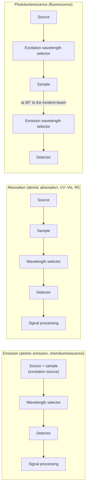

From this chapter on we study optical methods of analysis, which use the interaction of matter with electromagnetic radiation (absorption, emission and scattering) for qualitative and quantitative analysis. We first survey the electromagnetic spectrum, the classification of spectroscopic methods and the components common to spectroscopic instruments (source, monochromator and detector); the later chapters on atomic absorption ([6.4.8](/6.4.8)), ultraviolet–visible spectrophotometry ([6.4.9](/6.4.9)), molecular luminescence ([6.4.10](/6.4.10)) and infrared spectroscopy ([6.4.11](/6.4.11)) only refer back to them. We then turn to the oldest spectroscopic method of analysis, atomic emission spectrometry. The physics of atomic energy levels and term symbols, selection rules, gratings and chromatic resolving power, the Boltzmann distribution and the photoelectric effect has been covered in physics ([5.5.4](/5.5.4), [5.5.5](/5.5.5), [5.4.2](/5.4.2), [5.2.1](/5.2.1), [5.5.1](/5.5.1)); here we link to it and concentrate on how it determines the sensitivity, selectivity and instrument design of analytical methods. The general principles of calibration curves, the internal standard method and the standard addition method are in [6.4.1](/6.4.1); this chapter treats only what is specific to atomic emission.

## 7.1. Introduction to Spectroscopic Analysis

### 7.1.1. Radiant Energy and the Electromagnetic Spectrum

Electromagnetic radiation is both a wave and a stream of **photons** ([5.5.1](/5.5.1#sec-1.3)). The energy of a photon is related to its frequency $\nu$, wavelength $\lambda$ and wavenumber $\tilde\nu = 1/\lambda$ by

$$
E = h\nu = \frac{hc}{\lambda} = hc\tilde\nu.
$$
By custom, spectroscopy uses different units in different regions: nm in the ultraviolet–visible, wavenumber ($\mathrm{cm^{-1}}$) or μm in the infrared, MHz in nuclear magnetic resonance, and keV or nm for X-rays. The common conversions are

$$
1\,\mathrm{eV} \;\widehat{=}\; 1239.84\,\mathrm{nm} \;\widehat{=}\; 8065.54\,\mathrm{cm^{-1}} \;\widehat{=}\; 241.80\,\mathrm{THz} \;\widehat{=}\; 96.485\,\mathrm{kJ\,mol^{-1}}.
$$
For example, the yellow sodium line at 589.0 nm corresponds to $2.105\,\mathrm{eV}$ and $16978\,\mathrm{cm^{-1}}$, and a mole of such photons carries $203\,\mathrm{kJ\,mol^{-1}}$, the same order as a chemical bond energy; an infrared photon of $1000\,\mathrm{cm^{-1}}$ carries only $0.124\,\mathrm{eV}$ ($12\,\mathrm{kJ\,mol^{-1}}$).

The energy of the radiation determines which kind of transition in matter it can excite, and hence the corresponding analytical method:

| Region | Wavelength range | Photon energy | Transition | Analytical methods (chapter) |
|---|---|---|---|---|
| γ-rays | $< 0.005\,\mathrm{nm}$ | $> 250\,\mathrm{keV}$ | Nuclear levels | γ-ray spectrometry, Mössbauer spectroscopy |
| X-rays | $0.005$–$10\,\mathrm{nm}$ | $0.1$–$250\,\mathrm{keV}$ | Inner-shell electrons | X-ray fluorescence, X-ray diffraction (6.4.8) |
| Vacuum ultraviolet | $10$–$200\,\mathrm{nm}$ | $6$–$120\,\mathrm{eV}$ | Valence electrons (σ→σ*) | Photoelectron spectroscopy |
| Ultraviolet, visible | $200$–$780\,\mathrm{nm}$ | $1.6$–$6\,\mathrm{eV}$ | Valence electrons | Atomic emission and absorption (6.4.7–6.4.8); ultraviolet–visible absorption and molecular luminescence (6.4.9–6.4.10) |
| Near-infrared | $0.78$–$2.5\,\mu\mathrm{m}$ | $0.5$–$1.6\,\mathrm{eV}$ | Vibrational overtones and combinations | Near-infrared spectroscopy (6.4.11) |
| Mid-infrared | $2.5$–$25\,\mu\mathrm{m}$ ($4000$–$400\,\mathrm{cm^{-1}}$) | $0.05$–$0.5\,\mathrm{eV}$ | Molecular vibrations | Infrared and Raman spectroscopy (6.4.11) |
| Far-infrared, microwave | $25\,\mu\mathrm{m}$–$1\,\mathrm{m}$ | $10^{-6}$–$0.05\,\mathrm{eV}$ | Molecular rotations; electron spin in a magnetic field | Rotational spectroscopy; electron paramagnetic resonance |
| Radio frequency | $> 1\,\mathrm{m}$ | $< 10^{-6}\,\mathrm{eV}$ | Nuclear spin in a magnetic field | Nuclear magnetic resonance (6.4.12) |

### 7.1.2. Types of Spectra and Classification of Spectroscopic Methods

Atomic spectra consist of discrete sharp lines (line spectra), because atoms have only electronic energy levels. In a **molecular spectrum**, vibrational and rotational levels are superimposed on the electronic levels, giving a **band spectrum** ([5.5.5](/5.5.5#sec-5.3.4)). A hot solid emits a continuous spectrum, approximately the thermal radiation of a **black body** ([5.5.1](/5.5.1#sec-1.1)). Atomic methods therefore measure elements (irrespective of chemical form), whereas molecular methods measure molecules or functional groups.

According to how the radiation interacts with matter, spectroscopic methods are classified as follows:

| Interaction | What is measured | Atoms | Molecules |
|---|---|---|---|
| Emission | Radiation emitted after thermal or electrical excitation | Atomic emission spectrometry (this chapter) | Chemiluminescence (6.4.10) |
| Absorption | Attenuation of radiation passing through the sample | Atomic absorption (6.4.8) | Ultraviolet–visible, infrared, nuclear magnetic resonance (6.4.9, 6.4.11, 6.4.12) |
| Photoluminescence | Radiation re-emitted after absorption | Atomic fluorescence (6.4.8) | Fluorescence, phosphorescence (6.4.10) |
| Scattering | Scattered radiation | — | Raman spectroscopy (6.4.11) |

There are also optical methods that do not involve transitions between energy levels (refraction, optical rotation, circular dichroism, diffraction), and energy spectrometries and mass spectrometry, which measure electrons and ions rather than photons (6.4.15).

### 7.1.3. Components of Spectroscopic Instruments

All spectroscopic instruments consist of four parts: a source (or excitation source), a wavelength selector, a sample container (or atomizer) and a detector, plus a signal processor and readout. The order depends on the method:

Sources. Continuum sources include the deuterium lamp (ultraviolet, 160–380 nm), the tungsten–halogen lamp (visible and near-infrared), the xenon arc lamp (fluorescence), and the Nernst glower or Globar (infrared); line sources include hollow cathode lamps and lasers. In emission spectrometry the sample itself is the source, and the role of the excitation source is to vaporize, atomize and excite the sample (Section 7.3).

Wavelength selectors. A filter selects a single band of wavelengths; a monochromator consists of an entrance slit, a collimating mirror, a dispersing element (prism or grating), a focusing mirror and an exit slit, and rotating the dispersing element brings different wavelengths successively through the exit slit (the common Czerny–Turner design uses two concave mirrors). An instrument without an exit slit, with an array detector in the focal plane recording a stretch of spectrum simultaneously, is called a spectrograph or polychromator (Sections 7.4 and 7.5).

Sample containers. In the ultraviolet region one must use quartz cuvettes (glass absorbs below about 350 nm); glass is adequate in the visible region; in the infrared, salt plates such as NaCl or KBr are used.

Detectors. Photon detectors (photomultiplier tubes, photodiodes, CCDs; Section 7.5) use the photoelectric effect to convert photons into electrons. In the infrared, photon energies are too low, so thermal detectors (thermocouples, pyroelectric detectors) or narrow-band-gap semiconductor detectors are generally used (6.4.11).

### 7.1.4. A Brief History of Atomic Emission Spectrometry

The flame test has long been known. In 1859–1860 Kirchhoff and Bunsen assembled a spectroscope from a prism, a slit and a telescope and used the almost colorless flame of the Bunsen burner to excite various salts: all sodium salts gave the same closely spaced pair of yellow lines, and potassium salts gave one red and one violet line. From this they established the basic principle of spectrochemical analysis, that every element has its own characteristic spectral lines at fixed positions, and used it to discover cesium (1860, named for its blue lines) and rubidium (1861, red lines). Other elements discovered by spectroscopy include Tl, In and Ga, the rare earths Pr, Nd, Sm, Ho, Tm, Yb and Lu, helium (first in the solar spectrum), and the noble gases Ne, Ar, Kr and Xe. Atomic emission became a routine method in metallurgical and geological analysis in the 1930s; the inductively coupled plasma source of the 1970s and the echelle grating with an array detector of the 1990s made it the modern method for simultaneous multielement analysis.

## 7.2. Origin of Atomic Spectra and Line Intensity

### 7.2.1. Atomic Emission Spectrometry

**Definition 7.2.1 (Atomic Emission Spectrometry)** A method in which the analyte elements in a sample are converted to gaseous atoms (or ions) and excited by heat or electrical energy, and in which qualitative analysis is based on the wavelengths, and quantitative analysis on the intensities, of the characteristic lines emitted when the excited states return to lower energy states, is called **atomic emission spectrometry** (AES, also called optical emission spectrometry, OES).

In the excitation source the sample passes successively through vaporization, atomization (dissociation of molecules into atoms) and excitation (and ionization). An excited atom returns to a lower state within about $10^{-8}\,\mathrm{s}$ and emits a photon. Because the atomic structures of the elements differ, so do the wavelengths of their lines, which is the basis of qualitative analysis; the intensity of a given line increases with the concentration of the element, which is the basis of quantitative analysis.

Characteristics of atomic emission spectrometry:

1. Simultaneous multielement analysis: one excitation yields the lines of all elements in the sample, and a modern ICP spectrometer can determine several dozen elements in a minute.
2. Both qualitative and quantitative analysis are possible.
3. Sensitivity and selectivity are high; detection limits with an ICP source are mostly $0.1$–$10\,\mu\mathrm{g\,L^{-1}}$.
4. The instrument is simpler than those for X-ray fluorescence and ICP mass spectrometry.
5. The method is unsuited to nonmetals such as the halogens, noble gases, S, N, O and H: their excitation energies are high, their most sensitive lines lie in the vacuum ultraviolet, and air and optical components absorb there.

It is widely used for the determination of elements in metallurgical, geological, environmental, food and clinical samples.

### 7.2.2. Atomic Energy Levels and Term Symbols

The state of each electron in an atom is described by four quantum numbers ([5.5.4](/5.5.4#sec-4.4.1)): the principal quantum number $n = 1, 2, 3, \dots$ (the corresponding shells are labeled K, L, M, N, …), the orbital angular momentum quantum number $l = 0, 1, \dots, n - 1$ (subshells s, p, d, f, …), the magnetic quantum number $m_l$ and the spin magnetic quantum number $m_s = \pm\frac12$. Quantum numbers are integers (or half-integers); K, L, M and s, p, d are only labels of shells and subshells, not values of quantum numbers.

The energy levels of a many-electron atom cannot be described by the electron configuration alone: electrostatic interaction between the valence electrons and spin–orbit interaction split a configuration into several levels. For lighter atoms one uses L–S coupling: the orbital angular momenta of the valence electrons combine to a total orbital quantum number $L$ (for two electrons $L = l_1 + l_2, l_1 + l_2 - 1, \dots, \lvert l_1 - l_2\rvert$; $L = 0, 1, 2, 3, \dots$ is written S, P, D, F, …), the spins combine to a total spin quantum number $S$, and these combine to a total angular momentum quantum number $J = L + S, \dots, \lvert L - S\rvert$. The energy levels of an atom are denoted by the **term symbol** ([5.5.4](/5.5.4#def-4.2.3))

$$
n\,{}^{2S+1}L_J,
$$
where $2S + 1$ is the multiplicity; for $L \ge S$ a term has $2S + 1$ values of $J$, that is, it splits into $2S + 1$ levels.

**Example 7.2.1 (Sodium)** The ground-state configuration is $1\mathrm{s}^22\mathrm{s}^22\mathrm{p}^63\mathrm{s}^1$, with valence electron $3\mathrm{s}^1$: $L = 0$, $S = \frac12$, $J = \frac12$, term symbol $3\,{}^2\mathrm{S}_{1/2}$. The valence electron of the first excited state is $3\mathrm{p}^1$: $L = 1$, $S = \frac12$, $J = \frac32$ or $\frac12$, giving two levels $3\,{}^2\mathrm{P}_{3/2}$ and $3\,{}^2\mathrm{P}_{1/2}$. Their transitions to the ground state are the sodium D doublet:

$$
3\,{}^2\mathrm{P}_{3/2} \to 3\,{}^2\mathrm{S}_{1/2}:\ 588.995\,\mathrm{nm}\ (\mathrm{D}_2),\qquad 3\,{}^2\mathrm{P}_{1/2} \to 3\,{}^2\mathrm{S}_{1/2}:\ 589.592\,\mathrm{nm}\ (\mathrm{D}_1).
$$
The separation of the two lines arises from spin–orbit coupling ([5.5.4](/5.5.4#sec-4.2.5)).

**Example 7.2.2 (Magnesium)** The ground-state configuration is $3\mathrm{s}^2$: both electrons have $L = 0$ and paired spins, $S = 0$, so the term is $3\,{}^1\mathrm{S}_0$. The first excited configuration $3\mathrm{s}^13\mathrm{p}^1$ has $L = 1$ and $S = 0$ or 1, giving the singlet $3\,{}^1\mathrm{P}_1$ and the triplet $3\,{}^3\mathrm{P}_{2,1,0}$; the three levels of the triplet differ slightly in energy.

### 7.2.3. Selection Rules and Resonance Lines

Radiative transitions cannot occur between arbitrary pairs of levels. Electric dipole transitions must satisfy the **selection rules** ([5.5.5](/5.5.5#def-5.3.2)), which for L–S coupling are:

1. The change in the principal quantum number $n$ is unrestricted.
2. $\Delta L = \pm1$ (for the transiting electron $\Delta l = \pm1$, parity changes), so transitions occur only between S and P, P and D, D and F, and so on.
3. $\Delta S = 0$: singlets combine only with singlets, triplets only with triplets.
4. $\Delta J = 0, \pm1$, but $J = 0 \to J = 0$ is forbidden.

For example, the second excited configuration of sodium, $3\mathrm{d}$, has two levels, $3\,{}^2\mathrm{D}_{5/2}$ and $3\,{}^2\mathrm{D}_{3/2}$. Of the four combinations with $3\,{}^2\mathrm{P}_{1/2,3/2}$, the $3\,{}^2\mathrm{P}_{1/2}$–$3\,{}^2\mathrm{D}_{5/2}$ transition has $\Delta J = 2$ and is forbidden, so only three lines are observed (near 818.3 and 819.5 nm). The rule $\Delta S = 0$ holds strictly only for light atoms; in heavy atoms strong spin–orbit coupling mixes singlet and triplet states and spin-forbidden intercombination lines can appear: the Mg transition $3\,{}^3\mathrm{P}_1 \to 3\,{}^1\mathrm{S}_0$ (457.1 nm) is very weak, but the analogous Hg transition at 253.7 nm is the strongest line of the mercury lamp.

**Definition 7.2.2 (Resonance Line)** A spectral line produced by a transition between an excited state and the ground state is called a **resonance line**; the one produced by the transition from the lowest excited state to the ground state is called the first resonance line, and is usually the strongest line of the element.

Examples are Na 589.0/589.6 nm, Mg 285.21 nm, Ca 422.67 nm, Cu 324.75 nm and Zn 213.86 nm. Roman numerals distinguish the lines of atoms from those of ions: I denotes a neutral-atom line, II a singly charged ion line and III a doubly charged ion line, for instance Mg I 285.21 nm (atom line) and Mg II 279.55 nm (ion line). The level structure of an ion resembles that of the atom with one more electron ($\ce{Mg+}$ and Na both have a single valence electron), so Mg II 279.55/280.27 nm is a doublet similar to the sodium D lines. In the hot ICP the ion lines of many elements are stronger than the atom lines.

### 7.2.4. Line Intensity

**Formula 7.2.1 (Line Intensity)** In a source in thermal equilibrium at temperature $T$, the intensity of the line emitted in the transition from excited state $j$ to the ground state 0 (radiant energy emitted per unit volume and time) is

$$
I_{j0} = \frac{g_j}{g_0}A_{j0}h\nu_{j0}N_0\exp\left(-\frac{E_j}{k_{\mathrm{B}}T}\right), \tag{7.1}
$$
where $g_j$ and $g_0$ are the statistical weights (degeneracies, $g = 2J + 1$) of the two levels, $A_{j0}$ is the Einstein coefficient for spontaneous emission of the transition, $E_j$ is the excitation energy and $N_0$ is the number of ground-state atoms per unit volume.

**Proof** Each atom in state $j$ undergoes **spontaneous emission** with probability $A_{j0}$ per unit time, releasing a photon of energy $h\nu_{j0}$ ([5.5.5](/5.5.5#sec-5.2.1)), so $I_{j0} = N_jA_{j0}h\nu_{j0}$. At thermal equilibrium the populations of the levels obey the **Boltzmann distribution** ([5.2.1](/5.2.1#thm-1.7.1)), $N_j/N_0 = (g_j/g_0)\exp(-E_j/(k_{\mathrm{B}}T))$. Substitution gives the result. $\square$

Equation (7.1) shows that the line intensity depends on three kinds of factors.

1. Atomic structure: lines with large $g_j A_{j0}$ (high transition probability) and low $E_j$ are strong, which is why resonance lines, and especially first resonance lines, are the strongest.
2. Source temperature: as $T$ rises, the population of the excited state increases exponentially. At ordinary source temperatures $N_j/N_0$ is very small (in the figure below, about $10^{-10}$ for Zn 213.9 nm at 3000 K and only $7\times10^{-3}$ for Cs 852.1 nm), and the great majority of atoms are in the ground state, which is the basis of atomic absorption ([6.4.8](/6.4.8#sec-8.1.2)). The line intensity is extremely sensitive to temperature: $\frac{\mathrm{d}\ln I}{\mathrm{d}T} = \frac{E_j}{k_{\mathrm{B}}T^2}$, which for $E_j = 4\,\mathrm{eV}$ and $T = 5000\,\mathrm{K}$ is about 0.19% per kelvin, so a 50 K fluctuation changes the intensity by about 9%. The source must therefore be stable, and the internal standard method is used to compensate (Section 7.6.4). At too high a temperature atoms are ionized and $N_0$ decreases, so atom lines weaken while ion lines strengthen; the degree of ionization is given by the Saha equation and depends on the ionization energy and the temperature: elements of low ionization energy such as Na and K are almost completely ionized in an ICP. Each line therefore has an "optimum temperature" at which its intensity is greatest.
3. Concentration of the analyte: the steady-state number of atoms in the source is determined by the rate of vaporization of the sample and the rate at which atoms leave the excitation zone; under fixed conditions $N_0 \propto c$, so $I = ac$.

Conversely, the intensities of several lines of the same element with different excitation energies can be measured and $\ln\frac{I\lambda}{gA}$ plotted against $E_j$ according to Eq. (7.1) (a Boltzmann plot); the slope is $-1/(k_{\mathrm{B}}T)$, which gives the excitation temperature of the source. Lines of Fe and Ar are commonly used for this purpose.

### 7.2.5. Self-Absorption and Self-Reversal

The center of the source is hot and rich in excited atoms; the periphery is cooler and rich in ground-state atoms. Radiation from the center that passes through the periphery can be absorbed by ground-state atoms of the same element.

**Definition 7.2.3 (Self-Absorption and Self-Reversal)** The absorption of a line emitted at the center of the source by cooler ground-state atoms of the same element in the periphery, which reduces the intensity at the center of the line, is called **self-absorption**. When it is severe, the intensity at the line center falls below that at the wings and a single line appears to split into two; this is called **self-reversal**.

Self-reversal occurs because the absorbing atoms in the cooler periphery have a narrower Doppler width than the emitting line at the center (on line broadening see [6.4.8](/6.4.8#sec-8.1.3)), so absorption is strongest at the central wavelength. Self-absorption becomes more pronounced as the concentration increases, so the intensity grows more slowly than the concentration ($b < 1$ in Section 7.6.3). Resonance lines, whose lower level is the ground state, are the most prone to self-absorption. A direct-current arc, with a steep temperature gradient and a thick vapor cloud, suffers severely from it, whereas the excitation zone of an ICP is "optically thin" and self-absorption is very small, which is one reason for the wide linear range of the ICP. Older line tables mark lines that are easily self-absorbed and easily self-reversed with the letters r and R.

## 7.3. Excitation Sources

### 7.3.1. Requirements for a Source

The excitation source supplies the energy for vaporization, atomization and excitation of the sample. An ideal source has a high temperature (strong excitation capability); is stable and reproducible; has a low background (little continuous radiation and few molecular bands); has small matrix effects; and is simple and safe to use. The development of sources has been a progression toward ever higher temperatures and smaller matrix influence: flame (2000–3000 K) → arc and spark (4000–7000 K) → inductively coupled plasma (6000–10000 K).

**Remark 7.3.1 (Matrix Effects in Atomic Emission)** The influence of the major components of a sample on the intensity of an analyte line (the **matrix effect**, Definition 1.8.6) arises in an arc source mainly in two steps, vaporization and excitation.

1. Vaporization: the electrode temperature is controlled by the major components of the sample. A matrix rich in low-boiling substances gives a low electrode temperature, and one rich in high-boiling substances a high temperature. If the matrix contains substances of different boiling points, the components vaporize in order of volatility (fractional distillation effect), and the line intensity varies with the exposure time.
2. Excitation: the temperature of the arc plasma is governed by the major element of lowest ionization energy (it supplies most of the electrons), and the higher the ionization energy of the matrix, the higher the excitation temperature. Large amounts of easily ionized elements (Na, K) lower the arc temperature and so change the intensities of all lines.

This is why the standards must resemble the sample in composition, or a spectroscopic buffer must be added. In the ICP the temperature is high and the residence time of the sample is long, so matrix effects are much smaller.

### 7.3.2. Arc and Spark Sources

An arc or spark discharges between two electrodes (usually graphite, the sample being placed in a cavity of the lower electrode; for metals the sample itself serves as an electrode) and is suited to the direct analysis of solid samples.

| Source | Electrode temperature | Temperature of the discharge | Stability | Characteristics and uses |
|---|---|---|---|---|
| Direct-current arc | High | 5000–7000 K | Poor (the arc spot wanders over the electrode surface; fractional distillation) | Strong vaporization, high absolute sensitivity, low background apart from the CN bands from graphite electrodes; severe self-absorption; qualitative and semiquantitative analysis of ores and powders |
| Low-voltage alternating-current arc | Slightly lower than the dc arc | Similar | Better | Stable arc, suitable for quantitative work, sensitivity similar to the dc arc |
| High-voltage spark | Low | Momentarily above 10000 K | Good | Short discharge time and small area of action, weak vaporization, unsuited to refractory substances; high energy excites atom and ion lines of high excitation energy; suited to quantitative analysis of metals and to microanalysis |

The temperatures of arcs and sparks are still not high enough, and matrix effects are severe. Nevertheless, direct-reading spark spectrometers remain the standard equipment for furnace-side analysis in steelmaking: a single discharge gives the contents of more than twenty elements in steel within tens of seconds.

### 7.3.3. Inductively Coupled Plasma

**Definition 7.3.1 (Inductively Coupled Plasma)** An ionized gas composed of electrons, ions, atoms and molecules, electrically neutral on the macroscopic scale and with an appreciable degree of ionization, is called a **plasma**. A high-temperature plasma torch at atmospheric pressure, formed and sustained in flowing argon by the eddy currents that the alternating magnetic field of a coil carrying a high-frequency current induces in the gas and that heat it, is called an **inductively coupled plasma** (ICP).

Principle. The high-frequency generator (operating at 27.12 MHz or 40.68 MHz, two of the industrial, scientific and medical frequency bands; power usually 1–1.5 kW, up to 2–4 kW) drives a current through a water-cooled copper coil of 2–5 turns wound around the torch, which produces an axial high-frequency alternating magnetic field inside the torch. Argon itself does not conduct, so a spark from a Tesla coil first ionizes a little argon; the electrons produced are accelerated in the induced electric field and ionize more argon atoms by collisions, yielding more electrons and ions. Once the conductivity is high enough, by **Faraday's law of induction** the changing magnetic field induces closed circular **eddy currents** in the cross section perpendicular to the field. The large currents heat the gas by Joule heating, and a stable plasma torch with a temperature up to 10000 K forms almost instantly. Energy is coupled continuously from the coil into the plasma, much as in a transformer whose secondary is a single short-circuited turn of plasma.

Torch and gas flows. The torch consists of three concentric quartz tubes:

1. The outer tube carries the coolant gas (plasma gas, Ar at 10–20 L/min), which enters tangentially, keeps the plasma away from the inner wall of the tube so that the quartz does not melt, and forms a low-pressure channel in the center that favors sample introduction.
2. The middle tube carries the auxiliary gas (0–1 L/min), which lifts the base of the plasma off the mouth of the central tube.
3. The inner tube (inner diameter about 1–2 mm) carries the carrier gas (nebulizer gas, about 0.5–1 L/min), which transports the sample aerosol into the center of the plasma.

Argon is used as the working gas because it is a monatomic inert gas that forms no stable compounds with sample components, does not consume energy in dissociation as molecular gases do, has a high ionization energy (15.76 eV) and good excitation properties, and has a simple spectrum of its own.

Zones and the annular channel. From bottom to top the ICP flame is divided into the induction region, the initial radiation zone and the normal analytical zone. The induction region lies within the coil; it is white and opaque, is the region of the eddy currents, has a temperature of about 10000 K and a very high electron density, and is where the plasma couples to the coil and receives energy. Its continuous background (bremsstrahlung and ion recombination) is strong, and the sample aerosol is preheated and the solvent and solute vaporized here (preheating zone). The initial radiation zone, 10–20 mm above the coil, is slightly bluish and translucent, with a temperature of 6000–8000 K; it is the main region of atomization, excitation, ionization and emission of the analyte, and the spectra are observed here (observation zone). The tail flame is colorless and transparent, with a temperature below 6000 K, and can excite only lines of low excitation energy.

Because of the **skin effect** of the high-frequency current ([5.3.9](/5.3.9#sec-9.3.4)), the induced current is concentrated in the outer layer of the plasma and forms an annular heating zone, leaving a cooler and less viscous channel in the center: the carrier gas carries the aerosol through the central channel and across the plasma, rather than being pushed to the periphery. This "annular structure" is the source of the excellent analytical performance of the ICP: the sample spends about 2 ms above 6000 K, so vaporization and atomization are complete and chemical interferences and matrix effects are small; and because the sample is concentrated in the central channel, with no cool layer of ground-state atoms around it, self-absorption is very small.

Sample introduction. Liquid samples are nebulized by a pneumatic nebulizer (concentric or cross-flow) or an ultrasonic nebulizer and pass through a spray chamber, which removes the large droplets, into the torch. The efficiency of pneumatic nebulization is only 1%–5%; that of ultrasonic nebulization is an order of magnitude higher, but requires a desolvation unit. Solid samples can be introduced directly by laser ablation.

Analytical performance of the ICP:

1. The temperature is high, atomization is complete, and chemical interferences and matrix effects are small.
2. Self-absorption is small, and the linear range reaches 4–6 orders of magnitude.
3. There are no electrodes, hence no electrode contamination and no CN bands from graphite electrodes.
4. The electron density is very high (about $10^{15}\,\mathrm{cm^{-3}}$), so the few electrons added by easily ionized elements hardly affect the ionization equilibrium, and ionization interference can generally be ignored.
5. Stability is good, many elements can be determined simultaneously, and the precision is about 1% RSD.

The disadvantages are the large consumption of argon and hence the high running cost, the difficulty of introducing solids, the low efficiency of pneumatic nebulization, the low sensitivity for nonmetals such as the halogens, and the abundance of lines (especially for Fe and the rare earths), so that spectral interferences must be overcome with a high-resolution optical system. The ICP can be viewed from the side (radially) or end-on (axially); axial viewing has a longer optical path and detection limits lower by a factor of 5–10, but larger matrix effects. The ICP is also the ion source of ICP mass spectrometry ([6.4.15](/6.4.15#def-15.5.5)).

### 7.3.4. Other Sources

A microwave plasma (sustained by 2.45 GHz microwaves) can operate on nitrogen separated from air; its running cost is lower than that of the ICP, and commercial microwave plasma atomic emission spectrometers are available. A dielectric barrier discharge is an alternating-current discharge between two electrodes separated by at least one layer of insulating dielectric; it produces a low-temperature plasma at atmospheric pressure (the discharge region is near room temperature), requires only a few to a few tens of watts and is compact, which suits miniaturization of instruments; it has been used for the atomization and excitation of hydrides.

**Definition 7.3.2 (Laser-Induced Breakdown Spectroscopy)** A method of elemental analysis in which a high-energy pulsed laser (for example a Nd:YAG laser at 1064 nm, nanosecond pulses of tens of millijoules) is focused on the sample surface to ablate and vaporize a minute amount of material and form a transient high-temperature microplasma, and in which the atomic and ionic emission spectra are collected after a delay while the plasma cools, is called **laser-induced breakdown spectroscopy** (LIBS).

During roughly the first microsecond after the plasma forms, the continuous radiation is strong, and delayed (time-resolved) detection brings out the lines of the elements. LIBS needs almost no sample preparation, can analyze solids, liquids and gases, allows remote sensing, and can be built into handheld instruments, which makes it suited to rapid analysis in the field. Its precision and detection limits are poorer than those of the ICP, so it is used mostly for qualitative and semiquantitative analysis. LIBS on Mars rovers is a typical example: ChemCam on the American Curiosity rover (since 2012) and the Mars Surface Composition Detector (MarSCoDe) on China's Zhurong rover (2021) both strike rocks with a laser from several meters away to analyze the elemental composition of the Martian surface.

## 7.4. Optical System

### 7.4.1. Dispersing Elements and Monochromator Performance

A prism disperses light through the **dispersion** of the material (the variation of its **refractive index** with wavelength); the dispersion varies strongly with wavelength (large at short wavelengths, small at long ones), and the transmission range is limited by the material. A grating disperses light by diffraction, with an approximately linear dispersion and a very wide useful wavelength range, and nearly all modern spectrometers use gratings (for the theory of the **diffraction grating** see [5.4.2](/5.4.2#sec-2.3)).

For a reflection grating, the angle of incidence $\alpha$, the angle of diffraction $\beta$ and the wavelength are related by the grating equation

$$
d(\sin\alpha + \sin\beta) = m\lambda,
$$
where $d$ is the groove spacing and $m$ the diffraction order (for normal incidence this is [Formula 2.3.1 of 5.4.2](/5.4.2#fml-2.3.1)). Differentiating with respect to $\lambda$ at fixed $\alpha$ gives the angular dispersion (**angular dispersion**, [5.4.2](/5.4.2#sec-2.4.4))

$$
\frac{\mathrm{d}\beta}{\mathrm{d}\lambda} = \frac{m}{d\cos\beta}.
$$
An imaging mirror of focal length $f$ converts angular separation into linear separation in the focal plane, and the linear dispersion is $\mathrm{d}l/\mathrm{d}\lambda = f\,\mathrm{d}\beta/\mathrm{d}\lambda$.

**Definition 7.4.1 (Reciprocal Linear Dispersion)** The wavelength difference corresponding to unit distance in the focal plane,

$$
D^{-1} = \frac{\mathrm{d}\lambda}{\mathrm{d}l} = \frac{d\cos\beta}{mf},
$$
is called the **reciprocal linear dispersion** of the monochromator, usually in $\mathrm{nm\,mm^{-1}}$.

The smaller the reciprocal linear dispersion, the stronger the dispersing power. For example, for a grating of 1200 grooves/mm ($d = 833\,\mathrm{nm}$), $f = 0.5\,\mathrm{m}$, first order and $\beta \approx 0$, $D^{-1} = 1.67\,\mathrm{nm\,mm^{-1}}$. The range of wavelengths leaving the monochromator (the spectral bandpass) equals the reciprocal linear dispersion times the slit width: a $25\,\mu\mathrm{m}$ slit corresponds to $0.042\,\mathrm{nm}$.

Whether two lines can be separated is determined by the **chromatic resolving power** $R = \lambda/\delta\lambda = mN$, where $N$ is the total number of illuminated grooves ([5.4.2](/5.4.2#sec-2.4.4)); it is further limited by the slit width and by aberrations. Atomic emission spectra are rich in lines and demand high resolution: Chinese textbooks traditionally test spectrometers with the three Fe lines about 0.03 nm apart near 310.0 nm (the "iron triplet"), which require $R \approx 310/0.03 \approx 1\times10^4$, so in first order more than $10^4$ grooves must be illuminated (a grating of 1200 grooves/mm illuminated over 10 mm or more suffices; real instruments do much better).

Besides dispersion and resolution, a monochromator must have sufficient light-gathering power (the ability of the optical system to transmit radiant energy), which is proportional to the square of the relative aperture (the reciprocal of the $f$-number). The requirements for the optical system of an atomic emission spectrometer are therefore a large dispersion that is approximately independent of wavelength, high resolution, strong light-gathering power and maximum diffracted energy at the wavelengths needed for the analysis. The last is provided by the blazed grating.

### 7.4.2. Blazed Gratings

An ordinary transmission or plane grating diffracts most of the energy into the undispersed zeroth order, and the distribution among the other orders is uneven.

**Definition 7.4.2 (Blazed Grating)** A reflection grating whose grooves have a sawtooth profile, each small reflecting facet (groove face) making a fixed angle (the blaze angle $\theta_{\mathrm{B}}$) with the plane of the grating, is called a **blazed grating**. The diffracted energy is concentrated in the direction of specular reflection from the groove faces, and the wavelength that satisfies the grating equation in this direction is called the **blaze wavelength** $\lambda_{\mathrm{B}}$.

Diffraction from a single groove face (equivalent to the modulating envelope of single-slit diffraction, [5.4.2](/5.4.2#sec-2.3.4)) concentrates the energy in the direction of specular reflection from the groove face, while interference among the many grooves determines the positions of the orders. In the Littrow arrangement, where incident and diffracted light travel in the same direction ($\alpha = \beta = \theta_{\mathrm{B}}$), the first-order blaze wavelength is $\lambda_{\mathrm{B}} = 2d\sin\theta_{\mathrm{B}}$, and that of order $m$ is $\lambda_{\mathrm{B}}/m$.

In scalar diffraction theory the relative efficiency of order $m$ at wavelength $\lambda$ is $\eta_m(\lambda) \approx \operatorname{sinc}^2\big[\pi(\lambda_{\mathrm{B}}/\lambda - m)\big]$. At $\lambda = \lambda_{\mathrm{B}}/(m \pm \frac12)$ one has $\eta = (2/\pi)^2 \approx 0.41$, so the range

$$
\frac{\lambda_{\mathrm{B}}}{m + 0.5} \le \lambda \le \frac{\lambda_{\mathrm{B}}}{m - 0.5}
$$
is usually taken as the useful wavelength range of order $m$. For example, for a grating with a first-order blaze wavelength of 500 nm, the first order is useful from 333 to 1000 nm and the second order from 200 to 333 nm. The useful range of the first order is very wide on the long-wavelength side, so a single grating can cover a broad band.

### 7.4.3. Echelle Gratings and Two-Dimensional Dispersion

**Definition 7.4.3 (Echelle Grating)** A reflection grating with sparse grooves (usually tens per millimeter), wide groove faces and a large blaze angle (for example $63.4^\circ$ or $76^\circ$), used at very high diffraction orders (from several tens to over a hundred) near the blaze wavelength of each order, is called an **echelle grating**.

Each "step" of an echelle grating is several times wider than it is high, and the spacing of the steps is tens to hundreds of times the working wavelength. In the Littrow arrangement its angular dispersion is

$$
\frac{\mathrm{d}\beta}{\mathrm{d}\lambda} = \frac{m}{d\cos\beta} = \frac{2\tan\theta_{\mathrm{B}}}{\lambda},
$$
which depends only on the blaze angle (substitute $m\lambda = 2d\sin\theta_{\mathrm{B}}$). For example, an echelle grating of 79 grooves/mm with $\theta_{\mathrm{B}} = 63.4^\circ$ ($\tan\theta_{\mathrm{B}} = 2$) used in order 75 at 300 nm has an angular dispersion of $0.0133\,\mathrm{rad\,nm^{-1}}$, 11 times that of a 1200 grooves/mm ordinary grating in first order ($0.0012\,\mathrm{rad\,nm^{-1}}$); its resolving power $R = mN$ is also larger by more than an order of magnitude. A compact spectrometer with a focal length of less than 0.5 m can therefore reach the resolution of a large spectrograph.

The price is severe overlap of the orders: the free spectral range of order $m$ is only $\lambda/m$ (about 4 nm at 300 nm), so lines of adjacent orders fall at the same position. The remedy is cross-dispersion: a low-dispersion prism (or grating) in the direction perpendicular to that of the echelle separates the orders. The focal plane then contains a two-dimensional spectrum, with the diffraction orders arranged vertically (the high orders of short wavelengths at the top) and a short stretch of spectrum in each row. Recording the whole two-dimensional spectrum with an array detector (a CCD or charge-injection device) gives all lines from 165 to 800 nm simultaneously; modern ICP atomic emission spectrometers generally use an echelle grating with an array detector, the "full-spectrum direct-reading" design.

## 7.5. Detectors

### 7.5.1. Photographic Plates

Classical spectrography recorded spectra on photographic plates: a glass plate coated with a silver halide emulsion, which darkens where a line exposed it after development. The intensity of a line is expressed by the blackness $S = \lg(i_0/i)$, where $i_0$ and $i$ are the intensities of the microphotometer beam transmitted through the unexposed part and the darkened line of the plate. A plate records a whole stretch of the spectrum at once, but the relation between blackness and intensity is nonlinear (the emulsion characteristic curve) and the procedure is laborious, so plates have been replaced by photoelectric detectors.

### 7.5.2. Photomultiplier Tubes

**Definition 7.5.1 (Photomultiplier Tube)** A photoelectric detector consisting of a photocathode, several electron-multiplying electrodes (dynodes) and an anode sealed in an evacuated tube, which uses the **photoelectric effect** to convert incident photons into photoelectrons and amplifies them stage by stage, through secondary electron emission at the dynodes, into a measurable current, is called a **photomultiplier tube** (PMT).

The photocathode is coated with a photosensitive material of low work function (Sb–Cs, Ag–O–Cs, bialkali Sb–K–Cs, multialkali or GaAs). Photoelectrons ejected by photons (the **photoelectric effect**, [5.5.1](/5.5.1#sec-1.2)) are accelerated by the electric field to the first dynode $D_1$, where each releases $\delta$ secondary electrons, which are accelerated in turn to $D_2$, and so on. A direct-current high voltage of about 1000 V between cathode and anode is divided among 9–12 dynodes. With $n$ dynodes the total gain is $G = \delta^n$: $\delta = 4$ and $n = 10$ give $G \approx 10^6$, and actual gains range from $10^5$ to $10^8$. The main characteristics of a photomultiplier tube are as follows.

1. Spectral response: determined by the photocathode material and the window material (UV glass or quartz), typically covering 160–900 nm; the quantum efficiency of the photocathode (the ratio of photoelectrons produced to incident photons) peaks at about 20%–30%.
2. Linearity and dark current: for incident light of fixed spectral composition the anode current is proportional to the intensity, $i = kI + i_0$.

**Definition 7.5.2 (Dark Current)** The current output by a detector when it is not illuminated is called the **dark current**.

The dark current of a photomultiplier tube comes mainly from thermionic emission at the photocathode and dynodes (which increases exponentially with temperature) and secondarily from leakage current between electrodes; cooling or a suitably lower operating voltage reduces it. The smaller the dark current, the better the detector.

3. Noise and signal-to-noise ratio: even for constant incident intensity the photocurrent fluctuates, which is noise. The ratio of output signal to noise is the signal-to-noise ratio; it determines the weakest intensity that can be measured and hence the **limit of detection** of the analyte (Section 7.5.4).
4. Operating voltage and temperature: the $\delta$ of each dynode increases with the interstage voltage, and the total gain is roughly proportional to the total voltage raised to the power $kn$ ($k \approx 0.7$), so the gain of a 10-stage tube is roughly proportional to the 7th power of the voltage: a 0.05% change in voltage changes the gain by about 0.35%. This is why a photomultiplier tube needs a highly stable high-voltage supply (fluctuation not above 0.05%). Exceeding the maximum permitted voltage causes spontaneous discharge and damages the tube; changes of ambient temperature also affect the photocurrent, so the tube must be operated in an environment of constant temperature and not at high temperatures.
5. Fatigue and aging: with too intense or too prolonged illumination the photocurrent gradually decays (fatigue); fatigue that recovers after a period in the dark is reversible, and that which does not is aging. An excessive anode current (far above about $100\,\mu\mathrm{A}$) accelerates aging.

Photomultiplier tubes are highly sensitive and fast (nanosecond response) and can operate in single-photon counting mode; they are still used in atomic absorption, fluorescence and single-channel scanning spectrometers.

### 7.5.3. Charge-Coupled Devices

**Definition 7.5.3 (Charge-Coupled Device)** A photoelectric detector made of a large number of metal–oxide–semiconductor capacitors (pixels) arranged in a linear or two-dimensional array on a silicon semiconductor, in which the electron–hole pairs produced by photons in a pixel are collected and accumulated in a potential well and, after the exposure, are read out in turn by transferring the charge from well to neighboring well (charge coupling), is called a **charge-coupled device** (CCD).

Each pixel of a CCD acts as an integrating photodetector: it collects the photogenerated charge during the exposure (integration) period, and at readout the charge packets are shifted, driven by clock voltages, row by row and pixel by pixel to the output amplifier. Its main performance parameters are as follows.

1. Quantum efficiency: the ratio of charges collected to photons incident. A back-illuminated CCD can exceed 90% in the visible, far more than the photocathode of a photomultiplier tube; with a fluorescent conversion layer it can be used in the ultraviolet.
2. Dark current and readout noise: thermal excitation also generates charge, so CCDs are generally cooled thermoelectrically to about $-40\,^\circ\mathrm{C}$ to reduce the dark current; the readout noise is only a few electrons.
3. Dynamic range: the ratio of the full-well charge (about $10^5$ electrons) to the readout noise. Intense light makes charge spill into neighboring pixels (blooming), which requires anti-blooming structures.
4. Spectral response range and number of pixels: linear arrays ($1024\times1$, $2048\times1$) are used for one-dimensional spectra, and two-dimensional arrays ($512\times512$, $1024\times1024$, etc.) for the two-dimensional spectra of echelle gratings.

In atomic emission spectrometry the advantages of the CCD are simultaneous recording of the whole spectrum and high speed (for example 70 elements in 35 s); sensitivity and dynamic range that match or exceed those of the photomultiplier tube; and stable performance, tolerance of overexposure and greater ruggedness than the photomultiplier tube. The related charge-injection device (CID) allows random readout of any pixel and nondestructive readout, and is used in some ICP spectrometers.

### 7.5.4. Noise and Signal-to-Noise Ratio

The arrival of photons at a detector is random: the number of photons $N$ arriving in a given time follows a **Poisson distribution** ([3.1.4](/3.1.4#sec-4.1.7)), whose variance equals the mean and whose standard deviation is $\sqrt{N}$. The resulting noise is called shot noise and is the fundamental limit of any optical measurement. If shot noise is the only noise, the signal-to-noise ratio is

$$
\frac{S}{N} = \frac{N}{\sqrt{N}} = \sqrt{N},
$$
which grows as the square root of the count (the intensity or the integration time): at $10^4$ photons the relative standard deviation is 1%, and $10^6$ photons are needed to reduce it to 0.1%. Lengthening the integration time by a factor of 4 therefore improves the signal-to-noise ratio only by a factor of 2. The dark current also produces shot noise, the readout process adds readout noise, and fluctuations of the source (flicker noise, roughly proportional to $1/f$) cannot be eliminated by longer integration; being proportional to the signal, they must be compensated by the internal standard method or a double-beam design. By Definition 1.8.5, the **limit of detection** is determined by the noise of the blank signal.

### 7.5.5. Multichannel and Single-Channel Scanning Instruments

Atomic emission spectrometers using photomultiplier tubes come in two designs.

| Instrument | Design | Advantages | Disadvantages |
|---|---|---|---|
| Multichannel spectrometer | An exit slit and a photomultiplier tube at each preselected line position on the Rowland circle of a concave grating (Paschen–Runge mounting) | Simultaneous determination, fast readout, good precision | The elements and lines are fixed at the factory, generally a dozen to a few dozen |
| Single-channel scanning spectrometer | One exit slit and one photomultiplier tube; the grating is rotated to scan the lines of the elements in turn | Flexible, any line can be chosen | Sequential determination, slow readout |

A single-channel scanning instrument can determine many elements, but one after another, not simultaneously. Full-spectrum direct-reading instruments with an echelle grating and an array CCD combine the advantages of both: all lines are recorded simultaneously, and the analytical lines and background correction points can be chosen freely. They have become the mainstream for ICP atomic emission spectrometers.

## 7.6. Qualitative and Quantitative Analysis

### 7.6.1. Qualitative Analysis

Each element has many lines, and in an analysis only the few most representative ones need be examined.

**Definition 7.6.1 (Analytical Line, Sensitive Line and Last Line)** A characteristic line used to establish the presence of an element or to determine its content is called an **analytical line**. A line of an element that has a large intensity and still appears at low contents is called a **sensitive line**. As the content of the element in the sample decreases, its lines disappear one by one, and the last one to vanish is called the **last line**.

The last line is usually the most sensitive line, normally the first resonance line (although not necessarily in sources prone to self-absorption). The presence of an element must be confirmed by two or three sensitive lines or more, with overlap from the lines of other elements excluded. Classical spectrography used the iron-spectrum comparison method for qualitative analysis: the sample and pure iron are photographed side by side on the same plate, and the iron spectrum, rich in lines of accurately known wavelength, serves as a wavelength scale. By comparison with a standard spectral chart marking the sensitive lines of each element, one checks in turn whether the sensitive lines of the suspected elements appear. The method is convenient for checking many elements at once, and has now been replaced by photoelectric detection and spectral line databases (such as the NIST Atomic Spectra Database) with automatic identification software.

### 7.6.2. Semiquantitative Analysis

When the approximate content of an element must be known quickly (for example in reconnaissance of ores), one can use line-intensity comparison (the intensity of an analyte line in the sample is compared with that in a series of standards) or line-appearance comparison (the lower the content, the fewer lines appear, and the content is estimated from which lines appear). The error is about 30%–200%.

### 7.6.3. Quantitative Analysis: The Lomakin–Scheibe Equation

By Section 7.2.4 the line intensity is proportional to the concentration, but self-absorption slows the growth of intensity at high concentrations.

**Definition 7.6.2 (Lomakin–Scheibe Equation)** The empirical relation between the intensity $I$ of a line and the concentration $c$ of the analyte in the sample under fixed excitation conditions,

$$
I = ac^b,\qquad \lg I = b\lg c + \lg a \tag{7.2}
$$
is called the **Lomakin–Scheibe equation**. The constant $a$ depends on the vaporization and excitation conditions and on the sample composition; $b$ is called the self-absorption coefficient, and equals 1 when there is no self-absorption and becomes smaller as self-absorption grows.

On a plot of $\lg I$ against $\lg c$, the curve is a straight line of slope 1 in the range of low concentration without self-absorption; at higher concentrations the slope decreases and the curve bends. A **calibration curve** prepared with standards of composition similar to the sample gives the concentration from the line intensity. Self-absorption in an ICP source is very small and the linear range is very wide.

### 7.6.4. The Internal Standard Method

The constant $a$ in Eq. (7.2) fluctuates with the source temperature, the vaporization conditions and the matrix (Section 7.2.4 explains the sensitivity of the intensity to temperature), so direct measurement of absolute intensities is of poor precision. Quantitative analysis in atomic emission therefore generally uses the **internal standard method** (Definition 1.8.9): an internal standard element of fixed content is added to the sample and the standards (or an element already present is used), and the intensity ratio of the analytical line to the internal standard line is measured.

Let the contents of the analyte and the internal standard element be $c$ and $c_0$, the intensities of the analytical and internal standard lines $I$ and $I_0$, and the self-absorption coefficients $b$ and $b_0$. By Eq. (7.2), $I = a_1c^b$ and $I_0 = a_0c_0^{b_0}$, and their ratio is

$$
R = \frac{I}{I_0} = \frac{a_1}{a_0c_0^{b_0}}\,c^b = Ac^b,\qquad \lg R = b\lg c + \lg A. \tag{7.3}
$$
For fixed $c_0$, $A$ is a constant, and a calibration curve of $\lg R$ against $\lg c$ gives the quantitative result; this is the basic relation for quantitative spectrochemical analysis by the internal standard method. A fluctuation of the source conditions changes $a_1$ and $a_0$ together, and so long as the two lines respond to the changes in the same way, the ratio is unaffected. The pair of the analytical line and the internal standard line is called the analytical line pair. The principles for choosing the internal standard element and line are as follows.

1. The content of the internal standard element must be moderate and fixed (the sample should originally contain none or very little of it; otherwise its content must be accurately known).
2. The compounds of the internal standard element and of the analyte should have similar vaporization behavior in the source.
3. The analytical line and the internal standard line should have no or very little self-absorption and should be free of interference from other lines.
4. For an analytical line pair of atom lines the excitation energies of the two lines should be close; for ion lines, in addition to similar excitation energies the ionization energies of the internal standard element and the analyte should also be close. A pair of one atom line and one ion line is unsuitable, because their dependences on temperature are quite different (by Eq. (7.1) and the ionization equilibrium).
5. The wavelengths of the two lines should be as close as possible (in spectrography this removes the variation of the emulsion characteristics with wavelength; in photoelectric measurement the two lines can be measured by the same detector or by neighboring channels).

In ICP atomic emission spectrometry, Y (371.03 nm), Sc and In are commonly used as internal standards, and mainly compensate for variations in the efficiency of nebulization and sample introduction.

### 7.6.5. Standard Addition and Background Correction

When the matrix of the standards is hard to match to that of the sample, the **standard addition method** (Definition 1.8.8) is used: different amounts of the analyte element are added to several equal portions of the sample, the line intensities are measured, and the intensity is plotted against the amount added and extrapolated to zero intensity; the absolute value of the intercept on the horizontal axis is the content in the sample. The method requires the calibration curve to be linear over the range used and to pass through the origin (after subtraction of the background). Standard addition can also be used to check for matrix effects and to estimate systematic errors.

A line sits on the continuous background of the source (ion–electron recombination, bremsstrahlung), on molecular band spectra and on stray light, and the background must be subtracted to obtain the net line intensity. In the off-peak correction method the background intensity is measured on both sides near the line and the average $I_{\mathrm{b}}$ is taken as the background at the line, so that the net intensity is $I = I_{l+\mathrm{b}} - I_{\mathrm{b}}$. Correction is simpler still when the background is used as an internal standard:

$$
R = \frac{I}{I_{\mathrm{b}}} = \frac{I_{l+\mathrm{b}}}{I_{\mathrm{b}}} - 1,
$$
since both the apparent line intensity $I_{l+\mathrm{b}}$ and the background intensity $I_{\mathrm{b}}$ can be measured directly, giving the background-corrected $\lg R$. A full-spectrum direct-reading instrument can choose background correction points freely on either side of the line, and can also subtract complex overlapping interferences by multivariate fitting.

### 7.6.6. Applications

ICP atomic emission spectrometry (ICP-OES) is one of the most widely used methods for determining major, minor and trace elements in solution: heavy metals in environmental water samples and soil digests, major and minor elements in geological samples and ores, impurities in alloys, harmful and nutritional elements in foods and traditional Chinese medicines, and Na, K, Ca, Mg, Fe, Zn, Cu, P and S in clinical samples (serum, urine). Compared with the methods of the next two chapters: atomic absorption ([6.4.8](/6.4.8)) determines only one element at a time, but the instrument is cheaper and interferences are fewer; ICP mass spectrometry ([6.4.15](/6.4.15#sec-15.5.6)) has detection limits two to three orders of magnitude lower than ICP-OES and can measure isotopes, but costs more and tolerates total dissolved solids less well. Direct-reading spark spectrometry is used for furnace-side analysis of steel and nonferrous metals, and LIBS for field analysis, remote sensing and surface microanalysis.

## Summary

- Spectroscopic methods are classified by the region of the radiation (which determines the type of transition) and by the mode of interaction (emission, absorption, photoluminescence, scattering); every instrument consists of a source, a wavelength selector, a sample and a detector.
- The performance of a monochromator is described by the reciprocal linear dispersion, the chromatic resolving power $R = mN$ and the light-gathering power. A blazed grating concentrates energy near $\lambda_{\mathrm{B}}/m$, with the useful range $\lambda_{\mathrm{B}}/(m \pm 0.5)$; an echelle grating uses high orders to obtain high dispersion and resolution, and after cross-dispersion the full spectrum is recorded by an array detector.
- A photomultiplier tube amplifies by dynodes, with a gain of $10^5$–$10^8$ and a strong dependence on the high voltage; a CCD has high quantum efficiency and records the full spectrum simultaneously; shot noise makes the signal-to-noise ratio grow as the square root of the count.
- Atomic lines arise from transitions between terms that satisfy the selection rules; the line intensity is $I \propto (g_j/g_0)A_{j0}h\nu\,N_0\mathrm{e}^{-E_j/(k_{\mathrm{B}}T)}$, extremely sensitive to temperature; the great majority of atoms are in the ground state.
- Self-absorption and self-reversal curve the calibration plot ($I = ac^b$, $b < 1$). Through the skin effect the ICP forms an annular channel, with a high temperature, little self-absorption, small matrix effects and a wide linear range, and is the main source in modern atomic emission spectrometry.
- Quantitative analysis uses calibration curves, the internal standard method (the analytical line pair having similar excitation and ionization energies) and standard addition, with background subtraction.

## Questions

1. Why is atomic emission spectrometry unsuited to the determination of the halogens and the noble gases?

   **Answer** Their excitation energies are high, the populations of their excited states are extremely small, and their most sensitive lines lie in the vacuum ultraviolet, where air and optical components absorb.
2. By roughly how much does the intensity of a line of excitation energy 4 eV change when the source temperature rises from 5000 K to 5100 K? Why do some atom lines weaken at too high a temperature?

   **Answer** It increases by about $\exp\left(\frac{E_j}{k_{\mathrm{B}}}\left(\frac{1}{5000} - \frac{1}{5100}\right)\right) - 1 \approx 20\%$; at too high a temperature the atoms are heavily ionized and the number of ground-state atoms decreases.
3. Why are resonance lines the most prone to self-absorption? Why is self-absorption very small in an ICP source?

   **Answer** The lower level of a resonance line is the ground state, and ground-state atoms are most numerous in the cool periphery; in the ICP the sample is concentrated in the central channel and there is no cool layer of atoms of the same kind around it.
4. Why must an echelle grating be used together with cross-dispersion and an array detector?

   **Answer** It works at very high orders with a free spectral range of only a few nanometers, so the orders overlap severely; cross-dispersion separates the orders in the perpendicular direction to form a two-dimensional spectrum, which only an array detector can record simultaneously.
5. Why can an atom line and an ion line not be used as the analytical line pair in the internal standard method?

   **Answer** The intensity of an ion line also depends on the ionization equilibrium, so the two lines depend on temperature differently and their intensity ratio does not stay constant when the temperature fluctuates.
