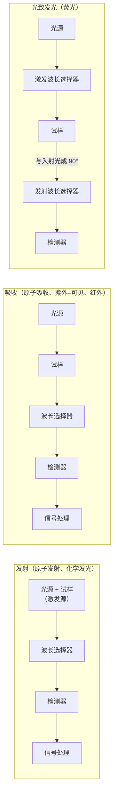

从本章起是光学分析方法：利用物质与电磁辐射的相互作用——吸收、发射、散射——进行定性与定量分析。本章先概述电磁波谱、各种光谱方法的分类和光谱仪器的共同部件（光源、单色器与检测器），它们在后面的原子吸收（[6.4.8](/6.4.8)）、紫外–可见（[6.4.9](/6.4.9)）、分子发光（[6.4.10](/6.4.10)）与红外（[6.4.11](/6.4.11)）各章中只引用；然后讲最早的光谱分析方法——原子发射光谱法。原子能级与光谱项、选择定则、光栅与色分辨本领、Boltzmann 分布和光电效应的物理已在物理学中讲过（[5.5.4](/5.5.4)、[5.5.5](/5.5.5)、[5.4.2](/5.4.2)、[5.2.1](/5.2.1)、[5.5.1](/5.5.1)），这里链接过去，重点放在它们怎样决定分析方法的灵敏度、选择性与仪器设计。校准曲线、内标法与标准加入法的一般原理在 [6.4.1](/6.4.1)，本章只写原子发射光谱特有的部分。

## 7.1. 光谱分析概论

### 7.1.1. 电磁辐射的能量与电磁波谱

电磁辐射既是波也是**光子**流（[5.5.1](/5.5.1#sec-1.3)）。光子的能量与频率 $\nu$、波长 $\lambda$、波数 $\tilde\nu = 1/\lambda$ 的关系为

$$
E = h\nu = \frac{hc}{\lambda} = hc\tilde\nu.
$$
光谱学中按习惯在不同区域用不同的单位：紫外–可见区用 nm，红外区用波数（$\mathrm{cm^{-1}}$）或 μm，核磁共振用 MHz，X 射线用 keV 或 nm。常用的换算关系：

$$
1\,\mathrm{eV} \;\widehat{=}\; 1239.84\,\mathrm{nm} \;\widehat{=}\; 8065.54\,\mathrm{cm^{-1}} \;\widehat{=}\; 241.80\,\mathrm{THz} \;\widehat{=}\; 96.485\,\mathrm{kJ\,mol^{-1}}.
$$
例如钠的 589.0 nm 黄线对应 $2.105\,\mathrm{eV}$、$16978\,\mathrm{cm^{-1}}$，一摩尔光子的能量为 $203\,\mathrm{kJ\,mol^{-1}}$，与化学键能同一量级；红外的 $1000\,\mathrm{cm^{-1}}$ 只有 $0.124\,\mathrm{eV}$（$12\,\mathrm{kJ\,mol^{-1}}$）。

辐射的能量决定了它能激发物质中的哪种跃迁，也就决定了对应的分析方法：

| 区域 | 波长范围 | 光子能量 | 对应的跃迁 | 分析方法（章） |
|---|---|---|---|---|
| γ 射线 | $< 0.005\,\mathrm{nm}$ | $> 250\,\mathrm{keV}$ | 核能级 | γ 能谱、Mössbauer 谱 |
| X 射线 | $0.005$–$10\,\mathrm{nm}$ | $0.1$–$250\,\mathrm{keV}$ | 内层电子 | X 射线荧光、X 射线衍射（6.4.8） |
| 真空紫外 | $10$–$200\,\mathrm{nm}$ | $6$–$120\,\mathrm{eV}$ | 价电子（σ→σ*） | 光电子能谱 |
| 紫外、可见 | $200$–$780\,\mathrm{nm}$ | $1.6$–$6\,\mathrm{eV}$ | 价电子 | 原子发射与原子吸收（6.4.7–6.4.8），紫外–可见吸收与分子发光（6.4.9–6.4.10） |
| 近红外 | $0.78$–$2.5\,\mu\mathrm{m}$ | $0.5$–$1.6\,\mathrm{eV}$ | 振动的倍频与合频 | 近红外光谱（6.4.11） |
| 中红外 | $2.5$–$25\,\mu\mathrm{m}$（$4000$–$400\,\mathrm{cm^{-1}}$） | $0.05$–$0.5\,\mathrm{eV}$ | 分子振动 | 红外与 Raman 光谱（6.4.11） |
| 远红外、微波 | $25\,\mu\mathrm{m}$–$1\,\mathrm{m}$ | $10^{-6}$–$0.05\,\mathrm{eV}$ | 分子转动；磁场中的电子自旋 | 转动光谱；电子顺磁共振 |
| 射频 | $> 1\,\mathrm{m}$ | $< 10^{-6}\,\mathrm{eV}$ | 磁场中的核自旋 | 核磁共振（6.4.12） |

### 7.1.2. 光谱的类型与光谱方法的分类

按产生光谱的物质，原子光谱由彼此分立的锐线组成（线状光谱），因为原子只有电子能级；**分子光谱**则因电子能级上叠加了振动与转动能级而成为**带状光谱**（[5.5.5](/5.5.5#sec-5.3.4)）；炽热的固体发出连续光谱（近似于**黑体**的热辐射，[5.5.1](/5.5.1#sec-1.1)）。所以原子光谱法测的是元素（与化学形态无关），分子光谱法测的是分子或基团。

按辐射与物质作用的方式，光谱方法分为：

| 作用方式 | 测量 | 原子 | 分子 |
|---|---|---|---|
| 发射 | 热或电激发后发出的辐射 | 原子发射光谱（本章） | 化学发光（6.4.10） |
| 吸收 | 透过试样后辐射的减弱 | 原子吸收（6.4.8） | 紫外–可见、红外、核磁共振（6.4.9、6.4.11、6.4.12） |
| 光致发光 | 吸收后再发出的辐射 | 原子荧光（6.4.8） | 荧光、磷光（6.4.10） |
| 散射 | 散射辐射 | — | Raman 光谱（6.4.11） |

此外还有不涉及能级跃迁的光学方法（折射、旋光、圆二色、衍射），以及测量电子、离子而非光子的能谱与质谱（6.4.15）。

### 7.1.3. 光谱仪器的基本组成

各种光谱仪器都由四个部分组成：光源（或激发源）、波长选择器、试样容器（或原子化器）、检测器，加上信号处理与读出系统。排列顺序依方法而定：

光源：连续光源（氘灯用于紫外 160–380 nm，钨卤素灯用于可见与近红外，氙弧灯用于荧光，红外用 Nernst 灯或硅碳棒）和线光源（空心阴极灯、激光）。发射光谱中试样本身就是光源，激发源的作用是使试样蒸发、原子化并激发（7.3）。

波长选择器：滤光片（只选出一个波段）或单色器。单色器由入射狭缝、准直镜、色散元件（棱镜或光栅）、聚焦镜与出射狭缝组成，转动色散元件使不同波长依次通过出射狭缝（常见的 Czerny–Turner 结构用两块凹面镜）；去掉出射狭缝、在焦面上放面阵检测器同时记录一段光谱的称为摄谱仪或多色仪（7.4、7.5）。

试样容器：在紫外区必须用石英比色皿（玻璃在约 350 nm 以下吸收），可见区可用玻璃，红外区用 NaCl、KBr 等盐片。

检测器：光子检测器（光电倍增管、光电二极管、CCD，7.5）利用光电效应，把光子转换为电子；红外区光子能量太低，多用热检测器（热电偶、热释电检测器）或窄禁带半导体检测器（6.4.11）。

### 7.1.4. 原子发射光谱法简史

焰色反应早就为人所知。1859–1860 年，Kirchhoff 与 Bunsen 用棱镜、狭缝与望远镜组装成分光镜，用几乎无色的 Bunsen 灯火焰激发各种盐：所有钠盐都给出同一对靠得很近的黄线，钾盐给出一条红线和一条紫线。他们由此确立了"每种元素都有自己特征的、位置固定的谱线"这一光谱分析的基本原理，并用它发现了铯（1860，以其蓝色谱线命名）与铷（1861，红色谱线）。此后用光谱法发现的元素还有 Tl、In、Ga，稀土 Pr、Nd、Sm、Ho、Tm、Yb、Lu，以及太阳光谱中的 He 与稀有气体 Ne、Ar、Kr、Xe。原子发射光谱法在 20 世纪 30 年代成为冶金与地质分析的常规方法，1970 年代的电感耦合等离子体光源与 1990 年代的中阶梯光栅加面阵检测器使它成为现代的多元素同时分析方法。

## 7.2. 原子光谱的产生与谱线强度

### 7.2.1. 原子发射光谱法

**定义 7.2.1（原子发射光谱法）** 在热或电的激发下使试样中的待测元素成为气态原子（或离子）并被激发，根据激发态回到较低能态时发射的特征谱线的波长进行定性分析、根据谱线强度进行定量分析的方法称为**原子发射光谱法**（AES，又称光学发射光谱法 OES）。

试样在激发源中依次经历蒸发、原子化（分子解离为原子）、激发（以及电离）三个过程，激发态原子在约 $10^{-8}\,\mathrm{s}$ 内回到低能态并发射光子。由于各元素的原子结构不同，谱线的波长不同，这是定性的依据；同一谱线的强度随元素的浓度增大，这是定量的依据。

原子发射光谱法的特点：

1. 多元素同时分析：一次激发就得到试样中所有元素的谱线，现代 ICP 光谱仪一分钟内可测几十种元素；
2. 可以定性，也可以定量；
3. 灵敏度与选择性较高，ICP 光源的检出限多在 $0.1$–$10\,\mu\mathrm{g\,L^{-1}}$；
4. 仪器比 X 射线荧光与 ICP 质谱简单；
5. 不适于卤素、稀有气体、S、N、O、H 等非金属：它们的激发能高，最灵敏的谱线在真空紫外区，空气与光学元件都会吸收。

它广泛用于冶金、地质、环境、食品与临床样品中元素的测定。

### 7.2.2. 原子能级与光谱项

原子中每个电子的状态由四个量子数描述（[5.5.4](/5.5.4#sec-4.4.1)）：主量子数 $n = 1, 2, 3, \dots$（相应的电子壳层记作 K、L、M、N……），轨道角量子数 $l = 0, 1, \dots, n - 1$（亚层记作 s、p、d、f……），磁量子数 $m_l$ 与自旋磁量子数 $m_s = \pm\frac12$。量子数取整数（或半整数），K、L、M 与 s、p、d 只是壳层与亚层的记号，不是量子数的取值。

多电子原子的能级不能只由电子组态描述：价电子之间的静电作用与自旋–轨道作用使同一组态分裂为若干能级。对较轻的原子用 L–S 耦合：各价电子的轨道角动量合成总轨道角量子数 $L$（两个电子时 $L = l_1 + l_2, l_1 + l_2 - 1, \dots, \lvert l_1 - l_2\rvert$，$L = 0, 1, 2, 3, \dots$ 记作 S、P、D、F……），自旋合成总自旋量子数 $S$，再合成总角量子数 $J = L + S, \dots, \lvert L - S\rvert$。原子的能级用**光谱项**（[5.5.4](/5.5.4#def-4.2.3)）表示：

$$
n\,{}^{2S+1}L_J,
$$
$2S + 1$ 称为多重度；$L \ge S$ 时一个光谱项有 $2S + 1$ 个 $J$ 值，即分裂为 $2S + 1$ 个光谱支项。

**例 7.2.1（钠）** 基态组态 $1\mathrm{s}^22\mathrm{s}^22\mathrm{p}^63\mathrm{s}^1$，价电子 $3\mathrm{s}^1$：$L = 0$，$S = \frac12$，$J = \frac12$，光谱项 $3\,{}^2\mathrm{S}_{1/2}$。第一激发态的价电子是 $3\mathrm{p}^1$：$L = 1$，$S = \frac12$，$J = \frac32$ 或 $\frac12$，两个支项 $3\,{}^2\mathrm{P}_{3/2}$ 与 $3\,{}^2\mathrm{P}_{1/2}$，它们向基态的跃迁就是钠的 D 双线：

$$
3\,{}^2\mathrm{P}_{3/2} \to 3\,{}^2\mathrm{S}_{1/2}:\ 588.995\,\mathrm{nm}\ (\mathrm{D}_2),\qquad 3\,{}^2\mathrm{P}_{1/2} \to 3\,{}^2\mathrm{S}_{1/2}:\ 589.592\,\mathrm{nm}\ (\mathrm{D}_1).
$$
两线之差来自自旋–轨道耦合（[5.5.4](/5.5.4#sec-4.2.5)）。

**例 7.2.2（镁）** 基态组态 $3\mathrm{s}^2$：两个电子 $L = 0$，自旋配对 $S = 0$，光谱项 $3\,{}^1\mathrm{S}_0$。第一激发组态 $3\mathrm{s}^13\mathrm{p}^1$：$L = 1$，$S = 0$ 或 1，得到单重态 $3\,{}^1\mathrm{P}_1$ 与三重态 $3\,{}^3\mathrm{P}_{2,1,0}$；三重态的三个支项能量略有不同。

### 7.2.3. 选择定则与共振线

并不是任意两个能级之间都能发生辐射跃迁。电偶极跃迁必须满足**选择定则**（[5.5.5](/5.5.5#def-5.3.2)），对 L–S 耦合：

1. 主量子数 $n$ 的改变不受限制；
2. $\Delta L = \pm1$（跃迁电子的 $\Delta l = \pm1$，宇称改变），即只能在 S 与 P、P 与 D、D 与 F 之间跃迁；
3. $\Delta S = 0$，单重态只跃迁到单重态，三重态只跃迁到三重态；
4. $\Delta J = 0, \pm1$，但 $J = 0 \to J = 0$ 禁戒。

例如钠的第二激发组态 $3\mathrm{d}$ 有 $3\,{}^2\mathrm{D}_{5/2}$ 与 $3\,{}^2\mathrm{D}_{3/2}$ 两个支项，它们与 $3\,{}^2\mathrm{P}_{1/2,3/2}$ 之间四种组合中，$3\,{}^2\mathrm{P}_{1/2}$–$3\,{}^2\mathrm{D}_{5/2}$ 的 $\Delta J = 2$ 是禁戒的，只观察到三条谱线（818.3 与 819.5 nm 附近）。$\Delta S = 0$ 只对轻原子严格成立；重原子的自旋–轨道耦合强，单重态与三重态混合，自旋禁戒的互组合线也能出现：Mg 的 $3\,{}^3\mathrm{P}_1 \to 3\,{}^1\mathrm{S}_0$（457.1 nm）很弱，Hg 的同类跃迁 253.7 nm 却是汞灯最强的谱线。

**定义 7.2.2（共振线）** 激发态与基态之间跃迁产生的谱线称为**共振线**；由最低激发态跃迁到基态的称为第一共振线，它通常是该元素最强的谱线。

例如 Na 589.0/589.6 nm、Mg 285.21 nm、Ca 422.67 nm、Cu 324.75 nm、Zn 213.86 nm。原子的谱线与离子的谱线用罗马数字区分：I 表示中性原子线，II 表示一价离子线，III 表示二价离子线，如 Mg I 285.21 nm（原子线）、Mg II 279.55 nm（离子线）。离子的能级结构与少一个电子的原子相似（$\ce{Mg+}$ 与 Na 都只有一个价电子），所以 Mg II 279.55/280.27 nm 是类似钠 D 线的双线。在高温的 ICP 中，许多元素的离子线比原子线更强。

### 7.2.4. 谱线强度

**公式 7.2.1（谱线强度）** 在温度为 $T$ 的热平衡光源中，由激发态 $j$ 跃迁到基态 0 发射的谱线强度（单位体积、单位时间发射的辐射能）为

$$
I_{j0} = \frac{g_j}{g_0}A_{j0}h\nu_{j0}N_0\exp\left(-\frac{E_j}{k_{\mathrm{B}}T}\right), \tag{7.1}
$$
其中 $g_j$、$g_0$ 是两个能级的统计权重（即能级的简并度，$g = 2J + 1$），$A_{j0}$ 是跃迁的自发辐射系数，$E_j$ 是激发能，$N_0$ 是单位体积中基态原子数。

**证明** 每个处于 $j$ 态的原子在单位时间内以概率 $A_{j0}$ 发生**自发辐射**、放出能量 $h\nu_{j0}$ 的光子（[5.5.5](/5.5.5#sec-5.2.1)），所以 $I_{j0} = N_jA_{j0}h\nu_{j0}$。热平衡时各能级的粒子数服从 **Boltzmann 分布**（[5.2.1](/5.2.1#thm-1.7.1)）：$N_j/N_0 = (g_j/g_0)\exp(-E_j/(k_{\mathrm{B}}T))$。代入即得。$\square$

式 (7.1) 说明谱线强度取决于三类因素：

1. 原子结构：$g_j A_{j0}$ 大（跃迁概率大）、$E_j$ 低的谱线强，所以共振线、尤其是第一共振线最强。
2. 光源温度：$T$ 升高，激发态的布居按指数增加。在通常的光源温度下，$N_j/N_0$ 很小（图中 Zn 213.9 nm 在 3000 K 只有约 $10^{-10}$，Cs 852.1 nm 也只有 $7\times10^{-3}$），绝大多数原子处在基态——这是原子吸收法的依据（[6.4.8](/6.4.8#sec-8.1.2)）。谱线强度对温度极为敏感：$\frac{\mathrm{d}\ln I}{\mathrm{d}T} = \frac{E_j}{k_{\mathrm{B}}T^2}$，$E_j = 4\,\mathrm{eV}$、$T = 5000\,\mathrm{K}$ 时每开尔文变化约 0.19%，温度波动 50 K 就使强度变化约 9%。所以光源必须稳定，并用内标法补偿（7.6.4）。温度过高时原子电离，$N_0$ 反而减小，原子线变弱而离子线增强；电离度由 Saha 方程给出，它取决于电离能与温度：Na、K 等电离能低的元素在 ICP 中几乎全部电离。每条谱线因此有一个强度最大的"最佳温度"。
3. 待测元素的浓度：光源中稳态的原子数由试样的蒸发速率与原子离开激发区的速率决定，在一定条件下 $N_0 \propto c$，所以 $I = ac$。

反过来，测出同一元素几条激发能不同的谱线的强度，由式 (7.1) 以 $\ln\frac{I\lambda}{gA}$ 对 $E_j$ 作图（Boltzmann 作图），斜率为 $-1/(k_{\mathrm{B}}T)$，可以求出光源的激发温度；Fe 与 Ar 的谱线常用于这一目的。

### 7.2.5. 自吸与自蚀

光源中心温度高，激发态原子多；外围温度低，基态原子多。中心发出的辐射穿过外围时，会被同种元素的基态原子吸收。

**定义 7.2.3（自吸与自蚀）** 光源中心发射的谱线被外围温度较低的同种基态原子吸收，使谱线中心的强度减弱的现象称为**自吸**；自吸严重时，谱线中心的强度甚至低于两翼，一条谱线看上去分裂为两条，称为**自蚀**。

自蚀的原因是外围原子温度低，吸收线的 Doppler 宽度比中心发射线窄（谱线变宽见 [6.4.8](/6.4.8#sec-8.1.3)），中心波长处的吸收最强。自吸随浓度增大而加剧，使谱线强度随浓度的增长变慢（7.6.3 的 $b < 1$）；共振线的下能级是基态，最容易自吸；直流电弧的温度梯度大、蒸气云厚，自吸严重，ICP 的激发区是"光学薄"的，自吸很小，这是 ICP 线性范围宽的原因之一。旧的谱线表用 r 与 R 标注易自吸与易自蚀的谱线。

## 7.3. 激发光源

### 7.3.1. 对光源的要求

激发光源为试样的蒸发、原子化与激发提供能量。理想的光源应当：温度高（激发能力强）；稳定、重现性好；背景小（连续辐射与分子带光谱少）；基体效应小；简便、安全。光源的发展历程正是温度不断升高、基体影响不断降低的过程：火焰（2000–3000 K）→ 电弧与火花（4000–7000 K）→ 电感耦合等离子体（6000–10000 K）。

**注 7.3.1（原子发射光谱中的基体效应）** 试样的主体成分对待测元素谱线强度的影响（**基体效应**，定义 1.8.6）在电弧光源中主要发生在蒸发与激发两步：

1. 蒸发：电极温度由试样中的主体成分控制。基体含大量低沸点物质时电极温度低，含大量高沸点物质时温度高；基体中有沸点不同的物质时各组分按挥发性先后蒸发（分馏效应），谱线强度随曝光时间而变。
2. 激发：电弧等离子体的温度由其中电离能最低的主体元素决定（它提供了大部分电子），基体的电离能越高，激发温度越高。大量易电离元素（Na、K）使电弧温度降低，所有谱线的强度都随之改变。

这就是标准样品必须与试样组成相近、或加入光谱缓冲剂的原因。ICP 的温度高、样品在其中停留时间长，基体效应小得多。

### 7.3.2. 电弧与火花光源

电弧与火花在两个电极（通常是石墨电极，试样装在下电极的孔穴中；分析金属时试样本身作电极）之间放电，适于固体试样的直接分析。

| 光源 | 电极温度 | 放电区温度 | 稳定性 | 特点与用途 |
|---|---|---|---|---|
| 直流电弧 | 高 | 5000–7000 K | 差（弧斑在电极表面游动，有分馏效应） | 蒸发能力强，绝对灵敏度高，背景除石墨电极的 CN 带外较浅；自吸严重；矿石、粉末的定性与半定量 |
| 低压交流电弧 | 略低于直流电弧 | 相近 | 较好 | 弧焰稳定，适于定量，灵敏度与直流电弧相近 |
| 高压火花 | 低 | 瞬时可达 10000 K 以上 | 好 | 放电时间短、作用面积小，蒸发能力弱，不适于难挥发物；能量高，能激发激发能高的原子线与离子线；适于金属的定量与微区分析 |

电弧与火花的温度仍不够高，基体影响严重。但火花光源的直读光谱仪至今仍是钢铁冶炼炉前分析的标准设备：一次放电在几十秒内给出钢中二十多种元素的含量。

### 7.3.3. 电感耦合等离子体

**定义 7.3.1（电感耦合等离子体）** 由电子、离子、原子和分子组成、宏观上呈电中性、有相当电离度的电离气体称为**等离子体**。用高频电流通过感应线圈产生的交变磁场，在流动的氩气中感应出环形涡流并加热，形成并维持的常压高温等离子体炬称为**电感耦合等离子体**（ICP）。

工作原理。高频发生器（工作频率多为 27.12 MHz 或 40.68 MHz 这两个工业、科学与医疗用频段；功率通常 1–1.5 kW，最大 2–4 kW）的电流通过绕在炬管外的 2–5 匝水冷铜管线圈，在炬管内产生轴向的高频交变磁场。氩气本身不导电，先用 Tesla 线圈的火花使少量氩电离；产生的电子在感应电场中加速，与氩原子碰撞使之电离，产生更多的电子与离子。电导率足够大时，按 **Faraday 电磁感应定律**，变化的磁场在垂直于磁场的截面上感应出闭合的环形**涡流**，强大的电流以 Joule 热加热气体，瞬间形成温度可达 10000 K 的稳定等离子体炬。能量由线圈持续耦合给等离子体，就像变压器的次级线圈是一匝短路的等离子体。

炬管与气路。炬管由三层同心石英管组成：

1. 外管通冷却气（等离子体气，Ar 10–20 L/min），沿切线方向进入，使等离子体离开外管内壁以免烧熔石英，并在中心形成低压通道，有利于进样；
2. 中层管通辅助气（0–1 L/min），使等离子体底部离开中心管口；
3. 内管（内径约 1–2 mm）通载气（雾化气，约 0.5–1 L/min），把试样气溶胶送入等离子体中心。

用 Ar 作工作气体，因为它是单原子惰性气体，不与试样组分形成难解离的化合物，不像分子气体那样因解离消耗能量，电离能（15.76 eV）高、激发性能好，自身的谱线也较简单。

三个区与环状通道。ICP 焰自下而上分为焰心区、内焰区与尾焰区。焰心区在感应线圈内，白色不透明，是涡流区，温度约 10000 K，电子密度很高，等离子体在这里与线圈耦合获得能量；它的连续背景（轫致辐射与离子复合）很强，试样气溶胶在这里被预热、蒸发溶剂与溶质（预热区）。内焰区在线圈上方 10–20 mm，略带淡蓝色、半透明，温度 6000–8000 K，是待测物原子化、激发、电离与辐射的主要区域，光谱观测在这里进行（测光区）。尾焰区无色透明，温度低于 6000 K，只能激发低能级的谱线。

由于高频电流的**趋肤效应**（[5.3.9](/5.3.9#sec-9.3.4)），感应电流集中在等离子体的外层，形成一个环形的加热区，中心是温度较低、黏度较小的通道：载气带着气溶胶顺利地从中心通道穿过等离子体，而不是被推向外围。这一"环状结构"是 ICP 优良分析性能的根源：试样在 6000 K 以上停留约 2 ms，蒸发、原子化充分，化学干扰与基体效应小；试样集中在中心通道，外围没有低温的基态原子层，自吸很小。

试样引入。液体试样由气动雾化器（同心雾化器、交叉流雾化器）或超声雾化器雾化，经雾化室除去大雾滴后进入炬管。气动雾化的效率只有 1%–5%，超声雾化的效率高一个数量级，但需要去溶剂装置。固体试样可以用激光烧蚀直接引入。

ICP 的分析性能：

1. 温度高，原子化完全，化学干扰小，基体效应小；
2. 自吸小，线性范围可达 4–6 个数量级；
3. 没有电极，无电极污染，也没有石墨电极的 CN 带；
4. 电子密度很高（约 $10^{15}\,\mathrm{cm^{-3}}$），易电离元素加入的少量电子对电离平衡影响很小，电离干扰一般可以不考虑；
5. 稳定性好，多元素同时测定，精密度 RSD 约 1%。

缺点是：消耗大量氩气，运行费用高；固体进样较困难；气动雾化效率低；对卤素等非金属灵敏度低；谱线丰富（尤其是 Fe、稀土等元素），光谱干扰需要高分辨率的分光系统来克服。ICP 观测有侧向（径向）与轴向两种：轴向观测光程长，检出限低 5–10 倍，但基体效应较大。ICP 也是 ICP 质谱的离子源（[6.4.15](/6.4.15#def-15.5.5)）。

### 7.3.4. 其他光源

微波等离子体（2.45 GHz 的微波维持的等离子体）可以用空气中分离出的氮气工作，运行费用低于 ICP，已有商品化的微波等离子体原子发射光谱仪。介质阻挡放电是两电极之间至少隔一层绝缘介质的交流放电，在常压下产生低温等离子体（放电区接近室温），功率只有几瓦到几十瓦，体积小，适于仪器的微型化，已用于氢化物的原子化与激发。

**定义 7.3.2（激光诱导击穿光谱）** 用高能量的脉冲激光（如 1064 nm、纳秒级、几十毫焦的 Nd:YAG 激光）聚焦在试样表面，使微量物质烧蚀、气化并形成瞬态的高温微等离子体，延时采集等离子体冷却过程中的原子与离子发射光谱进行元素分析的方法称为**激光诱导击穿光谱**（LIBS）。

等离子体形成后的最初约 1 μs 内连续辐射很强，延迟采集（时间分辨检测）可以突出元素的谱线。LIBS 几乎不需要样品处理，能分析固体、液体与气体，可以远距离遥测，也可以做成手持式仪器，适于现场快速分析；其精密度与检出限不如 ICP，多用于定性与半定量。火星车上的 LIBS 是典型的例子：2012 年起美国"好奇号"的 ChemCam、2021 年中国"祝融号"的火星表面成分探测仪（MarSCoDe）都用激光在几米外击打岩石，分析火星表面的元素组成。

## 7.4. 分光系统

### 7.4.1. 色散元件与单色器的性能

棱镜靠材料的**色散**（**折射率**随波长的变化）分光，色散随波长变化很大（短波处大、长波处小），透光范围受材料限制；光栅靠衍射分光，色散近似线性，适用于很宽的波段，现代光谱仪几乎都用光栅（**光栅**的理论见 [5.4.2](/5.4.2#sec-2.3)）。

对反射光栅，入射角 $\alpha$、衍射角 $\beta$ 与波长的关系是光栅方程

$$
d(\sin\alpha + \sin\beta) = m\lambda,
$$
其中 $d$ 为刻线间距，$m$ 为衍射级次（垂直入射时即 [5.4.2 的公式 2.3.1](/5.4.2#fml-2.3.1)）。固定 $\alpha$ 对 $\lambda$ 求导，得角色散（**色散本领**，[5.4.2](/5.4.2#sec-2.4.4)）

$$
\frac{\mathrm{d}\beta}{\mathrm{d}\lambda} = \frac{m}{d\cos\beta}.
$$
焦距为 $f$ 的成像镜把角距离转换为焦面上的线距离，线色散为 $\mathrm{d}l/\mathrm{d}\lambda = f\,\mathrm{d}\beta/\mathrm{d}\lambda$。

**定义 7.4.1（倒线色散率）** 焦面上单位距离所对应的波长差

$$
D^{-1} = \frac{\mathrm{d}\lambda}{\mathrm{d}l} = \frac{d\cos\beta}{mf}
$$
称为单色器的**倒线色散率**，常用单位 $\mathrm{nm\,mm^{-1}}$。

倒线色散率越小，色散能力越强。例如 1200 条/mm 的光栅（$d = 833\,\mathrm{nm}$）、$f = 0.5\,\mathrm{m}$、一级光谱、$\beta \approx 0$ 时，$D^{-1} = 1.67\,\mathrm{nm\,mm^{-1}}$。单色器出射光的波长范围（光谱通带）等于倒线色散率乘以狭缝宽度：$25\,\mu\mathrm{m}$ 的狭缝对应 $0.042\,\mathrm{nm}$。

两条谱线能否分开由**色分辨本领** $R = \lambda/\delta\lambda = mN$ 决定（$N$ 为被照明的刻线总数，[5.4.2](/5.4.2#sec-2.4.4)），它还受狭缝宽度与像差的限制。原子发射光谱谱线丰富，对分辨率要求高：中文教材常以 Fe 在 310.0 nm 附近三条相距约 0.03 nm 的谱线（"铁三线"）检验光谱仪，需要 $R \approx 310/0.03 \approx 1\times10^4$，一级光谱中被照明的刻线数应超过 $10^4$（1200 条/mm 的光栅照明 10 mm 以上即可，实际的仪器要高得多）。

除色散率与分辨率外，单色器还要有足够的集光本领（光学系统传递辐射能的能力），它与相对孔径（$f$ 数的倒数）的平方成正比。所以对原子发射光谱的分光系统的要求是：色散率大，且近似与波长无关；分辨率高；集光本领强，并使分析所需波长的衍射能量最大。最后一点由闪耀光栅满足。

### 7.4.2. 闪耀光栅

普通的透射或平面光栅把大部分能量衍射到不色散的零级，各级之间的分配也不均匀。

**定义 7.4.2（闪耀光栅）** 刻槽的截面呈锯齿形、每个小反射面（槽面）与光栅平面成一定角度（闪耀角 $\theta_{\mathrm{B}}$）的反射光栅称为**闪耀光栅**；衍射能量集中的方向与槽面的镜面反射方向一致，在这一方向上满足光栅方程的波长称为**闪耀波长** $\lambda_{\mathrm{B}}$。

单个槽面的衍射（相当于单缝衍射的调制，[5.4.2](/5.4.2#sec-2.3.4)）把能量集中在槽面的镜面反射方向，多槽干涉则决定各级的位置。使入射光与衍射光沿同一方向（Littrow 装置，$\alpha = \beta = \theta_{\mathrm{B}}$）时，一级闪耀波长为 $\lambda_{\mathrm{B}} = 2d\sin\theta_{\mathrm{B}}$，$m$ 级的闪耀波长为 $\lambda_{\mathrm{B}}/m$。

按标量衍射理论，$m$ 级在波长 $\lambda$ 处的相对效率为 $\eta_m(\lambda) \approx \operatorname{sinc}^2\big[\pi(\lambda_{\mathrm{B}}/\lambda - m)\big]$。在 $\lambda = \lambda_{\mathrm{B}}/(m \pm \frac12)$ 处 $\eta = (2/\pi)^2 \approx 0.41$，所以通常把

$$
\frac{\lambda_{\mathrm{B}}}{m + 0.5} \le \lambda \le \frac{\lambda_{\mathrm{B}}}{m - 0.5}
$$
作为 $m$ 级的适用波长范围。例如一级闪耀波长 500 nm 的光栅，一级适用于 333–1000 nm，二级适用于 200–333 nm。一级的适用范围在长波一侧很宽，所以一块光栅能覆盖很宽的波段。

### 7.4.3. 中阶梯光栅与二维色散

**定义 7.4.3（中阶梯光栅）** 刻线稀疏（通常每毫米几十条）、槽面宽而闪耀角大（如 $63.4^\circ$ 或 $76^\circ$），使用很高的衍射级次（几十到一百多级）、在每一级的闪耀波长附近工作的反射光栅称为**中阶梯光栅**（Echelle 光栅）。

中阶梯光栅的每一个"阶梯"的宽度是高度的几倍，阶梯间距是工作波长的几十到几百倍。它在 Littrow 装置下的角色散为

$$
\frac{\mathrm{d}\beta}{\mathrm{d}\lambda} = \frac{m}{d\cos\beta} = \frac{2\tan\theta_{\mathrm{B}}}{\lambda},
$$
只由闪耀角决定（代入 $m\lambda = 2d\sin\theta_{\mathrm{B}}$）。例如 79 条/mm、$\theta_{\mathrm{B}} = 63.4^\circ$（$\tan\theta_{\mathrm{B}} = 2$）的中阶梯光栅在 300 nm 处用第 75 级，角色散为 $0.0133\,\mathrm{rad\,nm^{-1}}$，是 1200 条/mm 普通光栅一级（$0.0012\,\mathrm{rad\,nm^{-1}}$）的 11 倍；色分辨本领 $R = mN$ 也大一个数量级以上。于是一台焦距不到 0.5 m 的小型光谱仪就能达到大型摄谱仪的分辨率。

代价是各级严重重叠：$m$ 级的自由光谱区只有 $\lambda/m$（300 nm 处约 4 nm），相邻级的谱线落在同一位置。解决的办法是交叉色散：在与中阶梯光栅色散方向垂直的方向上，用一个低色散的棱镜（或光栅）把各级分开。焦面上于是得到二维的光谱图：沿竖直方向排列着各个衍射级（短波的高级次在上），每一行内是该级的一小段光谱。用面阵检测器（CCD 或电荷注入器件）记录整个二维光谱，就能同时得到 165–800 nm 的全部谱线——现代 ICP 原子发射光谱仪普遍采用中阶梯光栅加面阵检测器，即"全谱直读"。

## 7.5. 检测器

### 7.5.1. 感光板

经典的摄谱法用感光板记录光谱：玻璃板上涂有卤化银乳剂，谱线曝光处显影后变黑。谱线的强度用黑度 $S = \lg(i_0/i)$ 表示，$i_0$ 与 $i$ 是测微光度计的光束透过未曝光部分与谱线变黑部分的强度。感光板能一次记录整段光谱，但黑度与强度的关系是非线性的（乳剂特性曲线），操作繁琐，已被光电检测器取代。

### 7.5.2. 光电倍增管

**定义 7.5.1（光电倍增管）** 由光阴极、若干个电子倍增极（打拿极）与阳极封装在真空管中构成，利用**光电效应**把入射光子转换为光电子、再经各倍增极的二次电子发射逐级放大为可测电流的光电检测器称为**光电倍增管**（PMT）。

光阴极涂有逸出功低的光敏材料（Sb–Cs、Ag–O–Cs、双碱 Sb–K–Cs、多碱或 GaAs），光子打出的光电子（**光电效应**，[5.5.1](/5.5.1#sec-1.2)）被电场加速到第一倍增极 $D_1$，打出 $\delta$ 个二次电子，它们再加速到 $D_2$……阴极与阳极之间加约 1000 V 的直流高压，分配到 9–12 个倍增极上。$n$ 个倍增极的总增益 $G = \delta^n$：$\delta = 4$、$n = 10$ 时 $G \approx 10^6$，实际的增益在 $10^5$–$10^8$。光电倍增管的主要性能：

1. 光谱响应：由光阴极材料与窗口材料（紫外玻璃或石英）决定，通常覆盖 160–900 nm；光阴极的量子效率（产生的光电子数与入射光子数之比）峰值约 20%–30%。
2. 线性与暗电流：入射光的光谱组成不变时，阳极电流与入射光强成正比：$i = kI + i_0$。

**定义 7.5.2（暗电流）** 检测器在没有光照时输出的电流称为**暗电流**。

光电倍增管的暗电流主要来自光阴极与倍增极的热电子发射（随温度按指数增加），其次是电极间的漏电流；降低温度（制冷）或适当降低工作电压都能减小暗电流。暗电流越小，检测器的质量越好。

3. 噪声与信噪比：入射光强不变时光电流仍有起伏，这就是噪声；输出信号与噪声之比称为信噪比，它决定了能测出的最弱光强，从而决定了待测元素的**检出限**（7.5.4）。
4. 工作电压与温度：每个倍增极的 $\delta$ 随级间电压增大，总增益大致与总电压的 $kn$ 次方成正比（$k \approx 0.7$），所以 10 级管的增益约与电压的 7 次方成正比：电压变化 0.05%，增益就变化约 0.35%。这就是光电倍增管必须用高度稳定的高压电源（波动不超过 0.05%）的原因。电压超过允许的最大值会引起自发放电而损坏管子；环境温度的变化也影响光电流，所以要在温度恒定的环境中工作，不能在高温下使用。
5. 疲劳与老化：入射光太强或照射太久时光电流逐渐衰减（疲劳）；在暗处放置一段时间后能恢复的是可逆疲劳，不能恢复的是老化。阳极电流过大（远超过约 $100\,\mu\mathrm{A}$）会加速老化。

光电倍增管灵敏度高、响应快（纳秒级），还可以工作在单光子计数模式，至今仍用于原子吸收、荧光与单道扫描型光谱仪。

### 7.5.3. 电荷耦合器件

**定义 7.5.3（电荷耦合器件）** 由硅半导体上大量排列成线阵或面阵的金属–氧化物–半导体电容（像元）组成，光子在像元中产生的电子–空穴对被势阱收集并积累，曝光结束后通过逐个转移相邻势阱中的电荷（电荷耦合）依次读出的光电检测器称为**电荷耦合器件**（CCD）。

CCD 的每个像元相当于一个积分型的光电检测器：在曝光（积分）期间收集光生电荷，读出时在时钟电压的驱动下把电荷包一行行、一个个地移到输出放大器。它的主要性能参数：

1. 量子效率：收集到的电荷数与入射光子数之比，背照式 CCD 在可见区可超过 90%，远高于光电倍增管的光阴极；涂荧光转换层后可用于紫外区。
2. 暗电流与读出噪声：热激发也会产生电荷，CCD 一般用半导体制冷到 $-40\,^\circ\mathrm{C}$ 左右以降低暗电流；读出噪声只有几个电子。
3. 动态范围：满阱电荷（约 $10^5$ 个电子）与读出噪声之比；强光会使电荷溢出到相邻像元（溢出效应），需要抗溢出结构。
4. 光谱响应范围与像元数：线阵（$1024\times1$、$2048\times1$）用于一维光谱，面阵（$512\times512$、$1024\times1024$ 等）用于中阶梯光栅的二维光谱。

在原子发射光谱中，CCD 的优点是全谱同时记录，速度快（例如 35 s 内测定 70 种元素）；灵敏度与动态范围达到甚至超过光电倍增管；性能稳定，耐受过度曝光，比光电倍增管坚固耐用。同类的电荷注入器件（CID）可以随机读出任意像元并做非破坏性读出，用于部分 ICP 光谱仪。

### 7.5.4. 噪声与信噪比

光子到达检测器是随机的：在一段时间内到达的光子数 $N$ 服从 **Poisson 分布**（[3.1.4](/3.1.4#sec-4.1.7)），其方差等于均值，标准差为 $\sqrt{N}$。由此产生的噪声称为散粒噪声，它是任何光学测量的基本限制：只有散粒噪声时，信噪比

$$
\frac{S}{N} = \frac{N}{\sqrt{N}} = \sqrt{N},
$$
随计数（光强或积分时间）的平方根增长：计数 $10^4$ 个光子时相对标准偏差为 1%，要降到 0.1% 需要 $10^6$ 个光子。所以把积分时间延长 4 倍，信噪比只提高 2 倍。暗电流同样产生散粒噪声，读出过程有读出噪声，光源的波动（闪烁噪声，近似与 $1/f$ 成正比）则不能靠延长积分时间消除——它与信号成正比，需要用内标法或双光束结构补偿。按定义 1.8.5，**检出限**就由空白信号的噪声决定。

### 7.5.5. 多道仪器与单道扫描仪器

用光电倍增管的原子发射光谱仪有两种结构：

| 仪器 | 结构 | 优点 | 缺点 |
|---|---|---|---|
| 多道光谱仪 | 凹面光栅（Paschen–Runge 装置）的 Rowland 圆上，在预定的谱线位置各设一个出射狭缝和一支光电倍增管 | 同时测定，读数快，精密度好 | 分析的元素与谱线在出厂时固定，一般只有十几到几十种 |
| 单道扫描光谱仪 | 一个出射狭缝、一支光电倍增管，转动光栅依次扫描各元素的谱线 | 灵活，可以选择任意谱线 | 顺序测定，读谱速度慢 |

单道扫描仪能测多种元素，但是逐个依次测定，不是同时分析。中阶梯光栅与面阵 CCD 的全谱直读仪器兼有两者的优点：同时记录全部谱线，又可以任意选择分析线和背景校正点，已成为 ICP 原子发射光谱仪的主流。

## 7.6. 定性与定量分析

### 7.6.1. 定性分析

每种元素都有许多谱线，分析时只需检查其中最有代表性的几条。

**定义 7.6.1（分析线、灵敏线与最后线）** 用来确定某一元素存在与否或测定其含量的特征谱线称为**分析线**；元素的谱线中强度较大、在含量较低时仍能出现的谱线称为**灵敏线**；随着试样中该元素含量降低，它的谱线逐渐减少，最后消失的那条谱线称为**最后线**。

最后线通常就是最灵敏的谱线，一般是第一共振线（但在易发生自吸的光源中不一定）。一个元素的存在要由两三条以上的灵敏线证实，并排除其他元素谱线的重叠干扰。经典摄谱法用铁谱比较法定性：把试样与纯铁并列摄谱在同一块感光板上，以谱线丰富、波长精确已知的铁光谱为波长标尺，与标有各元素灵敏线位置的标准光谱图对照，逐一检查待查元素的灵敏线是否出现。这种方法便于同时检查多种元素，现在已被光电检测与谱线数据库（如 NIST 原子光谱数据库）加软件自动识别所取代。

### 7.6.2. 半定量分析

需要快速知道元素大致含量（如矿石的普查）时，可以用谱线强度比较法（把试样某元素谱线的强度与一系列标准样品比较）或谱线呈现法（含量越低，出现的谱线越少，由出现了哪几条谱线估计含量），误差约为 30%–200%。

### 7.6.3. 定量分析：Lomakin–Scheibe 公式

由 7.2.4，谱线强度与浓度成正比；但自吸使浓度高时的强度增长变慢。

**定义 7.6.2（Lomakin–Scheibe 公式）** 一定的激发条件下，谱线强度 $I$ 与试样中待测元素浓度 $c$ 之间的经验关系

$$
I = ac^b,\qquad \lg I = b\lg c + \lg a \tag{7.2}
$$
称为 **Lomakin–Scheibe 公式**。$a$ 与蒸发、激发条件及试样组成有关；$b$ 称为自吸系数，没有自吸时 $b = 1$，自吸越严重 $b$ 越小。

以 $\lg I$ 对 $\lg c$ 作图，在浓度较低、没有自吸的范围内是斜率为 1 的直线，浓度增大后斜率变小、曲线弯曲。用与试样组成相近的标准样品绘制**校准曲线**，就能由谱线强度求出浓度。ICP 光源的自吸很小，线性范围很宽。

### 7.6.4. 内标法

式 (7.2) 中的 $a$ 随光源的温度、蒸发条件与基体而波动（7.2.4 说明了强度对温度的敏感性），直接测量绝对强度的精密度不高。原子发射光谱的定量因此普遍用**内标法**（定义 1.8.9）：在试样与标准样品中加入（或利用其中已有的）含量固定的内标元素，测量分析线与内标线的强度比。

设被测元素与内标元素的含量分别为 $c$ 与 $c_0$，分析线与内标线的强度为 $I$ 与 $I_0$，自吸系数为 $b$ 与 $b_0$，由式 (7.2)，$I = a_1c^b$，$I_0 = a_0c_0^{b_0}$，两者之比

$$
R = \frac{I}{I_0} = \frac{a_1}{a_0c_0^{b_0}}\,c^b = Ac^b,\qquad \lg R = b\lg c + \lg A. \tag{7.3}
$$
$c_0$ 固定时 $A$ 是常数，以 $\lg R$ 对 $\lg c$ 作校准曲线定量，这是内标法光谱定量分析的基本关系式。光源条件的波动使 $a_1$ 与 $a_0$ 同时变化，只要两条谱线对条件变化的响应相同，比值就不受影响。分析线与内标线组成的一对谱线称为分析线对。为此，内标元素与内标线的选择原则是：

1. 内标元素的含量必须适量并且固定（试样中原来不含或含量极少，否则要准确知道其含量）；
2. 内标元素与被测元素的化合物在光源中的蒸发性质相近；
3. 分析线与内标线没有自吸或自吸很小，且不受其他谱线的干扰；
4. 用原子线组成分析线对时，两线的激发能应相近；用离子线时，不仅两线的激发能相近，内标元素与被测元素的电离能也应相近。用一条原子线与一条离子线组成分析线对是不合适的，因为它们对温度的依赖完全不同（由式 (7.1) 与电离平衡）；
5. 两条谱线的波长尽量靠近（摄谱法中可以消除感光板乳剂特性随波长的变化；光电法中可以由同一检测器或相近的通道测量）。

ICP 原子发射光谱中常用 Y（371.03 nm）、Sc、In 作内标，它们主要补偿雾化与进样效率的变化。

### 7.6.5. 标准加入法与背景校正

标准样品与试样的基体难以匹配时用**标准加入法**（定义 1.8.8）：向几份等量的试样中分别加入不同量的被测元素，测量谱线强度，以强度对加入量作图外推到强度为零，横轴截距的绝对值就是试样中的含量。它要求校准曲线在所用范围内是线性的、通过原点（已扣除背景）。标准加入法还可以用来检查基体的影响、估计系统误差。

谱线叠加在光源的连续背景（离子–电子复合、轫致辐射）、分子带光谱与杂散光上，必须扣除背景才能得到净的谱线强度。离峰校正法在被测谱线两侧附近测量背景强度，取平均值 $I_{\mathrm{b}}$ 作为谱线处的背景，净强度为 $I = I_{l+\mathrm{b}} - I_{\mathrm{b}}$。以背景强度为内标时，校正更为简便：

$$
R = \frac{I}{I_{\mathrm{b}}} = \frac{I_{l+\mathrm{b}}}{I_{\mathrm{b}}} - 1,
$$
谱线的表观强度 $I_{l+\mathrm{b}}$ 与背景强度 $I_{\mathrm{b}}$ 都能直接测得，由此得到校正了背景的 $\lg R$。全谱直读仪器可以在谱线两侧任意选择背景校正点，也可以用多元拟合扣除复杂的重叠干扰。

### 7.6.6. 应用

ICP 原子发射光谱（ICP-OES）是测定溶液中主量、少量与痕量元素最常用的方法之一：环境水样与土壤消解液中的重金属，地质样品与矿石中的主次量元素，合金中的杂质，食品与中药中的有害元素与营养元素，临床样品（血清、尿）中的 Na、K、Ca、Mg、Fe、Zn、Cu 与 P、S。与后面两章的方法相比：原子吸收（[6.4.8](/6.4.8)）一次只测一种元素，但仪器便宜、干扰少；ICP 质谱（[6.4.15](/6.4.15#sec-15.5.6)）的检出限比 ICP-OES 低两三个数量级，并能测同位素，但价格更高、对总溶解固体的耐受性较差。火花直读光谱用于钢铁与有色金属的炉前分析，LIBS 用于现场、遥测与表面微区分析。

## 小结

- 光谱方法按辐射的区域（决定跃迁的类型）与作用方式（发射、吸收、光致发光、散射）分类；仪器都由光源、波长选择器、试样与检测器组成。
- 单色器的性能用倒线色散率、色分辨本领 $R = mN$ 与集光本领描述；闪耀光栅把能量集中在 $\lambda_{\mathrm{B}}/m$ 附近，适用范围为 $\lambda_{\mathrm{B}}/(m \pm 0.5)$；中阶梯光栅用高级次获得高色散与高分辨率，交叉色散后由面阵检测器全谱记录。
- 光电倍增管靠倍增极放大，增益 $10^5$–$10^8$，对高压极为敏感；CCD 量子效率高、可全谱同时记录；散粒噪声使信噪比随计数的平方根增长。
- 原子谱线由光谱项之间满足选择定则的跃迁产生；谱线强度 $I \propto (g_j/g_0)A_{j0}h\nu\,N_0\mathrm{e}^{-E_j/(k_{\mathrm{B}}T)}$，对温度极为敏感；绝大多数原子处在基态。
- 自吸与自蚀使校准曲线弯曲（$I = ac^b$，$b < 1$）；ICP 因趋肤效应形成环状通道，温度高、自吸小、基体效应小、线性范围宽，是现代原子发射光谱的主要光源。
- 定量用校准曲线、内标法（分析线对的激发能、电离能相近）与标准加入法，并扣除背景。

## 思考题

1. 为什么原子发射光谱法不适于测定卤素和稀有气体？

   **答** 它们的激发能高，激发态布居极小，最灵敏的谱线又在真空紫外区，被空气与光学元件吸收。
2. 光源温度从 5000 K 升到 5100 K 时，激发能 4 eV 的谱线强度大约变化多少？为什么温度过高时某些原子线反而变弱？

   **答** 约增加 $\exp\left(\frac{E_j}{k_{\mathrm{B}}}\left(\frac{1}{5000} - \frac{1}{5100}\right)\right) - 1 \approx 20\%$；温度过高时原子大量电离，基态原子数减少。
3. 为什么共振线最容易自吸？为什么 ICP 光源的自吸很小？

   **答** 共振线的下能级是基态，外围低温区中基态原子最多；ICP 的试样集中在中心通道，外围没有低温的同种原子层。
4. 中阶梯光栅为什么必须配合交叉色散和面阵检测器使用？

   **答** 它工作在很高的级次，自由光谱区只有几纳米，各级严重重叠；交叉色散把各级在垂直方向分开，形成二维光谱，只有面阵检测器能同时记录。
5. 内标法中为什么不能用一条原子线和一条离子线组成分析线对？

   **答** 离子线的强度还取决于电离平衡，两条线对温度的依赖不同，温度波动时强度比不能保持恒定。
