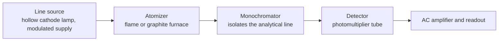

Atomic emission spectrometry ([6.4.7](/6.4.7)) measures the light emitted by the small fraction of atoms that have been excited; at the temperature of a flame or graphite furnace, however, the vast majority of atoms remain in the ground state. In atomic absorption spectrometry a beam of light at the wavelength of a **resonance line** of the analyte element is passed through an atomic vapor, and the amount absorbed by the ground-state atoms is measured. The signal is therefore insensitive to temperature and suffers little spectral interference, and the method remains one of the most reliable routine methods for trace metals. This chapter first treats the key theory of atomic absorption, namely how wide the lines are and why the peak absorption must be measured with a line source; then the instrumentation (sources and atomizers), the interferences and their removal; then atomic fluorescence, which complements absorption; and finally, turning to inner-shell electrons, X-ray fluorescence spectrometry and X-ray diffraction by crystals. The components common to spectrometers (monochromator, grating, **photomultiplier tube** and so on) were treated in [6.4.7](/6.4.7); the definitions of the **calibration curve**, the **standard addition method**, the **internal standard method** and the **limit of detection** are in [6.4.1](/6.4.1#sec-1.8); the **Boltzmann distribution**, the **spectral linewidth**, the **Zeeman effect**, **characteristic X-rays** and the Bragg equation come from physics (5.2, 5.4, 5.5) and are only cited here.

## 8.1. Principles of Atomic Absorption Spectrometry

### 8.1.1. History and Characteristics

In 1802 Wollaston noticed several dark lines in the solar spectrum; around 1814 Fraunhofer recorded more than five hundred dark lines with a more precise spectroscope and noticed that the yellow light of a table-salt flame coincides with the D dark line of the solar spectrum. In 1859 Kirchhoff and Bunsen showed that these dark lines are selective absorption of the continuous spectrum by elements in the outer atmosphere of the Sun: each element absorbs just the lines it can emit. This is the phenomenon of atomic absorption, but for a hundred years it was used only in astrophysics. In 1955 Walsh pointed out that atomic absorption lines are so narrow that they cannot be measured accurately with a continuum source and that the sharp lines emitted by the analyte element itself should be used as the source, and he proposed the hollow cathode lamp; commercial instruments followed quickly. In 1959 L'vov proposed electrothermal atomization in a graphite furnace, which raised the sensitivity by two to three orders of magnitude.

**Definition 8.1.1 (Atomic Absorption Spectrometry)** A method in which the analyte element in the sample is converted to gaseous ground-state atoms, the characteristic radiation of the analyte is passed through the atomic vapor, and the content of the element is determined from the absorption of the characteristic line by the ground-state atoms is called **atomic absorption spectrometry** (AAS).

Its main characteristics are:

- High sensitivity: detection limits of flame AAS are mostly at the low end of the range from $\mathrm{ng\,mL^{-1}}$ to $\mu\mathrm{g\,mL^{-1}}$, and absolute detection limits of graphite furnace AAS reach $10^{-10}$–$10^{-14}\,\mathrm{g}$.
- Good precision: the **relative standard deviation** is generally below 1% for flame AAS and 1%–5% for graphite furnace AAS.
- Good selectivity: about 70 elements can be determined, spectral interference is very small, and the method is often used as a reference method for other methods of elemental analysis.
- Drawbacks: in conventional instruments the lamp must be changed for each element, so simultaneous multielement determination is difficult, and the method is unsuited to qualitative analysis; nonmetals and refractory elements are hard to determine.

### 8.1.2. Ground-State and Excited-State Atoms

Are atoms thermally excited at the atomization temperature? At thermal equilibrium the ratio of the numbers of atoms in an excited state $j$ and in the ground state obeys the **Boltzmann distribution** ([5.2.1](/5.2.1#sec-1.7), [6.3.10](/6.3.10#sec-10.3)):

$$
\frac{N_j}{N_0} = \frac{g_j}{g_0}\exp\!\Big(-\frac{E_j}{k_{\mathrm{B}}T}\Big),
\tag{8.1}
$$

where $g_j$ and $g_0$ are statistical weights and $E_j = hc/\lambda$ is the excitation energy of the resonance line.

**Example 8.1.1** The values of $N_j/N_0$ for several resonance lines, calculated from Eq. (8.1) (for Na and Cs the upper level is $^2\mathrm{P}_{3/2}$, $g_j/g_0 = 2$; Ca and Zn have $^1\mathrm{P}_1 \to {}^1\mathrm{S}_0$, $g_j/g_0 = 3$):

| Resonance line | $E_j/\mathrm{eV}$ | 2000 K | 2500 K | 3000 K |
|---|---|---|---|---|
| Cs 852.1 nm | 1.455 | $4.3\times10^{-4}$ | $2.3\times10^{-3}$ | $7.2\times10^{-3}$ |
| Na 589.0 nm | 2.105 | $9.9\times10^{-6}$ | $1.1\times10^{-4}$ | $5.8\times10^{-4}$ |
| Ca 422.7 nm | 2.933 | $1.2\times10^{-7}$ | $3.7\times10^{-6}$ | $3.5\times10^{-5}$ |
| Zn 213.9 nm | 5.798 | $7.4\times10^{-15}$ | $6.2\times10^{-12}$ | $5.5\times10^{-10}$ |

The lower the excitation energy (the longer the wavelength) and the higher the temperature, the more atoms are excited, but even for Cs at 3000 K less than 1% are in the excited state. In the temperature range of atomic absorption we may therefore regard $N_0$ as the total number of atoms, which is proportional to the concentration in the sample; moreover $N_0$ hardly varies with temperature, which is the fundamental reason why atomic absorption is more stable than atomic emission (the emission intensity is proportional to $N_j$ and varies exponentially with temperature according to Eq. (8.1); see Eq. (7.1)). The main effect of temperature is not on excitation but on atomization efficiency and ionization (Section 8.3).

### 8.1.3. Profile and Broadening of Absorption Lines

An atomic absorption line is not infinitely narrow. Plotting the absorption coefficient $K_\nu$ (the coefficient by which the light intensity decays exponentially, as $\mathrm{e}^{-K_\nu b}$, per unit length of atomic vapor) against frequency gives the line profile, which is described by the center frequency $\nu_0$ and the full width at half maximum $\Delta\nu$ (or $\Delta\lambda$). Three factors determine the width.

The first is the natural width. An excited state has a finite lifetime $\tau$, and by the energy–time **Heisenberg uncertainty relation** ([5.5.2](/5.5.2#sec-2.3.3)) the level has a width, so that the natural width of the line is $\Delta\nu_{\mathrm{N}} = 1/(2\pi\tau)$. The Na $3\mathrm{p}$ level has a lifetime of about 16 ns, so $\Delta\nu_{\mathrm{N}} \approx 10\,\mathrm{MHz}$, that is, $\Delta\lambda_{\mathrm{N}} = \lambda^2\Delta\nu_{\mathrm{N}}/c \approx 1\times10^{-5}\,\mathrm{nm}$, two orders of magnitude smaller than the other contributions and negligible.

**Definition 8.1.2 (Doppler Broadening)** The random thermal motion of atoms gives different atoms different velocities along the line of sight, so that by the **Doppler effect** ([5.1.7](/5.1.7#sec-7.9)) different atoms absorb at slightly different frequencies and the line is broadened. This is called **Doppler broadening** (thermal broadening).

The velocity component along the line of sight follows the Maxwell (Gaussian) distribution, so the Doppler profile is Gaussian. From the variance $k_{\mathrm{B}}T/m$ of the velocity component and $\Delta\nu/\nu_0 = v_x/c$ the full width at half maximum is

$$
\Delta\nu_{\mathrm{D}} = \frac{\nu_0}{c}\sqrt{\frac{8\ln 2\,k_{\mathrm{B}}T}{m}},
\qquad
\Delta\lambda_{\mathrm{D}} = 7.16\times10^{-7}\,\lambda_0\sqrt{\frac{T/\mathrm{K}}{A_{\mathrm{r}}}},
\tag{8.2}
$$

where $m = A_{\mathrm{r}}\,\mathrm{u}$, $A_{\mathrm{r}}$ is the relative atomic mass, and the coefficient is $7.16\times10^{-7} = \sqrt{8\ln2\,k_{\mathrm{B}}/\mathrm{u}}\,/\,c$ (the value with $c$ in $\mathrm{m\,s^{-1}}$). The Doppler width increases with temperature and decreases with atomic mass.

**Example 8.1.2** At 2500 K, for the Na 589.0 nm line, $\Delta\lambda_{\mathrm{D}} = 7.16\times10^{-7}\times589.0\,\mathrm{nm}\times\sqrt{2500/22.99} = 4.4\times10^{-3}\,\mathrm{nm}$; for the Zn 213.9 nm line, $9.5\times10^{-4}\,\mathrm{nm}$; for the Cu 324.8 nm line, $1.5\times10^{-3}\,\mathrm{nm}$. All are of the order of picometers.

**Definition 8.1.3 (Pressure Broadening)** Collisions of the absorbing atoms with other particles in the vapor shorten the effective lifetime of the excited state (or perturb the energy levels) and broaden the line. This is called **pressure broadening** (collisional broadening). Broadening by collisions with foreign particles (flame gas molecules, Ar atoms) is called Lorentz broadening, and broadening by collisions with atoms of the same kind is called resonance (Holtsmark) broadening.

The pressure-broadened profile is Lorentzian, with a width proportional to the collision frequency and hence varying with pressure and temperature. In a flame at atmospheric pressure and in a graphite furnace the Lorentz width is of the same order as the Doppler width ($10^{-3}\,\mathrm{nm}$), and it also shifts the line center slightly and makes the profile asymmetric. Resonance broadening is proportional to the concentration of the analyte atoms themselves and is negligible at the low concentrations of atomic absorption.

The actual absorption line is the convolution of a Gaussian and a Lorentzian profile, called the *Voigt profile*: it is approximately Gaussian at the center, and the wings fall off slowly like a Lorentzian. The total width is about $10^{-3}$–$10^{-2}\,\mathrm{nm}$.

### 8.1.4. Integrated Absorption and Peak Absorption

The total area under the absorption line reflects the total number of absorbing atoms.

**Definition 8.1.4 (Oscillator Strength)** The ratio of the actual absorption intensity of an absorption transition to that given by the classical model of an electron as a harmonic oscillator is called the **oscillator strength** $f$ of the transition (dimensionless). It is determined by the electric dipole matrix element of the transition; $f$ is close to 1 for strong resonance lines (for the Na 589.0 nm line $f = 0.64$) and very small for forbidden transitions.

**Definition 8.1.5 (Integrated Absorption)** The integral of the absorption coefficient over the frequencies of the whole absorption line, $\int K_\nu\,\mathrm{d}\nu$, is called the **integrated absorption**. From the theory of the interaction of radiation with atoms (SI units),

$$
\int K_\nu\,\mathrm{d}\nu = \frac{e^2}{4\varepsilon_0 m_{\mathrm{e}} c}\,N_0 f,
\tag{8.3}
$$

where $N_0$ is the number density of ground-state atoms and $e^2/(4\varepsilon_0 m_{\mathrm{e}}c) = 2.654\times10^{-6}\,\mathrm{m^2\,s^{-1}}$ (written $\pi e^2/(m_{\mathrm{e}}c)$ in Gaussian units).

Equation (8.3) contains no empirical parameters such as temperature or line width: in principle, measuring the integrated absorption gives the number of atoms in absolute terms. The difficulty lies in the measurement. An absorption line is only about $0.002\,\mathrm{nm}$ wide, so to trace its profile with a continuum source the bandpass of the monochromator would have to be of the order of $10^{-4}\,\mathrm{nm}$ (a resolving power of about $3\times10^6$ at 300 nm), whereas ordinary atomic absorption instruments have bandpasses of 0.1–1 nm, and even with such a grating the light isolated would be too weak to measure. This is why atomic absorption did not become an analytical method for a hundred years.

Walsh's solution was to measure the absorption at the center of the line.

**Definition 8.1.6 (Peak Absorption)** The absorption coefficient $K_0$ at the center frequency $\nu_0$ of an absorption line is called the **peak absorption** (central absorption).

When the absorption line is dominated by Doppler broadening, the profile is Gaussian and the ratio of area to peak height is a constant, so that from Eq. (8.3)

$$
K_0 = \frac{2}{\Delta\nu_{\mathrm{D}}}\sqrt{\frac{\ln2}{\pi}}\int K_\nu\,\mathrm{d}\nu
= \frac{2}{\Delta\nu_{\mathrm{D}}}\sqrt{\frac{\ln2}{\pi}}\;\frac{e^2}{4\varepsilon_0 m_{\mathrm{e}}c}\,N_0 f .
$$

If the line emitted by the source has the same center frequency as the absorption line and is much narrower (a line source), the whole emission line falls near the top of the absorption line, and the absorption coefficient can be taken as the constant $K_0$. After light of intensity $I_0$ passes through an atomic vapor of length (path length) $b$, $I = I_0\,\mathrm{e}^{-K_0b}$, and the absorbance is

$$
A = \lg\frac{I_0}{I} = \frac{K_0b}{\ln10} = 0.434\,K_0b .
$$

Under fixed experimental conditions $\Delta\nu_{\mathrm{D}}$, $f$ and $b$ are constants, and $N_0$ is proportional to the concentration $c$ of the analyte in the sample solution, so that

$$
A = Kc,
\tag{8.4}
$$

which is the basic relation of quantitative atomic absorption and is formally the same as the **Beer–Lambert law** ([6.3.17](/6.3.17#def-17.2.3)) for absorption in solution. Unlike the integrated absorption, however, $K$ contains the line width and the atomization efficiency, cannot be calculated, and must be calibrated with standard solutions; atomic absorption is therefore a relative method.

A line source has a further advantage: the monochromator need not resolve the profile of the absorption line but only separate the emission line in use from the other lines of the lamp (bandpass about 0.2 nm), so an ordinary monochromator suffices.

**Example 8.1.3** Estimate the sensitivity of atomic absorption. Take Na in a 2500 K flame ($\Delta\lambda_{\mathrm{D}} = 4.4\,\mathrm{pm}$, corresponding to $\Delta\nu_{\mathrm{D}} = c\Delta\lambda_{\mathrm{D}}/\lambda^2 = 3.8\times10^{9}\,\mathrm{Hz}$), $f = 0.64$ and a path length $b = 10\,\mathrm{cm}$. The $K_0$ needed for 1% absorption ($A = 0.0044$) is $K_0 = 0.0044\ln10/b = 0.10\,\mathrm{m^{-1}}$, and from the equation above

$$
N_0 = \frac{K_0\,\Delta\nu_{\mathrm{D}}}{2\sqrt{\ln2/\pi}\;(2.654\times10^{-6}\,\mathrm{m^2\,s^{-1}})\,f}
\approx 2.4\times10^{14}\,\mathrm{m^{-3}} = 2.4\times10^{8}\,\mathrm{cm^{-3}},
$$

that is, only about $10^8$ Na atoms per cubic centimeter of flame (about $10^{-14}\,\mathrm{g}$) are needed to detect the absorption. Actual detection limits of flame AAS are much higher, mainly because nebulization and atomization efficiencies are low and the atoms stay in the light path for a short time (Section 8.2).

### 8.1.5. Curvature of the Calibration Curve

Equation (8.4) holds only in a limited concentration range, and at high concentrations the **calibration curve** bends toward the concentration axis, for the following reasons.

1. Line width of the source: when the width of the emission line cannot be neglected, the absorption coefficient at the wings of the emission line is smaller than $K_0$. At high concentrations the light in the central part is almost completely absorbed, and the light transmitted is mainly that of the wings, so the apparent absorbance grows more slowly. This is especially marked when too high a lamp current broadens the emission line or causes self-absorption (Section 8.2.2).
2. Nonabsorbed light in the bandpass: lines in the bandpass that are not absorbed (lines of the fill gas or cathode impurities) or stray light, of intensity $I_{\mathrm{s}}$, give $A = \lg\dfrac{I_0 + I_{\mathrm{s}}}{I + I_{\mathrm{s}}}$. At very high concentrations $I \to 0$ and $A$ tends to the constant $\lg[(I_0 + I_{\mathrm{s}})/I_{\mathrm{s}}]$.
3. Atomization and ionization: the assumption $N_0 \propto c$ fails, for example when the matrix and chemical interferences change the atomization efficiency; easily ionized elements are partly ionized at high temperature (the degree of ionization is larger at low concentrations, so the curve bends upward instead; Section 8.3.3).
4. Hyperfine structure of the absorption line and pressure broadening make the absorption profile deviate from a single Gaussian.

One should therefore work in the linear range of absorbance of about 0.1–0.8, avoid excessive lamp current, and use a narrow bandpass.

### 8.1.6. High-Resolution Continuum Source Atomic Absorption

Walsh's conclusion depended on the monochromators of his time. Today a high-intensity xenon short-arc lamp is used as the continuum source, with a double monochromator consisting of a prism predisperser and an **echelle grating** and detection by a **charge-coupled device** array, each pixel corresponding to a wavelength interval of about 2 pm, and the profile of an atomic absorption line can be resolved. In this high-resolution continuum source atomic absorption (HR-CS AAS), one lamp serves for all elements, the background and molecular absorption bands near the analytical line can be seen simultaneously, which eases background correction, and several elements can be determined rapidly in sequence. It does not refute Walsh's argument but shows that a continuum source can also be used for atomic absorption provided the resolving power is sufficient.

## 8.2. The Atomic Absorption Spectrophotometer

### 8.2.1. Components of the Instrument

An atomic absorption spectrophotometer consists of a source, an atomizer, a monochromator and a detection system. It differs from the ultraviolet–visible spectrophotometer ([6.4.9](/6.4.9#sec-9.4.1)) in that the sample cell is replaced by an atomizer and the monochromator is placed after the atomizer.

The atomizer (flame, graphite tube) also emits light, including the thermally excited emission lines of the analyte, which have the same wavelength as the analytical line and cannot be separated by the monochromator. The remedy is source modulation: the source is made to flicker at a fixed frequency with a pulsed current (or a mechanical chopper), and the detector is followed by an amplifier that amplifies only the AC signal at that frequency (lock-in detection); the continuous emission of the atomizer is a DC signal and is not amplified.

A single-beam instrument has a simple structure and little loss of light; a double-beam instrument splits the light of the source into a beam that passes through the atomizer and one that does not, and measures them alternately, which compensates for drift of the source intensity.

### 8.2.2. Sources

The requirements for the source are that it emits the resonance line of the analyte with a line width smaller than that of the absorption line (a sharp line), that its intensity is sufficient and stable (drift below 1% in 30 min), and that its background is low.

**Definition 8.2.1 (Hollow Cathode Lamp)** A source whose hollow cylindrical cathode is made of the analyte metal (or an alloy) and which emits the sharp-line spectrum of that element by glow discharge in a low-pressure inert gas (Ne or Ar) is called a **hollow cathode lamp** (HCL).

In operation, a voltage of several hundred volts is applied between cathode and anode, the gas in the lamp is ionized, and the positive ions are accelerated in the electric field and bombard the inner wall of the cathode, sputtering atoms of the cathode material out. The sputtered atoms are excited by collisions with electrons and ions in the cathode cavity and emit the characteristic lines of the element. The lines it emits are narrow because the pressure in the lamp is only a few hundred pascals, so pressure broadening is very small, and because the discharge current is small (a few to a few tens of milliamperes) and the temperature in the cathode cavity is only a few hundred degrees Celsius, so that the Doppler broadening is also smaller than in a flame.

The lamp current is the main operating condition: if the current is too small, the emission is weak and the signal-to-noise ratio is low; if it is too large, the atom density and temperature in the cathode cavity rise, the lines broaden, and the center of the emission line is absorbed by cooler ground-state atoms in the cavity, which causes **self-absorption** and, when severe, **self-reversal** ([6.4.7](/6.4.7#def-7.2.3)), reducing the sensitivity and bending the calibration curve. A small lamp current should therefore be chosen, provided that stability and sufficient intensity are ensured.

An electrodeless discharge lamp seals a little metal or metal halide in a quartz bulb and excites it with a radio-frequency or microwave field; its intensity is one to two orders of magnitude higher than that of a hollow cathode lamp, and it is used mainly for volatile elements such as As, Se and Sb and for atomic fluorescence (Section 8.4).

### 8.2.3. Flame Atomization

The role of the atomizer is to supply energy to dry and vaporize the sample and dissociate it into gaseous ground-state atoms. The atomization efficiency determines the sensitivity of the method, and the atomization process is also the origin of most interferences, so the atomizer is the heart of an atomic absorption instrument.

**Definition 8.2.2 (Flame Atomization)** A method in which a nebulizer converts the sample solution into an aerosol, which is mixed with fuel gas and oxidant and fed into a burner, where the analyte is atomized in the high temperature of the flame, is called **flame atomization**.

All current instruments use premix burners: a pneumatic nebulizer uses a high-speed oxidant stream to draw in the sample solution and break it into droplets; the droplets strike an impact bead and flow spoilers in the spray chamber, the large droplets coalesce and leave through the drain, and only the fine mist mixes with the fuel gas and enters the long-slot burner (path length 5–10 cm), so that the flame is stable and the noise is low. The mean droplet diameter depends on the relative velocities of gas and liquid and on the surface tension, density and viscosity of the solution (the Nukiyama–Tanasawa empirical equation), and is generally 10–20 μm; only droplets smaller than about 10 μm lose their solvent and evaporate rapidly in the flame. Less than 15% of the sample solution reaches the flame, and the nebulization efficiency is the main limit on the sensitivity of flame AAS. Ultrasonic nebulization produces finer droplets with a narrower size distribution and a higher efficiency, but with larger memory effects.

In the flame the droplets successively lose their solvent, evaporate to molecules, and dissociate to atoms; the atoms may be further ionized or form oxides with O and OH in the flame. The two key properties of a flame are its temperature and its redox character:

| Flame (fuel–oxidant) | Maximum temperature | Use |
|---|---|---|
| Air–acetylene | about 2500 K | The most common; about thirty elements can be determined |
| Nitrous oxide–acetylene | about 3000 K | Elements that form refractory oxides (Al, Si, Ti, V, B, rare earths) |
| Air–hydrogen | about 2300 K | Low background absorption; for short-wavelength elements such as As and Se (the acetylene flame absorbs strongly below about 200 nm) |

For the same flame, the properties also depend on the ratio of fuel to oxidant:

| | Stoichiometric flame | Lean flame | Rich flame |
|---|---|---|---|
| Fuel-to-oxidant ratio | Stoichiometric for the combustion reaction | Excess oxidant | Excess fuel |
| Properties | Highest temperature, neutral | Oxidizing, lower temperature | Reducing (rich in partially decomposed species such as C and CH), slightly lower temperature |
| Use | Most elements | Elements not easily oxidized (Ag, Au, Cu) and the alkali metals | Elements that readily form refractory oxides (Cr, Mo, alkaline earth metals) |

The temperature and composition of the flame vary with height above the burner, so the observation height must also be optimized: for elements that form stable oxides (Cr) the signal is strongest in the reducing region at the bottom of the flame and decreases higher up; for elements that do not form stable oxides (Ag) the number of atoms increases with height; Mg lies between the two and has a maximum in the middle. The flame type, the fuel-to-oxidant ratio and the observation height are the three conditions to be chosen in flame atomic absorption.

Flame AAS is simple, fast and precise, but the nebulization efficiency is low, the atoms stay in the light path for only about $10^{-4}\,\mathrm{s}$ before the gas flow carries them away, and they are diluted by a large amount of flame gas, which limits the sensitivity.

### 8.2.4. Graphite Furnace Atomization

**Definition 8.2.3 (Graphite Furnace Atomization)** A method in which a microliter volume of sample solution is injected into a graphite tube, which is heated by a large current according to a program, and the sample is dried, ashed and atomized under the protection of an inert gas, is called **graphite furnace atomization** (electrothermal atomization).

The graphite tube is about 30 mm long, with an outer diameter of about 6 mm and an inner diameter of about 4 mm, open at both ends for the light, water-cooled on the outside, and protected inside and outside by Ar (to prevent oxidation of the graphite and the atoms). The sample volume is 5–50 μL, and the temperature is raised stepwise according to a program:

| Step | Temperature (typical) | Purpose |
|---|---|---|
| Drying | Slightly above the boiling point of the solvent (about 100–130 °C) | Remove the solvent and prevent spattering |
| Ashing (pyrolysis) | 300–1200 °C, depending on the element | Remove volatile matrix and organic matter without losing the analyte |
| Atomization | 1800–2700 °C, heated extremely fast, gas flow in the tube stopped | Produce the atomic vapor and measure the absorption signal |
| Cleaning | About 200 °C above the atomization temperature | Remove residues and eliminate memory effects |

![Graphite furnace atomization. Top: a typical temperature program (drying, ashing, atomization, cleaning), with the Ar flow in the tube stopped during atomization. Bottom: transient signal during atomization (schematic): the tube wall is heated at about 2000 °C/s, and analyte atomized from the wall enters the light path while the gas-phase temperature is still low; a sample placed on an L'vov platform is heated mainly by radiation from the wall, so atomization is delayed and the atoms enter a gas that is already close to its final temperature](./plots/furnace-program.py)

Compared with the flame, the advantages of the graphite furnace are that almost all of the sample is atomized and retained in the tube; the atoms stay in the light path for about 0.1–1 s, roughly $10^3$ times longer than in a flame; and atomization takes place in Ar, with the reducing character of graphite favoring the decomposition of oxides. The absolute detection limits are therefore low (picogram level), the sample volume is small, and small biological samples such as blood and urine can be analyzed directly. The signal is a transient peak, and quantification by peak area (integrated absorbance, in s) is more reliable than by peak height.

The drawbacks are poorer precision and heavier background absorption and matrix interference. An important source of interference is temporal nonisothermality: the tube wall heats up rapidly as soon as the current is applied, whereas the gas inside lags behind, so the analyte evaporates from the wall while the gas phase is still cool and readily recombines into molecules in the cold gas; the ends of the tube are cooler than the middle, which causes spatial nonisothermality. The current remedy is the "stabilized temperature platform furnace" (STPF) technique:

- L'vov platform: a small platform of pyrolytic graphite is placed in the graphite tube and the sample is deposited on it. The platform has little contact with the wall and is heated mainly by radiation from the wall, so it heats up later than the wall and the analyte evaporates only when the gas in the tube has reached a stable high temperature (see the figure above), approaching isothermal atomization.
- Maximum power heating (about 2000 °C/s), pyrolytic graphite coating (which reduces the porosity of graphite and the formation of carbides), and transversely heated graphite tubes (which eliminate spatial nonisothermality).
- Addition of a **matrix modifier** (Section 8.3.2), quantification by peak area, and Zeeman background correction (Section 8.3.4).

### 8.2.5. Hydride Generation and the Cold-Vapor Method

As, Se, Sb, Bi, Te, Sn, Ge and Pb have low sensitivity in a flame, their resonance lines are mostly near 200 nm, and the flame background absorption there is heavy. They form covalent hydrides that are gases at room temperature, which can first be separated from the solution and then atomized.

**Definition 8.2.4 (Hydride Generation)** A sample introduction method in which the analyte is reduced to a gaseous covalent hydride by a strong reducing agent (usually $\ce{NaBH4}$ or $\ce{KBH4}$) in acidic medium, separated from the solution by a carrier gas and fed into an atomizer (a heated quartz tube, about 900 °C), where it is decomposed to atoms, is called **hydride generation**.

For arsenic, for example,

$$
\ce{4H3AsO3 + 3BH4- + 3H+ -> 4AsH3 ^ + 3H3BO3 + 3H2O},
$$

while the excess $\ce{BH4-}$ is hydrolyzed with the release of a large amount of $\ce{H2}$. The advantages of hydride generation are that the analyte is separated from the matrix, so interference is small; that the sample introduction efficiency is close to 100% and the analyte can be preconcentrated, so that detection limits are one to three orders of magnitude lower than with direct nebulization of the solution; and that the formation of hydrides depends on the oxidation state (As(III) reacts much faster than As(V)), so that oxidation states can be distinguished by controlling the conditions.

Mercury has an appreciable vapor pressure even at room temperature and needs no heating: $\ce{Hg^2+}$ is reduced to elemental mercury with $\ce{SnCl2}$ (or $\ce{NaBH4}$),

$$
\ce{Hg^2+ + Sn^2+ -> Hg + Sn^4+},
$$

the mercury atoms are swept by a carrier gas into a quartz absorption cell and the absorption is measured at 253.7 nm. This is called cold-vapor atomic absorption (cold-atom absorption), with detection limits of the order of $\mathrm{ng\,L^{-1}}$. The monitoring of mercury in the environment and in food is of great importance: Minamata disease in Minamata Bay, Japan, in the 1950s was caused by a chemical plant that used a mercury catalyst to produce acetaldehyde and discharged wastewater containing methylmercury into the bay; the methylmercury accumulated in fish and shellfish, entered the human body and damaged the nervous system. Because the atomization temperature of hydrides and mercury vapor is low (low-temperature atomization), low-temperature plasmas such as dielectric barrier discharges can also be used to atomize them near room temperature.

### 8.2.6. Optical and Detection Systems

The monochromator (grating, slits and mirrors, [6.4.7](/6.4.7#sec-7.4)) is placed after the atomizer; its role is to separate the analytical line from neighboring lines (nonabsorbed lines of the lamp, lines of the fill gas) and to reduce the emission of the atomizer reaching the detector. It must separate the Mn lines at 279.48 nm and 279.83 nm (0.35 nm apart) and the Ni analytical line at 232.00 nm from the neighboring lines at 231.60 nm and 231.10 nm, so the spectral bandpass is generally chosen between 0.2 nm (for elements with complex spectra such as Ni) and 1 nm (for elements with simple spectra such as the alkali metals). If the bandpass is too wide, nonabsorbed lines enter, the sensitivity falls and the calibration curve bends; if it is too narrow, the light is too weak and the noise increases.

The detector is a **photomultiplier tube**, which must have sufficient spectral sensitivity over 190–900 nm and a stable operating voltage.

## 8.3. Interferences and Their Elimination

Interferences in atomic absorption are classified by origin into physical, chemical, ionization and spectral interferences.

### 8.3.1. Physical Interferences

Changes in physical properties of the sample solution such as viscosity, surface tension, density and solvent vapor pressure alter the nebulization efficiency, the sample uptake and the rate of evaporation, and so change the absorption signal; this is called physical interference. It affects all elements in the sample in the same way and is a kind of **matrix effect** ([6.4.1](/6.4.1#def-1.8.6)). It is eliminated by preparing standard solutions of composition similar to the sample (matrix matching), by diluting the sample, or by the **standard addition method** ([6.4.1](/6.4.1#def-1.8.8)): the standard is added to the sample itself, so that the matrix is the same and physical interference is corrected automatically.

### 8.3.2. Chemical Interferences

**Definition 8.3.1 (Chemical Interference)** Interference caused by a change in atomization efficiency because the analyte forms a thermodynamically stable compound with a coexisting component in the condensed or gas phase (or is lost early because it is volatile) is called **chemical interference**. It is the most important interference in atomic absorption and is selective: it affects only particular combinations of analyte and interfering component.

Common cases are:

- Formation of compounds that dissociate with difficulty: phosphate markedly lowers the absorption of Ca, because calcium phosphate and pyrophosphate ($\ce{Ca3(PO4)2}$, $\ce{Ca2P2O7}$), which dissociate with difficulty, form in the flame; Al and Mg form the spinel $\ce{MgAl2O4}$. This is important in determining Ca and Mg in serum, bone and plant samples.
- Formation of refractory oxides or carbides: Al, Si, Ti, Zr, V, Mo, W, B and the rare earths form oxides that dissociate with difficulty in the air–acetylene flame and are hard to atomize; Nb, Ta, Hf, W, Re and Os are very hard to atomize; Be, B, Al, Si, Ti, Zr, V, W and U readily form involatile carbides in the graphite furnace.
- Molecular evaporation: in the graphite furnace the analyte forms a volatile halide or oxide and is lost by evaporation during the ashing stage.

Chemical interference is eliminated as follows.

1. Raising the atomization temperature: for example, with the nitrous oxide–acetylene flame the interference of phosphate with Ca essentially disappears.
2. Adding chemical reagents.

**Definition 8.3.2 (Releasing Agent, Protective Agent and Matrix Modifier)** A reagent that forms a more stable or less volatile compound with the interfering component and thereby releases the analyte is called a **releasing agent**. A reagent that forms a stable complex with the analyte, which decomposes easily in the flame, and thereby prevents the analyte from combining with the interfering component is called a **protective agent**. A reagent added in the graphite furnace to make the matrix more volatile or the analyte less volatile, so that the ashing temperature can be raised without loss of the analyte, is called a **matrix modifier** (chemical modifier).

For example, in the determination of Ca, a La or Sr salt is added, and La forms the more stable $\ce{LaPO4}$ with phosphate and so releases Ca (releasing agent); EDTA is added, Ca forms the CaY complex, which decomposes easily in the flame, and Ca no longer combines with phosphate; and 8-hydroxyquinoline suppresses the interference of Al with Mg and Ca (protective agent). In the graphite furnace determination of trace Cd and Pb in seawater or blood, $\ce{NH4NO3}$ is added to convert the high concentration of NaCl into $\ce{NaNO3}$ and $\ce{NH4Cl}$, which are readily removed at the ashing temperature:

$$
\ce{NaCl + NH4NO3 -> NaNO3 + NH4Cl};
$$

the most widely used modifier today is the mixture of Pd and $\ce{Mg(NO3)2}$, which allows volatile elements such as As, Se, Pb and Cd to be ashed at much higher temperatures.

3. Chemical separation (extraction, ion exchange, hydride generation), or the standard addition method.

### 8.3.3. Ionization Interference

**Definition 8.3.3 (Ionization Interference and Ionization Suppressor)** The phenomenon in which analyte atoms are ionized in the high-temperature atomizer, so that the number of ground-state atoms and hence the absorption signal decrease, is called **ionization interference**. An easily ionized element of lower ionization energy than the analyte, added to suppress ionization, is called an **ionization suppressor**.

The lower the **ionization energy** and the higher the temperature, the more severe the ionization: alkali and alkaline earth metals are already appreciably ionized in the air–acetylene flame, and still more in the nitrous oxide–acetylene flame. The equilibrium constant of the ionization equilibrium $\ce{M <=> M+ + e-}$ depends only on temperature (the Saha equation), so the higher the concentration of the analyte, the smaller the degree of ionization: the absorption at the low-concentration end is too low, and the calibration curve bends toward the absorbance axis.

A large amount of a K or Cs salt is added (for example $1$–$2\,\mathrm{g\,L^{-1}}$ KCl; the ionization energies of K and Cs, 4.34 eV and 3.89 eV, are lower than those of Ca, 6.11 eV, and Na, 5.14 eV). These elements ionize and supply a large number of free electrons, which shift the ionization equilibrium of the analyte to the left:

$$
\ce{K -> K+ + e-},\qquad \ce{Ca+ + e- -> Ca}.
$$

A cooler flame can also be used instead.

### 8.3.4. Spectral Interference and Background Correction

Spectral interferences include overlap of an absorption line of another element with the analytical line (very rare, significant only when the lines are less than about 0.01 nm apart, as with Fe 271.903 nm and Pt 271.904 nm); nonabsorbed lines of the lamp in the bandpass; emission from the atomizer; and background absorption. With line sources and modulation, the first three can generally be eliminated by choosing the line, reducing the bandpass and modulating, and the main problem is background absorption:

- Molecular absorption: molecules formed during atomization (alkali halides, oxides, $\ce{OH}$, $\ce{CaOH}$ and so on) have broad absorption bands. For example, NaCl and NaI absorb continuously over 200–400 nm, so the background is heavy for samples of high salt content; sulfuric and phosphoric acids absorb strongly below 250 nm.
- Light scattering: undissociated solid particles in the atomizer scatter the light and weaken it, which appears as apparent absorption; scattering increases as the wavelength decreases.

Background absorption is far more severe in the graphite furnace than in the flame, and it is broadband, varying hardly at all with wavelength within the bandpass near the analytical line.

**Definition 8.3.4 (Background Correction)** A method in which the background absorbance $A_{\mathrm{B}}$ at the analytical line is measured separately and subtracted from the total absorbance $A_{\mathrm{T}} = A + A_{\mathrm{B}}$ to give the net atomic absorbance $A = A_{\mathrm{T}} - A_{\mathrm{B}}$ is called **background correction**.

1. Adjacent nonresonance line method: the background is measured with a line near the analytical line that is not absorbed by the analyte atoms (a nonresonance line of the lamp or a line of another element). It is accurate only if the background is flat and is now little used.
2. Deuterium lamp method: the deuterium lamp emits a continuous spectrum and its light passes alternately with that of the hollow cathode lamp through the atomizer. Of continuum light in a bandpass of, say, 0.2 nm, the atomic absorption line, only about 0.002 nm wide, absorbs less than 1%, so the deuterium lamp measures the background, $A_{\mathrm{D}} \approx A_{\mathrm{B}}$; the hollow cathode lamp measures $A_{\mathrm{T}}$, and the difference is $A$. The deuterium lamp method is simple but applies only in the ultraviolet (about 190–350 nm), requires the background to be flat within the bandpass, and cannot correct molecular absorption with fine structure.
3. Zeeman effect method: a magnetic field (about 1 T) is applied to the atomizer, and the absorption line of the analyte atoms splits through the **Zeeman effect** ([5.5.4](/5.5.4#sec-4.2.1)). Observed perpendicular to the field, the π component ($\Delta m = 0$) lies at the original wavelength and absorbs only **linearly polarized light** polarized parallel to the field, whereas the σ± components ($\Delta m = \pm1$) shift to either side by picometers and absorb light polarized perpendicular to the field. Molecular absorption and light scattering are unaffected by the field and absorb both polarizations equally. Thus light polarized parallel to the field (or with the field off) gives the atomic absorption plus the background, and light polarized perpendicular to the field (with the field on) gives the background alone, because the σ components have moved out of the emission line of the line source. Most practical instruments apply an alternating magnetic field to the atomizer and measure with a fixed polarizer when the field is on and off. The Zeeman method measures the background at the wavelength of the analytical line itself, can be used over the whole spectral range, corrects structured background, and is standard equipment for graphite furnaces; the price is a slight loss of sensitivity and a roll-over of the calibration curve at high concentrations.
4. Self-absorption method (Smith–Hieftje): the hollow cathode lamp is periodically driven with high-current pulses, so that the emission line is heavily self-absorbed and its center is depressed (self-reversal); what is then measured is mainly the background, while the total absorption is measured at the normal low current, and the two are subtracted. The apparatus is simple, but the loss of sensitivity is considerable and the lamp life is shortened.

High-resolution continuum source atomic absorption (Section 8.1.6), which can see the background on both sides of the analytical line directly and correct it with neighboring pixels, is another approach.

### 8.3.5. Characteristic Concentration and Measurement Conditions

In atomic absorption the sensitivity is commonly expressed by the characteristic concentration.

**Definition 8.3.5 (Characteristic Concentration and Characteristic Mass)** The concentration of the analyte that produces 1% absorption ($I/I_0 = 0.99$, that is, $A = \lg(100/99) = 0.0044$) is called the **characteristic concentration** $c_0$; the mass of the analyte in the graphite furnace that produces an integrated absorbance of $0.0044\,\mathrm{s}$ is called the **characteristic mass** $m_0$:

$$
c_0 = \frac{0.0044\,c}{A},\qquad m_0 = \frac{0.0044\,\mathrm{s}\times m}{A_{\mathrm{int}}} .
$$

The smaller the characteristic concentration, the more sensitive the method. It reflects the slope of the calibration curve, that is, the **sensitivity** ([6.4.1](/6.4.1#def-1.8.2)), and carries no information on noise; whether a low concentration can be detected depends on the **limit of detection** ([6.4.1](/6.4.1#def-1.8.5)), which depends on both the slope and the standard deviation of the blank.

**Example 8.3.1** In the determination of Cu by flame atomic absorption, a standard solution of $0.50\,\mu\mathrm{g\,mL^{-1}}$ has an absorbance of 0.110, so the characteristic concentration is $c_0 = 0.0044\times0.50/0.110\,\mu\mathrm{g\,mL^{-1}} = 0.020\,\mu\mathrm{g\,mL^{-1}}$. If the blank solution is measured 11 times with a standard deviation of absorbance of 0.0008, the limit of detection is $c_{\mathrm{L}} = 3s_{\mathrm{b}}/S = 3\times0.0008/(0.110/0.50\,\mathrm{mL\,\mu g^{-1}}) = 0.011\,\mu\mathrm{g\,mL^{-1}}$.

It also follows from the derivation of Eq. (8.4) that atomic absorption measures the difference between two large signals: 1% absorption corresponds only to $A = 0.0044$, so its sensitivity is limited by source noise and in principle cannot match that of atomic fluorescence (Section 8.4), which measures a signal on a zero background.

The choice of measurement conditions can be summarized as follows: the analytical line (generally the most sensitive resonance line; at high concentration a less sensitive line can be chosen to extend the linear range), lamp current and spectral bandpass; for flame AAS, the flame type, fuel-to-oxidant ratio and observation height; for the graphite furnace, the ashing and atomization temperatures (from an ashing curve and an atomization curve, taking the highest ashing temperature at which the analyte is not lost and the lowest atomization temperature at which the signal reaches a plateau) and the matrix modifier; and the elimination of interferences and the mode of background correction. Quantification uses the **calibration curve** or standard addition, the latter especially often for complex matrices (blood, seawater, soil digests).

## 8.4. Atomic Fluorescence Spectrometry

### 8.4.1. Origin and Types of Atomic Fluorescence

**Definition 8.4.1 (Atomic Fluorescence Spectrometry)** The light emitted when gaseous ground-state atoms are excited by absorbing the characteristic radiation of a source and then deexcite by radiative transitions is called atomic fluorescence; a method of quantitative analysis based on measuring the intensity of the atomic fluorescence of the analyte is called **atomic fluorescence spectrometry** (AFS).

Atomic fluorescence involves both a process of atomic absorption (optical excitation) and a process of atomic emission (luminescence), and lies between the two methods. As with molecular **fluorescence** ([6.3.17](/6.3.17#sec-17.2.4)), the fluorescence is observed at right angles to the excitation light, so that no excitation light enters the detector directly and the signal is superimposed on a background close to zero. According to the relation between the levels of excitation and emission, atomic fluorescence is divided into the following types.

- Resonance fluorescence: absorption and emission occur on the same resonance line (for example Zn 213.9 nm, Cd 228.8 nm, Hg 253.7 nm); it is the strongest and most commonly used.
- Nonresonance fluorescence: the fluorescence wavelength differs from the excitation wavelength. In direct-line fluorescence the excited atom drops directly from the high level to a metastable level above the ground state (for example Tl absorbs at 377.6 nm and emits at 535.0 nm, the two lines having the same upper level); in stepwise-line fluorescence the atom is excited to a high level, first loses part of its energy nonradiatively by collisions to a lower excited state, and then returns to the ground state by a transition (for example Na is excited to 4p by absorbing 330.3 nm, relaxes to 3p and emits at 589.0 nm). The advantage of nonresonance fluorescence is that a monochromator can separate the fluorescence from scattered excitation light.
- Sensitized fluorescence: an atom, once excited, transfers its energy by collision to an analyte atom, which is thereby excited and emits fluorescence.

Excited atoms can also be deactivated nonradiatively by collisions with flame gas molecules ($\ce{N2}$, $\ce{CO2}$, $\ce{H2O}$); this is the **quenching** of fluorescence, which lowers the **quantum yield** $\Phi$. Ar has a very small quenching cross section, so a hydrogen flame diluted with Ar is often used in atomic fluorescence.

### 8.4.2. Basis of Quantitative Analysis

The fluorescence intensity $I_{\mathrm{f}}$ is proportional to the absorbed intensity $I_{\mathrm{a}}$ and to the quantum yield: $I_{\mathrm{f}} = \Phi I_{\mathrm{a}}$. By the law of absorption, after excitation light of intensity $I_0$ passes through the atomic vapor,

$$
I_{\mathrm{a}} = I_0 - I = I_0\big(1 - \mathrm{e}^{-k'c}\big),
$$

where $k'$ contains the peak absorption coefficient, the absorption path length and the atomization efficiency and is independent of the concentration $c$. Hence

$$
I_{\mathrm{f}} = \Phi I_0\big(1 - \mathrm{e}^{-k'c}\big) \approx \Phi I_0 k' c \qquad (k'c \ll 1).
\tag{8.5}
$$

At low concentration the fluorescence intensity is proportional to the concentration, which is the basis of quantitative atomic fluorescence (in practice one must also multiply by a geometric factor for the collection of the fluorescence by the detector). Two points follow from Eq. (8.5).

1. The fluorescence intensity is proportional to the excitation intensity $I_0$, so a high-intensity source (a high-performance hollow cathode lamp, an electrodeless discharge lamp or a laser) raises the sensitivity directly; in atomic absorption, by contrast, the absorbance is independent of the light intensity.
2. As the concentration increases, the excitation light is absorbed almost completely and $I_{\mathrm{f}}$ saturates; the fluorescence is also reabsorbed (self-absorption) by ground-state atoms on its way out of the atomic vapor, so the calibration curve bends and even falls at high concentrations. This sets the upper limit of the linear range, but the low-concentration end can extend very far, and the linear range often reaches 3–5 orders of magnitude.

### 8.4.3. Instrumentation and Hydride Generation Atomic Fluorescence

An atomic fluorescence spectrometer consists of an excitation source, an atomizer, (a monochromator,) a detector, a sample introduction system and a data processing system. The source and detector are at right angles so that excitation light does not enter the detector directly; source modulation is likewise used to subtract the emission of the atomizer.

- Dispersive type: a monochromator separates the fluorescence line, so continuum sources (high-pressure xenon arc lamps) and nonresonance fluorescence can be used and many elements can be determined, but the loss of light flux is large.
- Nondispersive type: no monochromator is used, and the fluorescence is detected directly with an interference filter or a solar-blind photomultiplier tube (whose photocathode is sensitive only to ultraviolet light of about 160–320 nm and does not respond to visible light or the thermal radiation of the flame). The optical path is simple, the light flux large and the sensitivity high, and each channel can determine several elements simultaneously; the price is that the light entering the detector must contain no other strong lines or strong scattered light.

The difficulty of nondispersive atomic fluorescence is that nebulizing a solution produces a great many droplets that scatter the excitation light strongly, while the Ar–H₂ flame, which gives high fluorescence quantum yields, resists chemical interference poorly. Hydride generation (Section 8.2.5) solves both problems: the analyte is separated from the matrix as a gas, so there is no droplet scattering; the $\ce{H2}$ produced by the reaction of $\ce{NaBH4}$ with acid is ignited at the mouth of the quartz tube furnace to form an Ar–H₂ diffusion flame of low temperature, low background and little quenching, in which the hydrides are fully atomized. The fluorescence lines of As, Se, Sb, Bi, Te, Hg and other elements all lie within 180–260 nm, right in the response range of the solar-blind photomultiplier tube. Hydride generation atomic fluorescence (HG-AFS) is therefore almost always of the nondispersive type.

The development and application of HG-AFS have been especially extensive in China. Early nondispersive atomic fluorescence used iodide electrodeless discharge lamps, but the iodine line at 206.16 nm is only about 0.007 nm from the Bi fluorescence line at 206.17 nm, causing severe spectral interference, and for a long time no commercial instruments were made abroad; in the late 1970s, to meet the needs of geochemical exploration, Chinese workers developed bromide electrodeless discharge lamps and a hydride–nondispersive atomic fluorescence apparatus with quartz tube furnace atomization, and later developed high-performance hollow cathode lamps with pulsed supply and intermittent-flow sample introduction systems, so that atomic fluorescence instruments went into mass production. Chinese standards for the environment, food and geology now list atomic fluorescence methods for the determination of As, Hg, Se, Sb and other elements.

The advantages of atomic fluorescence are high sensitivity (for As, Hg and others of the order of $0.01\,\mu\mathrm{g\,L^{-1}}$), a wide linear range, the possibility of simultaneous multielement determination, and simple instruments; the limitations are that few elements are suitable (mainly Hg, As, Sb, Bi, Se, Te, Sn, Pb and Ge, which form hydrides or cold vapor, and Zn and Cd) and that scattering and quenching interferences must be strictly controlled. It is therefore not as widely applied as atomic absorption, but has clear advantages for a few elements.

### 8.4.4. Speciation Analysis

The toxicity and biological effects of an element depend on its chemical form, not only on its total amount. Inorganic arsenic (As(III), As(V)) is highly toxic, monomethylarsonic and dimethylarsinic acids are less toxic, and arsenobetaine, abundant in seafood, is almost nontoxic; methylmercury is far more neurotoxic than inorganic mercury and accumulates in the food chain (Minamata disease, Section 8.2.5). Food standards (for example for arsenic in rice) therefore limit inorganic arsenic, not total arsenic.

The determination of the content of each form is called *speciation analysis*. The usual approach couples **high-performance liquid chromatography** ([6.4.14](/6.4.14#def-14.1.1)) with atomic spectrometry: the column first separates the species, and the effluent passes online through ultraviolet digestion or reacts directly with $\ce{KBH4}$ to form the hydride (or mercury vapor) before entering the atomic fluorescence detector. HPLC–HG-AFS costs far less than HPLC–ICP-MS and is a commonly used method in China for the speciation of arsenic and mercury in food. The oxidation-state selectivity of hydride generation itself (controlling the acidity so that only As(III) forms arsine) can also give simple information on oxidation states.

## 8.5. X-Ray Fluorescence Spectrometry

### 8.5.1. Inner-Shell Transitions and Characteristic Lines

The atomic spectra above all arise from transitions of valence electrons between outer levels, with energies of a few electronvolts and light in the ultraviolet–visible region. The photons of **X-rays** ([5.4.2](/5.4.2#sec-2.5.1)) have energies of the order of keV, enough to knock inner-shell electrons out of an atom. When a vacancy appears in an inner shell, an outer electron makes a transition to fill it and emits a **characteristic X-ray** ([5.5.5](/5.5.5#def-5.1.3)); alternatively the energy can be given to another outer electron, which escapes (the Auger effect). The characteristic X-rays excited from a sample by irradiating it with X-rays are called X-ray fluorescence, or secondary X-rays.

**Definition 8.5.1 (X-Ray Fluorescence Spectrometry)** A method in which a sample is irradiated with primary X-rays so that its atoms emit characteristic X-rays (X-ray fluorescence), the elements being identified from the wavelength (or energy) of the fluorescence and their contents determined from its intensity, is called **X-ray fluorescence spectrometry** (XRF).

The lines are classified as K, L and M series according to the shell in which the transition ends: an L electron filling a K vacancy gives the $\mathrm{K}_\alpha$ line, an M electron filling a K vacancy gives the $\mathrm{K}_\beta$ line, an M or N electron filling an L vacancy gives the lines of the L series, and so on. The transitions obey the electric dipole **selection rules** $\Delta l = \pm1$, $\Delta j = 0, \pm1$, so the $\mathrm{K}_\alpha$ line comes from $2\mathrm{p}_{3/2} \to 1\mathrm{s}$ and $2\mathrm{p}_{1/2} \to 1\mathrm{s}$, called $\mathrm{K}_{\alpha1}$ and $\mathrm{K}_{\alpha2}$ (intensity ratio about 2:1, in agreement with the 4:2 electron occupancies of $2\mathrm{p}_{3/2}$ and $2\mathrm{p}_{1/2}$), while $2\mathrm{s} \to 1\mathrm{s}$ is forbidden. This Siegbahn notation is still the most common; IUPAC recommends writing the lines in terms of levels: K–L₃ ($\mathrm{K}_{\alpha1}$), K–L₂ ($\mathrm{K}_{\alpha2}$) and K–M₃ ($\mathrm{K}_{\beta1}$).

Inner-shell electrons feel only the screened nuclear charge and are independent of chemical bonding, so the characteristic lines are determined by the element and vary monotonically with the atomic number $Z$; this is **Moseley's law** ([Theorem 5.1.1](/5.5.5#thm-5.1.1)), $\sqrt{\nu} = K(Z - S)$, where $K$ and the screening constant $S$ depend on the series. The wavelength of a line of the same name decreases as $Z$ increases, for example for $\mathrm{K}_{\alpha1}$: Fe ($Z = 26$) 0.1936 nm, Cu (29) 0.1541 nm, Ag (47) 0.0559 nm. This is the basis of qualitative XRF analysis. Compared with atomic spectra in the ultraviolet–visible, X-ray spectra have few and simple lines with almost no overlap, and X-rays can penetrate to a certain depth, so solids can be analyzed directly.

The probability that an inner-shell vacancy deexcites by emitting an X-ray is called the *fluorescence yield*, and it increases rapidly with $Z$: in light elements the Auger process predominates and the fluorescence yield is very low, and the soft X-rays of light elements are readily absorbed by air and the window, so XRF is insensitive to light elements. Measuring the energies of photoelectrons or Auger electrons can also identify elements; these are X-ray photoelectron spectroscopy (XPS) and Auger electron spectroscopy. Electrons can escape from a solid only from a depth of a few nanometers, so these are surface analysis methods, and XPS also gives information on oxidation states from the chemical shifts of the binding energies.

### 8.5.2. Wavelength-Dispersive and Energy-Dispersive Instruments

An X-ray fluorescence spectrometer consists of an X-ray tube (the excitation source), a dispersion (or energy-resolving) system and a detector. The anode (target) of the X-ray tube is commonly Rh, W, Cr or Mo: the higher the atomic number of the target and the higher the tube voltage, the stronger the continuum, which suits excitation of heavy elements; for light elements a lighter target such as Cr is preferable.

A wavelength-dispersive instrument (WDXRF) disperses with a crystal: the X-rays from the sample strike the analyzing crystal at a glancing angle $\theta$, and only wavelengths satisfying the Bragg equation ([Equation 2.5.1](/5.4.2#fml-2.5.1))

$$
k\lambda = 2d\sin\theta
$$

are strongly diffracted, and the detector is turned to the position $2\theta$ to receive them. Rotating the crystal and the detector (a goniometer) scans the spectrum, giving a spectrum with $2\theta$ as the abscissa. First order, $k = 1$, is usually measured; since $\sin\theta \le 1$, the measurable wavelengths satisfy $\lambda \le 2d$, so different wavelength ranges require crystals of different lattice spacings: LiF(200) ($2d = 0.4027\,\mathrm{nm}$) and LiF(220) ($0.2848\,\mathrm{nm}$) for heavy elements, and PET ($0.874\,\mathrm{nm}$), TAP ($2.58\,\mathrm{nm}$) and artificial multilayers for light elements. Flat crystals are simple, and curved crystals focus the X-rays and give higher intensity. The detectors are the proportional counter (light elements) and the scintillation counter (a NaI(Tl) scintillator with a **photomultiplier tube**, heavy elements). WDXRF has high resolution (about 5–20 eV) and low detection limits, and with a vacuum light path can measure light elements down to Be and B.

An energy-dispersive instrument (EDXRF) uses no analyzing crystal but an energy-resolving semiconductor detector that measures the energy of each X-ray photon directly: the number of electron–hole pairs produced by a photon in the detector is proportional to the photon energy, and the pulse heights are sorted by a multichannel analyzer (thousands of channels) into a spectrum with energy as the abscissa. Current detectors are silicon drift detectors (SDD) cooled thermoelectrically (Peltier), which no longer need liquid nitrogen and have a resolution of about 125–140 eV at Mn $\mathrm{K}_\alpha$ (5.9 keV). The advantages of EDXRF are simultaneous measurement of all elements, no moving parts, no interference from higher-order diffraction, a short light path and compact instruments that can be built as benchtop or handheld units for rapid screening in the field; the drawbacks are a resolution an order of magnitude lower than the wavelength-dispersive type, more line overlap, and generally poorer sensitivity and detection limits for light elements than WDXRF.

Micro-XRF excited with synchrotron radiation or a microfocus X-ray tube gives two-dimensional element maps and has been used to observe the distribution of metals such as Fe, Cu and Zn in cells and tissues; in total-reflection XRF (TXRF) the incident X-rays graze a polished sample carrier at an angle below the critical angle, so the scattering background is very low and a few microliters of sample solution suffice to reach the picogram level.

### 8.5.3. Qualitative and Quantitative Analysis

Qualitative analysis: elements are identified by looking up line tables with the $2\theta$ of the peaks (WDXRF) or their energies (EDXRF). An element has a set of lines of definite wavelengths and intensity ratios (such as $\mathrm{K}_{\alpha1}$, $\mathrm{K}_{\alpha2}$ and $\mathrm{K}_{\beta1}$), and an element is confirmed only when a matching set of lines is found.

**Example 8.5.1** With LiF(200) ($2d = 0.4027\,\mathrm{nm}$) as the analyzing crystal, a strong peak is measured at $2\theta = 57.47^\circ$. Find the corresponding wavelength and identify the element. From the Bragg equation ($k = 1$),

$$
\lambda = 2d\sin\theta = 0.4027\,\mathrm{nm}\times\sin28.74^\circ = 0.1936\,\mathrm{nm},
$$

and $\nu = c/\lambda = 1.549\times10^{18}\,\mathrm{Hz}$. If it is a $\mathrm{K}_\alpha$ line, Moseley's law $\sqrt{\nu} = 0.496\times10^{8}\,\mathrm{Hz}^{1/2}\times(Z-1)$ gives $Z - 1 = 25.1$ and $Z = 26$, so it is the Fe $\mathrm{K}_{\alpha1}$ line. Finding the weaker Fe $\mathrm{K}_\beta$ line (0.1757 nm) near $2\theta = 51.7^\circ$ then confirms it.

Quantitative analysis: the line intensity is related to the content of the element, but not by simple proportionality, because there are significant matrix effects: other elements in the sample absorb the primary and fluorescent X-rays (absorption effect) or their fluorescence reexcites the analyte (enhancement effect, secondary fluorescence); particle size, surface flatness and chemical composition also have an influence. The usual methods are as follows.

- Calibration curve method: a calibration curve is prepared with **reference materials** of similar composition, which is suitable for samples of the same kind with little variation in composition (alloys, cement, ores).
- The internal standard method and the standard addition method ([6.4.1](/6.4.1#sec-1.8.4)).
- Mathematical correction of matrix effects: the empirical influence coefficient method, and the fundamental parameter method, which calculates absorption and enhancement from the physics of X-rays and can give semiquantitative to quantitative results with few standards or even none.

Solid samples are usually measured after pressing into pellets or fusing into glass disks (which eliminates particle-size and mineralogical effects).

The characteristics of XRF are that elements from about Be (or B) to U can be measured simultaneously; the lines are simple and interference is small; the analysis is nondestructive, solids, powders and liquids can be measured directly, and sample preparation is simple; and the linear range is wide, from $\mu\mathrm{g\,g^{-1}}$ to 100%. The limitations are low sensitivity for light elements, detection limits generally of the order of $\mu\mathrm{g\,g^{-1}}$ (heavy elements) to 0.01% (light elements), higher than the trace levels reached by atomic absorption and ICP methods, and a limited depth of analysis, so that the result represents the composition of the surface layer. Applications are in metallurgy, geology, cement, archaeology and cultural relics (nondestructive), the environment (heavy metals in soil) and rapid screening of food: for example, cadmium in rice powder can be measured directly by EDXRF, and in a few minutes one can judge whether the limit is exceeded, with samples above the limit confirmed by graphite furnace atomic absorption or ICP-MS.

## 8.6. Introduction to X-Ray Diffraction

### 8.6.1. Principle of Diffraction

**Definition 8.6.1 (X-Ray Diffraction)** When X-rays irradiate a crystal, the X-rays scattered by the electrons of the atoms in the crystal are coherent with one another and, in directions satisfying the Bragg condition, undergo constructive **interference** to form diffracted beams; the method of determining crystal structures and identifying phases by means of this diffraction is called **X-ray diffraction** analysis (XRD).

The physical mechanism of diffraction is elastic scattering: the electric field of the incident X-rays drives the electrons in the atoms into forced oscillations, and the electrons radiate electromagnetic waves of the same frequency as the incident light in all directions ([5.4.2](/5.4.2#sec-2.5.3)); no energy-level transition is involved and the wavelength of the scattered light is unchanged. This is entirely different from X-ray fluorescence (absorption followed by emission at a different wavelength). A periodic arrangement of atoms is a three-dimensional **diffraction grating**; regarding the crystal as families of parallel lattice planes, diffraction is strengthened when the path difference of reflection from adjacent planes is an integer multiple of the wavelength, that is, when $2d\sin\theta = k\lambda$.

The Bragg equation can be used in two mutually inverse ways.

1. With a known wavelength $\lambda$ (monochromatic characteristic X-rays, most commonly Cu $\mathrm{K}_\alpha$, 0.1541 nm), the diffraction angle $\theta$ is measured and the lattice spacing $d$ found; this is X-ray diffraction analysis.
2. With a known lattice spacing $d$ (the analyzing crystal), $\theta$ is measured and $\lambda$ found; this is the principle of dispersion in wavelength-dispersive XRF (Section 8.5.2).

Since $\sin\theta \le 1$, only radiation with $\lambda \le 2d$ can be diffracted by lattice planes of spacing $d$; lattice spacings of crystals are of the order of 0.1 nm, so only X-rays (and electrons or neutrons of comparable wavelength) can be used for crystal diffraction.

### 8.6.2. Single-Crystal and Powder Diffraction

Single-crystal diffraction: a **single crystal** of about 0.1 mm is mounted on a goniometer head and rotated in a monochromatic X-ray beam, and the directions and intensities of all diffraction spots are recorded. The positions of the spots give the unit cell parameters and the symmetry, and the intensities give the distribution of electron density in the unit cell (the diffraction amplitude is the Fourier transform of the electron density, [5.4.2](/5.4.2#rem-2.5.1)), from which the atomic coordinates, bond lengths and angles, molecular configuration and conformation and the intermolecular packing are obtained. The classical instrument is the four-circle diffractometer, in which the three circles φ, χ and ω rotate the crystal and the 2θ circle rotates the detector, measuring the spots one by one; current instruments use CCD, CMOS or photon-counting area detectors that record a great many spots at once, and the structure of a small molecule can be determined in a few hours. Single-crystal diffraction is the most direct and reliable method for determining molecular structures, and the absolute configuration of new compounds in organic synthesis is often established by it.

Powder diffraction: a **polycrystal** powder contains a great number of small crystallites with random orientations, and for each family of lattice planes there are always some crystallites that happen to satisfy the Bragg condition, so that the diffracted rays lie on cones about the incident beam with half-angle $2\theta$. Diffractometers mostly use the Bragg–Brentano geometry (θ–2θ scan: the detector turns through $2\theta$ while the sample turns through $\theta$, with source, sample and receiving slit always on one focusing circle), and the relative intensity $I/I_0$ is plotted against $2\theta$ to give the powder diffraction pattern. Every crystalline substance has its own set of $d$ values and relative intensities, like a "fingerprint", and phase identification is made by comparison with a powder diffraction database (the PDF cards of the ICDD). Powder diffraction is also used for the following.

- Distinguishing different crystal forms (polymorphs) of the same compound, which is important in pharmaceuticals because the crystal form affects solubility and bioavailability.
- Quantifying the phases in a mixture (Rietveld whole-pattern fitting).
- Determining crystallinity and distinguishing crystalline from amorphous material; estimating the crystallite size from the broadening of the diffraction peaks (the Scherrer equation), which is used for nanomaterials.

Compared with XRF, the source in XRD is monochromatic and no analyzing crystal is needed: the sample itself is the "analyzing crystal". XRF answers "which elements are present and how much of each", and XRD answers "what structure these atoms form and which phase it is"; the two are often used together (for example to identify minerals or corrosion products).

### 8.6.3. Synchrotron Radiation and Structural Biology

Electrons moving at nearly the speed of light in a storage ring, when deflected by a magnetic field, emit continuous radiation from the infrared to hard X-rays along the tangent, called *synchrotron radiation*. Its brightness is many orders of magnitude higher than that of X-ray tubes; it is well collimated, tunable in wavelength and pulsed in time structure, and is the main source for modern X-ray diffraction, X-ray absorption spectroscopy and XRF imaging (in China, the Shanghai Synchrotron Radiation Facility, the Beijing High Energy Photon Source and others).

Proteins, nucleic acids and their complexes can also be crystallized. Protein crystals have large unit cells, diffract weakly and contain a great deal of solvent; the number of diffraction spots runs to tens of thousands, and the high brightness of synchrotron radiation is needed. Obtaining the electron density from the diffraction intensities also requires solving the "phase problem" (diffraction measures only amplitudes), usually with heavy-atom derivatives, anomalous scattering of selenomethionine, or molecular replacement from a known structure. Most structures in the Protein Data Bank (PDB) have been determined by X-ray crystallography; in recent years cryo-electron microscopy and structure prediction have developed rapidly, and the three approaches complement one another. The systematic theory of crystallography belongs to structural chemistry, and methods for determining the structures of biological macromolecules will be discussed in chemical biology.

## Summary

| Method | What is measured | Source / excitation | Atomizer or sample | Main characteristics |
|---|---|---|---|---|
| Atomic emission ([6.4.7](/6.4.7)) | Emission of excited atoms | The source is the atomizer (ICP, arc) | Same | Simultaneous multielement, sensitive to temperature |
| Atomic absorption | Absorption of the resonance line by ground-state atoms | Line source (hollow cathode lamp) | Flame, graphite furnace, hydride | Good selectivity and precision, generally single element |
| Atomic fluorescence | Fluorescence of optically excited atoms | Intense line source, right-angle observation | Hydride + Ar–H₂ flame | Sensitive, wide linear range, few elements |
| X-ray fluorescence | Characteristic X-rays from inner-shell transitions | X-ray tube | Solid measured directly | Nondestructive, simple sample preparation, lower sensitivity for traces |
| X-ray diffraction | Coherent scattering of X-rays by a crystal | Monochromatic X-rays | Single crystal or powder | Structure and phase, not elemental analysis |

- The key to the theory of atomic absorption is that nearly all atoms are in the ground state at the atomization temperature, so $N_0 \propto c$; the absorption line is only of the order of picometers wide (dominated by Doppler and pressure broadening) and its integrated absorption cannot be measured with an ordinary monochromator, so the peak absorption is measured with a line source, $A = Kc$.
- Flame atomization is simple and precise; the graphite furnace is sensitive and needs little sample but suffers more interference (the stabilized temperature platform technique); hydride generation and the cold-vapor method are used for As, Se, Hg and others.
- Interferences: physical interference is handled by matrix matching or standard addition; chemical interference by a high-temperature flame, releasing agents, protective agents and matrix modifiers; ionization interference by ionization suppressors; and background absorption is corrected with a deuterium lamp, the Zeeman effect or the self-absorption method.
- The atomic fluorescence intensity is proportional to the excitation intensity, and combined with hydride generation it is a powerful means of determining As, Hg and their species.
- X-ray fluorescence is identified by Moseley's law and dispersed by the Bragg equation; X-ray diffraction uses the same Bragg equation in reverse to measure lattice spacings.

## Questions

1. How narrow is an atomic absorption line, really? Could one use a continuum source and a monochromator to obtain "monochromatic light" for atomic absorption measurements?

   **Answer** The absorption line is about $10^{-3}$–$10^{-2}\,\mathrm{nm}$ wide. The bandpass of an ordinary monochromator is 0.1–1 nm, and only about 1% of the continuum light in the bandpass is absorbable, so the sensitivity is extremely low and $A$ is not proportional to the concentration; to measure the absorption profile a resolution of picometers is needed (Section 8.1.4). This can be done only with high-resolution continuum source instruments using an echelle double monochromator and an array detector (Section 8.1.6).

2. Atomization requires a high temperature, but a high temperature also excites atoms. Under what conditions is it ensured that atoms are atomized and still mainly in the ground state?

   **Answer** By the Boltzmann distribution, below 3000 K even the Cs 852 nm line, with the lowest excitation energy, has less than 1% of the atoms in the excited state (Example 8.1.1). Atomic absorption operates at 2000–3000 K, and the main effects of temperature are on the atomization efficiency and on ionization.

3. The hollow cathode lamp emits just the sharp lines of the analyte; can the monochromator be omitted?

   **Answer** No. The lamp also emits other lines of the analyte (nonresonance lines, ion lines) and lines of the fill gas, which if they reach the detector are nonabsorbed light, lowering the sensitivity and bending the calibration curve (Section 8.1.5); the monochromator also reduces the emission of the atomizer reaching the detector. It need not resolve the absorption profile, however, and an ordinary monochromator suffices.

4. The photomultiplier tube receives the source signal, daylight and the emission of the flame together. How are they distinguished?

   **Answer** The source is modulated (pulsed supply or chopping), and the detection system amplifies only the AC signal at the modulation frequency; daylight and flame emission are DC signals and are filtered out (Section 8.2.1). Their shot noise still enters, however, so the instrument must be shielded from light, and the signal-to-noise ratio falls when the flame emission is strong.

5. If the emission line of the source is wider than the absorption line, can atomic absorption still be measured?

   **Answer** Absorption can be measured, but the absorption coefficient at the wings of the emission line is small, so the apparent absorbance is too low and deviates more and more from $A = Kc$ as the concentration increases (figure in Section 8.1.5); both the sensitivity and the linear range become worse. A line source is therefore required, and the lamp current must be controlled.

6. How are atomic absorption, atomic emission and atomic fluorescence alike and different in instrumentation?

   **Answer** All three require an atomizer, a monochromator (except nondispersive atomic fluorescence) and a detector. Atomic emission has no external source and the atomizer doubles as the excitation source; in atomic absorption the source, atomizer, monochromator and detector lie in a straight line; in atomic fluorescence the source and detector are at right angles, and the fluorescence intensity is proportional to the source intensity.

7. What do the elemental analysis methods of this chapter have in common?

   **Answer** All make use of the characteristic nature of atomic energy levels (valence or inner-shell electrons): the positions of the lines are used for qualitative analysis, and the intensity or absorption for quantitative analysis; to obtain atoms, the sample must be converted to gaseous atoms (except for XRF, because the inner-shell levels are not affected by the chemical environment). The same idea is used in atomic mass spectrometry (ICP-MS, [6.4.15](/6.4.15#sec-15.5.6)), which measures the mass of atoms instead of energy levels.
