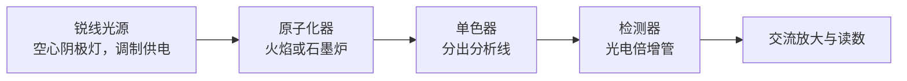

原子发射光谱（[6.4.7](/6.4.7)）测量的是被激发的少数原子发出的光；而在火焰或石墨炉的温度下，绝大多数原子停留在基态。原子吸收光谱法让一束与待测元素**共振线**波长相同的光穿过原子蒸气，测量基态原子吸收了多少，因此信号对温度不敏感、谱线干扰少，至今仍是测定痕量金属最可靠的常规方法之一。本章先讲原子吸收的理论关键：谱线有多宽、为什么必须用锐线光源测峰值吸收；再讲仪器（光源与原子化器）、干扰及其消除；然后是与它互补的原子荧光，最后两节转向内层电子：X 射线荧光光谱和晶体的 X 射线衍射。单色器、光栅、**光电倍增管**等光谱仪器的公共部件已在 [6.4.7](/6.4.7) 讲过，**校准曲线**、**标准加入法**、**内标法**与**检出限**的定义见 [6.4.1](/6.4.1#sec-1.8)；**Boltzmann 分布**、**谱线宽度**、**Zeeman 效应**、**特征 X 射线**与 Bragg 公式来自物理学（5.2、5.4、5.5），本章只引用。

## 8.1. 原子吸收光谱法的原理

### 8.1.1. 发展简史与特点

1802 年，Wollaston 发现太阳光谱中有几条暗线；1814 年前后，Fraunhofer 用更精密的分光装置记录了五百多条暗线，并注意到食盐火焰的黄光恰好落在太阳光谱的 D 暗线上。1859 年，Kirchhoff 与 Bunsen 证明这些暗线是太阳外层大气中的元素对连续光谱的选择性吸收：每种元素吸收的正是它自己能发射的谱线。这就是原子吸收现象，但一百年来它只用于天体物理。1955 年，Walsh 指出原子吸收线极窄，用连续光源无法准确测量，应当用待测元素本身发射的锐线作光源，并提出用空心阴极灯；此后商品仪器迅速出现。1959 年，L'vov 提出石墨炉电热原子化，把灵敏度提高了两到三个数量级。

**定义 8.1.1（原子吸收光谱法）** 将试样中的待测元素转变为气态基态原子，使待测元素的特征辐射通过原子蒸气，根据基态原子对特征谱线的吸收程度测定该元素含量的方法称为**原子吸收光谱法**（AAS）。

它的主要特点：

- 灵敏度高：火焰法的检出限多为 $\mathrm{ng\,mL^{-1}}$ 到 $\mu\mathrm{g\,mL^{-1}}$ 的低端，石墨炉法的绝对检出限可达 $10^{-10}$–$10^{-14}\,\mathrm{g}$；
- 精密度好：火焰法的**相对标准偏差**一般小于 1%，石墨炉法为 1%–5%；
- 选择性好：可测约 70 种元素，谱线干扰很少，常作为其他元素分析方法的参比方法；
- 缺点：传统仪器每测一种元素就要换一只灯，难以多元素同时测定，也不适于定性分析；非金属与难熔元素的测定困难。

### 8.1.2. 基态原子与激发态原子

原子化温度下原子会不会被热激发？在热平衡时，激发态 $j$ 与基态的原子数之比服从 **Boltzmann 分布**（[5.2.1](/5.2.1#sec-1.7)，[6.3.10](/6.3.10#sec-10.3)）：

$$
\frac{N_j}{N_0} = \frac{g_j}{g_0}\exp\!\Big(-\frac{E_j}{k_{\mathrm{B}}T}\Big),
\tag{8.1}
$$

其中 $g_j$、$g_0$ 是统计权重，$E_j = hc/\lambda$ 是共振线对应的激发能。

**例 8.1.1** 几条共振线的 $N_j/N_0$（按式 (8.1) 计算；Na 与 Cs 取 $^2\mathrm{P}_{3/2}$ 上能级，$g_j/g_0 = 2$；Ca 与 Zn 为 $^1\mathrm{P}_1 \to {}^1\mathrm{S}_0$，$g_j/g_0 = 3$）：

| 共振线 | $E_j/\mathrm{eV}$ | 2000 K | 2500 K | 3000 K |
|---|---|---|---|---|
| Cs 852.1 nm | 1.455 | $4.3\times10^{-4}$ | $2.3\times10^{-3}$ | $7.2\times10^{-3}$ |
| Na 589.0 nm | 2.105 | $9.9\times10^{-6}$ | $1.1\times10^{-4}$ | $5.8\times10^{-4}$ |
| Ca 422.7 nm | 2.933 | $1.2\times10^{-7}$ | $3.7\times10^{-6}$ | $3.5\times10^{-5}$ |
| Zn 213.9 nm | 5.798 | $7.4\times10^{-15}$ | $6.2\times10^{-12}$ | $5.5\times10^{-10}$ |

激发能越低（波长越长）、温度越高，激发态原子越多，但即使是 Cs 在 3000 K，激发态也不到 1%。所以在原子吸收的温度范围内，可以认为 $N_0$ 就是原子总数，它与试样中的浓度成正比；而且 $N_0$ 几乎不随温度变化，这是原子吸收比原子发射稳定的根本原因（发射强度正比于 $N_j$，按式 (8.1) 随温度指数变化，见式 (7.1)）。温度的主要影响不在激发，而在原子化效率与电离（8.3 节）。

### 8.1.3. 吸收线的轮廓与变宽

原子吸收线并不是无限窄的。用吸收系数 $K_\nu$（单位长度原子蒸气使光强按 $\mathrm{e}$ 指数衰减的系数）对频率作图，得到吸收线的轮廓，用中心频率 $\nu_0$ 和半峰全宽 $\Delta\nu$（或 $\Delta\lambda$）描述。决定宽度的因素有三种。

首先是自然宽度。激发态的寿命 $\tau$ 有限，由能量–时间的**不确定关系**（[5.5.2](/5.5.2#sec-2.3.3)），能级有宽度，谱线的自然宽度 $\Delta\nu_{\mathrm{N}} = 1/(2\pi\tau)$。Na 的 $3\mathrm{p}$ 能级寿命约 16 ns，$\Delta\nu_{\mathrm{N}} \approx 10\,\mathrm{MHz}$，即 $\Delta\lambda_{\mathrm{N}} = \lambda^2\Delta\nu_{\mathrm{N}}/c \approx 1\times10^{-5}\,\mathrm{nm}$，比其他因素小两个数量级，可以忽略。

**定义 8.1.2（Doppler 变宽）** 原子的无规热运动使不同原子相对观测方向的速度不同，由 **Doppler 效应**（[5.1.7](/5.1.7#sec-7.9)）各原子吸收的频率略有不同，谱线因此展宽，称为 **Doppler 变宽**（热变宽）。

视线方向的速度分量服从 Maxwell 分布（Gauss 分布），所以 Doppler 轮廓是 Gauss 型。由速度分量的方差 $k_{\mathrm{B}}T/m$ 与 $\Delta\nu/\nu_0 = v_x/c$ 得半峰全宽

$$
\Delta\nu_{\mathrm{D}} = \frac{\nu_0}{c}\sqrt{\frac{8\ln 2\,k_{\mathrm{B}}T}{m}},
\qquad
\Delta\lambda_{\mathrm{D}} = 7.16\times10^{-7}\,\lambda_0\sqrt{\frac{T/\mathrm{K}}{A_{\mathrm{r}}}},
\tag{8.2}
$$

其中 $m = A_{\mathrm{r}}\,\mathrm{u}$，$A_{\mathrm{r}}$ 是相对原子质量，系数 $7.16\times10^{-7} = \sqrt{8\ln2\,k_{\mathrm{B}}/\mathrm{u}}\,/\,c$（以 $\mathrm{m\,s^{-1}}$ 计的数值）。Doppler 宽度随温度升高、原子质量减小而增大。

**例 8.1.2** 2500 K 时，Na 589.0 nm 线：$\Delta\lambda_{\mathrm{D}} = 7.16\times10^{-7}\times589.0\,\mathrm{nm}\times\sqrt{2500/22.99} = 4.4\times10^{-3}\,\mathrm{nm}$；Zn 213.9 nm 线：$9.5\times10^{-4}\,\mathrm{nm}$；Cu 324.8 nm 线：$1.5\times10^{-3}\,\mathrm{nm}$。都是 pm 量级。

**定义 8.1.3（压力变宽）** 吸光原子与蒸气中其他粒子碰撞，使激发态的有效寿命缩短（或能级受扰动），谱线展宽，称为**压力变宽**（碰撞变宽）。与外来粒子（火焰气体分子、Ar 原子）碰撞引起的称为 Lorentz 变宽，与同种原子碰撞引起的称为共振变宽（Holtsmark 变宽）。

压力变宽的轮廓是 Lorentz 型，宽度正比于碰撞频率，因而随压力和温度变化；在常压火焰与石墨炉中 Lorentz 宽度与 Doppler 宽度同量级（$10^{-3}\,\mathrm{nm}$），还使谱线中心略微位移、轮廓不对称。共振变宽正比于待测原子自身的浓度，在原子吸收的低浓度下可以忽略。

实际的吸收线是 Gauss 轮廓与 Lorentz 轮廓的卷积，称为 Voigt 轮廓（Voigt profile）：中心近似 Gauss 型，两翼按 Lorentz 型缓慢下降。总宽度约 $10^{-3}$–$10^{-2}\,\mathrm{nm}$。

### 8.1.4. 积分吸收与峰值吸收

吸收线下的总面积反映吸光原子的总数。

**定义 8.1.4（振子强度）** 一条吸收跃迁的实际吸收强度与经典电子谐振子模型给出的吸收强度之比称为该跃迁的**振子强度** $f$（量纲一）。它由跃迁的电偶极矩阵元决定，强共振线的 $f$ 接近 1（如 Na 589.0 nm 线 $f = 0.64$），禁阻跃迁的 $f$ 很小。

**定义 8.1.5（积分吸收）** 吸收系数对整条吸收线的频率积分 $\int K_\nu\,\mathrm{d}\nu$ 称为**积分吸收**。由辐射与原子相互作用的理论（SI 单位）

$$
\int K_\nu\,\mathrm{d}\nu = \frac{e^2}{4\varepsilon_0 m_{\mathrm{e}} c}\,N_0 f,
\tag{8.3}
$$

其中 $N_0$ 是基态原子的数密度，$e^2/(4\varepsilon_0 m_{\mathrm{e}}c) = 2.654\times10^{-6}\,\mathrm{m^2\,s^{-1}}$（Gauss 单位制写作 $\pi e^2/(m_{\mathrm{e}}c)$）。

式 (8.3) 不含温度、谱线宽度等任何经验参数：只要测出积分吸收，原则上就能绝对地求出原子数。困难在于测量。吸收线只有约 $0.002\,\mathrm{nm}$ 宽，要用连续光源描出它的轮廓，单色器的通带须达到 $10^{-4}\,\mathrm{nm}$ 量级（在 300 nm 处分辨本领约 $3\times10^6$）；普通原子吸收仪器的通带是 0.1–1 nm，即使有这样的光栅，分出的光也太弱，无法测量。这就是一百年来原子吸收没有成为分析方法的原因。

Walsh 的解决办法是改测吸收线中心的吸收。

**定义 8.1.6（峰值吸收）** 吸收线中心频率 $\nu_0$ 处的吸收系数 $K_0$ 称为**峰值吸收**（中心吸收）。

吸收线以 Doppler 变宽为主时，轮廓是 Gauss 型，面积与峰高之比是常数，由式 (8.3)

$$
K_0 = \frac{2}{\Delta\nu_{\mathrm{D}}}\sqrt{\frac{\ln2}{\pi}}\int K_\nu\,\mathrm{d}\nu
= \frac{2}{\Delta\nu_{\mathrm{D}}}\sqrt{\frac{\ln2}{\pi}}\;\frac{e^2}{4\varepsilon_0 m_{\mathrm{e}}c}\,N_0 f .
$$

如果光源发射的谱线与吸收线中心频率相同、宽度又比吸收线窄得多（锐线光源），整条发射线都落在吸收线的峰顶附近，吸收系数可以看作常数 $K_0$。强度为 $I_0$ 的光通过长度（光程）为 $b$ 的原子蒸气后，$I = I_0\,\mathrm{e}^{-K_0b}$，吸光度

$$
A = \lg\frac{I_0}{I} = \frac{K_0b}{\ln10} = 0.434\,K_0b .
$$

在确定的实验条件下，$\Delta\nu_{\mathrm{D}}$、$f$、$b$ 都是常数，$N_0$ 又与试液中待测元素的浓度 $c$ 成正比，于是

$$
A = Kc,
\tag{8.4}
$$

这就是原子吸收定量的基本关系式，形式上与溶液吸收的 **Lambert–Beer 定律**（[6.3.17](/6.3.17#def-17.2.3)）相同。与积分吸收不同，$K$ 包含了谱线宽度与原子化效率，不能计算，只能用标准溶液校准，因此原子吸收是相对方法。

锐线光源带来另一个好处：单色器不必分辨吸收线的轮廓，只需把所用的发射线与灯发出的其他谱线分开（通带 0.2 nm 左右），所以普通单色器就够用。

**例 8.1.3** 估计原子吸收的灵敏度。设 2500 K 火焰中的 Na（$\Delta\lambda_{\mathrm{D}} = 4.4\,\mathrm{pm}$，对应 $\Delta\nu_{\mathrm{D}} = c\Delta\lambda_{\mathrm{D}}/\lambda^2 = 3.8\times10^{9}\,\mathrm{Hz}$），$f = 0.64$，光程 $b = 10\,\mathrm{cm}$。产生 1% 吸收（$A = 0.0044$）所需的 $K_0 = 0.0044\ln10/b = 0.10\,\mathrm{m^{-1}}$，由上式

$$
N_0 = \frac{K_0\,\Delta\nu_{\mathrm{D}}}{2\sqrt{\ln2/\pi}\;(2.654\times10^{-6}\,\mathrm{m^2\,s^{-1}})\,f}
\approx 2.4\times10^{14}\,\mathrm{m^{-3}} = 2.4\times10^{8}\,\mathrm{cm^{-3}},
$$

即每立方厘米的火焰中只要有约 $10^8$ 个 Na 原子（约 $10^{-14}\,\mathrm{g}$），就能测出吸收。实际火焰法的检出限远高于此，主要是因为雾化与原子化效率低、原子在光路中停留时间短（8.2 节）。

### 8.1.5. 校准曲线的弯曲

式 (8.4) 只在一定浓度范围内成立，**校准曲线**在高浓度时向浓度轴弯曲，原因有：

1. 光源线宽：发射线宽度不能忽略时，发射线两翼处的吸收系数小于 $K_0$。浓度高时峰顶部分的光几乎被吸收殆尽，透过的主要是两翼的光，表观吸光度增长变慢。灯电流过大使发射线变宽、自吸（8.2.2 节）时尤其明显。
2. 通带内的非吸收光：通带内有不被吸收的谱线（灯中填充气体或阴极杂质的谱线）或杂散光，强度为 $I_{\mathrm{s}}$ 时 $A = \lg\dfrac{I_0 + I_{\mathrm{s}}}{I + I_{\mathrm{s}}}$。浓度很高时 $I \to 0$，$A$ 趋于常数 $\lg[(I_0 + I_{\mathrm{s}})/I_{\mathrm{s}}]$。
3. 原子化与电离：$N_0 \propto c$ 的假定不成立，例如基体与化学干扰改变原子化效率；易电离元素在高温下部分电离（低浓度时电离分数大，曲线反而向上弯，8.3.3 节）。
4. 吸收线的超精细结构与压力变宽使吸收轮廓偏离单一的 Gauss 型。

所以应在吸光度约 0.1–0.8 的线性范围内工作，灯电流不宜过大，并用较窄的通带。

### 8.1.6. 高分辨连续光源原子吸收

Walsh 的结论依赖于当时的单色器。如今用高强度氙短弧灯作连续光源，配以由棱镜预分光和**中阶梯光栅**组成的双单色器，再以**电荷耦合器件**阵列检测，每个像素对应约 2 pm 的波长间隔，已经能够分辨原子吸收线的轮廓。这种高分辨连续光源原子吸收（HR-CS AAS）一只灯可测所有元素，能同时看到分析线附近的背景和分子吸收带，便于背景校正，还可以快速顺序测定多种元素。它没有否定 Walsh 的论证，而是证明了只要分辨本领足够，连续光源也可以用于原子吸收。

## 8.2. 原子吸收分光光度计

### 8.2.1. 仪器的组成

原子吸收分光光度计由光源、原子化器、单色器和检测系统组成。与紫外–可见分光光度计（[6.4.9](/6.4.9#sec-9.4.1)）的不同之处在于：试样池换成了原子化器，单色器放在原子化器之后。

原子化器（火焰、石墨管）本身也发光，其中包括待测元素被热激发的发射线，它与分析线波长相同，单色器无法分开。解决办法是光源调制：用脉冲电流（或机械斩光器）使光源以一定频率闪烁，检测器后接只对该频率的交流信号放大的放大器（锁相检测），原子化器的连续发射是直流信号，不被放大。

单光束仪器结构简单、光能损失少；双光束仪器把光源的光分成通过与不通过原子化器的两束，交替测量，可以补偿光源强度的漂移。

### 8.2.2. 光源

对光源的要求是：发射待测元素的共振线，线宽小于吸收线宽（锐线）；强度足够、稳定（30 min 内漂移小于 1%）；背景低。

**定义 8.2.1（空心阴极灯）** 以待测元素的金属（或合金）制成空心圆筒形阴极、在低压惰性气体（Ne 或 Ar）中辉光放电而发射该元素锐线光谱的光源称为**空心阴极灯**。

工作过程：阴极与阳极间加几百伏电压，灯内气体电离，正离子在电场中加速轰击阴极内壁，把阴极材料的原子溅射出来；溅射出的原子在阴极腔内与电子、离子碰撞而激发，发射该元素的特征谱线。它发出的谱线窄，原因是：灯内压力只有几百帕，压力变宽很小；放电电流小（几毫安到几十毫安），阴极腔内温度只有几百摄氏度，Doppler 变宽也比火焰中小。

灯电流是主要的工作条件：电流太小，发射强度弱、信噪比低；电流太大，阴极腔内原子密度与温度升高，谱线变宽，发射线中心还会被腔内较冷的基态原子吸收而产生**自吸**，严重时出现**自蚀**（[6.4.7](/6.4.7#def-7.2.3)），使灵敏度下降、校准曲线弯曲。所以在保证稳定和足够光强的前提下，应选用较小的灯电流。

无极放电灯把少量金属或其卤化物封在石英泡中，由射频或微波场激发，强度比空心阴极灯高一到两个数量级，主要用于 As、Se、Sb 等挥发性元素以及原子荧光（8.4 节）。

### 8.2.3. 火焰原子化

原子化器的作用是提供能量，使试样干燥、蒸发并解离成气态基态原子。原子化效率决定了方法的灵敏度，原子化过程又是大多数干扰的来源，因此原子化器是原子吸收仪器的核心。

**定义 8.2.2（火焰原子化）** 用雾化器把试液变成气溶胶，与燃气、助燃气混合后送入燃烧器，在火焰的高温中使待测元素原子化的方法称为**火焰原子化**。

现行仪器都用预混合型燃烧器：气动雾化器利用高速助燃气流把试液吸入并破碎成雾滴，雾滴在雾化室中撞击撞击球、扰流器，大雾滴凝聚后从废液口排出，只有细雾与燃气混合后进入长缝燃烧器（光程 5–10 cm），所以火焰稳定、噪声低。雾滴的平均直径取决于气液相对流速和溶液的表面张力、密度、黏度（Nukiyama–Tanasawa 经验式），一般为 10–20 μm；直径小于约 10 μm 的雾滴才能在火焰中迅速脱溶剂、蒸发。能进入火焰的试液不到 15%，雾化效率是火焰原子吸收灵敏度的主要限制。超声雾化产生的雾滴更细、分布更窄，效率更高，但记忆效应较大。

雾滴在火焰中依次经历脱溶剂、蒸发成分子、分子解离成原子；原子还可能进一步电离，或与火焰中的 O、OH 生成氧化物。火焰的两个关键性质是温度和氧化还原性：

| 火焰（燃气–助燃气） | 最高温度 | 用途 |
|---|---|---|
| 空气–乙炔 | 约 2500 K | 最常用，可测三十多种元素 |
| 氧化亚氮–乙炔 | 约 3000 K | 生成难熔氧化物的元素（Al、Si、Ti、V、B、稀土） |
| 空气–氢 | 约 2300 K | 背景吸收小，用于 As、Se 等短波长元素（约 200 nm 以下乙炔火焰吸收强） |

同一种火焰，燃气与助燃气的比例不同，性质也不同：

| | 化学计量火焰 | 贫燃火焰 | 富燃火焰 |
|---|---|---|---|
| 燃助比 | 按燃烧反应的化学计量 | 助燃气过量 | 燃气过量 |
| 性质 | 温度最高，中性 | 氧化性，温度较低 | 还原性（含大量 C、CH 等半分解产物），温度略低 |
| 适用 | 大多数元素 | 不易氧化的元素（Ag、Au、Cu）与碱金属 | 易生成难熔氧化物的元素（Cr、Mo、碱土金属） |

燃烧器上方不同高度处火焰的温度与组成不同，所以观测高度也要优化：生成稳定氧化物的元素（Cr）在火焰底部还原区信号最强，越往上越弱；不生成稳定氧化物的元素（Ag）原子越往上越多；Mg 介于两者之间，在中部出现最大值。火焰类型、燃助比、观测高度是火焰原子吸收需要选择的三个条件。

火焰法简便、快速、精密度好，但雾化效率低，原子在光路中只停留约 $10^{-4}\,\mathrm{s}$ 就被气流带走，并被大量火焰气体稀释，灵敏度受限。

### 8.2.4. 石墨炉原子化

**定义 8.2.3（石墨炉原子化）** 把微升级的试液注入石墨管中，通过大电流使石墨管按程序升温，在惰性气体保护下使试样干燥、灰化并原子化的方法称为**石墨炉原子化**（电热原子化）。

石墨管长约 30 mm、外径约 6 mm、内径约 4 mm，两端通光，外壁水冷，管内外通 Ar 保护（防止石墨与原子被氧化）。进样量 5–50 μL，按程序分步升温：

| 步骤 | 温度（典型） | 目的 |
|---|---|---|
| 干燥 | 略高于溶剂沸点（约 100–130 °C） | 除去溶剂，防止溅射 |
| 灰化（热解） | 300–1200 °C，随元素而定 | 除去易挥发的基体与有机物，待测元素不能损失 |
| 原子化 | 1800–2700 °C，升温极快，停止管内气流 | 产生原子蒸气，测量吸收信号 |
| 净化 | 比原子化温度高约 200 °C | 除去残留物，消除记忆效应 |

与火焰相比，石墨炉的优点是：试样几乎全部原子化并留在管内；原子在光路中的停留时间约 0.1–1 s，比火焰长约 $10^3$ 倍；原子化在 Ar 中进行，石墨的还原性有利于氧化物分解。因此绝对检出限低（pg 级），试样用量少，可直接分析血液、尿液等少量生物试样。信号是一个瞬态峰，用峰面积（积分吸光度，单位 s）定量比峰高更可靠。

缺点是精密度较差、背景吸收和基体干扰较重。干扰的一个重要来源是时间不等温性：管壁一通电就迅速升温，而管内的气体升温滞后，待测物在气相温度还低时就从管壁蒸发出来，在冷的气体中易重新结合成分子；管的两端比中部冷，又造成空间不等温性。现行的对策是"稳定温度平台石墨炉"技术：

- L'vov 平台：在石墨管内放一块热解石墨小平台，试样点在平台上。平台与管壁接触很少，主要靠管壁辐射加热，升温比管壁晚，待测物在管内气体已达到稳定高温时才蒸发（见上图），接近等温原子化；
- 最大功率升温（约 2000 °C/s）、热解石墨涂层（减少石墨的多孔性和碳化物的生成）、横向加热石墨管（消除空间不等温性）；
- 加入**基体改进剂**（8.3.2 节）、用峰面积定量、Zeeman 背景校正（8.3.4 节）。

### 8.2.5. 氢化物发生与冷蒸气法

As、Se、Sb、Bi、Te、Sn、Ge、Pb 在火焰中的灵敏度低，共振线多在 200 nm 附近，火焰背景吸收也重。它们能生成在常温下为气体的共价氢化物，可以先从溶液中分离出来再原子化。

**定义 8.2.4（氢化物发生）** 在酸性介质中用强还原剂（通常是 $\ce{NaBH4}$ 或 $\ce{KBH4}$）把待测元素还原成气态共价氢化物，用载气把它从溶液中分离并送入原子化器（加热的石英管，约 900 °C）分解为原子的进样方法称为**氢化物发生**。

以砷为例：

$$
\ce{4H3AsO3 + 3BH4- + 3H+ -> 4AsH3 ^ + 3H3BO3 + 3H2O},
$$

过量的 $\ce{BH4-}$ 同时水解放出大量 $\ce{H2}$。氢化物发生的优点是：待测元素与基体分离，干扰少；进样效率接近 100%，又可以富集，检出限比溶液直接雾化低一到三个数量级；氢化物的生成与价态有关（如 As(III) 比 As(V) 快得多），可以通过控制条件区分价态。

汞在常温下就有可观的蒸气压，可以不加热：用 $\ce{SnCl2}$（或 $\ce{NaBH4}$）把 $\ce{Hg^2+}$ 还原为单质汞，

$$
\ce{Hg^2+ + Sn^2+ -> Hg + Sn^4+},
$$

用载气把汞原子吹入石英吸收池，在 253.7 nm 测量吸收，称为冷蒸气原子吸收（冷原子吸收），检出限可达 $\mathrm{ng\,L^{-1}}$ 量级。环境与食品中汞的监测意义重大：1950 年代日本水俣湾发生的水俣病，就是化工厂用汞催化剂生产乙醛、把含甲基汞的废水排入海湾，甲基汞经鱼贝类富集后进入人体、损害神经系统所致。氢化物与冷蒸气的原子化温度低（低温原子化），也可以用介质阻挡放电等低温等离子体在接近室温下原子化。

### 8.2.6. 分光与检测系统

单色器（光栅、狭缝、反射镜，[6.4.7](/6.4.7#sec-7.4)）放在原子化器之后，作用是把分析线与邻近的谱线（灯中的非吸收线、填充气体的谱线）分开，并减少进入检测器的原子化器发射。要求能分开 Mn 279.48 nm 与 279.83 nm 两条线（相距 0.35 nm），以及 Ni 232.00 nm 分析线与邻近的 231.60 nm、231.10 nm 线，所以光谱通带一般取 0.2 nm（Ni 等谱线复杂的元素）到 1 nm（碱金属等谱线简单的元素）。通带过宽，非吸收线进入，灵敏度下降、校准曲线弯曲；过窄，光强太弱，噪声增大。

检测器是**光电倍增管**，要求在 190–900 nm 范围内有足够的光谱灵敏度，工作电压稳定。

## 8.3. 干扰及其消除

原子吸收的干扰按来源分为物理干扰、化学干扰、电离干扰和光谱干扰。

### 8.3.1. 物理干扰

试液的黏度、表面张力、密度、溶剂蒸气压等物理性质的变化，改变了雾化效率、进样量和蒸发速度，使吸收信号变化，称为物理干扰。它对试样中所有元素的影响相同，属于**基体效应**（[6.4.1](/6.4.1#def-1.8.6)）。消除方法：配制与试样组成相似的标准溶液（基体匹配）；稀释试样；或用**标准加入法**（[6.4.1](/6.4.1#def-1.8.8)）——标准加入到试样本身中，基体相同，物理干扰被自动校正。

### 8.3.2. 化学干扰

**定义 8.3.1（化学干扰）** 待测元素在凝聚相或气相中与共存组分生成热力学稳定的化合物（或因易挥发而提前损失），使原子化效率改变而引起的干扰称为**化学干扰**。它是原子吸收最主要的干扰，具有选择性：只影响特定的待测元素与干扰组分的组合。

常见的情形：

- 生成难解离的化合物：磷酸根使 Ca 的吸收显著降低，因为在火焰中生成难解离的磷酸钙与焦磷酸钙（$\ce{Ca3(PO4)2}$、$\ce{Ca2P2O7}$）；Al 与 Mg 生成尖晶石 $\ce{MgAl2O4}$。这一点在测血清、骨样、植物中的 Ca、Mg 时很重要。
- 生成难熔氧化物或碳化物：Al、Si、Ti、Zr、V、Mo、W、B、稀土元素在空气–乙炔火焰中生成难解离的氧化物，较难原子化；Nb、Ta、Hf、W、Re、Os 很难原子化；Be、B、Al、Si、Ti、Zr、V、W、U 在石墨炉中易生成难挥发的碳化物。
- 分子蒸发：在石墨炉中，待测元素生成易挥发的卤化物或氧化物，在灰化阶段就蒸发损失。

消除化学干扰的方法：

1. 提高原子化温度：例如改用氧化亚氮–乙炔火焰，磷酸盐对 Ca 的干扰基本消失。
2. 加入化学试剂。

**定义 8.3.2（释放剂、保护剂与基体改进剂）** 能与干扰组分生成更稳定或更难挥发的化合物、从而把待测元素释放出来的试剂称为**释放剂**；能与待测元素生成稳定但在火焰中易于分解的配合物、从而防止待测元素与干扰组分结合的试剂称为**保护剂**；在石墨炉中加入的、使基体变得易挥发或使待测元素变得难挥发、从而可以提高灰化温度而不损失待测元素的试剂称为**基体改进剂**（化学改进剂）。

例如：测 Ca 时加入 La 或 Sr 盐，La 与磷酸根生成更稳定的 $\ce{LaPO4}$，把 Ca 释放出来（释放剂）；加入 EDTA，Ca 生成 CaY 配合物，它在火焰中容易分解，Ca 不再与磷酸根结合；加入 8-羟基喹啉可抑制 Al 对 Mg、Ca 的干扰（保护剂）。石墨炉测海水或血液中的痕量 Cd、Pb 时加入 $\ce{NH4NO3}$，使高浓度的 NaCl 转变为在灰化温度下易于除去的 $\ce{NaNO3}$ 和 $\ce{NH4Cl}$：

$$
\ce{NaCl + NH4NO3 -> NaNO3 + NH4Cl};
$$

现行最通用的是 Pd 与 $\ce{Mg(NO3)2}$ 的混合改进剂，它使 As、Se、Pb、Cd 等易挥发元素可以在高得多的温度下灰化。

3. 化学分离（萃取、离子交换、氢化物发生），或用标准加入法。

### 8.3.3. 电离干扰

**定义 8.3.3（电离干扰与消电离剂）** 待测原子在高温原子化器中电离，基态原子数减少，使吸收信号下降的现象称为**电离干扰**。为抑制电离而加入的、电离能比待测元素更低的易电离元素称为**消电离剂**。

**电离能**越低、温度越高，电离越严重：碱金属与碱土金属在空气–乙炔火焰中已有明显电离，在氧化亚氮–乙炔火焰中更甚。电离平衡 $\ce{M <=> M+ + e-}$ 的平衡常数只与温度有关（Saha 方程），所以待测元素的浓度越高，电离分数越小：低浓度端的吸收偏低，校准曲线向吸光度轴弯曲。

加入大量 K、Cs 盐（如 $1$–$2\,\mathrm{g\,L^{-1}}$ KCl；K 与 Cs 的电离能分别为 4.34 eV 与 3.89 eV，低于 Ca 的 6.11 eV、Na 的 5.14 eV），它们电离产生大量自由电子，使待测元素的电离平衡向左移动：

$$
\ce{K -> K+ + e-},\qquad \ce{Ca+ + e- -> Ca}.
$$

此外也可以改用温度较低的火焰。

### 8.3.4. 光谱干扰与背景校正

光谱干扰包括：其他元素的吸收线与分析线重叠（极少见，相距小于约 0.01 nm 才有影响，如 Fe 271.903 nm 与 Pt 271.904 nm）；通带内有灯发出的非吸收线；原子化器的发射；以及背景吸收。采用锐线光源与调制技术后，前三种一般可以通过选线、减小通带、调制消除，主要问题是背景吸收：

- 分子吸收：原子化过程中生成的分子（碱金属卤化物、氧化物、$\ce{OH}$、$\ce{CaOH}$ 等）有宽的吸收带。例如 NaCl、NaI 等在 200–400 nm 有连续吸收，高盐试样的背景很重；硫酸、磷酸在 250 nm 以下有强吸收。
- 光散射：原子化器中未蒸发的固体微粒使光散射，光强减弱，表现为表观吸收；散射随波长减小而增大。

背景吸收在石墨炉中远比在火焰中严重，而且是宽带的，在分析线附近的通带内几乎不随波长变化。

**定义 8.3.4（背景校正）** 设法单独测出分析线处的背景吸光度 $A_{\mathrm{B}}$，从总吸光度 $A_{\mathrm{T}} = A + A_{\mathrm{B}}$ 中扣除，得到净原子吸光度 $A = A_{\mathrm{T}} - A_{\mathrm{B}}$ 的方法称为**背景校正**。

1. 邻近非共振线法：用分析线附近一条不被待测原子吸收的谱线（灯中的非共振线或另一元素的谱线）测背景。只在背景平坦时准确，现已少用。
2. 氘灯法：氘灯发射连续光谱，与空心阴极灯的光交替通过原子化器。对于通带（如 0.2 nm）内的连续光，宽度只有约 0.002 nm 的原子吸收线吸收的部分不到 1%，所以氘灯测得的就是背景 $A_{\mathrm{D}} \approx A_{\mathrm{B}}$；空心阴极灯测得 $A_{\mathrm{T}}$，二者之差即 $A$。氘灯法简便，但只适用于紫外区（约 190–350 nm），且要求背景在通带内平坦，不能校正有精细结构的分子吸收。
3. Zeeman 效应法：在原子化器上加磁场（约 1 T），待测原子的吸收线发生 **Zeeman 效应**（[5.5.4](/5.5.4#sec-4.2.1)）分裂。在与磁场垂直的方向观测时，分裂出的 π 分量（$\Delta m = 0$）位于原波长处，只吸收偏振方向与磁场平行的**线偏振光**；σ± 分量（$\Delta m = \pm1$）向两侧移动 pm 量级，吸收偏振方向与磁场垂直的光。分子吸收和光散射不受磁场影响，对两种偏振的光吸收相同。于是，用偏振方向平行于磁场的光（或磁场关闭时）测得原子吸收加背景；用偏振方向垂直于磁场的光（磁场开启时）测得的只是背景，因为 σ 分量已移出锐线光源的发射线。实际仪器多在原子化器上加交变磁场，用固定的偏振器在磁场开、关两个时刻测量。Zeeman 法在分析线本身的波长处测背景，可在全波段使用，能校正结构化背景，是石墨炉的标准配置；代价是灵敏度略降、校准曲线在高浓度下会翻转（roll-over）。
4. 自吸收法（Smith–Hieftje 法）：空心阴极灯周期性地以大电流脉冲供电，发射线严重自吸、中心凹陷（自蚀），此时测得的主要是背景；正常小电流时测得总吸收，二者相减。装置简单，但灵敏度损失较大，灯的寿命缩短。

高分辨连续光源原子吸收（8.1.6 节）可以直接看到分析线两侧的背景，用相邻像素校正，是另一条途径。

### 8.3.5. 特征浓度与测定条件

原子吸收中常用特征浓度表示灵敏度。

**定义 8.3.5（特征浓度与特征质量）** 产生 1% 吸收（$I/I_0 = 0.99$，即 $A = \lg(100/99) = 0.0044$）所对应的待测元素浓度称为**特征浓度** $c_0$；石墨炉中产生 $0.0044\,\mathrm{s}$ 积分吸光度所对应的待测元素质量称为**特征质量** $m_0$：

$$
c_0 = \frac{0.0044\,c}{A},\qquad m_0 = \frac{0.0044\,\mathrm{s}\times m}{A_{\mathrm{int}}} .
$$

特征浓度越小，方法越灵敏。它反映的是校准曲线的斜率，即**灵敏度**（[6.4.1](/6.4.1#def-1.8.2)），不含噪声的信息；能否测出低浓度要看**检出限**（[6.4.1](/6.4.1#def-1.8.5)），它同时取决于斜率与空白的标准偏差。

**例 8.3.1** 用火焰原子吸收测 Cu，$0.50\,\mu\mathrm{g\,mL^{-1}}$ 的标准溶液吸光度为 0.110，则特征浓度 $c_0 = 0.0044\times0.50/0.110\,\mu\mathrm{g\,mL^{-1}} = 0.020\,\mu\mathrm{g\,mL^{-1}}$。若空白溶液测 11 次，吸光度的标准偏差为 0.0008，则检出限 $c_{\mathrm{L}} = 3s_{\mathrm{b}}/S = 3\times0.0008/(0.110/0.50\,\mathrm{mL\,\mu g^{-1}}) = 0.011\,\mu\mathrm{g\,mL^{-1}}$。

从式 (8.4) 的推导还可以看出，原子吸收测量的是两个大信号之差：1% 吸收只对应 $A = 0.0044$，所以它的灵敏度受光源噪声限制，原理上不如测"零背景上的信号"的原子荧光（8.4 节）。

测定条件的选择归纳如下：分析线（一般用最灵敏的共振线，浓度高时可选次灵敏线以扩大线性范围）、灯电流、光谱通带；火焰法的火焰类型、燃助比、观测高度；石墨炉的灰化温度与原子化温度（作灰化曲线与原子化曲线，取不损失待测元素的最高灰化温度和信号达到平台的最低原子化温度）、基体改进剂；以及干扰的消除与背景校正方式。定量方法用**校准曲线**或标准加入法，后者在基体复杂（血液、海水、土壤消解液）时尤为常用。

## 8.4. 原子荧光光谱法

### 8.4.1. 原子荧光的产生与类型

**定义 8.4.1（原子荧光光谱法）** 气态基态原子吸收光源的特征辐射被激发后，以辐射跃迁方式去激发而发射的光称为原子荧光；通过测量待测元素原子荧光的强度进行定量分析的方法称为**原子荧光光谱法**（AFS）。

原子荧光既有原子吸收的过程（光激发），又有原子发射的过程（发光），是介于二者之间的方法。与分子的**荧光**（[6.3.17](/6.3.17#sec-17.2.4)）一样，荧光在与激发光垂直的方向观测，没有激发光直接进入检测器，信号叠加在接近于零的背景上。按激发与发射的能级关系分为：

- 共振荧光：吸收与发射的是同一条共振线（如 Zn 213.9 nm、Cd 228.8 nm、Hg 253.7 nm），最强、最常用。
- 非共振荧光：荧光波长与激发波长不同。直跃线荧光：激发后由高能级直接跃迁到高于基态的亚稳能级（如 Tl 吸收 377.6 nm，发射 535.0 nm，二者有相同的上能级）；阶跃线荧光：激发到高能级后，先经碰撞无辐射地失去部分能量到较低的激发态，再跃迁回基态（如 Na 吸收 330.3 nm 被激发到 4p，弛豫到 3p 后发射 589.0 nm）。非共振荧光的好处是可以用单色器把荧光与激发光的散射分开。
- 敏化荧光：一种原子被激发后通过碰撞把能量转移给待测原子，使后者激发而发射荧光。

激发态原子也可以通过与火焰气体分子（$\ce{N2}$、$\ce{CO2}$、$\ce{H2O}$）碰撞而无辐射地失活，这就是荧光的**猝灭**，它降低了荧光的**量子产率** $\Phi$。$\ce{Ar}$ 的猝灭截面很小，所以原子荧光常用 Ar 稀释的氢火焰。

### 8.4.2. 定量基础

荧光强度 $I_{\mathrm{f}}$ 正比于被吸收的光强 $I_{\mathrm{a}}$ 与量子产率：$I_{\mathrm{f}} = \Phi I_{\mathrm{a}}$。由吸收定律，强度为 $I_0$ 的激发光通过原子蒸气后

$$
I_{\mathrm{a}} = I_0 - I = I_0\big(1 - \mathrm{e}^{-k'c}\big),
$$

其中 $k'$ 包含峰值吸收系数、吸收光程和原子化效率，与浓度 $c$ 无关。于是

$$
I_{\mathrm{f}} = \Phi I_0\big(1 - \mathrm{e}^{-k'c}\big) \approx \Phi I_0 k' c \qquad (k'c \ll 1).
\tag{8.5}
$$

低浓度时荧光强度与浓度成正比，这是原子荧光定量的基础（实际还要乘以检测器收集荧光的几何因子）。由式 (8.5) 可以看出两点：

1. 荧光强度与激发光强 $I_0$ 成正比，所以用高强度光源（高性能空心阴极灯、无极放电灯、激光）可以直接提高灵敏度——这与原子吸收不同，原子吸收的吸光度与光强无关。
2. 浓度增大时，激发光被吸收殆尽，$I_{\mathrm{f}}$ 趋于饱和；荧光在射出原子蒸气途中又被基态原子吸收（自吸），校准曲线在高浓度下弯曲甚至下降。线性范围的上限由此决定，但低浓度端可以延伸得很远，线性范围常达 3–5 个数量级。

### 8.4.3. 仪器与氢化物发生–原子荧光

原子荧光光谱仪由激发光源、原子化器、（单色器、）检测器、进样系统和数据处理系统组成。光源与检测器成直角，以避免激发光直接进入检测器；光源调制同样用来扣除原子化器的发射。

- 色散型：用单色器分出荧光线，可以使用连续光源（高压氙弧灯）和非共振荧光，适用元素多，但光通量损失大。
- 非色散型：不用单色器，用干涉滤光片或日盲光电倍增管（光阴极只对约 160–320 nm 的紫外光敏感，对可见光和火焰的热辐射不响应）直接检测。光路简单、光通量大、灵敏度高，各通道可以同时测几种元素；代价是要求进入检测器的光中没有其他强谱线和强散射光。

非色散型原子荧光的难点在于：溶液雾化进样产生大量雾滴，散射的激发光很强；而能获得高荧光量子产率的 Ar–H₂ 火焰，抗化学干扰的能力又差。氢化物发生（8.2.5 节）恰好解决了这两个问题：待测元素以气体形式与基体分离，没有雾滴散射；$\ce{NaBH4}$ 与酸反应产生的 $\ce{H2}$ 在石英管炉口被点燃，形成 Ar–H₂ 扩散火焰，温度低、背景低、猝灭小，氢化物在其中充分原子化。As、Se、Sb、Bi、Te、Hg 等元素的荧光线都在 180–260 nm，正落在日盲光电倍增管的响应范围内。所以氢化物发生–原子荧光（HG-AFS）几乎总是非色散型的。

HG-AFS 在我国的发展与应用特别广泛。早期的非色散原子荧光用碘化物无极放电灯，碘的 206.16 nm 谱线与 Bi 的 206.17 nm 荧光线只差约 0.007 nm，造成严重的光谱干扰，国外长期没有商品仪器；1970 年代末，我国为地球化学勘查的需要研制了溴化物无极放电灯和石英管炉原子化的氢化物–无色散原子荧光装置，此后又发展了脉冲供电的高性能空心阴极灯与断续流动进样系统，原子荧光仪器实现了规模化生产。现在我国环境、食品与地质标准中 As、Hg、Se、Sb 等的测定都列有原子荧光法。

原子荧光的优点是灵敏度高（As、Hg 等可达 $0.01\,\mu\mathrm{g\,L^{-1}}$ 量级）、线性范围宽、可多元素同时测定、仪器简单；局限是适用元素较少（主要是能生成氢化物或冷蒸气的 Hg、As、Sb、Bi、Se、Te、Sn、Pb、Ge 以及 Zn、Cd），散射与猝灭干扰须严格控制。因此它不如原子吸收应用广泛，而是在少数元素上有明显优势。

### 8.4.4. 形态分析

元素的毒性和生物效应取决于它的化学形态，而不只是总量。无机砷（As(III)、As(V)）毒性很强，一甲基胂酸与二甲基胂酸的毒性较低，海产品中大量存在的砷甜菜碱几乎无毒；甲基汞的神经毒性远高于无机汞，而且能在食物链中富集（8.2.5 节的水俣病）。所以食品标准（如大米中的砷）限定的是无机砷，而不是总砷。

测定各形态的含量称为形态分析（speciation analysis）。常用的做法是把**高效液相色谱**（[6.4.14](/6.4.14#def-14.1.1)）与原子光谱联用：色谱柱先把各种形态分离开，柱后的流出液在线经过紫外消解或直接与 $\ce{KBH4}$ 反应生成氢化物（或汞蒸气），再进入原子荧光检测器。HPLC–HG-AFS 的成本远低于 HPLC–ICP-MS，是我国测定食品中砷、汞形态的常用方法。氢化物发生本身的价态选择性（控制酸度只让 As(III) 生成胂）也可以给出简单的价态信息。

## 8.5. X 射线荧光光谱法

### 8.5.1. 内层电子跃迁与特征谱线

前面几种原子光谱都来自价电子在外层能级间的跃迁，能量是几个电子伏特，光在紫外–可见区。**X 射线**（[5.4.2](/5.4.2#sec-2.5.1)）的光子能量为 keV 量级，足以把原子的内层电子打出去。原子内层出现空位后，外层电子跃迁填补空位，放出**特征 X 射线**（[5.5.5](/5.5.5#def-5.1.3)）；也可以把能量交给另一个外层电子使之逸出，即 Auger 效应。用 X 射线照射试样激发出的特征 X 射线称为 X 射线荧光，或二次 X 射线。

**定义 8.5.1（X 射线荧光光谱法）** 用初级 X 射线照射试样，使其中的原子发射特征 X 射线（X 射线荧光），根据荧光的波长（或能量）鉴定元素、根据其强度测定含量的方法称为 **X 射线荧光光谱法**（XRF）。

谱线按跃迁终态的壳层分为 K、L、M 系：L 层电子填补 K 层空位产生 $\mathrm{K}_\alpha$ 线，M 层电子填补 K 层空位产生 $\mathrm{K}_\beta$ 线，M 层或 N 层电子填补 L 层空位产生 L 系谱线，等等。跃迁服从电偶极**选择定则** $\Delta l = \pm1$、$\Delta j = 0, \pm1$，所以 $\mathrm{K}_\alpha$ 线来自 $2\mathrm{p}_{3/2} \to 1\mathrm{s}$ 和 $2\mathrm{p}_{1/2} \to 1\mathrm{s}$，分别称为 $\mathrm{K}_{\alpha1}$ 与 $\mathrm{K}_{\alpha2}$（强度比约 2:1，与 $2\mathrm{p}_{3/2}$、$2\mathrm{p}_{1/2}$ 的电子数 4:2 一致），而 $2\mathrm{s} \to 1\mathrm{s}$ 是禁阻的。这种 Siegbahn 记号仍最常用；IUPAC 推荐按能级写作 K–L₃（$\mathrm{K}_{\alpha1}$）、K–L₂（$\mathrm{K}_{\alpha2}$）、K–M₃（$\mathrm{K}_{\beta1}$）。

内层电子几乎只感受到被屏蔽的核电荷，与化学键无关，所以特征谱线由元素决定，且随原子序数 $Z$ 单调变化，这就是 **Moseley 定律**（[定理 5.1.1](/5.5.5#thm-5.1.1)）：$\sqrt{\nu} = K(Z - S)$，$K$ 与屏蔽常数 $S$ 随线系而定。同名谱线的波长随 $Z$ 增大而缩短，例如 $\mathrm{K}_{\alpha1}$：Fe（$Z = 26$）0.1936 nm，Cu（29）0.1541 nm，Ag（47）0.0559 nm。这是 XRF 定性分析的基础。与紫外–可见的原子光谱相比，X 射线谱线少而简单，几乎没有谱线重叠，X 射线又能穿透一定深度，可以直接分析固体。

内层空位以发射 X 射线退激的概率称为荧光产额（fluorescence yield），它随 $Z$ 增大而迅速增大：轻元素主要发生 Auger 过程，荧光产额很低，加上轻元素的软 X 射线易被空气与窗口吸收，所以 XRF 对轻元素灵敏度差。测量光电子或 Auger 电子的能量也可以鉴定元素，这就是 X 射线光电子能谱（XPS）与 Auger 电子能谱；电子在固体中只能逸出几纳米，所以它们是表面分析方法，XPS 还能从结合能的化学位移得到元素的价态信息。

### 8.5.2. 波长色散与能量色散仪器

X 射线荧光光谱仪由 X 射线管（激发源）、分光（或能量分辨）系统和检测器组成。X 射线管的阳极（靶）常用 Rh、W、Cr、Mo：靶材原子序数越大、管压越高，连续谱越强，适于激发重元素；测轻元素宜用 Cr 等较轻的靶。

波长色散型（WDXRF）用晶体分光：试样发出的 X 射线以掠射角 $\theta$ 射到分光晶体上，只有满足 Bragg 公式（[公式 2.5.1](/5.4.2#fml-2.5.1)）

$$
k\lambda = 2d\sin\theta
$$

的波长才被强烈衍射，检测器转到 $2\theta$ 的位置接收。转动晶体与检测器（测角仪）进行扫描，就得到以 $2\theta$ 为横坐标的谱。通常测一级衍射 $k = 1$，因为 $\sin\theta \le 1$，可测的波长 $\lambda \le 2d$，所以不同波长范围要换用不同晶面间距的晶体：LiF(200)（$2d = 0.4027\,\mathrm{nm}$）、LiF(220)（$0.2848\,\mathrm{nm}$）用于重元素，PET（$0.874\,\mathrm{nm}$）、TAP（$2.58\,\mathrm{nm}$）与人工多层膜用于轻元素。平面晶体结构简单，弯曲晶体有聚焦作用、光强较大。检测器用正比计数器（轻元素）和闪烁计数器（NaI(Tl) 闪烁体加**光电倍增管**，重元素）。WDXRF 的分辨率高（约 5–20 eV），检出限低，轻元素在真空光路中可测到 Be、B。

能量色散型（EDXRF）不用分光晶体，用能量分辨的半导体探测器直接测量每个 X 射线光子的能量：光子在探测器中产生的电子–空穴对数正比于光子能量，脉冲幅度经多道分析器（上千道）分类，得到以能量为横坐标的谱。现行探测器是用 Peltier 制冷的硅漂移探测器（SDD），不再需要液氮冷却，对 Mn $\mathrm{K}_\alpha$（5.9 keV）的分辨率约 125–140 eV。EDXRF 的优点是：各元素同时测量、无运动部件、无高次衍射干扰、光路短、仪器紧凑，可以做成台式或手持式，适合现场快速筛查；缺点是分辨率比波长色散型低一个数量级，谱线重叠较多，轻元素的灵敏度与检出限一般不如 WDXRF。

用同步辐射或微聚焦 X 射线管激发的微区 XRF 可以给出元素的二维分布图，已用于观察细胞与组织中 Fe、Cu、Zn 等金属的分布；全反射 XRF（TXRF）让入射 X 射线以小于临界角的角度掠射到抛光的样品载体上，散射背景很低，几微升试液即可测到 pg 级。

### 8.5.3. 定性与定量分析

定性分析：由谱峰的 $2\theta$（WDXRF）或能量（EDXRF）查谱线表确定元素。同一元素有一组波长和强度比确定的谱线（如 $\mathrm{K}_{\alpha1}$、$\mathrm{K}_{\alpha2}$、$\mathrm{K}_{\beta1}$ 等），找到一组相符的谱线才能确认。

**例 8.5.1** 以 LiF(200)（$2d = 0.4027\,\mathrm{nm}$）为分光晶体，在 $2\theta = 57.47^\circ$ 处测得一个强峰，求对应的波长并判断元素。由 Bragg 公式（$k = 1$）

$$
\lambda = 2d\sin\theta = 0.4027\,\mathrm{nm}\times\sin28.74^\circ = 0.1936\,\mathrm{nm},
$$

$\nu = c/\lambda = 1.549\times10^{18}\,\mathrm{Hz}$。若它是 $\mathrm{K}_\alpha$ 线，由 Moseley 定律 $\sqrt{\nu} = 0.496\times10^{8}\,\mathrm{Hz}^{1/2}\times(Z-1)$ 得 $Z - 1 = 25.1$，$Z = 26$，是 Fe 的 $\mathrm{K}_{\alpha1}$ 线。再在 $2\theta = 51.7^\circ$ 附近找到较弱的 Fe $\mathrm{K}_\beta$（0.1757 nm）即可确认。

定量分析：谱线强度与元素含量有关，但不是简单的正比关系，因为存在显著的基体效应：试样中其他元素吸收初级 X 射线和荧光 X 射线（吸收效应），或其荧光再激发待测元素（增强效应，二次荧光）；颗粒度、表面平整度和化学组成也有影响。常用的方法有：

- 校准曲线法：用组成相近的**标准物质**作校准曲线，适用于组成变化不大的同类样品（合金、水泥、矿石）；
- 内标法与标准加入法（[6.4.1](/6.4.1#sec-1.8.4)）；
- 用数学方法校正基体效应：经验影响系数法，以及由 X 射线物理计算吸收与增强的基本参数法，后者可以在少量标准甚至无标准的情况下给出半定量到定量结果。

固体试样常压片或熔融成玻璃片（消除颗粒度与矿物效应）后测量。

XRF 的特点是：可测约 Be（或 B）到 U 的元素，多元素同时测定；谱线简单，干扰少；无损分析，固体、粉末、液体都可以直接测，制样简单；线性范围宽，含量从 $\mu\mathrm{g\,g^{-1}}$ 到 100%。局限是对轻元素灵敏度低，检出限一般为 $\mu\mathrm{g\,g^{-1}}$ 量级（重元素）到 0.01% 量级（轻元素），低于原子吸收与 ICP 方法的痕量水平；分析深度有限，结果代表表层的组成。应用于冶金、地质、水泥、考古与文物（无损）、环境（土壤重金属）和食品的快速筛查：例如用 EDXRF 直接测量大米粉末中的镉，几分钟内即可判断是否超标，超标样品再用石墨炉原子吸收或 ICP-MS 确证。

## 8.6. X 射线衍射简介

### 8.6.1. 衍射原理

**定义 8.6.1（X 射线衍射）** X 射线照射晶体时，晶体中各原子的电子散射的 X 射线彼此相干，在满足 Bragg 条件的方向上相长**干涉**而形成衍射束；利用这种衍射测定晶体的结构、鉴定物相的方法称为 **X 射线衍射**分析（XRD）。

衍射的物理机制是弹性散射：入射 X 射线的电场使原子中的电子做受迫振动，电子向各方向辐射与入射光频率相同的电磁波（[5.4.2](/5.4.2#sec-2.5.3)），其中没有能级跃迁，散射光的波长不变。这与 X 射线荧光（吸收后发射另一波长的光）完全不同。周期排列的原子就是三维**光栅**；把晶体看成一族族平行的晶面，相邻晶面反射的光程差为波长的整数倍时，即 $2d\sin\theta = k\lambda$ 时，衍射加强。

Bragg 公式有两种互逆的用法：

1. 已知波长 $\lambda$（用单色的特征 X 射线，最常用的是 Cu $\mathrm{K}_\alpha$，0.1541 nm），测衍射角 $\theta$，求晶面间距 $d$——这是 X 射线衍射分析；
2. 已知晶面间距 $d$（分光晶体），测 $\theta$，求 $\lambda$——这是波长色散 XRF 的分光原理（8.5.2 节）。

由 $\sin\theta \le 1$，只有 $\lambda \le 2d$ 的辐射才能被晶面间距为 $d$ 的晶面衍射；晶体的晶面间距为 0.1 nm 量级，所以只有 X 射线（以及波长相当的电子、中子）能用于晶体衍射。

### 8.6.2. 单晶衍射与粉末衍射

单晶衍射：把一粒约 0.1 mm 的**单晶**装在测角头上，在单色 X 射线中转动，记录全部衍射点的方向与强度。衍射点的位置给出晶胞参数与对称性，强度给出晶胞中电子密度的分布（衍射振幅是电子密度的 Fourier 变换，[5.4.2](/5.4.2#rem-2.5.1)），由此求出原子的坐标、键长、键角、分子构型与构象和分子间的堆积方式。经典仪器是四圆衍射仪，用 φ、χ、ω 三个圆转动晶体、2θ 圆转动检测器，逐个测量衍射点；现行仪器用 CCD、CMOS 或光子计数的面阵探测器，一次记录大量衍射点，测定一个小分子结构只需几小时。单晶衍射是测定分子结构最直接、最可靠的方法，有机合成中新化合物的绝对构型常由它确定。

粉末衍射：**多晶**粉末中有大量取向随机的小晶粒，对每一族晶面，总有一些晶粒恰好满足 Bragg 条件，衍射线分布在以入射线为轴、半顶角为 $2\theta$ 的圆锥上。衍射仪多用 Bragg–Brentano 几何（θ–2θ 扫描：试样转过 $\theta$ 时检测器转过 $2\theta$，光源、试样与接收狭缝始终在一个聚焦圆上），以相对强度 $I/I_0$ 对 $2\theta$ 作图，得到粉末衍射图。每种晶态物质都有自己的一组 $d$ 值与相对强度，像"指纹"一样，与粉末衍射数据库（ICDD 的 PDF 卡片）对照即可进行物相鉴定。粉末衍射还用于：

- 区分同一化合物的不同晶型（多晶型），这在药物中很重要，因为晶型影响溶解度与生物利用度；
- 混合物中各物相的定量（Rietveld 全谱拟合）；
- 测定结晶度，区分晶态与无定形；由衍射峰的宽化估计晶粒尺寸（Scherrer 公式），用于纳米材料。

与 XRF 相比，XRD 仪器的光源是单色的，不需要分光晶体：试样本身就是"分光晶体"。XRF 回答"有哪些元素、各多少"，XRD 回答"这些原子排成了什么结构、是什么物相"，二者常配合使用（例如鉴别矿物或腐蚀产物）。

### 8.6.3. 同步辐射与结构生物学

接近光速运动的电子在储存环中被磁场偏转时，沿切线方向发出从红外到硬 X 射线的连续辐射，称为同步辐射（synchrotron radiation）。它的亮度比 X 射线管高许多个数量级，准直性好、波长可调、有脉冲时间结构，是现代 X 射线衍射、X 射线吸收谱与 XRF 成像的主要光源（我国的上海光源、北京高能同步辐射光源等）。

蛋白质、核酸与它们的复合物也能结晶。蛋白质晶体的晶胞很大、衍射弱、含大量溶剂，衍射点数以万计，需要同步辐射的高亮度；从衍射强度求电子密度还要另外解决"相位问题"（衍射只测得振幅），常用重原子衍生物、硒代甲硫氨酸的反常散射或已知结构的分子置换。蛋白质数据库（PDB）中的大多数结构是用 X 射线晶体学测定的；近年冷冻电镜与结构预测发展迅速，三者互相补充。晶体学的系统理论属于结构化学，生物大分子结构的测定方法将在化学生物学中讨论。

## 小结

| 方法 | 测量对象 | 光源 / 激发 | 原子化器或试样 | 主要特点 |
|---|---|---|---|---|
| 原子发射（[6.4.7](/6.4.7)） | 激发态原子的发射 | 光源即原子化器（ICP、电弧） | 同左 | 多元素同时，对温度敏感 |
| 原子吸收 | 基态原子对共振线的吸收 | 锐线光源（空心阴极灯） | 火焰、石墨炉、氢化物 | 选择性好、精密度高，一般单元素 |
| 原子荧光 | 被光激发的原子的荧光 | 强锐线光源，直角观测 | 氢化物 + Ar–H₂ 火焰 | 灵敏、线性宽，元素较少 |
| X 射线荧光 | 内层电子跃迁的特征 X 射线 | X 射线管 | 固体直接测量 | 无损、制样简单，痕量灵敏度较低 |
| X 射线衍射 | 晶体对 X 射线的相干散射 | 单色 X 射线 | 单晶或粉末 | 结构与物相，不是元素分析 |

- 原子吸收的理论关键是：在原子化温度下几乎全部原子处于基态，$N_0 \propto c$；吸收线宽只有 pm 量级（Doppler 变宽与压力变宽为主），无法用普通单色器测积分吸收，所以用锐线光源测峰值吸收，$A = Kc$。
- 火焰原子化简便精密，石墨炉灵敏、用量少但干扰大（稳定温度平台技术），氢化物发生与冷蒸气法用于 As、Se、Hg 等。
- 干扰：物理干扰用基体匹配或标准加入法；化学干扰用高温火焰、释放剂、保护剂、基体改进剂；电离干扰用消电离剂；背景吸收用氘灯、Zeeman 或自吸收法校正。
- 原子荧光的强度正比于激发光强，与氢化物发生结合成为测定 As、Hg 及其形态的有力手段。
- X 射线荧光由 Moseley 定律定性、Bragg 公式分光；X 射线衍射用同一个 Bragg 公式反过来测晶面间距。

## 思考题

1. 原子吸收线到底有多窄？能不能用连续光源通过分光得到"单色光"进行原子吸收测定？

   **答** 吸收线宽约 $10^{-3}$–$10^{-2}\,\mathrm{nm}$。普通单色器的通带为 0.1–1 nm，连续光源的光中被吸收的只占通带的约 1%，灵敏度极低且 $A$ 与浓度不成比例；要测吸收轮廓须有 pm 级的分辨（8.1.4 节）。只有用中阶梯光栅双单色器加阵列检测器的高分辨连续光源仪器才能做到（8.1.6 节）。

2. 原子化需要高温，而高温又使原子激发。在什么条件下能保证原子化的同时原子主要处于基态？

   **答** 由 Boltzmann 分布，3000 K 以下即使激发能最低的 Cs 852 nm 线，激发态也不到 1%（例 8.1.1）。原子吸收在 2000–3000 K 下工作，原子化效率与电离才是温度的主要影响。

3. 空心阴极灯发射的就是待测元素的锐线，分光系统是否可以省略？

   **答** 不能。灯还发射待测元素的其他谱线（非共振线、离子线）和填充气体的谱线，它们若进入检测器就成为不被吸收的光，使灵敏度下降、校准曲线弯曲（8.1.5 节）；单色器还减少原子化器的发射进入检测器。但它不需要分辨吸收线轮廓，普通单色器即可。

4. 光电倍增管同时接收光源信号、日光与火焰的发射，怎样区分？

   **答** 对光源进行调制（脉冲供电或斩光），检测系统只放大与调制同频的交流信号；日光与火焰发射是直流信号，被滤除（8.2.1 节）。它们的散粒噪声仍会进入，所以仪器要避光，火焰发射强时信噪比下降。

5. 如果光源的发射线比吸收线宽，原子吸收测量能否进行？

   **答** 能测到吸收，但发射线两翼的吸收系数小，表观吸光度偏低，且随浓度增大而越来越偏离 $A = Kc$（8.1.5 节的图），灵敏度和线性范围都变差。所以要求锐线光源，并控制灯电流。

6. 原子吸收、原子发射、原子荧光在仪器上有何异同？

   **答** 三者都要原子化器、单色器（非色散原子荧光除外）和检测器。原子发射没有外光源，原子化器兼作激发源；原子吸收的光源、原子化器、单色器、检测器在一条直线上；原子荧光的光源与检测器成直角，荧光强度与光源强度成正比。

7. 本章的元素分析方法有什么共同规律？

   **答** 都利用原子能级（价电子或内层电子）的特征性：谱线的位置用于定性，强度或吸收用于定量；为了获得原子，都要把试样转变为气态原子（XRF 除外，因为内层能级不受化学环境影响）。同样的思路也用于原子质谱（ICP-MS，[6.4.15](/6.4.15#sec-15.5.6)），它测的是原子的质量而不是能级。
