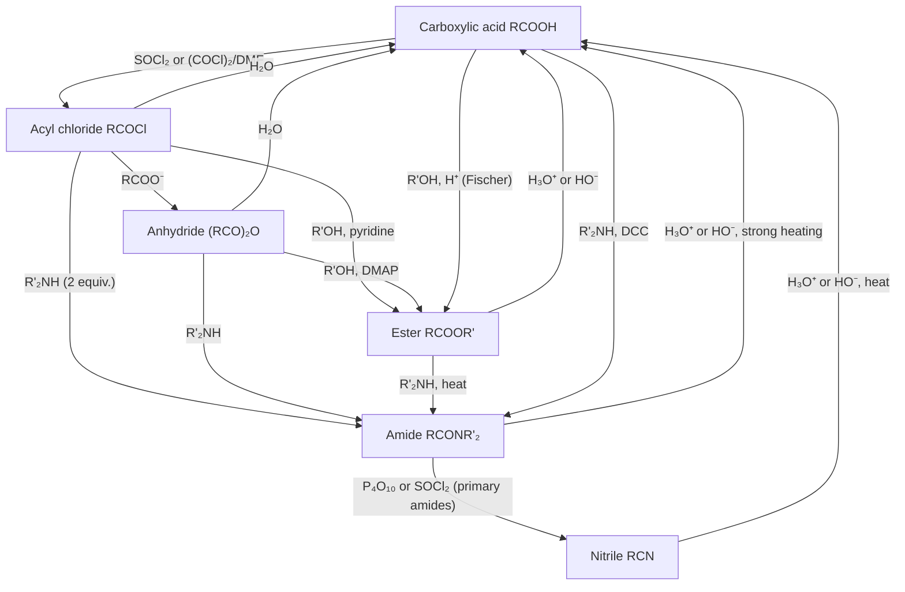

This is the last chapter of the unit on carboxylic acids and their derivatives. The first half discusses several classes of reactions and compounds not covered in [6.5.19](/6.5.19): the acidity and basicity of amides, the Hofmann rearrangement, and dehydration of amides; nitriles, which are in the same oxidation state as carboxylic acids but have no carbonyl group; carbonic acid derivatives, in which carbon bears the most bonds to heteroatoms (phosgene, urea, carbamates, carbonates); and "special" derivatives of carboxylic acids such as orthoesters, guanidines, peracids, and isocyanides. The second half organizes the reactions of [6.5.18](/6.5.18)–[6.5.20](/6.5.20) into an overview of preparation and interconversion and uses it to introduce the basic ideas of synthesis design: retrosynthetic analysis, synthons and equivalents, functional group interconversion, and **protecting groups**.

Connections with other chapters: the Hofmann rearrangement is the prototype of a series of rearrangements to electron-deficient nitrogen (Curtius, Schmidt, Lossen) in [6.5.30](/6.5.30#sec-30.6), and the **Curtius rearrangement** and **azides** are in [6.5.24](/6.5.24#sec-24.8); the preparation of amines from amides and nitriles is in [6.5.23](/6.5.23#sec-23.5); the use of the carbamate protecting groups (Boc, Cbz, Fmoc) in peptide synthesis is in [6.5.33](/6.5.33); the retrosynthesis of difunctional compounds is continued in [6.5.22](/6.5.22#sec-22.11). The metabolism of urea and the urea cycle belong to biochemistry ([7.1](/7.1)).

## 20.1. Acidity and Basicity of Amides

The lone pair on the amide nitrogen is conjugated with the carbonyl group ([6.5.19](/6.5.19#sec-19.1.2)), which both lowers the basicity of the amide and raises the acidity of the N–H:

| Compound | As a base ($\mathrm{p}K_{\mathrm{a}}$ of conjugate acid) | As an acid ($\mathrm{p}K_{\mathrm{a}}$ of N–H) |
|---|---|---|
| $\ce{NH3}$ | 9.25 ($\ce{NH4+}$) | About 38 in water (estimated), 41 in DMSO |
| $\ce{CH3CONH2}$ | About $-0.5$ (protonation on O) | About 15 in water, 25.5 in DMSO |
| Succinimide | — | 9.6 (14.7 in DMSO) |
| Phthalimide | — | 8.3 |
| $\ce{C6H5SO2NH2}$ | — | 10.1 |

(Data from Tables 3.1–3.3 of [6.5.3](/6.5.3#sec-3.1.4); values in the same solvent must be used when comparing acidities.)

Amides are very weakly basic, weaker than water, and protonation occurs on oxygen: the O-protonated cation is stabilized by two **resonance structures**, whereas N-protonation would destroy the conjugation of N with the carbonyl group. The N–H of an amide is about $10^{23}$ times as acidic as that of ammonia, because the negative charge of the conjugate base can be delocalized onto the carbonyl oxygen; it is still a very weak acid and requires a strong base such as NaH for quantitative deprotonation. The negative charge of an imide $\ce{(RCO)2NH}$ is delocalized over two carbonyl groups, the acidity is comparable to that of phenol, and the potassium salt forms readily in KOH or $\ce{K2CO3}$. Potassium phthalimide is the reagent of the **Gabriel synthesis** of primary amines ([6.5.23](/6.5.23#sec-23.5.2)).


## 20.2. The Hofmann Rearrangement

**Definition 20.2.1 (Hofmann Rearrangement)** The reaction in which a primary amide is treated with bromine (or chlorine, or a hypohalite) in basic solution, loses its carbonyl carbon, and gives a primary amine with one carbon fewer is called the **Hofmann rearrangement** (A. W. Hofmann, 1881), also called the Hofmann degradation:

$$
\ce{RCONH2 + Br2 + 4NaOH -> RNH2 + Na2CO3 + 2NaBr + 2H2O}.
$$

It must be distinguished from the **Hofmann elimination** (thermal elimination of a quaternary ammonium hydroxide, the base form of a **quaternary ammonium salt**, to give an alkene, [6.5.23](/6.5.23#sec-23.8)) and the **Hofmann rule** (the regiochemistry of elimination, [6.5.9](/6.5.9#sec-9.4.3)): all three are named after the same chemist and are otherwise unrelated.

The mechanism has four steps:

1. N-Bromination: base removes a proton from the N–H of the amide, and the amide anion attacks $\ce{Br2}$ to give the N-bromoamide.
2. A second deprotonation: the electron-withdrawing bromine makes the remaining N–H of the N-bromoamide more acidic, and base removes it to give the N-bromoamide anion.
3. Rearrangement: with the lone pair of nitrogen "pushing" and bromide "pulling", the hydrocarbyl group R migrates with its bonding pair from the carbonyl carbon to nitrogen while $\ce{Br-}$ leaves, giving an isocyanate $\ce{R-N=C=O}$. This is the **rate-determining step**.
4. Hydrolysis and **decarboxylation**: $\ce{HO-}$ adds to the central carbon of the isocyanate to give a carbamate; the protonated carbamic acid is unstable and loses $\ce{CO2}$ to give the amine (in base $\ce{CO2}$ leaves as carbonate).


The rearrangement step has three characteristics:

- The configuration of the migrating group is retained. (S)-2-Phenylpropanamide gives (S)-1-phenylethylamine in the Hofmann rearrangement without loss of optical purity: the migrating carbon is bonded to carbon or nitrogen throughout the process, and there is no free **carbanion**, **carbocation**, or **radical**, hence no opportunity for inversion or **racemization**.
- Migration is intramolecular. When a mixture of two amides carrying different isotopes or substituents is rearranged (a **crossover experiment**, [6.5.3](/6.5.3#sec-3.11.3)), no crossover products are found in the product, showing that R never leaves the molecule.
- Migration and departure are concerted. It was once imagined that the N-bromoamide anion first loses $\ce{Br-}$ to give an acyl nitrene (a monovalent nitrogen with six electrons, like a **carbene**, [6.5.11](/6.5.11#sec-11.10)), which then undergoes 1,2-migration. Under the conditions of the Hofmann rearrangement, however, the typical reactions of nitrenes (insertion into C–H bonds, addition to alkenes to give aziridines) are not detected, and the rate depends strongly on the **migratory aptitude** of R. It is therefore generally believed that migration and loss of $\ce{Br-}$ occur simultaneously (a concerted "push–pull" mechanism); a true nitrene is formed only under conditions such as photolysis of acyl azides.

When water is replaced by an alcohol, the isocyanate is trapped by the alcohol as a carbamate (for example, with NBS and DBU in methanol a methyl carbamate is obtained), which gives an N-protected amine; hypervalent iodine reagents (such as $\ce{PhI(OCOCF3)2}$) in place of bromine allow the reaction to be run under weakly acidic conditions, suitable for base-sensitive substrates ([6.5.27](/6.5.27#sec-27.7)).

The synthetic use of the Hofmann rearrangement is to convert a carboxylic acid derivative into a primary amine with one carbon fewer, including tertiary alkylamines and arylamines that are hard to prepare by **SN2**. In industry, sodium hypochlorite opens phthalimide with rearrangement to produce anthranilic acid (2-aminobenzoic acid, a raw material for dyes and drugs); succinimide gives β-alanine.

The other members of this family of reactions all pass through isocyanates, differing only in the **leaving group** on nitrogen; a detailed comparison is in [6.5.30](/6.5.30#sec-30.6):

| Reaction | Substrate | Leaving group on nitrogen | Conditions |
|---|---|---|---|
| Hofmann rearrangement | $\ce{RCONH2}$ | $\ce{Br-}$ (N-bromoamide anion) | $\ce{Br2}$ or NaOCl, NaOH |
| **Curtius rearrangement** | Acyl azide $\ce{RCON3}$ | $\ce{N2}$ | Heat (Definition 24.8.2) |
| **Schmidt reaction** | $\ce{RCOOH + HN3}$ | $\ce{N2}$ | Concentrated $\ce{H2SO4}$ (Definition 24.8.3) |
| **Lossen rearrangement** | O-Acylhydroxamic acid $\ce{RCONHOCOR'}$ | $\ce{R'COO-}$ | Base, heat (Definition 30.6.1) |

## 20.3. Dehydration of Amides

When a primary amide is heated with a strong dehydrating agent ($\ce{P4O10}$, $\ce{SOCl2}$, $\ce{POCl3}$, or trifluoroacetic anhydride with pyridine), it loses one molecule of water to give a nitrile:

$$
\ce{RCONH2 ->[\ce{P4O10} \text{ or } \ce{SOCl2}] RC#N + H2O}.
$$

The dehydrating agent first activates the carbonyl oxygen (for example, with $\ce{SOCl2}$ to give $\ce{-O-S(O)Cl}$), turning it into a good **leaving group**; the lone pair on nitrogen pushes out this group to give an intermediate of the nitrilium type, and loss of a proton gives the nitrile. This is another example of the idea of "turning a poor leaving group into a good one" (compare the preparation of acyl chlorides in [6.5.19](/6.5.19#sec-19.3.1)). A secondary amide under the same conditions gives an imidoyl chloride, which is the basis of the Vilsmeier reagent and of the Bischler–Napieralski cyclization.


## 20.4. Nitriles

### 20.4.1. Structure and Properties

**Definition 20.4.1 (Nitrile)** An organic compound $\ce{RC#N}$ containing the cyano group $\ce{-C#N}$ is called a **nitrile**. In naming, the cyano carbon is counted in the main chain, with the ending -nitrile, as in acetonitrile $\ce{CH3CN}$, benzonitrile $\ce{C6H5CN}$, and adiponitrile; as a substituent it is called cyano-.

The carbon and nitrogen of the cyano group are both $\mathrm{sp}$-hybridized, $\ce{C-C#N}$ is linear, and the C≡N bond length is about 116 pm, similar to the C≡C of alkynes. The **electronegativity** of N makes the C≡N bond highly polar: acetonitrile has an **electric dipole moment** of about $13\times10^{-30}\,\mathrm{C\,m}$ (3.9 D), a **relative permittivity** of about 36, and a boiling point of 82 °C, and is a commonly used **polar aprotic solvent**. The IR absorption of nitriles is at $2210$–$2260\,\mathrm{cm^{-1}}$ (sharp, of medium intensity), and the $^{13}\mathrm{C}$ chemical shift is about $\delta$ 115–125.

Nitriles are both very weak acids and very weak bases:

- Basicity: the lone pair of nitrogen is in an $\mathrm{sp}$ orbital with high s character and is held tightly by the nucleus; the $\mathrm{p}K_{\mathrm{a}}$ of a protonated nitrile is about $-10$, far lower than that of protonated ethers, alcohols, and ketones. Nitriles coordinate only to strong **Lewis acids** or **carbocations** (the Ritter reaction, Section 20.4.4).
- Acidity of the α-H: the $\mathrm{p}K_{\mathrm{a}}$ of $\ce{CH3CN}$ in DMSO is 31.3 (about 29 extrapolated for water), weaker than that of esters (about 25), and LDA or $n$-BuLi is needed to generate the nitrile-stabilized **carbanion** quantitatively; a $\ce{CH2}$ between two electron-withdrawing groups (malononitrile 11.2, cyanoacetates) is deprotonated very easily ([6.5.21](/6.5.21#sec-21.1.2)).

The cyano group is small, highly polar, and metabolically stable, can serve as a **hydrogen bond** acceptor, and is a common group in drug molecules: the aromatase inhibitors letrozole and anastrozole, the antidepressant citalopram, the antiandrogen bicalutamide, the immunosuppressant tofacitinib, the anti-HIV drug rilpivirine, and the type 2 diabetes drugs vildagliptin and saxagliptin all contain a cyano group. In vildagliptin and in the anti-COVID drug nirmatrelvir the cyano group is also a "warhead": a serine or cysteine in the enzyme active site adds to the C≡N to give a reversible covalent adduct.

### 20.4.2. Preparation of Nitriles

| Method | Reaction | Remark |
|---|---|---|
| **SN2** substitution of alkyl halides | $\ce{RX + NaCN -> RCN + NaX}$ | In DMSO or DMF; primary and secondary halides; the chain is lengthened by one carbon ([6.5.8](/6.5.8#sec-8.2.2)) |
| Dehydration of primary amides | $\ce{RCONH2 -> RCN}$ | Section 20.3 |
| Addition of HCN to aldehydes and ketones | Gives **cyanohydrins** | [6.5.16](/6.5.16#sec-16.7.1) |
| **Sandmeyer reaction** of **arenediazonium salts** | $\ce{ArN2+ + CuCN -> ArCN}$ | Aryl nitriles (Definition 24.4.1) |
| Pd-catalyzed cyanation of aryl halides | $\ce{ArBr + Zn(CN)2 ->[Pd] ArCN}$ | [6.5.29](/6.5.29#sec-29.4.7) |
| Ammoxidation (industrial) | $\ce{CH2=CHCH3 + NH3 + 3/2O2 -> CH2=CHCN + 3H2O}$ | The SOHIO process, catalyzed by Bi–Mo oxides, to make acrylonitrile |

The cyanide ion is a typical **ambident nucleophile** ([6.5.8](/6.5.8#sec-8.7.3)): both the carbon and the nitrogen ends carry lone pairs. NaCN and KCN in polar aprotic solvents react as "free" cyanide ions, and attack occurs mainly through the more nucleophilic, softer carbon end to give nitriles; in silver cyanide the carbon is covalently bonded to silver and only the nitrogen end is left for attack, and silver ion can pull off the halogen and give the reaction some **SN1** character, so AgCN with alkyl halides gives mainly isocyanides $\ce{RN#C}$ (Section 20.6.3). KCN with alkyl halides also gives a little isocyanide, but mainly the nitrile; to obtain mainly the isocyanide, AgCN should be used.

### 20.4.3. Hydrolysis and Reduction of Nitriles and Reaction with Organometallic Reagents

The cyano carbon is electrophilic, and all the reactions of C≡N are **nucleophilic additions**. On heating in aqueous acid or base, a nitrile is hydrolyzed first to the amide and then to the carboxylic acid (or its salt), a method for preparing a carboxylic acid with one more carbon from an alkyl halide through the nitrile:

```smiles
C(Br)c1ccccc1>>N#CCc1ccccc1
N#CCc1ccccc1>>OC(=O)Cc1ccccc1
```

(Benzyl bromide and NaCN give phenylacetonitrile, which is hydrolyzed by refluxing in dilute sulfuric acid to phenylacetic acid.) Under acid catalysis, the nitrile is protonated on nitrogen, water adds to the activated carbon, and loss of a proton gives the imidic acid (the **enol** form of an amide, a tautomer), which tautomerizes to the amide; under base catalysis, $\ce{HO-}$ adds directly to the cyano carbon and the nitrogen anion formed takes a proton from water. An amide is harder to hydrolyze than a nitrile, but under the vigorous conditions needed to hydrolyze a nitrile it is still hydrolyzed further, so the carboxylic acid is usually obtained; to stop at the amide, alkaline hydrogen peroxide ($\ce{H2O2}$, $\ce{K2CO3}$, DMSO) can be used. In industry, nitrile hydratase (a metalloenzyme containing Fe or Co) selectively hydrates acrylonitrile to acrylamide, produced at hundreds of thousands of tonnes per year, one of the largest-scale applications of biocatalysis.


In anhydrous HCl and alcohol, a nitrile gives an imidate salt (the Pinner reaction), which gives an ester with water and an amidine with ammonia.


Reduction of nitriles and addition of organometallic reagents:

```smiles
CCCC#N>>CCCCN
CCCC#N>>CCCC=O
N#Cc1ccccc1>>CCC(=O)c1ccccc1
```

- $\ce{LiAlH4}$ adds hydride twice, and hydrolysis gives the primary amine $\ce{RCH2NH2}$; catalytic hydrogenation (Raney Ni, with added ammonia to suppress formation of secondary amines) also gives primary amines, and hexane-1,6-diamine, the monomer of nylon-66, is produced industrially by hydrogenation of adiponitrile.
- DIBAL-H adds only once at low temperature, giving a stable aluminum imine salt, and hydrolysis gives the aldehyde (the second equation). The sequence $\ce{RX -> RCN -> RCHO}$ gives an aldehyde with one more carbon from an alkyl halide.
- A **Grignard reagent** adds to the cyano carbon to give the magnesium salt of an imine anion. It is negatively charged and is not attacked by a second equivalent of reagent; on acidic hydrolysis the imine salt is hydrolyzed to a ketone (the third equation: benzonitrile and ethylmagnesium bromide give propiophenone). This contrasts with esters (double addition to give tertiary alcohols, [6.5.19](/6.5.19#sec-19.8)) and is the standard way to make ketones from nitriles.


### 20.4.4. The Ritter Reaction

**Definition 20.4.2 (Ritter Reaction)** The reaction in which, in a strong acid such as concentrated sulfuric acid, a carbocation formed from an alcohol (or alkene) bonds to the nitrogen atom of a nitrile and the nitrilium ion formed is trapped by water to give an N-alkylamide is called the **Ritter reaction** (J. J. Ritter, 1948):

$$
\ce{R3COH + R'C#N ->[\text{conc. } \ce{H2SO4}][\ce{H2O}] R'CONHCR3}.
$$

The carbocation plays the same role here as a proton: the nitrogen of a nitrile, although very weakly basic, can still attack a highly electron-deficient tertiary carbocation. The nitrilium ion $\ce{R'C#N+-CR3}$ formed is a reactive **electrophile**; water adds to its carbon, and tautomerization gives the amide.


The Ritter reaction can attach a tertiary alkyl group to nitrogen, which is impossible by SN2 (tertiary halides undergo only elimination, [6.5.9](/6.5.9#sec-9.6.1)). Hydrolysis of the N-tertiary-alkylamide gives a tertiary alkylamine: industrially tert-butylamine is produced by a Ritter reaction of HCN with isobutene (or tert-butyl alcohol) followed by hydrolysis. Intramolecular and asymmetric variants of the Ritter reaction are also used in drug synthesis, for example in the key intermediate of the HIV protease inhibitor indinavir, cis-1-amino-2-indanol.

## 20.5. Carbonic Acid Derivatives

Carbonic acid $\ce{H2CO3}$ can be regarded as hydroxyformic acid, or as a diprotic acid in which two hydroxy groups share one carbonyl group. Carbonic acid itself and its mono-acyl chloride, mono-amide, and monoesters are unstable and decompose with release of $\ce{CO2}$; derivatives in which both hydroxy groups are replaced are stable, and all are important compounds:

```smiles
ClC(Cl)=O
ClC(=O)OCc1ccccc1
NC(N)=O
COC(=O)OC
O=C1OCCO1
CN=C=O
```

These are phosgene (carbonyl chloride), benzyl chloroformate (Cbz-Cl), urea (carbonic diamide), dimethyl carbonate, ethylene carbonate, and methyl isocyanate.

### 20.5.1. Phosgene, Chloroformates, and Isocyanates

Phosgene ($\ce{COCl2}$, bp 8 °C) is a highly toxic, suffocating gas that hydrolyzes and acylates in the alveoli of the lungs after inhalation and causes pulmonary edema; it was used as a chemical weapon in the First World War. Industrially it is made from CO and $\ce{Cl2}$ over activated carbon; the early laboratory preparation ($\ce{CCl4}$ and fuming sulfuric acid) is little used now, and the solid triphosgene (bis(trichloromethyl) carbonate), which decomposes slowly to 3 molecules of phosgene on use and so is easy to measure and handle, is used in the laboratory instead.

Phosgene is a double acyl chloride and behaves like acyl chlorides; it can be hydrolyzed, alcoholyzed, and aminolyzed in succession:

| Reactant | First product | Second product |
|---|---|---|
| ROH | Chloroformate $\ce{ROCOCl}$ | Dialkyl carbonate $\ce{(RO)2CO}$ |
| $\ce{RNH2}$ | Carbamoyl chloride $\ce{RNHCOCl}$ (loses HCl to give isocyanate $\ce{RN=C=O}$) | Urea $\ce{(RNH)2CO}$ |
| $\ce{H2O}$ | Chloroformic acid (decomposes to $\ce{HCl + CO2}$) | — |

Benzyl chloroformate and 9-fluorenylmethyl chloroformate are the reagents for introducing the Cbz and Fmoc **protecting groups** (Section 20.8.3). The central carbon of an isocyanate $\ce{RN=C=O}$ is very electrophilic, and alcohols, amines, and water all add to it: alcohols give carbamates, amines give substituted ureas, and water gives the unstable carbamic acid (which decomposes to amine and $\ce{CO2}$, as in the last step of the Hofmann rearrangement). Addition polymerization of diisocyanates (MDI, TDI) with diols (polyols) gives polyurethanes, and with a little water the $\ce{CO2}$ released foams the polymer to give foam plastics. The 1984 leak of methyl isocyanate at a pesticide plant in Bhopal, India, killed thousands of people and was the worst accident in the history of the chemical industry; it promoted "phosgene-free" routes, such as the preparation of dimethyl carbonate from the oxidative carbonylation of methanol or from $\ce{CO2}$, with dimethyl carbonate then used in place of phosgene.


### 20.5.2. Carbamic Acids and Carbamates

Carbamic acid $\ce{H2NCOOH}$ is unstable, but its salts and esters are stable. Ammonium carbamate is formed directly from $\ce{NH3}$ and $\ce{CO2}$ and is the intermediate in the industrial synthesis of urea (Section 20.5.3). Carbamates $\ce{R2NCOOR'}$ combine features of esters and amides and are harder to hydrolyze than esters:

- The tert-butoxycarbonyl (Boc), benzyloxycarbonyl (Cbz), and 9-fluorenylmethoxycarbonyl (Fmoc) groups are the most commonly used protecting groups for amino groups (Section 20.8.3, [6.5.33](/6.5.33)). They turn the nitrogen of the amine into a carbamate, which greatly lowers both the **nucleophilicity** and the basicity of nitrogen; only the ester side has to be cleaved for removal (Boc loses the tert-butyl group in acid by the AAl1 mechanism, [6.5.19](/6.5.19#sec-19.4.3); Cbz is removed by hydrogenolysis; Fmoc is eliminated in base by an **E1cB** mechanism), and the carbamic acid formed then undergoes **decarboxylation** at once, releasing the free amine.
- Aryl carbamate insecticides (such as carbaryl, 1-naphthyl methylcarbamate) and rivastigmine, used to treat Alzheimer's disease, transfer a carbamoyl group to the serine in the active site of acetylcholinesterase; the carbamoylated enzyme hydrolyzes very slowly and is thereby inhibited. This is the same kind of covalent modification as the acetylation of cyclooxygenase by aspirin ([6.5.18](/6.5.18#sec-18.7.4)).


### 20.5.3. Urea

Urea (carbonic diamide, $\ce{CO(NH2)2}$) is the main form in which nitrogen from protein metabolism is excreted by mammals, and a healthy adult excretes about 20–35 g per day. In 1828 Wöhler obtained urea by heating the inorganic compound ammonium cyanate, often called the beginning of organic synthesis; however, vitalism was not overthrown by this single experiment but was gradually abandoned over the following decades (Kolbe's synthesis of acetic acid from the elements in 1845, Berthelot's systematic syntheses).

$$
\ce{NH4OCN ->[\Delta] CO(NH2)2}.
$$


Industrially (the Bosch–Meiser process, 1922) it is synthesized from ammonia and carbon dioxide at about 14–20 MPa and about 180 °C: the first step, rapid and exothermic, gives ammonium carbamate, and the second, slower step dehydrates it to urea. Urea contains 46% nitrogen and is the most widely used nitrogen fertilizer, with a world production of more than 150 million tonnes per year.

$$
\ce{2NH3 + CO2 <=> NH2COONH4 <=> CO(NH2)2 + H2O}.
$$

The chemistry of urea:

- Weak basicity: protonation on oxygen (conjugate acid $\mathrm{p}K_{\mathrm{a}}$ about 0.1); it forms salts with nitric acid and oxalic acid.
- Hydrolysis: heating in acid or base hydrolyzes it to $\ce{CO2}$ (or carbonate) and $\ce{NH3}$ (or ammonium salts), but very slowly. Urease speeds it up by about $10^{14}$: urease was the first enzyme to be crystallized (Sumner, 1926, which showed that enzymes are proteins) and also the first enzyme found to contain nickel, in which two $\ce{Ni^2+}$ ions in the active site activate the carbonyl group of urea and the nucleophilic water molecule, respectively. Urea applied to soil must first be hydrolyzed to ammonium by the urease of soil microorganisms before crops can absorb it, so it should be applied in advance.
- Reaction with nitrous acid releases nitrogen: $\ce{CO(NH2)2 + 2HNO2 -> CO2 + 2N2 + 3H2O}$. Urea is often added after **diazotization** to remove excess nitrous acid ([6.5.24](/6.5.24#sec-24.2.1)). The classical determination of urea also measured the volume of $\ce{N2}$ released (commonly with sodium hypobromite: $\ce{CO(NH2)2 + 3NaOBr -> N2 + CO2 + 3NaBr + 2H2O}$); clinically the urease method is now used.
- Exhaust treatment of diesel vehicles: an on-board aqueous urea solution (32.5%, "diesel exhaust fluid") is injected into the exhaust pipe, hydrolyzes on heating to $\ce{NH3}$, and reduces nitrogen oxides to nitrogen over a catalyst (selective catalytic reduction: $\ce{4NO + 4NH3 + O2 -> 4N2 + 6H2O}$). This is why diesel trucks need to carry urea: urea is a safe, nontoxic, easily stored "solid ammonia".
- The biuret reaction: when urea is heated above its melting point, two molecules lose one molecule of ammonia to give biuret $\ce{H2NCONHCONH2}$. Biuret forms a violet complex with $\ce{Cu^2+}$ in alkaline solution. Any compound containing two or more adjacent amide bonds ($\ce{-CONH-}$) gives this reaction, so tripeptides and higher peptides and proteins give a violet color, whereas amino acids and dipeptides do not. This is the biuret method for determining protein content.

```smiles
NC(N)=O.NC(N)=O>>NC(=O)NC(N)=O.N
```

### 20.5.4. Carbonates

Carbonate monoesters are unstable (sodium methyl carbonate from $\ce{CO2}$ and sodium methoxide decomposes at once to methanol and $\ce{CO2}$ on acidification); carbonate diesters are stable liquids that, like esters, undergo **transesterification**. Dimethyl carbonate has low toxicity and can replace phosgene as a carbonylating agent and dimethyl sulfate and iodomethane as a methylating agent, a representative reagent of "green chemistry". The cyclic ethylene carbonate and propylene carbonate have high **relative permittivity** and are the main solvents of electrolytes in lithium-ion batteries. Polycarbonate is made by interfacial polycondensation of bisphenol A with phosgene, or by melt transesterification with diphenyl carbonate; it is transparent and impact-resistant and is used for optical discs and safety glasses.

## 20.6. Orthoesters, Guanidines, Peracids, and Isocyanides

### 20.6.1. Orthoesters and Guanidines

Addition of one more molecule of water to the carbonyl group of a carboxylic acid would give an orthoacid $\ce{RC(OH)3}$, which is unstable (it loses water to return to the carboxylic acid), but its esters, the orthoesters $\ce{RC(OR')3}$, are stable compounds. Triethyl orthoformate $\ce{HC(OEt)3}$ is made from chloroform and sodium ethoxide (through the **carbene** dichlorocarbene). Orthoesters are stable in base and hydrolyze very easily in acid to an ester and an alcohol, as do **acetals** (an orthoester can be regarded as the "acetal" of a carboxylic acid). This is exploited by using triethyl orthoformate as a water scavenger in acetal formation: in acid it reacts with the water formed and at the same time supplies alcohol, driving the equilibrium ([6.5.16](/6.5.16#sec-16.5.4)). The Johnson–Claisen rearrangement of triethyl orthoacetate with allylic alcohols is in [6.5.12](/6.5.12#sec-12.5.6).

Among the derivatives of orthocarbonic acid, tetraethyl orthocarbonate $\ce{C(OEt)4}$ can be prepared from trichloronitromethane and sodium ethoxide (carbon tetrachloride does not react with sodium ethoxide). The orthocarbonic "tetraamide" $\ce{C(NH2)4}$ does not exist; loss of one molecule of ammonia gives guanidine $\ce{HN=C(NH2)2}$. Guanidine is one of the strongest neutral organic bases (the $\mathrm{p}K_{\mathrm{a}}$ of the guanidinium ion is 13.6): the protonated guanidinium ion has three equivalent **resonance structures**, the positive charge is shared equally by the three nitrogen atoms, and the ion is planar and Y-shaped. The side chain of arginine is a guanidino group that is fully protonated at physiological pH, and the guanidinium ion can form bidentate **hydrogen bonds** with a phosphate or carboxylate using two parallel N–H bonds, which is how many proteins bind DNA and phosphorylated substrates.


### 20.6.2. Peracids and Diacyl Peroxides

In a peracid $\ce{RC(=O)OOH}$, the O–H forms an intramolecular **hydrogen bond** with the carbonyl oxygen to give a five-membered ring, and this hydrogen bond persists in solution. IR spectroscopy can distinguish intramolecular from intermolecular hydrogen bonds: on progressive dilution of the solution, the associated O–H band of an intermolecular hydrogen bond weakens and the free O–H band strengthens, whereas the position and relative intensity of the O–H band of an intramolecular hydrogen bond do not change with concentration.

Peracids are much weaker acids than the corresponding carboxylic acids (peracetic acid $\mathrm{p}K_{\mathrm{a}}$ 8.2, acetic acid 4.76): the negative charge of a percarboxylate is on the terminal oxygen and cannot be spread over two oxygens by two equivalent resonance structures as in a carboxylate, and ionization also requires breaking the intramolecular hydrogen bond. Peracids are electrophilic oxygen-atom donors, used for the epoxidation of alkenes (to give **epoxides**, [6.5.11](/6.5.11#sec-11.8.1)) and the **Baeyer–Villiger oxidation** (Definition 17.5.1). The most commonly used is meta-chloroperoxybenzoic acid (mCPBA). Low-molar-mass peracids and concentrated peroxides are explosion hazards.

The weak O–O bond of a diacyl peroxide $\ce{(RCOO)2}$ (the **bond dissociation energy** is about $130\,\mathrm{kJ\,mol^{-1}}$, even lower than the roughly $150\,\mathrm{kJ\,mol^{-1}}$ of dialkyl peroxides, [6.5.7](/6.5.7#sec-7.2.2)) undergoes **homolysis** on heating to give acyloxy **radicals**, which undergo **decarboxylation** ([6.5.18](/6.5.18#sec-18.4.2)); benzoyl peroxide (BPO) is therefore a commonly used **radical initiator** ([6.5.7](/6.5.7#sec-7.2.2)) and also a topical drug for acne.

### 20.6.3. Isocyanides

**Definition 20.6.1 (Isocyanide)** A compound $\ce{R-N#C}$ containing the group $\ce{-N#C}$, in which the carbon atom is bonded only to nitrogen, is called an **isocyanide** (also called an isonitrile). Its structure can be described by two **resonance structures**: $\mathrm{R{-}N^{+}{\equiv}C^{-}}$ (a lone pair and a negative formal charge on carbon) and $\mathrm{R{-}N{=}C\colon}$ (a divalent carbene-like carbon).

The terminal carbon of an isocyanide has both a lone pair (nucleophilic) and an empty π* orbital (electrophilic), which makes its reactions unusual: an **electrophile** and a **nucleophile** add to the same carbon (α-addition). Lower isocyanides have extremely unpleasant odors. Preparations:

- Dehydration of formamides: $\ce{RNHCHO ->[\ce{POCl3}, \ce{Et3N}] RNC}$, now the most widely used method (Ugi);
- The Hofmann carbylamine reaction: a primary amine is heated with chloroform and KOH to give the isocyanide through dichlorocarbene ($\ce{RNH2 + CHCl3 + 3KOH -> RNC + 3KCl + 3H2O}$), and the stench of the isocyanide can be used as a test for primary amines;
- Reaction of alkyl halides with AgCN (Section 20.4.2).

Reactions of isocyanides:

- They are stable to base (carbon carries a partial negative charge and is not attacked by $\ce{HO-}$) and unstable to acid: in dilute acid they hydrolyze to N-hydrocarbylformamides $\ce{RNHCHO}$, unlike the hydrolysis of nitriles (which gives $\ce{RCOOH}$).
- Catalytic hydrogenation gives N-methylamines: $\ce{RNC + 2H2 -> RNHCH3}$.
- They add halogens to give dihalides $\ce{RN=CCl2}$, are oxidized by HgO to isocyanates $\ce{RN=C=O}$, and give isothiocyanates $\ce{RN=C=S}$ with sulfur.
- Multicomponent reactions: the three-component Passerini reaction of an isocyanide, a carboxylic acid, and an aldehyde (ketone) (1921) gives α-acyloxyamides; the four-component Ugi reaction with an added amine (1959) gives a peptoid-like bisamide in one step. Joining four components in one pot, with great product diversity, is an important tool of combinatorial chemistry and the construction of drug screening libraries.
- Isocyanides are isoelectronic with CO and are also good metal ligands ([6.5.28](/6.5.28#sec-28.3.2)).


## 20.7. Preparation and Interconversion of Carboxylic Acids and Their Derivatives

### 20.7.1. Preparation of Carboxylic Acids

| Method | Reaction | Change in carbon number |
|---|---|---|
| Oxidation of primary alcohols and aldehydes | $\ce{RCH2OH -> RCOOH}$ ($\ce{CrO3}$/$\ce{H2SO4}$, $\ce{KMnO4}$, or $\ce{HNO3}$); $\ce{RCHO -> RCOOH}$ (Tollens, $\ce{NaClO2}$) | None ([6.5.10](/6.5.10#sec-10.6), [6.5.17](/6.5.17#sec-17.5.1)) |
| Side-chain oxidation of alkylbenzenes | $\ce{ArCH2R ->[\ce{KMnO4}] ArCOOH}$ | The side chain is reduced to one carbon ([6.5.15](/6.5.15#sec-15.4.4)) |
| Oxidative cleavage of alkenes and alkynes | **Ozonolysis** (oxidative workup) or $\ce{KMnO4}$ | Decrease ([6.5.11](/6.5.11#sec-11.8.3)) |
| **Haloform reaction** of methyl ketones | $\ce{RCOCH3 -> RCOOH + CHX3}$ | Decrease by one ([6.5.21](/6.5.21#sec-21.5.2)) |
| **Grignard reagent** and $\ce{CO2}$ | $\ce{RX -> RMgX ->[\ce{CO2}][\ce{H3O+}] RCOOH}$ | Increase by one |
| Hydrolysis of nitriles | $\ce{RX -> RCN -> RCOOH}$ | Increase by one |
| **Malonic ester synthesis** | $\ce{RX -> RCH2COOH}$ | Increase by two ([6.5.22](/6.5.22#sec-22.9)) |
| Hydrolysis of derivatives | Esters, amides, anhydrides, acyl halides | None ([6.5.19](/6.5.19#sec-19.4)) |

Bulk carboxylic acids in industry have their own routes: acetic acid is made by carbonylation of methanol (the rhodium catalyst of the Monsanto process and the iridium catalyst of the Cativa process, [6.5.29](/6.5.29#sec-29.3.1)); terephthalic acid by air oxidation of p-xylene catalyzed by cobalt, manganese, and bromide; adipic acid by nitric acid oxidation of a mixture of cyclohexanol and cyclohexanone ("KA oil"), whose by-product $\ce{N2O}$ is a strong greenhouse gas and must now be decomposed.

The Grignard method and the nitrile hydrolysis method both convert an alkyl halide into a carboxylic acid with one more carbon, and their scopes are complementary: the Grignard method requires that the molecule contain no group that reacts with Grignard reagents (OH, NH, C=O, $\ce{NO2}$, and so on) but is applicable to tertiary and aryl halides; the nitrile method requires that the halide can undergo **SN2** (primary and secondary halides, not tertiary or aryl halides) but tolerates more functional groups.

### 20.7.2. Overview of the Interconversion of Derivatives

The order of reactivity of [6.5.19](/6.5.19#sec-19.2.2) determines the direction of interconversion: a reactive derivative can be converted into a less reactive one by adding the appropriate **nucleophile**; the reverse conversion requires hydrolysis to the carboxylic acid followed by activation.



Two basic synthetic strategies:

1. The carbon atom bearing the functional group is unchanged and only its oxidation state or attached groups change: for example, an acyl chloride with excess Grignard reagent gives a tertiary alcohol, an acyl chloride with a **lithium dialkylcuprate** gives a ketone, and a nitrile with a Grignard reagent gives a ketone; the new C–C bond is always formed at the original carbonyl carbon.
2. The functional group is transferred to a new carbon atom: for example, an alkyl halide gives a carboxylic acid through the nitrile or through the Grignard reagent and $\ce{CO2}$; the carbon that bore the halogen becomes the α carbon of the carboxyl group, and the carboxyl carbon is newly introduced.

The general line of thought is: if the target molecule is a carboxylic acid derivative, work back first to the carboxylic acid; then, starting from functional groups that can be converted into a carboxylic acid (primary alcohols, aldehydes, nitriles, alkyl halides, alkenes, methyl ketones), consider the synthesis of the carboxylic acid itself. This way of thinking, working backward from the target molecule, is the retrosynthetic analysis of the next section.

## 20.8. Introduction to Synthesis Design

### 20.8.1. Retrosynthetic Analysis

In planning the synthesis of a molecule, trying various reactions in the forward direction rarely finds a route; it is far more effective to start from the target molecule and work backward step by step until simple, readily available starting materials are reached. Corey systematized this method and received the 1990 Nobel Prize in Chemistry for "the theory and methodology of organic synthesis".

**Definition 20.8.1 (Retrosynthetic Analysis)** The method of designing a synthetic route in which, starting from the target molecule, simpler precursors are derived backward by hypothetical disconnection of bonds or hypothetical transformation of functional groups, and the process is repeated on the precursors until starting materials that can be bought or are easily prepared are reached, is called **retrosynthetic analysis**. Each retrosynthetic step is represented by an open arrow $\Rightarrow$ whose direction is opposite to that of the actual synthesis, and one retrosynthetic step may correspond to more than one actual reaction.

There are two basic operations in retrosynthetic analysis:

- Disconnection: hypothetically breaking a bond to divide the molecule into two parts. Every disconnection must correspond to a known, reliable forward reaction.
- Functional group interconversion (FGI): replacing one functional group with another into which it can be converted by known reactions (for example, replacing a carboxylic acid by a nitrile or a primary alcohol) in order to carry out the next disconnection without changing the carbon skeleton.

**Definition 20.8.2 (Synthon)** The two charged (or radical) fragments hypothetically obtained on disconnecting a bond are called **synthons**; the reagent that supplies such a fragment in the actual synthesis is called its **synthetic equivalent**.

For example, disconnecting the $\ce{R-COOH}$ bond of a carboxylic acid gives the synthons $\ce{R-}$ and $\ce{+COOH}$: the equivalent of $\ce{R-}$ is $\ce{RMgBr}$ and that of $\ce{+COOH}$ is $\ce{CO2}$. The disconnection can also go the other way, to $\ce{R+}$ and $\ce{-COOH}$: the equivalent of $\ce{R+}$ is $\ce{RBr}$ (an **SN2** substrate) and that of $\ce{-COOH}$ is $\ce{CN-}$ (which becomes the carboxyl group after hydrolysis). The same disconnection corresponds to two routes (the Grignard method and the nitrile method), and the choice depends on the other groups in the substrate (Section 20.7.1).

Some rules of thumb for choosing a disconnection:

- Disconnect bonds to heteroatoms first (C–O, C–N), especially the acyl–heteroatom bonds of esters and amides: the reactions that form them are reliable, and the two parts obtained after disconnection are much simpler.
- Disconnect C–C bonds near a functional group: the functional group is the "handle" for bond formation. The α C–C bond of an alcohol (Grignard addition), the bond between the α and β carbons of a carbonyl compound (alkylation and aldol condensation of **enolates**, [6.5.21](/6.5.21#sec-21.7), [6.5.22](/6.5.22#sec-22.1)), and the C–COOH bond of a carboxylic acid are all commonly used disconnections.
- Disconnect, if possible, in the middle of the molecule or at branch points so that the two parts are of similar size (convergent syntheses give higher overall yields than linear ones); exploit the symmetry of the molecule.
- Avoid problems of **chemoselectivity**: at each step of the route consider whether the other functional groups in the molecule will be affected; when this cannot be avoided, use **protecting groups** (Section 20.8.3) or change the order of the steps.
- For substitution on aromatic rings, mind the order of introduction: the **directing effects** determine which group is introduced first ([6.5.14](/6.5.14#sec-14.5)).

### 20.8.2. Worked Examples

**Example 20.8.1** Synthesize 2-phenylpropanoic acid, 2-(3-bromophenyl)propanoic acid, and 2-(4-bromophenyl)propanoic acid from simple organic compounds of up to $\mathrm{C_6}$.

Retrosynthesis of 2-phenylpropanoic acid (and of 2-arylpropanoic acid nonsteroidal anti-inflammatory drugs such as ibuprofen): FGI leads the carboxylic acid back to the nitrile or **Grignard reagent**, and then to the bromide at the **benzylic position**, 1-bromo-1-phenylethane; this is obtained by benzylic bromination of ethylbenzene (NBS, [6.5.7](/6.5.7#sec-7.8)) or by reduction of acetophenone to the alcohol followed by conversion with $\ce{PBr3}$:

$$
\ce{PhCH(CH3)COOH} \Rightarrow \ce{PhCH(CH3)CN} \Rightarrow \ce{PhCH(CH3)Br} \Rightarrow \ce{PhCH2CH3}\ \text{or}\ \ce{PhCOCH3}.
$$

Forward: ethylbenzene $\xrightarrow{\text{NBS, benzoyl peroxide}}$ 1-bromo-1-phenylethane $\xrightarrow{\text{NaCN, DMSO}}$ 2-phenylpropanenitrile $\xrightarrow{\ce{H3O+},\ \Delta}$ 2-phenylpropanoic acid. (SN2 on a secondary benzylic bromide competes with elimination; forming the Grignard reagent with Mg and treating it with $\ce{CO2}$ also works, but benzylic Grignard reagents are prone to Wurtz coupling.)

The two bromo analogues illustrate the importance of the order of steps. 2-(3-Bromophenyl)propanoic acid requires bromine meta to the side chain: acetophenone is brominated first ($\ce{Br2}$, excess $\ce{AlCl3}$; the acetyl group is a meta director) to give 3-bromoacetophenone, which is then reduced, brominated, cyanated, and hydrolyzed; if ethylbenzene were brominated first, the ethyl group, an ortho/para director, would not give the meta product. 2-(4-Bromophenyl)propanoic acid requires bromine para to the alkyl group: ethylbenzene is brominated first ($\ce{Br2}$, $\ce{FeBr3}$, mainly para) to give 4-bromoethylbenzene, followed by benzylic bromination, cyanation, and hydrolysis. Neither route can use the Grignard method, because the bromine on the aromatic ring would also react with magnesium.

The industrial synthesis of ibuprofen offers another perspective. The original Boots route had six steps and an atom economy of about 40%; the BHC route put into production in 1992 has only three steps: Friedel–Crafts acetylation of isobutylbenzene (HF as both catalyst and solvent, recycled), catalytic hydrogenation to the alcohol, and Pd-catalyzed carbonylation to introduce the carboxyl group directly, with an atom economy of about 77% (approaching 100% when the acetic acid is recovered), and it won the 1997 US Presidential Green Chemistry Challenge Award.

**Example 20.8.2** Synthesize 3-[2,2-(ethylenedioxy)cyclohexyl]propanoic acid (the cyclohexanone ethylene glycol **ketal**, bearing $\ce{CH2CH2COOH}$ at position 2) from simple starting materials of up to $\mathrm{C_6}$.

The target molecule contains a protected ketone and a carboxylic acid separated by three carbons (a 1,5-dicarbonyl relationship). Retrosynthesis: removing the protecting group gives 3-(2-oxocyclohexyl)propanoic acid, and disconnection of its C2–Cα bond corresponds to **conjugate addition** of an equivalent of the cyclohexanone **enol** to an acrylate (or acrolein). A reliable forward route:

1. Cyclohexanone and pyrrolidine give the **enamine**, which undergoes conjugate addition to methyl acrylate (the **Stork enamine reaction**, Definition 21.8.1), and hydrolysis gives methyl 3-(2-oxocyclohexyl)propanoate;
2. Ethylene glycol and p-toluenesulfonic acid, with water removed by a Dean–Stark trap, protect the ketone as the ketal;
3. **Saponification** with aqueous LiOH (the ketal is stable to base) and careful acidification give the target carboxylic acid.

Another route uses addition of the enamine to acrolein to give the aldehyde, but then in step 2 the reactive aldehyde would be protected first, and the aldehyde must first be selectively oxidized to the carboxylic acid (for example with $\ce{NaClO2}$); using an acrylate avoids this problem. A further route forms the Grignard reagent from the ketal of 2-bromocyclohexanone and treats it with ethylene oxide; it has a pitfall: a Grignard reagent bearing an alkoxy group at the β position readily undergoes β-elimination (the alkoxy group leaves as a leaving group to give an alkene), so this step is not reliable. Comparing the reliability of several routes is exactly the kind of judgment required in retrosynthetic analysis.

### 20.8.3. Protecting Groups

In the synthesis of polyfunctional molecules it is often necessary to make a functional group temporarily "invisible" so that it is unaffected while other groups react, and to restore it afterward. The group used for this purpose is called a protecting group (the acetal protecting group first appeared in [6.5.16](/6.5.16#sec-16.5.3)). A good protecting group should be easy to introduce in high yield; be stable under the conditions it is required to withstand; be removable in high yield under conditions that do not affect the rest of the molecule; and not itself introduce a new **stereocenter** or by-products that are hard to separate.

The main protecting groups encountered in this course are listed below:

| Group protected | Protecting group | Introduction | Stable to | Removal | Chapter |
|---|---|---|---|---|---|
| Aldehydes, ketones | Acetals, ketals (ethylene glycol) | $\ce{HOCH2CH2OH}$, TsOH, removal of water | Base, **nucleophiles**, hydride, organometallics | $\ce{H3O+}$ | [6.5.16](/6.5.16#sec-16.5.3) |
| Alcohols | tert-Butyldimethylsilyl ether (TBS) | TBSCl, imidazole, DMF | Base, organometallics, most oxidants | $\ce{Bu4N+F-}$ (TBAF) or acid | [6.5.27](/6.5.27#sec-27.5.3) |
| Alcohols | Benzyl ether (Bn) | NaH, BnBr | Acid, base, oxidants, hydride | $\ce{H2}$, Pd/C (hydrogenolysis) | [6.5.15](/6.5.15#sec-15.4.5) |
| Alcohols | Acetate (Ac), benzoate (Bz) | $\ce{Ac2O}$ or BzCl, pyridine, DMAP | Acid, oxidants | $\ce{K2CO3}$/MeOH or NaOH | [6.5.19](/6.5.19#sec-19.3.3) |
| 1,2- and 1,3-Diols | Acetonide (acetone ketal) | Acetone or 2,2-dimethoxypropane, TsOH | Base, nucleophiles | $\ce{H3O+}$ | [6.5.16](/6.5.16#sec-16.5.3), [6.5.32](/6.5.32) |
| Carboxylic acids | Methyl, ethyl esters | MeOH, $\ce{H+}$; or MeI, $\ce{K2CO3}$ | Acid, mild oxidants | LiOH or NaOH (saponification) | [6.5.19](/6.5.19#sec-19.4.2) |
| Carboxylic acids | tert-Butyl ester | Isobutene, $\ce{H2SO4}$ | Base, nucleophiles | TFA (AAl1) | [6.5.19](/6.5.19#sec-19.4.3) |
| Carboxylic acids | Benzyl ester | BnBr, $\ce{K2CO3}$ | Acid, base (milder) | $\ce{H2}$, Pd/C | [6.5.15](/6.5.15#sec-15.4.5), [6.5.33](/6.5.33) |
| Amines | tert-Butoxycarbonyl (Boc) | $\ce{Boc2O}$, base | Base, nucleophiles, hydrogenolysis | TFA or HCl | [6.5.33](/6.5.33) |
| Amines | Benzyloxycarbonyl (Cbz, Z) | CbzCl, base | Acid (mild), base | $\ce{H2}$, Pd/C; HBr/AcOH | [6.5.33](/6.5.33) |
| Amines | 9-Fluorenylmethoxycarbonyl (Fmoc) | FmocCl or Fmoc-OSu, base | Acid | Piperidine (**E1cB**) | [6.5.33](/6.5.33) |
| Amines | Trifluoroacetyl | $\ce{(CF3CO)2O}$ | Acid | $\ce{K2CO3}$/MeOH | [6.5.18](/6.5.18#sec-18.7.2) |
| Terminal alkynes | Trimethylsilyl (TMS) | $n$-BuLi, TMSCl | Base (nonnucleophilic), organometallic coupling | $\ce{K2CO3}$/MeOH or TBAF | [6.5.27](/6.5.27#sec-27.5) |

When a molecule contains several groups to be protected that must be removed at different stages, a set of protecting groups whose removal conditions do not interfere with one another is chosen; this is called orthogonal protection. For example, Fmoc (removed by base), tert-butyl types (removed by acid), and benzyl types (removed by hydrogenolysis) are mutually orthogonal in pairs, and solid-phase peptide synthesis exploits this by protecting the α-amino group with Fmoc and the side chains with tert-butyl types ([6.5.33](/6.5.33)).

Protection and deprotection each cost an extra step, lowering the overall yield and increasing waste, so modern synthesis aims at "protecting-group-free synthesis": by choosing reagents of higher chemoselectivity and a suitable order of steps, protecting groups are avoided as far as possible. The use of an acrylate in place of acrolein in Example 20.8.2 is an example of reducing selectivity problems by step design.

## Summary

| Topic | Key points |
|---|---|
| Acidity and basicity of amides | Very weakly basic, protonated on O (about $-0.5$); acidity of N–H: amides about 15 (water), 25.5 (DMSO), imides 8–10 |
| Hofmann rearrangement (Definition 20.2.1) | $\ce{RCONH2 -> RNH2}$ (one carbon fewer); N-bromination, deprotonation, concerted migration to give the isocyanate, hydrolysis and **decarboxylation**; configuration of the migrating group retained, intramolecular, no free nitrene; relatives: Curtius, Schmidt, Lossen |
| Dehydration of amides | $\ce{P4O10}$, $\ce{SOCl2}$, $\ce{POCl3}$ → nitriles |
| Nitriles (Definition 20.4.1) | Linear, strongly polar; $\mathrm{p}K_{\mathrm{a}}$ of the protonated nitrile about $-10$, α-H 31.3 (DMSO); **SN2** (NaCN) gives nitriles, AgCN gives isocyanides; hydrolysis through the imidic acid and amide to the carboxylic acid; $\ce{LiAlH4}$ → primary amines, DIBAL-H → aldehydes, RMgX → ketones |
| Ritter reaction (Definition 20.4.2) | **Carbocation** + nitrile → nitrilium ion → N-tertiary-alkylamide, to make tertiary alkylamines |
| Carbonic acid derivatives | Phosgene (a double acyl chloride) → chloroformates, carbonates, isocyanates, ureas; carbamates: Boc, Cbz, Fmoc, carbamoylation inhibits esterases; urea: Wöhler, Bosch–Meiser, urease, release of $\ce{N2}$ with $\ce{HNO2}$, diesel exhaust fluid, the biuret reaction; dimethyl carbonate and ethylene carbonate |
| Orthoesters and guanidines | Orthoesters hydrolyze in acid and serve as water scavengers; guanidinium ion $\mathrm{p}K_{\mathrm{a}}$ 13.6, Y-shaped resonance, arginine |
| Peracids, diacyl peroxides | Intramolecular **hydrogen bond**, acidity weaker than carboxylic acids; epoxidation and Baeyer–Villiger; BPO is a **radical initiator** |
| Isocyanides (Definition 20.6.1) | α-Addition; dehydration of formamides, the carbylamine reaction; hydrolysis in acid to N-hydrocarbylformamides; Passerini and Ugi multicomponent reactions |
| Preparation and interconversion | Carboxylic acids: oxidation, $\ce{RMgX + CO2}$, nitrile hydrolysis (each adding one carbon, with complementary scope); derivatives: from reactive to less reactive, the reverse by hydrolysis and activation |
| Synthesis design | Retrosynthetic analysis (Definition 20.8.1): disconnections and FGI; synthons and equivalents (Definition 20.8.2); disconnect C–heteroatom bonds first, C–C bonds near functional groups; **protecting groups** and orthogonal protection |

## Questions

1. What is the configuration of the amine obtained by Hofmann rearrangement of (S)-2-methylbutanamide? What if (S)-2-methylbutanoic acid is first converted into the acyl chloride, which is treated with sodium azide to give the acyl azide, heated (**Curtius rearrangement**), and then hydrolyzed?

   **Answer** Both methods give (S)-butan-2-amine. The migrating sec-butyl group moves with its bonding pair from the carbonyl carbon to nitrogen and is bonded to carbon or nitrogen throughout the migration, so the configuration is retained; the order of the four groups on the **stereocenter** in the CIP ranking is also unchanged (the original $\ce{-CONH2}$ is first, the $\ce{-NH2}$ that replaces it is still first, and the others are ethyl > methyl > H), so the descriptor remains S. The Curtius rearrangement goes through the same isocyanate, again with retention of configuration.

2. Distinguish acetamide, acetonitrile, ammonium acetate, and urea by chemical methods.

   **Answer** Add NaOH solution: the one that releases ammonia at once at room temperature is ammonium acetate (an ammonium salt); acetamide, acetonitrile, and urea release ammonia only slowly on heating. Add nitrous acid ($\ce{NaNO2}$ and dilute acid) to the other three: urea releases large amounts of $\ce{N2}$ and $\ce{CO2}$; acetamide, a primary amide, also reacts with nitrous acid to release $\ce{N2}$ but not $\ce{CO2}$ (acetic acid is formed); acetonitrile does not react. The biuret reaction can also be done after melting urea by heating (alkaline $\ce{CuSO4}$ shows a violet color).

3. Prepare from benzoic acid: (a) aniline; (b) phenylacetic acid; (c) acetophenone; (d) N-tert-butylbenzamide.

   **Answer** (a) Prepare benzoyl chloride with $\ce{SOCl2}$, aminolyze to benzamide, and carry out the Hofmann rearrangement with $\ce{Br2}$/NaOH to give aniline. (b) The carbon chain is increased by one carbon: reduce to benzyl alcohol with $\ce{LiAlH4}$, convert to benzyl bromide with $\ce{PBr3}$, substitute with NaCN to give phenylacetonitrile, and hydrolyze to phenylacetic acid (alternatively through the benzylic **Grignard reagent** and $\ce{CO2}$, but benzylic Grignard reagents tend to couple). (c) Benzoic acid with 2 equivalents of MeLi gives acetophenone directly ([6.5.18](/6.5.18#sec-18.6)); or benzoyl chloride with $\ce{Me2CuLi}$; or dehydrate benzamide to benzonitrile and react with MeMgBr followed by hydrolysis. (d) Benzoyl chloride with tert-butylamine (2 equivalents); or use the Ritter reaction: benzonitrile with tert-butyl alcohol in concentrated sulfuric acid.

4. Write the main products of the reactions of $\ce{CH3MgBr}$ (excess) with each of the following, followed by acidic hydrolysis: acetonitrile, ethyl acetate, diethyl carbonate, acetyl chloride.

   **Answer** Acetonitrile: acetone (the imine salt is negatively charged and adds only once; it hydrolyzes to the ketone). Ethyl acetate: tert-butyl alcohol (2-methylpropan-2-ol, two additions). Diethyl carbonate: three additions, the first giving ethyl acetate, the second acetone, and the third tert-butyl alcohol, so the product is also 2-methylpropan-2-ol; this is a way to make tertiary alcohols $\ce{R3COH}$ with three identical hydrocarbyl groups from a carbonate. Acetyl chloride: tert-butyl alcohol (an acyl chloride is more reactive than an ester and likewise adds twice).

5. Why do diesel vehicles need to carry an aqueous urea solution? Write the relevant reactions. Why is urea better than carrying ammonia directly?

   **Answer** A diesel engine burns fuel in excess oxygen, and the nitrogen oxides produced cannot be reduced by the three-way catalyst of gasoline vehicles, so a reducing agent must be added. The aqueous urea solution is injected into the hot exhaust, where it first pyrolyzes to ammonia and isocyanic acid, and isocyanic acid hydrolyzes to ammonia and $\ce{CO2}$ ($\ce{CO(NH2)2 + H2O -> 2NH3 + CO2}$); ammonia reduces NO to $\ce{N2}$ over the selective catalytic reduction (SCR) catalyst: $\ce{4NO + 4NH3 + O2 -> 4N2 + 6H2O}$. Urea is a nontoxic, nonvolatile, nonflammable solid, and the 32.5% aqueous solution (the eutectic composition, with the lowest freezing point, about $-11$ °C) can be stored and filled safely, whereas liquid ammonia or ammonia water is toxic and irritating and needs pressure vessels.

6. How can IR spectroscopy tell whether the **hydrogen bond** in peracetic acid is intramolecular or intermolecular? What about 2-nitrophenol and 4-nitrophenol?

   **Answer** Measure the IR spectra of a series of concentrations in a nonpolar solvent (such as $\ce{CCl4}$). The extent of intermolecular hydrogen bonding changes with concentration: on dilution the broad associated O–H band weakens and the sharp free O–H band at about $3600\,\mathrm{cm^{-1}}$ strengthens. Intramolecular hydrogen bonding is independent of concentration, and on dilution neither the position nor the relative intensity of the O–H band changes. Peracetic acid and 2-nitrophenol both form intramolecular hydrogen bonds (five- and six-membered rings), and their spectra do not change on dilution; 4-nitrophenol can form only intermolecular hydrogen bonds, and a free O–H band appears on dilution. (The intramolecular hydrogen bond of 2-nitrophenol also explains its lower boiling point and its volatility in steam distillation.)

7. Design a route from a carboxylic acid $\ce{RCOOH}$ to $\ce{RCH2COCl}$ (the acyl chloride with one more carbon).

   **Answer** Route one (through the nitrile): reduce $\ce{RCOOH}$ to $\ce{RCH2OH}$ with $\ce{LiAlH4}$ or $\ce{BH3}$; convert to $\ce{RCH2Br}$ with $\ce{PBr3}$; substitute with NaCN in DMSO to give $\ce{RCH2CN}$; hydrolyze with acid to $\ce{RCH2COOH}$; and obtain $\ce{RCH2COCl}$ with $\ce{SOCl2}$. Route two (Arndt–Eistert homologation, fewer steps): $\ce{SOCl2}$ gives $\ce{RCOCl}$; reaction with **diazomethane** gives the diazomethyl ketone $\ce{RCOCHN2}$; in the presence of $\ce{Ag2O}$ and water the **Wolff rearrangement** gives a ketene, which is hydrated to $\ce{RCH2COOH}$ (Definition 24.5.3), and $\ce{SOCl2}$ converts it to the acyl chloride. In route two the configuration of R is retained, which suits **chiral** carboxylic acids (such as the homologation of amino acids).

8. Synthesize the natural fragrance α-bisabolol (C1 of the ring bears 2-hydroxy-6-methylhept-5-en-2-yl, that is, $\ce{C(OH)(CH3)CH2CH2CH=C(CH3)2}$) from 4-methylcyclohex-3-ene-1-carboxylic acid. Explain the approach by retrosynthetic analysis.

   **Answer** The carbon bearing the hydroxy group in the target is a tertiary alcohol carbon bonded to the ring, a methyl group, and a 4-methylpent-3-enyl group. Retrosynthesis: disconnect the bond between the tertiary alcohol carbon and the 4-methylpent-3-enyl group (Grignard addition); the precursors are 1-(4-methylcyclohex-3-enyl)ethanone and 4-methylpent-3-enylmagnesium bromide; then work the methyl ketone back to the starting carboxylic acid (a carboxylic acid with 2 equivalents of MeLi gives a methyl ketone). Forward: (1) the carboxylic acid with 2 equivalents of MeLi, then hydrolysis, gives the methyl ketone; (2) the methyl ketone is added to $\ce{(CH3)2C=CHCH2CH2MgBr}$ (made from 5-bromo-2-methylpent-2-ene), and hydrolysis gives α-bisabolol. The carboxylic acid should not be converted into an ester first and then treated with a Grignard reagent: an ester adds a Grignard reagent twice, introducing two identical groups. If the order were reversed (first the long chain, then the methyl group by MeMgBr addition to the ketone), the long-chain ketone must first be prepared, for example from the Weinreb amide of the carboxylic acid and the long-chain Grignard reagent, followed by addition of MeMgBr, which is also a feasible route.
