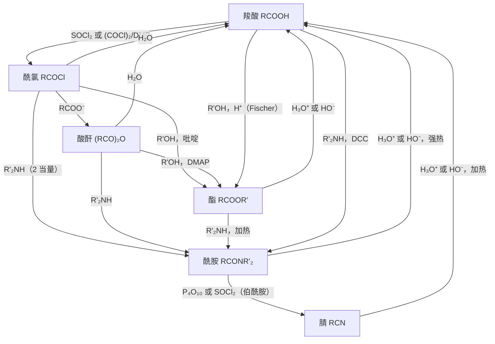

本章是羧酸及其衍生物这一单元的最后一章。前半部分讨论 [6.5.19](/6.5.19) 中没有涉及的几类反应与化合物：酰胺的酸碱性、Hofmann 重排与脱水；与羧酸处于同一氧化态、却没有羰基的腈；碳与杂原子成键最多的碳酸衍生物（光气、尿素、氨基甲酸酯、碳酸酯）；以及原酸酯、胍、过氧酸与异腈等"特殊"的羧酸衍生物。后半部分把 [6.5.18](/6.5.18)–[6.5.20](/6.5.20) 的反应整理成制备与相互转化的总图，并以此为例介绍合成设计的基本思路：逆合成分析、合成子与等价试剂、官能团转化与**保护基**。

本章与其他章节的联系：Hofmann 重排是 [6.5.30](/6.5.30#sec-30.6) 中一系列缺电子氮上的重排（Curtius、Schmidt、Lossen）的原型，**Curtius 重排**与**叠氮化合物**在 [6.5.24](/6.5.24#sec-24.8)；由酰胺、腈制备胺在 [6.5.23](/6.5.23#sec-23.5)；氨基甲酸酯保护基（Boc、Cbz、Fmoc）在肽合成中的用法在 [6.5.33](/6.5.33)；双官能团化合物的逆合成在 [6.5.22](/6.5.22#sec-22.11) 继续讨论。尿素的代谢与尿素循环属于生物化学（[7.1](/7.1)）。

## 20.1. 酰胺的酸碱性

酰胺氮的孤对电子与羰基共轭（[6.5.19](/6.5.19#sec-19.1.2)），这同时降低了酰胺的碱性、提高了 N–H 的酸性：

| 化合物 | 作为碱（共轭酸的 $\mathrm{p}K_{\mathrm{a}}$） | 作为酸（N–H 的 $\mathrm{p}K_{\mathrm{a}}$） |
|---|---|---|
| $\ce{NH3}$ | 9.25（$\ce{NH4+}$） | 水中约 38（估计），DMSO 中 41 |
| $\ce{CH3CONH2}$ | 约 $-0.5$（在 O 上质子化） | 水中约 15，DMSO 中 25.5 |
| 丁二酰亚胺 | — | 9.6（DMSO 中 14.7） |
| 邻苯二甲酰亚胺 | — | 8.3 |
| $\ce{C6H5SO2NH2}$ | — | 10.1 |

（数据取自 [6.5.3](/6.5.3#sec-3.1.4) 的表 3.1–3.3；比较酸性时要用同一溶剂中的值。）

酰胺的碱性很弱，比水还弱，而且质子化发生在氧上：O-质子化的正离子由两个**共振式**稳定，N-质子化则破坏了 N 与羰基的共轭。酰胺 N–H 的酸性比氨强约 $10^{23}$ 倍，因为共轭碱的负电荷可以离域到羰基氧上；它仍是很弱的酸，要用 NaH 等强碱才能定量去质子化。酰亚胺 $\ce{(RCO)2NH}$ 的负电荷离域到两个羰基上，酸性与苯酚相当，在 KOH 或 $\ce{K2CO3}$ 中就能生成钾盐。邻苯二甲酰亚胺钾是 **Gabriel 合成**伯胺的试剂（[6.5.23](/6.5.23#sec-23.5.2)）。


## 20.2. Hofmann 重排

**定义 20.2.1（Hofmann 重排）** 伯酰胺在碱性溶液中与溴（或氯、次卤酸盐）作用，失去羰基碳，生成少一个碳的伯胺的反应称为 **Hofmann 重排**（Hofmann rearrangement，A. W. Hofmann，1881），也称 Hofmann 降解：

$$
\ce{RCONH2 + Br2 + 4NaOH -> RNH2 + Na2CO3 + 2NaBr + 2H2O}.
$$

注意区分它与 **Hofmann 消除**（**季铵碱**受热生成烯烃，[6.5.23](/6.5.23#sec-23.8)）以及 **Hofmann 规则**（消除取向，[6.5.9](/6.5.9#sec-9.4.3)）：三者都以同一位化学家命名，彼此无关。

机理分为四步：

1. N-溴化：碱夺去酰胺 N–H 的质子，酰胺负离子进攻 $\ce{Br2}$，生成 N-溴代酰胺。
2. 再去质子化：溴的吸电子作用使 N-溴代酰胺剩下的 N–H 酸性更强，碱把它夺去，生成 N-溴代酰胺负离子。
3. 重排：氮的孤对电子"推"、溴离子"拉"，烃基 R 带着成键电子对从羰基碳迁移到氮上，同时 $\ce{Br-}$ 离去，生成异氰酸酯 $\ce{R-N=C=O}$。这是**速控步**。
4. 水解与**脱羧**：$\ce{HO-}$ 加成到异氰酸酯的中心碳上，生成氨基甲酸根；质子化后的氨基甲酸不稳定，失去 $\ce{CO2}$ 得到胺（在碱中 $\ce{CO2}$ 以碳酸盐形式离开）。


重排一步有三个特点：

- 迁移基团的构型保持。(S)-2-苯基丙酰胺经 Hofmann 重排得到 (S)-1-苯基乙胺，光学纯度不变：迁移的碳在整个过程中始终与碳或氮之一成键，没有游离的**碳负离子**、**碳正离子**或**自由基**，也就没有机会翻转或**外消旋化**。
- 分子内迁移。用两种带不同同位素或取代基的酰胺混合进行重排（**交叉实验**，[6.5.3](/6.5.3#sec-3.11.3)），产物中没有交叉组合，说明 R 从未离开分子。
- 迁移与离去是协同的。曾经设想 N-溴代酰胺负离子先失去 $\ce{Br-}$ 生成酰基氮宾（acyl nitrene，含六电子的一价氮，类似**卡宾**，[6.5.11](/6.5.11#sec-11.10)），再发生 1,2-迁移。但在 Hofmann 重排的条件下检测不到氮宾的典型反应（插入 C–H 键、与烯烃加成生成氮杂环丙烷），反应速率又强烈依赖于 R 的**迁移能力**。所以一般认为迁移与 $\ce{Br-}$ 的离去同时发生（"推–拉"协同机理）；真正的氮宾只在光解酰基叠氮等条件下生成。

把水换成醇，异氰酸酯被醇捕获为氨基甲酸酯（例如用 NBS 与 DBU 在甲醇中反应得到甲基氨基甲酸酯），这样可以得到 N-保护的胺；用高价碘试剂（如 $\ce{PhI(OCOCF3)2}$）代替溴，可以在弱酸性条件下进行，适合对碱敏感的底物（[6.5.27](/6.5.27#sec-27.7)）。

Hofmann 重排的合成用途是把羧酸衍生物转化为少一个碳的伯胺，包括难以用 **SN2** 制备的叔烷基胺与芳胺。工业上用次氯酸钠使邻苯二甲酰亚胺开环并重排，生产邻氨基苯甲酸（染料与药物的原料）；由丁二酰亚胺得到 $\beta$-丙氨酸。

同一类反应的其他成员都经过异氰酸酯，只是氮上的**离去基团**不同，详细的比较在 [6.5.30](/6.5.30#sec-30.6)：

| 反应 | 底物 | 氮上的离去基团 | 条件 |
|---|---|---|---|
| Hofmann 重排 | $\ce{RCONH2}$ | $\ce{Br-}$（N-溴代酰胺负离子） | $\ce{Br2}$ 或 NaOCl，NaOH |
| **Curtius 重排** | 酰基叠氮 $\ce{RCON3}$ | $\ce{N2}$ | 加热（定义 24.8.2） |
| **Schmidt 反应** | $\ce{RCOOH + HN3}$ | $\ce{N2}$ | 浓 $\ce{H2SO4}$（定义 24.8.3） |
| **Lossen 重排** | O-酰基异羟肟酸 $\ce{RCONHOCOR'}$ | $\ce{R'COO-}$ | 碱、加热（定义 30.6.1） |

## 20.3. 酰胺的脱水

伯酰胺与强脱水剂（$\ce{P4O10}$、$\ce{SOCl2}$、$\ce{POCl3}$，或三氟乙酸酐与吡啶）共热，失去一分子水生成腈：

$$
\ce{RCONH2 ->[\ce{P4O10} \text{ 或 } \ce{SOCl2}] RC#N + H2O}.
$$

脱水剂先活化羰基氧（例如与 $\ce{SOCl2}$ 生成 $\ce{-O-S(O)Cl}$），把它变成好的**离去基团**；氮的孤对电子推出这个基团，生成腈鎓离子一类的中间体，失去质子得到腈。这是"把差的离去基团变成好的离去基团"这一思路的又一例（比较 [6.5.19](/6.5.19#sec-19.3.1) 中酰氯的制备）。仲酰胺在同样条件下生成亚胺酰氯，这是 Vilsmeier 试剂与 Bischler–Napieralski 环化的基础。


## 20.4. 腈

### 20.4.1. 结构与性质

**定义 20.4.1（腈）** 含氰基 $\ce{-C#N}$ 的有机化合物 $\ce{RC#N}$ 称为**腈**（nitrile）。命名时氰基碳计入主链，称"某腈"（英文 -nitrile），如乙腈 $\ce{CH3CN}$、苯甲腈 $\ce{C6H5CN}$、己二腈；作取代基时称氰基（cyano-）。

氰基的碳与氮都是 $\mathrm{sp}$ 杂化的，$\ce{C-C#N}$ 呈直线形，C≡N 键长约 116 pm，与炔烃的 C≡C 相似。N 的**电负性**使 C≡N 键高度极化：乙腈的**电偶极矩**约 $13\times10^{-30}\,\mathrm{C\,m}$（3.9 D），相对电容率约 36，沸点 82 °C，是常用的**非质子极性溶剂**。腈的 IR 吸收在 $2210$–$2260\,\mathrm{cm^{-1}}$（尖锐，中等强度），$^{13}\mathrm{C}$ 化学位移约 $\delta$ 115–125。

腈的酸碱性都很弱：

- 碱性：氮的孤对电子在 $\mathrm{sp}$ 轨道上，s 成分高、被原子核束缚得紧，质子化的腈 $\mathrm{p}K_{\mathrm{a}}$ 约 $-10$，比质子化的醚、醇、酮都强得多。腈只能与强 **Lewis 酸**或**碳正离子**配位（Ritter 反应，20.4.4）。
- $\alpha$-H 的酸性：$\ce{CH3CN}$ 的 $\mathrm{p}K_{\mathrm{a}}$ 在 DMSO 中为 31.3（水相外推约 29），比酯（约 25）还弱，用 LDA 或 $n$-BuLi 才能定量生成腈基**碳负离子**；两个吸电子基团之间的 $\ce{CH2}$（丙二腈 11.2、氰乙酸酯）则很容易去质子化（[6.5.21](/6.5.21#sec-21.1.2)）。

氰基体积小、极性大、代谢稳定，能作为**氢键**受体，是药物分子中常见的基团：芳香化酶抑制剂来曲唑与阿那曲唑、抗抑郁药西酞普兰、抗雄激素药比卡鲁胺、免疫抑制剂托法替布、抗 HIV 药利匹韦林、治疗 2 型糖尿病的维格列汀与沙格列汀都含氰基。在维格列汀与抗新冠药奈玛特韦中，氰基还是"弹头"：酶活性部位的丝氨酸或半胱氨酸加成到 C≡N 上，生成可逆的共价加合物。

### 20.4.2. 腈的制备

| 方法 | 反应 | 说明 |
|---|---|---|
| 卤代烃的 **SN2** 取代 | $\ce{RX + NaCN -> RCN + NaX}$ | DMSO 或 DMF 中；伯、仲卤代烃；碳链增加一个碳（[6.5.8](/6.5.8#sec-8.2.2)） |
| 伯酰胺脱水 | $\ce{RCONH2 -> RCN}$ | 20.3 |
| 醛、酮与 HCN 加成 | 生成**氰醇** | [6.5.16](/6.5.16#sec-16.7.1) |
| **芳基重氮盐**的 **Sandmeyer 反应** | $\ce{ArN2+ + CuCN -> ArCN}$ | 制芳腈（定义 24.4.1） |
| 芳基卤代烃的 Pd 催化氰化 | $\ce{ArBr + Zn(CN)2 ->[Pd] ArCN}$ | [6.5.29](/6.5.29#sec-29.4.7) |
| 氨氧化（工业） | $\ce{CH2=CHCH3 + NH3 + 3/2O2 -> CH2=CHCN + 3H2O}$ | SOHIO 法，Bi–Mo 氧化物催化，生产丙烯腈 |

氰离子是**两可亲核试剂**的典型（[6.5.8](/6.5.8#sec-8.7.3)）：碳端与氮端都有孤对电子。NaCN、KCN 在极性非质子溶剂中以"自由"的氰离子反应，进攻主要发生在更亲核、更软的碳端，生成腈；氰化银中碳与银共价结合，只剩氮端可以进攻，并且银离子能拉走卤素、使反应带有 **SN1** 的特征，所以 AgCN 与卤代烃主要生成异腈 $\ce{RN#C}$（20.6.3）。KCN 与卤代烃反应时也生成少量异腈，但以腈为主；要以异腈为主，应使用 AgCN。

### 20.4.3. 腈的水解、还原与有机金属试剂

氰基碳是亲电的，C≡N 的反应都是**亲核加成**。在酸或碱的水溶液中加热，腈先水解为酰胺，再水解为羧酸（或其盐），这是由卤代烃经腈制备多一个碳的羧酸的方法：

```smiles
C(Br)c1ccccc1>>N#CCc1ccccc1
N#CCc1ccccc1>>OC(=O)Cc1ccccc1
```

（苄溴与 NaCN 生成苯乙腈，苯乙腈在稀硫酸中回流水解为苯乙酸。）酸催化时，腈在氮上质子化，水加成到被活化的碳上，失去质子得到亚胺酸（酰胺的**烯醇式**互变异构体），再互变为酰胺；碱催化时，$\ce{HO-}$ 直接加成到氰基碳上，生成的氮负离子从水中夺取质子。酰胺比腈更难水解，但在水解腈所需的剧烈条件下仍会继续水解，所以通常得到羧酸；要停在酰胺，可以用碱性过氧化氢（$\ce{H2O2}$，$\ce{K2CO3}$，DMSO）。工业上用腈水合酶（一种含 Fe 或 Co 的金属酶）把丙烯腈选择性地水合为丙烯酰胺，每年生产数十万吨，是生物催化最大规模的应用之一。


在无水的 HCl 与醇中，腈生成亚胺酸酯盐（Pinner 反应），后者遇水得到酯、遇氨得到脒。


腈的还原与有机金属试剂的加成：

```smiles
CCCC#N>>CCCCN
CCCC#N>>CCCC=O
N#Cc1ccccc1>>CCC(=O)c1ccccc1
```

- $\ce{LiAlH4}$ 两次加成负氢，水解后得到伯胺 $\ce{RCH2NH2}$；催化氢化（Raney Ni，加氨抑制仲胺的生成）也得到伯胺，工业上由己二腈氢化生产尼龙 66 的单体己二胺。
- DIBAL-H 在低温下只加成一次，生成稳定的亚胺铝盐，水解得到醛（第二式）。合成路线 $\ce{RX -> RCN -> RCHO}$ 由卤代烃得到多一个碳的醛。
- **Grignard 试剂**加成到氰基碳上生成亚胺负离子的镁盐。它带负电荷，不再被第二当量的试剂进攻；酸性水解时亚胺盐水解为酮（第三式：苯甲腈与乙基溴化镁生成苯丙酮）。这与酯（两次加成得到叔醇，[6.5.19](/6.5.19#sec-19.8)）形成对比，是由腈制酮的标准方法。


### 20.4.4. Ritter 反应

**定义 20.4.2（Ritter 反应）** 在浓硫酸等强酸中，由醇（或烯烃）生成的碳正离子与腈的氮原子结合，生成的腈鎓离子被水捕获，得到 N-烷基酰胺的反应称为 **Ritter 反应**（Ritter reaction，J. J. Ritter，1948）：

$$
\ce{R3COH + R'C#N ->[\text{浓 } \ce{H2SO4}][\ce{H2O}] R'CONHCR3}.
$$

碳正离子在这里起的作用与质子相同：腈的氮虽然碱性很弱，仍能进攻高度缺电子的叔碳正离子。生成的腈鎓离子 $\ce{R'C#N+-CR3}$ 是一个活泼的**亲电试剂**，水加成到它的碳上，互变后得到酰胺。


Ritter 反应能把叔烷基连到氮上，这用 SN2 无法做到（叔卤代烃只发生消除，[6.5.9](/6.5.9#sec-9.6.1)）。N-叔烷基酰胺水解后得到叔烷基胺：工业上用 HCN 与异丁烯（或叔丁醇）经 Ritter 反应、再水解生产叔丁胺。Ritter 反应的分子内与不对称变体也用于药物合成，例如 HIV 蛋白酶抑制剂印地那韦的关键中间体顺-1-氨基-2-茚醇。

## 20.5. 碳酸衍生物

碳酸 $\ce{H2CO3}$ 可以看作羟基甲酸，也可以看作两个羟基共用一个羰基的二元酸。碳酸本身与它的单酰氯、单酰胺、单酯都不稳定，会分解放出 $\ce{CO2}$；两个羟基都被取代的衍生物则是稳定的，而且都是重要的化合物：

```smiles
ClC(Cl)=O
ClC(=O)OCc1ccccc1
NC(N)=O
COC(=O)OC
O=C1OCCO1
CN=C=O
```

依次为光气（碳酰氯）、氯甲酸苄酯（Cbz-Cl）、尿素（碳酰胺）、碳酸二甲酯、碳酸乙烯酯与异氰酸甲酯。

### 20.5.1. 光气、氯甲酸酯与异氰酸酯

光气（$\ce{COCl2}$，沸点 8 °C）是窒息性剧毒气体，吸入后在肺泡中水解、酰化，引起肺水肿，第一次世界大战中曾被用作化学武器。工业上由 CO 与 $\ce{Cl2}$ 在活性炭催化下制得；早期的实验室制法（$\ce{CCl4}$ 与发烟硫酸）已很少使用，实验室中改用固体的三光气（碳酸双(三氯甲基)酯），它在使用时缓慢分解为 3 分子光气，便于定量与操作。

光气是双重的酰氯，性质与酰氯相同，可以依次水解、醇解、氨解：

| 反应物 | 第一步产物 | 第二步产物 |
|---|---|---|
| ROH | 氯甲酸酯 $\ce{ROCOCl}$ | 碳酸二酯 $\ce{(RO)2CO}$ |
| $\ce{RNH2}$ | 氨基甲酰氯 $\ce{RNHCOCl}$（失去 HCl 得到异氰酸酯 $\ce{RN=C=O}$） | 脲 $\ce{(RNH)2CO}$ |
| $\ce{H2O}$ | 氯甲酸（分解为 $\ce{HCl + CO2}$） | — |

氯甲酸苄酯与氯甲酸 9-芴甲酯是引入 Cbz、Fmoc **保护基**的试剂（20.8.3）。异氰酸酯 $\ce{RN=C=O}$ 的中心碳很亲电，醇、胺、水都能加成上去：与醇生成氨基甲酸酯，与胺生成取代脲，与水生成不稳定的氨基甲酸（分解为胺与 $\ce{CO2}$，见 Hofmann 重排的最后一步）。二异氰酸酯（MDI、TDI）与二元醇（多元醇）的加成聚合生成聚氨酯，加少量水时放出的 $\ce{CO2}$ 使聚合物发泡，得到泡沫塑料。1984 年印度博帕尔农药厂的异氰酸甲酯泄漏造成数千人死亡，是化学工业史上最严重的事故；这推动了"不用光气"的路线，例如由甲醇的氧化羰基化或由 $\ce{CO2}$ 制碳酸二甲酯，再用碳酸二甲酯代替光气。


### 20.5.2. 氨基甲酸与氨基甲酸酯

氨基甲酸 $\ce{H2NCOOH}$ 不稳定，但它的盐与酯是稳定的。氨基甲酸铵由 $\ce{NH3}$ 与 $\ce{CO2}$ 直接化合生成，是工业合成尿素的中间体（20.5.3）。氨基甲酸酯 $\ce{R2NCOOR'}$ 兼有酯与酰胺的特点，比酯难水解：

- 叔丁氧羰基（Boc）、苄氧羰基（Cbz）与 9-芴甲氧羰基（Fmoc）是氨基最常用的保护基（20.8.3、[6.5.33](/6.5.33)）。它们把胺的氮变成氨基甲酸酯，氮的**亲核性**与碱性都大大降低；脱除时只需断开酯的那一侧（Boc 在酸中按 AAl1 机理失去叔丁基，[6.5.19](/6.5.19#sec-19.4.3)；Cbz 被氢解；Fmoc 在碱中按 **E1cb** 消除），生成的氨基甲酸随即**脱羧**放出游离胺。
- 氨基甲酸芳基酯类杀虫剂（如西维因，甲氨基甲酸 1-萘酯）与治疗阿尔茨海默病的卡巴拉汀，都把氨基甲酰基转移到乙酰胆碱酯酶活性部位的丝氨酸上，被氨基甲酰化的酶水解得很慢，从而被抑制。这与阿司匹林乙酰化环氧合酶（[6.5.18](/6.5.18#sec-18.7.4)）是同一类共价修饰。


### 20.5.3. 尿素

尿素（碳酰胺，$\ce{CO(NH2)2}$）是哺乳动物蛋白质代谢中氮的主要排泄形式，健康成人每天排出约 20–35 g。1828 年 Wöhler 由无机物氰酸铵加热得到尿素，常被称为有机合成的开端；不过"生命力论"并不是被这一个实验推翻的，而是在随后几十年间（Kolbe 1845 年由元素合成乙酸、Berthelot 的系统合成工作）逐渐被放弃的。

$$
\ce{NH4OCN ->[\Delta] CO(NH2)2}.
$$


工业上（Bosch–Meiser 法，1922）由氨与二氧化碳在约 14–20 MPa、约 180 °C 下合成：第一步快速、放热地生成氨基甲酸铵，第二步较慢地脱水为尿素。尿素含氮 46%，是用量最大的氮肥，全球年产量超过 1.5 亿吨。

$$
\ce{2NH3 + CO2 <=> NH2COONH4 <=> CO(NH2)2 + H2O}.
$$

尿素的化学性质：

- 弱碱性：在氧上质子化（共轭酸 $\mathrm{p}K_{\mathrm{a}}$ 约 0.1），能与硝酸、草酸成盐。
- 水解：在酸或碱中加热水解为 $\ce{CO2}$（或碳酸盐）与 $\ce{NH3}$（或铵盐），但非常慢。脲酶把它加快约 $10^{14}$ 倍：脲酶是第一个被结晶的酶（Sumner，1926，由此证明了酶是蛋白质），也是第一个被发现含镍的酶，活性部位的两个 $\ce{Ni^2+}$ 分别活化尿素的羰基与亲核的水分子。尿素施入土壤后要先被土壤微生物的脲酶水解为铵，才能被作物吸收，所以要提前施用。
- 与亚硝酸反应放出氮气：$\ce{CO(NH2)2 + 2HNO2 -> CO2 + 2N2 + 3H2O}$。**重氮化反应**后常加尿素除去过量的亚硝酸（[6.5.24](/6.5.24#sec-24.2.1)）。经典的尿素测定也是测量放出的 $\ce{N2}$ 体积（常用次溴酸钠：$\ce{CO(NH2)2 + 3NaOBr -> N2 + CO2 + 3NaBr + 2H2O}$），现在临床上改用脲酶法。
- 柴油车尾气处理：车载的尿素水溶液（32.5%，"车用尿素"）注入排气管，受热水解为 $\ce{NH3}$，在催化剂上把氮氧化物还原为氮气（选择性催化还原：$\ce{4NO + 4NH3 + O2 -> 4N2 + 6H2O}$）。这就是柴油卡车需要配备尿素的原因：尿素是安全、无毒、易储存的"固体氨"。
- 缩二脲反应：尿素加热到熔点以上，两分子失去一分子氨生成缩二脲 $\ce{H2NCONHCONH2}$。缩二脲在碱性溶液中与 $\ce{Cu^2+}$ 生成紫色的配合物。凡分子中含有两个或两个以上相邻的酰胺键（$\ce{-CONH-}$）的化合物都有此反应，所以三肽以上的肽与蛋白质都显紫色，而氨基酸与二肽不显色。这就是测定蛋白质含量的双缩脲法。

```smiles
NC(N)=O.NC(N)=O>>NC(=O)NC(N)=O.N
```

### 20.5.4. 碳酸酯

碳酸单酯不稳定（$\ce{CO2}$ 与甲醇钠生成的甲基碳酸钠酸化后立即分解为甲醇与 $\ce{CO2}$），碳酸二酯是稳定的液体，与酯一样能发生**酯交换**。碳酸二甲酯毒性低，可以代替光气作羰基化试剂、代替硫酸二甲酯与碘甲烷作甲基化试剂，是"绿色化学"的代表性试剂。环状的碳酸乙烯酯与碳酸丙烯酯**相对电容率**高，是锂离子电池电解液的主要溶剂。聚碳酸酯由双酚 A 与光气界面缩聚，或与碳酸二苯酯熔融酯交换制得，透明、耐冲击，用于光盘与护目镜。

## 20.6. 原酸酯、胍、过氧酸与异腈

### 20.6.1. 原酸酯与胍

羧酸的羰基若再加成一分子水，得到原酸 $\ce{RC(OH)3}$，原酸不稳定（会失水回到羧酸），但它的酯原酸酯 $\ce{RC(OR')3}$ 是稳定的化合物。原甲酸三乙酯 $\ce{HC(OEt)3}$ 由氯仿与乙醇钠反应制得（经过二氯**卡宾**）。原酸酯在碱中稳定，在酸中极易水解为酯与醇，这与**缩醛**的性质相同（原酸酯可以看作羧酸的"缩醛"）。利用这一点，原甲酸三乙酯常用作缩醛化反应的除水剂：它在酸中与反应生成的水反应，同时提供醇，推动平衡（[6.5.16](/6.5.16#sec-16.5.4)）。原乙酸三乙酯与烯丙醇的 Johnson–Claisen 重排见 [6.5.12](/6.5.12#sec-12.5.6)。

原碳酸的衍生物中，原碳酸四乙酯 $\ce{C(OEt)4}$ 可由三氯硝基甲烷与乙醇钠制得（四氯化碳与乙醇钠不反应）。原碳酸的"四酰胺" $\ce{C(NH2)4}$ 不存在，失去一分子氨得到胍 $\ce{HN=C(NH2)2}$。胍是最强的中性有机碱之一（胍鎓离子的 $\mathrm{p}K_{\mathrm{a}}$ 13.6）：质子化后的胍鎓离子有三个等价的**共振式**，正电荷平均分布在三个氮上，并且呈平面的 Y 形。精氨酸的侧链是胍基，在生理 pH 下完全质子化，胍鎓离子可以用两个平行的 N–H 与磷酸根或羧酸根形成双齿**氢键**，这是许多蛋白质结合 DNA 与磷酸化底物的方式。


### 20.6.2. 过氧酸与过氧化二酰

过氧酸 $\ce{RC(=O)OOH}$ 中，O–H 与羰基氧形成五元环的分子内**氢键**，这种氢键在溶液中也保持不变。IR 光谱可以区分分子内与分子间的氢键：逐步稀释溶液，分子间氢键的缔合 O–H 峰减弱、游离 O–H 峰增强，而分子内氢键的 O–H 峰位置与相对强度不随浓度变化。

过氧酸的酸性比相应的羧酸弱得多（过氧乙酸 $\mathrm{p}K_{\mathrm{a}}$ 8.2，乙酸 4.76）：过氧酸根的负电荷在末端氧上，不能像羧酸根那样由两个等价共振式分散到两个氧上；电离还要破坏分子内氢键。过氧酸是亲电的氧原子给体，用于烯烃的环氧化（生成**环氧化合物**，[6.5.11](/6.5.11#sec-11.8.1)）与 **Baeyer–Villiger 氧化**（定义 17.5.1）。最常用的是间氯过氧苯甲酸（mCPBA）。低分子量的过氧酸与浓的过氧化物有爆炸危险。

过氧化二酰 $\ce{(RCOO)2}$ 中弱的 O–O 键（**键解离能**约 $130\,\mathrm{kJ\,mol^{-1}}$，比过氧化二烷基的约 $150\,\mathrm{kJ\,mol^{-1}}$ 还低，[6.5.7](/6.5.7#sec-7.2.2)）受热**均裂**，生成酰氧基**自由基**，后者**脱羧**（[6.5.18](/6.5.18#sec-18.4.2)），所以过氧化二苯甲酰（BPO）是常用的**自由基引发剂**（[6.5.7](/6.5.7#sec-7.2.2)），也是治疗痤疮的外用药。

### 20.6.3. 异腈

**定义 20.6.1（异腈）** 含 $\ce{-N#C}$ 基团、碳原子只与氮相连的化合物 $\ce{R-N#C}$ 称为**异腈**（isocyanide，也称胩、isonitrile）。它的结构可以用两个**共振式**描述：$\mathrm{R{-}N^{+}{\equiv}C^{-}}$（碳上有孤对电子与负的形式电荷）与 $\mathrm{R{-}N{=}C\colon}$（二价的卡宾式碳）。

异腈的末端碳既有孤对电子（亲核），又有空的 π* 轨道（亲电），这使它的反应很特别：**亲电试剂**与**亲核试剂**加成到同一个碳上（$\alpha$-加成）。低级异腈有极难闻的气味。制备方法：

- 甲酰胺脱水：$\ce{RNHCHO ->[\ce{POCl3}, \ce{Et3N}] RNC}$，这是现在最常用的方法（Ugi）；
- Hofmann 胩反应：伯胺与氯仿、KOH 共热，经二氯卡宾生成异腈（$\ce{RNH2 + CHCl3 + 3KOH -> RNC + 3KCl + 3H2O}$），异腈的恶臭可以用来检验伯胺；
- 卤代烃与 AgCN 反应（20.4.2）。

异腈的反应：

- 对碱稳定（碳带部分负电荷，不受 $\ce{HO-}$ 进攻），对酸不稳定：在稀酸中水解为 N-烃基甲酰胺 $\ce{RNHCHO}$，这与腈的水解（生成 $\ce{RCOOH}$）不同。
- 催化氢化得到 N-甲基胺：$\ce{RNC + 2H2 -> RNHCH3}$。
- 与卤素加成生成二卤化物 $\ce{RN=CCl2}$；被 HgO 氧化为异氰酸酯 $\ce{RN=C=O}$；与硫生成异硫氰酸酯 $\ce{RN=C=S}$。
- 多组分反应：异腈、羧酸与醛（酮）的三组分 Passerini 反应（1921）生成 $\alpha$-酰氧基酰胺；再加上胺的四组分 Ugi 反应（1959）一步生成类肽的双酰胺。一锅中把四个组分连在一起、产物多样性大，是组合化学与药物筛选库构建的重要工具。
- 异腈与 CO 是等电子的，也是好的金属配体（[6.5.28](/6.5.28#sec-28.3.2)）。


## 20.7. 羧酸及其衍生物的制备与相互转化

### 20.7.1. 羧酸的制备

| 方法 | 反应 | 碳数的变化 |
|---|---|---|
| 伯醇、醛的氧化 | $\ce{RCH2OH -> RCOOH}$（$\ce{CrO3}$/$\ce{H2SO4}$、$\ce{KMnO4}$ 或 $\ce{HNO3}$）；$\ce{RCHO -> RCOOH}$（Tollens、$\ce{NaClO2}$） | 不变（[6.5.10](/6.5.10#sec-10.6)、[6.5.17](/6.5.17#sec-17.5.1)） |
| 烷基苯的侧链氧化 | $\ce{ArCH2R ->[\ce{KMnO4}] ArCOOH}$ | 侧链只留一个碳（[6.5.15](/6.5.15#sec-15.4.4)） |
| 烯烃、炔烃的氧化断裂 | **臭氧化**（氧化后处理）或 $\ce{KMnO4}$ | 减少（[6.5.11](/6.5.11#sec-11.8.3)） |
| 甲基酮的**卤仿反应** | $\ce{RCOCH3 -> RCOOH + CHX3}$ | 减少一个（[6.5.21](/6.5.21#sec-21.5.2)） |
| **Grignard 试剂**与 $\ce{CO2}$ | $\ce{RX -> RMgX ->[\ce{CO2}][\ce{H3O+}] RCOOH}$ | 增加一个 |
| 腈的水解 | $\ce{RX -> RCN -> RCOOH}$ | 增加一个 |
| **丙二酸酯合成法** | $\ce{RX -> RCH2COOH}$ | 增加两个（[6.5.22](/6.5.22#sec-22.9)） |
| 衍生物的水解 | 酯、酰胺、酸酐、酰卤 | 不变（[6.5.19](/6.5.19#sec-19.4)） |

工业上的大宗羧酸有自己的路线：乙酸由甲醇的羰基化（Monsanto 法的铑催化剂、Cativa 法的铱催化剂，[6.5.29](/6.5.29#sec-29.3.1)）生产；对苯二甲酸由对二甲苯在钴–锰–溴催化下用空气氧化；己二酸由环己醇与环己酮的混合物（"KA 油"）用硝酸氧化，副产的 $\ce{N2O}$ 是强温室气体，现在必须分解处理。

Grignard 法与腈水解法都把卤代烃转化为多一个碳的羧酸，适用范围互补：Grignard 法要求分子中没有与 Grignard 试剂反应的基团（OH、NH、C=O、$\ce{NO2}$ 等），但适用于叔卤代烃与芳基卤代烃；腈法要求卤代烃能发生 **SN2**（伯、仲卤代烃，不适用于叔卤代烃与芳基卤代烃），但能容忍更多官能团。

### 20.7.2. 衍生物的相互转化总图

[6.5.19](/6.5.19#sec-19.2.2) 的反应性顺序决定了相互转化的方向：活泼的衍生物加入相应的**亲核试剂**就能转化为不活泼的；反向的转化要先水解为羧酸，再活化。



两个基本的合成策略：

1. 官能团所在的碳原子不变，只改变它的氧化态或连接的基团：例如酰氯与过量 Grignard 试剂得到叔醇，酰氯与**二烷基铜锂**得到酮，腈与 Grignard 试剂得到酮；新的 C–C 键都形成在原来的羰基碳上。
2. 官能团转移到新的碳原子上：例如卤代烃经腈或 Grignard 试剂与 $\ce{CO2}$ 得到羧酸，卤素所在的碳变成了羧基的 $\alpha$ 碳，羧基碳是新引入的。

一般的思路是：如果目标分子是羧酸衍生物，先逆推到羧酸；再从能转化为羧酸的官能团（伯醇、醛、腈、卤代烃、烯烃、甲基酮）出发，考虑羧酸本身的合成。这种从目标分子出发往回推的思考方式，就是下一节的逆合成分析。

## 20.8. 合成设计初步

### 20.8.1. 逆合成分析

合成一个分子时，正向地"试"各种反应很难找到路线；更有效的是从目标分子出发，一步一步往回推，直到得到简单易得的原料。Corey 把这种方法系统化，并因"有机合成的理论与方法"获得 1990 年诺贝尔化学奖。

**定义 20.8.1（逆合成分析）** 从目标分子出发，通过对化学键的假想切断或官能团的假想转化，逆向地推导出较简单的前体，再对前体重复这一过程，直到得到可以买到或容易制备的原料，这种设计合成路线的方法称为**逆合成分析**（retrosynthetic analysis）。每一个逆推步骤用空心箭头 $\Rightarrow$ 表示，方向与实际的合成相反，一个逆推步骤可以对应不止一步实际反应。

逆合成分析中的基本操作有两种：

- 切断（disconnection）：假想地断开一根键，把分子分为两部分。每一次切断都必须对应一个已知的、可靠的正向反应。
- 官能团转化（functional group interconversion，FGI）：把一个官能团换成另一个能通过已知反应相互转化的官能团（例如把羧酸换成腈或伯醇），以便进行下一次切断，而不改变碳骨架。

**定义 20.8.2（合成子）** 切断一根键时，假想地得到的两个带电荷的（或自由基）片段称为**合成子**（synthon）；实际合成中提供这个片段的试剂称为它的**等价试剂**（synthetic equivalent）。

例如切断羧酸的 $\ce{R-COOH}$ 键，得到合成子 $\ce{R-}$ 与 $\ce{+COOH}$：$\ce{R-}$ 的等价试剂是 $\ce{RMgBr}$，$\ce{+COOH}$ 的等价试剂是 $\ce{CO2}$。也可以反过来切成 $\ce{R+}$ 与 $\ce{-COOH}$：$\ce{R+}$ 的等价试剂是 $\ce{RBr}$（**SN2** 底物），$\ce{-COOH}$ 的等价试剂是 $\ce{CN-}$（水解后成为羧基）。同一个切断对应两条路线（Grignard 法与腈法），选哪一条取决于底物中的其他基团（20.7.1）。

选择切断的几条经验规则：

- 先切断与杂原子相连的键（C–O、C–N），特别是酯、酰胺的酰基–杂原子键：它们的形成反应可靠，切断后得到的两部分简单得多。
- C–C 键的切断要靠近官能团：官能团是成键反应的"把手"。醇的 $\alpha$-C–C 键（Grignard 加成）、羰基 $\alpha$-C 与 $\beta$-C 之间的键（**烯醇负离子**的烷基化与羟醛缩合，[6.5.21](/6.5.21#sec-21.7)、[6.5.22](/6.5.22#sec-22.1)）、羧酸的 C–COOH 键都是常用的切断。
- 尽量在分子的中间、分支处切断，使两部分大小相近（汇聚式合成比线性合成总产率高）；利用分子的对称性。
- 避免**化学选择性**问题：路线中每一步都要考虑分子中其他官能团是否会受影响；无法避免时，用**保护基**（20.8.3），或调整步骤的顺序。
- 芳环上的取代要注意引入的顺序：**定位效应**决定了先引入哪个基团（[6.5.14](/6.5.14#sec-14.5)）。

### 20.8.2. 例题

**例 20.8.1** 以 $\mathrm{C_6}$ 以内的简单有机化合物为原料合成 2-苯基丙酸、2-(3-溴苯基)丙酸与 2-(4-溴苯基)丙酸。

2-苯基丙酸（以及布洛芬等 2-芳基丙酸类非甾体抗炎药）的逆合成：FGI 把羧酸逆推到腈或 **Grignard 试剂**，再到**苄位**溴代物 1-溴-1-苯基乙烷；后者由乙苯的苄位溴化（NBS，[6.5.7](/6.5.7#sec-7.8)）或由苯乙酮还原为醇、再用 $\ce{PBr3}$ 转化得到：

$$
\ce{PhCH(CH3)COOH} \Rightarrow \ce{PhCH(CH3)CN} \Rightarrow \ce{PhCH(CH3)Br} \Rightarrow \ce{PhCH2CH3}\ \text{或}\ \ce{PhCOCH3}.
$$

正向：乙苯 $\xrightarrow{\text{NBS，过氧化苯甲酰}}$ 1-溴-1-苯基乙烷 $\xrightarrow{\text{NaCN，DMSO}}$ 2-苯基丙腈 $\xrightarrow{\ce{H3O+}，\Delta}$ 2-苯基丙酸。（仲苄位溴代物的 SN2 会与消除竞争，用 Mg 生成 Grignard 试剂再与 $\ce{CO2}$ 反应也可以，但苄基 Grignard 试剂容易发生 Wurtz 偶联。）

两个溴代的类似物说明了步骤顺序的重要性。2-(3-溴苯基)丙酸要求溴在乙酰基的间位：先由苯乙酮溴化（$\ce{Br2}$，过量 $\ce{AlCl3}$；乙酰基是间位定位基），得到 3-溴苯乙酮，再还原、溴代、氰化、水解；若先溴化乙苯，乙基是邻对位定位基，得不到间位产物。2-(4-溴苯基)丙酸则要求溴在烷基的对位：先溴化乙苯（$\ce{Br2}$，$\ce{FeBr3}$，以对位为主），得到 4-溴乙苯，再苄位溴化、氰化、水解。两条路线都不能用 Grignard 法，因为芳环上的溴也会与镁反应。

布洛芬的工业合成提供了另一个视角。原来的 Boots 路线有六步，原子利用率约 40%；1992 年投产的 BHC 路线只有三步：异丁苯的 Friedel–Crafts 乙酰化（HF 作催化剂兼溶剂，循环使用）、催化氢化为醇、Pd 催化的羰基化直接引入羧基，原子利用率约 77%（回收乙酸后接近 100%），获得了 1997 年美国总统绿色化学奖。

**例 20.8.2** 以 $\mathrm{C_6}$ 以内的简单原料合成 3-[2,2-(乙二氧基)环己基]丙酸（环己酮以乙二醇**缩酮**保护、2 位带 $\ce{CH2CH2COOH}$ 的化合物）。

目标分子含一个被保护的酮与一个羧酸，两者相隔三个碳（1,5-二羰基关系）。逆合成：去掉保护基得到 3-(2-氧亚基环己基)丙酸，其 C2–C$\alpha$ 键的切断对应环己酮的**烯醇**等价物对丙烯酸酯（或丙烯醛）的**共轭加成**。可靠的正向路线：

1. 环己酮与吡咯烷生成**烯胺**，烯胺与丙烯酸甲酯发生共轭加成（**Stork 烯胺反应**，定义 21.8.1），水解得到 3-(2-氧亚基环己基)丙酸甲酯；
2. 乙二醇与对甲苯磺酸，分水器除水，把酮保护为缩酮；
3. LiOH 水溶液**皂化**（缩酮对碱稳定），小心酸化得到目标羧酸。

另一条路线是用烯胺与丙烯醛加成得到醛，但这样第 2 步缩酮化时活泼的醛会先被保护，必须先把醛选择性地氧化为羧酸（如 $\ce{NaClO2}$）；用丙烯酸酯可以避免这个问题。还有一条路线由 2-溴环己酮的缩酮制 Grignard 试剂、再与环氧乙烷反应，它有一个隐患：$\beta$ 位带烷氧基的 Grignard 试剂容易发生 $\beta$-消除（烷氧基作为离去基团离开，生成烯烃），这一步并不可靠。比较几条路线的可靠性，正是逆合成分析中需要做的判断。

### 20.8.3. 保护基

多官能团分子的合成中，经常需要让一个官能团暂时"隐身"，使它在其他基团反应时不受影响，之后再恢复原样。用于这一目的的基团称为保护基（缩醛保护基在 [6.5.16](/6.5.16#sec-16.5.3) 中第一次出现）。一个好的保护基应当：容易以高产率引入；在需要它承受的条件下稳定；能在不影响分子其他部分的条件下以高产率脱除；本身不引入新的**手性中心**或难以分离的副产物。

本课程中出现的主要保护基如下：

| 被保护的基团 | 保护基 | 引入 | 稳定于 | 脱除 | 所在章节 |
|---|---|---|---|---|---|
| 醛、酮 | 缩醛、缩酮（乙二醇） | $\ce{HOCH2CH2OH}$，TsOH，除水 | 碱、**亲核试剂**、负氢、有机金属 | $\ce{H3O+}$ | [6.5.16](/6.5.16#sec-16.5.3) |
| 醇 | 叔丁基二甲基硅醚（TBS） | TBSCl，咪唑，DMF | 碱、有机金属、多数氧化剂 | $\ce{Bu4N+F-}$（TBAF）或酸 | [6.5.27](/6.5.27#sec-27.5.3) |
| 醇 | 苄醚（Bn） | NaH，BnBr | 酸、碱、氧化剂、负氢 | $\ce{H2}$，Pd/C（氢解） | [6.5.15](/6.5.15#sec-15.4.5) |
| 醇 | 乙酸酯（Ac）、苯甲酸酯（Bz） | $\ce{Ac2O}$ 或 BzCl，吡啶，DMAP | 酸、氧化剂 | $\ce{K2CO3}$/MeOH 或 NaOH | [6.5.19](/6.5.19#sec-19.3.3) |
| 1,2-、1,3-二醇 | 缩丙酮（丙酮缩酮） | 丙酮或 2,2-二甲氧基丙烷，TsOH | 碱、亲核试剂 | $\ce{H3O+}$ | [6.5.16](/6.5.16#sec-16.5.3)、[6.5.32](/6.5.32) |
| 羧酸 | 甲酯、乙酯 | MeOH，$\ce{H+}$；或 MeI，$\ce{K2CO3}$ | 酸、温和的氧化剂 | LiOH 或 NaOH（皂化） | [6.5.19](/6.5.19#sec-19.4.2) |
| 羧酸 | 叔丁酯 | 异丁烯，$\ce{H2SO4}$ | 碱、亲核试剂 | TFA（AAl1） | [6.5.19](/6.5.19#sec-19.4.3) |
| 羧酸 | 苄酯 | BnBr，$\ce{K2CO3}$ | 酸、碱（较温和） | $\ce{H2}$，Pd/C | [6.5.15](/6.5.15#sec-15.4.5)、[6.5.33](/6.5.33) |
| 胺 | 叔丁氧羰基（Boc） | $\ce{Boc2O}$，碱 | 碱、亲核试剂、氢解 | TFA 或 HCl | [6.5.33](/6.5.33) |
| 胺 | 苄氧羰基（Cbz，Z） | CbzCl，碱 | 酸（温和）、碱 | $\ce{H2}$，Pd/C；HBr/AcOH | [6.5.33](/6.5.33) |
| 胺 | 9-芴甲氧羰基（Fmoc） | FmocCl 或 Fmoc-OSu，碱 | 酸 | 哌啶（**E1cb**） | [6.5.33](/6.5.33) |
| 胺 | 三氟乙酰基 | $\ce{(CF3CO)2O}$ | 酸 | $\ce{K2CO3}$/MeOH | [6.5.18](/6.5.18#sec-18.7.2) |
| 端炔 | 三甲基硅基（TMS） | $n$-BuLi，TMSCl | 碱（非亲核）、有机金属偶联 | $\ce{K2CO3}$/MeOH 或 TBAF | [6.5.27](/6.5.27#sec-27.5) |

当分子中有几个需要保护的基团、并且要在不同阶段分别脱除时，选择脱除条件互不干扰的一组保护基，称为正交保护。例如 Fmoc（碱脱除）、叔丁基类（酸脱除）与苄基类（氢解脱除）三者两两正交，固相肽合成中用 Fmoc 保护 $\alpha$-氨基、用叔丁基类保护侧链，正是利用了这一点（[6.5.33](/6.5.33)）。

保护与脱保护各要多一步反应，降低总产率、增加废物，所以现代合成追求"无保护基合成"：通过选择化学选择性更高的试剂与合适的步骤顺序，尽量不用保护基。例 20.8.2 中用丙烯酸酯代替丙烯醛，就是用步骤设计减少选择性问题的例子。

## 小结

| 主题 | 要点 |
|---|---|
| 酰胺的酸碱性 | 碱性极弱，在 O 上质子化（约 $-0.5$）；N–H 酸性：酰胺约 15（水）、25.5（DMSO），酰亚胺 8–10 |
| Hofmann 重排（定义 20.2.1） | $\ce{RCONH2 -> RNH2}$（少一个碳）；N-溴化、去质子、协同迁移得异氰酸酯、水解**脱羧**；迁移基团构型保持，分子内，无游离氮宾；同族：Curtius、Schmidt、Lossen |
| 酰胺脱水 | $\ce{P4O10}$、$\ce{SOCl2}$、$\ce{POCl3}$ → 腈 |
| 腈（定义 20.4.1） | 线形，强极性；质子化的腈 $\mathrm{p}K_{\mathrm{a}}$ 约 $-10$，$\alpha$-H 31.3（DMSO）；**SN2**（NaCN）制腈，AgCN 得异腈；水解经亚胺酸与酰胺得羧酸；$\ce{LiAlH4}$ → 伯胺，DIBAL-H → 醛，RMgX → 酮 |
| Ritter 反应（定义 20.4.2） | **碳正离子** + 腈 → 腈鎓离子 → N-叔烷基酰胺，制叔烷基胺 |
| 碳酸衍生物 | 光气（双酰氯）→ 氯甲酸酯、碳酸酯、异氰酸酯、脲；氨基甲酸酯：Boc、Cbz、Fmoc，氨基甲酰化抑制酯酶；尿素：Wöhler、Bosch–Meiser、脲酶、与 $\ce{HNO2}$ 放 $\ce{N2}$、车用尿素、缩二脲反应；碳酸二甲酯与碳酸乙烯酯 |
| 原酸酯与胍 | 原酸酯在酸中水解，作除水剂；胍鎓离子 $\mathrm{p}K_{\mathrm{a}}$ 13.6，Y 形共振，精氨酸 |
| 过氧酸、过氧化二酰 | 分子内**氢键**，酸性弱于羧酸；环氧化与 Baeyer–Villiger；BPO 是**自由基引发剂** |
| 异腈（定义 20.6.1） | $\alpha$-加成；甲酰胺脱水、胩反应；酸中水解为 N-烃基甲酰胺；Passerini 与 Ugi 多组分反应 |
| 制备与转化 | 羧酸：氧化、$\ce{RMgX + CO2}$、腈水解（各加一个碳，适用范围互补）；衍生物：从活泼到不活泼，反向先水解再活化 |
| 合成设计 | 逆合成分析（定义 20.8.1）：切断与 FGI；合成子与等价试剂（定义 20.8.2）；先切 C–杂原子键、C–C 键靠近官能团；**保护基**与正交保护 |

## 思考题

1. 由 (S)-2-甲基丁酰胺经 Hofmann 重排得到的胺是什么构型？如果先把 (S)-2-甲基丁酸转化为酰氯、再与叠氮化钠生成酰基叠氮并加热（**Curtius 重排**），再水解呢？

   **答** 两种方法都得到 (S)-丁-2-胺。迁移的仲丁基带着成键电子对从羰基碳迁移到氮上，在迁移中始终与碳或氮之一成键，构型保持；**手性中心**上的四个基团在 CIP 次序中的排列也没有变（原来的 $\ce{-CONH2}$ 是第一位，换成的 $\ce{-NH2}$ 仍是第一位，其余为乙基 > 甲基 > H），所以描述符仍是 S。Curtius 重排经过同样的异氰酸酯，同样构型保持。

2. 用化学方法区分乙酰胺、乙腈、乙酸铵与尿素。

   **答** 加 NaOH 溶液，室温下立即放出氨气的是乙酸铵（铵盐）；乙酰胺、乙腈与尿素要加热才缓慢放出氨。在其余三者中加亚硝酸（$\ce{NaNO2}$ 与稀酸），尿素放出大量 $\ce{N2}$ 与 $\ce{CO2}$；伯酰胺乙酰胺也与亚硝酸反应放出 $\ce{N2}$，但不放 $\ce{CO2}$（生成乙酸）；乙腈不反应。也可以把尿素加热熔融后做缩二脲反应（碱性 $\ce{CuSO4}$ 显紫色）。

3. 由苯甲酸分别制备：(a) 苯胺；(b) 苯乙酸；(c) 苯乙酮；(d) N-叔丁基苯甲酰胺。

   **答** (a) $\ce{SOCl2}$ 制苯甲酰氯，氨解得苯甲酰胺，再用 $\ce{Br2}$/NaOH 进行 Hofmann 重排得苯胺。(b) 碳链增加一个碳：$\ce{LiAlH4}$ 还原为苯甲醇，$\ce{PBr3}$ 转化为苄溴，NaCN 取代得苯乙腈，水解得苯乙酸（也可经苄基 **Grignard 试剂**与 $\ce{CO2}$，但苄基 Grignard 试剂易发生偶联）。(c) 苯甲酸与 2 当量 MeLi 直接得到苯乙酮（[6.5.18](/6.5.18#sec-18.6)）；或苯甲酰氯与 $\ce{Me2CuLi}$；或经苯甲酰胺脱水得苯甲腈，再与 MeMgBr 反应后水解。(d) 苯甲酰氯与叔丁胺（2 当量）；或用 Ritter 反应：苯甲腈与叔丁醇在浓硫酸中反应。

4. 写出用 $\ce{CH3MgBr}$ 与下列化合物分别反应（过量试剂）、再酸性水解的主要产物：乙腈、乙酸乙酯、碳酸二乙酯、乙酰氯。

   **答** 乙腈：丙酮（亚胺盐带负电荷，只加成一次，水解为酮）。乙酸乙酯：叔丁醇（2-甲基丙-2-醇，两次加成）。碳酸二乙酯：三次加成，第一次得乙酸乙酯，第二次得丙酮，第三次得叔丁醇，所以产物也是 2-甲基丙-2-醇；这是由碳酸酯合成三个相同烃基的叔醇 $\ce{R3COH}$ 的方法。乙酰氯：叔丁醇（酰氯比酯更活泼，同样两次加成）。

5. 为什么柴油车要配备尿素水溶液？写出相关反应。尿素为什么比直接携带氨更好？

   **答** 柴油机在富氧条件下燃烧，产生的氮氧化物不能用汽油车的三效催化剂还原，需要另加还原剂。尿素水溶液注入高温的排气中，先热解为氨与异氰酸，异氰酸再水解为氨与 $\ce{CO2}$（$\ce{CO(NH2)2 + H2O -> 2NH3 + CO2}$）；氨在选择性催化还原（SCR）催化剂上把 NO 还原为 $\ce{N2}$：$\ce{4NO + 4NH3 + O2 -> 4N2 + 6H2O}$。尿素是无毒、不挥发、不可燃的固体，32.5% 的水溶液（共晶组成，冰点最低，约 $-11$ °C）可以安全地储存和加注，而液氨或氨水有毒、有刺激性且需要压力容器。

6. 怎样用红外光谱判断过氧乙酸中的**氢键**是分子内的还是分子间的？邻硝基苯酚与对硝基苯酚呢？

   **答** 在非极性溶剂（如 $\ce{CCl4}$）中测定一系列浓度的 IR 光谱。分子间氢键的程度随浓度变化：稀释后缔合的宽 O–H 峰减弱，约 $3600\,\mathrm{cm^{-1}}$ 的游离 O–H 尖峰增强。分子内氢键与浓度无关，稀释后 O–H 峰的位置与相对强度都不变。过氧乙酸与邻硝基苯酚都形成分子内氢键（五元、六元环），稀释时谱图不变；对硝基苯酚只能形成分子间氢键，稀释后出现游离 O–H 峰。（邻硝基苯酚的分子内氢键也解释了它沸点较低、能随水蒸气蒸馏。）

7. 设计由羧酸 $\ce{RCOOH}$ 合成 $\ce{RCH2COCl}$（增长一个碳的酰氯）的路线。

   **答** 路线一（经腈）：$\ce{LiAlH4}$ 或 $\ce{BH3}$ 把 $\ce{RCOOH}$ 还原为 $\ce{RCH2OH}$；$\ce{PBr3}$ 转化为 $\ce{RCH2Br}$；NaCN 在 DMSO 中取代得 $\ce{RCH2CN}$；酸性水解得 $\ce{RCH2COOH}$；$\ce{SOCl2}$ 得 $\ce{RCH2COCl}$。路线二（Arndt–Eistert 同系化，步骤更少）：$\ce{SOCl2}$ 得 $\ce{RCOCl}$；与**重氮甲烷**生成重氮甲基酮 $\ce{RCOCHN2}$；在 $\ce{Ag2O}$ 与水存在下 **Wolff 重排**得烯酮并水合为 $\ce{RCH2COOH}$（定义 24.5.3），再用 $\ce{SOCl2}$ 转化为酰氯。路线二中 R 的构型保持，适合**手性**的羧酸（如氨基酸的同系化）。

8. 由 4-甲基环己-3-烯-1-甲酸合成天然香料 $\alpha$-红没药醇（环上 C1 连 2-羟基-6-甲基庚-5-烯-2-基，即 $\ce{C(OH)(CH3)CH2CH2CH=C(CH3)2}$）。用逆合成分析说明思路。

   **答** 目标分子中羟基所在的碳是叔醇碳，连着环、甲基与 4-甲基戊-3-烯基。逆合成：切断叔醇碳与 4-甲基戊-3-烯基之间的键（Grignard 加成），前体是 1-(4-甲基环己-3-烯基)乙酮与 4-甲基戊-3-烯基溴化镁；再把甲基酮逆推到原料羧酸（羧酸与 2 当量 MeLi 生成甲基酮）。正向：(1) 羧酸与 2 当量 MeLi，水解得甲基酮；(2) 甲基酮与 $\ce{(CH3)2C=CHCH2CH2MgBr}$（由 5-溴-2-甲基戊-2-烯制得）加成，水解得 $\alpha$-红没药醇。不能把羧酸先转化为酯再与 Grignard 试剂反应：酯与 Grignard 试剂两次加成，引入的是两个相同的基团。若用甲基酮与 MeMgBr 的顺序颠倒（先引入长链、再加甲基），则需要先合成长链酮，例如由羧酸的 Weinreb 酰胺与长链 Grignard 试剂反应，再与 MeMgBr 加成，也是可行的路线。
