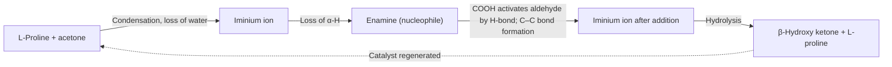
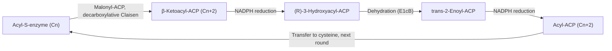

The previous chapter ([6.5.21](/6.5.21)) treated the reactions of **enols** and **enolates** as **nucleophiles** toward protons, halogens, iminium ions, and alkyl halides. This chapter treats their most important class of **electrophiles**, another carbonyl compound. Addition of an enolate to the carbonyl group of an aldehyde or ketone is the aldol reaction, addition to an ester with expulsion of the alkoxide is the Claisen condensation, and addition to the β carbon of an α,β-unsaturated carbonyl compound is the **Michael addition**. These give 1,3-dioxygenated compounds (β-hydroxy carbonyl compounds, 1,3-dicarbonyl compounds) and 1,5-dicarbonyl compounds, respectively, and are the basic methods for building carbon skeletons. We first treat these three classes of reactions and their variants (Perkin, Knoevenagel, Reformatsky, Darzens, Robinson annulation) and the asymmetric aldol reaction, then the 1,3-dicarbonyl compounds, which form enolates especially easily, and the acetoacetic ester and malonic ester syntheses based on them; next we turn to the same chemistry in biosynthesis (aldolases, the Claisen condensation of acetyl-CoA, and fatty acid synthesis), and finally organize the reactions of this chapter into rules for the **retrosynthetic analysis** of difunctional compounds. The chapter draws on the carbonyl **nucleophilic addition** and **enamines** of [6.5.16](/6.5.16#sec-16.2) ([6.5.16](/6.5.16#sec-16.9.3)), the **conjugate addition** of [6.5.17](/6.5.17#sec-17.6), the **decarboxylation** of [6.5.18](/6.5.18#sec-18.4), the **nucleophilic acyl substitution** of [6.5.19](/6.5.19#sec-19.2), and the **E1cB reaction** of [6.5.9](/6.5.9#sec-9.5.1).

## 22.1. The Aldol Reaction

### 22.1.1. Condensation Reactions and the Aldol Reaction

**Definition 22.1.1** A reaction in which two molecules combine into a larger molecule with simultaneous loss of a small molecule such as water, an alcohol, or carbon dioxide is called a **condensation reaction**.

**Definition 22.1.2 (Aldol Reaction)** The addition of the enolate (or enol) of one molecule of an aldehyde or ketone to the carbonyl group of another molecule of an aldehyde or ketone to give a β-hydroxy aldehyde or β-hydroxy ketone is called the **aldol addition**; when the β-hydroxy carbonyl compound loses water further to give an α,β-unsaturated aldehyde or ketone, the process is called the **aldol condensation**. Together they are called the **aldol reaction**. The name "aldol" is derived from *ald*ehyde and alcoh*ol*.

```smiles
CC=O.CC=O>>CC(O)CC=O
CC(O)CC=O>>C/C=C/C=O
```

Acetaldehyde in dilute NaOH at room temperature gives 3-hydroxybutanal (the "aldol"), and on heating it loses water to give (*E*)-but-2-enal (crotonaldehyde). The mechanism has three steps, each reversible:


In the aldol reaction one molecule of the carbonyl compound acts as the **nucleophile** (through its **enolate**) and another as the **electrophile**. Only a catalytic amount of base is needed, because the equilibrium concentration of enolate is very low ($\lg K \approx 14.00 - 16.7 \approx -3$ for acetaldehyde and $\ce{HO-}$, [6.5.21](/6.5.21#sec-21.1.3)) and most of the aldehyde remains in the carbonyl form, where it can serve as the electrophile. This is just the opposite of alkylation, which requires quantitative formation of the enolate.

### 22.1.2. Equilibrium and Dehydration

Aldol addition replaces a C=O π bond by a C–C σ bond, which is favorable in enthalpy, but two molecules become one, which is unfavorable in entropy. For aldehydes the equilibrium favors the product; for ketones, whose carbonyl group is more stable and whose product is more crowded, the equilibrium favors the starting material: the equilibrium mixture of acetone in base contains only a few percent of diacetone alcohol (4-hydroxy-4-methylpentan-2-one). To obtain the aldol product of a ketone, the product must be continuously removed from the equilibrium: the classical procedure is to reflux acetone in a Soxhlet extractor so that condensed acetone flows through solid $\ce{Ba(OH)2}$ catalyst held in the thimble, and the diacetone alcohol formed flows back into the flask, away from the catalyst, where it can no longer decompose.

On heating, the β-hydroxy carbonyl compound loses water to give an α,β-unsaturated aldehyde or ketone conjugated with the carbonyl group. Conjugation and the entropy of the released water molecule make dehydration thermodynamically very favorable and pull the whole equilibrium toward the product; the aldol reaction of ketones therefore generally gives the condensation product directly on heating. Dehydration under basic conditions is an **E1cB reaction** ([6.5.9](/6.5.9#sec-9.5.1), where the mechanism of dehydration of 4-hydroxy-4-methylpentan-2-one is shown): base first removes the acidic α-H to give the enolate, and the enolate then expels the β-$\ce{HO-}$. Hydroxide is normally a very poor **leaving group**; it can leave here because the conjugated system formed is stable and because the **carbanion** before departure is already stabilized by the carbonyl group. Dehydration under acidic conditions goes through the **enol**: the β-hydroxyl group is protonated and leaves as water (**E1** or **E2** type). The product is mainly the less hindered, more stable (*E*) isomer; when conjugation with an aromatic ring is possible (condensation of benzaldehyde), dehydration is easier and occurs even at room temperature.

### 22.1.3. The Retro-Aldol Reaction

**Definition 22.1.3** The cleavage of the $\mathrm{C}_\alpha$–$\mathrm{C}_\beta$ bond of a β-hydroxy carbonyl compound under base (or acid) catalysis to give two molecules of carbonyl compound, that is, the reverse of aldol addition, is called the **retro-aldol reaction**.

The mechanism is the reverse of the forward process: the β-hydroxyl group is deprotonated to the alkoxide, the lone pair of the alkoxide pushes back to re-form C=O, and the enolate is expelled as the leaving group. The decomposition of diacetone alcohol to acetone on heating with a little NaOH is a retro-aldol reaction; in systems for which the aldol is thermodynamically unfavorable (ketones, high temperature) the reverse reaction limits the yield of aldol products. The retro-aldol reaction is important in biochemistry: the cleavage of fructose 1,6-bisphosphate to two three-carbon sugars by aldolase in glycolysis (Section 22.10.1) is essentially a retro-aldol reaction.


## 22.2. Crossed and Intramolecular Aldol Reactions

### 22.2.1. The Problem of Crossed Aldol Reactions

When two different aldehydes that both have α-H and can form **enols** are mixed in base, each can act as the **nucleophile** and each as the **electrophile**, so four aldol products are obtained (plus their dehydration products and stereoisomers). Condensation of a mixture of acetaldehyde and propanal gives a mixture of 3-hydroxybutanal, 3-hydroxy-2-methylpentanal, 3-hydroxypentanal, and 3-hydroxy-2-methylbutanal, which has no practical value. To obtain a single crossed product, one component must act only as the nucleophile and the other only as the electrophile.

### 22.2.2. Strategies for a Single Product

Strategy one: one component cannot enolize. Formaldehyde, aromatic aldehydes such as benzaldehyde, 2,2-dimethylpropanal, furfural, and glyoxylate esters have no α-H and can act only as electrophiles; moreover, aldehydes are more reactive than ketones and are attacked preferentially as electrophiles.

**Definition 22.2.1** The crossed aldol condensation, in base (NaOH or KOH in ethanol), of an aromatic aldehyde that has no α-H with an aldehyde or ketone that has an α-H is called the **Claisen–Schmidt condensation**.

```smiles
O=Cc1ccccc1.CC(C)=O>>CC(=O)/C=C/c1ccccc1
O=Cc1ccccc1.CC(=O)c1ccccc1>>O=C(/C=C/c1ccccc1)c1ccccc1
```

Benzaldehyde and acetone give (*E*)-4-phenylbut-3-en-2-one (benzylideneacetone), and with excess benzaldehyde both sides condense to give dibenzylideneacetone; with acetophenone the product is chalcone. In practice the enolizable component is added slowly to a mixture of the non-enolizable aldehyde and base, so that as soon as it forms its **enolate** it meets a large excess of the aromatic aldehyde and has little chance of self-condensation; self-condensation of ketones is unfavorable anyway. The product is conjugated with the aromatic ring, dehydration is spontaneous, and the product often crystallizes from the solution.

The crossed aldol reaction of formaldehyde is used industrially to make pentaerythritol: acetaldehyde and excess formaldehyde in $\ce{Ca(OH)2}$ undergo aldol addition at the three α-H of acetaldehyde in turn with three molecules of formaldehyde to give tris(hydroxymethyl)acetaldehyde $\ce{(HOCH2)3CCHO}$; this has no α-H and undergoes a crossed **Cannizzaro reaction** (Definition 17.4.1) with a fourth molecule of formaldehyde, in which formaldehyde is oxidized to formate and the trihydroxymethylacetaldehyde is reduced to pentaerythritol $\ce{C(CH2OH)4}$. Pentaerythritol is used in alkyd resins, in polyol esters for synthetic lubricants, and in the explosive pentaerythritol tetranitrate, and it is also the tetrafunctional core for building dendrimers.

Strategy two: form the enolate of one component quantitatively beforehand. LDA at $-78$ °C converts a ketone (or ester) completely to the lithium enolate, and the aldehyde is then added: there is no undeprotonated ketone in solution, so the enolate can attack only the added aldehyde, and the low temperature prevents the adduct from undergoing the reverse reaction and dehydration, giving the β-hydroxy ketone (the directed aldol reaction).

```smiles
CC(=O)C(C)(C)C.O=CC1CCCCC1>>CC(C)(C)C(=O)CC(O)C1CCCCC1
```

Strategy three: use an enol equivalent. A **silyl enol ether** reacts with an aldehyde under activation by a **Lewis acid** (the Mukaiyama aldol reaction, Section 22.6.2), and the **enamine** or **imine** of an aldehyde acts as the nucleophilic component (Section 22.6.3).

### 22.2.3. Intramolecular Aldol Reactions

When a molecule contains two carbonyl groups, the intramolecular aldol reaction is much faster than the intermolecular one (less loss of entropy on ring formation) and gives mainly the least strained five- or six-membered ring. Because every step is reversible, the product is under **thermodynamic control**: even if other rings can form, the system finally drifts to the most stable five- or six-membered cyclic α,β-unsaturated ketone.

```smiles
CC(=O)CCC(C)=O>>CC1=CC(=O)CC1
CC(=O)CCCC(C)=O>>CC1=CC(=O)CCC1
```

Hexane-2,5-dione gives only 3-methylcyclopent-2-en-1-one in base: the enolate at C1 (the methyl group) attacks the carbonyl group at C5 to form a five-membered ring; attack of the enolate at C3 on C5 could form only a three-membered ring, which is too strained, and even if it formed it would return to the starting material by a retro-aldol reaction. Heptane-2,6-dione likewise gives only the six-membered 3-methylcyclohex-2-en-1-one, not a four-membered ring. The intramolecular aldol condensation is the standard method for the synthesis of five- and six-membered cyclic α,β-unsaturated ketones and is also the second step of the Robinson annulation (Section 22.5.2).


## 22.3. The Claisen and Dieckmann Condensations

### 22.3.1. The Claisen Condensation

The **enolate** of an ester can also attack the carbonyl group of another molecule of ester. Unlike that of an aldehyde or ketone, the **tetrahedral intermediate** of an ester can expel the alkoxide and re-form C=O; the result is **nucleophilic acyl substitution** ([6.5.19](/6.5.19#sec-19.2.1)), and the product is a β-keto ester.

**Definition 22.3.1 (Claisen Condensation)** The condensation of two molecules of an ester that has α-H under the action of a sodium alkoxide, in which the α carbon of one ester replaces the alkoxy group of the other to give a β-keto ester (3-oxo carboxylate), is called the **Claisen condensation** (Claisen 1887).

```smiles
CCOC(C)=O.CCOC(C)=O>>CCOC(=O)CC(C)=O.CCO
```

Ethyl acetate condenses under sodium ethoxide to give ethyl acetoacetate (ethyl 3-oxobutanoate). The mechanism:


Several points about this mechanism are worth noting:

- The overall equilibrium of the first three steps (**enolization**, addition, elimination) is unfavorable: the α-H of ethyl acetate ($\mathrm{p}K_{\mathrm{a}}$ about 25) is much weaker than ethanol (15.9), so the concentration of enolate is very low, and formation of the β-keto ester is itself endothermic. What drives the reaction is the last step: the product β-keto ester has $\mathrm{p}K_{\mathrm{a}}$ 10.7, about 5 units more acidic than ethanol, and is deprotonated quantitatively by ethoxide ($K \approx 10^5$). One equivalent of sodium alkoxide must therefore be used; it is consumed in the reaction as the sodium salt of the β-keto ester, and the mixture must be acidified at the end.
- Hence the α carbon of the ester must carry at least two H: one is lost in the condensation, and the other remains between the two carbonyl groups in the product for the final deprotonation. Ethyl 2-methylpropanoate has only one α-H and does not undergo Claisen condensation with sodium ethoxide (even if the product ethyl 2,2,4-trimethyl-3-oxopentanoate were formed, it would undergo retro-Claisen cleavage in sodium ethoxide, Section 22.7.2).
- The alkyl group of the alkoxide must be the same as the alkoxy group of the ester (sodium ethoxide for ethyl esters); otherwise **transesterification** occurs and mixed esters are obtained. NaOH cannot be used, since it would bring about **saponification** of the ester to the unreactive carboxylate.
- The similarly named **Claisen rearrangement** (Definition 12.5.3) is the [3,3]-sigmatropic shift of an allyl vinyl ether and has nothing to do with the Claisen condensation except that both were discovered by the same chemist.

### 22.3.2. The Dieckmann Condensation

**Definition 22.3.2 (Dieckmann Condensation)** The intramolecular Claisen condensation between two ester groups in the same molecule, giving a cyclic β-keto ester, is called the **Dieckmann condensation** (Dieckmann 1894).

```smiles
CCOC(=O)CCCCC(=O)OCC>>CCOC(=O)C1CCCC1=O
CCOC(=O)CCCCCC(=O)OCC>>CCOC(=O)C1CCCCC1=O
```

Diethyl adipate gives ethyl 2-oxocyclopentane-1-carboxylate, and diethyl pimelate gives ethyl 2-oxocyclohexane-1-carboxylate; as in the intramolecular aldol reaction, five- and six-membered rings form most readily. When the α carbons of the two ester groups are not equivalent, the product is decided by the final deprotonation: only the cyclization product that leaves an H between the two carbonyl groups can be deprotonated by the alkoxide and thereby stabilized, while the other cyclization returns reversibly to the starting material (see Question 3).

![The Dieckmann condensation of diethyl adipate. Top: the enolate of one ester attacks the carbonyl carbon of the other ester group in the same molecule, forming a five-membered ring and a cyclic tetrahedral intermediate. Bottom: the lone pair on the oxyanion re-forms C=O and ethoxide leaves, giving ethyl 2-oxocyclopentane-1-carboxylate; as in the Claisen condensation, it is then deprotonated by ethoxide between the two carbonyl groups, which drives the equilibrium, and acidification gives the neutral β-keto ester](./plots/dieckmann.py)

### 22.3.3. The Crossed Claisen Condensation

Mixing two esters that both have α-H in sodium alkoxide gives four condensation products. As with the crossed aldol reaction, there are two ways to obtain a single product:

1. One component has no α-H and can act only as the **electrophile**: ethyl formate (introducing a formyl group), diethyl carbonate (introducing an ethoxycarbonyl group), diethyl oxalate (introducing an ethoxyoxalyl group), ethyl benzoate. The ester with no α-H is used in excess. A ketone can also serve as the nucleophilic component: the α-H of a ketone is about 6 $\mathrm{p}K_{\mathrm{a}}$ units more acidic than that of an ester, so in an alkoxide or NaH the ketone enolate forms preferentially and condenses with the ester to give a 1,3-diketone or β-keto ester.

   ```smiles
   O=C1CCCCC1.CCOC(=O)OCC>>CCOC(=O)C1CCCCC1=O
   O=C1CCCCC1.CCOC=O>>O=CC1CCCCC1=O
   CC(=O)c1ccccc1.CCOC(=O)C(=O)OCC>>CCOC(=O)C(=O)CC(=O)c1ccccc1
   ```

   (In order: cyclohexanone and diethyl carbonate in NaH give ethyl 2-oxocyclohexane-1-carboxylate; with ethyl formate they give 2-formylcyclohexanone, which exists mainly as the **enol** 2-(hydroxymethylene)cyclohexanone; acetophenone and diethyl oxalate give ethyl 2,4-dioxo-4-phenylbutanoate.)

2. Form the enolate of one component quantitatively with a strong base and then add the ester (or the more reactive acyl chloride, which is often used) as the electrophile. With LDA both formation of the enolate and the addition are irreversible, and deprotonation of the product is no longer needed to drive the equilibrium, so an ester with only one α-H can also be acylated: ethyl 2-methylpropanoate is deprotonated first with LDA (or sodium triphenylmethanide) and then treated with benzoyl chloride to give ethyl 2,2-dimethyl-3-oxo-3-phenylpropanoate; with sodium ethoxide this does not work.

## 22.4. Other Condensation Reactions

The idea of the aldol and Claisen condensations, in which an activated C–H bond is deprotonated and adds to a carbonyl group, has several important named variants, which differ in the nucleophilic component and in the reagent that promotes the reaction:

| Reaction | Nucleophilic component | Electrophilic component | Reagent | Product |
|---|---|---|---|---|
| Perkin | Acid anhydride (through its **enolate**) | Aromatic aldehyde | Sodium or potassium salt of the corresponding carboxylic acid, 170–180 °C | (*E*)-β-Arylacrylic acid |
| Knoevenagel | **Active methylene compound** | Aldehyde, ketone | Weak base (piperidine, pyridine, amine salt) | α,β-Unsaturated dicarbonyl compound or acid |
| Reformatsky | α-Bromo ester + Zn (zinc enolate) | Aldehyde, ketone | Zn, inert solvent | β-Hydroxy ester |
| Darzens | α-Halo ester (through its enolate) | Aldehyde, ketone | Alkoxide, potassium *tert*-butoxide | α,β-Epoxy ester (glycidic ester) |

### 22.4.1. The Perkin Reaction

**Definition 22.4.1 (Perkin Reaction)** The condensation of an aromatic aldehyde with a carboxylic acid anhydride that has α-H, on heating in the presence of the corresponding carboxylate (or $\ce{K2CO3}$, triethylamine), to give a β-aryl-α,β-unsaturated carboxylic acid is called the **Perkin reaction** (Perkin 1868).

```smiles
O=Cc1ccccc1.CC(=O)OC(C)=O>>O=C(O)/C=C/c1ccccc1
O=Cc1ccccc1O.CC(=O)OC(C)=O>>O=c1ccc2ccccc2o1
```

Benzaldehyde, acetic anhydride, and sodium acetate react at 180 °C to give (*E*)-cinnamic acid; in the Perkin reaction of salicylaldehyde the *o*-hydroxycinnamic acid formed (the *cis* isomer) immediately lactonizes to give coumarin (Perkin discovered the reaction through his synthesis of coumarin). Acetate acts as the base to form the enolate of the anhydride; this adds to the aldehyde, and the alkoxide formed is acetylated intramolecularly by the neighboring anhydride (**acyl transfer**); **E1cB** elimination of acetate then gives the unsaturated mixed anhydride, and hydrolysis gives the product acid. The α-H of an anhydride is somewhat more acidic than that of an ester, but acetate is a weak base, so a high temperature is needed.


### 22.4.2. The Knoevenagel Condensation

**Definition 22.4.2 (Knoevenagel Condensation)** The condensation of an active methylene compound (malonate esters, malonic acid, cyanoacetate esters, acetoacetate esters, malononitrile, Meldrum's acid, and so on) with an aldehyde or ketone, catalyzed by a weak base (piperidine, pyridine, or an amine acetate), to give an alkylidene (benzylidene) derivative is called the **Knoevenagel condensation** (Knoevenagel 1894).

```smiles
O=Cc1ccccc1.CCOC(=O)CC(=O)OCC>>CCOC(=O)C(=Cc1ccccc1)C(=O)OCC
O=Cc1ccccc1.O=C(O)CC(=O)O>>O=C(O)/C=C/c1ccccc1
```

The $\mathrm{p}K_{\mathrm{a}}$ of active methylene compounds is 9–13 (Section 22.7), so a weak base such as an amine generates enough **carbanion**, whereas aldehydes hardly undergo self-aldol reaction in weak base, so the crossed product is a single one. With a secondary amine as catalyst, the amine first forms with the aldehyde an iminium ion that is more electrophilic than the aldehyde, and the amine is eliminated after addition (iminium catalysis). When malonic acid is used in pyridine (with a little piperidine), the condensation product undergoes **decarboxylation** at the same time and gives directly an α,β-unsaturated acid such as (*E*)-cinnamic acid (the Doebner modification), a mild alternative to the Perkin reaction. Ethyl acetoacetate and an aldehyde in KOH undergo Knoevenagel condensation, ester hydrolysis, and decarboxylation in one pot to give (*E*)-alkyl vinyl methyl ketones $\ce{RCH=CHCOCH3}$; acetone and an aldehyde cannot be used directly, because the aldehyde would condense with itself and acetone would react on both sides.


Knoevenagel products are very strong Michael acceptors (doubly activated alkenes) and often undergo **Michael addition** with a second **nucleophile** in situ, forming multicomponent cascade reactions.

### 22.4.3. The Reformatsky Reaction

**Definition 22.4.3 (Reformatsky Reaction)** The reaction in which an α-bromo carboxylic ester and zinc in an inert solvent (ether, benzene, THF) form an organozinc reagent (a zinc enolate), which adds to an aldehyde or ketone to give, after hydrolysis, a β-hydroxy carboxylic ester, is called the **Reformatsky reaction** (Reformatsky 1887).

```smiles
O=C1CCCCC1.CCOC(=O)CBr>>CCOC(=O)CC1(O)CCCCC1
```


The **nucleophilicity** of a zinc enolate is much weaker than that of a lithium enolate or a **Grignard reagent**: it adds to the carbonyl group of an aldehyde or ketone but does not react with an ester group, so the reagent can be generated in situ in the presence of the aldehyde or ketone without Claisen self-condensation of the ester. Magnesium cannot replace zinc: the magnesium reagent formed is too reactive and would attack the ester group of unreacted bromo ester. A further advantage of the Reformatsky reaction is that the conditions are neutral, so it is suitable for base-sensitive substrates and hindered ketones; dehydration of the β-hydroxy ester product gives an α,β-unsaturated ester.

### 22.4.4. The Darzens Reaction

**Definition 22.4.4 (Darzens Reaction)** The condensation of an aldehyde or ketone with an α-halo carboxylic ester under the action of a strong base (alkoxide, potassium *tert*-butoxide, NaH) to give an α,β-epoxy carboxylic ester (glycidic ester) is called the **Darzens reaction** (Darzens 1904).


The first step is an aldol-type addition, and the second is an intramolecular Williamson-type ether formation ([6.5.10](/6.5.10#sec-10.2.2)) giving the **epoxide**. When the glycidic ester is hydrolyzed to the acid and heated, it decarboxylates with ring opening and gives, through the enol, an aldehyde with one more carbon than the original aldehyde or ketone: cyclohexanone gives cyclohexanecarbaldehyde by Darzens reaction, hydrolysis, and decarboxylation. This is a method of chain extension.

## 22.5. Michael Addition and the Robinson Annulation

### 22.5.1. Michael Addition of Enolates

An enolate can also add to the β carbon of an α,β-unsaturated carbonyl compound; this is the **Michael addition** (for the general theory of **conjugate addition** and the competition between **1,2-addition** and **1,4-addition** see [6.5.17](/6.5.17#sec-17.6)). By the rules of [6.5.17](/6.5.17#sec-17.6.2), soft, stabilized **nucleophiles** whose addition is reversible undergo 1,4-addition, so the best Michael donors are the enolates of **1,3-dicarbonyl compounds** (and the anions of nitroalkanes and cyanoacetates), and the commonly used Michael acceptors are methyl vinyl ketone (MVK), acrolein, acrylates, acrylonitrile, nitroalkenes, and vinyl sulfones.


The Michael addition needs only a catalytic amount of base: the enolate formed in the addition is the enolate of a simple ketone ($\mathrm{p}K_{\mathrm{a}}$ about 19), much more basic than the anion of the donor (9–13), and it takes a proton from ethanol or from another molecule of donor to regenerate the catalyst. The product is a 1,5-dicarbonyl compound.

When the lithium enolate of a simple ketone is mixed with an α,β-unsaturated ketone at $-78$ °C, a mixture of 1,2-addition (aldol-type) and 1,4-addition products is often obtained, accompanied by polymerization of the acceptor; for simple aldehydes and ketones the Michael addition is therefore usually carried out with the following equivalents:

- **Enamines** (Stork, [6.5.21](/6.5.21#sec-21.8)): the pyrrolidine enamine of cyclohexanone adds to MVK, and the iminium–enolate zwitterion formed undergoes proton transfer and hydrolysis to give 2-(3-oxobutyl)cyclohexanone. An enamine is a neutral, soft nucleophile and undergoes only 1,4-addition.
- 1,3-Dicarbonyl compounds: ethyl acetoacetate or a malonate is used as the donor, and the extra ester group is then removed by hydrolysis and **decarboxylation** (Sections 22.8, 22.9).
- In a **protic solvent** with a catalytic amount of alkoxide or KOH, which makes 1,2-addition reversible so that the system finally flows to the thermodynamically stable 1,4-product.

### 22.5.2. The Robinson Annulation

**Definition 22.5.1 (Robinson Annulation)** The reaction in which the enolate (or enamine) of a ketone undergoes Michael addition to an α,β-unsaturated ketone (usually methyl vinyl ketone), and the 1,5-diketone formed then undergoes intramolecular aldol condensation to form a new cyclohex-2-en-1-one ring, is called the **Robinson annulation** (Rapson and Robinson 1935).


The Robinson annulation forms two C–C bonds and a new six-membered ring in one operation; the product is a cyclohex-2-en-1-one, which can again serve as a Michael acceptor or undergo the next annulation. It is the classical method for building the six-membered rings of steroids and terpenoids: the Robinson annulation of 2-methylcyclohexane-1,3-dione with MVK gives the Wieland–Miescher ketone, and the analogous product of 2-methylcyclopentane-1,3-dione is the Hajos–Parrish ketone; both are standard starting materials for steroid total synthesis, and the **asymmetric synthesis** of the latter is described in Section 22.6.3. MVK polymerizes readily, so in practice it is often generated in situ from its **Mannich base** or **quaternary ammonium salt** ([6.5.21](/6.5.21#sec-21.6.1)).

The Robinson annulation can use other Michael donors and acceptors. For example, chalcone (the acceptor) and ethyl acetoacetate (the donor) undergo Michael addition in KOH/ethanol, the methyl group of the acetyl group then undergoes intramolecular aldol condensation with the benzoyl group, and ester hydrolysis and decarboxylation finally give 3,5-diphenylcyclohex-2-en-1-one:

```smiles
O=C(/C=C/c1ccccc1)c1ccccc1.CCOC(=O)CC(C)=O>>O=C1C=C(c2ccccc2)CC(c2ccccc2)C1
```

In the retrosynthetic direction, a cyclohex-2-en-1-one can always be disconnected first at C2=C3 (aldol condensation) and then at the C4–C5 bond (Michael addition), giving a ketone (providing C3 and C4) and an α,β-unsaturated ketone (providing C5, C6, C1, and C2) (Section 22.11).

## 22.6. Asymmetric Aldol Reactions

Aldol addition usually creates two new **stereocenters** (the α and β carbons), and the product can be a *syn* or *anti* **diastereomer**, each of which is a pair of **enantiomers**. Control of relative and absolute configuration was one of the central problems of organic synthesis in the second half of the twentieth century, and the synthesis of polyketide natural products (macrolide antibiotics and others) depends on it.

### 22.6.1. The Zimmerman–Traxler Model

**Definition 22.6.1 (Zimmerman–Traxler Model)** The aldol addition of a metal enolate to an aldehyde goes through a chair-like six-membered cyclic transition state in which the metal is coordinated to both the enolate oxygen and the aldehyde oxygen, and the substituent of the aldehyde occupies an equatorial position to avoid 1,3-diaxial interactions. As a result a (*Z*)-enolate gives the *syn* aldol product and an (*E*)-enolate gives the *anti* aldol product. This transition state model is called the **Zimmerman–Traxler model** (1957).

The model turns the stereochemistry of the aldol reaction into a problem of **conformational analysis** ([6.5.4](/6.5.4#sec-4.5.1)): the geometry of the **enolate** determines the position of the substituent on the α carbon in the chair **transition state**, and the equatorial R of the aldehyde determines the orientation of the β carbon. The shorter the M–O bond and the more compact the transition state, the higher the selectivity: boron enolates (B–O about 140 pm) give much higher diastereoselectivity than lithium enolates (Li–O about 190 pm). Evans (1981) combined an oxazolidinone **chiral auxiliary** ([6.5.21](/6.5.21#sec-21.7.3)) with the (*Z*)-dibutylboron enolate to obtain *syn* aldol products with diastereoselectivity and enantioselectivity both above 99 : 1, known as the Evans aldol reaction.

### 22.6.2. The Mukaiyama Aldol Reaction

**Definition 22.6.2 (Mukaiyama Aldol Reaction)** The reaction in which a **silyl enol ether** (the trialkylsilyl ether $\ce{R2C=C(OSiR3)R'}$ of an enol) adds to an aldehyde or ketone activated by a Lewis acid ($\ce{TiCl4}$, $\ce{BF3*OEt2}$, chiral B, Ti, Cu, or Sn complexes), giving a β-hydroxy carbonyl compound after hydrolysis, is called the **Mukaiyama aldol reaction** (Mukaiyama 1973).

```smiles
C[Si](C)(C)OC1=CCCCC1.O=Cc1ccccc1>>O=C1CCCCC1C(O)c1ccccc1
```

The **Lewis acid** coordinates to the oxygen of the aldehyde and makes the carbonyl group strongly electrophilic; the silyl enol ether is a neutral, weak **nucleophile** (an equivalent of the **enol**) and does not react with the aldehyde in the absence of the Lewis acid, so the two components can be present together without self-condensation. This fixes completely which component is the nucleophile and which is the **electrophile**: a silyl enol ether can be prepared beforehand with defined regiochemistry and geometry ([6.5.21](/6.5.21#sec-21.3.2)). Unlike metal enolates, the Mukaiyama reaction generally goes through an open (acyclic) transition state, and there is no simple correspondence between the geometry of the silyl enol ether and the *syn*/*anti* selectivity of the product. A catalytic amount of a **chiral** Lewis acid makes the enantioselective Mukaiyama reaction possible (**asymmetric catalysis**).


### 22.6.3. Proline Catalysis and Organocatalysis

**Definition 22.6.3** The use of metal-free, usually small organic molecules as catalysts (such as proline, chiral secondary amines, thioureas, chiral phosphoric acids, and N-heterocyclic carbenes) to catalyze organic reactions is called **organocatalysis**.

In 1971 Hajos and Parrish at Hoffmann-La Roche and Eder, Sauer, and Wiechert at Schering independently found that 3 mol % of (*S*)-proline catalyzes the intramolecular aldol reaction of 2-methyl-2-(3-oxobutyl)cyclopentane-1,3-dione with an **enantiomeric excess** of 93 % in the product. This discovery was regarded as a special case for almost thirty years. List, Lerner, and Barbas (2000) showed that proline also catalyzes intermolecular aldol reactions: acetone and 4-nitrobenzaldehyde in DMSO with 30 mol % of L-proline give (*R*)-4-hydroxy-4-(4-nitrophenyl)butan-2-one (68 % yield, 76 % ee), and the reaction with isobutyraldehyde reaches 96 % ee. In the same year MacMillan introduced the iminium-catalyzed asymmetric **Diels–Alder reaction**; organocatalysis thus became the third class of asymmetric catalysis alongside metal catalysis and enzyme catalysis, and List and MacMillan received the 2021 Nobel Prize in Chemistry.

The action of proline is almost the same as that of class I aldolases (Section 22.10.1):



The secondary amine and the ketone form a nucleophilic **enamine**, the proton of the carboxylic acid forms a **hydrogen bond** with the aldehyde oxygen, fixing the aldehyde on one face of the enamine and activating it, and the C–C bond forms in a chair transition state resembling the Zimmerman–Traxler one (the computational model of Houk and List, 2003); the iminium ion formed is hydrolyzed to release the product and the catalyst. Gong and Wu (2004) designed prolinamide catalysts on this basis, in which the amide N–H and a terminal hydroxyl group hydrogen-bond to the aldehyde simultaneously and the enantioselectivity is further improved. Organocatalysts are insensitive to water and air, nontoxic, and inexpensive, and are particularly attractive in drug synthesis.

![Proline-catalyzed aldol reaction (Houk–List model, planar drawing): the enamine formed from L-proline and acetone attacks the aldehyde, with the lone pair on nitrogen pushing the π electrons of C=C to attack the carbon of the aldehyde; the carboxylic acid, hydrogen-bonded to the aldehyde oxygen, gives its proton to the alkoxide as it forms and at the same time holds the aldehyde on one face of the enamine. The iminium ion formed is hydrolyzed to release (R)-4-hydroxy-4-(4-nitrophenyl)butan-2-one and regenerate proline (Ar is 4-nitrophenyl)](./plots/proline-aldol.py)

## 22.7. 1,3-Dicarbonyl Compounds

### 22.7.1. Structure and Acidity

**Definition 22.7.1** A compound in which two carbonyl groups are separated by one carbon atom is called a **1,3-dicarbonyl compound** (also called a β-dicarbonyl compound); it includes β-diketones, β-keto acids (esters), and malonic acids (esters). More generally, a $\ce{CH2}$ between two electron-withdrawing groups (carbonyl, ester, cyano, nitro, sulfonyl) is called an active methylene group, and the corresponding compounds are called **active methylene compounds**.

The α-H between two carbonyl groups is especially acidic because the negative charge can be delocalized onto two oxygens (three **resonance structures**). The $\mathrm{p}K_{\mathrm{a}}$ values are taken from the [unified table of 6.5.3](/6.5.3#sec-3.1.4):

| Compound | $\mathrm{p}K_{\mathrm{a}}$ (water) | $\mathrm{p}K_{\mathrm{a}}$ (DMSO) |
|---|---|---|
| Acetylacetone $\ce{CH3COCH2COCH3}$ | 8.9 | 13.3 |
| Ethyl acetoacetate $\ce{CH3COCH2COOC2H5}$ | 10.7 | 14.2 |
| Malononitrile $\ce{CH2(CN)2}$ | 11.2 | 11.1 |
| Diethyl malonate $\ce{CH2(COOC2H5)2}$ | About 13 | 16.4 |
| (For comparison) acetone | 19.3 | 26.5 |

The order of acidity reflects the strength of the two electron-withdrawing groups: ketone carbonyl > ester carbonyl (the alkoxy group of an ester is electron-donating). The $\mathrm{p}K_{\mathrm{a}}$ of Meldrum's acid (2,2-dimethyl-1,3-dioxane-4,6-dione) is about 4.8 (in water), similar to acetic acid and much stronger than that of an open-chain malonate: the ring holds the two ester groups in a conformation that is uncommon for open-chain esters, and this conformational effect stabilizes the anion much more (the detailed explanation is still debated).

1,3-Dicarbonyl compounds can therefore be deprotonated essentially quantitatively by alkoxides ($\lg K$ about 3–7), and even $\ce{K2CO3}$ or amines suffice; they evolve hydrogen with sodium metal and form stable six-membered chelates with $\ce{Cu^2+}$, $\ce{Fe^3+}$, and similar ions (metal **coordination compounds** of acetylacetone, [6.1.5](/6.1.5)). The anions formed are weakly basic with moderate **nucleophilicity**, so in alkylation there is little **E2** side reaction, and they do not undergo Claisen condensation with ester groups. The keto–enol tautomerism of 1,3-dicarbonyl compounds is in [6.5.21](/6.5.21#sec-21.2.4).

### 22.7.2. Ketonic Cleavage and Acid Cleavage of β-Keto Esters

**Definition 22.7.2** The hydrolysis of a β-keto ester in dilute base (or dilute acid) to the β-keto acid, followed by decarboxylation on heating to give a methyl ketone $\ce{RCOCH3}$, is called **ketonic cleavage**; the retro-Claisen cleavage in concentrated base, giving two molecules of carboxylic acid (salt), is called **acid cleavage**.

```smiles
CCOC(=O)CC(C)=O>>CC(C)=O.O=C=O.CCO
CCOC(=O)CC(C)=O>>CC(=O)O.CC(=O)O.CCO
```

- Ketonic cleavage (for example, hydrolysis with 5 % NaOH followed by acidification and heating, or direct reflux in dilute $\ce{H2SO4}$): the ester is hydrolyzed to the β-keto acid, which undergoes **decarboxylation** through a six-membered cyclic **transition state**, first giving the enol and then tautomerizing to the ketone ([6.5.18](/6.5.18#sec-18.4.1)). Ethyl acetoacetate gives acetone; alkylated ethyl acetoacetate gives a substituted acetone.
- Acid cleavage (heating with 40 % NaOH): concentrated $\ce{HO-}$ adds directly to the ketone carbonyl group, and the **tetrahedral intermediate** expels the enolate of the ester (a stable carbanion **leaving group**); this is exactly the reverse of the Claisen condensation:


  The products of acid cleavage are acetic acid and substituted acetic acids, but substituted acetic acids are better prepared by the malonic ester synthesis (Section 22.9), so the acetoacetic ester synthesis mainly uses ketonic cleavage. A β-keto ester that lacks two α-H and cannot be deprotonated by alkoxide also undergoes this cleavage (retro-Claisen) in alkoxide.

Hydrolysis of a malonic ester gives a substituted malonic acid, which on heating (about 150 °C) likewise decarboxylates through a cyclic transition state to give a substituted acetic acid. A mild method that avoids hydrolysis is the Krapcho dealkoxycarbonylation: a β-keto ester or malonic ester is heated to about 150 °C with LiCl (or NaCl) in DMSO containing a little water, chloride undergoes an **SN2 reaction** at the methyl or ethyl group of the ester, and the carboxylate formed decarboxylates at once, so that an ester group is removed directly.

## 22.8. The Acetoacetic Ester Synthesis

**Definition 22.8.1** The method in which the enolate of ethyl acetoacetate acts as the nucleophile toward electrophiles such as alkyl halides, acyl chlorides, and α,β-unsaturated carbonyl compounds, followed by ketonic cleavage, to prepare substituted acetones (methyl ketones) and their derivatives, is called the **acetoacetic ester synthesis**.

```smiles
CCOC(=O)CC(C)=O.CCCCBr>>CCCCC(C(C)=O)C(=O)OCC
CCCCC(C(C)=O)C(=O)OCC>>CCCCCC(C)=O
```

(Ethyl acetoacetate reacts with 1-bromobutane in sodium ethoxide to give ethyl 2-butyl-3-oxobutanoate; ketonic cleavage gives heptan-2-one.) The three steps of the synthesis are: (1) sodium alkoxide forms the **enolate**; (2) reaction with the **electrophile** (**SN2** is suitable only for methyl, primary, and reactive alkyl halides); (3) ketonic cleavage. Steps (1) and (2) can be repeated once to introduce a second alkyl group, giving $\ce{RR'CHCOCH3}$. The ester group is here an "activating group": it makes the enolate form easily and at only one carbon, and it leaves as $\ce{CO2}$ after it has done its job. Direct alkylation of the enolate of acetone runs into polyalkylation and self-condensation ([6.5.21](/6.5.21#sec-21.7.1)), which the acetoacetic ester synthesis avoids.

The retrosynthetic rule: in the target methyl ketone find the $\ce{CH3CO-C}$ unit; this acetone unit comes from ethyl acetoacetate, and the rest attached to its α carbon comes from the alkyl halide. Besides simple substituted acetones, the common variations are:

| Electrophile | Product after ketonic cleavage |
|---|---|
| RX, then R'X | $\ce{RR'CHCOCH3}$ |
| Acyl chloride RCOCl (magnesium salt or NaH, mainly C-acylation) | 1,3-Diketone $\ce{RCOCH2COCH3}$ |
| $\ce{Br(CH2)nBr}$ (2 equiv of base, $n$ = 2–5) | Cycloalkyl methyl ketone ($n = 4$: cyclopentyl methyl ketone) |
| α-Halo ketone $\ce{BrCH2COR}$ | 1,4-Diketone $\ce{CH3COCH2CH2COR}$ (can give furans and pyrroles by the Paal–Knorr reaction, Definition 25.7.1) |
| α,β-Unsaturated ketone (**Michael addition**) | 1,5-Diketone |
| Aldehyde (Knoevenagel, Section 22.4.2) | α,β-Unsaturated methyl ketone |
| 0.5 equiv of $\ce{I2}$ (oxidative coupling) | 1,4-Diketone (hexane-2,5-dione) |

This relation between 1,4-diketones and α-halo ketones is called a disconnection with "**umpolung**" in Section 22.11.

Treatment of ethyl acetoacetate with two equivalents of strong base (first NaH, then $n$-BuLi) gives the dianion deprotonated at both C2 and C4; the second anion (at the γ position, on the methyl group of the acetyl group) is both more basic and higher in **nucleophilicity** and reacts selectively at the γ position with one equivalent of alkyl halide (Weiler, 1974) to give $\ce{RCH2COCH2COOEt}$. This moves the site of reaction of ethyl acetoacetate from between the two carbonyl groups to the terminus.

## 22.9. The Malonic Ester Synthesis

**Definition 22.9.1** The method in which the enolate of diethyl malonate acts as the nucleophile toward electrophiles such as alkyl halides, followed by hydrolysis and decarboxylation, to prepare substituted acetic acids $\ce{RCH2COOH}$ and $\ce{RR'CHCOOH}$, is called the **malonic ester synthesis**.

```smiles
CCOC(=O)CC(=O)OCC.CCCCBr>>CCCCC(C(=O)OCC)C(=O)OCC
CCCCC(C(=O)OCC)C(=O)OCC>>CCCCCC(=O)O
```

(Diethyl malonate reacts with 1-bromobutane in sodium ethoxide; hydrolysis, acidification, and **decarboxylation** on heating give hexanoic acid.) The relation of the malonic ester synthesis to the acetoacetic ester synthesis is that of substituted acetic acids to substituted acetones: in the target carboxylic acid find the $\ce{-CH-COOH}$ (that is, $\ce{CH2COOH}$) unit, which comes from the malonic ester, and the rest on the α carbon comes from the alkyl halide. Why not alkylate acetic acid or ethyl acetate directly? Acetic acid is deprotonated first at O–H, and the α-H of the carboxylate is extremely difficult to remove again; ethyl acetate needs LDA to form the **enolate** and also undergoes Claisen condensation. A malonic ester is deprotonated quantitatively by alkoxide, and the product is a single compound.

Main variations:

- Two alkylations give $\ce{RR'CHCOOH}$; intramolecular dialkylation with $\ce{Br(CH2)nBr}$ and two equivalents of base gives cycloalkanecarboxylic acids (1,3-dibromopropane: cyclobutanecarboxylic acid; 1,4-dibromobutane: cyclopentanecarboxylic acid). W. H. Perkin Jr. (1883–1884) used this method to synthesize the first three- and four-membered carbocycles, at a time when such small rings were generally thought unlikely to exist.
- Two molecules of malonic ester, each monoalkylated with $\ce{CH2I2}$ or $\ce{Br(CH2)nBr}$, give after hydrolysis and decarboxylation the dicarboxylic acids $\ce{HOOC(CH2)_{n+2}COOH}$.
- Reaction with α,β-unsaturated carbonyl compounds (**Michael addition**), aldehydes (Knoevenagel condensation), and **epoxides** (ring opening, giving γ-lactones).
- Alkylation of diethyl acetamidomalonate followed by hydrolysis and decarboxylation gives racemic α-amino acids: with benzyl chloride, phenylalanine ([6.5.33](/6.5.33)).
- Without hydrolysis, condensation with urea gives barbiturates: diethyl diethylmalonate and urea in sodium ethoxide give barbital (5,5-diethylbarbituric acid, [6.5.20](/6.5.20#sec-20.5.3)).

The limitation common to both syntheses comes from **SN2**: tertiary alkyl halides, vinyl halides, and aryl halides cannot be used as alkylating agents, and the yields with secondary alkyl halides are lower.

## 22.10. Condensation Reactions in Biosynthesis

Carbon–carbon bond formation in living organisms relies mainly on the three classes of reactions of this chapter: the aldol reaction, the Claisen condensation, and the **Michael addition**. Enzymes carry out these reactions in nearly neutral aqueous solution at room temperature, which poses a chemical problem: the α-H of a carbonyl compound has $\mathrm{p}K_{\mathrm{a}}$ of about 19–25, whereas the conjugate acids of the bases in the active site of an enzyme (the carboxylates of Asp and Glu, the imidazole of His, the amino group of Lys) have $\mathrm{p}K_{\mathrm{a}}$ of only 4–10, so thermodynamically only a very small amount of **enolate** can form. Biochemistry has three solutions: converting the carbonyl group into a stronger electron sink (a protonated **imine**), stabilizing the enolate by metal ions or **hydrogen bonds**, and using thioesters in place of oxygen esters.

### 22.10.1. Aldolases

*Aldolases* catalyze the aldol reaction and its reverse. In glycolysis fructose-1,6-bisphosphate aldolase cleaves fructose 1,6-bisphosphate to dihydroxyacetone phosphate (DHAP) and glyceraldehyde 3-phosphate, and in gluconeogenesis it catalyzes the reverse reaction; chemically this is a retro-aldol reaction (Definition 22.1.3): in the open-chain form of fructose the C4 hydroxyl group is the "β-hydroxy group", the C2 ketone carbonyl is the "carbonyl group", and the bond cleaved is C3–C4.

- Class I aldolases (animals and plants): the ε-amino group of a lysine in the active site (Lys229 in rabbit muscle aldolase) forms a protonated Schiff base (iminium ion, [6.5.16](/6.5.16#sec-16.9.1)) with the ketone carbonyl group of the substrate. After the C4 hydroxyl group is deprotonated, the C3–C4 bond breaks and the electrons flow into the positively charged iminium ion, a much stronger electron sink than a neutral carbonyl group; what is formed is a neutral **enamine** and not a high-energy enolate. After glyceraldehyde 3-phosphate is released, the enamine is protonated at C3 and the iminium ion is hydrolyzed, releasing DHAP. The reverse (synthetic) direction is the aldol addition of the enamine to an aldehyde, with the same mechanism as proline catalysis (Section 22.6.3). Evidence for the Schiff base intermediate came from sodium borohydride trapping experiments (Horecker and coworkers, 1962): when $\ce{NaBH4}$ is added in the presence of substrate the imine is reduced to a stable secondary amine and the enzyme is irreversibly inactivated; hydrolysis then gives a lysine attached to the three-carbon unit of DHAP.
- Class II aldolases (bacteria and fungi): use $\ce{Zn^2+}$ as a **Lewis acid** that coordinates to the carbonyl oxygen of the substrate, acidifies the α-H, and stabilizes the enolate formed (a zinc enolate, similar to the Reformatsky reagent).

![Cleavage of the C–C bond by a class I aldolase (fructose-1,6-bisphosphate aldolase): the ketone carbonyl group at C2 of the substrate forms a protonated Schiff base (iminium ion) with a lysine of the active site; after the C4 hydroxyl group is deprotonated, the alkoxide re-forms C=O, the C3–C4 bond breaks and the electrons flow into the iminium ion, giving glyceraldehyde 3-phosphate and a neutral enamine; the enamine is protonated at C3 and hydrolyzed to release dihydroxyacetone phosphate. R stands for CH(OH)CH₂OPO₃²⁻](./plots/aldolase.py)

Aldolases have become tools of **asymmetric synthesis**: 2-deoxyribose-5-phosphate aldolase (DERA) can add chloroacetaldehyde and two molecules of acetaldehyde in tandem and in one step gives an internal **hemiacetal** with two **stereocenters** of defined configuration, used in the industrial synthesis of the side chain of statin cholesterol-lowering drugs (atorvastatin), and the activity and stability of the enzyme have been improved further by directed evolution. Cross-linking of collagen also depends on aldol condensation: lysyl oxidase oxidizes the amino group of lysine side chains to aldehydes (allysine), and aldol condensation between two allysines gives an α,β-unsaturated aldehyde cross-link; inhibition of this enzyme (for example by β-aminopropionitrile) weakens collagen (lathyrism).

### 22.10.2. The Claisen Condensation of Thioesters: Acetyl-CoA and Fatty Acid Synthesis

The "ester" condensations in living organisms use not oxygen esters but the thioesters of coenzyme A (CoA–SH) or of acyl carrier protein (ACP), the most important being acetyl-CoA $\ce{CH3CO-SCoA}$. Thioesters have two chemical properties suited to this purpose (general properties of thioesters are in [6.5.19](/6.5.19#sec-19.9.1)):

- The α-H is more acidic: the 3p lone pair of S overlaps poorly with π* of C=O, so the carbonyl group of a thioester receives less resonance donation than that of an oxygen ester and its ability to accept the negative charge of the α carbon is closer to that of a ketone. The α-H of ethyl thioacetate has $\mathrm{p}K_{\mathrm{a}}$ of about 21 in water, about 4 units more acidic than ethyl acetate (about 25) (Amyes and Richard, 1996).
- The carbonyl group is more electrophilic and $\ce{RS-}$ is a better **leaving group** (the $\mathrm{p}K_{\mathrm{a}}$ of a thiol is about 10, that of an alcohol about 16), so **nucleophilic acyl substitution** is easier.

Acetyl-CoA is therefore both a good nucleophilic component (easy **enolization**) and a good electrophilic component (strongly acylating). Several core reactions in which it takes part:

| Enzyme | Reaction | Type |
|---|---|---|
| Thiolase | 2 acetyl-CoA ⇌ acetoacetyl-CoA + CoASH | Claisen condensation; runs in reverse in fatty acid β-oxidation (retro-Claisen, thiolysis) |
| Citrate synthase | acetyl-CoA + oxaloacetate → citryl-CoA → citrate + CoASH | Aldol addition of the thioester enol to a ketone carbonyl group, followed by thioester hydrolysis that drives the equilibrium |
| HMG-CoA synthase | acetyl-CoA + acetoacetyl-CoA → HMG-CoA | Aldol addition; leads to cholesterol, terpenoids, and ketone bodies |
| β-Ketoacyl-ACP synthase | acyl-ACP + malonyl-ACP → β-ketoacyl-ACP + $\ce{CO2}$ | Decarboxylative Claisen condensation (**decarboxylation**) |

In citrate synthase the carboxylate of Asp removes the α-H of acetyl-CoA, and His hydrogen-bonds to the carbonyl oxygen and stabilizes the enol (or enolate) formed; this attacks the ketone carbonyl group of oxaloacetate to give citryl-CoA, and the subsequent hydrolysis of the thioester releases a large amount of free energy that makes the whole reaction irreversible.

Fatty acid synthesis extends the chain by two carbons at a time, but the two-carbon unit does not come directly from the enolate of acetyl-CoA; it comes from malonyl-CoA: acetyl-CoA carboxylase (with biotin as prosthetic group, consuming ATP) first carboxylates acetyl-CoA. In β-ketoacyl synthase the growing acyl group is bound to the thiol of a cysteine (a thioester) and the malonyl group to the phosphopantetheine of ACP; the malonyl group decarboxylates, and the thioester enolate formed immediately attacks the carbonyl group of the acyl thioester and expels the thiol of the cysteine:


This has the same logic as the malonic ester synthesis (Section 22.9) and the Knoevenagel–Doebner reaction: the carboxyl group first activates the α carbon and then leaves as $\ce{CO2}$; decarboxylation is favorable in both entropy and enthalpy and makes the otherwise reversible Claisen condensation (the thiolase reaction is close to equilibrium) irreversible, the cost being paid by the hydrolysis of ATP in the carboxylation step. The β-ketoacyl-ACP formed is reduced in turn (NADPH, ketone reduced to the (*R*)-3-hydroxy compound), dehydrated (**E1cB**, giving *trans*-2-enoyl-ACP), and reduced again (NADPH, reduction of C=C) to give the saturated acyl-ACP with two more carbons; the cycle is repeated seven times to give the palmitoyl group (C16), which is released by hydrolysis by a thioesterase.



If some or all of the reduction steps are omitted, poly-β-keto chains are obtained, which cyclize by intramolecular aldol or Claisen condensation and aromatize to give *polyketide* natural products: the poly-β-keto chain assembled from one molecule of acetyl-CoA and three molecules of malonyl-CoA gives orsellinic acid by aldol condensation between C2 and C7 and aromatization; important drugs such as erythromycin, tetracycline, and lovastatin are all made by modular or iterative polyketide synthases.

## 22.11. Retrosynthesis of Difunctional Compounds

The general method of **retrosynthetic analysis** and **synthons** is in [6.5.20](/6.5.20#sec-20.8.1). The reactions of this chapter all form C–C bonds between two functional groups, so their retrosynthetic rules can be organized by the distance between the two functional groups (represented by a carbonyl group or a derivative, OH, C=C). Number the carbonyl carbon 1, the adjacent carbon 2, and so on: the carbonyl carbon is a natural electrophilic position ($a^1$), the α carbon through the **enolate** is a natural nucleophilic position ($d^2$), and the conjugated β carbon is an electrophilic position ($a^3$). When the relative positions of the two functional groups "match" these natural polarities, the disconnection corresponds directly to a reaction of this chapter:

| Target structure | Bond disconnected | Synthons and reagents | Reaction |
|---|---|---|---|
| β-Hydroxy carbonyl (1,3-dioxygenated) | $\mathrm{C}_\alpha$–$\mathrm{C}_\beta$ | Enolate + aldehyde or ketone | Aldol addition (Sections 22.1, 22.6) |
| α,β-Unsaturated carbonyl | $\mathrm{C}_\alpha$=$\mathrm{C}_\beta$ | Enolate + aldehyde or ketone, or active methylene + aldehyde | Aldol condensation, Claisen–Schmidt, Knoevenagel, Perkin |
| 1,3-Dicarbonyl | C2–C3 (between acyl group and α carbon) | Enolate + ester (or acyl chloride) | Claisen, Dieckmann, crossed Claisen (Section 22.3) |
| 1,5-Dicarbonyl | C3–C4 | Stabilized enolate (or **enamine**) + α,β-unsaturated carbonyl | **Michael addition** (Section 22.5.1) |
| Cyclohex-2-en-1-one | C2=C3, then C4–C5 | Ketone + methyl vinyl ketone | Robinson annulation (Section 22.5.2) |
| $\ce{RCH2COCH3}$, $\ce{RCH2COOH}$ | α carbon–R | $\ce{CH3COCH2-}$, $\ce{-CH2COOH}$ synthons + RX | Acetoacetic ester, malonic ester syntheses (Sections 22.8, 22.9) |
| α,β-Epoxy ester, β-hydroxy ester | $\mathrm{C}_\alpha$–$\mathrm{C}_\beta$ | α-Halo ester + aldehyde or ketone | Darzens, Reformatsky (Section 22.4) |

When the two functional groups are in a 1,2-, 1,4-, or 1,6-relationship, the natural polarities do not match: for example, after disconnection of a 1,4-dicarbonyl compound at C2–C3 both fragments need a positive charge at the α carbon (or are both nucleophilic at the α carbon), and neither fragment can be supplied by an ordinary enolate. Then one needs:

- A synthon with "abnormal polarity": an α-halo ketone (the α carbon is electrophilic, $a^2$), which combines with an enolate to give a 1,4-dicarbonyl compound (ethyl acetoacetate + α-bromo ketone, Section 22.8); acyl anion equivalents (1,3-dithiane, **cyanohydrin**, **benzoin condensation** catalyzed by N-heterocyclic **carbenes**, in which the carbonyl carbon becomes nucleophilic, $d^1$, [6.5.16](/6.5.16#sec-16.10)), used for 1,2-dioxygenated and 1,4-dicarbonyl compounds;
- or another way of forming bonds: the most convenient source of 1,6-dicarbonyl compounds is **ozonolysis** or other oxidative cleavage of cyclohexenes ([6.5.11](/6.5.11#sec-11.8.3)), and cyclohexenes can be obtained by the **Diels–Alder reaction**; Michael addition of a nitroalkane anion followed by a Nef reaction that converts the nitro group to a carbonyl group also gives 1,4-dicarbonyl compounds.

Two examples:

1. Ethyl 2-oxocyclohexane-1-carboxylate is a 1,3-dicarbonyl compound and has two disconnections: cutting the ring C1–C2 bond (between the ketone carbonyl and the α carbon) gives diethyl pimelate (Dieckmann condensation); cutting the exocyclic C–$\ce{CO2Et}$ bond gives cyclohexanone and diethyl carbonate (crossed Claisen condensation). Both routes are short, and the latter has cheaper starting materials.
2. 9-Oxodec-2-enoic acid (the (*E*) isomer, the "queen substance" of the honeybee, a pheromone) is a methyl ketone: disconnection between the $\ce{CH3CO-CH2}$ unit and the rest gives the enolate of ethyl acetoacetate and an (*E*)-hept-2-enoate ester with a terminal halogen. In the synthesis, (*E*)-7-hydroxyhept-2-enoic acid is esterified, its hydroxyl group is converted to bromide with $\ce{PBr3}$, the product is allowed to react with the sodium salt of ethyl acetoacetate, and ketonic cleavage (with simultaneous hydrolysis of the ester) gives the target.

## 22.12. Research Frontier: Catalytic Direct Aldol Reactions

The classical aldol reaction requires either stoichiometric strong base and low temperature (the directed aldol reaction) or prior preparation of a **silyl enol ether** and a stoichiometric amount of **Lewis acid** (Mukaiyama). A direction with better atom economy is the "direct catalytic asymmetric aldol reaction": the ketone or aldehyde itself is the nucleophilic component, and a catalytic amount of a **chiral** catalyst accomplishes both **enolization** and stereocontrol. Besides proline and the class I aldolase mimics above, Shibasaki's lanthanum–lithium–BINOL heterobimetallic catalyst and Trost's dinuclear zinc catalyst both supply in one catalyst molecule both a Brønsted base (generating the **enolate**) and a Lewis acid (activating the aldehyde), in the same spirit as the $\ce{Zn^2+}$ active site of class II aldolases. Another direction is the modification of aldolases by directed evolution and "artificial aldolases": Baker, Houk, and coworkers (2008) used computationally designed artificial retro-aldolases with a lysine **enamine** as the intermediate and raised their activity by several orders of magnitude by directed evolution; such work converts mechanistic understanding in organic chemistry directly into protein design.

## Summary

- The aldol reaction (Definition 22.1.2): an **enolate** adds to the carbonyl group of an aldehyde or ketone to give a β-hydroxy carbonyl compound, every step being reversible; favorable for aldehydes, unfavorable for ketones; on heating **E1cB** dehydration gives the (*E*)-α,β-unsaturated aldehyde or ketone, and dehydration pulls the equilibrium. The retro-aldol reaction (Definition 22.1.3) cleaves $\mathrm{C}_\alpha$–$\mathrm{C}_\beta$.
- Crossed aldol reactions: use an aldehyde with no α-H (Claisen–Schmidt, Definition 22.2.1), an enolate formed beforehand and quantitatively (LDA), a **silyl enol ether**, or an **enamine**, so that the roles of the two components are fixed. Intramolecular aldol reactions under **thermodynamic control** give five- and six-membered cyclic α,β-unsaturated ketones.
- The Claisen condensation (Definition 22.3.1): one equivalent of sodium alkoxide, with the alkoxy group the same as in the ester; two α-H are needed because the driving force is the deprotonation of the product β-keto ester ($\mathrm{p}K_{\mathrm{a}}$ 10.7); the Dieckmann condensation (Definition 22.3.2) forms five- and six-membered rings; the crossed Claisen condensation uses an ester without α-H or a strong base.
- Other condensations: Perkin (Definition 22.4.1), Knoevenagel (Definition 22.4.2), Reformatsky (Definition 22.4.3), Darzens (Definition 22.4.4); see the table in Section 22.4 for a comparison.
- The **Michael addition** uses stabilized donors (1,3-dicarbonyl anions, enamines) and a catalytic amount of base to give 1,5-dicarbonyl compounds; the Robinson annulation (Definition 22.5.1) = Michael addition + intramolecular aldol condensation, giving cyclohex-2-en-1-ones.
- Stereochemistry: the Zimmerman–Traxler chair **transition state** (Definition 22.6.1), (*Z*)-enolate → *syn*, (*E*) → *anti*; the Mukaiyama aldol reaction (Definition 22.6.2) uses silyl enol ethers and a **Lewis acid**; in organocatalysis (Definition 22.6.3) proline acts through an enamine, with the same mechanism as class I aldolases.

| 1,3-Dicarbonyl compounds | Key points |
|---|---|
| Acidity (Definition 22.7.1) | $\mathrm{p}K_{\mathrm{a}}$ 9–13; alkoxide deprotonates quantitatively; the anion is nucleophilic but weakly basic |
| Cleavage (Definition 22.7.2) | Ketonic cleavage: hydrolysis + decarboxylation through a cyclic transition state → methyl ketone; acid cleavage: retro-Claisen in concentrated base → two molecules of acid; Krapcho dealkoxycarbonylation |
| Acetoacetic ester synthesis (Definition 22.8.1) | Alkylation/acylation + ketonic cleavage → $\ce{RR'CHCOCH3}$, 1,3-, 1,4-, and 1,5-diketones; the dianion reacts at the γ position |
| Malonic ester synthesis (Definition 22.9.1) | Alkylation + hydrolysis and decarboxylation → $\ce{RR'CHCOOH}$, cycloalkanecarboxylic acids, dicarboxylic acids, amino acids, barbiturates |

- Biosynthesis: class I aldolases use the Schiff base of lysine as an electron sink (enamine intermediate), class II use $\ce{Zn^2+}$; the thioester of acetyl-CoA makes the α-H more acidic and the acyl group more reactive; fatty acid and polyketide synthesis use the decarboxylative Claisen condensation of malonyl thioesters, which makes C–C bond formation irreversible.
- **Retrosynthesis** (Section 22.11): difunctional compounds with 1,3- and 1,5-relationships are disconnected directly by aldol, Claisen, and Michael reactions; the 1,2-, 1,4-, and 1,6-relationships need synthons with **umpolung** or oxidative cleavage.

## Questions

1. Write the main products of the following reactions: (a) propanal heated in aqueous NaOH; (b) cyclohexanone heated in NaOEt/EtOH; (c) 2 equiv of benzaldehyde and 1 equiv of acetone in NaOH/ethanol; (d) 2,2-dimethylpropanal and propanal (added slowly) in NaOH.

   **Answer** (a) Self-aldol condensation: (*E*)-2-methylpent-2-enal. The **enolate** of propanal (C2) attacks the carbonyl group of a second molecule of propanal to give 3-hydroxy-2-methylpentanal, which dehydrates on heating by **E1cB**. (b) 2-(Cyclohex-1-en-1-yl)cyclohexan-1-one (and the conjugated 2-cyclohexylidenecyclohexanone): the aldol equilibrium of a ketone is unfavorable, but dehydration on heating drives the reaction. (c) (1*E*,4*E*)-1,5-Diphenylpenta-1,4-dien-3-one (dibenzylideneacetone): the methyl groups on the two sides of acetone undergo Claisen–Schmidt condensation with benzaldehyde in turn. (d) Mainly (*E*)-2,4,4-trimethylpent-2-enal: 2,2-dimethylpropanal has no α-H and acts only as the **electrophile**; propanal is added slowly, which reduces self-condensation. Because the carbonyl group of 2,2-dimethylpropanal is hindered and less reactive, self-condensation products of propanal still form as by-products, and the result is poorer than the Claisen–Schmidt condensation with benzaldehyde.

2. The compound DPHP is (*E*)-3-[4-(di-*p*-tolylamino)phenyl]-1-(1-hydroxynaphthalen-2-yl)prop-2-en-1-one, a molecule used in two-photon fluorescence imaging. Design its synthesis by aldol condensation, indicate the aldehyde, ketone, and base required, and explain why a mixture of crossed products is not formed.

   **Answer** Disconnect at the C=C of the α,β-unsaturated ketone (aldol condensation): the nucleophilic component is 1-(1-hydroxynaphthalen-2-yl)ethan-1-one (2-acetyl-1-naphthol, whose α methyl group provides the enolate), and the electrophilic component is 4-(di-*p*-tolylamino)benzaldehyde. Claisen–Schmidt condensation in KOH or NaOH in ethanol, with dehydration on heating, gives the (*E*)-chalcone-type product. The aldehyde has no α-H and can act only as the electrophile; the ketone can condense with itself, but a ketone is far less reactive than an aldehyde as an electrophile, and self-condensation is thermodynamically unfavorable; the product is conjugated with two aromatic rings, dehydration is spontaneous, and the equilibrium lies completely on the side of the target. The phenolic OH is deprotonated first in strong base, so an excess of base is used; the phenoxide does not interfere with the reaction because of the intramolecular **hydrogen bond** and conjugation.

3. Diethyl 2-methylheptanedioate $\ce{EtO2CCH(CH3)(CH2)4CO2Et}$ undergoes Dieckmann condensation in sodium ethoxide. What are the two possible cyclization products? Which one is actually obtained, and why?

   **Answer** (i) The enolate at C6 (the unsubstituted side) attacks the ester carbonyl at C1 to give ethyl 3-methyl-2-oxocyclohexane-1-carboxylate: the ester group and the methyl group are on the two sides of the ketone carbonyl group, and C1 (between the two carbonyl groups) still bears an H. (ii) The enolate at C2 (the side bearing the methyl group) attacks the ester carbonyl at C7 to give ethyl 1-methyl-2-oxocyclohexane-1-carboxylate; the carbon between the two carbonyl groups is quaternary and has no H. Only (i) is actually obtained. Both cyclizations are reversible in themselves, and what drives the Claisen condensation is the deprotonation of the C–H between the two carbonyl groups in the product; (ii) lacks this H, cannot be converted by alkoxide to a stable anion, and returns to the starting material by retro-Claisen cleavage in alkoxide, so everything finally flows to (i), which can be deprotonated. If the enolate is instead formed beforehand with LDA at $-78$ °C, the selectivity is determined by kinetics.

4. 3-Ethylcyclopent-2-en-1-one is converted to its isomer 2,3-dimethylcyclopent-2-en-1-one on heating in aqueous NaOH. Write a plausible mechanism.

   **Answer** (1) $\ce{HO-}$ undergoes **conjugate addition** to the β carbon (C3) of the α,β-unsaturated ketone, and protonation of the enolate gives 3-ethyl-3-hydroxycyclopentan-1-one. (2) This is a β-hydroxy ketone: after the hydroxyl group is deprotonated, a retro-aldol reaction breaks the C2–C3 bond and opens the ring to give heptane-2,5-dione (C2 becomes the methyl of the methyl ketone, C3 the carbonyl carbon of the ethyl ketone). (3) Heptane-2,5-dione undergoes the other intramolecular aldol reaction: the $\ce{CH2}$ on the ethyl ketone side (the methylene of the ethyl group) forms an enolate and attacks the carbonyl group of the methyl ketone, forming a new five-membered ring, 3-hydroxy-2,3-dimethylcyclopentanone. (4) E1cB dehydration gives 2,3-dimethylcyclopent-2-en-1-one. The net result is that one carbon has been moved from inside the ring to outside it. The C=C of the product carries two substituents (a tetrasubstituted alkene) and is more stable than that of the starting material (trisubstituted), so the equilibrium favors the product; the whole process is under **thermodynamic control**.

5. Ethyl 2-oxocyclohexane-1-carboxylate can be synthesized by two routes (Section 22.11). Give the reaction conditions for each, and explain why, in the second route, cyclohexanone acts as the nucleophilic component and diethyl carbonate as the electrophilic component without self-condensation of diethyl carbonate or self-aldol condensation of cyclohexanone.

   **Answer** Route a: diethyl pimelate, NaOEt/EtOH at reflux (Dieckmann condensation), then acidification with dilute acid. Route b: cyclohexanone and excess diethyl carbonate, NaH (or NaOEt), heating, acidification. Diethyl carbonate has no α-H, cannot form an enolate, and can act only as the electrophile, so it cannot condense with itself; its carbonyl group is subject to resonance donation from two alkoxy groups and is less electrophilic than a ketone, but in large excess the enolate of cyclohexanone meets it far more often than another molecule of cyclohexanone. More important is thermodynamics: the self-aldol reaction of cyclohexanone is reversible and unfavorable, whereas the β-keto ester formed by condensation with diethyl carbonate is deprotonated quantitatively by the base ($\mathrm{p}K_{\mathrm{a}}$ about 11), and the reaction is pulled toward this product.

6. Using the acetoacetic ester or malonic ester synthesis, with suitable alkyl halides and other necessary reagents, synthesize: (a) 3-methylpentan-2-one; (b) 4-phenylbutan-2-one; (c) cyclobutanecarboxylic acid; (d) 2-methylbutanoic acid; (e) hexane-2,5-dione.

   **Answer** (a) Ethyl acetoacetate, NaOEt, $\ce{CH3CH2Br}$; then NaOEt, $\ce{CH3I}$; hydrolysis with dilute NaOH, acidification and heating for **decarboxylation** give $\ce{CH3COCH(CH3)CH2CH3}$. (b) Ethyl acetoacetate, NaOEt, benzyl bromide; ketonic cleavage gives $\ce{CH3COCH2CH2C6H5}$; benzyl bromide is a reactive alkyl halide and the alkylation gives a high yield. (c) Diethyl malonate, 2 equiv of NaOEt, 1,3-dibromopropane, intramolecular dialkylation to give diethyl cyclobutane-1,1-dicarboxylate; hydrolysis and decarboxylation on heating give cyclobutanecarboxylic acid. (d) Diethyl malonate, NaOEt, $\ce{CH3CH2Br}$; NaOEt, $\ce{CH3I}$; hydrolysis and decarboxylation give $\ce{CH3CH2CH(CH3)COOH}$. (e) A 1,4-diketone is a structure with mismatched polarity: the sodium salt of ethyl acetoacetate reacts with chloroacetone (an α-halo ketone, electrophilic α carbon) to give ethyl 2-acetyl-4-oxopentanoate, and ketonic cleavage gives $\ce{CH3COCH2CH2COCH3}$; alternatively the sodium salt of ethyl acetoacetate is coupled oxidatively with 0.5 equiv of $\ce{I2}$, followed by two ketonic cleavages.

7. Design Robinson annulations for the following compounds and write the starting materials required: (a) 4,4a,5,6,7,8-hexahydronaphthalen-2(3*H*)-one (Δ1,9-octalin-2-one); (b) 4a-methyl-4,4a,5,6,7,8-hexahydronaphthalen-2(3*H*)-one; (c) 4-ethylcyclohex-2-en-1-one. For (b), under what conditions should 2-methylcyclohexanone form its enolate?

   **Answer** (a) Cyclohexanone + methyl vinyl ketone: the enolate of cyclohexanone (or its pyrrolidine enamine) undergoes **Michael addition** to give 2-(3-oxobutyl)cyclohexanone, followed by intramolecular aldol condensation (the side-chain methyl attacks the ring carbonyl) and dehydration. (b) 2-Methylcyclohexanone + MVK, which must react at C2, the carbon bearing the methyl group, that is, through the **thermodynamic enolate**: a catalytic amount of alkoxide or KOH in a **protic solvent** (or MVK generated in situ from its **Mannich base**) lets the two enolates equilibrate; with LDA or an enamine the reaction would take place at C6 and give a product without the angular methyl group. (c) Disconnect the aldol at C=C (C2=C3), with C3 coming from an aldehyde group; then disconnect the Michael addition at C4–C5 to give butanal (the donor, whose α carbon bears the ethyl side chain) and MVK (the acceptor). The enolate of butanal would condense with itself, so the pyrrolidine enamine of butanal is used in a Stork–Michael addition with MVK, and hydrolysis gives 2-ethyl-5-oxohexanal, which undergoes intramolecular aldol condensation in base (the methyl of the methyl ketone attacks the aldehyde group) and dehydration to give 4-ethylcyclohex-2-en-1-one.

8. In the transformation below, compound 1 (a ketene dithioacetal, with a styryl group on one side of the carbonyl group) reacts with diethyl malonate in $\ce{K2CO3}$ to give the cyclohex-2-enone 2. Write a plausible mechanism.

   ```smiles
   Cc1ccc(/C=C/C(=O)C(C(=O)Nc2ccc(Cl)cc2)=C(SCC)SCC)cc1 1
   CCOC(=O)C1(C(=O)OCC)C(c2ccc(C)cc2)CC(=O)C(C(=O)Nc2ccc(Cl)cc2)=C1SCC 2
   ```

   **Answer** (1) $\ce{K2CO3}$ deprotonates diethyl malonate ($\mathrm{p}K_{\mathrm{a}}$ about 13). (2) The malonate anion undergoes Michael addition to the β carbon of the styryl ketone (the carbon bearing the aryl group), and the enolate formed is protonated. (3) The malonate unit after addition still has one acidic C–H, which is deprotonated again; this **carbanion** attacks, intramolecularly, the β carbon of the ketene dithioacetal (the carbon bearing the two SEt groups); the addition produces a carbanion stabilized jointly by the ketone and amide carbonyl groups, which expels $\ce{EtS-}$ and re-forms the C=C (addition–elimination, that is, nucleophilic substitution at an alkenyl carbon). (4) The new ring consists of six atoms: the ketone carbonyl carbon, the former α-$\ce{CH2}$, the CH bearing the aryl group, the quaternary carbon $\ce{C(CO2Et)2}$, the alkene carbon bearing SEt, and the alkene carbon bearing the amide group; the C=C between the last two is conjugated with the ketone carbonyl group. The β carbon of the ketene dithioacetal is electron-poor because of the two carbonyl groups and SEt is a good **leaving group**, which is why this system is widely used in heterocycle and carbocycle synthesis.

9. Explain: (a) the Claisen condensation with sodium ethoxide needs one equivalent of base rather than a catalytic amount, whereas the Michael addition needs only a catalytic amount; (b) fatty acid synthesis uses malonyl-CoA rather than a second molecule of acetyl-CoA as the nucleophilic component; (c) class I aldolases convert the substrate to an iminium ion during the reaction.

   **Answer** (a) The product of the Claisen condensation, the β-keto ester ($\mathrm{p}K_{\mathrm{a}}$ 10.7), is more acidic than ethanol (15.9) and is deprotonated quantitatively by ethoxide, so the base is consumed; and it is this step that drives the unfavorable equilibrium. The product of the Michael addition is an ordinary ketone ($\mathrm{p}K_{\mathrm{a}}$ about 19), less acidic than the donor (a 1,3-dicarbonyl compound, 9–13), so the enolate formed in the addition takes a proton from the donor and the base is regenerated. (b) The Claisen condensation of two molecules of acetyl-CoA (the thiolase reaction) is close to equilibrium and cannot extend the carbon chain efficiently; moreover acetyl-CoA forms its **enol** very slowly under neutral conditions. Decarboxylation of the malonyl thioester produces the thioester enolate under mild conditions, supplying the nucleophilic carbon exactly where it is needed; the release of $\ce{CO2}$ makes the condensation irreversible, and the free energy spent comes from the hydrolysis of ATP in the preceding carboxylation. This is the same idea as the "activating group leaves as $\ce{CO2}$ at the end" of the malonic ester synthesis. (c) A protonated imine is a much stronger electron sink than a carbonyl group: when the retro-aldol cleavage takes place, the electrons of the C–C bond flow into the iminium ion and a neutral enamine is formed rather than an enolate, which is very difficult to form in neutral aqueous solution; in the synthetic direction an enamine is a far stronger **nucleophile** than the **enol** and needs no strong base. This is the same as the role of proline in organocatalysis.
